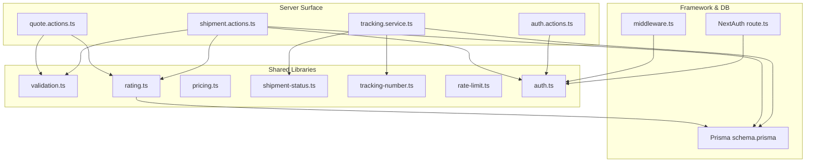
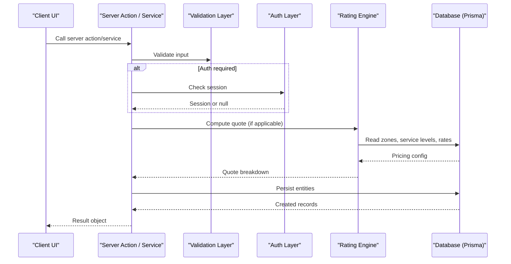
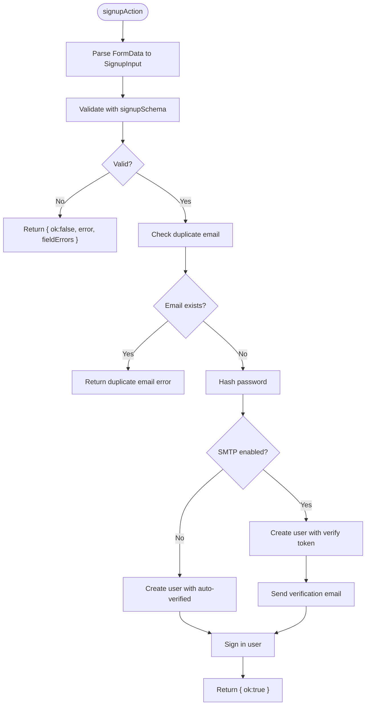
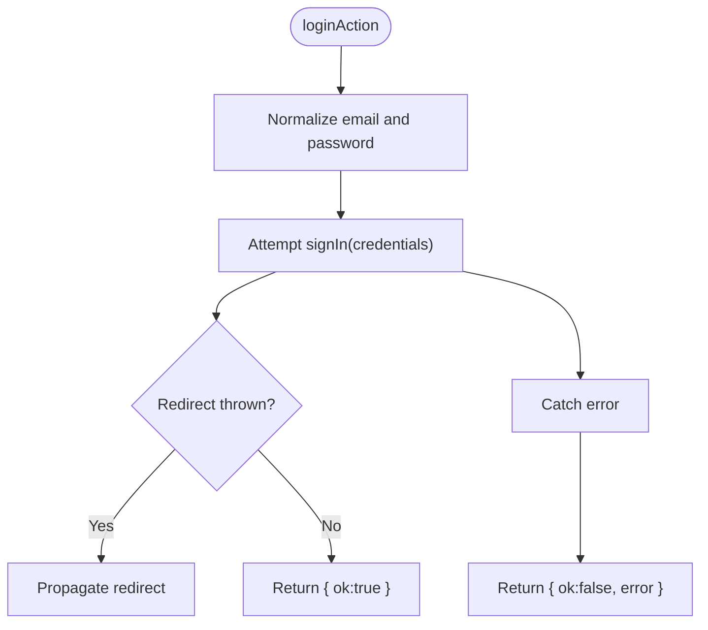
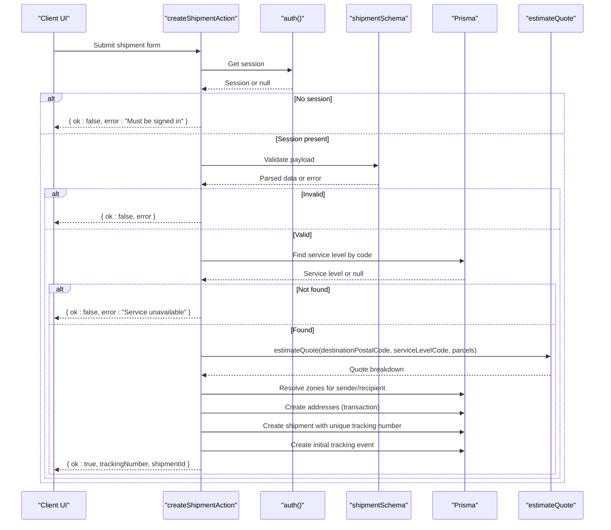
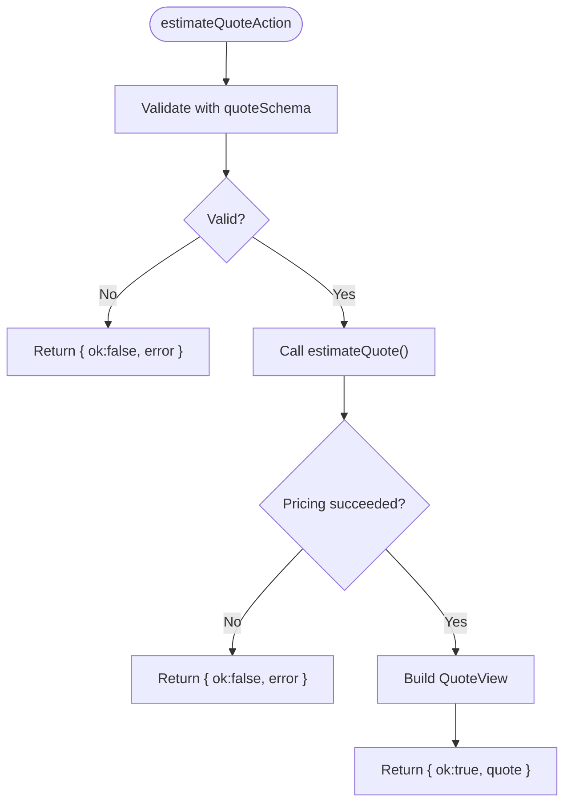
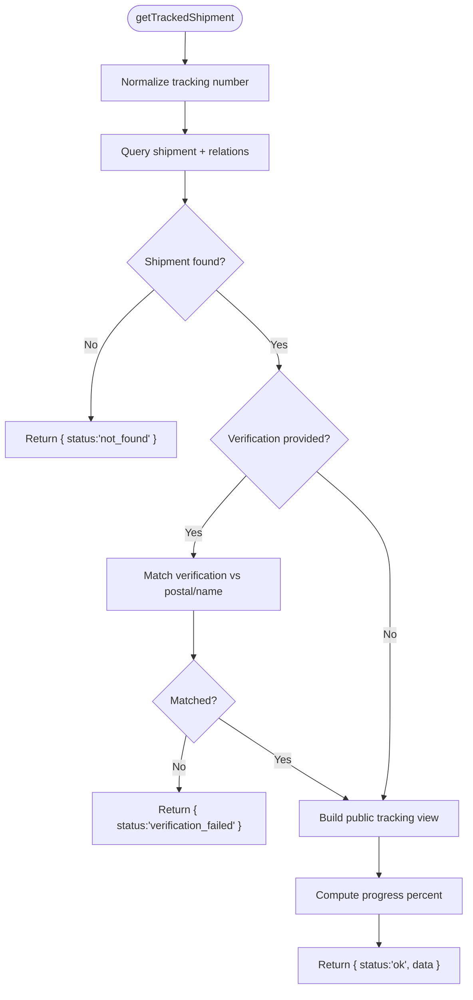
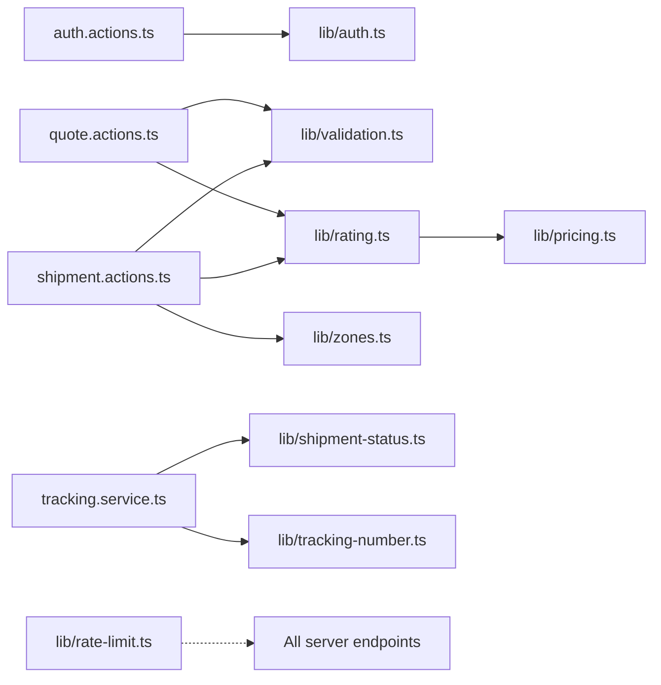

# API Reference

<cite>
**Referenced Files in This Document**
- [auth.actions.ts](file://server/auth.actions.ts)
- [shipment.actions.ts](file://server/shipment.actions.ts)
- [quote.actions.ts](file://server/quote.actions.ts)
- [tracking.service.ts](file://server/tracking.service.ts)
- [validation.ts](file://lib/validation.ts)
- [rate-limit.ts](file://lib/rate-limit.ts)
- [pricing.ts](file://lib/pricing.ts)
- [rating.ts](file://lib/rating.ts)
- [shipment-status.ts](file://lib/shipment-status.ts)
- [tracking-number.ts](file://lib/tracking-number.ts)
- [auth.ts](file://lib/auth.ts)
- [route.ts](file://app/api/auth/[...nextauth]/route.ts)
- [middleware.ts](file://middleware.ts)
- [schema.prisma](file://prisma/schema.prisma)
</cite>

## Table of Contents
1. [Introduction](#introduction)
2. [Project Structure](#project-structure)
3. [Core Components](#core-components)
4. [Architecture Overview](#architecture-overview)
5. [Detailed Component Analysis](#detailed-component-analysis)
6. [Dependency Analysis](#dependency-analysis)
7. [Performance Considerations](#performance-considerations)
8. [Troubleshooting Guide](#troubleshooting-guide)
9. [Conclusion](#conclusion)

## Introduction
This document provides comprehensive API documentation for Timberland’s server actions and services. It covers:
- Authentication actions for signup, login, and logout.
- Shipment creation with validation, pricing, address handling, and tracking event initialization.
- Quote estimation for shipping costs.
- Public shipment tracking with optional verification.
- Validation schemas, rate limiting utilities, security considerations, and performance guidance.

The APIs are implemented as Next.js Server Actions or server-only service functions. They rely on Prisma for database access, Zod for input validation, and a pure pricing engine for quote calculations.

## Project Structure
The relevant backend surface is organized into:
- `server/`: Server actions and services exposed to the frontend.
- `lib/`: Shared libraries including validation, pricing, rating, status machine, tracking number helpers, auth configuration, and rate limiting.
- `app/api/auth/[...nextauth]/route.ts`: NextAuth HTTP handlers.
- `middleware.ts`: Edge-safe authentication middleware guarding `/account`.
- `prisma/schema.prisma`: Database schema defining users, addresses, shipments, parcels, tracking events, zones, service levels, and notifications.

**Diagram sources**
- [auth.actions.ts:1-101](file://server/auth.actions.ts#L1-L101)
- [shipment.actions.ts:1-146](file://server/shipment.actions.ts#L1-L146)
- [quote.actions.ts:1-65](file://server/quote.actions.ts#L1-L65)
- [tracking.service.ts:1-147](file://server/tracking.service.ts#L1-L147)
- [validation.ts:1-87](file://lib/validation.ts#L1-L87)
- [rating.ts:1-70](file://lib/rating.ts#L1-L70)
- [pricing.ts:1-89](file://lib/pricing.ts#L1-L89)
- [shipment-status.ts:1-77](file://lib/shipment-status.ts#L1-L77)
- [tracking-number.ts:1-57](file://lib/tracking-number.ts#L1-L57)
- [auth.ts:1-42](file://lib/auth.ts#L1-L42)
- [route.ts:1-4](file://app/api/auth/[...nextauth]/route.ts#L1-L4)
- [middleware.ts:1-14](file://middleware.ts#L1-L14)
- [schema.prisma:1-261](file://prisma/schema.prisma#L1-L261)

**Section sources**
- [auth.actions.ts:1-101](file://server/auth.actions.ts#L1-L101)
- [shipment.actions.ts:1-146](file://server/shipment.actions.ts#L1-L146)
- [quote.actions.ts:1-65](file://server/quote.actions.ts#L1-L65)
- [tracking.service.ts:1-147](file://server/tracking.service.ts#L1-L147)
- [validation.ts:1-87](file://lib/validation.ts#L1-L87)
- [rate-limit.ts:1-56](file://lib/rate-limit.ts#L1-L56)
- [pricing.ts:1-89](file://lib/pricing.ts#L1-L89)
- [rating.ts:1-70](file://lib/rating.ts#L1-L70)
- [shipment-status.ts:1-77](file://lib/shipment-status.ts#L1-L77)
- [tracking-number.ts:1-57](file://lib/tracking-number.ts#L1-L57)
- [auth.ts:1-42](file://lib/auth.ts#L1-L42)
- [route.ts:1-4](file://app/api/auth/[...nextauth]/route.ts#L1-L4)
- [middleware.ts:1-14](file://middleware.ts#L1-L14)
- [schema.prisma:1-261](file://prisma/schema.prisma#L1-L261)

## Core Components
This section summarizes the primary server-side APIs and their responsibilities.

- Authentication Actions
  - Signup: Validates user data, hashes password, optionally verifies email, creates user and notification preferences, and signs in.
  - Login: Authenticates via credentials and redirects on success.
  - Logout: Signs out and redirects.

- Shipment Actions
  - Create Shipment: Requires authentication, validates payload, resolves service level, estimates quote, persists addresses and shipment, initializes tracking events, and returns tracking number and shipment ID.

- Quote Actions
  - Estimate Quote: Validates quote request, computes price using zone/service-level rules, and returns structured breakdown.

- Tracking Service
  - Get Tracked Shipment: Normalizes tracking number, fetches public tracking view, applies optional verification (postal code or recipient name token), and computes progress and timeline.

**Section sources**
- [auth.actions.ts:11-101](file://server/auth.actions.ts#L11-L101)
- [shipment.actions.ts:14-146](file://server/shipment.actions.ts#L14-L146)
- [quote.actions.ts:6-65](file://server/quote.actions.ts#L6-L65)
- [tracking.service.ts:6-147](file://server/tracking.service.ts#L6-L147)

## Architecture Overview
The system follows a layered architecture:
- Client components call server actions or service functions.
- Server actions validate inputs, enforce authentication, and orchestrate business logic.
- Shared libraries provide pure pricing, state machine rules, and helper utilities.
- Data persistence is handled through Prisma against PostgreSQL.

**Diagram sources**
- [auth.actions.ts:26-101](file://server/auth.actions.ts#L26-L101)
- [shipment.actions.ts:45-146](file://server/shipment.actions.ts#L45-L146)
- [quote.actions.ts:27-65](file://server/quote.actions.ts#L27-L65)
- [tracking.service.ts:69-147](file://server/tracking.service.ts#L69-L147)
- [rating.ts:19-61](file://lib/rating.ts#L19-L61)
- [schema.prisma:57-261](file://prisma/schema.prisma#L57-L261)

## Detailed Component Analysis

### Authentication API

#### Function: `signupAction`
- Purpose: Register a new customer account and sign them in.
- Parameters:
  - `_prev`: Previous form result (nullable).
  - `formData`: Form data containing name, email, phone, password.
- Return Type:
  - `{ ok: boolean; error?: string; fieldErrors?: Record<string, string> }`.
- Validation Rules:
  - Name: non-empty, trimmed, max length.
  - Email: valid email format, normalized lowercase.
  - Phone: optional, numeric pattern with allowed symbols, length constraints.
  - Password: minimum length, maximum length.
- Authentication Requirements: None (public endpoint).
- Error Handling:
  - Field validation errors returned as `fieldErrors`.
  - Duplicate email returns specific error and field hint.
  - On success, signs in and returns `ok: true`.
- Security Notes:
  - Passwords are hashed before storage.
  - Email verification token is generated and hashed; auto-verify when SMTP disabled.
  - Redirects after successful sign-in.

**Diagram sources**
- [auth.actions.ts:17-81](file://server/auth.actions.ts#L17-L81)
- [validation.ts:4-19](file://lib/validation.ts#L4-L19)

**Section sources**
- [auth.actions.ts:11-81](file://server/auth.actions.ts#L11-L81)
- [validation.ts:4-19](file://lib/validation.ts#L4-L19)

#### Function: `loginAction`
- Purpose: Authenticate an existing user.
- Parameters:
  - `formData`: Form data containing email and password.
- Return Type:
  - `{ ok: boolean; error?: string }`.
- Validation Rules:
  - Email normalized to lowercase and trimmed.
  - Password required.
- Authentication Requirements: None (public endpoint).
- Error Handling:
  - Invalid credentials return generic error message.
  - Next redirect thrown on success path is propagated.

**Diagram sources**
- [auth.actions.ts:83-96](file://server/auth.actions.ts#L83-L96)

**Section sources**
- [auth.actions.ts:83-96](file://server/auth.actions.ts#L83-L96)

#### Function: `logoutAction`
- Purpose: Sign out the current user.
- Parameters: None.
- Return Type: Promise resolving after sign-out.
- Authentication Requirements: User must be signed in.
- Error Handling: Delegates to NextAuth sign-out behavior.

**Section sources**
- [auth.actions.ts:98-101](file://server/auth.actions.ts#L98-L101)

#### NextAuth Integration
- Route: `GET` and `POST` handlers exported from NextAuth at `/api/auth/[...nextauth]`.
- Middleware: Guards `/account/*` routes using edge-safe NextAuth middleware.

**Section sources**
- [route.ts:1-4](file://app/api/auth/[...nextauth]/route.ts#L1-L4)
- [middleware.ts:1-14](file://middleware.ts#L1-L14)
- [auth.ts:1-42](file://lib/auth.ts#L1-L42)

### Shipment API

#### Function: `createShipmentAction`
- Purpose: Create a new shipment with validated sender/recipient addresses, parcels, and initial tracking event.
- Parameters:
  - `_prev`: Previous form result (nullable).
  - `formData`: Contains serviceLevelCode, pickupDate, notes, senderJson, recipientJson, parcelsJson.
- Return Type:
  - `{ ok: boolean; error?: string; trackingNumber?: string; shipmentId?: string }`.
- Authentication Requirements:
  - Must be signed in; otherwise returns error.
- Validation Rules:
  - Uses `shipmentSchema`:
    - serviceLevelCode: required.
    - pickupDate: optional date string.
    - notes: optional, max length.
    - sender/recipient: address schema with contactName, phone, line1, city, postalCode, country.
    - parcels: array of parcel objects with description, weightKg, pieces, optional dimensions and declaredValue.
- Business Logic:
  - Resolves service level by code; rejects if unavailable.
  - Estimates quote based on destination postal code, service level, and parcels.
  - Resolves service zones for sender and recipient postal codes.
  - Creates sender and recipient addresses within a transaction.
  - Creates shipment with unique tracking number (retry on collision).
  - Initializes first tracking event with CREATED status.
  - Fires-and-forgets notification for status change.
- Error Handling:
  - Missing or invalid parcel JSON.
  - Validation failures return error messages.
  - Unavailable service level returns error.
  - Unique constraint collision retries up to five times; otherwise throws allocation error.

**Diagram sources**
- [shipment.actions.ts:45-146](file://server/shipment.actions.ts#L45-L146)
- [validation.ts:60-67](file://lib/validation.ts#L60-L67)
- [rating.ts:19-61](file://lib/rating.ts#L19-L61)

**Section sources**
- [shipment.actions.ts:14-146](file://server/shipment.actions.ts#L14-L146)
- [validation.ts:60-67](file://lib/validation.ts#L60-L67)
- [rating.ts:19-61](file://lib/rating.ts#L19-L61)

### Quote API

#### Function: `estimateQuoteAction`
- Purpose: Calculate shipping cost and ETA for given parameters.
- Parameters:
  - `input`: Object containing serviceLevelCode, originPostalCode, destinationPostalCode, weightKg, pieces.
- Return Type:
  - Union type:
    - `{ ok: true; quote: QuoteView }`
    - `{ ok: false; error: string }`
- Validation Rules:
  - Uses `quoteSchema`:
    - serviceLevelCode: required.
    - originPostalCode: required, min length.
    - destinationPostalCode: required, min length.
    - weightKg: positive number, max limit.
    - pieces: integer, min 1, max limit.
- Business Logic:
  - Calls `estimateQuote` from rating library which resolves zone, service level, and rate rule, then computes breakdown via pricing engine.
- Error Handling:
  - Validation errors return structured error message.
  - Pricing configuration errors return descriptive error.

**Diagram sources**
- [quote.actions.ts:27-65](file://server/quote.actions.ts#L27-L65)
- [validation.ts:69-75](file://lib/validation.ts#L69-L75)
- [rating.ts:19-61](file://lib/rating.ts#L19-L61)

**Section sources**
- [quote.actions.ts:6-65](file://server/quote.actions.ts#L6-L65)
- [validation.ts:69-75](file://lib/validation.ts#L69-L75)
- [rating.ts:19-61](file://lib/rating.ts#L19-L61)

### Tracking API

#### Function: `getTrackedShipment`
- Purpose: Retrieve public tracking information for a shipment, optionally verifying guest access.
- Parameters:
  - `rawTrackingNumber`: String input representing the tracking number.
  - `verification?`: Optional string used to reduce enumeration (postal code or recipient name token).
- Return Type:
  - Union type:
    - `{ status: "ok"; data: PublicTracking }`
    - `{ status: "not_found" }`
    - `{ status: "verification_failed" }`
- Validation Rules:
  - Normalizes tracking number (uppercase, remove spaces/dashes).
  - Optional verification matches recipient postal code or tokens from recipient name.
- Business Logic:
  - Fetches shipment with related service level, addresses, parcels, and public tracking events.
  - Computes progress percentage based on status progression.
  - Builds public view excluding sensitive fields like street address, contact name, phone, and price.
- Error Handling:
  - Returns not_found when no matching shipment.
  - Returns verification_failed when verification provided but does not match.

**Diagram sources**
- [tracking.service.ts:69-147](file://server/tracking.service.ts#L69-L147)
- [tracking-number.ts:43-56](file://lib/tracking-number.ts#L43-L56)
- [shipment-status.ts:62-76](file://lib/shipment-status.ts#L62-L76)

**Section sources**
- [tracking.service.ts:6-147](file://server/tracking.service.ts#L6-L147)
- [tracking-number.ts:43-56](file://lib/tracking-number.ts#L43-L56)
- [shipment-status.ts:62-76](file://lib/shipment-status.ts#L62-L76)

## Dependency Analysis
Key dependencies across components:
- Server actions depend on shared validation schemas and auth/session checks.
- Shipment creation depends on rating engine for quotes and zone resolution.
- Tracking service depends on status metadata and tracking number normalization.
- Rate limiter utility is available for protecting endpoints against abuse.

**Diagram sources**
- [auth.actions.ts:1-101](file://server/auth.actions.ts#L1-L101)
- [shipment.actions.ts:1-146](file://server/shipment.actions.ts#L1-L146)
- [quote.actions.ts:1-65](file://server/quote.actions.ts#L1-L65)
- [tracking.service.ts:1-147](file://server/tracking.service.ts#L1-L147)
- [validation.ts:1-87](file://lib/validation.ts#L1-L87)
- [rating.ts:1-70](file://lib/rating.ts#L1-L70)
- [pricing.ts:1-89](file://lib/pricing.ts#L1-L89)
- [rate-limit.ts:1-56](file://lib/rate-limit.ts#L1-L56)

**Section sources**
- [auth.actions.ts:1-101](file://server/auth.actions.ts#L1-L101)
- [shipment.actions.ts:1-146](file://server/shipment.actions.ts#L1-L146)
- [quote.actions.ts:1-65](file://server/quote.actions.ts#L1-L65)
- [tracking.service.ts:1-147](file://server/tracking.service.ts#L1-L147)
- [validation.ts:1-87](file://lib/validation.ts#L1-L87)
- [rating.ts:1-70](file://lib/rating.ts#L1-L70)
- [pricing.ts:1-89](file://lib/pricing.ts#L1-L89)
- [rate-limit.ts:1-56](file://lib/rate-limit.ts#L1-L56)

## Performance Considerations
- Quote Calculation
  - The pricing engine is pure and efficient; ensure parcels arrays are minimal and avoid excessive nested computations.
  - Use cached service levels and zones where appropriate to reduce repeated queries.
- Database Transactions
  - Address creation uses a transaction to ensure atomicity; keep transactions small to minimize lock contention.
- Tracking Number Generation
  - Retry loop handles unique constraint collisions; consider pre-generating candidates only when necessary.
- Rate Limiting
  - In-memory fixed-window limiter can blunt enumeration attacks; for multi-instance deployments, migrate to a shared store (e.g., Redis).
- Notifications
  - Fire-and-forget notifications should be decoupled from critical paths to avoid blocking response time.

[No sources needed since this section provides general guidance]

## Troubleshooting Guide
Common issues and resolutions:
- Authentication Errors
  - Generic invalid credentials error prevents revealing whether an email exists. Ensure correct email/password and check environment configuration for Google provider if enabled.
- Duplicate Email on Signup
  - If email already registered, the action returns a field error for email. Clear the field and use a different email.
- Shipment Creation Failures
  - Invalid parcel JSON or missing required fields will return validation errors. Inspect form data structure and ensure parcels array conforms to schema.
  - Unavailable service level indicates misconfiguration; verify service levels exist and are active.
- Quote Estimation Failures
  - Pricing configuration incomplete or missing rate rule for zone/service level combination. Ensure zones, service levels, and rate rules are configured correctly.
- Tracking Lookup Failures
  - Not found: Tracking number does not exist.
  - Verification failed: Provided verification does not match recipient postal code or name token. Provide correct verification or omit it if not required.

**Section sources**
- [auth.actions.ts:26-96](file://server/auth.actions.ts#L26-L96)
- [shipment.actions.ts:45-146](file://server/shipment.actions.ts#L45-L146)
- [quote.actions.ts:27-65](file://server/quote.actions.ts#L27-L65)
- [tracking.service.ts:69-147](file://server/tracking.service.ts#L69-L147)

## Conclusion
Timberland’s server actions and services provide a robust, type-safe API surface for authentication, shipment management, quote calculation, and tracking. Inputs are validated with Zod, pricing is computed via a pure engine, and tracking exposes a secure public view with optional verification. For production, integrate rate limiting with a shared store, ensure proper environment configuration, and monitor database performance for high-throughput scenarios.

[No sources needed since this section summarizes without analyzing specific files]