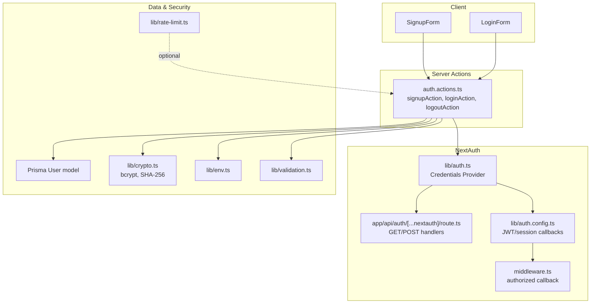
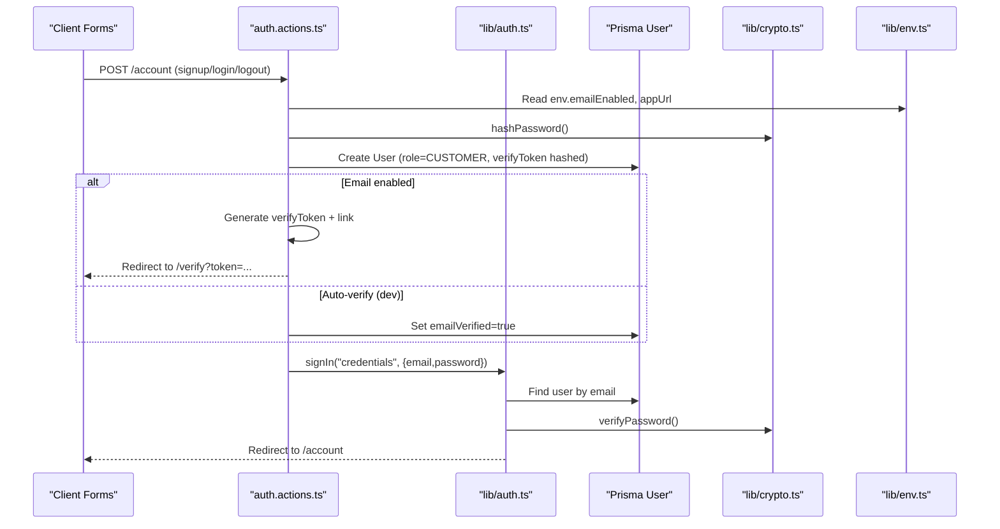
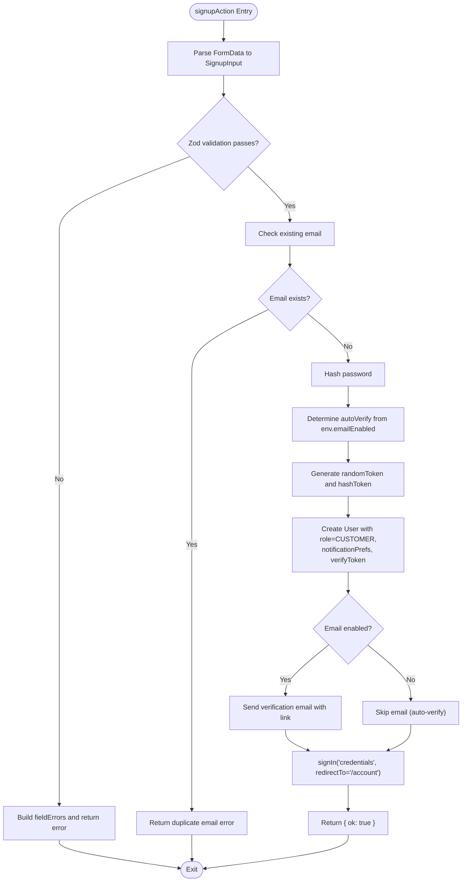
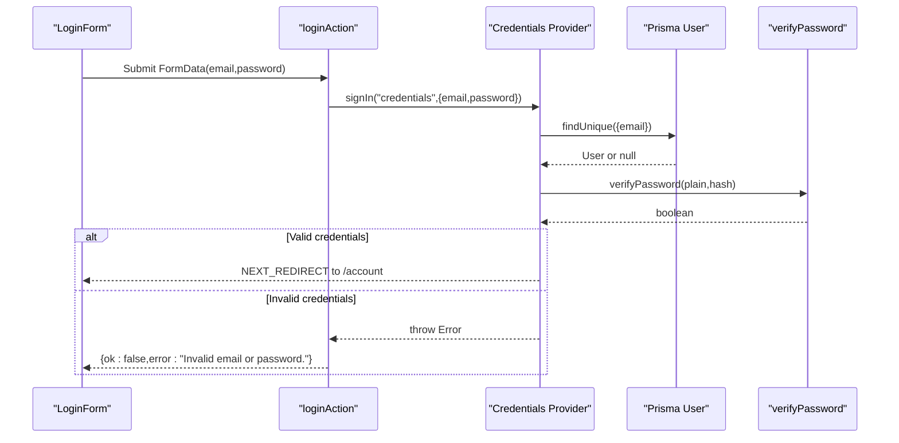
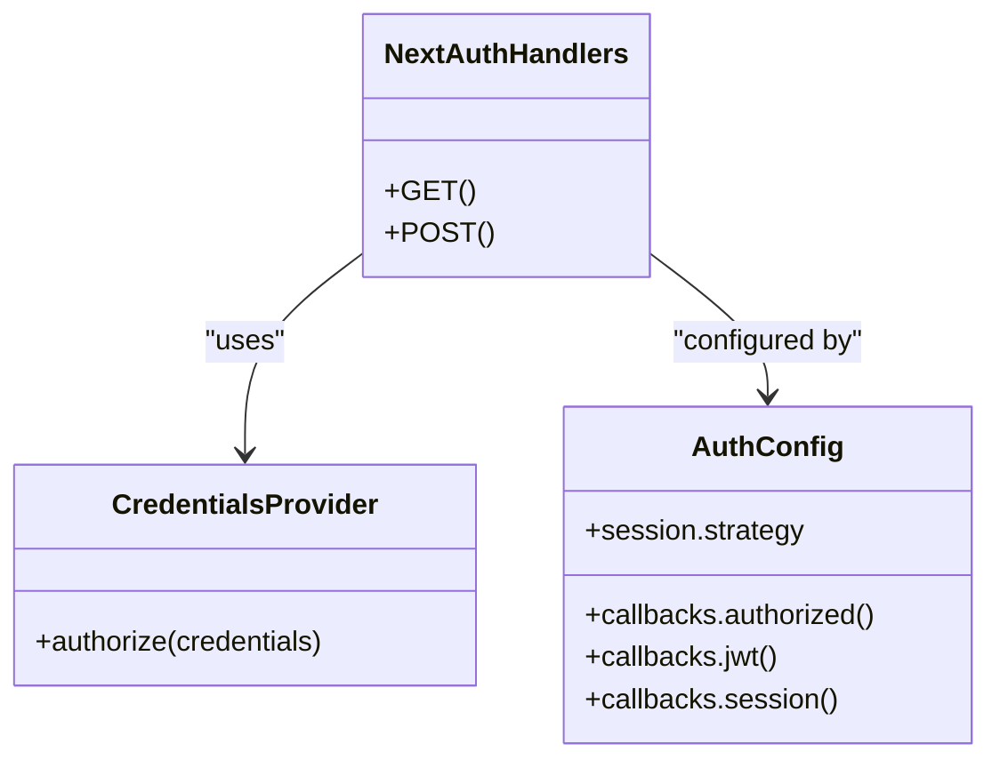
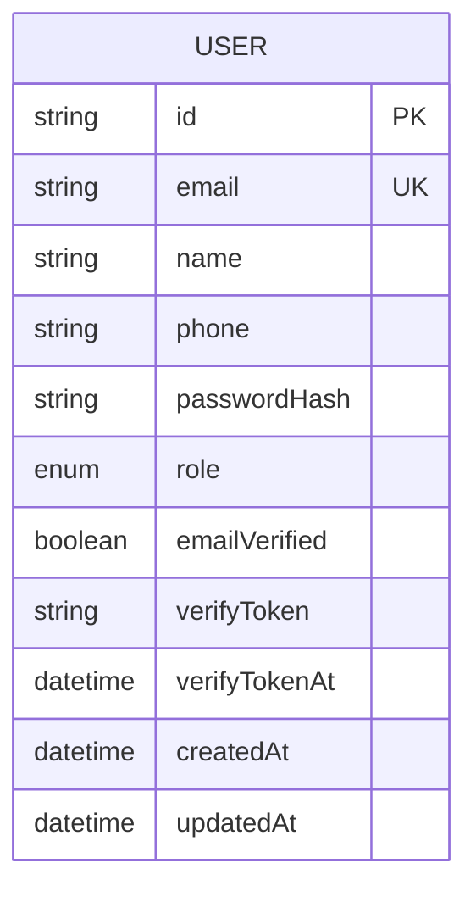
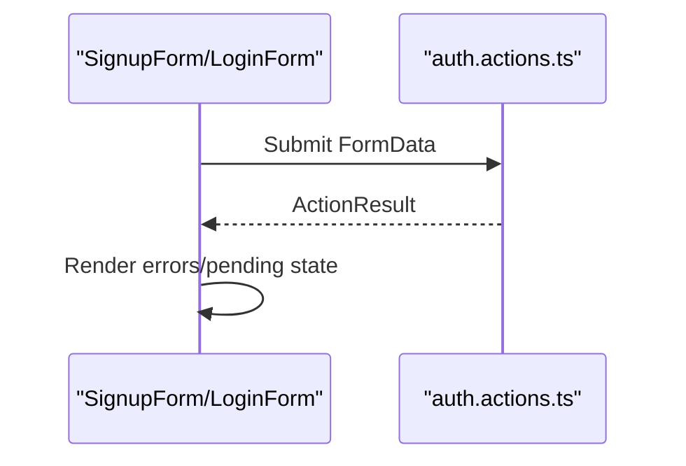
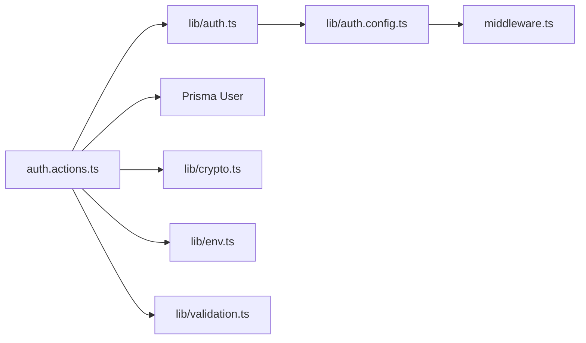

# Authentication API

<cite>
**Referenced Files in This Document**   
- [auth.actions.ts](file://server/auth.actions.ts)
- [auth.ts](file://lib/auth.ts)
- [route.ts](file://app/api/auth/[...nextauth]/route.ts)
- [validation.ts](file://lib/validation.ts)
- [signup-form.tsx](file://components/auth/signup-form.tsx)
- [login-form.tsx](file://components/auth/login-form.tsx)
- [auth.config.ts](file://lib/auth.config.ts)
- [crypto.ts](file://lib/crypto.ts)
- [env.ts](file://lib/env.ts)
- [schema.prisma](file://prisma/schema.prisma)
- [middleware.ts](file://middleware.ts)
- [rate-limit.ts](file://lib/rate-limit.ts)
</cite>

## Table of Contents
1. [Introduction](#introduction)
2. [Project Structure](#project-structure)
3. [Core Components](#core-components)
4. [Architecture Overview](#architecture-overview)
5. [Detailed Component Analysis](#detailed-component-analysis)
6. [Dependency Analysis](#dependency-analysis)
7. [Performance Considerations](#performance-considerations)
8. [Security Considerations](#security-considerations)
9. [Troubleshooting Guide](#troubleshooting-guide)
10. [Conclusion](#conclusion)

## Introduction
This document provides comprehensive API documentation for Timberland’s authentication server actions and their integration with NextAuth.js. It covers the signup, login, and logout flows; user registration with email verification and password hashing; role assignment; session management; JWT token handling; form data structures; validation schemas; client-side usage patterns; and security considerations such as password encryption, CSRF protection, and rate limiting.

## Project Structure
The authentication system is implemented across server actions, NextAuth configuration, Prisma schema, environment configuration, and UI forms:

- Server actions: `server/auth.actions.ts`
- NextAuth provider and handlers: `lib/auth.ts`, `app/api/auth/[...nextauth]/route.ts`
- Auth configuration (edge-safe): `lib/auth.config.ts`
- Middleware for protected routes: `middleware.ts`
- Validation schemas: `lib/validation.ts`
- Client forms: `components/auth/signup-form.tsx`, `components/auth/login-form.tsx`
- Cryptography utilities: `lib/crypto.ts`
- Environment configuration: `lib/env.ts`
- Database schema: `prisma/schema.prisma`
- Rate limiter utility: `lib/rate-limit.ts`

**Diagram sources**
- [auth.actions.ts:1-101](file://server/auth.actions.ts#L1-L101)
- [auth.ts:1-42](file://lib/auth.ts#L1-L42)
- [route.ts:1-4](file://app/api/auth/[...nextauth]/route.ts#L1-L4)
- [auth.config.ts:1-42](file://lib/auth.config.ts#L1-L42)
- [middleware.ts:1-14](file://middleware.ts#L1-L14)
- [validation.ts:1-87](file://lib/validation.ts#L1-L87)
- [crypto.ts:1-29](file://lib/crypto.ts#L1-L29)
- [env.ts:1-66](file://lib/env.ts#L1-L66)
- [schema.prisma:57-78](file://prisma/schema.prisma#L57-L78)
- [rate-limit.ts:1-56](file://lib/rate-limit.ts#L1-L56)

**Section sources**
- [auth.actions.ts:1-101](file://server/auth.actions.ts#L1-L101)
- [auth.ts:1-42](file://lib/auth.ts#L1-L42)
- [route.ts:1-4](file://app/api/auth/[...nextauth]/route.ts#L1-L4)
- [auth.config.ts:1-42](file://lib/auth.config.ts#L1-L42)
- [middleware.ts:1-14](file://middleware.ts#L1-L14)
- [validation.ts:1-87](file://lib/validation.ts#L1-L87)
- [crypto.ts:1-29](file://lib/crypto.ts#L1-L29)
- [env.ts:1-66](file://lib/env.ts#L1-L66)
- [schema.prisma:57-78](file://prisma/schema.prisma#L57-L78)
- [rate-limit.ts:1-56](file://lib/rate-limit.ts#L1-L56)

## Core Components
- Server action result type: `{ ok: boolean; error?: string; fieldErrors?: Record<string, string> }`
- signupAction: Validates input, checks uniqueness, hashes password, creates user with default role and notification preferences, optionally sends verification email, then signs in.
- loginAction: Authenticates via NextAuth credentials provider and redirects on success.
- logoutAction: Signs out and redirects to home.

Key responsibilities:
- Input parsing and validation using Zod schemas.
- Secure password hashing and verification.
- Email verification token generation and storage.
- Role assignment at registration.
- Integration with NextAuth for session and JWT.

**Section sources**
- [auth.actions.ts:11-15](file://server/auth.actions.ts#L11-L15)
- [auth.actions.ts:26-81](file://server/auth.actions.ts#L26-L81)
- [auth.actions.ts:83-100](file://server/auth.actions.ts#L83-L100)
- [validation.ts:4-24](file://lib/validation.ts#L4-L24)
- [crypto.ts:8-15](file://lib/crypto.ts#L8-L15)
- [schema.prisma:57-78](file://prisma/schema.prisma#L57-L78)

## Architecture Overview
Authentication integrates server actions with NextAuth.js:

- Client forms submit FormData to server actions.
- Server actions call NextAuth’s signIn/signOut.
- Credentials provider verifies passwords against stored hashes.
- JWT strategy stores user id and role in tokens.
- Middleware protects account routes using the authorized callback.

**Diagram sources**
- [auth.actions.ts:26-81](file://server/auth.actions.ts#L26-L81)
- [auth.ts:16-30](file://lib/auth.ts#L16-L30)
- [crypto.ts:8-15](file://lib/crypto.ts#L8-L15)
- [env.ts:48-51](file://lib/env.ts#L48-L51)
- [schema.prisma:57-78](file://prisma/schema.prisma#L57-L78)

## Detailed Component Analysis

### Server Actions API

#### signupAction
- Purpose: Register a new user, validate inputs, hash password, create user record, optionally send verification email, and sign in.
- Parameters:
  - `_prev`: Previous action state (ActionResult | null).
  - `formData`: HTML FormData containing name, email, phone, password.
- Return type: `Promise<ActionResult>` where ActionResult = `{ ok: boolean; error?: string; fieldErrors?: Record<string, string> }`.
- Processing logic:
  - Parse and validate using `signupSchema`.
  - Check for existing email.
  - Hash password with bcrypt.
  - Determine auto-verification based on SMTP configuration.
  - Generate and hash verification token; store timestamp.
  - Create user with default role CUSTOMER and notification preferences.
  - If email enabled, send verification email with link to `/verify?token=...`.
  - Call NextAuth signIn to redirect to `/account`.
- Error handling:
  - Validation errors returned as fieldErrors.
  - Duplicate email returns specific error message.
  - Throws Next redirect on successful sign-in flow.

**Diagram sources**
- [auth.actions.ts:17-81](file://server/auth.actions.ts#L17-L81)
- [validation.ts:9-19](file://lib/validation.ts#L9-L19)
- [crypto.ts:8-28](file://lib/crypto.ts#L8-L28)
- [env.ts:48-51](file://lib/env.ts#L48-L51)

**Section sources**
- [auth.actions.ts:17-81](file://server/auth.actions.ts#L17-L81)
- [validation.ts:9-19](file://lib/validation.ts#L9-L19)
- [crypto.ts:8-28](file://lib/crypto.ts#L8-L28)
- [env.ts:48-51](file://lib/env.ts#L48-L51)

#### loginAction
- Purpose: Authenticate user using credentials and redirect on success.
- Parameters:
  - `formData`: HTML FormData containing email, password.
- Return type: `Promise<ActionResult>`.
- Processing logic:
  - Normalize email (lowercase, trim).
  - Call NextAuth signIn with credentials provider.
  - On success, NextAuth throws a redirect which bubbles up.
  - On failure, return error indicating invalid credentials.
- Error handling:
  - Catches non-redirect errors and returns generic message.
  - Preserves Next redirect behavior for successful auth.

**Diagram sources**
- [auth.actions.ts:83-96](file://server/auth.actions.ts#L83-L96)
- [auth.ts:16-30](file://lib/auth.ts#L16-L30)
- [crypto.ts:12-15](file://lib/crypto.ts#L12-L15)

**Section sources**
- [auth.actions.ts:83-96](file://server/auth.actions.ts#L83-L96)
- [auth.ts:16-30](file://lib/auth.ts#L16-L30)
- [crypto.ts:12-15](file://lib/crypto.ts#L12-L15)

#### logoutAction
- Purpose: Sign out current session and redirect to home.
- Parameters: None.
- Return type: Promise<void>.
- Processing logic:
  - Calls NextAuth signOut with redirectTo="/".

**Section sources**
- [auth.actions.ts:98-100](file://server/auth.actions.ts#L98-L100)

### NextAuth Integration

#### Credentials Provider
- Verifies email/password against database.
- Returns minimal user object including id, email, name, role.
- Uses bcrypt comparison for secure password verification.

#### Handlers and Routes
- GET/POST handlers exposed at `/api/auth/*` for NextAuth operations.

#### JWT and Session
- Strategy: JWT.
- Token includes user id and role.
- Session extends user object with id and role.

**Diagram sources**
- [auth.ts:9-41](file://lib/auth.ts#L9-L41)
- [route.ts:1-4](file://app/api/auth/[...nextauth]/route.ts#L1-L4)
- [auth.config.ts:11-40](file://lib/auth.config.ts#L11-L40)

**Section sources**
- [auth.ts:9-41](file://lib/auth.ts#L9-L41)
- [route.ts:1-4](file://app/api/auth/[...nextauth]/route.ts#L1-L4)
- [auth.config.ts:11-40](file://lib/auth.config.ts#L11-L40)

### Form Data Structures and Validation Schemas

#### Signup Form Data
- Fields:
  - name: Required string, trimmed, min 1 char, max 120.
  - email: Required string, trimmed, lowercase, valid email format.
  - phone: Optional string, trimmed, regex pattern for phone numbers.
  - password: Required string, min 8 chars, max 128.

#### Login Form Data
- Fields:
  - email: Required string, trimmed, lowercase, valid email format.
  - password: Required string, min 1 char.

**Diagram sources**
- [schema.prisma:57-78](file://prisma/schema.prisma#L57-L78)

**Section sources**
- [validation.ts:4-24](file://lib/validation.ts#L4-L24)
- [schema.prisma:57-78](file://prisma/schema.prisma#L57-L78)

### Client-Side Usage Patterns

#### SignupForm
- Uses React Server Actions with `useActionState`.
- Displays field-level errors and global errors.
- Submits FormData to `signupAction`.

#### LoginForm
- Uses `useTransition` for pending state.
- Submits FormData to `loginAction`.
- Displays error messages.

**Diagram sources**
- [signup-form.tsx:1-39](file://components/auth/signup-form.tsx#L1-L39)
- [login-form.tsx:1-40](file://components/auth/login-form.tsx#L1-L40)
- [auth.actions.ts:26-100](file://server/auth.actions.ts#L26-L100)

**Section sources**
- [signup-form.tsx:1-39](file://components/auth/signup-form.tsx#L1-L39)
- [login-form.tsx:1-40](file://components/auth/login-form.tsx#L1-L40)
- [auth.actions.ts:26-100](file://server/auth.actions.ts#L26-L100)

## Dependency Analysis
- Server actions depend on:
  - NextAuth signIn/signOut.
  - Prisma for user creation and lookup.
  - Crypto utilities for password hashing and token generation.
  - Environment config for email settings and app URL.
  - Validation schemas for input sanitization.
- NextAuth depends on:
  - Credentials provider for email/password auth.
  - Google provider if enabled.
  - Auth config for JWT/session callbacks and page routing.
- Middleware uses authorized callback to protect `/account` routes.

**Diagram sources**
- [auth.actions.ts:1-101](file://server/auth.actions.ts#L1-L101)
- [auth.ts:1-42](file://lib/auth.ts#L1-L42)
- [auth.config.ts:1-42](file://lib/auth.config.ts#L1-L42)
- [middleware.ts:1-14](file://middleware.ts#L1-L14)

**Section sources**
- [auth.actions.ts:1-101](file://server/auth.actions.ts#L1-L101)
- [auth.ts:1-42](file://lib/auth.ts#L1-L42)
- [auth.config.ts:1-42](file://lib/auth.config.ts#L1-L42)
- [middleware.ts:1-14](file://middleware.ts#L1-L14)

## Performance Considerations
- Password hashing uses bcrypt with 12 rounds; consider adjusting rounds based on performance requirements and security policies.
- In-memory rate limiter is suitable for single-instance deployments; for multi-instance environments, use Redis or Upstash for shared rate limiting.
- Avoid unnecessary database queries by batching operations where possible.
- Use edge-safe middleware to reduce cold starts and improve response times for protected routes.

[No sources needed since this section provides general guidance]

## Security Considerations
- Password Encryption:
  - Passwords are hashed using bcrypt before storage.
  - Verification uses constant-time comparison to prevent timing attacks.
- CSRF Protection:
  - Server actions and NextAuth handle CSRF protection automatically when used with proper form submissions.
- Rate Limiting:
  - Minimal fixed-window rate limiter provided; integrate for sensitive endpoints like login/signup to prevent brute-force attacks.
- Email Verification:
  - Tokens are hashed before storage to prevent replay attacks if the database is compromised.
  - Auto-verification disabled in production when SMTP is configured.
- Session Management:
  - JWT strategy ensures tokens contain only necessary claims (id, role).
  - Middleware enforces authentication for protected routes.

**Section sources**
- [crypto.ts:8-28](file://lib/crypto.ts#L8-L28)
- [auth.actions.ts:46-76](file://server/auth.actions.ts#L46-L76)
- [auth.config.ts:11-40](file://lib/auth.config.ts#L11-L40)
- [middleware.ts:1-14](file://middleware.ts#L1-L14)
- [rate-limit.ts:1-56](file://lib/rate-limit.ts#L1-L56)

## Troubleshooting Guide
- Validation Errors:
  - Check fieldErrors returned by server actions for specific input issues.
- Duplicate Email:
  - Ensure unique email addresses during registration.
- Invalid Credentials:
  - Verify email and password correctness; ensure user exists and password matches.
- Email Not Sending:
  - Confirm SMTP configuration in environment variables.
  - Check emailEnabled flag and SMTP_HOST, SMTP_USER, SMTP_PASSWORD.
- Redirect Issues:
  - Ensure NextAuth handlers are correctly mounted at `/api/auth/*`.
  - Verify redirectTo values in signIn/signOut calls.

**Section sources**
- [auth.actions.ts:31-44](file://server/auth.actions.ts#L31-L44)
- [auth.actions.ts:83-96](file://server/auth.actions.ts#L83-L96)
- [env.ts:38-51](file://lib/env.ts#L38-L51)
- [route.ts:1-4](file://app/api/auth/[...nextauth]/route.ts#L1-L4)

## Conclusion
Timberland’s authentication system combines server actions with NextAuth.js to provide secure user registration, login, and logout functionality. The implementation emphasizes security through password hashing, token hashing, and environment-driven email verification. Session management leverages JWT for efficient stateless authentication, while middleware protects sensitive routes. The modular design allows for easy extension and maintenance, with clear separation of concerns between server actions, NextAuth configuration, and client-side forms.

[No sources needed since this section summarizes without analyzing specific files]