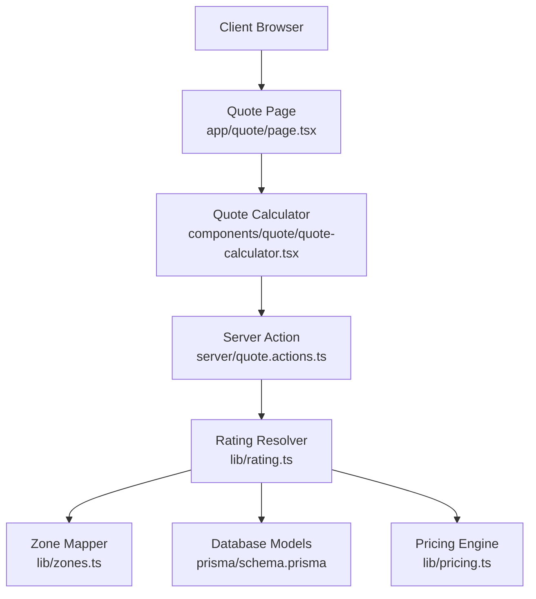
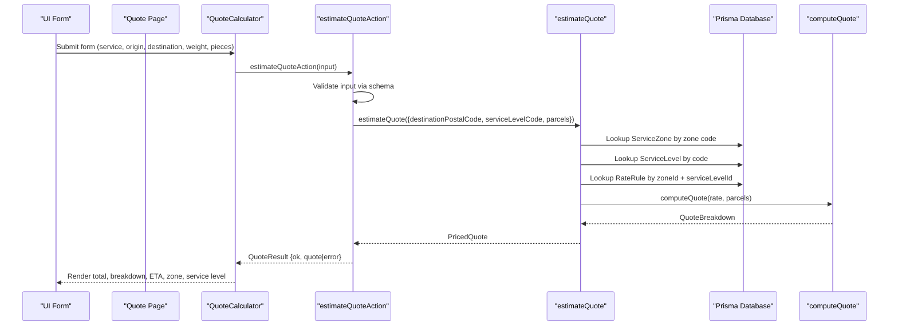
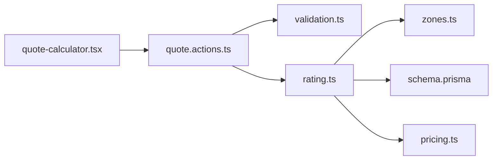

# Quote Calculation API

<cite>
**Referenced Files in This Document**
- [quote.actions.ts](file://server/quote.actions.ts)
- [rating.ts](file://lib/rating.ts)
- [pricing.ts](file://lib/pricing.ts)
- [zones.ts](file://lib/zones.ts)
- [validation.ts](file://lib/validation.ts)
- [schema.prisma](file://prisma/schema.prisma)
- [quote-calculator.tsx](file://components/quote/quote-calculator.tsx)
- [page.tsx](file://app/quote/page.tsx)
</cite>

## Table of Contents
1. [Introduction](#introduction)
2. [Project Structure](#project-structure)
3. [Core Components](#core-components)
4. [Architecture Overview](#architecture-overview)
5. [Detailed Component Analysis](#detailed-component-analysis)
6. [Dependency Analysis](#dependency-analysis)
7. [Performance Considerations](#performance-considerations)
8. [Troubleshooting Guide](#troubleshooting-guide)
9. [Conclusion](#conclusion)

## Introduction
This document describes the quote calculation API for the delivery platform. It explains how quotes are computed from destination postal codes, service levels, and parcel specifications. The pricing engine uses zone-based base pricing, per-kilogram and per-piece charges, a service-level multiplier, and a minimum price floor. The server action validates inputs, resolves zones and rate rules from the database, computes a detailed cost breakdown, and returns a structured response suitable for UI rendering or programmatic use.

The documentation covers:
- Server-side quote estimation endpoint behavior
- Zone mapping and rate rule application
- Pricing algorithm details and cost components
- Request validation and error handling
- Response format with currency, ETA, zone, service level, and breakdown fields
- Performance considerations and caching strategies

## Project Structure
The quote calculation feature spans server actions, pricing logic, zone mapping, input validation, Prisma data models, and the Next.js page that renders the calculator.

**Diagram sources**
- [page.tsx:10-30](file://app/quote/page.tsx#L10-L30)
- [quote-calculator.tsx:21-44](file://components/quote/quote-calculator.tsx#L21-L44)
- [quote.actions.ts:27-64](file://server/quote.actions.ts#L27-L64)
- [rating.ts:19-60](file://lib/rating.ts#L19-L60)
- [zones.ts:29-34](file://lib/zones.ts#L29-L34)
- [pricing.ts:49-87](file://lib/pricing.ts#L49-L87)
- [schema.prisma:84-125](file://prisma/schema.prisma#L84-L125)

**Section sources**
- [page.tsx:1-31](file://app/quote/page.tsx#L1-L31)
- [quote-calculator.tsx:1-155](file://components/quote/quote-calculator.tsx#L1-L155)
- [quote.actions.ts:1-65](file://server/quote.actions.ts#L1-L65)
- [rating.ts:1-70](file://lib/rating.ts#L1-L70)
- [pricing.ts:1-89](file://lib/pricing.ts#L1-L89)
- [zones.ts:1-35](file://lib/zones.ts#L1-L35)
- [schema.prisma:84-125](file://prisma/schema.prisma#L84-L125)

## Core Components
- Server action: Validates request data, calls the rating resolver, and returns a typed result object.
- Rating resolver: Resolves zone code, fetches zone, service level, and rate rule from the database, then delegates to the pure pricing engine.
- Pricing engine: Computes the quote breakdown using zone base price, weight charge, piece charge, service multiplier, and minimum price.
- Zone mapper: Maps a destination postal code to a zone code using a simple prefix table.
- Validation schema: Ensures required fields and numeric ranges for quote requests.
- Data models: Define ServiceZone, ServiceLevel, and RateRule used by the pricing engine.

Key responsibilities:
- Input validation and sanitization occur before any pricing computation.
- Zone determination is based on destination postal code only; origin postal code is accepted but not used by the current pricing logic.
- The pricing engine is pure and testable, with no side effects.

**Section sources**
- [quote.actions.ts:6-25](file://server/quote.actions.ts#L6-L25)
- [rating.ts:6-13](file://lib/rating.ts#L6-L13)
- [pricing.ts:9-38](file://lib/pricing.ts#L9-L38)
- [zones.ts:10-13](file://lib/zones.ts#L10-L13)
- [validation.ts:69-75](file://lib/validation.ts#L69-L75)
- [schema.prisma:84-125](file://prisma/schema.prisma#L84-L125)

## Architecture Overview
The quote calculation flow connects the client UI to a server action, which validates inputs, resolves pricing configuration from the database, and computes a detailed breakdown.

**Diagram sources**
- [quote-calculator.tsx:31-44](file://components/quote/quote-calculator.tsx#L31-L44)
- [quote.actions.ts:27-64](file://server/quote.actions.ts#L27-L64)
- [rating.ts:19-60](file://lib/rating.ts#L19-L60)
- [pricing.ts:49-87](file://lib/pricing.ts#L49-L87)

## Detailed Component Analysis

### Server Action: estimateQuoteAction
Purpose:
- Accepts an untrusted input object.
- Validates it against the quote schema.
- Calls the rating resolver with normalized parcel data.
- Returns a typed result indicating success or failure.

Input contract:
- serviceLevelCode: non-empty string identifying the service level.
- originPostalCode: non-empty string (accepted but not used by pricing).
- destinationPostalCode: non-empty string used to determine the zone.
- weightKg: positive number up to a maximum limit.
- pieces: integer between defined bounds.

Output contract:
- Success: ok=true with a quote object containing total, currency, etaDays, zoneName, serviceLevelName, and breakdown.
- Failure: ok=false with an error message.

Error handling:
- Validation errors return a user-friendly message derived from the schema.
- Runtime errors from the rating resolver are wrapped into a generic error message.

Response shape:
- total: final quoted amount after all adjustments.
- currency: currency code from the resolved zone.
- etaDays: estimated delivery days from the service level.
- zoneName: human-readable zone name.
- serviceLevelName: human-readable service level name.
- breakdown: detailed cost components.

**Section sources**
- [quote.actions.ts:27-64](file://server/quote.actions.ts#L27-L64)
- [validation.ts:69-75](file://lib/validation.ts#L69-L75)

### Rating Resolver: estimateQuote
Purpose:
- Determines the zone code from the destination postal code.
- Fetches zone, service level, and rate rule from the database.
- Delegates to the pure pricing engine to compute the breakdown.
- Returns a priced quote including metadata such as currency, ETA, and names.

Processing steps:
1. Map destination postal code to zone code.
2. Load ServiceZone by zone code.
3. Load ServiceLevel by serviceLevelCode.
4. Load RateRule by unique composite key (zoneId, serviceLevelId).
5. Convert Decimal fields to numbers and call computeQuote.
6. Attach currency, ETA, zone name, and service level name to the result.

Error handling:
- Missing zone or service level throws a configuration error.
- Missing rate rule throws a route-specific error.

**Section sources**
- [rating.ts:19-60](file://lib/rating.ts#L19-L60)
- [zones.ts:29-34](file://lib/zones.ts#L29-L34)
- [schema.prisma:84-125](file://prisma/schema.prisma#L84-L125)

### Pricing Engine: computeQuote
Purpose:
- Pure function that calculates the shipment quote given rate parameters and parcel list.

Algorithm overview:
- Normalize inputs: ensure positive values and safe defaults.
- Sum total weight across parcels.
- Sum total pieces across parcels.
- Compute weight charge = perKg × total weight.
- Compute piece charge = perPiece × total pieces.
- Compute subtotal before service = zoneBase + weightCharge + pieceCharge.
- Apply service multiplier to get afterService.
- Enforce minimum price floor if needed.
- Return detailed breakdown and final total.

Complexity:
- Time complexity: O(n) where n is the number of parcels due to summation.
- Space complexity: O(1) beyond input arrays.

Rounding:
- Uses a helper to round to two decimal places while mitigating floating-point drift.

Edge cases:
- Non-positive rates default to zero.
- Invalid or negative piece counts are floored to zero.
- Minimum price enforcement ensures a hard floor.

**Section sources**
- [pricing.ts:49-87](file://lib/pricing.ts#L49-L87)
- [pricing.ts:40-47](file://lib/pricing.ts#L40-L47)

### Zone Mapping: matchZoneCode
Purpose:
- Maps a destination postal code to a zone code using a static prefix map.

Behavior:
- Trims whitespace.
- If empty, returns the default zone code.
- Otherwise, maps the first digit to a zone code.
- Falls back to the default zone code when unknown.

Design note:
- Intended as a v1 demo coverage model.
- Future versions should replace this with a database-backed zone coverage lookup.

**Section sources**
- [zones.ts:1-35](file://lib/zones.ts#L1-L35)

### Input Validation: quoteSchema
Purpose:
- Validates quote request payloads before processing.

Rules:
- serviceLevelCode: required non-empty string.
- originPostalCode: required non-empty string.
- destinationPostalCode: required non-empty string.
- weightKg: coerced to a positive number within allowed range.
- pieces: coerced to an integer within allowed range with a default.

Integration:
- Used by the server action to reject invalid inputs early.

**Section sources**
- [validation.ts:69-75](file://lib/validation.ts#L69-L75)

### Data Models: ServiceZone, ServiceLevel, RateRule
Purpose:
- Define the pricing configuration stored in the database.

Key fields:
- ServiceZone: id, code, name, basePrice, currency, active.
- ServiceLevel: id, code, name, description, slaDays, priceMultiplier, active.
- RateRule: id, zoneId, serviceLevelId, perKg, perPiece, minPrice.

Relationships:
- RateRule links a ServiceZone and a ServiceLevel uniquely.
- ServiceZone and ServiceLevel are referenced by RateRule.

Usage:
- The rating resolver loads these entities to build the rate parameters passed to the pricing engine.

**Section sources**
- [schema.prisma:84-125](file://prisma/schema.prisma#L84-L125)

### UI Integration: Quote Page and Calculator
Purpose:
- Renders a form for entering shipment details and displays the resulting quote.

Flow:
- The page fetches available service levels and passes them to the calculator.
- The calculator submits form data to the server action.
- On success, it displays zone, base, weight, pieces, subtotal, service multiplier, minimum charge notice, total, and ETA.
- On error, it shows an alert with the error message.

Notes:
- The UI accepts originPostalCode but the current pricing logic does not use it.
- The UI formats currency using a shared utility.

**Section sources**
- [page.tsx:10-30](file://app/quote/page.tsx#L10-L30)
- [quote-calculator.tsx:21-155](file://components/quote/quote-calculator.tsx#L21-L155)

## Dependency Analysis
The following diagram shows how modules depend on each other during quote calculation.

**Diagram sources**
- [quote-calculator.tsx:1-155](file://components/quote/quote-calculator.tsx#L1-L155)
- [quote.actions.ts:1-65](file://server/quote.actions.ts#L1-L65)
- [validation.ts:69-75](file://lib/validation.ts#L69-L75)
- [rating.ts:1-70](file://lib/rating.ts#L1-L70)
- [zones.ts:1-35](file://lib/zones.ts#L1-L35)
- [pricing.ts:1-89](file://lib/pricing.ts#L1-L89)
- [schema.prisma:84-125](file://prisma/schema.prisma#L84-L125)

**Section sources**
- [quote.actions.ts:1-65](file://server/quote.actions.ts#L1-L65)
- [rating.ts:1-70](file://lib/rating.ts#L1-L70)
- [pricing.ts:1-89](file://lib/pricing.ts#L1-L89)
- [zones.ts:1-35](file://lib/zones.ts#L1-L35)
- [validation.ts:69-75](file://lib/validation.ts#L69-L75)
- [schema.prisma:84-125](file://prisma/schema.prisma#L84-L125)

## Performance Considerations
Current implementation characteristics:
- The pricing engine is pure and fast, with linear time complexity relative to the number of parcels.
- Each quote request performs three database lookups: ServiceZone, ServiceLevel, and RateRule.
- Zone mapping is constant-time and memory-efficient.

Optimization opportunities:
- Cache service levels and zones:
  - Cache the list of active service levels returned by the resolver for UI dropdowns.
  - Cache zone definitions keyed by zone code.
- Cache rate rules:
  - Cache rate rules by composite key (zoneId, serviceLevelId).
  - Use a short TTL or invalidate on configuration changes.
- Reduce database reads:
  - Batch load frequently accessed configuration at startup if appropriate.
  - Consider read replicas for high-traffic quote endpoints.
- Frontend optimizations:
  - Debounce repeated quote calculations if users adjust inputs rapidly.
  - Reuse cached results for identical inputs within a session.

Caching strategy recommendations:
- In-memory cache for small datasets like zones and service levels.
- Distributed cache (e.g., Redis) for multi-instance deployments.
- Cache keys should include zone code, service level code, and optionally parcel totals for fine-grained reuse.
- Invalidate caches when configuration updates occur.

[No sources needed since this section provides general guidance]

## Troubleshooting Guide
Common issues and resolutions:
- Invalid input:
  - Ensure serviceLevelCode, destinationPostalCode, weightKg, and pieces meet schema constraints.
  - Check error messages returned by the server action.
- Missing configuration:
  - Errors indicate incomplete pricing configuration for the selected route.
  - Verify that ServiceZone, ServiceLevel, and RateRule exist for the combination.
- No rate configured:
  - Ensure a RateRule exists for the resolved zone and service level.
- Unexpected totals:
  - Confirm that the minimum price is not being applied unintentionally.
  - Review the service multiplier and per-kg/per-piece rates.

Operational checks:
- Validate that the database contains valid entries for the requested zone and service level.
- Inspect the breakdown fields to understand how each component contributes to the total.
- Monitor error logs for configuration-related exceptions.

**Section sources**
- [quote.actions.ts:27-64](file://server/quote.actions.ts#L27-L64)
- [rating.ts:31-40](file://lib/rating.ts#L31-L40)
- [pricing.ts:73-74](file://lib/pricing.ts#L73-L74)

## Conclusion
The quote calculation API provides a clear, validated, and extensible path from user input to a detailed pricing breakdown. It separates concerns between input validation, configuration resolution, zone mapping, and pure pricing computation. The design supports future enhancements such as expanded zone coverage, richer rate rules, and caching layers without changing the core pricing algorithm. For production deployments, consider implementing robust caching for configuration data and monitoring for missing or inconsistent pricing rules.

[No sources needed since this section summarizes without analyzing specific files]