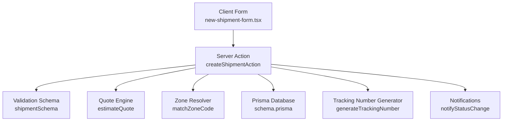
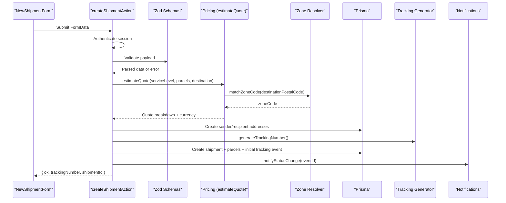
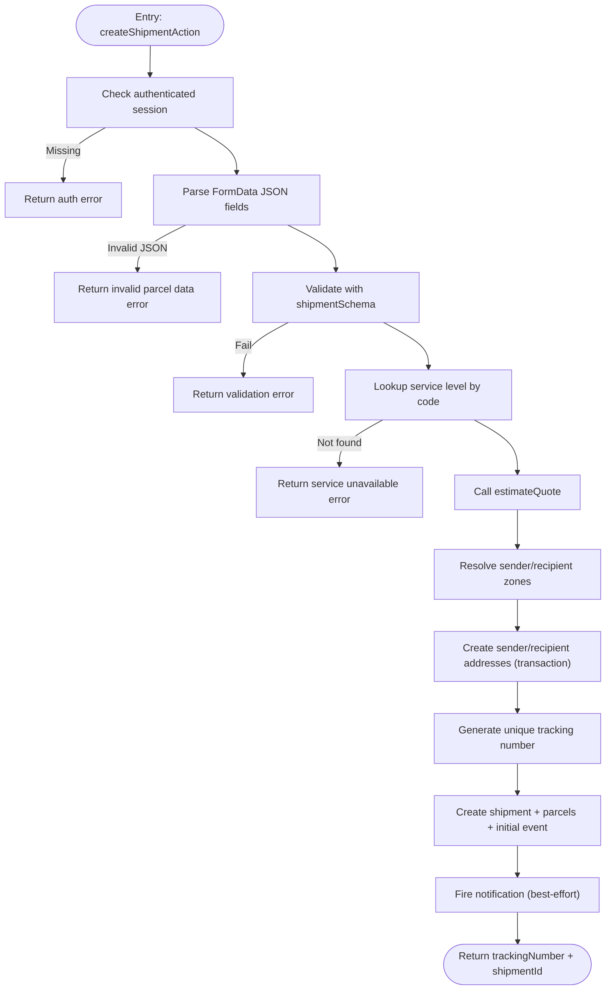
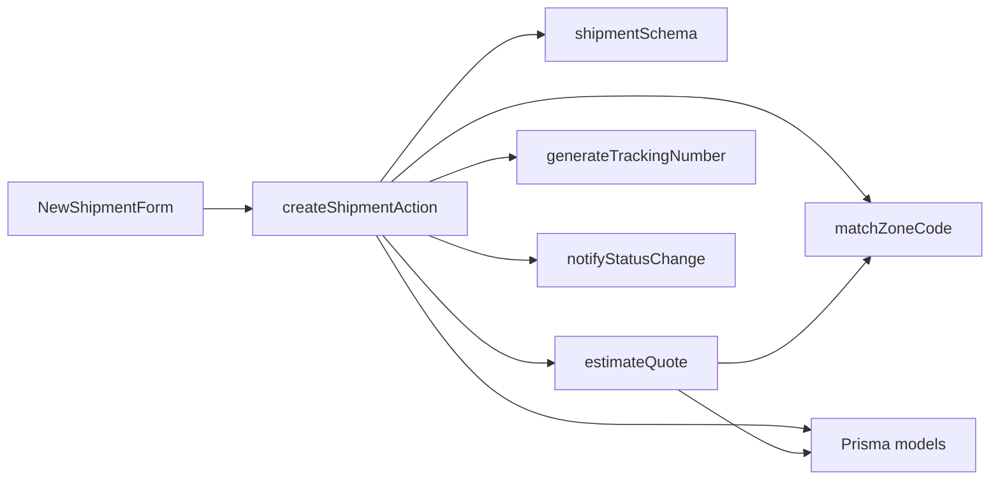

# Shipment Creation API

<cite>
**Referenced Files in This Document**
- [shipment.actions.ts](file://server/shipment.actions.ts)
- [validation.ts](file://lib/validation.ts)
- [zones.ts](file://lib/zones.ts)
- [tracking-number.ts](file://lib/tracking-number.ts)
- [rating.ts](file://lib/rating.ts)
- [quote.actions.ts](file://server/quote.actions.ts)
- [new-shipment-form.tsx](file://components/shipment/new-shipment-form.tsx)
- [page.tsx](file://app/account/new-shipment/page.tsx)
- [schema.prisma](file://prisma/schema.prisma)
- [shipping.spec.ts](file://tests/e2e/shipping.spec.ts)
</cite>

## Table of Contents
1. [Introduction](#introduction)
2. [Project Structure](#project-structure)
3. [Core Components](#core-components)
4. [Architecture Overview](#architecture-overview)
5. [Detailed Component Analysis](#detailed-component-analysis)
6. [Dependency Analysis](#dependency-analysis)
7. [Performance Considerations](#performance-considerations)
8. [Troubleshooting Guide](#troubleshooting-guide)
9. [Conclusion](#conclusion)

## Introduction
This document explains the shipment creation API surface exposed by the `createShipmentAction` server action. It covers parameter validation, parcel handling, sender and recipient address management, quote calculation, authentication requirements, zone resolution, tracking number generation, transaction safety, error handling patterns, and common validation failures. It also provides examples for creating single-parcel and multi-parcel shipments using the client form’s FormData structure.

## Project Structure
The shipment creation flow spans a Next.js Server Action, client-side form, pricing engine, database schema, and supporting utilities:

**Diagram sources**
- [new-shipment-form.tsx:136-163](file://components/shipment/new-shipment-form.tsx#L136-L163)
- [shipment.actions.ts:45-145](file://server/shipment.actions.ts#L45-L145)
- [validation.ts:60-67](file://lib/validation.ts#L60-L67)
- [rating.ts:19-61](file://lib/rating.ts#L19-L61)
- [zones.ts:29-34](file://lib/zones.ts#L29-L34)
- [tracking-number.ts:36-41](file://lib/tracking-number.ts#L36-L41)
- [schema.prisma:84-203](file://prisma/schema.prisma#L84-L203)

**Section sources**
- [new-shipment-form.tsx:136-163](file://components/shipment/new-shipment-form.tsx#L136-L163)
- [shipment.actions.ts:45-145](file://server/shipment.actions.ts#L45-L145)
- [schema.prisma:84-203](file://prisma/schema.prisma#L84-L203)

## Core Components
- Server action: `createShipmentAction` validates input, resolves service levels and zones, calculates quotes, persists addresses and shipment data, generates tracking numbers, and emits notifications.
- Validation: Zod schemas enforce parcel, address, and shipment-level constraints.
- Pricing: `estimateQuote` computes a price breakdown based on zone rules and service level multipliers.
- Zone mapping: Postal code prefix maps to METRO, REGION, or REMOTE zones.
- Tracking: Randomized base32 tracking codes with a check character; retry logic handles unique constraint collisions.
- Client form: Builds FormData, calls the server action, and redirects to the new shipment detail page.

**Section sources**
- [shipment.actions.ts:45-145](file://server/shipment.actions.ts#L45-L145)
- [validation.ts:38-67](file://lib/validation.ts#L38-L67)
- [rating.ts:19-61](file://lib/rating.ts#L19-L61)
- [zones.ts:29-34](file://lib/zones.ts#L29-L34)
- [tracking-number.ts:36-41](file://lib/tracking-number.ts#L36-L41)
- [new-shipment-form.tsx:136-163](file://components/shipment/new-shipment-form.tsx#L136-L163)

## Architecture Overview
The end-to-end sequence from client submission to persisted shipment is as follows:

**Diagram sources**
- [new-shipment-form.tsx:136-163](file://components/shipment/new-shipment-form.tsx#L136-L163)
- [shipment.actions.ts:45-145](file://server/shipment.actions.ts#L45-L145)
- [rating.ts:19-61](file://lib/rating.ts#L19-L61)
- [zones.ts:29-34](file://lib/zones.ts#L29-L34)
- [tracking-number.ts:36-41](file://lib/tracking-number.ts#L36-L41)

## Detailed Component Analysis

### createShipmentAction Server Action
Responsibilities:
- Authentication: Requires an authenticated user session; otherwise returns an error.
- Input parsing: Reads JSON fields from FormData (`senderJson`, `recipientJson`, `parcelsJson`) and scalar fields (`serviceLevelCode`, `pickupDate`, `notes`).
- Validation: Uses `shipmentSchema` to validate service level, addresses, and parcels.
- Service level verification: Ensures the selected service level exists in the database.
- Quote calculation: Computes a quote using `estimateQuote` with destination postal code, service level, and parcel inputs.
- Zone resolution: Maps sender and recipient postal codes to service zones via `matchZoneCode`.
- Address persistence: Creates sender and recipient addresses within a Prisma transaction, including optional line2 and region fields and resolved zone IDs.
- Shipment persistence: Creates the shipment with a unique tracking number, links addresses, sets status to CREATED, records price and currency from the quote, and creates associated parcels and an initial tracking event.
- Notification: Fires a notification for the created event (fire-and-forget).

Key behaviors:
- Tracking number uniqueness: Retries up to five times on unique constraint violations.
- Transaction safety: Addresses are created atomically; shipment creation uses its own write path.
- Error handling: Returns structured errors for missing authentication, invalid JSON, validation failures, unavailable service, and tracking allocation failure.

**Diagram sources**
- [shipment.actions.ts:45-145](file://server/shipment.actions.ts#L45-L145)

**Section sources**
- [shipment.actions.ts:45-145](file://server/shipment.actions.ts#L45-L145)

### Parameter Validation and FormData Structure
FormData fields:
- `serviceLevelCode`: String, required. Must correspond to an active service level in the database.
- `pickupDate`: Optional date string.
- `notes`: Optional text up to 500 characters.
- `senderJson`: JSON object representing the sender address.
- `recipientJson`: JSON object representing the recipient address.
- `parcelsJson`: JSON array of parcel objects.

Parcel input schema:
- `description`: Required string, 1–200 characters.
- `weightKg`: Positive number, max 2000.
- `pieces`: Integer, 1–50, default 1.
- `lengthCm`, `widthCm`, `heightCm`: Optional positive numbers.
- `declaredValue`: Optional non-negative number.

Address schema:
- `label`: Optional string, max 60.
- `contactName`: Required string, 1–120 characters.
- `phone`: Required string matching a phone pattern.
- `line1`: Required string, 1–160 characters.
- `line2`: Optional string, max 160.
- `city`: Required string, 1–80 characters.
- `region`: Optional string, max 80.
- `postalCode`: Required string, 2–16 characters.
- `country`: Two-letter country code, defaults to US.

Shipment-level constraints:
- At least one parcel, up to 20 parcels.
- Service level must be present.
- Sender and recipient must satisfy address schema.

Client form behavior:
- Serializes addresses and parcels into JSON strings before sending.
- Omits empty declared values to keep payloads minimal.

**Section sources**
- [validation.ts:38-67](file://lib/validation.ts#L38-L67)
- [new-shipment-form.tsx:136-163](file://components/shipment/new-shipment-form.tsx#L136-L163)

### Parcel Handling and Multi-Parcel Support
- The server action accepts an array of parcels and maps them to the database model.
- Each parcel includes description, weight, pieces, optional dimensions, and optional declared value.
- The client form supports adding and removing parcels dynamically and shows totals for weight and pieces.
- The quote calculation aggregates parcel weights and pieces to compute pricing.

Examples:
- Single parcel: Provide one parcel object with description, weight, and pieces.
- Multi-parcel: Provide multiple parcel objects; ensure each meets the parcel schema.

**Section sources**
- [shipment.actions.ts:99-119](file://server/shipment.actions.ts#L99-L119)
- [new-shipment-form.tsx:199-230](file://components/shipment/new-shipment-form.tsx#L199-L230)
- [schema.prisma:188-203](file://prisma/schema.prisma#L188-L203)

### Address Management
- Sender and recipient addresses are created per shipment, linked to the authenticated user.
- Optional fields like `line2` and `region` are normalized to null when absent.
- Zone IDs are resolved from postal codes and attached to addresses.

Database model highlights:
- Address fields include contact name, phone, lines, city, region, postal code, country, and optional zone link.
- Indexes exist on userId and postalCode for efficient queries.

**Section sources**
- [shipment.actions.ts:87-97](file://server/shipment.actions.ts#L87-L97)
- [schema.prisma:131-154](file://prisma/schema.prisma#L131-L154)

### Quote Calculation and Service Level Requirements
- The server action verifies that the selected service level exists before proceeding.
- Quote calculation uses `estimateQuote`, which:
  - Resolves the destination zone via `matchZoneCode`.
  - Looks up the service level and rate rule for the zone.
  - Computes a breakdown including base price, weight/piece charges, service multiplier, minimum price application, and total.
- The resulting quote’s total and currency are stored on the shipment.

Service level requirements:
- Must be present in the database and active for listing.
- Has SLA days and a price multiplier affecting final cost.

**Section sources**
- [shipment.actions.ts:77-85](file://server/shipment.actions.ts#L77-L85)
- [rating.ts:19-61](file://lib/rating.ts#L19-L61)
- [quote.actions.ts:27-64](file://server/quote.actions.ts#L27-L64)

### Authentication Requirements
- The action requires a valid session with a user ID.
- If no authenticated user is detected, it returns an error indicating sign-in is required.
- The page preloads services and optionally a default sender address based on the authenticated user.

**Section sources**
- [shipment.actions.ts:49-53](file://server/shipment.actions.ts#L49-L53)
- [page.tsx:8-16](file://app/account/new-shipment/page.tsx#L8-L16)

### Zone Resolution
- Postal codes are mapped to zone codes using a digit-prefix table:
  - Prefixes 0–1 map to METRO.
  - Prefixes 2–4 map to REGION.
  - Prefixes 5–9 map to REMOTE.
- If the postal code is empty or unmapped, the default zone is REGION.
- The zone lookup is used both for pricing and for attaching zone IDs to addresses.

**Section sources**
- [zones.ts:15-34](file://lib/zones.ts#L15-L34)
- [shipment.actions.ts:87-88](file://server/shipment.actions.ts#L87-L88)

### Tracking Number Generation and Uniqueness
- Tracking numbers use a randomized base32 body with a deterministic check character.
- Format: two-letter prefix followed by eight base32 characters and one check character.
- The server retries up to five times if a unique constraint collision occurs during insertion.
- If all attempts fail, a user-facing error is returned.

**Section sources**
- [tracking-number.ts:36-41](file://lib/tracking-number.ts#L36-L41)
- [shipment.actions.ts:25-43](file://server/shipment.actions.ts#L25-L43)

### Transaction Safety and Data Integrity
- Address creation for sender and recipient is wrapped in a Prisma transaction to ensure atomicity.
- Shipment creation writes the shipment, parcels, and initial tracking event together.
- Initial tracking event records the CREATED status with location derived from sender city and country.

**Section sources**
- [shipment.actions.ts:90-133](file://server/shipment.actions.ts#L90-L133)
- [schema.prisma:160-203](file://prisma/schema.prisma#L160-L203)

### Error Handling Patterns
Common errors:
- Authentication missing: Returned when no session user is present.
- Invalid parcel data: Returned when parcel JSON cannot be parsed.
- Validation failures: First validation issue message is returned.
- Service unavailable: Returned when the selected service level does not exist.
- Pricing configuration incomplete: Thrown by the pricing engine when zone/service/rule configuration is missing.
- Tracking allocation failure: Returned after repeated unique constraint collisions.

Client-side handling:
- The form displays errors and prevents navigation until successful creation.
- On success, it redirects to the shipment detail page.

**Section sources**
- [shipment.actions.ts:49-74](file://server/shipment.actions.ts#L49-L74)
- [rating.ts:31-40](file://lib/rating.ts#L31-L40)
- [shipment.actions.ts:25-43](file://server/shipment.actions.ts#L25-L43)
- [new-shipment-form.tsx:158-162](file://components/shipment/new-shipment-form.tsx#L158-L162)

### Examples

#### Example: Single-Parcel Shipment
FormData structure:
- `serviceLevelCode`: e.g., "STANDARD".
- `pickupDate`: Optional ISO date string.
- `notes`: Optional text.
- `senderJson`: Valid address object.
- `recipientJson`: Valid address object.
- `parcelsJson`: Array with one parcel object containing description, weightKg, and pieces.

Expected outcome:
- Validation passes.
- Quote calculated and stored.
- Sender and recipient addresses created.
- Shipment created with a generated tracking number.
- Redirect to `/account/shipments/{shipmentId}`.

**Section sources**
- [new-shipment-form.tsx:136-163](file://components/shipment/new-shipment-form.tsx#L136-L163)
- [shipping.spec.ts:23-40](file://tests/e2e/shipping.spec.ts#L23-L40)

#### Example: Multi-Parcel Shipment
FormData structure:
- Same fields as single-parcel, but `parcelsJson` contains multiple parcel objects.
- Ensure each parcel satisfies the parcel schema.

Expected outcome:
- Aggregated weight and pieces used for quote calculation.
- Multiple parcel rows created under the same shipment.

**Section sources**
- [new-shipment-form.tsx:199-230](file://components/shipment/new-shipment-form.tsx#L199-L230)
- [shipment.actions.ts:99-119](file://server/shipment.actions.ts#L99-L119)

## Dependency Analysis
High-level dependencies:

**Diagram sources**
- [shipment.actions.ts:45-145](file://server/shipment.actions.ts#L45-L145)
- [rating.ts:19-61](file://lib/rating.ts#L19-L61)
- [zones.ts:29-34](file://lib/zones.ts#L29-L34)
- [tracking-number.ts:36-41](file://lib/tracking-number.ts#L36-L41)
- [new-shipment-form.tsx:136-163](file://components/shipment/new-shipment-form.tsx#L136-L163)

**Section sources**
- [shipment.actions.ts:45-145](file://server/shipment.actions.ts#L45-L145)
- [rating.ts:19-61](file://lib/rating.ts#L19-L61)

## Performance Considerations
- Quote calculation involves database lookups for zone, service level, and rate rule; caching these configurations can reduce latency.
- Zone mapping is O(1) based on postal code prefix.
- Tracking number generation is lightweight; retries only occur on rare unique constraint collisions.
- Address creation uses a transaction to minimize round-trips and ensure consistency.
- Notifications are fire-and-forget to avoid blocking the main request path.

[No sources needed since this section provides general guidance]

## Troubleshooting Guide
Common issues and resolutions:
- Missing authentication: Ensure the user is signed in before submitting the form.
- Invalid parcel JSON: Verify that `parcelsJson` is valid JSON and matches the parcel schema.
- Validation errors: Check required fields such as contact name, phone, address lines, city, postal code, and parcel description/weight/pieces.
- Service unavailable: Confirm that the selected service level exists and is active.
- Pricing configuration incomplete: Ensure zone coverage and rate rules are configured for the destination postal code and service level.
- Tracking allocation failure: Retry the operation; the system retries internally, but persistent failures may indicate database constraints or environment issues.

E2E test references:
- The test demonstrates a full flow: login, fill recipient address, add parcel content, submit, verify redirect, and confirm public tracking visibility without exposing private address details.

**Section sources**
- [shipment.actions.ts:49-74](file://server/shipment.actions.ts#L49-L74)
- [rating.ts:31-40](file://lib/rating.ts#L31-L40)
- [shipping.spec.ts:14-53](file://tests/e2e/shipping.spec.ts#L14-L53)

## Conclusion
The shipment creation API provides a robust, validated, and secure pathway to create shipments with accurate quoting, proper address management, and reliable tracking. It enforces strong input validation, ensures service level availability, resolves zones deterministically, and maintains data integrity through transactions. Clients should construct FormData according to the documented structure, handle errors gracefully, and rely on the server’s guarantees for uniqueness and consistency.