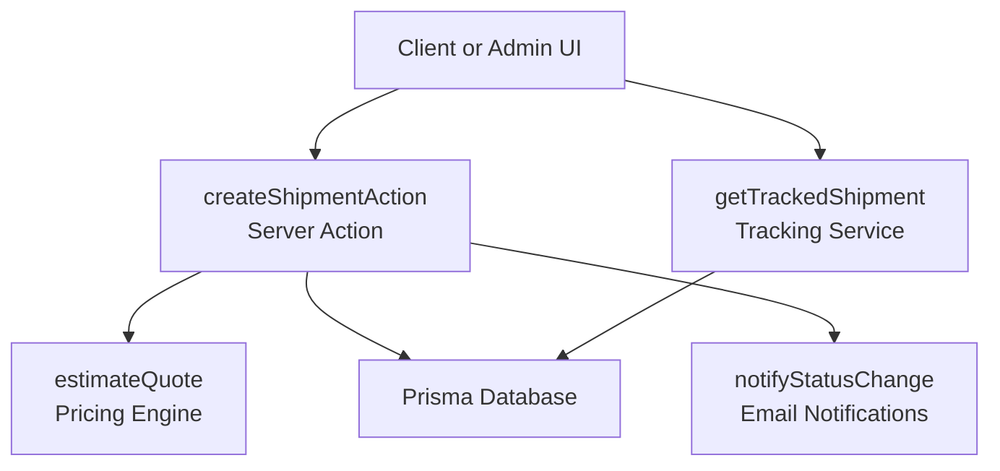
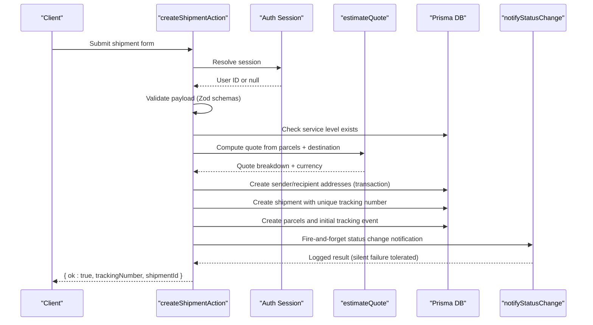
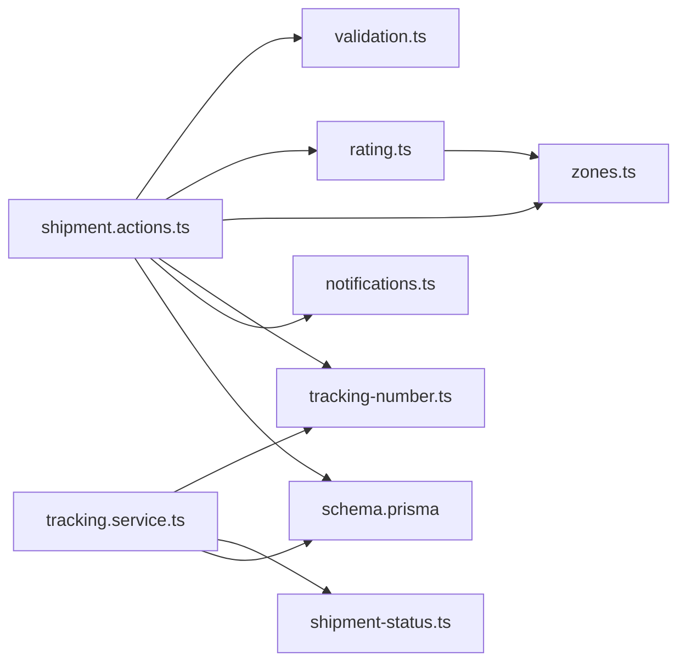

# Shipment Management API

<cite>
**Referenced Files in This Document**
- [shipment.actions.ts](file://server/shipment.actions.ts)
- [tracking.service.ts](file://server/tracking.service.ts)
- [tracking-number.ts](file://lib/tracking-number.ts)
- [shipment-status.ts](file://lib/shipment-status.ts)
- [validation.ts](file://lib/validation.ts)
- [rating.ts](file://lib/rating.ts)
- [zones.ts](file://lib/zones.ts)
- [notifications.ts](file://lib/notifications.ts)
- [schema.prisma](file://prisma/schema.prisma)
- [route.ts](file://app/api/auth/[...nextauth]/route.ts)
- [shipment-status.test.ts](file://tests/shipment-status.test.ts)
- [tracking-number.test.ts](file://tests/tracking-number.test.ts)
</cite>

## Table of Contents
1. [Introduction](#introduction)
2. [Project Structure](#project-structure)
3. [Core Components](#core-components)
4. [Architecture Overview](#architecture-overview)
5. [Detailed Component Analysis](#detailed-component-analysis)
6. [Dependency Analysis](#dependency-analysis)
7. [Performance Considerations](#performance-considerations)
8. [Troubleshooting Guide](#troubleshooting-guide)
9. [Conclusion](#conclusion)

## Introduction
This document describes the shipment management server actions and related services for creating shipments, generating tracking numbers, managing parcels, updating statuses, and querying shipment history. It explains function signatures, parameter validation rules, return structures, lifecycle states, transitions, business rules, error handling patterns, and database transaction safety.

The system is a Next.js application with server-side actions and services backed by Prisma and PostgreSQL. Public tracking lookups are guest-safe and optionally protected by recipient verification.

## Project Structure
Shipment-related functionality is primarily implemented in:
- Server action for creating shipments and persisting addresses, parcels, and initial tracking events.
- Tracking service for building public tracking views.
- Supporting libraries for tracking number generation, status state machine, pricing estimation, zone mapping, and notifications.
- Prisma schema defining entities such as Shipment, Parcel, Address, ServiceLevel, ServiceZone, RateRule, and TrackingEvent.

**Diagram sources**
- [shipment.actions.ts:45-145](file://server/shipment.actions.ts#L45-L145)
- [tracking.service.ts:69-146](file://server/tracking.service.ts#L69-L146)
- [rating.ts:19-60](file://lib/rating.ts#L19-L60)
- [notifications.ts:49-108](file://lib/notifications.ts#L49-L108)
- [schema.prisma:160-226](file://prisma/schema.prisma#L160-L226)

**Section sources**
- [schema.prisma:160-226](file://prisma/schema.prisma#L160-L226)
- [shipment.actions.ts:45-145](file://server/shipment.actions.ts#L45-L145)
- [tracking.service.ts:69-146](file://server/tracking.service.ts#L69-L146)

## Core Components
- createShipmentAction: Creates a shipment with validated input, generates a unique tracking number, computes a quote, persists sender/recipient addresses, parcels, and an initial tracking event, then triggers a notification.
- getTrackedShipment: Builds a public tracking view for a given tracking number, optionally verifying recipient details to prevent enumeration.
- generateTrackingNumber / isValidTrackingNumber / normalizeTrackingNumber: Generate random, check-digit-bearing tracking codes and validate them.
- SHIPMENT_STATUSES and transition helpers: Define allowed lifecycle states and enforce valid transitions.
- estimateQuote: Computes price breakdown based on destination zone, service level, and parcel inputs.
- Zone mapping: Maps postal code prefixes to service zones used for pricing.
- Notification delivery: Sends email updates about status changes and logs outcomes.

**Section sources**
- [shipment.actions.ts:45-145](file://server/shipment.actions.ts#L45-L145)
- [tracking.service.ts:69-146](file://server/tracking.service.ts#L69-L146)
- [tracking-number.ts:34-56](file://lib/tracking-number.ts#L34-L56)
- [shipment-status.ts:9-76](file://lib/shipment-status.ts#L9-L76)
- [rating.ts:19-60](file://lib/rating.ts#L19-L60)
- [zones.ts:29-34](file://lib/zones.ts#L29-L34)
- [notifications.ts:49-108](file://lib/notifications.ts#L49-L108)

## Architecture Overview
The shipment creation flow validates user input, checks service availability, estimates pricing, creates addresses and parcels atomically, assigns a unique tracking number, records the first tracking event, and sends a confirmation notification. The tracking lookup flow normalizes the tracking number, fetches public data, optionally verifies recipient identity, and returns a summarized timeline.

**Diagram sources**
- [shipment.actions.ts:45-145](file://server/shipment.actions.ts#L45-L145)
- [rating.ts:19-60](file://lib/rating.ts#L19-L60)
- [notifications.ts:49-108](file://lib/notifications.ts#L49-L108)
- [schema.prisma:160-226](file://prisma/schema.prisma#L160-L226)

## Detailed Component Analysis

### Shipment Creation API: createShipmentAction
Purpose:
- Validates and processes a new shipment request.
- Ensures authentication.
- Validates input using Zod schemas.
- Checks service availability.
- Estimates pricing.
- Persists addresses, shipment, parcels, and initial tracking event.
- Generates a unique tracking number with retry logic.
- Triggers a status-change notification.

Function signature:
- Name: createShipmentAction
- Parameters:
  - prev: ActionResult | null (previous form action result; unused)
  - formData: FormData (contains parcelsJson, senderJson, recipientJson, serviceLevelCode, pickupDate, notes)
- Return type: Promise<ActionResult & { trackingNumber?: string; shipmentId?: string }>

Parameter validation rules:
- parcelsJson must be valid JSON array of parcel objects.
- senderJson and recipientJson must be valid JSON address objects.
- serviceLevelCode must exist in the database.
- Input is validated via shipmentSchema, which enforces:
  - serviceLevelCode: required non-empty string.
  - pickupDate: optional string.
  - notes: optional string up to 500 characters.
  - sender and recipient: addressSchema fields including contactName, phone, line1, city, postalCode, country, etc.
  - parcels: array of parcelSchema items, min 1, max 20.

Parcel validation (parcelSchema):
- description: required string, 1–200 characters.
- weightKg: positive number, max 2000.
- pieces: integer, 1–50, default 1.
- lengthCm, widthCm, heightCm: optional positive numbers.
- declaredValue: optional number >= 0.

Address validation (addressSchema):
- label: optional string up to 60 characters.
- contactName: required string, 1–120 characters.
- phone: regex-based phone format, 6–20 characters.
- line1: required string, 1–160 characters.
- line2: optional string up to 160 characters.
- city: required string, 1–80 characters.
- region: optional string up to 80 characters.
- postalCode: required string, 2–16 characters.
- country: two-letter string, default "US".

Return structure:
- On success: { ok: true, trackingNumber: string, shipmentId: string }
- On failure: { ok: false, error: string }

Error handling:
- Missing or invalid session: returns error requiring sign-in.
- Invalid parcels JSON: returns error indicating invalid parcel data.
- Validation failures: returns first validation issue message.
- Unavailable service level: returns error indicating service unavailable.
- Unique constraint collision on tracking number: retries up to 5 times; if all fail, returns error indicating allocation failure.
- Notification errors: silently ignored (fire-and-forget).

Database transactions:
- Sender and recipient addresses are created within a single Prisma transaction to ensure atomicity.
- Shipment creation uses a helper that retries on unique-constraint violation for trackingNumber.

Business rules:
- Initial shipment status is CREATED.
- A tracking event is recorded at creation with source CUSTOMER and location derived from sender city and country.
- Price and currency are taken from the estimated quote.
- Parcels are persisted with dimensions and declared value when provided.

Example usage pattern:
- Build parcels array with description, weightKg, pieces, and optional dimensions/declaredValue.
- Provide sender and recipient addresses following addressSchema.
- Choose an active serviceLevelCode.
- Optionally provide pickupDate and notes.
- Submit via form action; handle returned trackingNumber and shipmentId.

**Section sources**
- [shipment.actions.ts:45-145](file://server/shipment.actions.ts#L45-L145)
- [validation.ts:50-67](file://lib/validation.ts#L50-L67)
- [validation.ts:38-48](file://lib/validation.ts#L38-L48)
- [schema.prisma:160-203](file://prisma/schema.prisma#L160-L203)

### Tracking Number Generation and Validation
Purpose:
- Generate random, unambiguous tracking numbers with a check character.
- Normalize user input.
- Validate generated or user-provided codes.

Key functions:
- generateTrackingNumber(opts?): string
  - Returns a code with prefix "TB", 8 base32 body characters, and a check character.
  - Uses Crockford Base32 alphabet excluding ambiguous characters.
  - Randomness can be injected for tests via opts.rand.
- normalizeTrackingNumber(input: string): string
  - Uppercases and removes spaces and dashes.
- isValidTrackingNumber(input: string): boolean
  - Validates length, prefix, body characters, and check digit.

Validation rules:
- Length must be 11 characters.
- Must start with "TB".
- Body must consist of allowed base32 characters.
- Check character must match computed checksum.

Examples:
- Generating multiple candidates and validating each before insertion.
- Normalizing " tb7k-3m9q xr4t " to "TB7K3M9QXR4T".

**Section sources**
- [tracking-number.ts:34-56](file://lib/tracking-number.ts#L34-L56)
- [tracking-number.ts:12-27](file://lib/tracking-number.ts#L12-L27)
- [tracking-number.test.ts:5-27](file://tests/tracking-number.test.ts#L5-L27)

### Shipment Lifecycle and Status Transitions
Purpose:
- Define allowed shipment statuses and transitions.
- Provide metadata for UI rendering.

Core definitions:
- SHIPMENT_STATUSES: Array of allowed statuses including CREATED, CONFIRMED, PICKED_UP, IN_TRANSIT, AT_HUB, OUT_FOR_DELIVERY, DELIVERED, EXCEPTION, RETURNED, CANCELLED.
- nextStatuses(from): returns allowed next statuses for a given state.
- canTransition(from, to): boolean indicating whether a transition is allowed.
- isTerminal(status): boolean indicating terminal states RETURNED and CANCELLED.
- isCompleted(status): boolean for delivered/closed states DELIVERED, RETURNED, CANCELLED.
- STATUS_META: maps each status to label, description, and tone.

Transitions:
- Linear happy path: CREATED → CONFIRMED → PICKED_UP → IN_TRANSIT → AT_HUB → OUT_FOR_DELIVERY → DELIVERED.
- Exceptions allow recovery paths back into transit or delivery flows.
- Terminal states do not allow further transitions.

UI metadata:
- Each status has a human-readable label and description.
- Tone values guide visual styling: neutral, active, success, warning, danger.

**Section sources**
- [shipment-status.ts:9-76](file://lib/shipment-status.ts#L9-L76)
- [shipment-status.test.ts:5-38](file://tests/shipment-status.test.ts#L5-L38)

### Public Tracking Lookup API: getTrackedShipment
Purpose:
- Build a guest-safe public tracking view for a given tracking number.
- Optionally verify recipient identity to reduce enumeration risk.

Function signature:
- Name: getTrackedShipment
- Parameters:
  - rawTrackingNumber: string
  - verification?: string (optional recipient postal code or name token)
- Return type: Promise<TrackedResult> where TrackedResult is one of:
  - { status: "ok"; data: PublicTracking }
  - { status: "not_found" }
  - { status: "verification_failed" }

PublicTracking structure:
- trackingNumber: string
- status: ShipmentStatus
- statusLabel: string
- statusDescription: string
- tone: "neutral" | "active" | "success" | "warning" | "danger"
- serviceName: string
- slaDays: number
- createdAt: Date
- estimatedDelivery: Date | null
- deliveredAt: Date | null
- origin: { city: string; region: string | null; country: string }
- destination: { city: string; region: string | null; country: string }
- pieces: number
- weightTotalKg: number
- progressPercent: number
- events: PublicTrackingEvent[]

Processing steps:
- Normalize tracking number.
- Fetch shipment with service level, addresses, parcels, and public tracking events.
- If verification is provided, compare against recipient postal code or name tokens.
- Map tracking events to public events with labels and descriptions.
- Compute totals for pieces and weight.
- Calculate progress percentage based on status.

Security considerations:
- Does not expose sensitive fields like street address, contact name, phone, or price.
- Optional verification reduces enumeration attacks.

**Section sources**
- [tracking.service.ts:69-146](file://server/tracking.service.ts#L69-L146)
- [tracking.service.ts:6-31](file://server/tracking.service.ts#L6-L31)
- [tracking-number.ts:43-56](file://lib/tracking-number.ts#L43-L56)

### Pricing Estimation: estimateQuote
Purpose:
- Resolve pricing configuration for a destination zone and service level.
- Compute quote breakdown using the pure pricing engine.

Function signature:
- Name: estimateQuote
- Parameters:
  - destinationPostalCode: string
  - serviceLevelCode: string
  - parcels: ParcelInput[]
- Return type: Promise<PricedQuote>

PricedQuote structure:
- breakdown: QuoteBreakdown
- currency: string
- etaDays: number
- zoneName: string
- serviceLevelName: string
- serviceLevelCode: string

Processing steps:
- Map destination postal code to zone code.
- Look up service zone and service level.
- Find rate rule for zone + service level.
- Compute quote breakdown using zone base price, per-kg, per-piece, minimum price, and service multiplier.

Error handling:
- Throws descriptive errors if pricing configuration is incomplete or no rate rule exists.

**Section sources**
- [rating.ts:19-60](file://lib/rating.ts#L19-L60)
- [zones.ts:29-34](file://lib/zones.ts#L29-L34)
- [schema.prisma:84-125](file://prisma/schema.prisma#L84-L125)

### Zone Mapping: matchZoneCode
Purpose:
- Map postal code prefixes to service zones for v1 demo coverage.

Function signature:
- Name: matchZoneCode
- Parameters:
  - postalCode: string
- Return type: ZoneCode ("METRO" | "REGION" | "REMOTE")

Rules:
- Empty or unknown prefixes default to "REGION".
- Digit prefixes map to zones according to a static table.

**Section sources**
- [zones.ts:29-34](file://lib/zones.ts#L29-L34)

### Notifications: notifyStatusChange
Purpose:
- Send email notifications for shipment status changes.
- Honor user preferences and log outcomes.

Function signature:
- Name: notifyStatusChange
- Parameters:
  - shipmentId: string
  - eventId: string
- Return type: Promise<void>

Behavior:
- Loads shipment and event; skips if missing.
- Checks user notification preferences for EMAIL channel.
- Composes subject and HTML body using status metadata.
- Delivers email or logs SKIPPED/FAILED depending on environment and transport.

Error handling:
- Delivery failures are caught and logged with error details.

**Section sources**
- [notifications.ts:49-108](file://lib/notifications.ts#L49-L108)

### Authentication Integration
Purpose:
- Protect shipment creation by requiring an authenticated session.

Integration points:
- createShipmentAction resolves the current session and requires a user ID.
- NextAuth handlers are mounted at the auth route.

**Section sources**
- [shipment.actions.ts:49-53](file://server/shipment.actions.ts#L49-L53)
- [route.ts:1-4](file://app/api/auth/[...nextauth]/route.ts#L1-L4)

## Dependency Analysis

**Diagram sources**
- [shipment.actions.ts:1-145](file://server/shipment.actions.ts#L1-L145)
- [tracking.service.ts:1-146](file://server/tracking.service.ts#L1-L146)
- [rating.ts:1-70](file://lib/rating.ts#L1-L70)
- [zones.ts:1-35](file://lib/zones.ts#L1-L35)
- [tracking-number.ts:1-57](file://lib/tracking-number.ts#L1-L57)
- [shipment-status.ts:1-77](file://lib/shipment-status.ts#L1-L77)
- [schema.prisma:1-261](file://prisma/schema.prisma#L1-L261)

**Section sources**
- [shipment.actions.ts:1-145](file://server/shipment.actions.ts#L1-L145)
- [tracking.service.ts:1-146](file://server/tracking.service.ts#L1-L146)
- [rating.ts:1-70](file://lib/rating.ts#L1-L70)
- [zones.ts:1-35](file://lib/zones.ts#L1-L35)
- [tracking-number.ts:1-57](file://lib/tracking-number.ts#L1-L57)
- [shipment-status.ts:1-77](file://lib/shipment-status.ts#L1-L77)
- [schema.prisma:1-261](file://prisma/schema.prisma#L1-L261)

## Performance Considerations
- Tracking number generation uses random base32 characters; uniqueness is enforced via database constraints with retry logic to avoid collisions.
- Address creation uses a Prisma transaction to minimize round-trips and ensure consistency.
- Notifications are fire-and-forget to avoid blocking the creation flow; failures are logged without impacting the response.
- Public tracking queries include only necessary relations and filter public events to reduce payload size.
- Pricing estimation performs three database reads (zone, service level, rate rule); consider caching frequently accessed configurations if needed.

[No sources needed since this section provides general guidance]

## Troubleshooting Guide
Common issues and resolutions:
- Invalid parcel data: Ensure parcelsJson is valid JSON and conforms to parcelSchema.
- Missing service level: Verify serviceLevelCode corresponds to an active service level in the database.
- Pricing configuration incomplete: Ensure zone and service level exist and have a matching rate rule.
- Tracking number allocation failure: Retry after a short delay; the action retries up to five times automatically.
- Verification failed on tracking lookup: Confirm the verification string matches recipient postal code or name token.
- Notification delivery failures: Check SMTP configuration and emailEnabled flag; review NotificationLog entries for error messages.

**Section sources**
- [shipment.actions.ts:55-74](file://server/shipment.actions.ts#L55-L74)
- [shipment.actions.ts:77-85](file://server/shipment.actions.ts#L77-L85)
- [shipment.actions.ts:25-43](file://server/shipment.actions.ts#L25-L43)
- [tracking.service.ts:91-94](file://server/tracking.service.ts#L91-L94)
- [notifications.ts:81-107](file://lib/notifications.ts#L81-L107)

## Conclusion
The Shipment Management API provides robust server actions for creating shipments with validated inputs, unique tracking numbers, multi-parcel support, and automated notifications. The tracking service offers a secure, guest-friendly view of shipment history. The state machine ensures consistent lifecycle progression, while pricing and zone mapping enable accurate quotes. Error handling and transaction safety protect data integrity and improve reliability.

[No sources needed since this section summarizes without analyzing specific files]