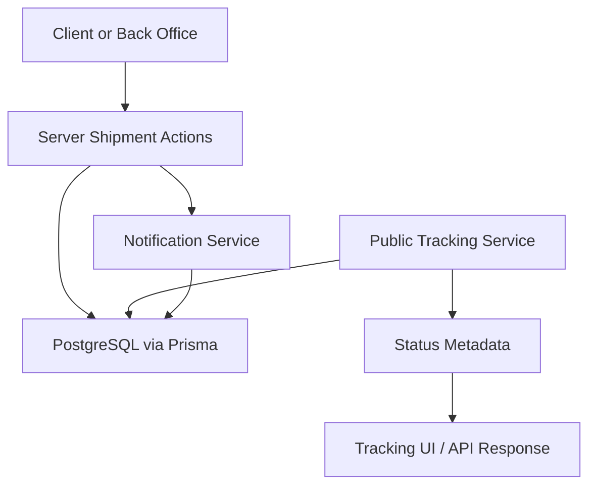
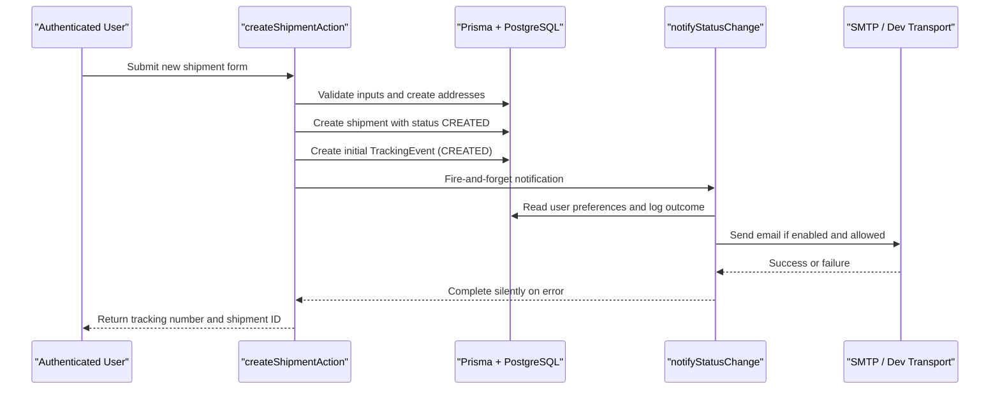
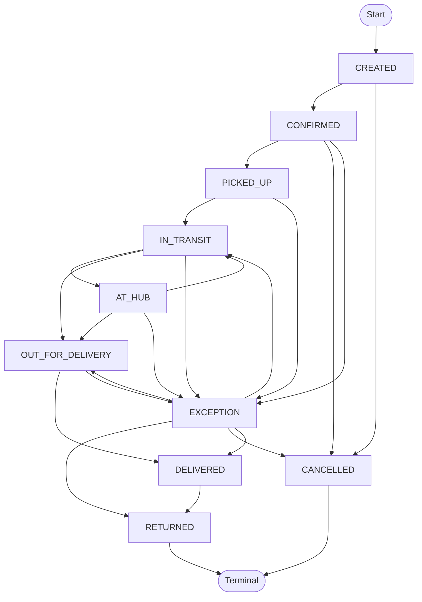
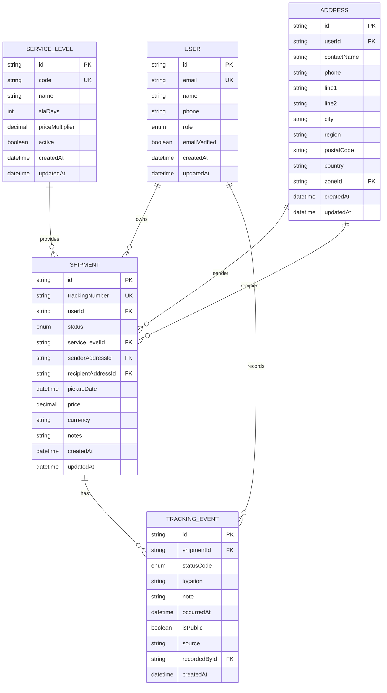
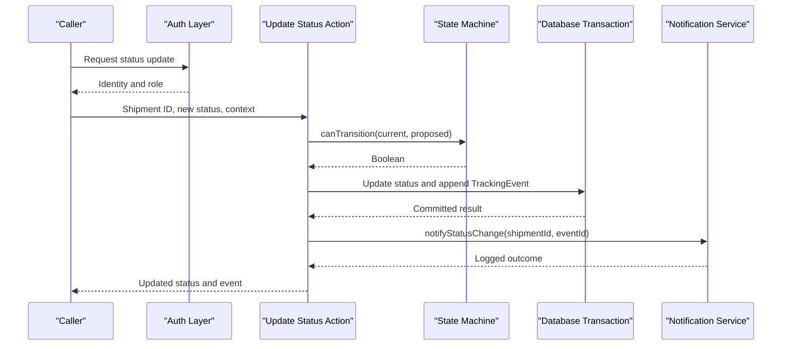
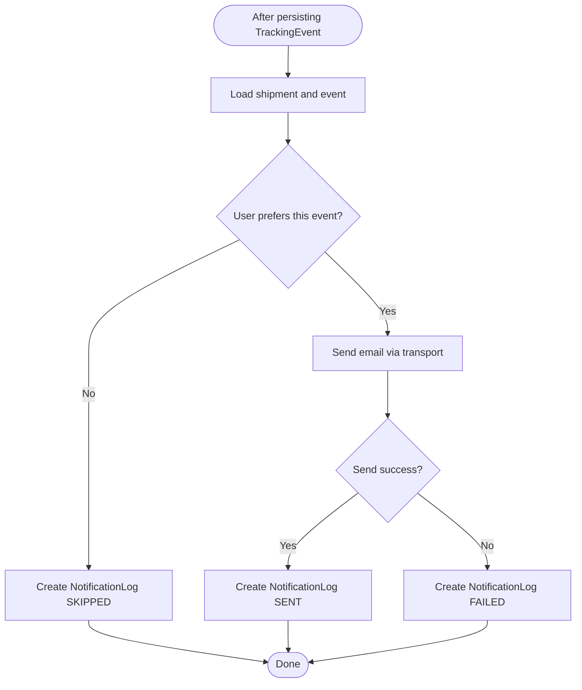
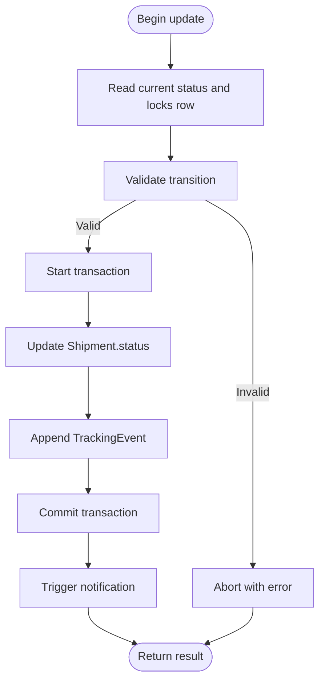
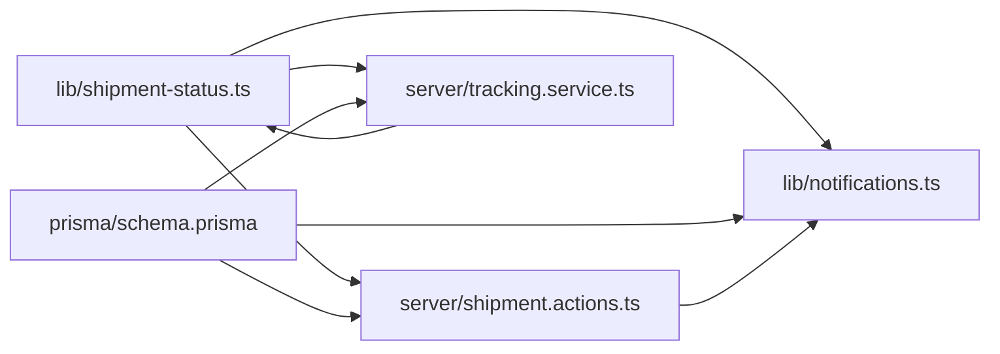

# Shipment Status Management

<cite>
**Referenced Files in This Document**
- [shipment-status.ts](file://lib/shipment-status.ts)
- [schema.prisma](file://prisma/schema.prisma)
- [shipment.actions.ts](file://server/shipment.actions.ts)
- [tracking.service.ts](file://server/tracking.service.ts)
- [notifications.ts](file://lib/notifications.ts)
- [seed.ts](file://prisma/seed.ts)
- [shipment-status.test.ts](file://tests/shipment-status.test.ts)
</cite>

## Table of Contents
1. [Introduction](#introduction)
2. [Project Structure](#project-structure)
3. [Core Components](#core-components)
4. [Architecture Overview](#architecture-overview)
5. [Detailed Component Analysis](#detailed-component-analysis)
6. [Dependency Analysis](#dependency-analysis)
7. [Performance Considerations](#performance-considerations)
8. [Troubleshooting Guide](#troubleshooting-guide)
9. [Conclusion](#conclusion)

## Introduction
This document explains the shipment status lifecycle management implemented in the project. It covers all supported shipment states, valid state transitions, business rules, authorization requirements, audit trail maintenance through tracking events, programmatic update patterns, validation logic, notification triggers, and concurrency handling.

The system models a complete delivery lifecycle: from order creation through confirmation, pickup, transit, hub processing, out-for-delivery, delivery, exceptions, returns, and cancellation. The state machine is centralized so that server actions, future back-office tools, and tests enforce identical rules.

## Project Structure
Shipment status management spans several layers:

- Domain model and state machine: `lib/shipment-status.ts`
- Database schema and relationships: `prisma/schema.prisma`
- Server-side shipment creation and initial event emission: `server/shipment.actions.ts`
- Public tracking query and progress computation: `server/tracking.service.ts`
- Notification delivery and logging: `lib/notifications.ts`
- Seed data demonstrating realistic event sequences: `prisma/seed.ts`
- Unit tests validating transition rules: `tests/shipment-status.test.ts`

**Diagram sources**
- [shipment.actions.ts:45-145](file://server/shipment.actions.ts#L45-L145)
- [tracking.service.ts:69-146](file://server/tracking.service.ts#L69-L146)
- [notifications.ts:49-108](file://lib/notifications.ts#L49-L108)
- [schema.prisma:160-226](file://prisma/schema.prisma#L160-L226)

**Section sources**
- [shipment-status.ts:1-77](file://lib/shipment-status.ts#L1-L77)
- [schema.prisma:23-34](file://prisma/schema.prisma#L23-L34)
- [schema.prisma:160-226](file://prisma/schema.prisma#L160-L226)
- [shipment.actions.ts:45-145](file://server/shipment.actions.ts#L45-L145)
- [tracking.service.ts:1-147](file://server/tracking.service.ts#L1-L147)
- [notifications.ts:1-114](file://lib/notifications.ts#L1-L114)
- [seed.ts:82-100](file://prisma/seed.ts#L82-L100)
- [shipment-status.test.ts:1-40](file://tests/shipment-status.test.ts#L1-L40)

## Core Components
- State machine and metadata: defines allowed statuses, next-state rules, terminal/completed helpers, and user-facing labels/descriptions/tone.
- Database schema: defines `Shipment`, `TrackingEvent`, and related entities with indexes for efficient queries.
- Shipment creation action: authenticates users, validates input, creates shipment records, emits an initial tracking event, and triggers notifications.
- Tracking service: builds guest-safe public tracking responses, computes progress, and maps events to human-readable metadata.
- Notification service: sends email updates based on user preferences and logs outcomes.

Key responsibilities:
- Enforce valid transitions centrally.
- Maintain an immutable audit trail through tracking events.
- Provide consistent status presentation across UI and APIs.
- Ensure notifications are preference-aware and auditable.

**Section sources**
- [shipment-status.ts:9-77](file://lib/shipment-status.ts#L9-L77)
- [schema.prisma:160-226](file://prisma/schema.prisma#L160-L226)
- [shipment.actions.ts:45-145](file://server/shipment.actions.ts#L45-L145)
- [tracking.service.ts:38-54](file://server/tracking.service.ts#L38-L54)
- [notifications.ts:49-108](file://lib/notifications.ts#L49-L108)

## Architecture Overview
The shipment status lifecycle is driven by server actions and services that interact with the database and external notification channels.

**Diagram sources**
- [shipment.actions.ts:45-145](file://server/shipment.actions.ts#L45-L145)
- [notifications.ts:49-108](file://lib/notifications.ts#L49-L108)
- [schema.prisma:160-226](file://prisma/schema.prisma#L160-L226)

## Detailed Component Analysis

### Shipment Status Lifecycle and Valid Transitions
The state machine defines ten statuses:
- CREATED
- CONFIRMED
- PICKED_UP
- IN_TRANSIT
- AT_HUB
- OUT_FOR_DELIVERY
- DELIVERED
- EXCEPTION
- RETURNED
- CANCELLED

Valid transitions follow a linear happy path with exception recovery and terminal closures:
- CREATED → CONFIRMED or CANCELLED
- CONFIRMED → PICKED_UP, CANCELLED, or EXCEPTION
- PICKED_UP → IN_TRANSIT or EXCEPTION
- IN_TRANSIT → AT_HUB, OUT_FOR_DELIVERY, or EXCEPTION
- AT_HUB → IN_TRANSIT, OUT_FOR_DELIVERY, or EXCEPTION
- OUT_FOR_DELIVERY → DELIVERED or EXCEPTION
- DELIVERED → RETURNED
- EXCEPTION → IN_TRANSIT, OUT_FOR_DELIVERY, RETURNED, CANCELLED, or DELIVERED
- RETURNED and CANCELLED are terminal; no further transitions are allowed.

Business rules:
- Transitions must be validated using the central state machine.
- Terminal states cannot advance.
- Completed states include DELIVERED, RETURNED, and CANCELLED for UI rendering purposes.
- Exception states allow recovery into normal flow or closure.

**Diagram sources**
- [shipment-status.ts:29-40](file://lib/shipment-status.ts#L29-L40)

**Section sources**
- [shipment-status.ts:9-77](file://lib/shipment-status.ts#L9-L77)
- [shipment-status.test.ts:4-39](file://tests/shipment-status.test.ts#L4-L39)

### Data Model and Audit Trail
The database model enforces strong relationships and indexing:
- `Shipment` stores current status, service level, addresses, pricing, and timestamps.
- `TrackingEvent` captures each status change with location, note, timestamp, visibility flag, source, and recording user.
- Indexes on `Shipment.status`, `Shipment.userId`, `Shipment.createdAt`, and `TrackingEvent.shipmentId` optimize common queries.

Audit trail guarantees:
- Every meaningful status change should be accompanied by a tracking event.
- Events record who recorded them and when, enabling full traceability.
- Public vs internal events are separated by `isPublic`.

**Diagram sources**
- [schema.prisma:57-78](file://prisma/schema.prisma#L57-L78)
- [schema.prisma:98-111](file://prisma/schema.prisma#L98-L111)
- [schema.prisma:131-154](file://prisma/schema.prisma#L131-L154)
- [schema.prisma:160-186](file://prisma/schema.prisma#L160-L186)
- [schema.prisma:209-226](file://prisma/schema.prisma#L209-L226)

**Section sources**
- [schema.prisma:160-226](file://prisma/schema.prisma#L160-L226)

### Status Update Workflow and Authorization
Current implementation focuses on creating shipments with an initial status and event. Future status updates should follow this pattern:

1. Authenticate the caller and resolve their identity.
2. Load the target shipment and its current status.
3. Validate the requested transition using the state machine.
4. If invalid, return an authorization/validation error.
5. Begin a database transaction:
   - Update `Shipment.status`.
   - Append a new `TrackingEvent` with `statusCode`, location, note, source, and recorder.
6. Commit the transaction.
7. Trigger notifications asynchronously.
8. Return success with updated status and event details.

Authorization requirements:
- Customer users can view their own shipments.
- Staff/admin roles may update statuses depending on operational needs.
- Guest tracking uses optional verification (postal code or recipient name token) to prevent enumeration.

**Diagram sources**
- [shipment-status.ts:45-55](file://lib/shipment-status.ts#L45-L55)
- [schema.prisma:160-226](file://prisma/schema.prisma#L160-L226)
- [notifications.ts:49-108](file://lib/notifications.ts#L49-L108)

**Section sources**
- [shipment-status.ts:45-55](file://lib/shipment-status.ts#L45-L55)
- [tracking.service.ts:56-62](file://server/tracking.service.ts#L56-L62)

### Programmatic Status Updates and Validation Logic
Programmatic updates should call the state machine before mutating the database:
- Use `nextStatuses(from)` to enumerate allowed targets.
- Use `canTransition(from, to)` for explicit validation.
- Use `isTerminal(status)` to block further changes after closure.
- Use `isCompleted(status)` for UI completion indicators.

Example validation logic outline:
- Reject transitions not listed for the current status.
- Reject attempts to move from terminal states.
- Require a non-empty tracking event when changing status.
- Record the operator and timestamp in the tracking event.

Tests validate:
- Happy-path transitions are allowed.
- Skipping ahead is rejected.
- Terminal states have no outgoing transitions.
- Exception recovery paths are permitted.
- Metadata exists for every status.

**Section sources**
- [shipment-status.ts:45-60](file://lib/shipment-status.ts#L45-L60)
- [shipment-status.test.ts:4-39](file://tests/shipment-status.test.ts#L4-L39)

### Event Notification Triggers
Notifications are triggered after successful persistence of a tracking event:
- The system loads the shipment and event.
- It checks the user’s email preferences and whether the event type is enabled.
- It sends an email if allowed and configured.
- It records a `NotificationLog` with status SENT, FAILED, or SKIPPED.

In shipment creation:
- A “CREATED” tracking event is emitted immediately.
- A fire-and-forget notification is attempted; failures are logged silently.

**Diagram sources**
- [notifications.ts:49-108](file://lib/notifications.ts#L49-L108)
- [shipment.actions.ts:135-142](file://server/shipment.actions.ts#L135-L142)

**Section sources**
- [notifications.ts:49-108](file://lib/notifications.ts#L49-L108)
- [shipment.actions.ts:120-142](file://server/shipment.actions.ts#L120-L142)

### Concurrent Access Handling and Data Consistency
Concurrency safeguards:
- Unique tracking numbers: the creation routine retries allocation on unique-constraint collisions to avoid duplicates under contention.
- Database transactions: status updates and event creation should be wrapped in a single transaction to ensure atomicity.
- Idempotency: consider deduplicating event creation by event signature (e.g., status + source + timestamp window) to handle retries safely.
- Optimistic checks: re-read the current status inside the transaction before applying the update to detect concurrent modifications.

Consistency guarantees:
- The latest status always reflects the most recent committed event.
- Public tracking queries filter only public events and compute progress deterministically.
- Notification logs provide an audit trail even when delivery fails.

**Diagram sources**
- [shipment.actions.ts:25-43](file://server/shipment.actions.ts#L25-L43)
- [schema.prisma:160-226](file://prisma/schema.prisma#L160-L226)

**Section sources**
- [shipment.actions.ts:25-43](file://server/shipment.actions.ts#L25-L43)
- [tracking.service.ts:75-87](file://server/tracking.service.ts#L75-L87)

### Public Tracking and Progress Rendering
The public tracking service:
- Normalizes the tracking number.
- Loads the shipment with public events and related metadata.
- Optionally verifies access using recipient postal code or name token.
- Computes progress percentage based on status position in a defined order.
- Returns a safe payload excluding sensitive fields like price and private addresses.

Progress calculation:
- DELIVERED, RETURNED, and CANCELLED map to 100%.
- Other statuses map proportionally along a predefined order.
- EXCEPTION receives a special intermediate value to reflect uncertainty.

**Section sources**
- [tracking.service.ts:38-54](file://server/tracking.service.ts#L38-L54)
- [tracking.service.ts:69-146](file://server/tracking.service.ts#L69-L146)

### Example Event Sequences
Seed data demonstrates realistic event sequences:
- A delivered shipment includes CREATED, PICKED_UP, IN_TRANSIT, OUT_FOR_DELIVERY, and DELIVERED events.
- Another example shows a shipment currently OUT_FOR_DELIVERY with earlier events.

These examples illustrate how events accumulate over time and how public timelines are constructed.

**Section sources**
- [seed.ts:82-100](file://prisma/seed.ts#L82-L100)
- [seed.ts:103-122](file://prisma/seed.ts#L103-L122)

## Dependency Analysis
The following diagram highlights key dependencies among modules involved in status management:

**Diagram sources**
- [shipment-status.ts:1-77](file://lib/shipment-status.ts#L1-L77)
- [shipment.actions.ts:1-146](file://server/shipment.actions.ts#L1-L146)
- [tracking.service.ts:1-147](file://server/tracking.service.ts#L1-L147)
- [notifications.ts:1-114](file://lib/notifications.ts#L1-L114)
- [schema.prisma:160-226](file://prisma/schema.prisma#L160-L226)

**Section sources**
- [shipment-status.ts:1-77](file://lib/shipment-status.ts#L1-L77)
- [shipment.actions.ts:1-146](file://server/shipment.actions.ts#L1-L146)
- [tracking.service.ts:1-147](file://server/tracking.service.ts#L1-L147)
- [notifications.ts:1-114](file://lib/notifications.ts#L1-L114)
- [schema.prisma:160-226](file://prisma/schema.prisma#L160-L226)

## Performance Considerations
- Index usage: Queries on `Shipment.status`, `Shipment.userId`, and `TrackingEvent.shipmentId` benefit from existing indexes.
- Event filtering: Public tracking filters by `isPublic` to reduce exposure and improve response size.
- Notification decoupling: Notifications are fired asynchronously to avoid blocking request latency.
- Progress computation: Linear scan over a small fixed array keeps progress calculations cheap.

Recommendations:
- Batch event creation where appropriate.
- Cache frequently accessed metadata at runtime if needed.
- Monitor notification queue/backlog and retry failed deliveries with exponential backoff.

[No sources needed since this section provides general guidance]

## Troubleshooting Guide
Common issues and resolutions:
- Invalid transition errors:
  - Verify the current status and proposed target against the state machine.
  - Ensure the operation is not attempting to move from a terminal state.
- Duplicate tracking numbers:
  - The creation routine retries allocation; persistent collisions indicate unusual contention or seed conflicts.
- Missing tracking events:
  - Confirm that every status mutation appends a tracking event within the same transaction.
- Notification not received:
  - Check user preferences, SMTP configuration, and `NotificationLog` entries for SKIPPED or FAILED statuses.
- Public tracking verification failures:
  - Ensure the provided verification matches either the recipient postal code or a token derived from the recipient name.

Operational checks:
- Inspect `NotificationLog` for delivery outcomes.
- Review `TrackingEvent` sequence for completeness and ordering.
- Validate that `Shipment.status` matches the latest event’s status.

**Section sources**
- [notifications.ts:49-108](file://lib/notifications.ts#L49-L108)
- [tracking.service.ts:56-62](file://server/tracking.service.ts#L56-L62)
- [shipment-status.test.ts:4-39](file://tests/shipment-status.test.ts#L4-L39)

## Conclusion
The shipment status management system centralizes lifecycle rules, enforces valid transitions, maintains a robust audit trail, and integrates notifications with preference-aware delivery. By combining a clear state machine, transactional updates, indexed queries, and comprehensive logging, it provides reliable, observable, and extensible shipment tracking. Future enhancements should implement explicit status-update server actions that reuse the shared state machine and preserve these consistency and audit guarantees.