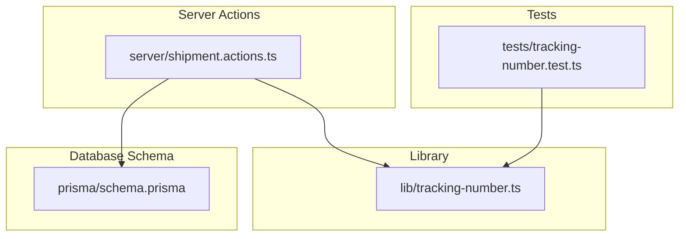
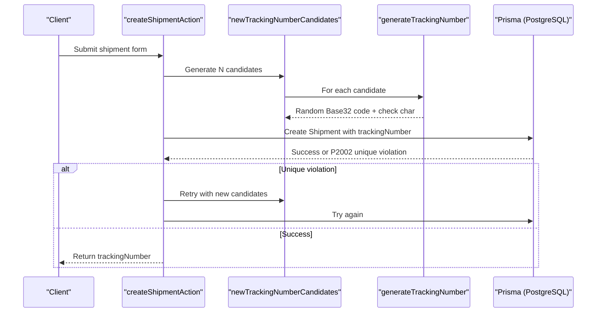
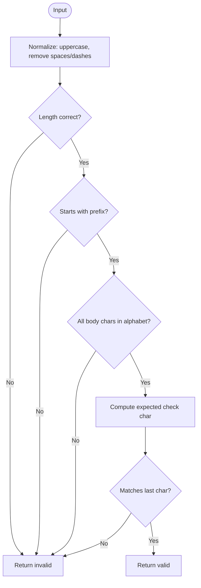
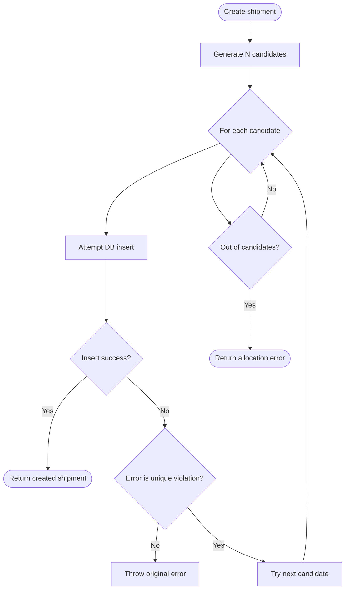
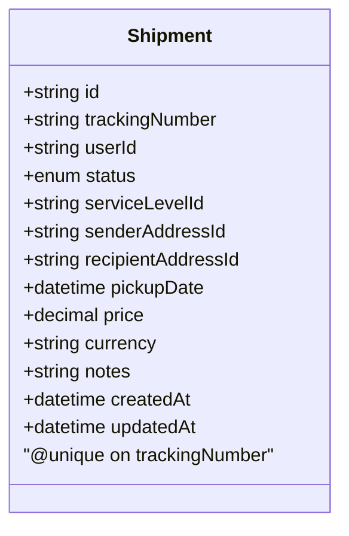
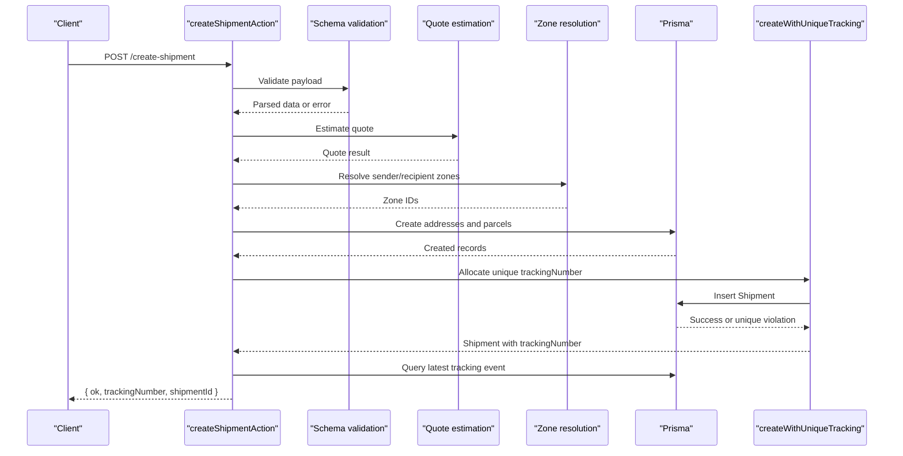
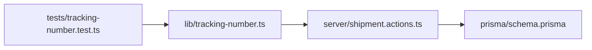

# Tracking Number Generation

<cite>
**Referenced Files in This Document**
- [tracking-number.ts](file://lib/tracking-number.ts)
- [shipment.actions.ts](file://server/shipment.actions.ts)
- [schema.prisma](file://prisma/schema.prisma)
- [tracking-number.test.ts](file://tests/tracking-number.test.ts)
</cite>

## Table of Contents
1. [Introduction](#introduction)
2. [Project Structure](#project-structure)
3. [Core Components](#core-components)
4. [Architecture Overview](#architecture-overview)
5. [Detailed Component Analysis](#detailed-component-analysis)
6. [Dependency Analysis](#dependency-analysis)
7. [Performance Considerations](#performance-considerations)
8. [Troubleshooting Guide](#troubleshooting-guide)
9. [Conclusion](#conclusion)

## Introduction
This document explains how tracking numbers are generated, validated, and integrated into shipment creation. It covers the Base32 encoding approach, uniqueness guarantees, collision handling, retry mechanisms, validation rules, and database constraints. It also provides guidance on performance, scalability, and troubleshooting unique constraint violations.

## Project Structure
The tracking number feature spans three main areas:
- Algorithm and utilities for generation and validation live in a dedicated library module.
- Shipment creation uses the generator to allocate tracking numbers and handles database uniqueness.
- The database schema enforces uniqueness at the data layer.

**Diagram sources**
- [tracking-number.ts:1-57](file://lib/tracking-number.ts#L1-L57)
- [shipment.actions.ts:1-146](file://server/shipment.actions.ts#L1-L146)
- [schema.prisma:160-186](file://prisma/schema.prisma#L160-L186)
- [tracking-number.test.ts:1-29](file://tests/tracking-number.test.ts#L1-L29)

**Section sources**
- [tracking-number.ts:1-57](file://lib/tracking-number.ts#L1-L57)
- [shipment.actions.ts:1-146](file://server/shipment.actions.ts#L1-L146)
- [schema.prisma:160-186](file://prisma/schema.prisma#L160-L186)
- [tracking-number.test.ts:1-29](file://tests/tracking-number.test.ts#L1-L29)

## Core Components
- Tracking number generator and validator:
  - Generates codes using a Crockford-style Base32 alphabet.
  - Computes a deterministic check character from the body.
  - Normalizes user input and validates format and checksum.
- Shipment action:
  - Creates shipments with a unique tracking number.
  - Batches candidate generation and retries on unique constraint violations.
- Database schema:
  - Enforces uniqueness of tracking numbers at the table level.

Key responsibilities:
- lib/tracking-number.ts: algorithm, normalization, validation.
- server/shipment.actions.ts: integration with Prisma, error handling, retry loop.
- prisma/schema.prisma: unique constraint on trackingNumber.

**Section sources**
- [tracking-number.ts:1-57](file://lib/tracking-number.ts#L1-L57)
- [shipment.actions.ts:19-43](file://server/shipment.actions.ts#L19-L43)
- [schema.prisma:160-163](file://prisma/schema.prisma#L160-L163)

## Architecture Overview
The tracking number flow integrates client-facing shipment creation with server-side allocation and persistence.

**Diagram sources**
- [shipment.actions.ts:19-43](file://server/shipment.actions.ts#L19-L43)
- [tracking-number.ts:34-41](file://lib/tracking-number.ts#L34-L41)
- [schema.prisma:160-163](file://prisma/schema.prisma#L160-L163)

## Detailed Component Analysis

### Tracking Number Algorithm and Validation
- Format:
  - Prefix: two-letter brand prefix.
  - Body: eight characters from a Crockford Base32 alphabet that excludes ambiguous letters.
  - Check character: one character derived deterministically from the body.
  - Total length: fixed size.
- Alphabet:
  - Uses digits and uppercase consonants/vowels excluding commonly confused characters.
- Checksum:
  - Weighted sum over body indices modulo alphabet length determines the final check character.
- Normalization:
  - Uppercases input and removes spaces and dashes before validation.
- Validation:
  - Checks total length, prefix, allowed characters, and recomputes the check character.

**Diagram sources**
- [tracking-number.ts:43-56](file://lib/tracking-number.ts#L43-L56)

**Section sources**
- [tracking-number.ts:1-57](file://lib/tracking-number.ts#L1-L57)

### Candidate Generation and Retry Mechanism
- Candidate generation:
  - Produces multiple random tracking numbers upfront to reduce round-trips.
- Retry strategy:
  - Attempts to create the shipment with each candidate.
  - On a unique constraint violation, catches the specific database error code and retries with a fresh set of candidates.
  - After exhausting attempts, returns a user-facing error indicating allocation failure.

**Diagram sources**
- [shipment.actions.ts:19-43](file://server/shipment.actions.ts#L19-L43)

**Section sources**
- [shipment.actions.ts:19-43](file://server/shipment.actions.ts#L19-L43)

### Database Constraint Handling
- Uniqueness:
  - The tracking number field is marked unique in the schema.
- Error detection:
  - Server code detects the specific unique constraint error code and treats it as a collision requiring retry.
- Implications:
  - Even with random generation, collisions can occur; the retry mechanism ensures eventual success under normal load.

**Diagram sources**
- [schema.prisma:160-163](file://prisma/schema.prisma#L160-L163)

**Section sources**
- [schema.prisma:160-163](file://prisma/schema.prisma#L160-L163)
- [shipment.actions.ts:25-43](file://server/shipment.actions.ts#L25-L43)

### Integration with Shipment Creation
- The shipment creation action:
  - Validates incoming form data.
  - Resolves service levels and zones.
  - Creates addresses and parcels within a transaction.
  - Calls the unique tracking allocation helper to persist the shipment with a guaranteed unique tracking number.
  - Emits a notification event after successful creation.

**Diagram sources**
- [shipment.actions.ts:45-145](file://server/shipment.actions.ts#L45-L145)
- [shipment.actions.ts:19-43](file://server/shipment.actions.ts#L19-L43)

**Section sources**
- [shipment.actions.ts:45-145](file://server/shipment.actions.ts#L45-L145)

## Dependency Analysis
- lib/tracking-number.ts:
  - Provides generateTrackingNumber, normalizeTrackingNumber, isValidTrackingNumber.
- server/shipment.actions.ts:
  - Imports generateTrackingNumber and orchestrates candidate generation and retry logic.
- prisma/schema.prisma:
  - Declares Shipment model with unique trackingNumber.
- tests/tracking-number.test.ts:
  - Validates generation correctness, normalization, tamper resistance, and randomness.

**Diagram sources**
- [tracking-number.ts:1-57](file://lib/tracking-number.ts#L1-L57)
- [shipment.actions.ts:1-146](file://server/shipment.actions.ts#L1-L146)
- [schema.prisma:160-163](file://prisma/schema.prisma#L160-L163)
- [tracking-number.test.ts:1-29](file://tests/tracking-number.test.ts#L1-L29)

**Section sources**
- [tracking-number.ts:1-57](file://lib/tracking-number.ts#L1-L57)
- [shipment.actions.ts:1-146](file://server/shipment.actions.ts#L1-L146)
- [schema.prisma:160-163](file://prisma/schema.prisma#L160-L163)
- [tracking-number.test.ts:1-29](file://tests/tracking-number.test.ts#L1-L29)

## Performance Considerations
- Randomness and entropy:
  - Eight-character Base32 body yields a large space, minimizing collision probability.
- Candidate batching:
  - Generating multiple candidates reduces database round-trips and contention.
- Retry overhead:
  - Retries only trigger on actual unique constraint errors; typical paths succeed on first attempt.
- Indexing:
  - Ensure queries by trackingNumber leverage the unique index automatically provided by the unique constraint.
- Scalability:
  - Under very high concurrency, consider increasing candidate batch size or pre-generating pools if contention becomes measurable.
- Deterministic checks:
  - Checksum computation is O(n) over body length; negligible given fixed small size.

[No sources needed since this section provides general guidance]

## Troubleshooting Guide
Common issues and resolutions:
- Unique constraint violations:
  - Symptom: Database reports a unique constraint error during shipment creation.
  - Cause: Two requests generated the same tracking number simultaneously.
  - Resolution: The server retries with new candidates; ensure error handling preserves the specific unique violation code and does not mask other errors.
- Invalid tracking numbers:
  - Symptom: User enters malformed or tampered codes.
  - Resolution: Use normalization and validation functions to reject invalid inputs early.
- Collisions in testing:
  - Symptom: Tests occasionally see duplicates due to randomness.
  - Resolution: Inject deterministic randomness in tests to control outputs and assert behavior.

Operational tips:
- Monitor unique constraint violation rates to detect unusual contention.
- Log failed allocations after retries to identify spikes.
- Keep candidate batch size tuned to workload characteristics.

**Section sources**
- [shipment.actions.ts:25-43](file://server/shipment.actions.ts#L25-L43)
- [tracking-number.ts:43-56](file://lib/tracking-number.ts#L43-L56)

## Conclusion
The tracking number system combines a robust Base32-based algorithm with deterministic checksum validation and a resilient retry mechanism backed by a unique database constraint. This design balances usability, security against enumeration, and reliability under concurrent load. With proper monitoring and tuning of candidate batches, the system scales well while maintaining strong uniqueness guarantees.

[No sources needed since this section summarizes without analyzing specific files]