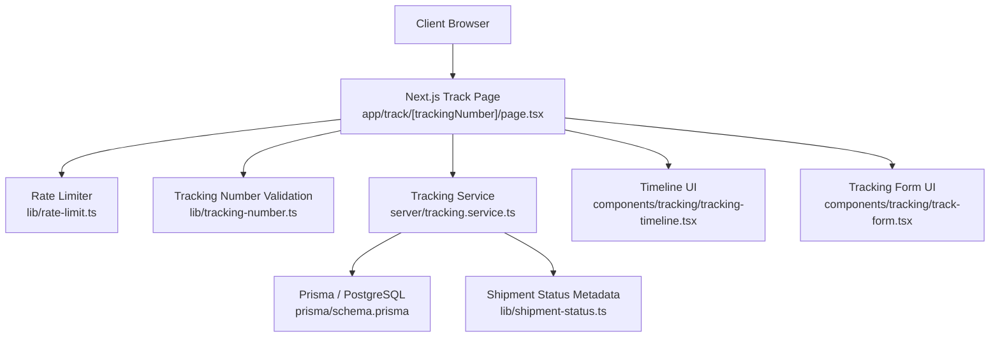
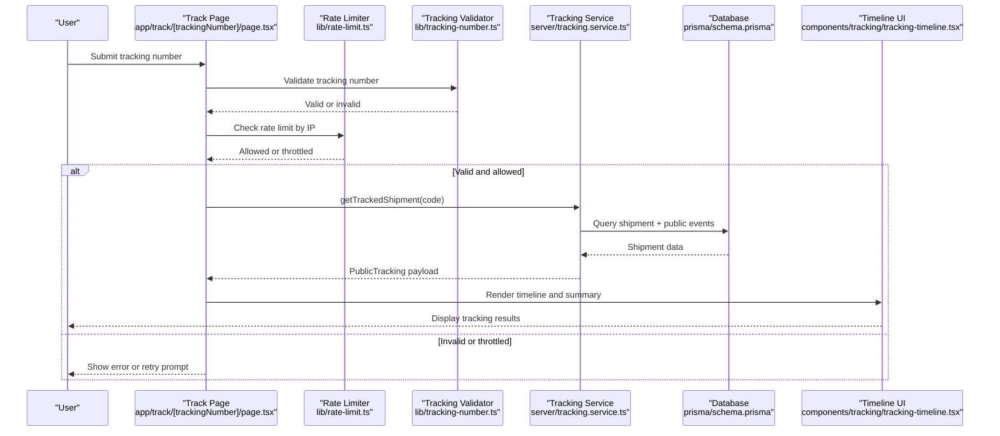
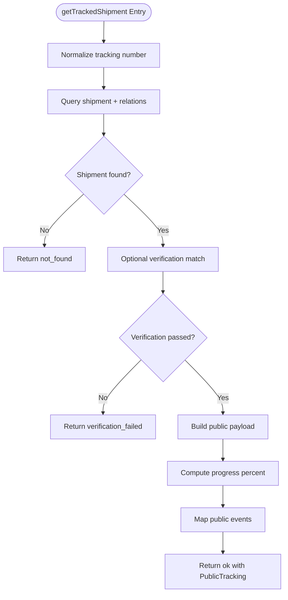
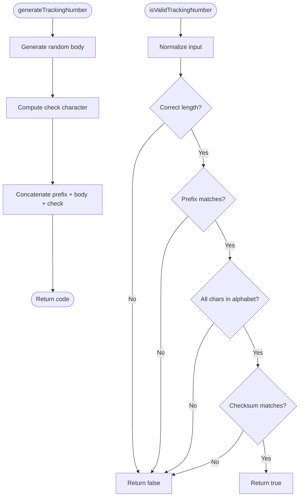
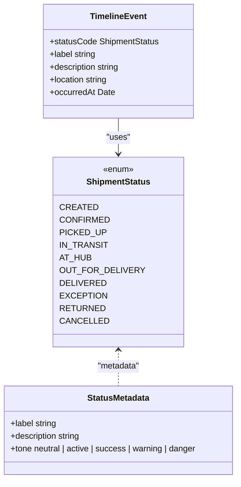
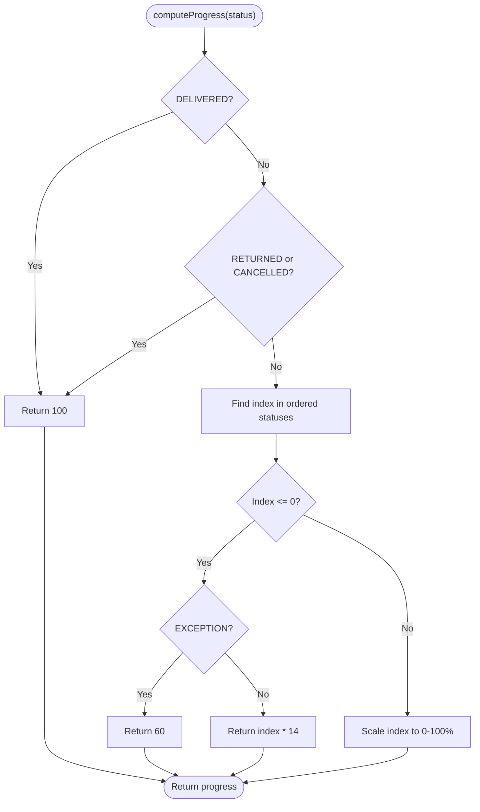
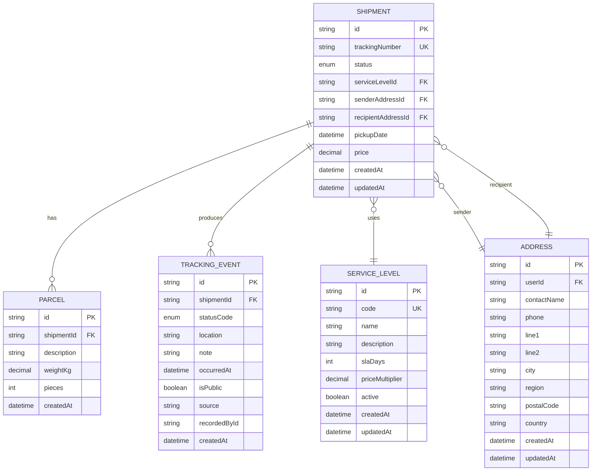
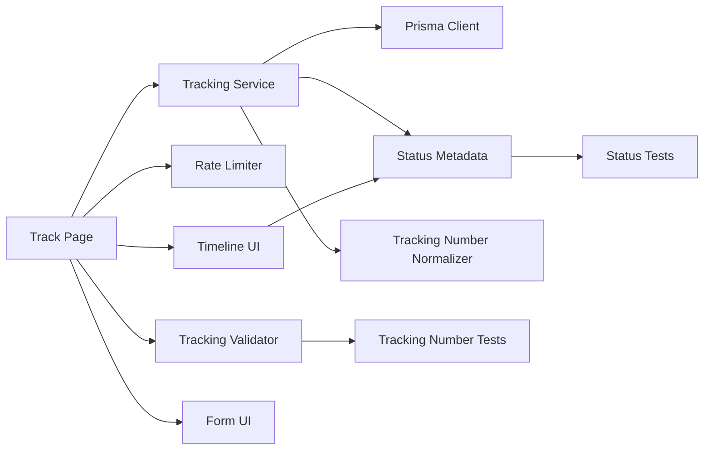

# Tracking Service API

<cite>
**Referenced Files in This Document**
- [tracking.service.ts](file://server/tracking.service.ts)
- [tracking-number.ts](file://lib/tracking-number.ts)
- [shipment-status.ts](file://lib/shipment-status.ts)
- [page.tsx](file://app/track/[trackingNumber]/page.tsx)
- [track-form.tsx](file://components/tracking/track-form.tsx)
- [tracking-timeline.tsx](file://components/tracking/tracking-timeline.tsx)
- [rate-limit.ts](file://lib/rate-limit.ts)
- [schema.prisma](file://prisma/schema.prisma)
- [tracking-number.test.ts](file://tests/tracking-number.test.ts)
- [shipment-status.test.ts](file://tests/shipment-status.test.ts)
</cite>

## Table of Contents
1. [Introduction](#introduction)
2. [Project Structure](#project-structure)
3. [Core Components](#core-components)
4. [Architecture Overview](#architecture-overview)
5. [Detailed Component Analysis](#detailed-component-analysis)
6. [Dependency Analysis](#dependency-analysis)
7. [Performance Considerations](#performance-considerations)
8. [Troubleshooting Guide](#troubleshooting-guide)
9. [Conclusion](#conclusion)

## Introduction
This document describes the tracking service layer that powers guest-facing shipment tracking. It explains how tracking numbers are generated and validated, how shipment status is retrieved and formatted, and how timeline data is presented to users. It also documents the public tracking interface design, guest access patterns, real-time update considerations, progress calculation logic, and performance strategies for high-traffic tracking queries.

The tracking flow is intentionally minimal: guests enter a tracking number, the system validates it, fetches public tracking data from the database, computes derived fields such as progress percentage, and renders a timeline of public events. Sensitive address details, prices, and internal identifiers are not exposed through the public tracking response.

## Project Structure
The tracking feature spans server-side service logic, client-side UI components, rate limiting, domain utilities, and database schema definitions:

- Server service: builds the public tracking payload and applies guest-safe filtering.
- Domain utilities: generate and validate Base32-based tracking numbers; define shipment state machine rules and metadata.
- Next.js page: enforces guest enumeration protection, validates input, calls the service, and renders the tracking view.
- UI components: render the tracking form and timeline.
- Rate limiter: provides an in-memory fixed-window guard against abuse.
- Database schema: defines shipments, parcels, tracking events, and related entities.

**Diagram sources**
- [page.tsx:48-76](file://app/track/[trackingNumber]/page.tsx#L48-L76)
- [tracking.service.ts:69-146](file://server/tracking.service.ts#L69-L146)
- [tracking-number.ts:36-56](file://lib/tracking-number.ts#L36-L56)
- [shipment-status.ts:62-76](file://lib/shipment-status.ts#L62-L76)
- [rate-limit.ts:24-47](file://lib/rate-limit.ts#L24-L47)
- [schema.prisma:160-226](file://prisma/schema.prisma#L160-L226)

**Section sources**
- [page.tsx:1-182](file://app/track/[trackingNumber]/page.tsx#L1-L182)
- [tracking.service.ts:1-147](file://server/tracking.service.ts#L1-L147)
- [tracking-number.ts:1-57](file://lib/tracking-number.ts#L1-L57)
- [shipment-status.ts:1-77](file://lib/shipment-status.ts#L1-L77)
- [rate-limit.ts:1-56](file://lib/rate-limit.ts#L1-L56)
- [schema.prisma:160-226](file://prisma/schema.prisma#L160-L226)

## Core Components
This section summarizes the primary building blocks of the tracking API surface and supporting logic.

- Public tracking result model:
  - Defines the shape returned by the tracking service, including status, labels, descriptions, tone, service name, SLA days, timestamps, origin/destination, pieces, weight, progress percentage, and public events.
- Tracking number generation and validation:
  - Generates random Base32 codes with a deterministic check character.
  - Normalizes user input and validates format and checksum.
- Shipment status state machine:
  - Enumerates allowed states, transitions, terminal states, completion semantics, and human-readable metadata used across rendering and business logic.
- Guest tracking endpoint:
  - Validates input, applies rate limiting, retrieves public data, and renders a safe summary without sensitive fields.
- Timeline component:
  - Renders public tracking events with status-specific styling and timestamps.

**Section sources**
- [tracking.service.ts:6-36](file://server/tracking.service.ts#L6-L36)
- [tracking-number.ts:3-10](file://lib/tracking-number.ts#L3-L10)
- [shipment-status.ts:9-26](file://lib/shipment-status.ts#L9-L26)
- [page.tsx:48-76](file://app/track/[trackingNumber]/page.tsx#L48-L76)
- [tracking-timeline.tsx:5-11](file://components/tracking/tracking-timeline.tsx#L5-L11)

## Architecture Overview
The public tracking request follows this sequence:

1. The user submits a tracking number via the client form.
2. The Next.js track page normalizes and validates the tracking number.
3. A per-IP rate limiter prevents rapid enumeration attempts.
4. The tracking service loads the shipment, related addresses, parcels, and public tracking events.
5. Derived fields (progress percentage, estimated delivery, totals) are computed.
6. The page renders the public tracking summary and timeline.

**Diagram sources**
- [page.tsx:56-76](file://app/track/[trackingNumber]/page.tsx#L56-L76)
- [tracking-number.ts:44-56](file://lib/tracking-number.ts#L44-L56)
- [rate-limit.ts:24-47](file://lib/rate-limit.ts#L24-L47)
- [tracking.service.ts:69-146](file://server/tracking.service.ts#L69-L146)
- [schema.prisma:160-226](file://prisma/schema.prisma#L160-L226)
- [tracking-timeline.tsx:21-50](file://components/tracking/tracking-timeline.tsx#L21-L50)

## Detailed Component Analysis

### Public Tracking Interface
The public tracking interface is implemented by the tracking service function that returns a unified result type. It accepts a raw tracking number and optional verification data. The response includes:

- Tracking number and current status with label, description, and tone.
- Service name and SLA duration.
- Creation timestamp, estimated delivery, and actual delivered timestamp when available.
- Origin and destination locations.
- Aggregated parcel count and total weight.
- Computed progress percentage.
- Public tracking events with status, label, description, location, and timestamp.

Guest safety is enforced by selecting only public events and excluding sensitive fields such as street address, contact name, phone, and price. Optional verification can be supplied to mitigate enumeration attacks.

**Diagram sources**
- [tracking.service.ts:69-146](file://server/tracking.service.ts#L69-L146)

**Section sources**
- [tracking.service.ts:6-36](file://server/tracking.service.ts#L6-L36)
- [tracking.service.ts:69-146](file://server/tracking.service.ts#L69-L146)

### Tracking Number Generation and Validation
Tracking numbers use a compact, unambiguous Base32 encoding:

- Format: two-letter prefix followed by eight Base32 characters and one check character.
- Alphabet: Crockford Base32 without ambiguous letters.
- Randomness: body characters are randomly selected to resist enumeration.
- Check character: deterministic checksum over the body ensures integrity.
- Normalization: uppercase conversion and removal of spaces/dashes.
- Validation: length, prefix, alphabet membership, and checksum verification.

Tests verify that generated codes are valid, tamper detection works, normalization behaves correctly, and outputs are non-sequential.

**Diagram sources**
- [tracking-number.ts:16-41](file://lib/tracking-number.ts#L16-L41)
- [tracking-number.ts:44-56](file://lib/tracking-number.ts#L44-L56)

**Section sources**
- [tracking-number.ts:3-10](file://lib/tracking-number.ts#L3-L10)
- [tracking-number.ts:36-56](file://lib/tracking-number.ts#L36-L56)
- [tracking-number.test.ts:4-27](file://tests/tracking-number.test.ts#L4-L27)

### Shipment Status Retrieval and Timeline Formatting
Status retrieval relies on a well-defined state machine:

- Allowed statuses include lifecycle stages from creation through delivery, plus exception, return, and cancellation.
- Forward transitions are constrained; some states allow recovery from exceptions.
- Terminal states prevent further movement.
- Completion semantics treat delivered, returned, and cancelled as closed.
- Human-readable metadata provides labels, descriptions, and visual tones.

Timeline formatting maps each public event to a display-friendly structure using the same metadata. The UI renders events chronologically with status-specific dots and timestamps.

**Diagram sources**
- [shipment-status.ts:9-26](file://lib/shipment-status.ts#L9-L26)
- [shipment-status.ts:62-76](file://lib/shipment-status.ts#L62-L76)
- [tracking-timeline.tsx:5-11](file://components/tracking/tracking-timeline.tsx#L5-L11)

**Section sources**
- [shipment-status.ts:28-60](file://lib/shipment-status.ts#L28-L60)
- [shipment-status.ts:62-76](file://lib/shipment-status.ts#L62-L76)
- [tracking-timeline.tsx:21-50](file://components/tracking/tracking-timeline.tsx#L21-L50)
- [shipment-status.test.ts:4-38](file://tests/shipment-status.test.ts#L4-L38)

### Progress Calculation Algorithm
Progress is calculated based on the current status:

- Delivered, returned, and cancelled map to full completion.
- Early lifecycle stages map to incremental percentages.
- Exception has a special mid-progress value.
- Intermediate stages scale linearly between start and finish.

**Diagram sources**
- [tracking.service.ts:38-54](file://server/tracking.service.ts#L38-L54)

**Section sources**
- [tracking.service.ts:38-54](file://server/tracking.service.ts#L38-L54)

### Guest Access Patterns and Real-Time Updates
Guest access is designed to minimize risk while providing useful visibility:

- Input validation occurs before database access.
- Per-IP rate limiting protects against brute-force enumeration.
- Only public events are included in the response.
- Optional verification allows additional confirmation without exposing sensitive data.
- The UI encourages account creation for richer features like alerts and proof of delivery.

Real-time updates are not implemented in the current flow. The page fetches data synchronously during rendering. For near-real-time behavior, consider polling endpoints, server-sent events, or WebSocket channels. Any such extension should preserve guest safety and rate limiting.

**Section sources**
- [page.tsx:56-76](file://app/track/[trackingNumber]/page.tsx#L56-L76)
- [tracking.service.ts:64-94](file://server/tracking.service.ts#L64-L94)
- [rate-limit.ts:3-9](file://lib/rate-limit.ts#L3-L9)

### Data Model Relationships Relevant to Tracking
The tracking service depends on several database models:

- Shipment: central entity with tracking number, status, service level, sender/recipient addresses, parcels, and events.
- Parcel: contributes piece counts and weights.
- TrackingEvent: stores status changes, locations, notes, and public flags.
- ServiceLevel: provides service name and SLA days.

**Diagram sources**
- [schema.prisma:98-111](file://prisma/schema.prisma#L98-L111)
- [schema.prisma:131-154](file://prisma/schema.prisma#L131-L154)
- [schema.prisma:160-203](file://prisma/schema.prisma#L160-L203)
- [schema.prisma:209-226](file://prisma/schema.prisma#L209-L226)

**Section sources**
- [schema.prisma:98-111](file://prisma/schema.prisma#L98-L111)
- [schema.prisma:131-154](file://prisma/schema.prisma#L131-L154)
- [schema.prisma:160-203](file://prisma/schema.prisma#L160-L203)
- [schema.prisma:209-226](file://prisma/schema.prisma#L209-L226)

## Dependency Analysis
The tracking subsystem has clear boundaries:

- The Next.js page depends on validation, rate limiting, the tracking service, and UI components.
- The tracking service depends on Prisma, status metadata, and tracking number normalization.
- UI components depend on status metadata and formatting utilities.
- Tests validate tracking number generation/validation and status transition rules.

**Diagram sources**
- [page.tsx:1-182](file://app/track/[trackingNumber]/page.tsx#L1-L182)
- [tracking.service.ts:1-147](file://server/tracking.service.ts#L1-L147)
- [tracking-number.ts:1-57](file://lib/tracking-number.ts#L1-L57)
- [shipment-status.ts:1-77](file://lib/shipment-status.ts#L1-L77)
- [tracking-timeline.tsx:1-51](file://components/tracking/tracking-timeline.tsx#L1-L51)
- [tracking-number.test.ts:1-29](file://tests/tracking-number.test.ts#L1-L29)
- [shipment-status.test.ts:1-40](file://tests/shipment-status.test.ts#L1-L40)

**Section sources**
- [page.tsx:1-182](file://app/track/[trackingNumber]/page.tsx#L1-L182)
- [tracking.service.ts:1-147](file://server/tracking.service.ts#L1-L147)
- [tracking-number.ts:1-57](file://lib/tracking-number.ts#L1-L57)
- [shipment-status.ts:1-77](file://lib/shipment-status.ts#L1-L77)
- [tracking-timeline.tsx:1-51](file://components/tracking/tracking-timeline.tsx#L1-L51)
- [tracking-number.test.ts:1-29](file://tests/tracking-number.test.ts#L1-L29)
- [shipment-status.test.ts:1-40](file://tests/shipment-status.test.ts#L1-L40)

## Performance Considerations
High-traffic tracking queries benefit from multiple layers of optimization:

- Input validation and rate limiting:
  - Validate early to avoid unnecessary database work.
  - Use per-IP rate limiting to blunt enumeration and reduce load spikes.
- Database query efficiency:
  - Fetch only necessary relations: service level, sender/recipient addresses, parcels, and public events.
  - Order public events by timestamp to support timeline rendering.
- Derived computation:
  - Compute progress percentage and totals in memory after loading data.
- Caching strategy:
  - Cache frequent tracking lookups at the application layer using short-lived keys keyed by tracking number.
  - Invalidate caches on status updates or after a small TTL.
  - For multi-instance deployments, prefer distributed caching (e.g., Redis) instead of in-process maps.
- UI responsiveness:
  - Avoid heavy client-side processing; rely on server-computed payloads.
  - Defer non-critical rendering until core tracking data is available.

[No sources needed since this section provides general guidance]

## Troubleshooting Guide
Common issues and resolutions:

- Invalid tracking number:
  - Ensure the code uses the correct prefix, length, Base32 alphabet, and checksum.
  - Normalize input by removing spaces and dashes and converting to uppercase.
- Too many requests:
  - If rate-limited, wait for the window to reset and retry.
  - Consider reducing polling frequency if implementing real-time updates.
- Not found or verification failed:
  - Confirm the tracking number exists and matches any provided verification data.
  - Remember that verification is optional but improves security against enumeration.
- Missing timeline events:
  - Only public events are shown; ensure events are marked as public when recording.
  - Check that events are ordered by timestamp and include required fields.

**Section sources**
- [tracking-number.ts:44-56](file://lib/tracking-number.ts#L44-L56)
- [rate-limit.ts:24-47](file://lib/rate-limit.ts#L24-L47)
- [tracking.service.ts:89-94](file://server/tracking.service.ts#L89-L94)
- [tracking.service.ts:103-112](file://server/tracking.service.ts#L103-L112)

## Conclusion
The tracking service layer provides a secure, efficient, and user-friendly way to expose shipment status and timeline information to guests. It combines robust tracking number generation and validation, a strict state machine for shipment statuses, and a carefully scoped public response model. With input validation, rate limiting, selective data inclusion, and potential caching, the system is well-positioned to handle high-traffic scenarios while protecting sensitive data. Future enhancements can add real-time updates and more sophisticated caching without compromising the guest safety guarantees already established.

[No sources needed since this section summarizes without analyzing specific files]