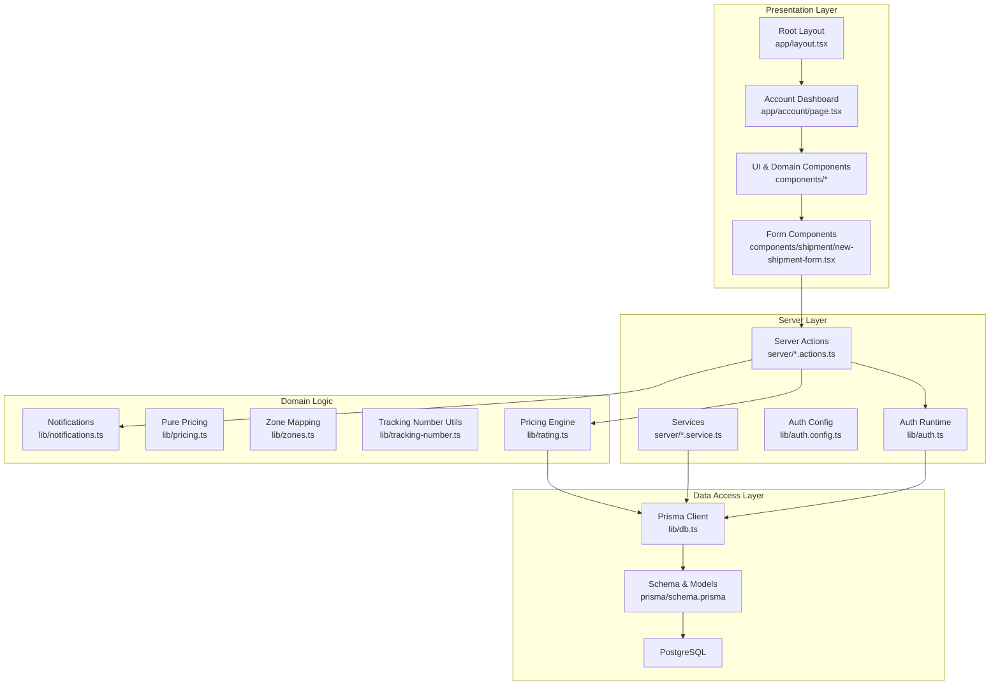
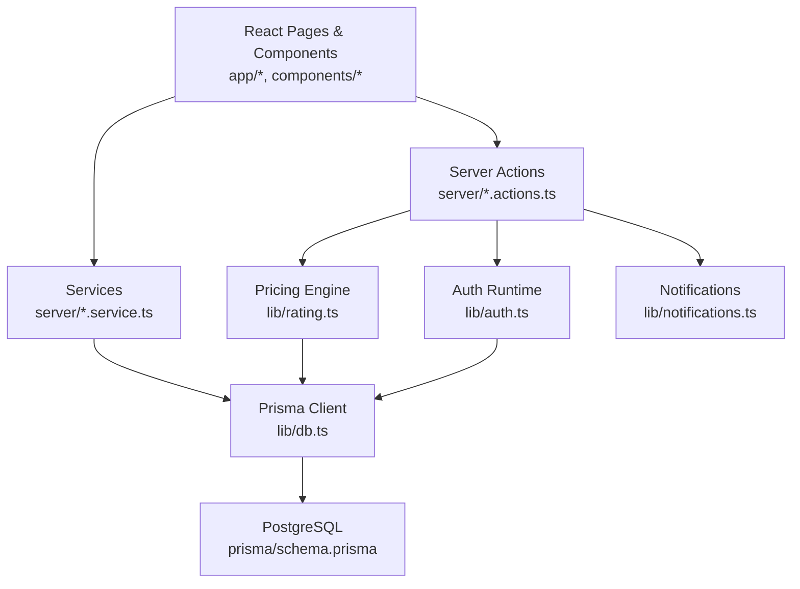
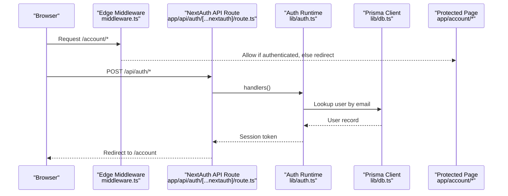
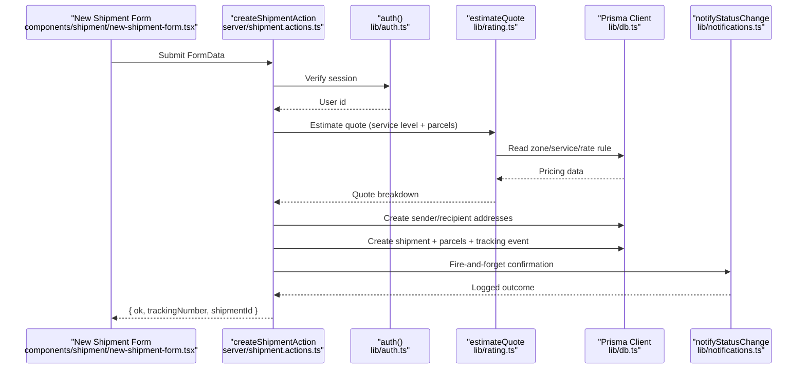
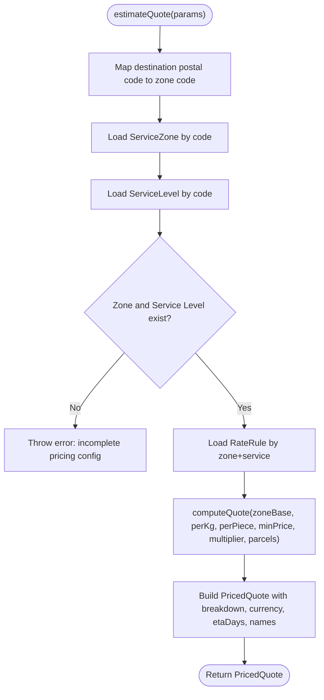
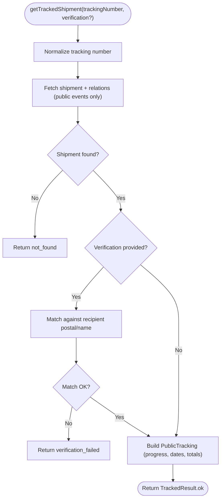
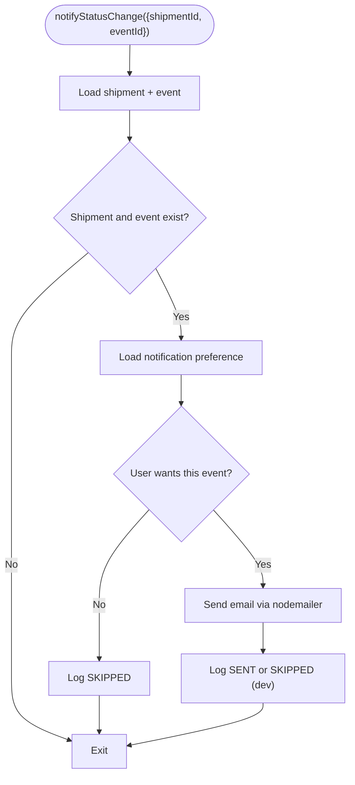
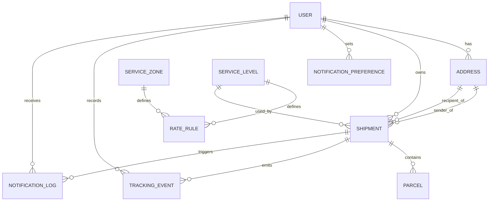
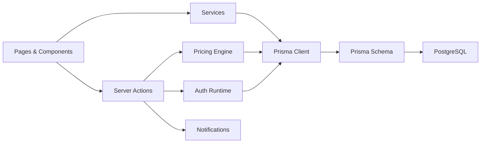

# Architecture Overview

<cite>
**Referenced Files in This Document**
- [README.md](file://README.md)
- [package.json](file://package.json)
- [next.config.ts](file://next.config.ts)
- [app/layout.tsx](file://app/layout.tsx)
- [middleware.ts](file://middleware.ts)
- [app/api/auth/[...nextauth]/route.ts](file://app/api/auth/[...nextauth]/route.ts)
- [lib/auth.config.ts](file://lib/auth.config.ts)
- [lib/auth.ts](file://lib/auth.ts)
- [server/auth.actions.ts](file://server/auth.actions.ts)
- [server/shipment.actions.ts](file://server/shipment.actions.ts)
- [server/quote.actions.ts](file://server/quote.actions.ts)
- [server/account.service.ts](file://server/account.service.ts)
- [server/ops.service.ts](file://server/ops.service.ts)
- [lib/rating.ts](file://lib/rating.ts)
- [lib/pricing.ts](file://lib/pricing.ts)
- [lib/zones.ts](file://lib/zones.ts)
- [lib/tracking-number.ts](file://lib/tracking-number.ts)
- [lib/notifications.ts](file://lib/notifications.ts)
- [server/notification.actions.ts](file://server/notification.actions.ts)
- [server/tracking.service.ts](file://server/tracking.service.ts)
- [prisma/schema.prisma](file://prisma/schema.prisma)
- [lib/db.ts](file://lib/db.ts)
- [app/account/page.tsx](file://app/account/page.tsx)
- [components/shipment/new-shipment-form.tsx](file://components/shipment/new-shipment-form.tsx)
</cite>

## Update Summary
**Changes Made**
- Updated to reflect comprehensive Next.js App Router architecture with modern component patterns
- Enhanced server actions and service layer organization documentation
- Added detailed analysis of the layered architecture with clear separation between presentation, business logic, and data access layers
- Updated diagrams to show modern React component patterns and server action flows
- Expanded coverage of authentication flow with edge-safe middleware and JWT sessions
- Enhanced pricing engine integration documentation with quote calculation flows

## Table of Contents
1. [Introduction](#introduction)
2. [Project Structure](#project-structure)
3. [Core Components](#core-components)
4. [Architecture Overview](#architecture-overview)
5. [Detailed Component Analysis](#detailed-component-analysis)
6. [Dependency Analysis](#dependency-analysis)
7. [Performance Considerations](#performance-considerations)
8. [Security Considerations](#security-considerations)
9. [Scalability Approaches](#scalability-approaches)
10. [Troubleshooting Guide](#troubleshooting-guide)
11. [Conclusion](#conclusion)

## Introduction
This document describes Timberland's full-stack architecture, built with Next.js 16 App Router, modern React components, and server actions. The system follows a comprehensive layered architecture pattern that separates presentation (pages and UI components), business logic (pricing engine, tracking service, notification orchestration), and data access (Prisma ORM over PostgreSQL). It integrates authentication via NextAuth with edge-safe middleware, supports shipment management, pricing estimation, and email notifications.

Key technologies:
- Next.js 16 with App Router and Turbopack
- TypeScript for type safety
- Prisma ORM for database access
- PostgreSQL as the primary database
- Tailwind CSS v4 for styling
- NextAuth for authentication with JWT strategy

The application exposes public pages for quoting and tracking, and protected customer areas for managing shipments and preferences. Server actions encapsulate mutations and orchestrate cross-cutting concerns such as validation, authorization, pricing, persistence, and notifications.

**Section sources**
- [package.json:25-40](file://package.json#L25-L40)
- [next.config.ts:1-16](file://next.config.ts#L1-L16)
- [README.md:1-1](file://README.md#L1-L1)

## Project Structure
The repository is organized by feature and layer using Next.js App Router conventions:
- app/: Next.js routes and layouts; includes account dashboard, quote, track, login/signup, and API route for NextAuth.
- components/: Reusable React components grouped by domain (account, auth, layout, quote, shipment, tracking, ui).
- lib/: Shared utilities and services (auth config, database client, crypto, environment, notifications, pricing engine, zones, validation).
- server/: Server actions and services handling business logic and data operations with clear separation of concerns.
- prisma/: Database schema, migrations, and seed script.
- tests/: Unit and E2E tests.

**Diagram sources**
- [app/layout.tsx:1-31](file://app/layout.tsx#L1-L31)
- [app/account/page.tsx:1-98](file://app/account/page.tsx#L1-L98)
- [components/shipment/new-shipment-form.tsx:1-257](file://components/shipment/new-shipment-form.tsx#L1-L257)
- [lib/auth.config.ts:1-42](file://lib/auth.config.ts#L1-L42)
- [lib/auth.ts:1-42](file://lib/auth.ts#L1-L42)
- [lib/db.ts:1-16](file://lib/db.ts#L1-L16)
- [prisma/schema.prisma:1-261](file://prisma/schema.prisma#L1-L261)
- [lib/rating.ts:1-70](file://lib/rating.ts#L1-L70)
- [lib/notifications.ts:1-114](file://lib/notifications.ts#L1-L114)

**Section sources**
- [app/layout.tsx:1-31](file://app/layout.tsx#L1-L31)
- [app/account/page.tsx:1-98](file://app/account/page.tsx#L1-L98)
- [package.json:1-59](file://package.json#L1-L59)

## Core Components
- Authentication: Edge-safe middleware guards /account routes using NextAuth JWT strategy. Providers include credentials and optional Google. Session augmentation attaches user id and role.
- Shipment Management: Server action validates input, resolves zones, computes quotes, persists addresses and parcels, creates tracking events, and triggers notifications.
- Pricing Engine: Resolves zone and service level, applies rate rules, and computes breakdowns through a pure pricing function.
- Tracking Service: Builds guest-safe tracking views, computes progress, and filters public events.
- Notifications: Sends emails on status changes, honors user preferences, and logs outcomes.
- Account Services: Provides read-only access to user-specific data with proper ownership enforcement.
- Operations Services: Back-office functionality for staff/admin roles with enhanced query capabilities.

**Section sources**
- [middleware.ts:1-14](file://middleware.ts#L1-L14)
- [lib/auth.config.ts:1-42](file://lib/auth.config.ts#L1-L42)
- [lib/auth.ts:1-42](file://lib/auth.ts#L1-L42)
- [server/shipment.actions.ts:1-146](file://server/shipment.actions.ts#L1-L146)
- [lib/rating.ts:1-70](file://lib/rating.ts#L1-L70)
- [server/tracking.service.ts:1-147](file://server/tracking.service.ts#L1-L147)
- [lib/notifications.ts:1-114](file://lib/notifications.ts#L1-L114)
- [server/account.service.ts:1-52](file://server/account.service.ts#L1-L52)
- [server/ops.service.ts:1-70](file://server/ops.service.ts#L1-L70)

## Architecture Overview
Timberland uses a comprehensive layered architecture:
- Presentation Layer: Next.js pages and React components render the UI and call server actions or read data from server functions.
- Business Logic Layer: Server actions and services implement use cases (create shipment, estimate quote, track shipment, update preferences).
- Data Access Layer: Prisma client abstracts PostgreSQL queries and enforces type safety.

**Diagram sources**
- [app/layout.tsx:1-31](file://app/layout.tsx#L1-L31)
- [server/shipment.actions.ts:1-146](file://server/shipment.actions.ts#L1-L146)
- [server/account.service.ts:1-52](file://server/account.service.ts#L1-L52)
- [server/ops.service.ts:1-70](file://server/ops.service.ts#L1-L70)
- [lib/auth.ts:1-42](file://lib/auth.ts#L1-L42)
- [lib/rating.ts:1-70](file://lib/rating.ts#L1-L70)
- [lib/notifications.ts:1-114](file://lib/notifications.ts#L1-L114)
- [lib/db.ts:1-16](file://lib/db.ts#L1-L16)
- [prisma/schema.prisma:1-261](file://prisma/schema.prisma#L1-L261)

## Detailed Component Analysis

### Authentication Flow
Authentication combines edge-safe middleware with a Node runtime provider configuration. Middleware protects /account routes. The runtime configures providers (credentials and optional Google), augments session with user id and role, and exposes handlers for the API route.

**Diagram sources**
- [middleware.ts:1-14](file://middleware.ts#L1-L14)
- [app/api/auth/[...nextauth]/route.ts:1-4](file://app/api/auth/[...nextauth]/route.ts#L1-L4)
- [lib/auth.config.ts:1-42](file://lib/auth.config.ts#L1-L42)
- [lib/auth.ts:1-42](file://lib/auth.ts#L1-L42)
- [lib/db.ts:1-16](file://lib/db.ts#L1-L16)
- [app/account/page.tsx:1-98](file://app/account/page.tsx#L1-L98)

**Section sources**
- [middleware.ts:1-14](file://middleware.ts#L1-L14)
- [lib/auth.config.ts:1-42](file://lib/auth.config.ts#L1-L42)
- [lib/auth.ts:1-42](file://lib/auth.ts#L1-L42)
- [app/api/auth/[...nextauth]/route.ts:1-4](file://app/api/auth/[...nextauth]/route.ts#L1-L4)
- [app/account/page.tsx:1-98](file://app/account/page.tsx#L1-L98)

### Shipment Creation Flow
Shipment creation validates inputs, checks authorization, estimates pricing, persists addresses and parcels, generates a unique tracking number, records initial tracking event, and sends a confirmation notification.

**Diagram sources**
- [components/shipment/new-shipment-form.tsx:1-257](file://components/shipment/new-shipment-form.tsx#L1-L257)
- [server/shipment.actions.ts:1-146](file://server/shipment.actions.ts#L1-L146)
- [lib/rating.ts:1-70](file://lib/rating.ts#L1-L70)
- [lib/db.ts:1-16](file://lib/db.ts#L1-L16)
- [lib/notifications.ts:1-114](file://lib/notifications.ts#L1-L114)

**Section sources**
- [components/shipment/new-shipment-form.tsx:1-257](file://components/shipment/new-shipment-form.tsx#L1-L257)
- [server/shipment.actions.ts:1-146](file://server/shipment.actions.ts#L1-L146)

### Pricing Engine Integration
The pricing engine resolves zone and service level, finds the applicable rate rule, and computes a detailed breakdown using a pure pricing function.

**Diagram sources**
- [lib/rating.ts:1-70](file://lib/rating.ts#L1-L70)
- [lib/pricing.ts](file://lib/pricing.ts)
- [lib/zones.ts](file://lib/zones.ts)

**Section sources**
- [lib/rating.ts:1-70](file://lib/rating.ts#L1-L70)

### Tracking Service
The tracking service builds a guest-safe view of a shipment, including computed progress, origin/destination, and public events. It optionally verifies access using recipient postal code or name.

**Diagram sources**
- [server/tracking.service.ts:1-147](file://server/tracking.service.ts#L1-L147)

**Section sources**
- [server/tracking.service.ts:1-147](file://server/tracking.service.ts#L1-L147)

### Notification System
Notification orchestration respects user preferences, composes email content, sends via nodemailer (or JSON transport in development), and logs outcomes.

**Diagram sources**
- [lib/notifications.ts:1-114](file://lib/notifications.ts#L1-L114)

**Section sources**
- [lib/notifications.ts:1-114](file://lib/notifications.ts#L1-L114)

### Data Model Overview
The Prisma schema defines core entities: User, Address, ServiceZone, ServiceLevel, RateRule, Shipment, Parcel, TrackingEvent, NotificationPreference, and NotificationLog. Relationships enforce referential integrity and cascade behaviors.

**Diagram sources**
- [prisma/schema.prisma:1-261](file://prisma/schema.prisma#L1-L261)

**Section sources**
- [prisma/schema.prisma:1-261](file://prisma/schema.prisma#L1-L261)

## Dependency Analysis
High-level dependencies between modules:
- Pages and components depend on server actions for mutations and on services for reading data.
- Server actions depend on auth runtime, rating engine, and notifications.
- Services and rating engine depend on Prisma client.
- Prisma client depends on the schema and PostgreSQL.

**Diagram sources**
- [app/layout.tsx:1-31](file://app/layout.tsx#L1-L31)
- [server/shipment.actions.ts:1-146](file://server/shipment.actions.ts#L1-L146)
- [server/account.service.ts:1-52](file://server/account.service.ts#L1-L52)
- [server/ops.service.ts:1-70](file://server/ops.service.ts#L1-L70)
- [lib/auth.ts:1-42](file://lib/auth.ts#L1-L42)
- [lib/rating.ts:1-70](file://lib/rating.ts#L1-L70)
- [lib/notifications.ts:1-114](file://lib/notifications.ts#L1-L114)
- [lib/db.ts:1-16](file://lib/db.ts#L1-L16)
- [prisma/schema.prisma:1-261](file://prisma/schema.prisma#L1-L261)

**Section sources**
- [server/shipment.actions.ts:1-146](file://server/shipment.actions.ts#L1-L146)
- [server/account.service.ts:1-52](file://server/account.service.ts#L1-L52)
- [server/ops.service.ts:1-70](file://server/ops.service.ts#L1-L70)
- [lib/rating.ts:1-70](file://lib/rating.ts#L1-L70)
- [lib/notifications.ts:1-114](file://lib/notifications.ts#L1-L114)
- [lib/db.ts:1-16](file://lib/db.ts#L1-L16)
- [prisma/schema.prisma:1-261](file://prisma/schema.prisma#L1-L261)

## Performance Considerations
- Database connection reuse: A singleton PrismaClient avoids exhausting connections during hot reloads in development.
- Tailwind v4 via Turbopack: CSS processing optimized for faster builds and dev experience.
- Minimal payload exposure: Tracking service returns only public fields, reducing response size and sensitive data leakage.
- Fire-and-forget notifications: Non-blocking email dispatch prevents request latency spikes.
- Server-side rendering: Next.js App Router enables efficient data fetching and reduced client-side JavaScript.
- Component optimization: Modern React patterns with hooks like useMemo and useTransition for better performance.

**Section sources**
- [lib/db.ts:1-16](file://lib/db.ts#L1-L16)
- [next.config.ts:1-16](file://next.config.ts#L1-L16)
- [components/shipment/new-shipment-form.tsx:1-257](file://components/shipment/new-shipment-form.tsx#L1-L257)

## Security Considerations
- Edge-safe middleware: Protects /account routes without importing Node-only modules.
- Uniform auth errors: Credential failures do not reveal whether an email exists.
- Password hashing: Uses secure hashing before storage.
- Token handling: Verification tokens are hashed before persistence.
- Guest-safe tracking: Optional verification parameter resists enumeration attacks.
- Environment gating: Email sending is disabled in development unless configured.
- Role-based access control: Staff/admin roles enforced in operations services.
- Input validation: Zod schemas validate all user inputs at multiple layers.

**Section sources**
- [middleware.ts:1-14](file://middleware.ts#L1-L14)
- [lib/auth.ts:16-30](file://lib/auth.ts#L16-L30)
- [server/auth.actions.ts:46-76](file://server/auth.actions.ts#L46-L76)
- [server/tracking.service.ts:56-62](file://server/tracking.service.ts#L56-L62)
- [lib/notifications.ts:10-24](file://lib/notifications.ts#L10-L24)
- [server/ops.service.ts:11-19](file://server/ops.service.ts#L11-L19)

## Scalability Approaches
- Stateless sessions: JWT-based sessions enable horizontal scaling without shared session stores.
- Separation of concerns: Pure pricing computation allows caching or offloading to dedicated services.
- Async notifications: Decoupled email delivery improves throughput under load.
- Indexes and queries: Prisma schema includes indexes on frequently queried fields (e.g., userId, status, createdAt, shipmentId).
- Service layer abstraction: Clear separation between server actions and services enables independent scaling.
- Connection pooling: Singleton PrismaClient instance optimizes database connections.

**Section sources**
- [lib/auth.config.ts:12-12](file://lib/auth.config.ts#L12-L12)
- [lib/rating.ts:1-70](file://lib/rating.ts#L1-L70)
- [lib/notifications.ts:1-114](file://lib/notifications.ts#L1-L114)
- [prisma/schema.prisma:77-77](file://prisma/schema.prisma#L77-L77)
- [lib/db.ts:3-15](file://lib/db.ts#L3-L15)

## Troubleshooting Guide
- Cannot create shipment:
  - Ensure user is authenticated; check session presence in server actions.
  - Validate parcel JSON and shipment form fields.
  - Confirm service level and zone configuration exists.
- Pricing errors:
  - Verify zone mapping for destination postal code.
  - Ensure rate rule exists for selected zone and service level.
- Tracking not found:
  - Confirm tracking number normalization and existence.
  - If verification fails, ensure correct recipient postal code or name.
- Notifications not sent:
  - Check SMTP configuration and emailEnabled flag.
  - Review notification logs for SKIPPED or FAILED statuses.
- Authentication issues:
  - Verify edge middleware configuration and matcher patterns.
  - Check JWT token validity and session configuration.
- Performance problems:
  - Monitor database connection usage and query performance.
  - Check for unnecessary re-renders in React components.

**Section sources**
- [server/shipment.actions.ts:45-146](file://server/shipment.actions.ts#L45-L146)
- [lib/rating.ts:19-60](file://lib/rating.ts#L19-L60)
- [server/tracking.service.ts:69-147](file://server/tracking.service.ts#L69-L147)
- [lib/notifications.ts:49-114](file://lib/notifications.ts#L49-L114)
- [middleware.ts:10-13](file://middleware.ts#L10-L13)

## Conclusion
Timberland's architecture cleanly separates presentation, business logic, and data access layers while leveraging Next.js App Router, server actions, and Prisma. Authentication is secured with edge-safe middleware and JWT sessions. The pricing engine and tracking service provide robust domain capabilities, and the notification system ensures reliable communication with users. With thoughtful security practices, performance optimizations, and scalable patterns, the system is well-positioned for growth and operational reliability. The comprehensive service layer organization and modern React component patterns provide a solid foundation for future enhancements and maintainability.