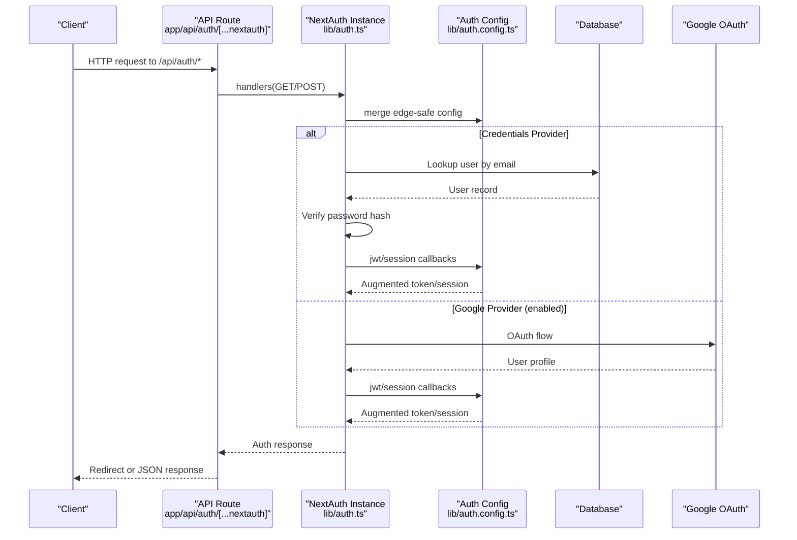
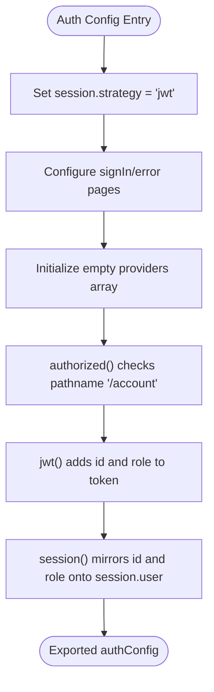
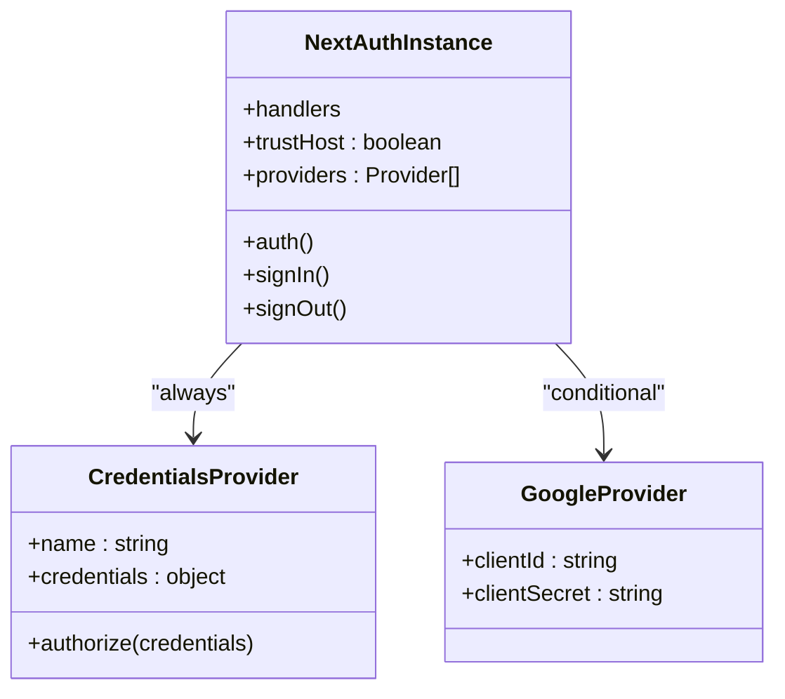
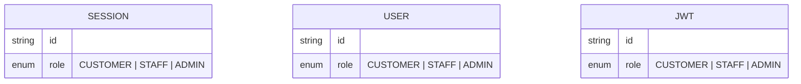
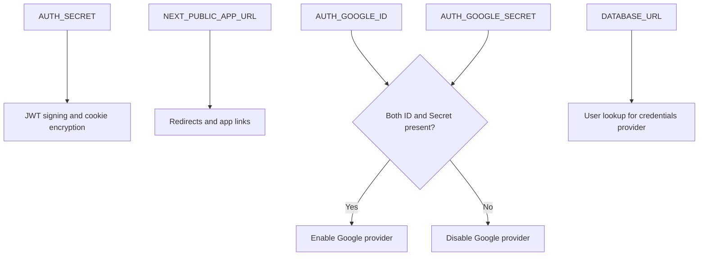
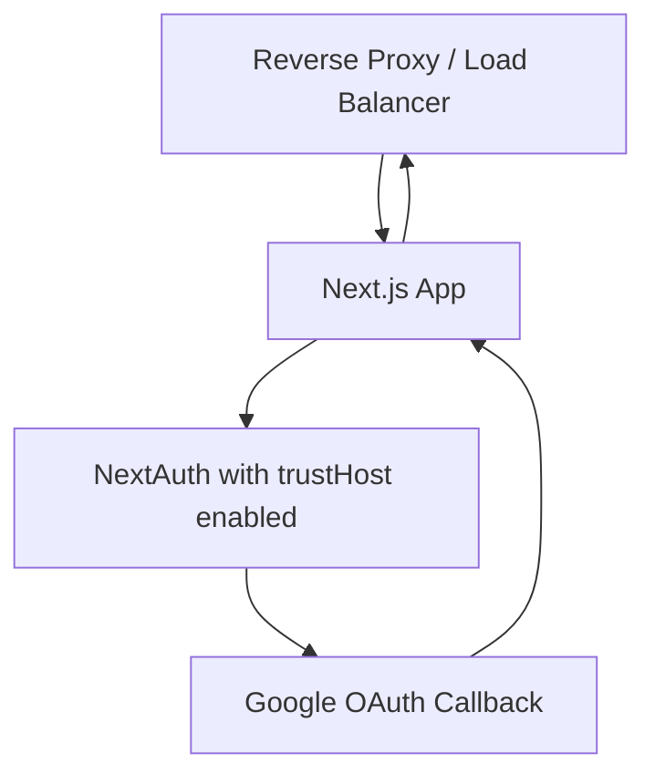

# Authentication Configuration

<cite>
**Referenced Files in This Document**
- [auth.config.ts](file://lib/auth.config.ts)
- [auth.ts](file://lib/auth.ts)
- [route.ts](file://app/api/auth/[...nextauth]/route.ts)
- [env.ts](file://lib/env.ts)
- [next-auth.d.ts](file://types/next-auth.d.ts)
- [ci.yml](file://.github/workflows/ci.yml)
</cite>

## Table of Contents
1. [Introduction](#introduction)
2. [Project Structure](#project-structure)
3. [Core Components](#core-components)
4. [Architecture Overview](#architecture-overview)
5. [Detailed Component Analysis](#detailed-component-analysis)
6. [Environment Variables](#environment-variables)
7. [Trust Host and Callback URLs](#trust-host-and-callback-urls)
8. [Security Considerations](#security-considerations)
9. [Development and Production Examples](#development-and-production-examples)
10. [Troubleshooting Guide](#troubleshooting-guide)
11. [Conclusion](#conclusion)

## Introduction
This document explains Timberland’s NextAuth.js configuration and environment setup. It covers the authentication configuration object structure, provider settings, security options, required environment variables (including Google OAuth credentials), session strategy, trust host behavior, callback URL handling, and best practices for managing sensitive credentials.

## Project Structure
Authentication is implemented across a small set of focused modules:
- Edge-safe configuration without Node-only dependencies
- Runtime provider assembly with conditional Google OAuth
- API route handlers for NextAuth endpoints
- Typed environment access for secrets and feature flags
- Type augmentation for session, user, and JWT payloads

```mermaid
graph TB
subgraph "App"
Route["Route Handler<br/>app/api/auth/[...nextauth]/route.ts"]
end
subgraph "Lib"
AuthModule["NextAuth Instance<br/>lib/auth.ts"]
AuthConfig["Edge-Safe Config<br/>lib/auth.config.ts"]
Env["Typed Environment<br/>lib/env.ts"]
end
subgraph "Types"
Types["Type Augmentation<br/>types/next-auth.d.ts"]
end
Route --> AuthModule
AuthModule --> AuthConfig
AuthModule --> Env
AuthModule --> Types
```

**Diagram sources**
- [route.ts:1-4](file://app/api/auth/[...nextauth]/route.ts#L1-L4)
- [auth.ts:1-42](file://lib/auth.ts#L1-L42)
- [auth.config.ts:1-42](file://lib/auth.config.ts#L1-L42)
- [env.ts:1-66](file://lib/env.ts#L1-L66)
- [next-auth.d.ts:1-24](file://types/next-auth.d.ts#L1-L24)

**Section sources**
- [route.ts:1-4](file://app/api/auth/[...nextauth]/route.ts#L1-L4)
- [auth.ts:1-42](file://lib/auth.ts#L1-L42)
- [auth.config.ts:1-42](file://lib/auth.config.ts#L1-L42)
- [env.ts:1-66](file://lib/env.ts#L1-L66)
- [next-auth.d.ts:1-24](file://types/next-auth.d.ts#L1-L24)

## Core Components
- Edge-safe configuration module defines shared NextAuth settings such as session strategy, sign-in page routing, and callbacks for authorization, token shaping, and session augmentation.
- Runtime module composes providers (credentials and optional Google OAuth) and creates the NextAuth instance with trust host enabled.
- API route exposes NextAuth handlers for all authentication flows.
- Environment module centralizes typed access to secrets and feature toggles.
- Type augmentation extends session, user, and JWT types with application-specific fields.

Key responsibilities:
- Session strategy: JWT-based sessions.
- Providers: Credentials provider always enabled; Google provider conditionally enabled based on environment.
- Callbacks: Protect routes under /account, propagate user id and role into tokens and sessions.
- Trust host: Enabled to support reverse proxies and containerized deployments.

**Section sources**
- [auth.config.ts:11-41](file://lib/auth.config.ts#L11-L41)
- [auth.ts:9-41](file://lib/auth.ts#L9-L41)
- [route.ts:1-4](file://app/api/auth/[...nextauth]/route.ts#L1-L4)
- [env.ts:22-62](file://lib/env.ts#L22-L62)
- [next-auth.d.ts:4-23](file://types/next-auth.d.ts#L4-L23)

## Architecture Overview
The authentication flow uses NextAuth.js with JWT sessions. The credentials provider authenticates users against the database using hashed passwords. When Google OAuth is enabled, it is added as an additional provider. The API route delegates all auth requests to NextAuth handlers.



**Diagram sources**
- [route.ts:1-4](file://app/api/auth/[...nextauth]/route.ts#L1-L4)
- [auth.ts:9-41](file://lib/auth.ts#L9-L41)
- [auth.config.ts:18-39](file://lib/auth.config.ts#L18-L39)

## Detailed Component Analysis

### Edge-Safe Configuration Object
The configuration object sets:
- Session strategy to JWT.
- Sign-in and error pages to the login route.
- Authorization callback that protects paths starting with /account.
- JWT callback that attaches user id and role to the token.
- Session callback that mirrors id and role onto session.user.



**Diagram sources**
- [auth.config.ts:11-41](file://lib/auth.config.ts#L11-L41)

**Section sources**
- [auth.config.ts:11-41](file://lib/auth.config.ts#L11-L41)

### Runtime Provider Assembly and NextAuth Instance
Providers:
- Credentials provider validates email/password against the database and returns a minimal user object including id, email, name, and role.
- Google provider is included only when both client id and secret are present in environment variables.

NextAuth instance:
- Merges the edge-safe configuration.
- Enables trustHost to allow proxy headers.
- Exposes handlers, auth utility, signIn, and signOut.



**Diagram sources**
- [auth.ts:9-41](file://lib/auth.ts#L9-L41)

**Section sources**
- [auth.ts:9-41](file://lib/auth.ts#L9-L41)

### API Route Handlers
The Next.js App Router route exports GET and POST handlers from NextAuth, enabling all standard authentication endpoints under /api/auth.

**Section sources**
- [route.ts:1-4](file://app/api/auth/[...nextauth]/route.ts#L1-L4)

### Type Augmentation for Session, User, and JWT
Application-specific fields are added to NextAuth’s built-in types:
- Session.user includes id and role.
- User includes id and optional role.
- JWT includes optional id and role.



**Diagram sources**
- [next-auth.d.ts:4-23](file://types/next-auth.d.ts#L4-L23)

**Section sources**
- [next-auth.d.ts:4-23](file://types/next-auth.d.ts#L4-L23)

## Environment Variables
All environment variables are accessed through a typed module. Required and optional variables relevant to authentication include:

- AUTH_SECRET
  - Purpose: Secret used by NextAuth for signing and encrypting tokens and cookies.
  - Required: Yes.
  - Notes: Must be a strong, randomly generated value in production.

- NEXT_PUBLIC_APP_URL
  - Purpose: Public application base URL used for redirects and links.
  - Required: Yes (with default fallback).
  - Notes: Ensure this matches the deployed domain.

- AUTH_GOOGLE_ID
  - Purpose: Google OAuth client id.
  - Required: Only if Google provider is enabled.
  - Notes: If missing, Google provider is disabled at runtime.

- AUTH_GOOGLE_SECRET
  - Purpose: Google OAuth client secret.
  - Required: Only if Google provider is enabled.
  - Notes: If missing, Google provider is disabled at runtime.

- DATABASE_URL
  - Purpose: Database connection string used by credentials provider to look up users.
  - Required: Yes.

Optional email-related variables exist but are not required for authentication.



**Diagram sources**
- [env.ts:22-62](file://lib/env.ts#L22-L62)
- [auth.ts:32-34](file://lib/auth.ts#L32-L34)

**Section sources**
- [env.ts:22-62](file://lib/env.ts#L22-L62)
- [auth.ts:32-34](file://lib/auth.ts#L32-L34)

## Trust Host and Callback URLs
- Trust Host
  - The NextAuth instance enables trustHost, allowing it to trust X-Forwarded-* headers commonly set by reverse proxies, load balancers, or container orchestrators.
  - CI configuration also sets a related trust host flag, reinforcing proxy compatibility.

- Callback URLs
  - NextAuth automatically manages provider callback URLs under /api/auth/* based on the configured providers and the application’s public URL.
  - For Google OAuth, ensure the authorized redirect URI in your Google Cloud Console matches the deployed NEXT_PUBLIC_APP_URL plus the Google callback path.



**Diagram sources**
- [auth.ts:37-41](file://lib/auth.ts#L37-L41)
- [ci.yml:47-47](file://.github/workflows/ci.yml#L47-L47)

**Section sources**
- [auth.ts:37-41](file://lib/auth.ts#L37-L41)
- [ci.yml:47-47](file://.github/workflows/ci.yml#L47-L47)

## Security Considerations
- Use JWT sessions
  - Sessions are stored in signed/encrypted JWTs rather than server-side stores, reducing stateful server requirements.
  - Ensure AUTH_SECRET is strong and unique per environment.

- Avoid information leakage
  - Credentials provider returns a uniform failure result regardless of whether the email exists or the password is wrong.

- Conditional provider enablement
  - Google provider is only enabled when both client id and secret are present, preventing accidental exposure of incomplete configurations.

- Trust host usage
  - Enabling trustHost is necessary behind proxies but should be restricted to trusted environments. Do not enable in untrusted networks.

- Least privilege and environment scoping
  - Keep secrets out of client bundles. Only NEXT_PUBLIC_* variables are exposed to the browser.
  - Rotate secrets regularly and restrict access via secure secret management systems.

**Section sources**
- [auth.config.ts:11-41](file://lib/auth.config.ts#L11-L41)
- [auth.ts:16-23](file://lib/auth.ts#L16-L23)
- [auth.ts:32-34](file://lib/auth.ts#L32-L34)
- [auth.ts:37-41](file://lib/auth.ts#L37-L41)

## Development and Production Examples
Below are example environment setups. Replace placeholder values with real secrets in production.

- Development (local)
  - AUTH_SECRET: Generate a strong random string.
  - NEXT_PUBLIC_APP_URL: http://localhost:3000
  - DATABASE_URL: Local database connection string.
  - AUTH_GOOGLE_ID and AUTH_GOOGLE_SECRET: Optional; omit to disable Google provider locally.

- Production
  - AUTH_SECRET: Strong, unique, rotated periodically.
  - NEXT_PUBLIC_APP_URL: https://your-domain.com
  - DATABASE_URL: Secure production database connection string.
  - AUTH_GOOGLE_ID and AUTH_GOOGLE_SECRET: Set both to enable Google provider.
  - Ensure Google Cloud Console authorized redirect URIs match the production domain.

Notes:
- If either AUTH_GOOGLE_ID or AUTH_GOOGLE_SECRET is missing, Google provider will be disabled at runtime.
- CI pipeline sets a trust host flag to support testing behind proxies.

**Section sources**
- [env.ts:22-62](file://lib/env.ts#L22-L62)
- [auth.ts:32-34](file://lib/auth.ts#L32-L34)
- [ci.yml:47-47](file://.github/workflows/ci.yml#L47-L47)

## Troubleshooting Guide
Common issues and resolutions:
- Missing required environment variable
  - Symptom: Application throws an error indicating a required environment variable is missing.
  - Resolution: Provide the missing variable (e.g., AUTH_SECRET, DATABASE_URL).

- Google OAuth not working
  - Symptom: Google login fails or provider is unavailable.
  - Resolution: Ensure both AUTH_GOOGLE_ID and AUTH_GOOGLE_SECRET are set. Verify Google Cloud Console redirect URI matches the deployed NEXT_PUBLIC_APP_URL.

- Redirect loops or invalid callback errors
  - Symptom: Redirects fail or callback URLs are rejected.
  - Resolution: Confirm NEXT_PUBLIC_APP_URL is correct and trustHost is enabled when behind a proxy.

- Protected routes accessible without login
  - Symptom: Routes under /account are accessible without authentication.
  - Resolution: Verify the authorized callback logic and ensure the session strategy is JWT and tokens are being issued.

**Section sources**
- [env.ts:8-15](file://lib/env.ts#L8-L15)
- [env.ts:53-62](file://lib/env.ts#L53-L62)
- [auth.config.ts:18-25](file://lib/auth.config.ts#L18-L25)

## Conclusion
Timberland’s authentication setup leverages NextAuth.js with JWT sessions, a credentials provider, and an optional Google OAuth provider controlled by environment variables. The configuration is split between an edge-safe module and a runtime module that composes providers and enables trust host for proxy compatibility. Centralized environment access ensures consistent and testable configuration. Following the security recommendations and environment examples above will help maintain a robust and secure authentication system across development and production environments.