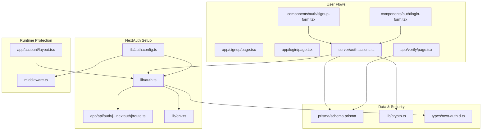
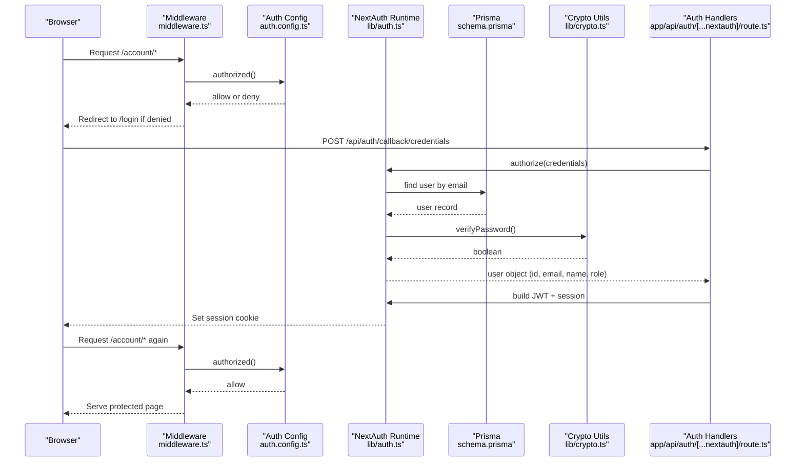
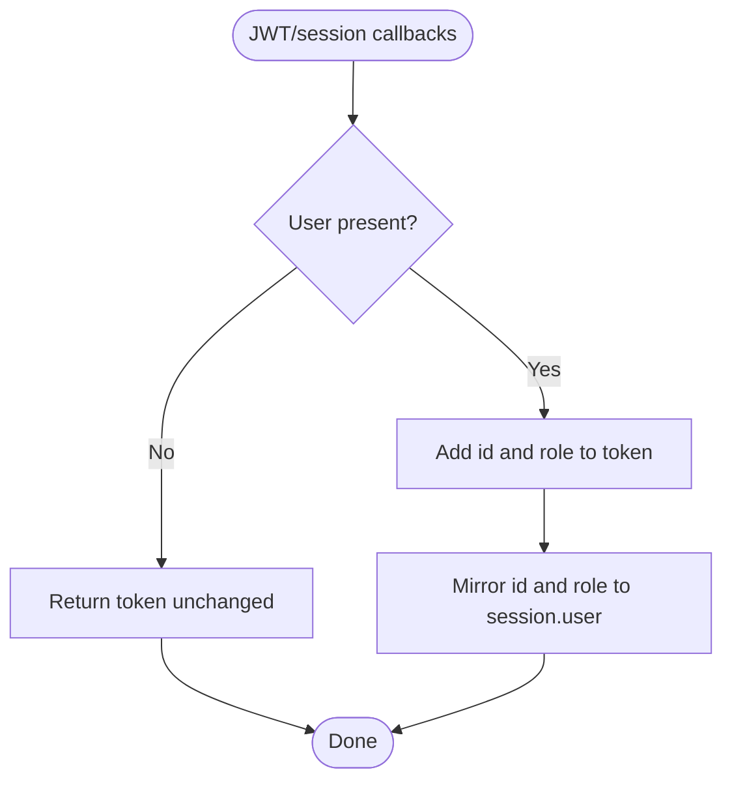
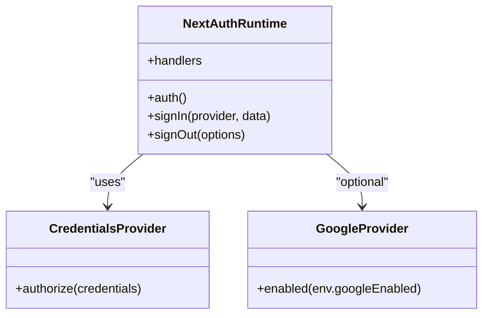
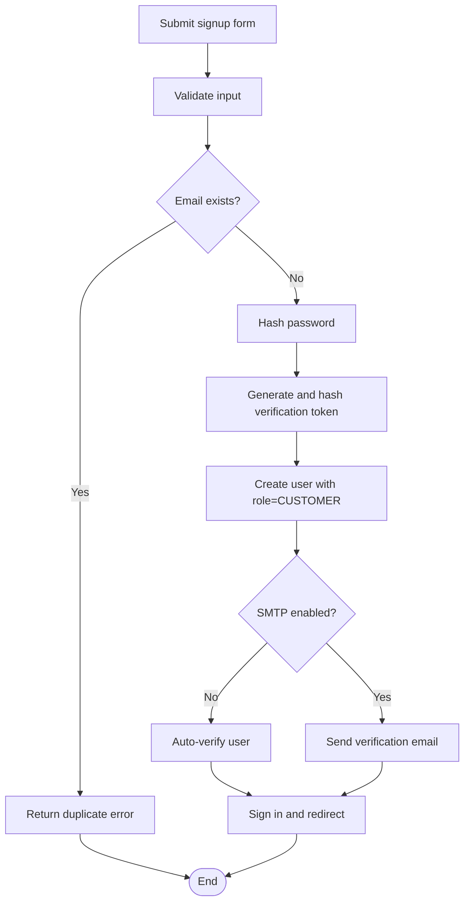
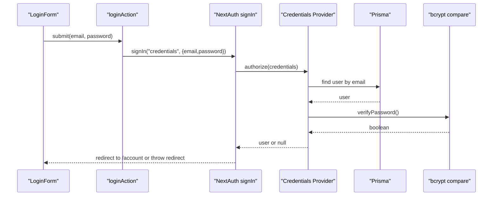
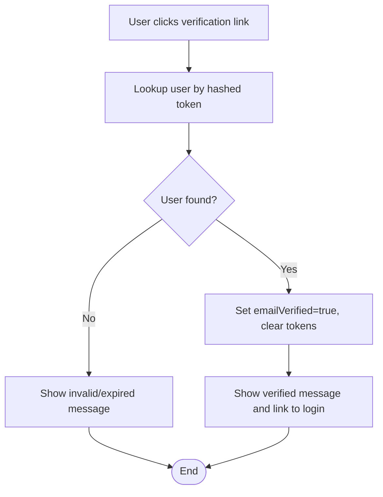
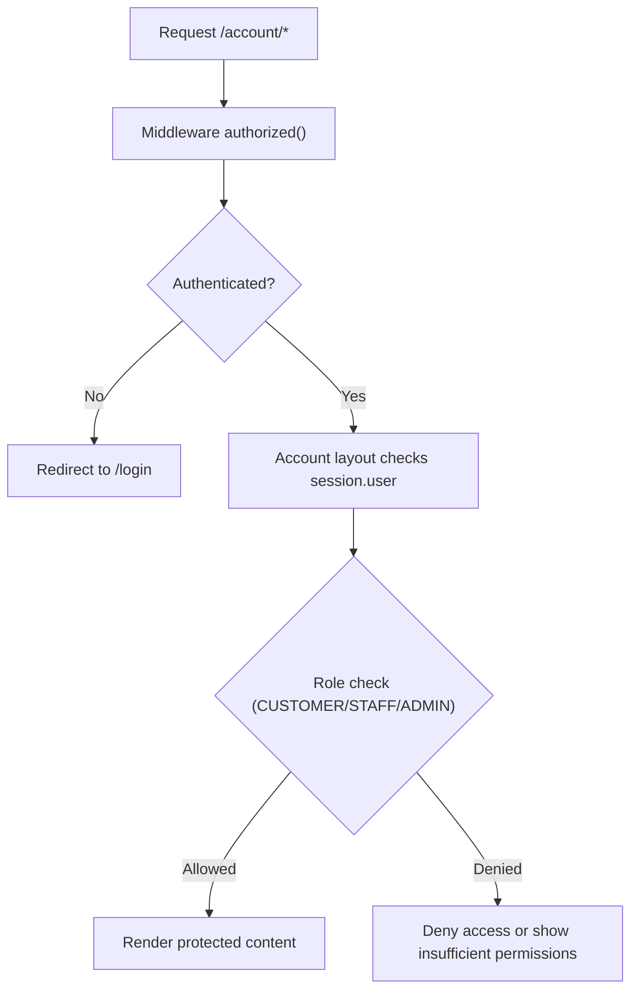
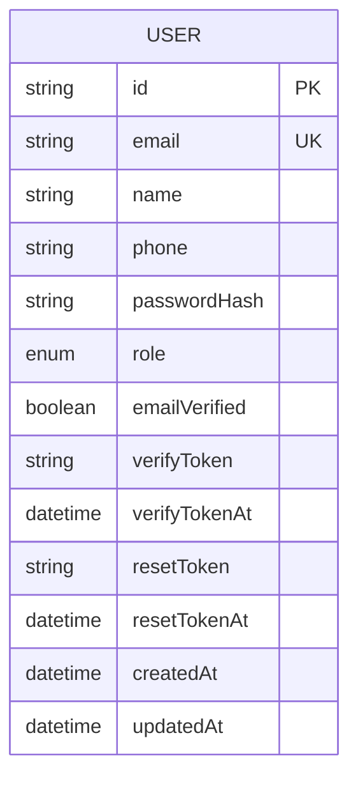
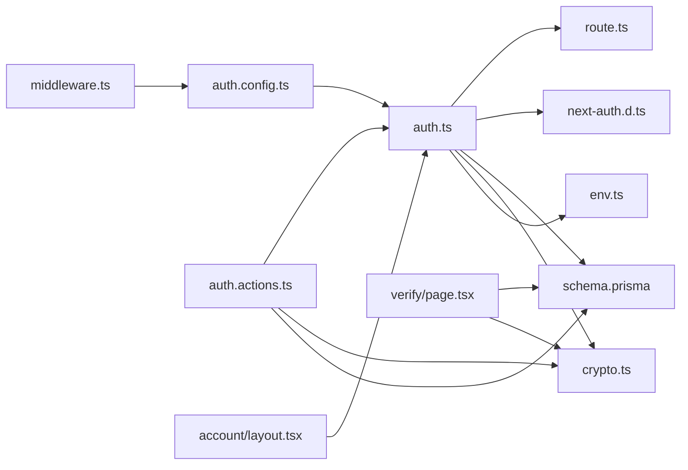

# Authentication System

<cite>
**Referenced Files in This Document**
- [auth.config.ts](file://lib/auth.config.ts)
- [auth.ts](file://lib/auth.ts)
- [route.ts](file://app/api/auth/[...nextauth]/route.ts)
- [middleware.ts](file://middleware.ts)
- [next-auth.d.ts](file://types\next-auth.d.ts)
- [auth.actions.ts](file://server\auth.actions.ts)
- [crypto.ts](file://lib/crypto.ts)
- [schema.prisma](file://prisma\schema.prisma)
- [login-form.tsx](file://components\auth\login-form.tsx)
- [signup-form.tsx](file://components\auth\signup-form.tsx)
- [page.tsx (login)](file://app\login\page.tsx)
- [page.tsx (signup)](file://app\signup\page.tsx)
- [page.tsx (verify)](file://app\verify\page.tsx)
- [layout.tsx (account)](file://app\account\layout.tsx)
- [env.ts](file://lib/env.ts)
</cite>

## Update Summary
**Changes Made**
- Updated to reflect NextAuth.js v5 beta implementation with email/password and Google OAuth providers
- Added documentation for role-based access control supporting CUSTOMER, STAFF, and ADMIN roles
- Enhanced provider configuration with conditional Google OAuth support
- Updated authentication flow diagrams to show the complete JWT-based authentication process
- Added comprehensive coverage of environment configuration for OAuth providers

## Table of Contents
1. [Introduction](#introduction)
2. [Project Structure](#project-structure)
3. [Core Components](#core-components)
4. [Architecture Overview](#architecture-overview)
5. [Detailed Component Analysis](#detailed-component-analysis)
6. [Dependency Analysis](#dependency-analysis)
7. [Performance Considerations](#performance-considerations)
8. [Troubleshooting Guide](#troubleshooting-guide)
9. [Conclusion](#conclusion)

## Introduction
This document explains Timberland's authentication system built with NextAuth.js v5 beta. It covers the JWT-based authentication flow, user role management (Customer, Staff, Admin), session handling, configuration, custom providers including email/password and Google OAuth, middleware protection, registration and login processes, password hashing with bcryptjs, email verification workflows, protected routes, role-based access control patterns, and security best practices.

## Project Structure
The authentication implementation is split across:
- Configuration and runtime setup for NextAuth.js v5
- API route handlers for authentication endpoints
- Middleware for edge-safe route protection
- Server actions for registration and login
- UI components for login and signup forms
- Pages for login, signup, and email verification
- Account layout that enforces authenticated access
- Database schema defining roles and verification fields
- Environment configuration for OAuth providers

**Diagram sources**
- [auth.config.ts:1-42](file://lib/auth.config.ts#L1-L42)
- [auth.ts:1-42](file://lib/auth.ts#L1-L42)
- [route.ts:1-4](file://app/api/auth/[...nextauth]/route.ts#L1-L4)
- [middleware.ts:1-14](file://middleware.ts#L1-L14)
- [layout.tsx (account):1-39](file://app/account\layout.tsx#L1-L39)
- [signup-form.tsx:1-39](file://components\auth\signup-form.tsx#L1-L39)
- [login-form.tsx:1-40](file://components\auth\login-form.tsx#L1-L40)
- [page.tsx (signup):1-31](file://app\signup\page.tsx#L1-L31)
- [page.tsx (login):1-50](file://app\login\page.tsx#L1-L50)
- [page.tsx (verify):1-60](file://app\verify\page.tsx#L1-L60)
- [auth.actions.ts:1-101](file://server\auth.actions.ts#L1-L101)
- [schema.prisma:57-78](file://prisma\schema.prisma#L57-L78)
- [crypto.ts:1-29](file://lib/crypto.ts#L1-L29)
- [next-auth.d.ts:1-24](file://types\next-auth.d.ts#L1-L24)
- [env.ts:53-62](file://lib/env.ts#L53-L62)

**Section sources**
- [auth.config.ts:1-42](file://lib/auth.config.ts#L1-L42)
- [auth.ts:1-42](file://lib/auth.ts#L1-L42)
- [route.ts:1-4](file://app/api/auth/[...nextauth]/route.ts#L1-L4)
- [middleware.ts:1-14](file://middleware.ts#L1-L14)
- [layout.tsx (account):1-39](file://app/account\layout.tsx#L1-L39)
- [auth.actions.ts:1-101](file://server\auth.actions.ts#L1-L101)
- [schema.prisma:57-78](file://prisma\schema.prisma#L57-L78)
- [crypto.ts:1-29](file://lib/crypto.ts#L1-L29)
- [next-auth.d.ts:1-24](file://types\next-auth.d.ts#L1-L24)
- [env.ts:53-62](file://lib/env.ts#L53-L62)

## Core Components
- NextAuth configuration: Edge-safe config defines JWT session strategy, sign-in pages, provider list, and callbacks for authorization, token augmentation, and session augmentation.
- NextAuth runtime: Combines credentials and optional Google provider, wires Prisma and password verification into the authorize function, and exports handlers, auth, signIn, and signOut.
- API route: Exposes NextAuth handlers at `/api/auth`.
- Middleware: Edge-safe guard using the `authorized` callback to protect `/account/*`.
- Types: Extends NextAuth Session, User, and JWT types with id and role.
- Server actions: Provide signup and login flows, handle validation, hashing, verification tokens, and redirect behavior.
- Crypto utilities: bcryptjs-based password hashing and verification; secure random token generation and hashing.
- Schema: Defines User model with role, verification fields, and relations.
- UI and pages: Login and signup forms, login page with error mapping, signup page, verify page, and account layout enforcing authentication.
- Environment configuration: Typed access to environment variables including Google OAuth credentials.

**Section sources**
- [auth.config.ts:1-42](file://lib/auth.config.ts#L1-L42)
- [auth.ts:1-42](file://lib/auth.ts#L1-L42)
- [route.ts:1-4](file://app/api/auth/[...nextauth]/route.ts#L1-L4)
- [middleware.ts:1-14](file://middleware.ts#L1-L14)
- [next-auth.d.ts:1-24](file://types\next-auth.d.ts#L1-L24)
- [auth.actions.ts:1-101](file://server\auth.actions.ts#L1-L101)
- [crypto.ts:1-29](file://lib/crypto.ts#L1-L29)
- [schema.prisma:57-78](file://prisma\schema.prisma#L57-L78)
- [env.ts:53-62](file://lib/env.ts#L53-L62)

## Architecture Overview
The authentication architecture uses NextAuth.js v5 with a JWT session strategy. The flow integrates server-side credential verification, optional OAuth via Google, and edge-safe middleware protection. Roles are embedded into the JWT and session objects for downstream access control.

**Diagram sources**
- [middleware.ts:1-14](file://middleware.ts#L1-L14)
- [auth.config.ts:11-39](file://lib/auth.config.ts#L11-L39)
- [auth.ts:9-30](file://lib/auth.ts#L9-L30)
- [route.ts:1-4](file://app/api/auth/[...nextauth]/route.ts#L1-L4)
- [schema.prisma:57-78](file://prisma\schema.prisma#L57-L78)
- [crypto.ts:8-15](file://lib/crypto.ts#L8-L15)

## Detailed Component Analysis

### NextAuth Configuration and Callbacks
- Session strategy: JWT.
- Sign-in and error pages: `/login`.
- Providers: Empty in edge config; populated at runtime.
- Authorization callback: Blocks `/account/*` unless authenticated.
- JWT callback: Adds user id and role to token; defaults role to CUSTOMER.
- Session callback: Mirrors id and role onto session.user.

**Diagram sources**
- [auth.config.ts:18-39](file://lib/auth.config.ts#L18-L39)

**Section sources**
- [auth.config.ts:11-39](file://lib/auth.config.ts#L11-L39)

### NextAuth Runtime and Providers
- Credentials provider: Validates email/password against Prisma and returns minimal user payload including role.
- Google provider: Conditionally enabled via environment variable.
- Exports: handlers, auth, signIn, signOut.

**Diagram sources**
- [auth.ts:9-41](file://lib/auth.ts#L9-L41)

**Section sources**
- [auth.ts:9-41](file://lib/auth.ts#L9-L41)

### API Route
- Exposes GET and POST handlers for NextAuth endpoints under `/api/auth`.

**Section sources**
- [route.ts:1-4](file://app/api/auth/[...nextauth]/route.ts#L1-L4)

### Middleware Protection
- Edge-safe middleware initializes NextAuth with the edge-compatible config.
- Protects only `/account/:path*`.
- Access decision delegated to `authorized` callback.

**Section sources**
- [middleware.ts:1-14](file://middleware.ts#L1-L14)
- [auth.config.ts:18-25](file://lib/auth.config.ts#L18-L25)

### Type Extensions
- Extends NextAuth Session, User, and JWT types to include id and role with allowed values: CUSTOMER, STAFF, ADMIN.

**Section sources**
- [next-auth.d.ts:1-24](file://types\next-auth.d.ts#L1-L24)

### Registration Flow
- Form submission triggers a server action.
- Input validated via schema.
- Duplicate email check.
- Password hashed with bcryptjs.
- Verification token generated and hashed before storage.
- In development without SMTP, auto-verification is enabled; otherwise an email link is sent.
- Immediately signs in the user and redirects to `/account`.

**Diagram sources**
- [auth.actions.ts:26-81](file://server\auth.actions.ts#L26-L81)
- [crypto.ts:8-27](file://lib/crypto.ts#L8-L27)
- [schema.prisma:57-78](file://prisma\schema.prisma#L57-L78)

**Section sources**
- [auth.actions.ts:26-81](file://server\auth.actions.ts#L26-L81)
- [signup-form.tsx:1-39](file://components\auth\signup-form.tsx#L1-L39)
- [page.tsx (signup):1-31](file://app\signup\page.tsx#L1-L31)
- [crypto.ts:8-27](file://lib/crypto.ts#L8-L27)
- [schema.prisma:57-78](file://prisma\schema.prisma#L57-L78)

### Login Flow
- Client form submits to a server action.
- Server action calls NextAuth signIn with credentials.
- On success, NextAuth redirects to `/account`; on failure, returns a safe generic error.

**Diagram sources**
- [login-form.tsx:1-40](file://components\auth\login-form.tsx#L1-L40)
- [auth.actions.ts:83-96](file://server\auth.actions.ts#L83-L96)
- [auth.ts:16-30](file://lib/auth.ts#L16-L30)
- [crypto.ts:12-15](file://lib/crypto.ts#L12-L15)

**Section sources**
- [login-form.tsx:1-40](file://components\auth\login-form.tsx#L1-L40)
- [auth.actions.ts:83-96](file://server\auth.actions.ts#L83-L96)
- [page.tsx (login):1-50](file://app\login\page.tsx#L1-L50)

### Email Verification Workflow
- On signup, a random token is generated and hashed before storing in the database.
- If SMTP is configured, an email containing a verification link is sent.
- The verify page validates the token by comparing its hash with the stored hash.
- On success, marks the user as verified and clears token fields.

**Diagram sources**
- [page.tsx (verify):1-60](file://app\verify\page.tsx#L1-L60)
- [crypto.ts:18-27](file://lib/crypto.ts#L18-L27)
- [schema.prisma:57-78](file://prisma\schema.prisma#L57-L78)

**Section sources**
- [page.tsx (verify):1-60](file://app\verify\page.tsx#L1-L60)
- [auth.actions.ts:46-76](file://server\auth.actions.ts#L46-L76)
- [crypto.ts:18-27](file://lib/crypto.ts#L18-L27)

### Protected Routes and Role-Based Access Control
- Middleware protects `/account/*` based on the `authorized` callback.
- Account layout performs a server-side session check and redirects unauthenticated users to `/login`.
- Role-based access control can be implemented by reading `session.user.role` (CUSTOMER, STAFF, ADMIN) and gating features accordingly.

**Diagram sources**
- [middleware.ts:1-14](file://middleware.ts#L1-L14)
- [auth.config.ts:18-25](file://lib/auth.config.ts#L18-L25)
- [layout.tsx (account):1-39](file://app/account\layout.tsx#L1-L39)
- [next-auth.d.ts:5-15](file://types\next-auth.d.ts#L5-L15)

**Section sources**
- [middleware.ts:1-14](file://middleware.ts#L1-L14)
- [layout.tsx (account):1-39](file://app/account\layout.tsx#L1-L39)
- [auth.config.ts:18-25](file://lib/auth.config.ts#L18-L25)
- [next-auth.d.ts:5-15](file://types\next-auth.d.ts#L5-L15)

### Data Model and Roles
- User model includes role (CUSTOMER, STAFF, ADMIN), email verification status, and verification/reset tokens.
- Role is defaulted to CUSTOMER during signup.

**Diagram sources**
- [schema.prisma:57-78](file://prisma\schema.prisma#L57-L78)

**Section sources**
- [schema.prisma:17-21](file://prisma\schema.prisma#L17-L21)
- [schema.prisma:57-78](file://prisma\schema.prisma#L57-L78)

### Google OAuth Integration
- Google OAuth provider is conditionally enabled through environment variables.
- Requires `AUTH_GOOGLE_ID` and `AUTH_GOOGLE_SECRET` environment variables.
- Provider is automatically included when both credentials are configured.
- Integrates seamlessly with existing JWT session strategy.

**Section sources**
- [auth.ts:32-34](file://lib/auth.ts#L32-L34)
- [env.ts:53-62](file://lib/env.ts#L53-L62)

## Dependency Analysis
The following diagram shows how authentication-related modules depend on each other.

**Diagram sources**
- [middleware.ts:1-14](file://middleware.ts#L1-L14)
- [auth.config.ts:1-42](file://lib/auth.config.ts#L1-L42)
- [auth.ts:1-42](file://lib/auth.ts#L1-L42)
- [route.ts:1-4](file://app/api/auth/[...nextauth]/route.ts#L1-L4)
- [next-auth.d.ts:1-24](file://types\next-auth.d.ts#L1-L24)
- [schema.prisma:57-78](file://prisma\schema.prisma#L57-L78)
- [crypto.ts:1-29](file://lib/crypto.ts#L1-L29)
- [auth.actions.ts:1-101](file://server\auth.actions.ts#L1-L101)
- [page.tsx (verify):1-60](file://app\verify\page.tsx#L1-L60)
- [layout.tsx (account):1-39](file://app/account\layout.tsx#L1-L39)
- [env.ts:53-62](file://lib/env.ts#L53-L62)

**Section sources**
- [middleware.ts:1-14](file://middleware.ts#L1-L14)
- [auth.config.ts:1-42](file://lib/auth.config.ts#L1-L42)
- [auth.ts:1-42](file://lib/auth.ts#L1-L42)
- [route.ts:1-4](file://app/api/auth/[...nextauth]/route.ts#L1-L4)
- [next-auth.d.ts:1-24](file://types\next-auth.d.ts#L1-L24)
- [schema.prisma:57-78](file://prisma\schema.prisma#L57-L78)
- [crypto.ts:1-29](file://lib/crypto.ts#L1-L29)
- [auth.actions.ts:1-101](file://server\auth.actions.ts#L1-L101)
- [page.tsx (verify):1-60](file://app\verify\page.tsx#L1-L60)
- [layout.tsx (account):1-39](file://app/account\layout.tsx#L1-L39)
- [env.ts:53-62](file://lib/env.ts#L53-L62)

## Performance Considerations
- Use JWT sessions to avoid per-request database lookups for session data.
- Keep edge middleware lightweight; rely on the `authorized` callback for simple auth checks.
- Avoid heavy operations in the edge layer; perform Prisma queries and bcrypt operations in Node runtime code.
- Precompute and cache non-sensitive data where appropriate; do not cache secrets or tokens.
- Ensure bcrypt rounds are balanced for security and performance (currently set to a moderate value).
- Google OAuth provider is conditionally loaded to minimize startup overhead when not needed.

## Troubleshooting Guide
- Invalid credentials: The credentials provider returns a uniform failure without revealing whether the email exists.
- Redirect errors: Login action catches Next redirect exceptions and surfaces a generic error when not a redirect.
- Missing verification token: Verify page displays a clear message when no token is provided.
- Expired or invalid token: Verify page fails gracefully and suggests re-signup.
- Unauthenticated access to protected routes: Middleware redirects to `/login`; account layout also enforces session presence.
- Google OAuth not working: Check that `AUTH_GOOGLE_ID` and `AUTH_GOOGLE_SECRET` environment variables are properly configured.
- OAuth account linking issues: The login page handles OAuth-specific error messages for linked accounts.

**Section sources**
- [auth.ts:16-23](file://lib/auth.ts#L16-L23)
- [auth.actions.ts:83-96](file://server\auth.actions.ts#L83-L96)
- [page.tsx (verify):19-31](file://app\verify\page.tsx#L19-L31)
- [middleware.ts:10-13](file://middleware.ts#L10-L13)
- [layout.tsx (account):13-15](file://app/account\layout.tsx#L13-L15)
- [page.tsx (login):8-12](file://app\login\page.tsx#L8-L12)
- [env.ts:53-62](file://lib/env.ts#L53-L62)

## Conclusion
Timberland's authentication system leverages NextAuth.js v5 beta with JWT sessions, bcrypt-based password hashing, and edge-safe middleware. It supports Customer, Staff, and Admin roles, integrates optional Google OAuth, and implements a robust registration and email verification workflow. The design cleanly separates configuration, runtime logic, server actions, and UI, enabling maintainable and secure authentication patterns across the application. The modular architecture allows for easy extension with additional OAuth providers while maintaining consistent role-based access control throughout the platform.