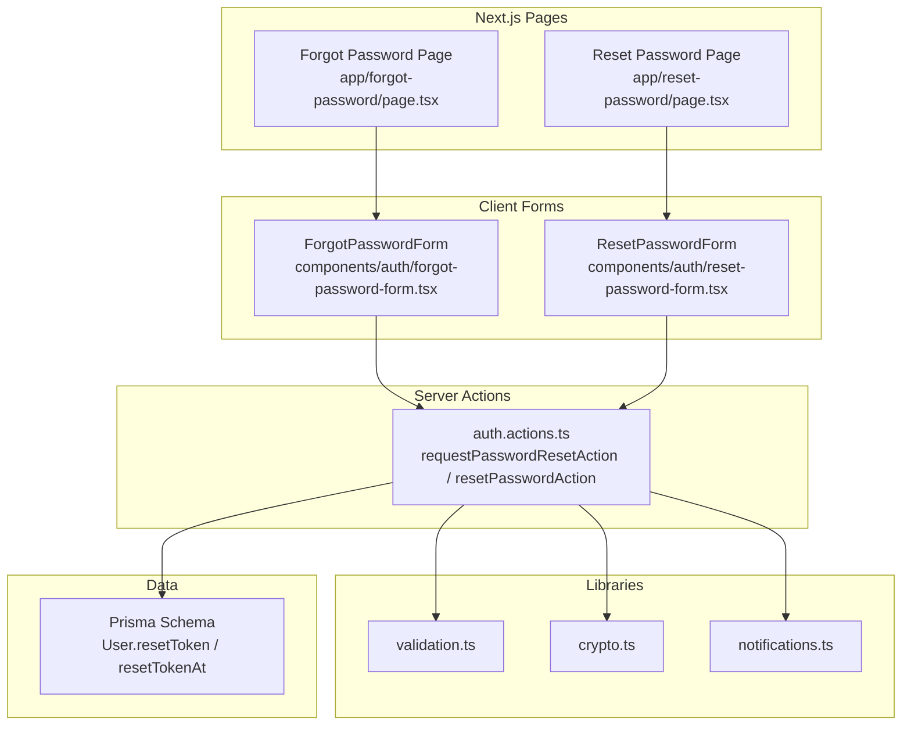
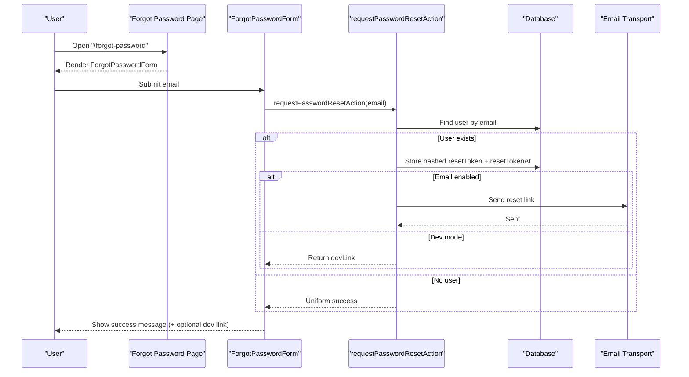
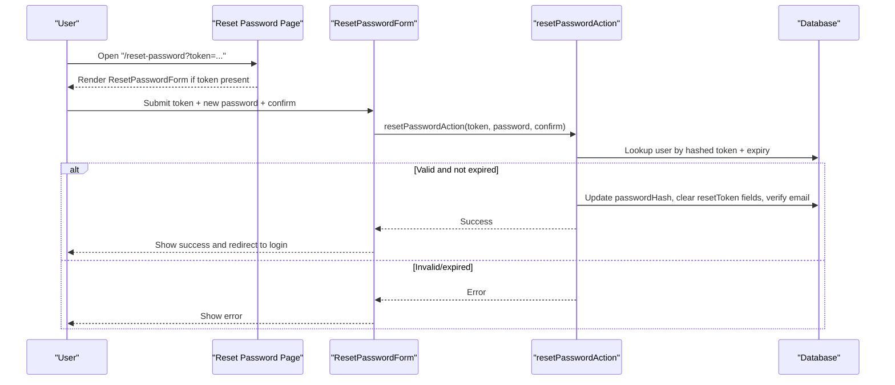
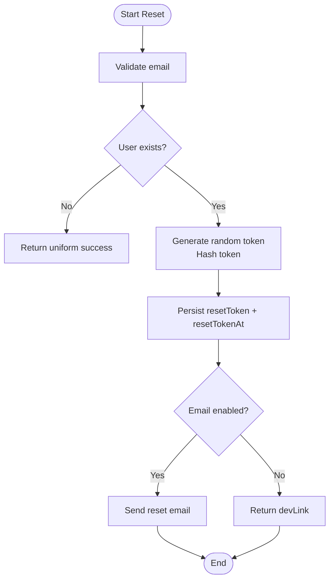
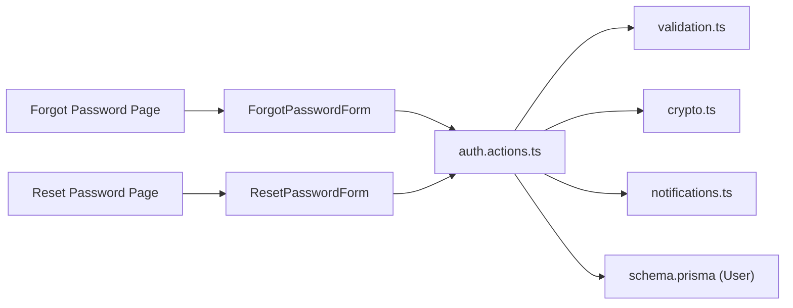

# Password Reset Workflow

<cite>
**Referenced Files in This Document**
- [page.tsx](file://app/forgot-password/page.tsx)
- [page.tsx](file://app/reset-password/page.tsx)
- [forgot-password-form.tsx](file://components/auth/forgot-password-form.tsx)
- [reset-password-form.tsx](file://components/auth/reset-password-form.tsx)
- [auth.actions.ts](file://server/auth.actions.ts)
- [notifications.ts](file://lib/notifications.ts)
- [validation.ts](file://lib/validation.ts)
- [crypto.ts](file://lib/crypto.ts)
- [schema.prisma](file://prisma/schema.prisma)
- [password-reset.spec.ts](file://tests/e2e/password-reset.spec.ts)
</cite>

## Table of Contents
1. [Introduction](#introduction)
2. [Project Structure](#project-structure)
3. [Core Components](#core-components)
4. [Architecture Overview](#architecture-overview)
5. [Detailed Component Analysis](#detailed-component-analysis)
6. [Dependency Analysis](#dependency-analysis)
7. [Performance Considerations](#performance-considerations)
8. [Troubleshooting Guide](#troubleshooting-guide)
9. [Conclusion](#conclusion)

## Introduction
This document explains the password reset workflow implemented in the project. It covers how a user requests a reset link, receives it via email or development-only direct link, validates and consumes the token, updates their password, and how the system prevents enumeration and replay attacks. The explanation is layered so both technical and non-technical readers can understand the flow, data model, security properties, and failure modes.

## Project Structure
The password reset feature spans Next.js App Router pages, client-side form components, server actions, validation schemas, cryptographic helpers, email delivery, database schema, and end-to-end tests.

**Diagram sources**
- [page.tsx:8-18](file://app/forgot-password/page.tsx#L8-L18)
- [page.tsx:12-31](file://app/reset-password/page.tsx#L12-L31)
- [forgot-password-form.tsx:12-50](file://components/auth/forgot-password-form.tsx#L12-L50)
- [reset-password-form.tsx:12-40](file://components/auth/reset-password-form.tsx#L12-L40)
- [auth.actions.ts:114-184](file://server/auth.actions.ts#L114-L184)
- [validation.ts:26-36](file://lib/validation.ts#L26-L36)
- [crypto.ts:17-27](file://lib/crypto.ts#L17-L27)
- [notifications.ts:110-113](file://lib/notifications.ts#L110-L113)
- [schema.prisma:57-78](file://prisma/schema.prisma#L57-L78)

**Section sources**
- [page.tsx:8-18](file://app/forgot-password/page.tsx#L8-L18)
- [page.tsx:12-31](file://app/reset-password/page.tsx#L12-L31)
- [forgot-password-form.tsx:12-50](file://components/auth/forgot-password-form.tsx#L12-L50)
- [reset-password-form.tsx:12-40](file://components/auth/reset-password-form.tsx#L12-L40)
- [auth.actions.ts:114-184](file://server/auth.actions.ts#L114-L184)
- [validation.ts:26-36](file://lib/validation.ts#L26-L36)
- [crypto.ts:17-27](file://lib/crypto.ts#L17-L27)
- [notifications.ts:110-113](file://lib/notifications.ts#L110-L113)
- [schema.prisma:57-78](file://prisma/schema.prisma#L57-L78)

## Core Components
- Forgot Password page: renders a card with the forgot-password form and navigation to sign in.
- Reset Password page: reads a token from the URL search params; shows the reset form when present, otherwise prompts for a new link.
- ForgotPasswordForm: client component that submits an email to request a reset link using a server action.
- ResetPasswordForm: client component that submits a token plus new password and confirmation using a server action.
- Server actions: validate inputs, manage tokens, update passwords, send emails (or surface dev links), and return uniform results.
- Validation schemas: enforce email format, token presence, password length, and confirm equality.
- Crypto utilities: generate secure random tokens and hash them before storage; hash passwords securely.
- Notifications: deliver transactional emails through nodemailer, with a JSON transport fallback in development.
- Database schema: User model includes resetToken and resetTokenAt fields used for single-use, time-bounded resets.

**Section sources**
- [page.tsx:8-18](file://app/forgot-password/page.tsx#L8-L18)
- [page.tsx:12-31](file://app/reset-password/page.tsx#L12-L31)
- [forgot-password-form.tsx:12-50](file://components/auth/forgot-password-form.tsx#L12-L50)
- [reset-password-form.tsx:12-40](file://components/auth/reset-password-form.tsx#L12-L40)
- [auth.actions.ts:114-184](file://server/auth.actions.ts#L114-L184)
- [validation.ts:26-36](file://lib/validation.ts#L26-L36)
- [crypto.ts:17-27](file://lib/crypto.ts#L17-L27)
- [notifications.ts:110-113](file://lib/notifications.ts#L110-L113)
- [schema.prisma:57-78](file://prisma/schema.prisma#L57-L78)

## Architecture Overview
The password reset workflow follows a standard secure pattern:
- Request phase: validate email, create a hashed token, store it with a timestamp, and send an email containing a signed URL. In development without SMTP, the raw link is surfaced directly.
- Redemption phase: validate the token against stored hash and expiry, set a new password, consume the token by clearing it, and mark the account as verified.

**Diagram sources**
- [page.tsx:8-18](file://app/forgot-password/page.tsx#L8-L18)
- [forgot-password-form.tsx:12-50](file://components/auth/forgot-password-form.tsx#L12-L50)
- [auth.actions.ts:114-148](file://server/auth.actions.ts#L114-L148)
- [notifications.ts:110-113](file://lib/notifications.ts#L110-L113)
- [schema.prisma:57-78](file://prisma/schema.prisma#L57-L78)

**Diagram sources**
- [page.tsx:12-31](file://app/reset-password/page.tsx#L12-L31)
- [reset-password-form.tsx:12-40](file://components/auth/reset-password-form.tsx#L12-L40)
- [auth.actions.ts:150-184](file://server/auth.actions.ts#L150-L184)
- [schema.prisma:57-78](file://prisma/schema.prisma#L57-L78)

## Detailed Component Analysis

### Forgot Password Page and Form
- The page renders a card with a title, description, and the ForgotPasswordForm component.
- The form uses React’s useActionState to call requestPasswordResetAction. On success, it displays a generic success message and optionally a dev-only link when SMTP is disabled.
- Field-level errors are surfaced via fieldErrors returned by the server action.

Key behaviors:
- Input: email address.
- Output: success state with optional devLink.
- Security: no information leakage about whether the email exists.

**Section sources**
- [page.tsx:8-18](file://app/forgot-password/page.tsx#L8-L18)
- [forgot-password-form.tsx:12-50](file://components/auth/forgot-password-form.tsx#L12-L50)

### Reset Password Page and Form
- The page reads the token from searchParams. If present, it renders ResetPasswordForm; otherwise, it instructs the user to request a new link.
- The form submits token (hidden input), new password, and confirm password via resetPasswordAction.
- On success, it shows a success alert and a link to sign in.

Key behaviors:
- Input: token, password, confirm.
- Output: success or error messages.
- UX: guides users back to login after successful reset.

**Section sources**
- [page.tsx:12-31](file://app/reset-password/page.tsx#L12-L31)
- [reset-password-form.tsx:12-40](file://components/auth/reset-password-form.tsx#L12-L40)

### Server Actions: Request and Reset
- requestPasswordResetAction:
  - Validates email using requestResetSchema.
  - Looks up the user by email.
  - Generates a random token, hashes it, stores resetToken and resetTokenAt.
  - Sends an email with the reset URL when email is enabled; otherwise returns devLink.
  - Always returns a uniform success response to prevent enumeration.
- resetPasswordAction:
  - Validates token, password, and confirm using resetPasswordSchema.
  - Finds a user by hashed token within the TTL window.
  - Updates passwordHash, clears resetToken and resetTokenAt, and marks emailVerified true.
  - Returns success or error accordingly.

Security properties:
- Tokens are hashed before storage.
- Single-use tokens: consumed on successful reset.
- Time-bounded: resetTokenAt enforces expiration.
- Enumeration resistance: same response whether the email exists or not.

**Section sources**
- [auth.actions.ts:114-184](file://server/auth.actions.ts#L114-L184)
- [validation.ts:26-36](file://lib/validation.ts#L26-L36)
- [crypto.ts:17-27](file://lib/crypto.ts#L17-L27)

### Email Delivery and Development Mode
- sendBasicEmail wraps nodemailer transport.
- When emailEnabled is false, a JSON transport captures mail instead of sending it.
- For password reset, when SMTP is disabled, the server action returns devLink so the test/dev flow remains testable.

Operational notes:
- Production requires valid SMTP configuration.
- Development can proceed without SMTP by opening the dev link directly.

**Section sources**
- [notifications.ts:10-24](file://lib/notifications.ts#L10-L24)
- [notifications.ts:110-113](file://lib/notifications.ts#L110-L113)
- [auth.actions.ts:134-143](file://server/auth.actions.ts#L134-L143)

### Data Model and Token Lifecycle
- User model includes resetToken and resetTokenAt.
- Token lifecycle:
  - Generate randomToken() and hashToken() before storing.
  - Store resetTokenAt to enforce TTL.
  - Consume token by setting resetToken and resetTokenAt to null upon successful reset.

**Diagram sources**
- [auth.actions.ts:114-148](file://server/auth.actions.ts#L114-L148)
- [crypto.ts:17-27](file://lib/crypto.ts#L17-L27)
- [schema.prisma:57-78](file://prisma/schema.prisma#L57-L78)

### Validation Schemas
- requestResetSchema ensures a well-formed email.
- resetPasswordSchema enforces:
  - Presence of token.
  - Password length constraints.
  - Confirm equals password.

These schemas centralize validation rules and provide consistent error messages across server actions and UI.

**Section sources**
- [validation.ts:26-36](file://lib/validation.ts#L26-L36)

### Cryptographic Utilities
- randomToken generates URL-safe random bytes suitable for tokens.
- hashToken hashes tokens before persistence to protect against replay if the database is leaked.
- Password hashing uses bcrypt with a defined cost factor.

**Section sources**
- [crypto.ts:8-15](file://lib/crypto.ts#L8-L15)
- [crypto.ts:17-27](file://lib/crypto.ts#L17-L27)

### End-to-End Tests
- The test suite verifies:
  - Requesting a reset link surfaces a success message.
  - In dev mode, the dev link is clickable and navigates to the reset page with a token.
  - Setting a new password succeeds and redirects to login.
  - Signing in with the new password works.
  - Reusing the consumed token fails with an invalid/expired message.
  - Unknown emails still return a generic success without exposing a dev link.

These tests ensure the complete user journey and critical security properties like single-use tokens and enumeration resistance.

**Section sources**
- [password-reset.spec.ts:20-72](file://tests/e2e/password-reset.spec.ts#L20-L72)

## Dependency Analysis
The password reset feature has clear boundaries between UI, server logic, external services, and data.

**Diagram sources**
- [page.tsx:8-18](file://app/forgot-password/page.tsx#L8-L18)
- [page.tsx:12-31](file://app/reset-password/page.tsx#L12-L31)
- [forgot-password-form.tsx:12-50](file://components/auth/forgot-password-form.tsx#L12-L50)
- [reset-password-form.tsx:12-40](file://components/auth/reset-password-form.tsx#L12-L40)
- [auth.actions.ts:114-184](file://server/auth.actions.ts#L114-L184)
- [validation.ts:26-36](file://lib/validation.ts#L26-L36)
- [crypto.ts:17-27](file://lib/crypto.ts#L17-L27)
- [notifications.ts:110-113](file://lib/notifications.ts#L110-L113)
- [schema.prisma:57-78](file://prisma/schema.prisma#L57-L78)

**Section sources**
- [auth.actions.ts:114-184](file://server/auth.actions.ts#L114-L184)
- [validation.ts:26-36](file://lib/validation.ts#L26-L36)
- [crypto.ts:17-27](file://lib/crypto.ts#L17-L27)
- [notifications.ts:110-113](file://lib/notifications.ts#L110-L113)
- [schema.prisma:57-78](file://prisma/schema.prisma#L57-L78)

## Performance Considerations
- Token generation and hashing are lightweight operations.
- Database lookups are simple queries indexed by email and token fields; consider ensuring indexes exist for resetToken and resetTokenAt if query volume grows.
- Email sending is asynchronous from the user perspective; in production, consider queuing to avoid blocking server responses.
- Avoid additional logging of sensitive data such as tokens or passwords.

[No sources needed since this section provides general guidance]

## Troubleshooting Guide
Common issues and resolutions:
- Email not received:
  - Verify SMTP configuration and emailEnabled flag.
  - In development, open the dev link surfaced by the form.
- “Invalid or expired” reset link:
  - The token may have been used already or exceeded the TTL.
  - Request a new reset link.
- Account enumeration concerns:
  - The API returns a uniform success even for unknown emails.
  - Ensure logs do not expose whether an account exists.
- Form validation errors:
  - Check fieldErrors returned by server actions and displayed by forms.
  - Ensure password meets minimum length and confirm matches.

**Section sources**
- [auth.actions.ts:114-184](file://server/auth.actions.ts#L114-L184)
- [forgot-password-form.tsx:12-50](file://components/auth/forgot-password-form.tsx#L12-L50)
- [reset-password-form.tsx:12-40](file://components/auth/reset-password-form.tsx#L12-L40)

## Conclusion
The password reset workflow implements a secure, user-friendly process:
- It protects against enumeration by returning uniform responses.
- It secures tokens by hashing and enforcing single-use behavior with a time limit.
- It supports both production email delivery and development-only direct links.
- It integrates cleanly with Next.js server actions, Zod validation, and Prisma data models.
- End-to-end tests validate the full user journey and critical security properties.

[No sources needed since this section summarizes without analyzing specific files]