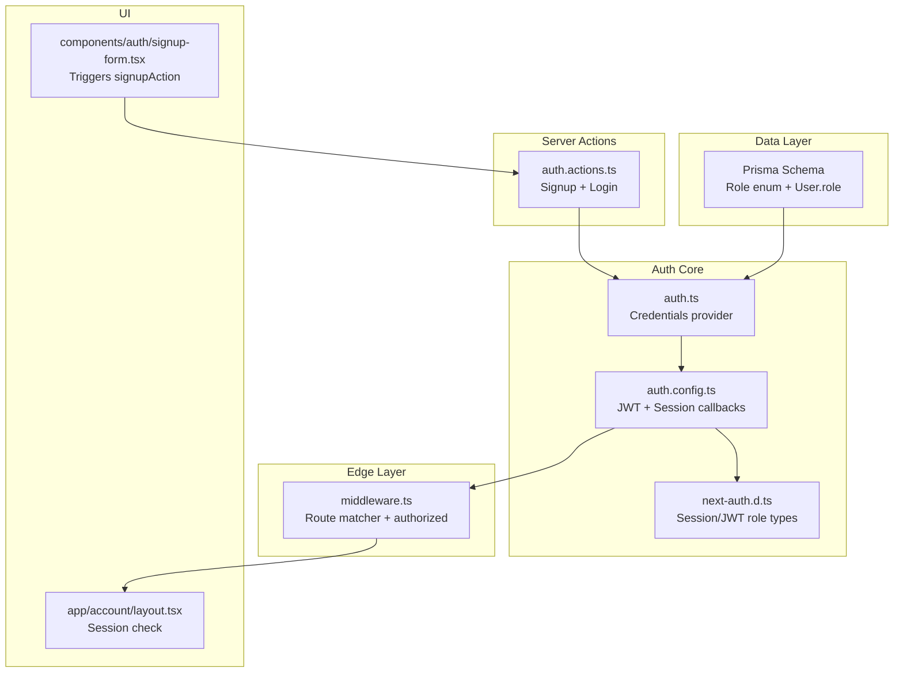
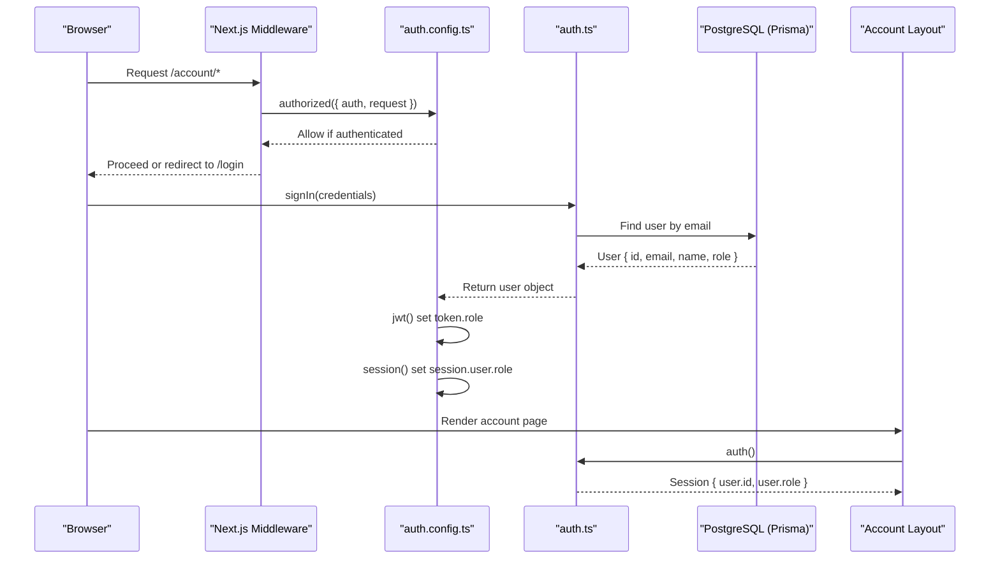
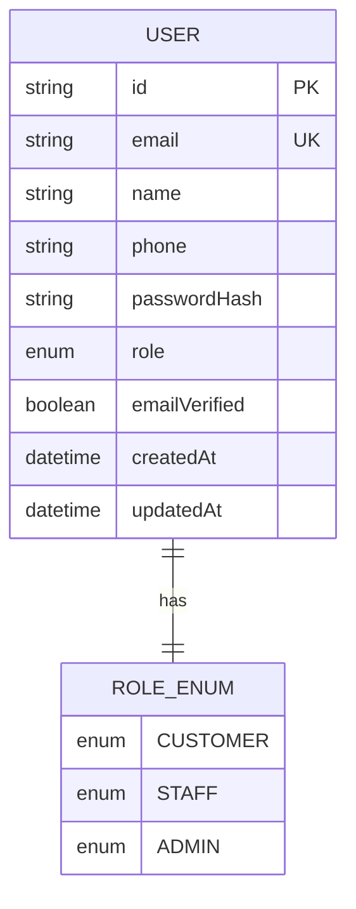
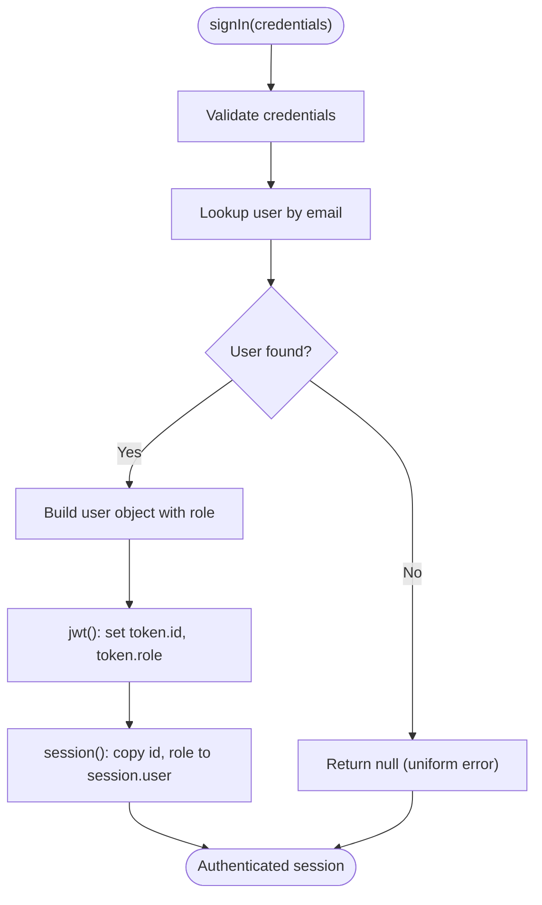
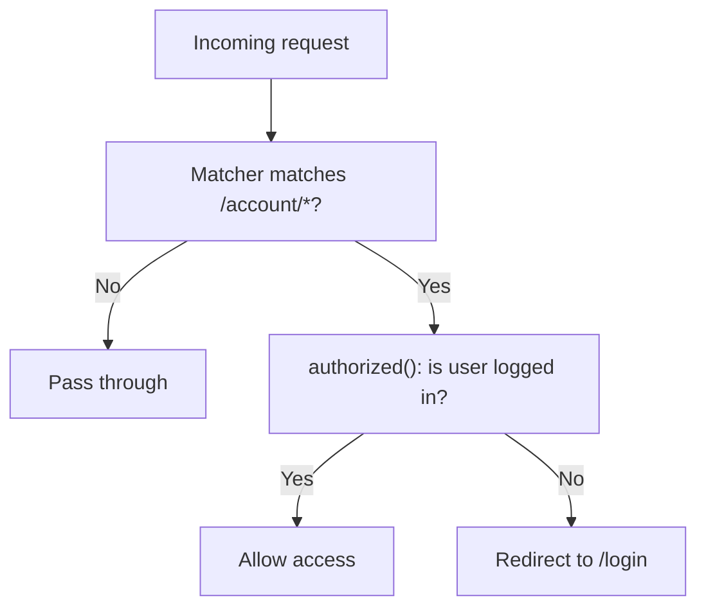
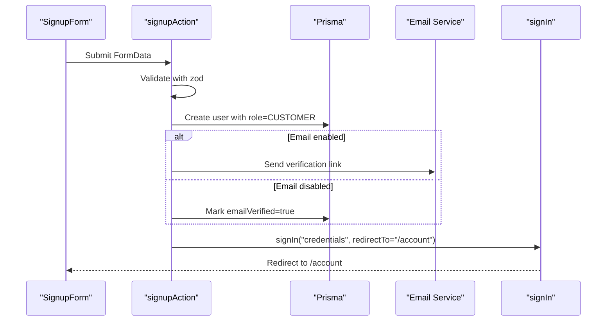
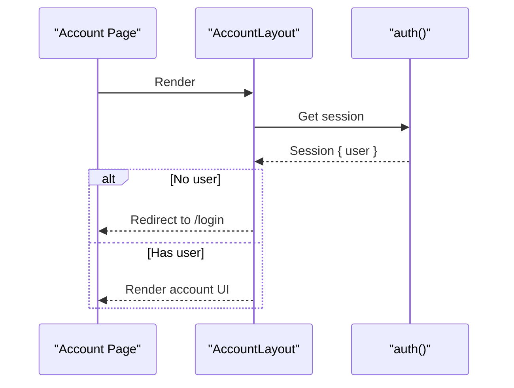
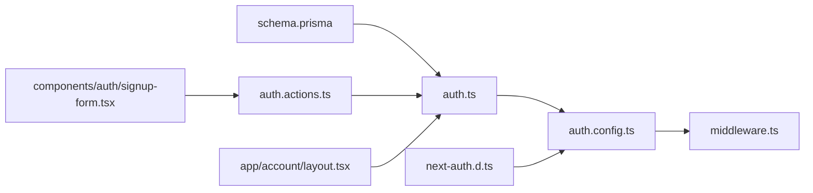

# Role-Based Access Control

<cite>
**Referenced Files in This Document**
- [auth.config.ts](file://lib/auth.config.ts)
- [auth.ts](file://lib/auth.ts)
- [middleware.ts](file://middleware.ts)
- [schema.prisma](file://prisma/schema.prisma)
- [auth.actions.ts](file://server/auth.actions.ts)
- [next-auth.d.ts](file://types/next-auth.d.ts)
- [account layout.tsx](file://app/account/layout.tsx)
- [signup-form.tsx](file://components/auth/signup-form.tsx)
- [validation.ts](file://lib/validation.ts)
</cite>

## Table of Contents
1. [Introduction](#introduction)
2. [Project Structure](#project-structure)
3. [Core Components](#core-components)
4. [Architecture Overview](#architecture-overview)
5. [Detailed Component Analysis](#detailed-component-analysis)
6. [Dependency Analysis](#dependency-analysis)
7. [Performance Considerations](#performance-considerations)
8. [Troubleshooting Guide](#troubleshooting-guide)
9. [Conclusion](#conclusion)

## Introduction
This document explains Timberland’s role-based access control (RBAC) system. The application defines a three-tier role hierarchy: Customer, Staff, and Admin. Roles are stored on the user model, propagated through NextAuth sessions and JWTs, and enforced at the middleware layer for protected routes. While the current implementation protects the customer account area with authentication-only checks, the schema and session typing provide the foundation for extending to role-based route protection, server-side authorization, and UI-level feature gating.

## Project Structure
The RBAC-related code is spread across configuration, runtime auth, middleware, data models, server actions, and type declarations:

- Data model and roles: Prisma schema defines the `Role` enum and attaches it to the `User` model.
- Authentication configuration: Edge-safe NextAuth config injects role into tokens and sessions.
- Runtime providers: Credentials provider reads users from the database and returns role during login.
- Middleware: Guards `/account/*` routes using NextAuth’s edge-safe `authorized` callback.
- Server actions: Signup flow creates users with default role and signs them in.
- Type augmentation: Extends NextAuth types so `session.user.role` is strongly typed.
- UI integration: Account layout uses the authenticated session; signup form triggers the server action that assigns roles.



**Diagram sources**
- [schema.prisma:17-21](file://prisma/schema.prisma#L17-L21)
- [schema.prisma:57-78](file://prisma/schema.prisma#L57-L78)
- [auth.config.ts:11-40](file://lib/auth.config.ts#L11-L40)
- [auth.ts:9-35](file://lib/auth.ts#L9-L35)
- [middleware.ts:1-13](file://middleware.ts#L1-L13)
- [auth.actions.ts:26-80](file://server/auth.actions.ts#L26-L80)
- [next-auth.d.ts:4-16](file://types/next-auth.d.ts#L4-L16)
- [account layout.tsx:13-15](file://app/account/layout.tsx#L13-L15)
- [signup-form.tsx:13-14](file://components/auth/signup-form.tsx#L13-L14)

**Section sources**
- [schema.prisma:17-21](file://prisma/schema.prisma#L17-L21)
- [schema.prisma:57-78](file://prisma/schema.prisma#L57-L78)
- [auth.config.ts:11-40](file://lib/auth.config.ts#L11-L40)
- [auth.ts:9-35](file://lib/auth.ts#L9-L35)
- [middleware.ts:1-13](file://middleware.ts#L1-L13)
- [auth.actions.ts:26-80](file://server/auth.actions.ts#L26-L80)
- [next-auth.d.ts:4-16](file://types/next-auth.d.ts#L4-L16)
- [account layout.tsx:13-15](file://app/account/layout.tsx#L13-L15)
- [signup-form.tsx:13-14](file://components/auth/signup-form.tsx#L13-L14)

## Core Components
- Role model and defaults:
  - The `Role` enum defines `CUSTOMER`, `STAFF`, and `ADMIN`.
  - The `User` model stores `role` with a default of `CUSTOMER`.
- Session and token propagation:
  - The credentials provider returns the user’s role during authentication.
  - The JWT callback sets `token.role`, defaulting to `CUSTOMER`.
  - The session callback copies `id` and `role` onto `session.user`.
- Route protection:
  - Middleware guards `/account/*` using the `authorized` callback, requiring an authenticated user.
- Signup flow:
  - The signup server action validates input, creates a user with role `CUSTOMER`, optionally auto-verifies email, and signs the user in.
- Type safety:
  - NextAuth types are augmented so `session.user.role` is typed as one of the three roles.

**Section sources**
- [schema.prisma:17-21](file://prisma/schema.prisma#L17-L21)
- [schema.prisma:57-78](file://prisma/schema.prisma#L57-L78)
- [auth.ts:16-30](file://lib/auth.ts#L16-L30)
- [auth.config.ts:26-39](file://lib/auth.config.ts#L26-L39)
- [middleware.ts:18-25](file://lib/auth.config.ts#L18-L25)
- [auth.actions.ts:26-80](file://server/auth.actions.ts#L26-L80)
- [next-auth.d.ts:4-16](file://types/next-auth.d.ts#L4-L16)

## Architecture Overview
The RBAC architecture integrates Prisma, NextAuth, and Next.js middleware:



**Diagram sources**
- [middleware.ts:1-13](file://middleware.ts#L1-L13)
- [auth.config.ts:18-39](file://lib/auth.config.ts#L18-L39)
- [auth.ts:16-30](file://lib/auth.ts#L16-L30)
- [account layout.tsx:13-15](file://app/account/layout.tsx#L13-L15)

## Detailed Component Analysis

### Role Model and Default Assignment
- Role enumeration:
  - `Role` includes `CUSTOMER`, `STAFF`, `ADMIN`.
- User model:
  - `User.role` defaults to `CUSTOMER`.
  - Index on `role` supports efficient queries.



**Diagram sources**
- [schema.prisma:17-21](file://prisma/schema.prisma#L17-L21)
- [schema.prisma:57-78](file://prisma/schema.prisma#L57-L78)

**Section sources**
- [schema.prisma:17-21](file://prisma/schema.prisma#L17-L21)
- [schema.prisma:57-78](file://prisma/schema.prisma#L57-L78)

### Authentication Flow and Role Propagation
- Credentials provider:
  - Validates email/password via Prisma and crypto utilities.
  - Returns user fields including `role`.
- JWT callback:
  - Sets `token.id` and `token.role`; defaults to `CUSTOMER` when missing.
- Session callback:
  - Copies `id` and `role` onto `session.user`.



**Diagram sources**
- [auth.ts:16-30](file://lib/auth.ts#L16-L30)
- [auth.config.ts:26-39](file://lib/auth.config.ts#L26-L39)

**Section sources**
- [auth.ts:16-30](file://lib/auth.ts#L16-L30)
- [auth.config.ts:26-39](file://lib/auth.config.ts#L26-L39)

### Middleware and Route Protection
- Middleware setup:
  - Uses NextAuth’s edge-safe `auth` function.
  - Matcher restricts protection to `/account/:path*`.
- Authorized callback:
  - Checks if the pathname starts with `/account`.
  - Requires an authenticated user; otherwise redirects to `/login`.



**Diagram sources**
- [middleware.ts:1-13](file://middleware.ts#L1-L13)
- [auth.config.ts:18-25](file://lib/auth.config.ts#L18-L25)

**Section sources**
- [middleware.ts:1-13](file://middleware.ts#L1-L13)
- [auth.config.ts:18-25](file://lib/auth.config.ts#L18-L25)

### Signup Flow and Role Assignment
- Validation:
  - Uses Zod schemas for name, email, phone, and password.
- Creation:
  - Hashes password, generates verification token, and creates user with role `CUSTOMER`.
  - Auto-verifies email when SMTP is disabled.
- Sign-in:
  - Immediately signs in the new user and redirects to `/account`.



**Diagram sources**
- [signup-form.tsx:13-14](file://components/auth/signup-form.tsx#L13-L14)
- [auth.actions.ts:26-80](file://server/auth.actions.ts#L26-L80)
- [validation.ts:9-19](file://lib/validation.ts#L9-L19)

**Section sources**
- [auth.actions.ts:26-80](file://server/auth.actions.ts#L26-L80)
- [validation.ts:9-19](file://lib/validation.ts#L9-L19)
- [signup-form.tsx:13-14](file://components/auth/signup-form.tsx#L13-L14)

### Account Layout and Session Usage
- The account layout fetches the session and redirects unauthenticated users to `/login`.
- It renders navigation links for dashboard, new shipment, addresses, and notifications.



**Diagram sources**
- [account layout.tsx:13-15](file://app/account/layout.tsx#L13-L15)

**Section sources**
- [account layout.tsx:13-15](file://app/account/layout.tsx#L13-L15)

### Type Augmentation for Role Safety
- NextAuth types are extended to include:
  - `session.user.role`: required and typed as `"CUSTOMER" | "STAFF" | "ADMIN"`.
  - `user.role`: optional in the base user object.
  - `JWT.role`: optional in the core JWT interface.

```mermaid
classDiagram
class Session_User {
+string id
+"CUSTOMER"|"STAFF"|"ADMIN" role
}
class Base_User {
+string id
"CUSTOMER"|"STAFF"|"ADMIN"? role
}
class JWT_Token {
+string id
"CUSTOMER"|"STAFF"|"ADMIN"? role
}
Session_User <|-- Base_User : "extends"
JWT_Token <|-- Base_User : "extends"
```

**Diagram sources**
- [next-auth.d.ts:4-16](file://types/next-auth.d.ts#L4-L16)
- [next-auth.d.ts:18-23](file://types/next-auth.d.ts#L18-L23)

**Section sources**
- [next-auth.d.ts:4-16](file://types/next-auth.d.ts#L4-L16)
- [next-auth.d.ts:18-23](file://types/next-auth.d.ts#L18-L23)

## Dependency Analysis
The following diagram shows how RBAC components depend on each other:



**Diagram sources**
- [schema.prisma:57-78](file://prisma/schema.prisma#L57-L78)
- [auth.ts:1-42](file://lib/auth.ts#L1-L42)
- [auth.config.ts:1-42](file://lib/auth.config.ts#L1-L42)
- [middleware.ts:1-13](file://middleware.ts#L1-L13)
- [auth.actions.ts:1-101](file://server/auth.actions.ts#L1-L101)
- [next-auth.d.ts:1-24](file://types/next-auth.d.ts#L1-L24)
- [account layout.tsx:1-39](file://app/account/layout.tsx#L1-L39)
- [signup-form.tsx:1-39](file://components/auth/signup-form.tsx#L1-L39)

**Section sources**
- [schema.prisma:57-78](file://prisma/schema.prisma#L57-L78)
- [auth.ts:1-42](file://lib/auth.ts#L1-L42)
- [auth.config.ts:1-42](file://lib/auth.config.ts#L1-L42)
- [middleware.ts:1-13](file://middleware.ts#L1-L13)
- [auth.actions.ts:1-101](file://server/auth.actions.ts#L1-L101)
- [next-auth.d.ts:1-24](file://types/next-auth.d.ts#L1-L24)
- [account layout.tsx:1-39](file://app/account/layout.tsx#L1-L39)
- [signup-form.tsx:1-39](file://components/auth/signup-form.tsx#L1-L39)

## Performance Considerations
- Minimal overhead:
  - Role is a small field on the JWT and session; copying it incurs negligible cost.
- Database indexing:
  - An index on `User.role` improves queries filtering by role.
- Edge middleware:
  - Using NextAuth’s edge-safe configuration avoids heavy Node dependencies in middleware.

[No sources needed since this section provides general guidance]

## Troubleshooting Guide
- Unauthenticated access to `/account/*`:
  - Ensure the `authorized` callback allows only authenticated users and that the matcher covers the intended paths.
- Missing role in session:
  - Verify that the credentials provider returns `role` and that the JWT/session callbacks populate `token.role` and `session.user.role`.
- Signup not assigning role:
  - Confirm that the signup action sets `role: "CUSTOMER"` when creating the user.
- Type errors accessing `session.user.role`:
  - Ensure NextAuth types are augmented correctly and that the app imports the augmented types.

**Section sources**
- [auth.config.ts:18-39](file://lib/auth.config.ts#L18-L39)
- [auth.ts:16-30](file://lib/auth.ts#L16-L30)
- [auth.actions.ts:53-67](file://server/auth.actions.ts#L53-L67)
- [next-auth.d.ts:4-16](file://types/next-auth.d.ts#L4-L16)

## Conclusion
Timberland’s RBAC system centers on a clear three-tier role model (`CUSTOMER`, `STAFF`, `ADMIN`) defined in the Prisma schema and propagated through NextAuth’s JWT and session layers. The current middleware enforces authentication for the customer account area, while the signup flow assigns the default `CUSTOMER` role. To extend this system:
- Add role checks in the `authorized` callback to enforce per-role route access.
- Implement server-side authorization in actions to restrict admin/staff operations.
- Use the strongly-typed `session.user.role` to gate UI features conditionally.
These patterns provide a solid foundation for scalable role inheritance and permission checking across the application.

[No sources needed since this section summarizes without analyzing specific files]