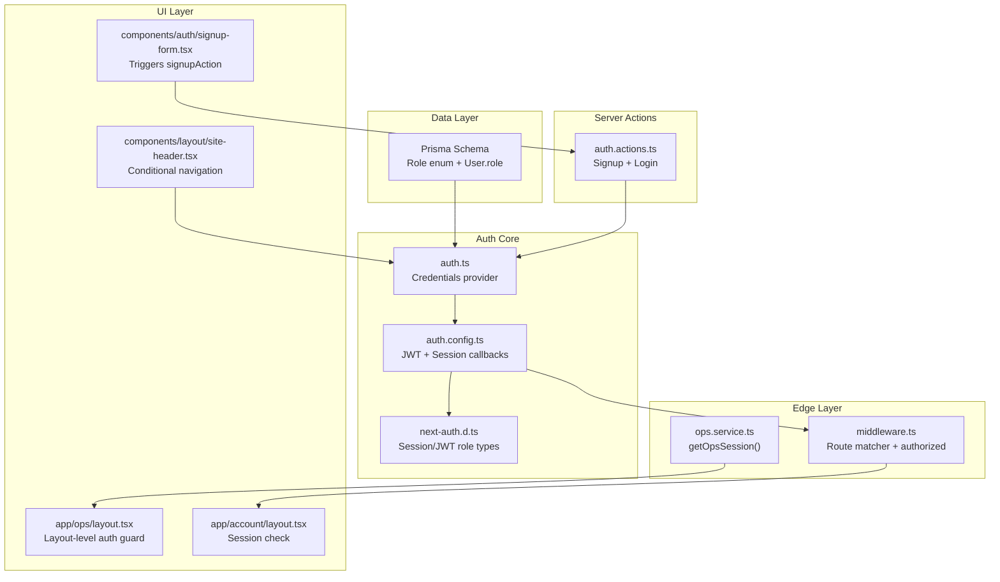
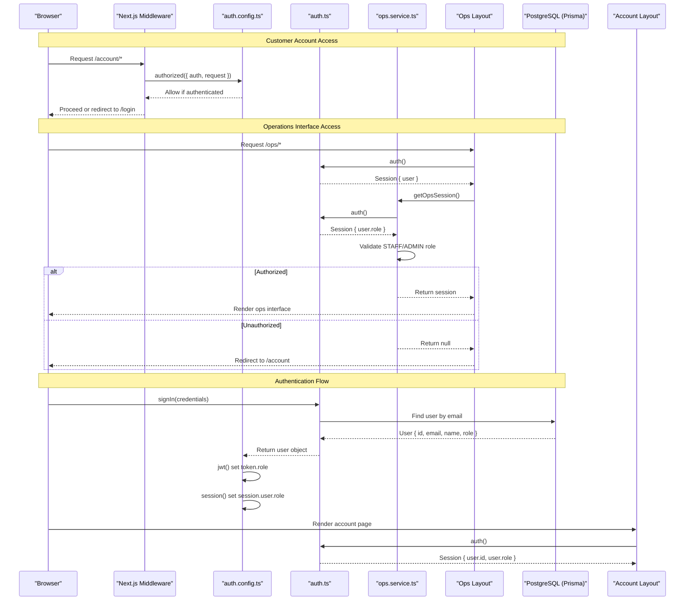
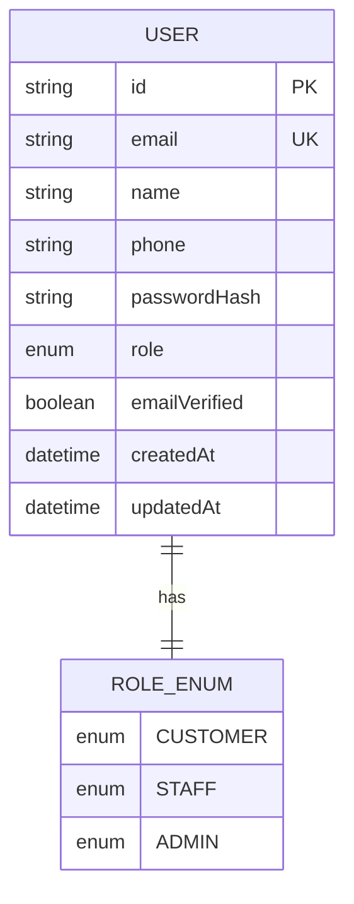
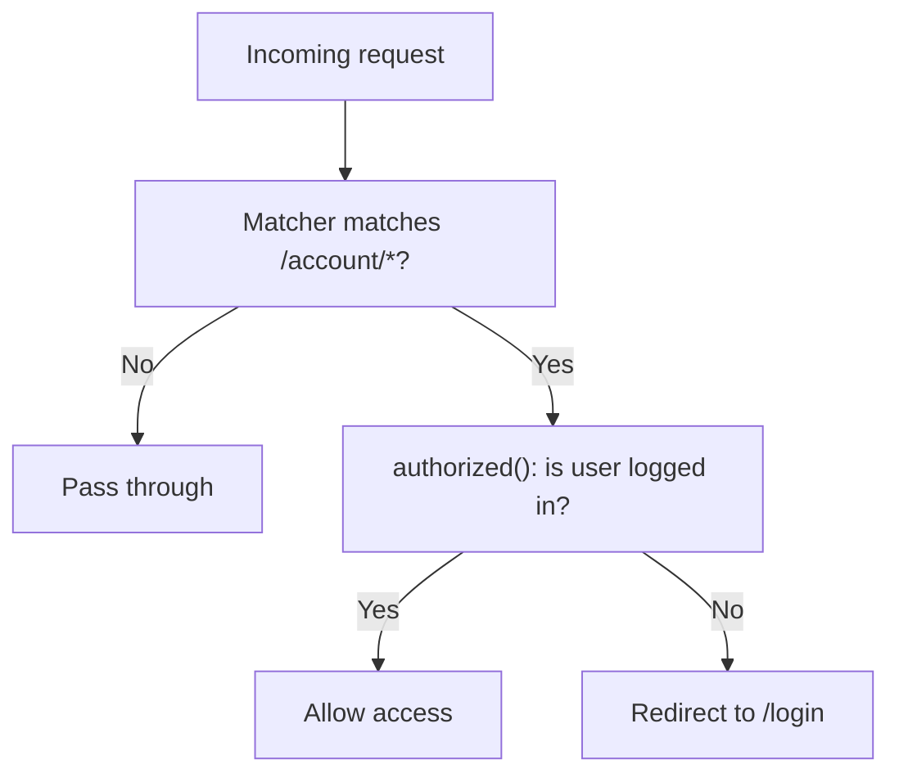
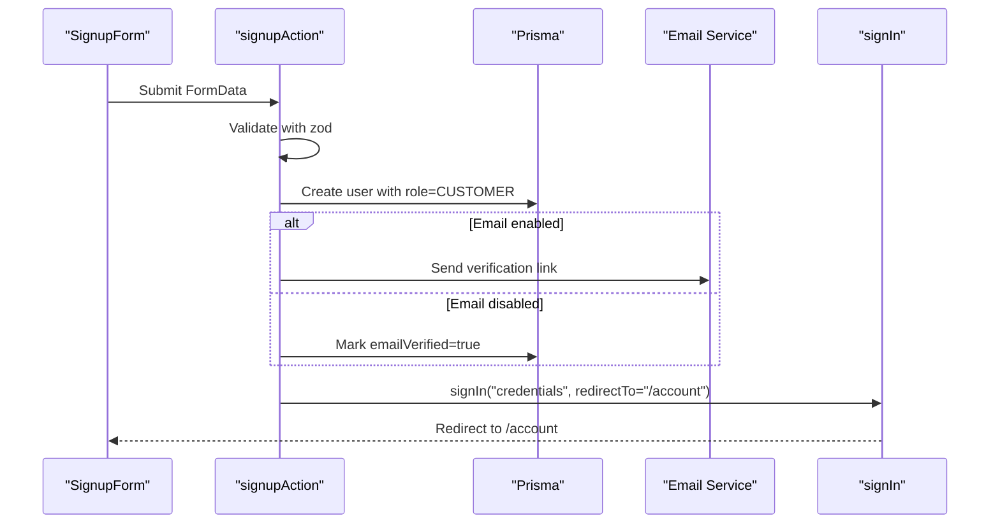
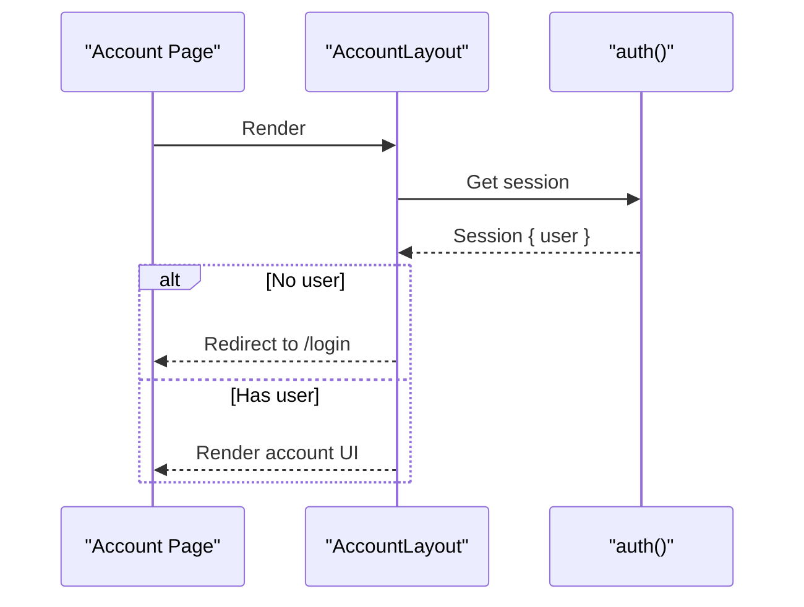
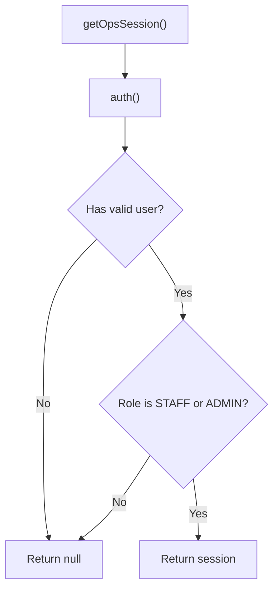
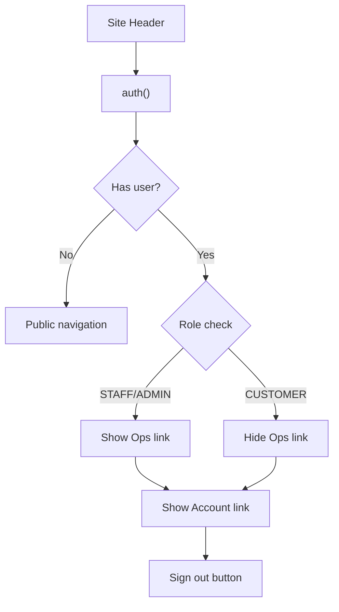
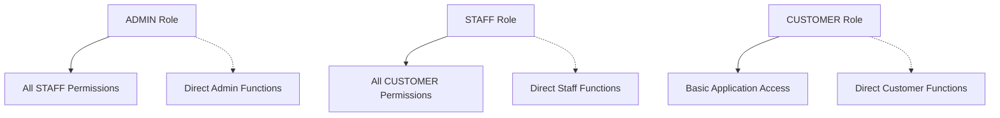
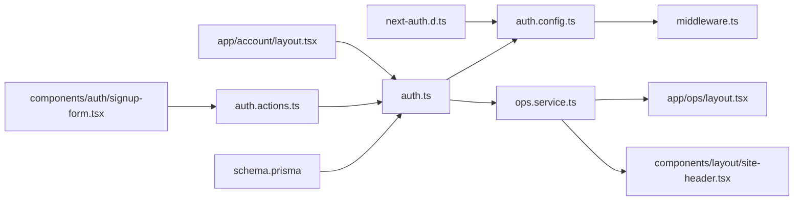

# Role-Based Access Control

<cite>
**Referenced Files in This Document**
- [schema.prisma](file://prisma/schema.prisma)
- [auth.config.ts](file://lib/auth.config.ts)
- [auth.ts](file://lib/auth.ts)
- [middleware.ts](file://middleware.ts)
- [ops.service.ts](file://server/ops.service.ts)
- [ops layout.tsx](file://app/ops/layout.tsx)
- [site-header.tsx](file://components/layout/site-header.tsx)
- [next-auth.d.ts](file://types/next-auth.d.ts)
- [auth.actions.ts](file://server/auth.actions.ts)
- [account layout.tsx](file://app/account/layout.tsx)
- [signup-form.tsx](file://components/auth/signup-form.tsx)
- [validation.ts](file://lib/validation.ts)
</cite>

## Update Summary
**Changes Made**
- Enhanced documentation to reflect the complete three-tier role hierarchy (CUSTOMER, STAFF, ADMIN)
- Added comprehensive coverage of the centralized `getOpsSession()` authorization function
- Documented the operations interface with robust role-based authorization guards
- Updated layout-level authorization patterns for the ops area requiring STAFF/ADMIN roles
- Enhanced conditional navigation documentation showing dynamic UI elements based on user roles
- Expanded middleware integration details for /ops route protection
- Added detailed examples of role inheritance patterns and permission checking utilities

## Table of Contents
1. [Introduction](#introduction)
2. [Project Structure](#project-structure)
3. [Core Components](#core-components)
4. [Architecture Overview](#architecture-overview)
5. [Detailed Component Analysis](#detailed-component-analysis)
6. [Operations Interface Authorization](#operations-interface-authorization)
7. [Role Hierarchy and Inheritance Patterns](#role-hierarchy-and-inheritance-patterns)
8. [Permission Checking Utilities](#permission-checking-utilities)
9. [Dependency Analysis](#dependency-analysis)
10. [Performance Considerations](#performance-considerations)
11. [Troubleshooting Guide](#troubleshooting-guide)
12. [Conclusion](#conclusion)

## Introduction
This document explains Timberland's comprehensive role-based access control (RBAC) system. The application implements a sophisticated three-tier role hierarchy: **Customer**, **Staff**, and **Admin**. Roles are stored on the user model, propagated through NextAuth sessions and JWTs, and enforced at multiple layers including middleware, layout components, and server services. The system provides dedicated operations interface access controlled by STAFF and ADMIN roles, with comprehensive authorization guards throughout the application lifecycle.

The RBAC system ensures that customer users can only access their personal dashboard and shipment management features, while staff and admin users gain access to back-office operations including shipment tracking, status updates, and administrative functions.

## Project Structure
The RBAC-related code is strategically distributed across configuration, runtime authentication, middleware, data models, server services, and UI components:

- **Data model and roles**: Prisma schema defines the `Role` enum with CUSTOMER, STAFF, and ADMIN values, with an index on the role field for efficient queries
- **Authentication configuration**: Edge-safe NextAuth config injects role into tokens and sessions during authentication flow
- **Runtime providers**: Credentials provider reads users from the database and returns role during login process
- **Middleware**: Guards `/account/*` routes using NextAuth's edge-safe `authorized` callback for customer account protection
- **Operations service**: Centralized role checking utility via `getOpsSession()` for back-office operations security
- **Layout authorization**: Ops layout enforces STAFF/ADMIN role requirements at the component level
- **Conditional navigation**: Site header dynamically shows/hides ops link based on user role permissions
- **Server actions**: Signup flow creates users with default CUSTOMER role and handles authentication
- **Type augmentation**: Extends NextAuth types so `session.user.role` is strongly typed across the application



**Diagram sources**
- [schema.prisma:17-21](file://prisma/schema.prisma#L17-L21)
- [schema.prisma:57-78](file://prisma/schema.prisma#L57-L78)
- [auth.config.ts:11-40](file://lib/auth.config.ts#L11-L40)
- [auth.ts:9-35](file://lib/auth.ts#L9-L35)
- [middleware.ts:1-13](file://middleware.ts#L1-L13)
- [ops.service.ts:11-19](file://server/ops.service.ts#L11-L19)
- [ops layout.tsx:9-15](file://app/ops/layout.tsx#L9-L15)
- [site-header.tsx:41-45](file://components/layout/site-header.tsx#L41-L45)
- [auth.actions.ts:26-80](file://server/auth.actions.ts#L26-L80)
- [next-auth.d.ts:4-16](file://types/next-auth.d.ts#L4-L16)

**Section sources**
- [schema.prisma:17-21](file://prisma/schema.prisma#L17-L21)
- [schema.prisma:57-78](file://prisma/schema.prisma#L57-L78)
- [auth.config.ts:11-40](file://lib/auth.config.ts#L11-L40)
- [auth.ts:9-35](file://lib/auth.ts#L9-L35)
- [middleware.ts:1-13](file://middleware.ts#L1-L13)
- [ops.service.ts:11-19](file://server/ops.service.ts#L11-L19)
- [ops layout.tsx:9-15](file://app/ops/layout.tsx#L9-L15)
- [site-header.tsx:41-45](file://components/layout/site-header.tsx#L41-L45)
- [auth.actions.ts:26-80](file://server/auth.actions.ts#L26-L80)
- [next-auth.d.ts:4-16](file://types/next-auth.d.ts#L4-L16)

## Core Components
- **Role model and defaults**:
  - The `Role` enum defines `CUSTOMER`, `STAFF`, and `ADMIN`.
  - The `User` model stores `role` with a default of `CUSTOMER`.
  - Database indexing on `role` field optimizes role-based queries.
- **Session and token propagation**:
  - The credentials provider returns the user's role during authentication.
  - The JWT callback sets `token.role`, defaulting to `CUSTOMER`.
  - The session callback copies `id` and `role` onto `session.user`.
- **Route protection**:
  - Middleware guards `/account/*` using the `authorized` callback, requiring an authenticated user.
- **Operations interface authorization**:
  - Centralized `getOpsSession()` function validates STAFF/ADMIN roles for back-office access.
  - Layout-level guards redirect unauthorized users to appropriate destinations.
- **Conditional navigation**:
  - Site header conditionally displays ops link based on user role.
- **Signup flow**:
  - The signup server action validates input, creates a user with role `CUSTOMER`, optionally auto-verifies email, and signs the user in.
- **Type safety**:
  - NextAuth types are augmented so `session.user.role` is typed as one of the three roles.

**Section sources**
- [schema.prisma:17-21](file://prisma/schema.prisma#L17-L21)
- [schema.prisma:57-78](file://prisma/schema.prisma#L57-L78)
- [auth.ts:16-30](file://lib/auth.ts#L16-L30)
- [auth.config.ts:26-39](file://lib/auth.config.ts#L26-L39)
- [ops.service.ts:11-19](file://server/ops.service.ts#L11-L19)
- [ops layout.tsx:9-15](file://app/ops/layout.tsx#L9-L15)
- [site-header.tsx:41-45](file://components/layout/site-header.tsx#L41-L45)
- [auth.actions.ts:26-80](file://server/auth.actions.ts#L26-L80)
- [next-auth.d.ts:4-16](file://types/next-auth.d.ts#L4-L16)

## Architecture Overview
The enhanced RBAC architecture integrates Prisma, NextAuth, Next.js middleware, and dedicated operations services:



**Diagram sources**
- [middleware.ts:1-13](file://middleware.ts#L1-L13)
- [auth.config.ts:18-39](file://lib/auth.config.ts#L18-L39)
- [auth.ts:16-30](file://lib/auth.ts#L16-L30)
- [ops.service.ts:14-19](file://server/ops.service.ts#L14-L19)
- [ops layout.tsx:9-15](file://app/ops/layout.tsx#L9-L15)
- [account layout.tsx:13-15](file://app/account/layout.tsx#L13-L15)

## Detailed Component Analysis

### Role Model and Default Assignment
- **Role enumeration**:
  - `Role` includes `CUSTOMER`, `STAFF`, `ADMIN`.
- **User model**:
  - `User.role` defaults to `CUSTOMER`.
  - Index on `role` supports efficient queries.



**Diagram sources**
- [schema.prisma:17-21](file://prisma/schema.prisma#L17-L21)
- [schema.prisma:57-78](file://prisma/schema.prisma#L57-L78)

**Section sources**
- [schema.prisma:17-21](file://prisma/schema.prisma#L17-L21)
- [schema.prisma:57-78](file://prisma/schema.prisma#L57-L78)

### Authentication Flow and Role Propagation
- **Credentials provider**:
  - Validates email/password via Prisma and crypto utilities.
  - Returns user fields including `role`.
- **JWT callback**:
  - Sets `token.id` and `token.role`; defaults to `CUSTOMER` when missing.
- **Session callback**:
  - Copies `id` and `role` onto `session.user`.


**Diagram sources**
- [auth.ts:16-30](file://lib/auth.ts#L16-L30)
- [auth.config.ts:26-39](file://lib/auth.config.ts#L26-L39)

**Section sources**
- [auth.ts:16-30](file://lib/auth.ts#L16-L30)
- [auth.config.ts:26-39](file://lib/auth.config.ts#L26-L39)

### Middleware and Route Protection
- **Middleware setup**:
  - Uses NextAuth's edge-safe `auth` function.
  - Matcher restricts protection to `/account/:path*`.
- **Authorized callback**:
  - Checks if the pathname starts with `/account`.
  - Requires an authenticated user; otherwise redirects to `/login`.



**Diagram sources**
- [middleware.ts:1-13](file://middleware.ts#L1-L13)
- [auth.config.ts:18-25](file://lib/auth.config.ts#L18-L25)

**Section sources**
- [middleware.ts:1-13](file://middleware.ts#L1-L13)
- [auth.config.ts:18-25](file://lib/auth.config.ts#L18-L25)

### Signup Flow and Role Assignment
- **Validation**:
  - Uses Zod schemas for name, email, phone, and password.
- **Creation**:
  - Hashes password, generates verification token, and creates user with role `CUSTOMER`.
  - Auto-verifies email when SMTP is disabled.
- **Sign-in**:
  - Immediately signs in the new user and redirects to `/account`.



**Diagram sources**
- [signup-form.tsx:13-14](file://components/auth/signup-form.tsx#L13-L14)
- [auth.actions.ts:26-80](file://server/auth.actions.ts#L26-L80)
- [validation.ts:9-19](file://lib/validation.ts#L9-L19)

**Section sources**
- [auth.actions.ts:26-80](file://server/auth.actions.ts#L26-L80)
- [validation.ts:9-19](file://lib/validation.ts#L9-L19)
- [signup-form.tsx:13-14](file://components/auth/signup-form.tsx#L13-L14)

### Account Layout and Session Usage
- The account layout fetches the session and redirects unauthenticated users to `/login`.
- It renders navigation links for dashboard, new shipment, addresses, and notifications.



**Diagram sources**
- [account layout.tsx:13-15](file://app/account/layout.tsx#L13-L15)

**Section sources**
- [account layout.tsx:13-15](file://app/account/layout.tsx#L13-L15)

### Type Augmentation for Role Safety
- NextAuth types are extended to include:
  - `session.user.role`: required and typed as `"CUSTOMER" | "STAFF" | "ADMIN"`.
  - `user.role`: optional in the base user object.
  - `JWT.role`: optional in the core JWT interface.

```mermaid
classDiagram
class Session_User {
+string id
+"CUSTOMER"|"STAFF"|"ADMIN" role
}
class Base_User {
+string id
"CUSTOMER"|"STAFF"|"ADMIN"? role
}
class JWT_Token {
+string id
"CUSTOMER"|"STAFF"|"ADMIN"? role
}
Session_User <|-- Base_User : "extends"
JWT_Token <|-- Base_User : "extends"
```

**Diagram sources**
- [next-auth.d.ts:4-16](file://types/next-auth.d.ts#L4-L16)
- [next-auth.d.ts:18-23](file://types/next-auth.d.ts#L18-L23)

**Section sources**
- [next-auth.d.ts:4-16](file://types/next-auth.d.ts#L4-L16)
- [next-auth.d.ts:18-23](file://types/next-auth.d.ts#L18-L23)

## Operations Interface Authorization

### Role-Based Access Control for Back-Office Operations
The operations interface implements comprehensive role-based authorization to protect sensitive back-office functionality. Only users with STAFF or ADMIN roles can access the operations dashboard and related endpoints.

#### Centralized Authorization Service
The `getOpsSession()` function serves as the primary authorization gatekeeper for all operations-related functionality:



**Diagram sources**
- [ops.service.ts:14-19](file://server/ops.service.ts#L14-L19)

#### Layout-Level Authorization Guards
The operations layout enforces role-based access at the component level, providing immediate feedback and proper redirection for unauthorized users:

- **Authentication check**: Redirects unauthenticated users to `/login`
- **Role validation**: Redirects non-STAFF/ADMIN users to `/account`
- **Protected content**: Renders operations interface only for authorized users

#### Conditional Navigation
The site header dynamically adjusts navigation based on user roles:

- **STAFF/ADMIN users**: See "Ops" link in the main navigation
- **Customer users**: Only see standard navigation links
- **Unauthenticated users**: See sign-in/create account options



**Diagram sources**
- [site-header.tsx:41-45](file://components/layout/site-header.tsx#L41-L45)

**Section sources**
- [ops.service.ts:11-19](file://server/ops.service.ts#L11-L19)
- [ops layout.tsx:9-15](file://app/ops/layout.tsx#L9-L15)
- [site-header.tsx:41-45](file://components/layout/site-header.tsx#L41-L45)

## Role Hierarchy and Inheritance Patterns

### Three-Tier Role Structure
Timberland implements a clear hierarchical role structure:

1. **CUSTOMER**: Default role for all registered users
   - Access to personal dashboard
   - Shipment creation and tracking
   - Address management
   - Notification preferences

2. **STAFF**: Operational role for logistics personnel
   - All CUSTOMER permissions
   - Access to operations dashboard
   - Shipment status updates
   - Internal note management

3. **ADMIN**: Administrative role with full system access
   - All STAFF permissions
   - Full administrative capabilities
   - System-wide oversight

### Role Inheritance Implementation
The system implements role inheritance through explicit checks rather than automatic inheritance:



**Diagram sources**
- [ops.service.ts:11](file://server/ops.service.ts#L11)
- [site-header.tsx:41-45](file://components/layout/site-header.tsx#L41-L45)

### Permission Escalation Controls
- **Explicit role checks**: Each protected endpoint explicitly checks for required roles
- **Defense in depth**: Multiple layers of authorization (middleware, layout, server actions)
- **Audit-ready**: Clear separation between read and write operations with additional authorization

**Section sources**
- [ops.service.ts:11-19](file://server/ops.service.ts#L11-L19)
- [site-header.tsx:41-45](file://components/layout/site-header.tsx#L41-L45)

## Permission Checking Utilities

### Centralized Authorization Function
The `getOpsSession()` function provides a reusable authorization pattern:

```typescript
export async function getOpsSession() {
  const session = await auth();
  const role = session?.user?.role;
  if (!session?.user?.id || !role || !(OPS_ROLES as readonly string[]).includes(role)) return null;
  return session;
}
```

### Role Constants and Validation
- **OPS_ROLES constant**: Defines allowed roles for operations access as `["STAFF", "ADMIN"]`
- **Type-safe validation**: Uses TypeScript's `as const` for compile-time role validation
- **Consistent checking**: Single source of truth for role-based authorization logic

### Pattern for Custom Permission Checks
To implement custom permission checks:

1. Define role constants for specific operations
2. Create helper functions that validate both authentication and authorization
3. Use these helpers consistently across server actions and API endpoints
4. Implement defensive programming with null checks and proper error handling

**Section sources**
- [ops.service.ts:11-19](file://server/ops.service.ts#L11-L19)

## Dependency Analysis
The following diagram shows how RBAC components depend on each other with the enhanced operations interface:



**Diagram sources**
- [schema.prisma:57-78](file://prisma/schema.prisma#L57-L78)
- [auth.ts:1-42](file://lib/auth.ts#L1-L42)
- [auth.config.ts:1-42](file://lib/auth.config.ts#L1-L42)
- [middleware.ts:1-13](file://middleware.ts#L1-L13)
- [ops.service.ts:1-163](file://server/ops.service.ts#L1-L163)
- [ops layout.tsx:1-48](file://app/ops/layout.tsx#L1-L48)
- [site-header.tsx:1-77](file://components/layout/site-header.tsx#L1-L77)
- [auth.actions.ts:1-101](file://server/auth.actions.ts#L1-L101)
- [next-auth.d.ts:1-24](file://types/next-auth.d.ts#L1-L24)
- [account layout.tsx:1-39](file://app/account/layout.tsx#L1-L39)
- [signup-form.tsx:1-39](file://components/auth/signup-form.tsx#L1-L39)

**Section sources**
- [schema.prisma:57-78](file://prisma/schema.prisma#L57-L78)
- [auth.ts:1-42](file://lib/auth.ts#L1-L42)
- [auth.config.ts:1-42](file://lib/auth.config.ts#L1-L42)
- [middleware.ts:1-13](file://middleware.ts#L1-L13)
- [ops.service.ts:1-163](file://server/ops.service.ts#L1-L163)
- [ops layout.tsx:1-48](file://app/ops/layout.tsx#L1-L48)
- [site-header.tsx:1-77](file://components/layout/site-header.tsx#L1-L77)
- [auth.actions.ts:1-101](file://server/auth.actions.ts#L1-L101)
- [next-auth.d.ts:1-24](file://types/next-auth.d.ts#L1-L24)
- [account layout.tsx:1-39](file://app/account/layout.tsx#L1-L39)
- [signup-form.tsx:1-39](file://components/auth/signup-form.tsx#L1-L39)

## Performance Considerations
- **Minimal overhead**:
  - Role is a small field on the JWT and session; copying it incurs negligible cost.
  - Operations authorization checks are lightweight role comparisons.
- **Database indexing**:
  - An index on `User.role` improves queries filtering by role.
- **Edge middleware**:
  - Using NextAuth's edge-safe configuration avoids heavy Node dependencies in middleware.
- **Centralized authorization**:
  - Single `getOpsSession()` function reduces code duplication and ensures consistent authorization logic.
- **Type safety benefits**:
  - Compile-time type checking prevents runtime errors from invalid role assignments.

## Troubleshooting Guide
- **Unauthenticated access to `/account/*`**:
  - Ensure the `authorized` callback allows only authenticated users and that the matcher covers the intended paths.
- **Unauthorized access to operations interface**:
  - Verify that users attempting to access `/ops/*` have STAFF or ADMIN roles.
  - Check that `getOpsSession()` properly validates roles before returning session data.
- **Missing role in session**:
  - Verify that the credentials provider returns `role` and that the JWT/session callbacks populate `token.role` and `session.user.role`.
- **Ops link not appearing in navigation**:
  - Confirm that the user has STAFF or ADMIN role in their session.
  - Check that the conditional rendering in site-header.tsx is working correctly.
- **Signup not assigning role**:
  - Confirm that the signup action sets `role: "CUSTOMER"` when creating the user.
- **Type errors accessing `session.user.role`**:
  - Ensure NextAuth types are augmented correctly and that the app imports the augmented types.
- **Role-based routing issues**:
  - Verify that middleware configuration matches the intended route patterns.
  - Check that layout-level authorization guards are properly implemented.

**Section sources**
- [auth.config.ts:18-39](file://lib/auth.config.ts#L18-L39)
- [auth.ts:16-30](file://lib/auth.ts#L16-L30)
- [ops.service.ts:14-19](file://server/ops.service.ts#L14-L19)
- [site-header.tsx:41-45](file://components/layout/site-header.tsx#L41-L45)
- [auth.actions.ts:53-67](file://server/auth.actions.ts#L53-L67)
- [next-auth.d.ts:4-16](file://types/next-auth.d.ts#L4-L16)

## Conclusion
Timberland's comprehensive RBAC system centers on a clear three-tier role model (`CUSTOMER`, `STAFF`, `ADMIN`) defined in the Prisma schema and propagated through NextAuth's JWT and session layers. The system provides robust protection for both customer-facing features and sensitive back-office operations:

- **Customer accounts**: Protected by middleware requiring authentication
- **Operations interface**: Protected by layout-level guards requiring STAFF/ADMIN roles
- **Conditional navigation**: Dynamic UI elements based on user roles
- **Centralized authorization**: Reusable `getOpsSession()` function for consistent role checking
- **Role inheritance**: Clear hierarchy with explicit permission checks
- **Type safety**: Strongly-typed role validation throughout the application

To extend this system further:
- Add more granular permission checks within server actions for specific operations
- Implement fine-grained permission matrices for complex business rules
- Add audit logging for role-based access attempts
- Use the strongly-typed `session.user.role` to gate additional UI features conditionally
- Consider implementing role-based feature flags for gradual rollout of new functionality

These patterns provide a solid foundation for scalable role inheritance and permission checking across the entire application, ensuring both security and maintainability while supporting the growth of the platform's operational requirements.