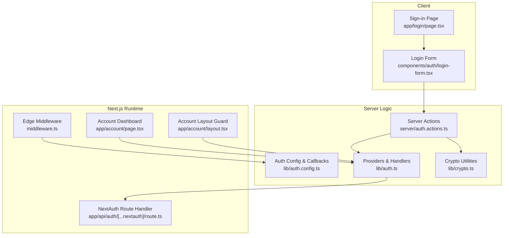
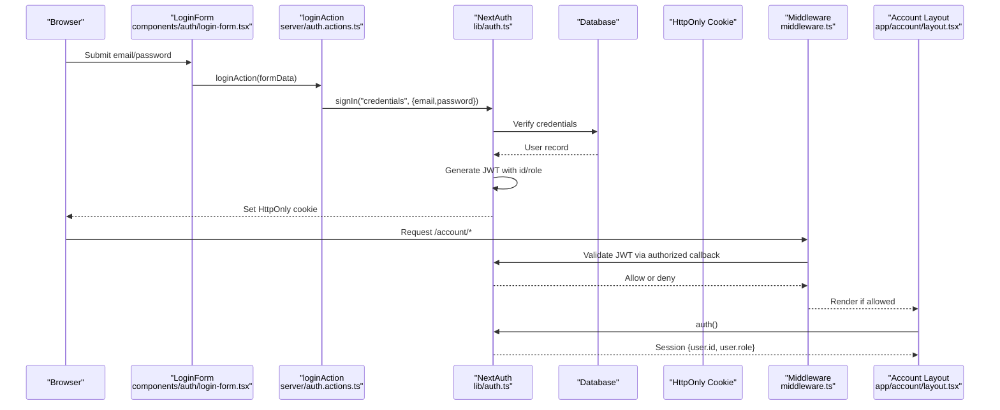
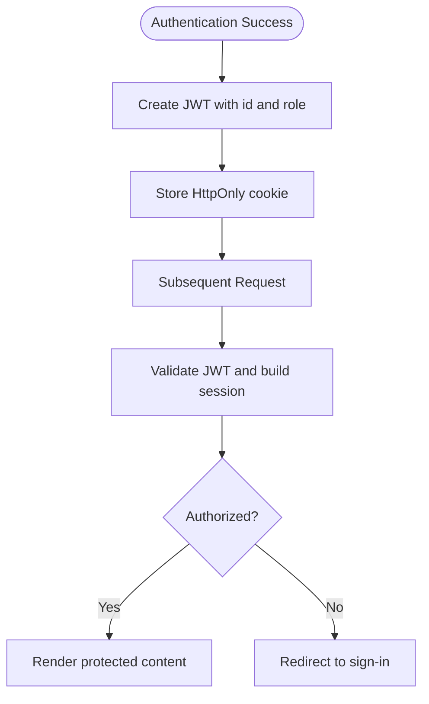
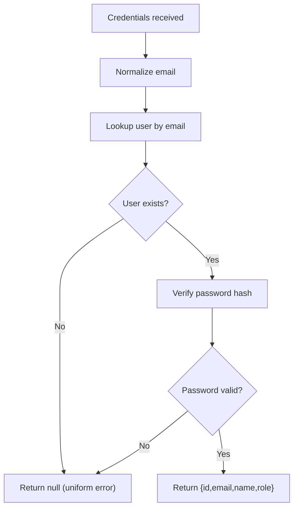
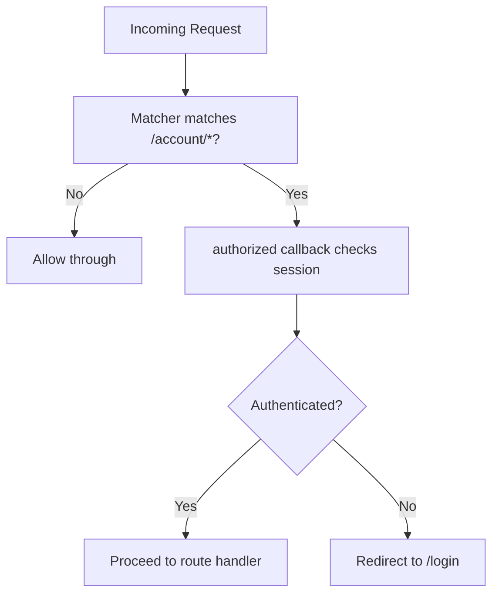
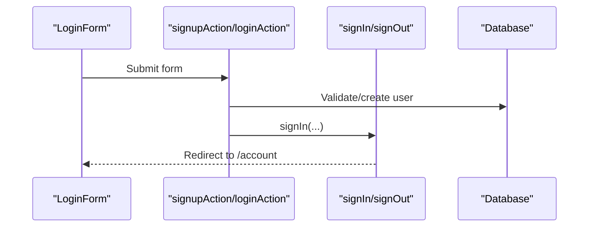
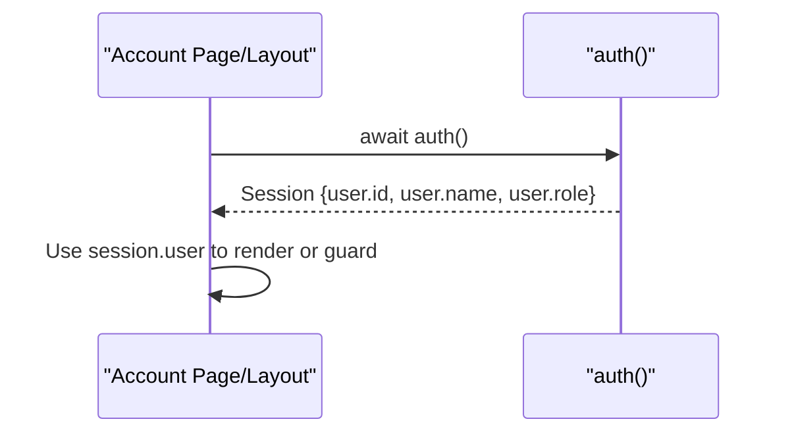
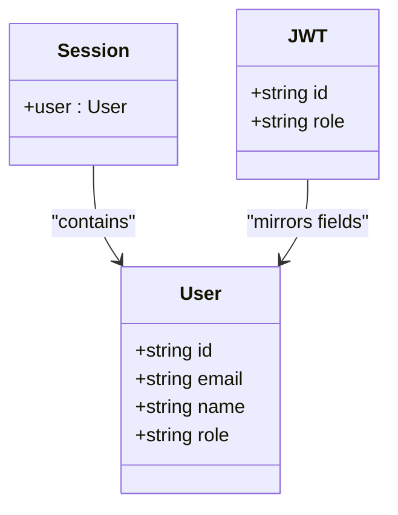
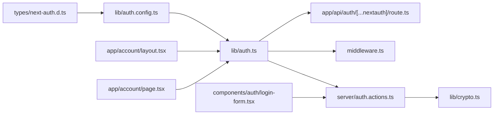

# Session Management

<cite>
**Referenced Files in This Document**
- [auth.ts](file://lib/auth.ts)
- [auth.config.ts](file://lib/auth.config.ts)
- [next-auth.d.ts](file://types\next-auth.d.ts)
- [middleware.ts](file://middleware.ts)
- [route.ts](file://app\api\auth\[...nextauth]\route.ts)
- [auth.actions.ts](file://server\auth.actions.ts)
- [crypto.ts](file://lib/crypto.ts)
- [login-form.tsx](file://components\auth\login-form.tsx)
- [page.tsx](file://app\login\page.tsx)
- [layout.tsx](file://app\account\layout.tsx)
- [page.tsx](file://app\account\page.tsx)
</cite>

## Table of Contents
1. [Introduction](#introduction)
2. [Project Structure](#project-structure)
3. [Core Components](#core-components)
4. [Architecture Overview](#architecture-overview)
5. [Detailed Component Analysis](#detailed-component-analysis)
6. [Dependency Analysis](#dependency-analysis)
7. [Performance Considerations](#performance-considerations)
8. [Troubleshooting Guide](#troubleshooting-guide)
9. [Conclusion](#conclusion)

## Introduction
This document explains how Timberland’s authentication system manages sessions using NextAuth (Auth.js). It covers JWT-based session strategy, token generation and validation, route protection via middleware, server-side session access, and the custom type definitions for the session object. It also includes guidance on security considerations such as token storage, CSRF handling, and cross-site request behavior.

## Project Structure
The session management spans several layers:
- Authentication configuration and providers
- Edge-safe middleware for route protection
- API routes for NextAuth handlers
- Server actions for login/signup/logout
- UI components that trigger authentication flows
- Server components that read the authenticated session

**Diagram sources**
- [middleware.ts:1-14](file://middleware.ts#L1-L14)
- [route.ts:1-4](file://app\api\auth\[...nextauth]\route.ts#L1-L4)
- [auth.config.ts:1-42](file://lib/auth.config.ts#L1-L42)
- [auth.ts:1-42](file://lib/auth.ts#L1-L42)
- [auth.actions.ts:1-101](file://server\auth.actions.ts#L1-L101)
- [crypto.ts:1-29](file://lib/crypto.ts#L1-L29)
- [login-form.tsx:1-40](file://components\auth\login-form.tsx#L1-L40)
- [page.tsx](file://app\login\page.tsx)
- [layout.tsx](file://app\account\layout.tsx)
- [page.tsx](file://app\account\page.tsx)

**Section sources**
- [middleware.ts:1-14](file://middleware.ts#L1-L14)
- [route.ts:1-4](file://app\api\auth\[...nextauth]\route.ts#L1-L4)
- [auth.config.ts:1-42](file://lib/auth.config.ts#L1-L42)
- [auth.ts:1-42](file://lib/auth.ts#L1-L42)
- [auth.actions.ts:1-101](file://server\auth.actions.ts#L1-L101)
- [crypto.ts:1-29](file://lib/crypto.ts#L1-L29)
- [login-form.tsx:1-40](file://components\auth\login-form.tsx#L1-L40)
- [page.tsx](file://app\login\page.tsx)
- [layout.tsx](file://app\account\layout.tsx)
- [page.tsx](file://app\account\page.tsx)

## Core Components
- NextAuth setup with JWT session strategy and credentials provider
- Edge-safe auth configuration with callbacks for authorization, JWT population, and session augmentation
- Custom TypeScript declarations for Session, User, and JWT
- Middleware protecting account routes
- API route exposing NextAuth handlers
- Server actions for signup, login, and logout
- Client login form triggering server actions
- Server components reading session data

Key responsibilities:
- Token generation and payload enrichment occur during authentication and are carried in the JWT.
- The session is reconstructed from the JWT on each request.
- Route protection is enforced by both edge middleware and server-side checks.

**Section sources**
- [auth.ts:1-42](file://lib/auth.ts#L1-L42)
- [auth.config.ts:1-42](file://lib/auth.config.ts#L1-L42)
- [next-auth.d.ts:1-24](file://types\next-auth.d.ts#L1-L24)
- [middleware.ts:1-14](file://middleware.ts#L1-L14)
- [route.ts:1-4](file://app\api\auth\[...nextauth]\route.ts#L1-L4)
- [auth.actions.ts:1-101](file://server\auth.actions.ts#L1-L101)

## Architecture Overview
Timberland uses NextAuth with a JWT session strategy. On successful authentication, NextAuth creates a signed JWT containing minimal user identifiers and role. Subsequent requests validate this token to reconstruct the session. The edge middleware protects the /account area, while server components can directly call the auth helper to read the current session.

**Diagram sources**
- [login-form.tsx:1-40](file://components\auth\login-form.tsx#L1-L40)
- [auth.actions.ts:83-96](file://server\auth.actions.ts#L83-L96)
- [auth.ts:1-42](file://lib/auth.ts#L1-L42)
- [auth.config.ts:18-39](file://lib/auth.config.ts#L18-L39)
- [middleware.ts:1-14](file://middleware.ts#L1-L14)
- [layout.tsx](file://app\account\layout.tsx)

## Detailed Component Analysis

### JWT Strategy and Token Lifecycle
- Strategy: JWT-based sessions configured in the auth configuration.
- Token generation: Occurs after successful credential verification; the JWT contains user identifiers and role.
- Token storage: Handled by NextAuth as an HttpOnly cookie.
- Validation: Each request validates the JWT to reconstruct the session.
- Expiration and refresh: Controlled by NextAuth defaults; no custom refresh logic is implemented in this codebase.

**Diagram sources**
- [auth.config.ts:11-12](file://lib/auth.config.ts#L11-L12)
- [auth.config.ts:26-39](file://lib/auth.config.ts#L26-L39)
- [auth.ts:16-30](file://lib/auth.ts#L16-L30)

**Section sources**
- [auth.config.ts:11-12](file://lib/auth.config.ts#L11-L12)
- [auth.config.ts:26-39](file://lib/auth.config.ts#L26-L39)
- [auth.ts:16-30](file://lib/auth.ts#L16-L30)

### Authentication Providers and Authorization Flow
- Credentials provider verifies email/password against the database and returns a minimal user object.
- Optional Google provider is conditionally enabled via environment configuration.
- The authorize function ensures uniform failure messages to avoid leaking user existence.

**Diagram sources**
- [auth.ts:16-30](file://lib/auth.ts#L16-L30)
- [crypto.ts:12-15](file://lib/crypto.ts#L12-L15)

**Section sources**
- [auth.ts:9-35](file://lib/auth.ts#L9-L35)
- [crypto.ts:12-15](file://lib/crypto.ts#L12-L15)

### Middleware-Based Route Protection
- The edge middleware applies NextAuth with the edge-safe configuration.
- The matcher restricts protection to the /account area.
- The authorized callback denies unauthenticated access to protected paths.

**Diagram sources**
- [middleware.ts:1-14](file://middleware.ts#L1-L14)
- [auth.config.ts:18-25](file://lib/auth.config.ts#L18-L25)

**Section sources**
- [middleware.ts:1-14](file://middleware.ts#L1-L14)
- [auth.config.ts:18-25](file://lib/auth.config.ts#L18-L25)

### Server Actions for Authentication
- Signup validates input, hashes password, optionally auto-verifies in development, stores verification token, and signs the user in.
- Login calls NextAuth’s signIn and handles redirect errors appropriately.
- Logout calls signOut with a redirect to the home page.

**Diagram sources**
- [auth.actions.ts:26-81](file://server\auth.actions.ts#L26-L81)
- [auth.actions.ts:83-100](file://server\auth.actions.ts#L83-L100)

**Section sources**
- [auth.actions.ts:26-81](file://server\auth.actions.ts#L26-L81)
- [auth.actions.ts:83-100](file://server\auth.actions.ts#L83-L100)

### Accessing Authenticated User Data in Components
- Server components call the auth helper to retrieve the session.
- If no session or user identifier is present, they redirect or return not found.
- The dashboard reads user name and ID to fetch related data.

**Diagram sources**
- [layout.tsx](file://app\account\layout.tsx)
- [page.tsx](file://app\account\page.tsx)

**Section sources**
- [layout.tsx](file://app\account\layout.tsx)
- [page.tsx](file://app\account\page.tsx)

### Custom NextAuth Type Definitions and Session Object
- Session.user is augmented with id and role.
- User and JWT types are extended to include id and role fields.
- Role values are constrained to a union of customer/staff/admin.

**Diagram sources**
- [next-auth.d.ts:1-24](file://types\next-auth.d.ts#L1-L24)
- [auth.config.ts:26-39](file://lib/auth.config.ts#L26-L39)

**Section sources**
- [next-auth.d.ts:1-24](file://types\next-auth.d.ts#L1-L24)
- [auth.config.ts:26-39](file://lib/auth.config.ts#L26-L39)

## Dependency Analysis
The following diagram shows key dependencies among authentication-related modules.

**Diagram sources**
- [next-auth.d.ts:1-24](file://types\next-auth.d.ts#L1-L24)
- [auth.config.ts:1-42](file://lib/auth.config.ts#L1-L42)
- [auth.ts:1-42](file://lib/auth.ts#L1-L42)
- [route.ts:1-4](file://app\api\auth\[...nextauth]\route.ts#L1-L4)
- [middleware.ts:1-14](file://middleware.ts#L1-L14)
- [auth.actions.ts:1-101](file://server\auth.actions.ts#L1-L101)
- [crypto.ts:1-29](file://lib/crypto.ts#L1-L29)
- [login-form.tsx:1-40](file://components\auth\login-form.tsx#L1-L40)
- [layout.tsx](file://app\account\layout.tsx)
- [page.tsx](file://app\account\page.tsx)

**Section sources**
- [auth.ts:1-42](file://lib/auth.ts#L1-L42)
- [auth.config.ts:1-42](file://lib/auth.config.ts#L1-L42)
- [next-auth.d.ts:1-24](file://types\next-auth.d.ts#L1-L24)
- [middleware.ts:1-14](file://middleware.ts#L1-L14)
- [route.ts:1-4](file://app\api\auth\[...nextauth]\route.ts#L1-L4)
- [auth.actions.ts:1-101](file://server\auth.actions.ts#L1-L101)
- [crypto.ts:1-29](file://lib/crypto.ts#L1-L29)
- [login-form.tsx:1-40](file://components\auth\login-form.tsx#L1-L40)
- [layout.tsx](file://app\account\layout.tsx)
- [page.tsx](file://app\account\page.tsx)

## Performance Considerations
- JWT strategy avoids per-request database lookups when the token is valid, improving performance.
- Edge middleware runs close to the network edge, reducing latency for route guards.
- Avoid placing heavy Node-only operations in the edge-safe auth configuration; keep it lightweight.

[No sources needed since this section provides general guidance]

## Troubleshooting Guide
Common issues and resolutions:
- Unauthenticated redirects to /login: Ensure the session is present and the middleware matcher aligns with your routes.
- Uniform sign-in errors: The credentials provider intentionally hides whether an email exists to prevent enumeration.
- Missing user fields in session: Confirm that the jwt and session callbacks populate id and role.
- Development vs production verification: In development without SMTP, accounts may be auto-verified; in production, users must verify via email.

Relevant implementation references:
- Credentials provider and uniform error handling
- JWT/session callbacks augmenting session fields
- Middleware matcher limiting protection to /account
- Server actions handling redirects and errors

**Section sources**
- [auth.ts:16-30](file://lib/auth.ts#L16-L30)
- [auth.config.ts:26-39](file://lib/auth.config.ts#L26-L39)
- [middleware.ts:10-13](file://middleware.ts#L10-L13)
- [auth.actions.ts:78-100](file://server\auth.actions.ts#L78-L100)

## Conclusion
Timberland’s session management leverages NextAuth with a JWT strategy to provide secure, efficient authentication. Tokens are generated at sign-in, stored in HttpOnly cookies, and validated on each request. Route protection is enforced at the edge via middleware and reinforced in server components. The session object is augmented with id and role, enabling fine-grained access control. For enhanced security, ensure proper cookie settings, consider CSRF protections where applicable, and follow best practices for cross-site request handling.

[No sources needed since this section summarizes without analyzing specific files]