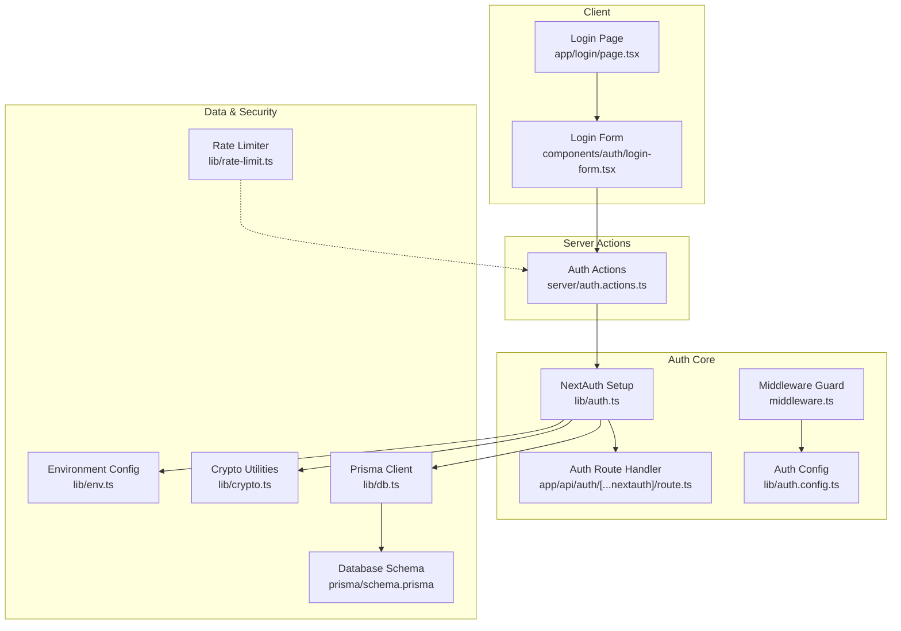
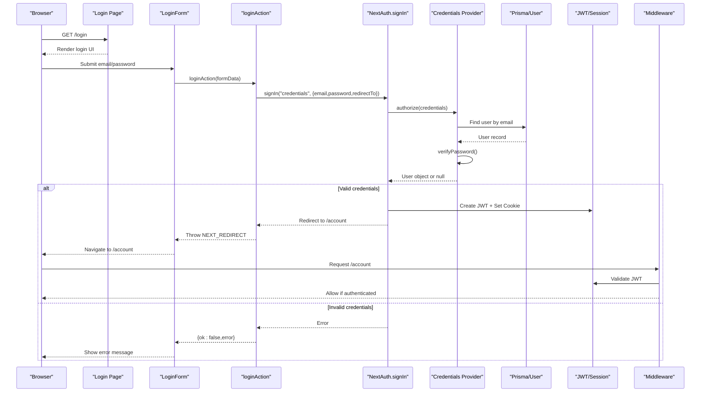
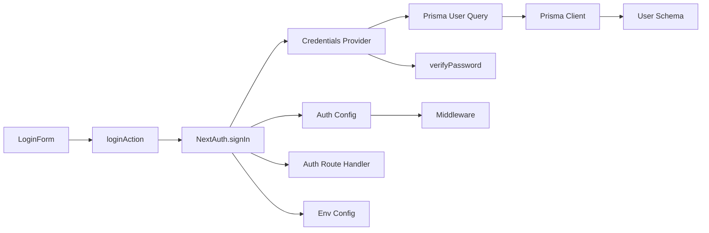

# User Login

<cite>
**Referenced Files in This Document**
- [page.tsx](file://app/login/page.tsx)
- [login-form.tsx](file://components/auth/login-form.tsx)
- [auth.actions.ts](file://server/auth.actions.ts)
- [auth.ts](file://lib/auth.ts)
- [auth.config.ts](file://lib/auth.config.ts)
- [route.ts](file://app/api/auth/[...nextauth]/route.ts)
- [middleware.ts](file://middleware.ts)
- [rate-limit.ts](file://lib/rate-limit.ts)
- [db.ts](file://lib/db.ts)
- [schema.prisma](file://prisma/schema.prisma)
- [crypto.ts](file://lib/crypto.ts)
- [env.ts](file://lib/env.ts)
- [next-auth.d.ts](file://types/next-auth.d.ts)
- [auth.spec.ts](file://tests/e2e/auth.spec.ts)
</cite>

## Table of Contents
1. [Introduction](#introduction)
2. [Project Structure](#project-structure)
3. [Core Components](#core-components)
4. [Architecture Overview](#architecture-overview)
5. [Detailed Component Analysis](#detailed-component-analysis)
6. [Dependency Analysis](#dependency-analysis)
7. [Performance Considerations](#performance-considerations)
8. [Troubleshooting Guide](#troubleshooting-guide)
9. [Conclusion](#conclusion)

## Introduction
This document explains the user login functionality in Timberland. It covers the complete authentication flow from the login form to NextAuth.js session management, including credential validation, JWT token handling, role-based access control, and security considerations such as rate limiting and brute-force protection. The documentation is structured for both technical and non-technical readers, with progressive complexity layers, diagrams, and concrete implementation references.

## Project Structure
The login feature spans client components, server actions, NextAuth configuration, middleware, database schema, and tests:

**Diagram sources**
- [page.tsx:1-50](file://app/login/page.tsx#L1-L50)
- [login-form.tsx:1-40](file://components/auth/login-form.tsx#L1-L40)
- [auth.actions.ts:1-101](file://server/auth.actions.ts#L1-L101)
- [auth.ts:1-42](file://lib/auth.ts#L1-L42)
- [auth.config.ts:1-42](file://lib/auth.config.ts#L1-L42)
- [route.ts:1-4](file://app/api/auth/[...nextauth]/route.ts#L1-L4)
- [middleware.ts:1-14](file://middleware.ts#L1-L14)
- [db.ts:1-16](file://lib/db.ts#L1-L16)
- [schema.prisma:57-78](file://prisma/schema.prisma#L57-L78)
- [crypto.ts:1-29](file://lib/crypto.ts#L1-L29)
- [env.ts:1-66](file://lib/env.ts#L1-L66)
- [rate-limit.ts:1-56](file://lib/rate-limit.ts#L1-L56)

**Section sources**
- [page.tsx:1-50](file://app/login/page.tsx#L1-L50)
- [login-form.tsx:1-40](file://components/auth/login-form.tsx#L1-L40)
- [auth.actions.ts:1-101](file://server/auth.actions.ts#L1-L101)
- [auth.ts:1-42](file://lib/auth.ts#L1-L42)
- [auth.config.ts:1-42](file://lib/auth.config.ts#L1-L42)
- [route.ts:1-4](file://app/api/auth/[...nextauth]/route.ts#L1-L4)
- [middleware.ts:1-14](file://middleware.ts#L1-L14)
- [db.ts:1-16](file://lib/db.ts#L1-L16)
- [schema.prisma:57-78](file://prisma/schema.prisma#L57-L78)
- [crypto.ts:1-29](file://lib/crypto.ts#L1-L29)
- [env.ts:1-66](file://lib/env.ts#L1-L66)
- [rate-limit.ts:1-56](file://lib/rate-limit.ts#L1-L56)

## Core Components
- Login page: Renders the login card, maps NextAuth error codes to user-friendly messages, and passes errors to the form.
- Login form: Client component that collects email/password, shows loading state, calls the server action, and displays errors.
- Server auth actions: Provide login/logout/signup server-side logic; login delegates to NextAuth’s signIn.
- NextAuth setup: Defines credentials provider, Google provider (optional), and exports handlers, auth, signIn, signOut.
- Auth config: Edge-safe configuration for JWT sessions, protected pages, and callbacks that attach id and role to tokens and sessions.
- Middleware: Guards /account routes using the authorized callback.
- Database and schema: Prisma client and User model with role and password hash fields.
- Crypto utilities: Password hashing and verification, token generation/hashing.
- Environment config: Typed access to secrets and feature flags.
- Rate limiter: In-memory fixed-window limiter for future integration points.

**Section sources**
- [page.tsx:1-50](file://app/login/page.tsx#L1-L50)
- [login-form.tsx:1-40](file://components/auth/login-form.tsx#L1-L40)
- [auth.actions.ts:1-101](file://server/auth.actions.ts#L1-L101)
- [auth.ts:1-42](file://lib/auth.ts#L1-L42)
- [auth.config.ts:1-42](file://lib/auth.config.ts#L1-L42)
- [middleware.ts:1-14](file://middleware.ts#L1-L14)
- [db.ts:1-16](file://lib/db.ts#L1-L16)
- [schema.prisma:57-78](file://prisma/schema.prisma#L57-L78)
- [crypto.ts:1-29](file://lib/crypto.ts#L1-L29)
- [env.ts:1-66](file://lib/env.ts#L1-L66)
- [rate-limit.ts:1-56](file://lib/rate-limit.ts#L1-L56)

## Architecture Overview
The login flow uses NextAuth.js with a credentials provider. On successful authentication, a JWT is issued and stored in a cookie. The middleware enforces authentication on protected routes, and the JWT/session callbacks enrich the session with user id and role for authorization.

**Diagram sources**
- [login-form.tsx:11-39](file://components/auth/login-form.tsx#L11-L39)
- [auth.actions.ts:83-96](file://server/auth.actions.ts#L83-L96)
- [auth.ts:9-31](file://lib/auth.ts#L9-L31)
- [auth.config.ts:11-40](file://lib/auth.config.ts#L11-L40)
- [middleware.ts:1-14](file://middleware.ts#L1-L14)

## Detailed Component Analysis

### Login Page
Responsibilities:
- Define metadata and map NextAuth error codes to user-facing messages.
- Render the login card and pass any error to the form.
- Provide links to signup and guest tracking.

Key behaviors:
- Reads searchParams.error and resolves it via AUTH_ERRORS mapping.
- Delegates rendering to LoginForm with an optional authError prop.

Security notes:
- Avoids leaking internal error details to the client.

**Section sources**
- [page.tsx:1-50](file://app/login/page.tsx#L1-L50)

### Login Form Component
Responsibilities:
- Collect email and password inputs.
- Manage pending/loading state during submission.
- Call the server action and display errors.

Validation and UX:
- Uses HTML5 required attributes for basic input validation.
- Disables submit button while pending and shows a spinner.
- Displays Alert when an error occurs.

Integration:
- Submits via FormData to loginAction.
- Handles NEXT_REDIRECT by letting it bubble up so Next.js navigates after success.

**Section sources**
- [login-form.tsx:1-40](file://components/auth/login-form.tsx#L1-L40)

### Server-Side Login Action
Responsibilities:
- Normalize email and password from FormData.
- Delegate authentication to NextAuth.signIn with credentials provider.
- Handle redirect vs error paths consistently.

Behavior:
- On success, NextAuth throws a redirect; the action re-throws it to trigger navigation.
- On failure, returns a structured result with ok=false and a generic error message.

Security considerations:
- Normalizes email to lowercase and trims whitespace.
- Does not expose whether the email exists; failures are uniform.

Future hardening:
- Integrate rate limiting around login attempts per IP/email.

**Section sources**
- [auth.actions.ts:83-96](file://server/auth.actions.ts#L83-L96)

### NextAuth Configuration and Providers
Providers:
- Credentials provider validates email/password against the database and returns a minimal user object including role.
- Optional Google provider enabled via environment variables.

Session strategy:
- JWT-based sessions configured in authConfig.

Callbacks:
- authorized: Protects /account routes based on presence of a user in auth context.
- jwt: Attaches id and role to the JWT token.
- session: Mirrors token data into session.user for runtime use.

Route handler:
- Exposes GET/POST at /api/auth/* for NextAuth flows.

Type augmentation:
- Extends Session, User, and JWT types to include id and role.

**Section sources**
- [auth.ts:1-42](file://lib/auth.ts#L1-L42)
- [auth.config.ts:1-42](file://lib/auth.config.ts#L1-L42)
- [route.ts:1-4](file://app/api/auth/[...nextauth]/route.ts#L1-L4)
- [next-auth.d.ts:1-24](file://types/next-auth.d.ts#L1-L24)

### Middleware Protection
- Wraps NextAuth with edge-safe middleware using authConfig.
- Guards only /account routes via matcher.
- Relies on authorized callback to enforce authentication.

**Section sources**
- [middleware.ts:1-14](file://middleware.ts#L1-L14)
- [auth.config.ts:18-25](file://lib/auth.config.ts#L18-L25)

### Database and Data Model
- Prisma client is exported as a singleton to avoid connection exhaustion.
- User model includes role, passwordHash, emailVerified, and related relations.

Relevant fields for login:
- email (unique index)
- passwordHash (bcrypt)
- role (CUSTOMER default)

**Section sources**
- [db.ts:1-16](file://lib/db.ts#L1-L16)
- [schema.prisma:57-78](file://prisma/schema.prisma#L57-L78)

### Cryptography and Environment
- Password hashing uses bcrypt with configurable rounds.
- Password verification compares plaintext to stored hash.
- Token helpers generate URL-safe random tokens and hash them before storage.
- Environment config centralizes secrets and feature flags (Google, SMTP).

**Section sources**
- [crypto.ts:1-29](file://lib/crypto.ts#L1-L29)
- [env.ts:1-66](file://lib/env.ts#L1-L66)

### Rate Limiting
- Provides a simple in-memory fixed-window rate limiter suitable for single-instance deployments.
- Includes helper to sweep expired buckets to bound memory usage.
- Not yet integrated into login; can be used to protect login endpoints against brute force.

**Section sources**
- [rate-limit.ts:1-56](file://lib/rate-limit.ts#L1-L56)

## Dependency Analysis
The following diagram highlights how the login feature depends on core modules:

**Diagram sources**
- [login-form.tsx:1-40](file://components/auth/login-form.tsx#L1-L40)
- [auth.actions.ts:83-96](file://server/auth.actions.ts#L83-L96)
- [auth.ts:1-42](file://lib/auth.ts#L1-L42)
- [auth.config.ts:1-42](file://lib/auth.config.ts#L1-L42)
- [middleware.ts:1-14](file://middleware.ts#L1-L14)
- [route.ts:1-4](file://app/api/auth/[...nextauth]/route.ts#L1-L4)
- [db.ts:1-16](file://lib/db.ts#L1-L16)
- [schema.prisma:57-78](file://prisma/schema.prisma#L57-L78)
- [crypto.ts:1-29](file://lib/crypto.ts#L1-L29)
- [env.ts:1-66](file://lib/env.ts#L1-L66)

**Section sources**
- [login-form.tsx:1-40](file://components/auth/login-form.tsx#L1-L40)
- [auth.actions.ts:83-96](file://server/auth.actions.ts#L83-L96)
- [auth.ts:1-42](file://lib/auth.ts#L1-L42)
- [auth.config.ts:1-42](file://lib/auth.config.ts#L1-L42)
- [middleware.ts:1-14](file://middleware.ts#L1-L14)
- [route.ts:1-4](file://app/api/auth/[...nextauth]/route.ts#L1-L4)
- [db.ts:1-16](file://lib/db.ts#L1-L16)
- [schema.prisma:57-78](file://prisma/schema.prisma#L57-L78)
- [crypto.ts:1-29](file://lib/crypto.ts#L1-L29)
- [env.ts:1-66](file://lib/env.ts#L1-L66)

## Performance Considerations
- Prisma client reuse avoids connection churn during development.
- JWT sessions reduce server-side session store pressure.
- bcrypt cost factor balances security and latency; tune BCRYPT_ROUNDS based on performance targets.
- Rate limiter is in-memory; for multi-instance deployments, replace with a shared store (Redis/Upstash) to ensure consistent throttling across instances.

[No sources needed since this section provides general guidance]

## Troubleshooting Guide
Common issues and resolutions:
- Invalid credentials:
  - Symptom: Error message shown on the login form; user remains on /login.
  - Cause: Credentials provider returned null due to mismatched password or missing user.
  - Resolution: Verify user exists and password is correct; ensure DATABASE_URL is configured.

- Redirect not happening after login:
  - Symptom: After submitting login, no navigation to /account.
  - Cause: NEXT_REDIRECT thrown but not handled properly in the action.
  - Resolution: Ensure loginAction re-throws NEXT_REDIRECT so Next.js navigates.

- Protected route access denied:
  - Symptom: Accessing /account redirects to /login.
  - Cause: No valid session/JWT present.
  - Resolution: Complete login flow; verify cookies and JWT are set.

- Google login not available:
  - Symptom: Google provider missing.
  - Cause: Missing AUTH_GOOGLE_ID or AUTH_GOOGLE_SECRET.
  - Resolution: Configure environment variables to enable Google provider.

- Email verification behavior:
  - Symptom: Account auto-verified locally.
  - Cause: SMTP not configured; app auto-verifies users for testability.
  - Resolution: Configure SMTP_HOST, SMTP_USER, SMTP_PASSWORD to require email verification in production.

E2E tests validate:
- Rejection of invalid credentials with visible error.
- Redirection to /account after successful login.
- Logout flow returning to login or home.

**Section sources**
- [auth.actions.ts:83-96](file://server/auth.actions.ts#L83-L96)
- [auth.ts:16-31](file://lib/auth.ts#L16-L31)
- [env.ts:38-62](file://lib/env.ts#L38-L62)
- [auth.spec.ts:1-37](file://tests/e2e/auth.spec.ts#L1-L37)

## Conclusion
Timberland’s login system combines a clean client-side form with robust server-side authentication via NextAuth.js. Credentials are validated against the database, and successful logins produce JWT-based sessions enriched with user identity and role. Middleware protects sensitive routes, and the architecture supports optional Google authentication. For production-grade security, integrate rate limiting around login attempts and consider additional controls such as account lockout policies and audit logging.

[No sources needed since this section summarizes without analyzing specific files]