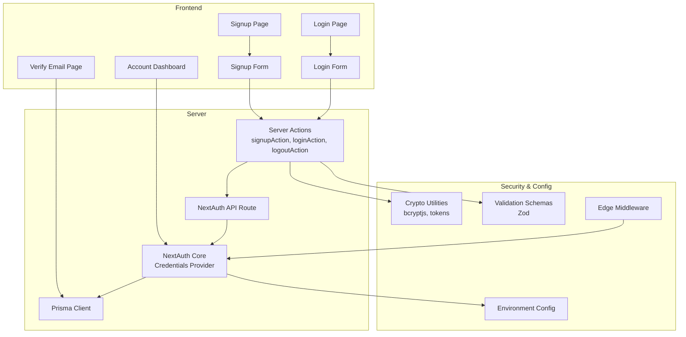
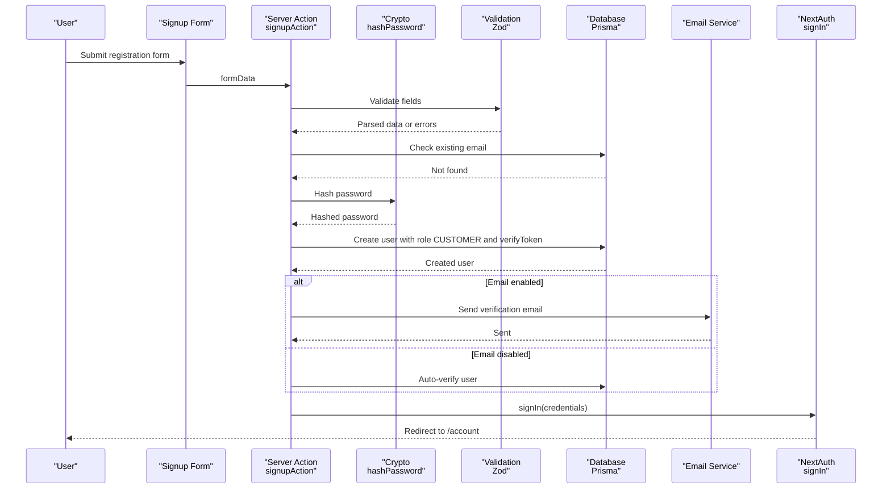
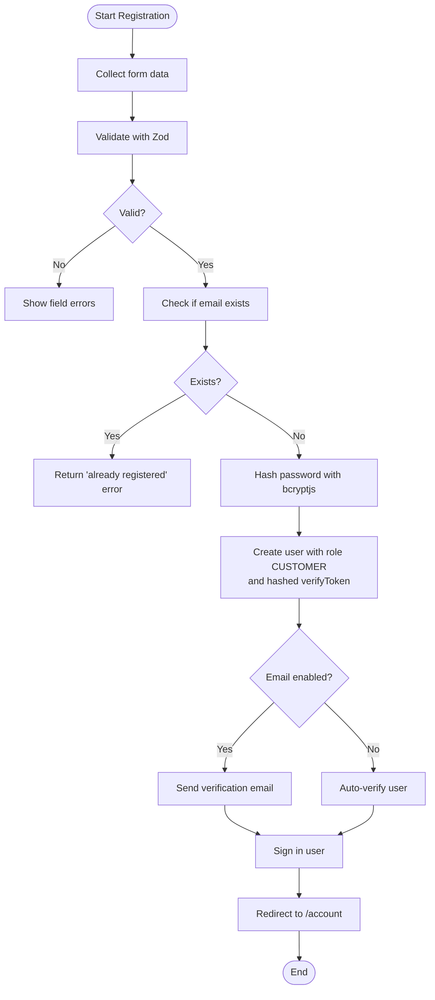
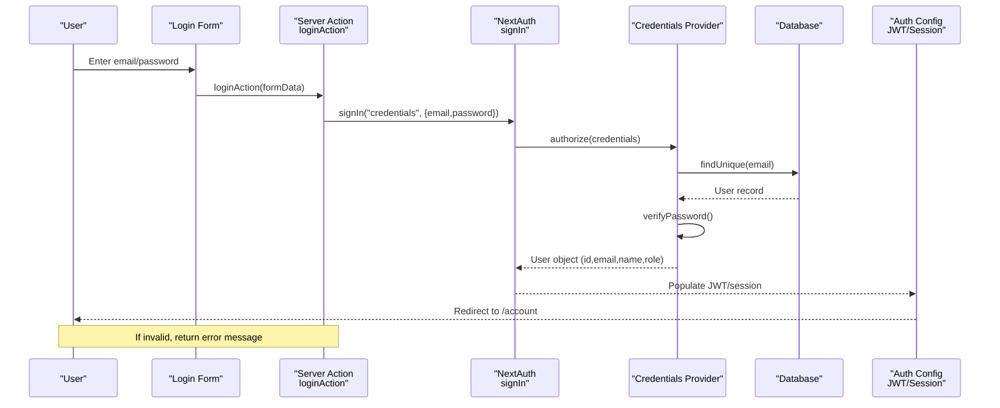
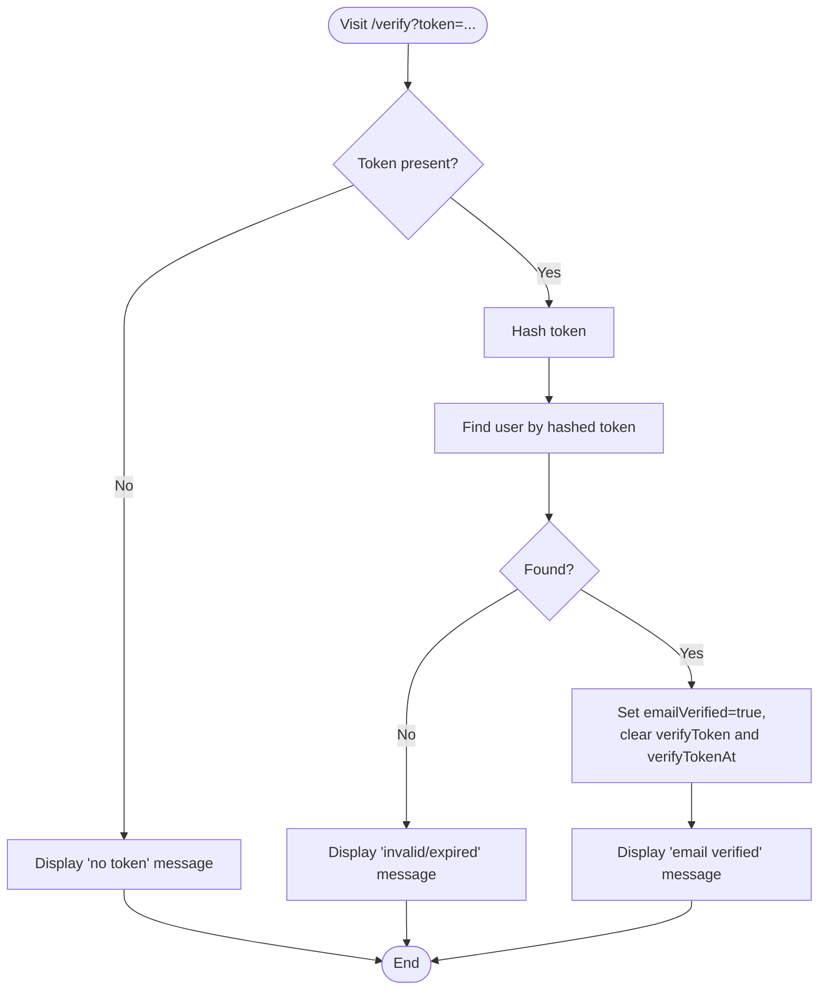
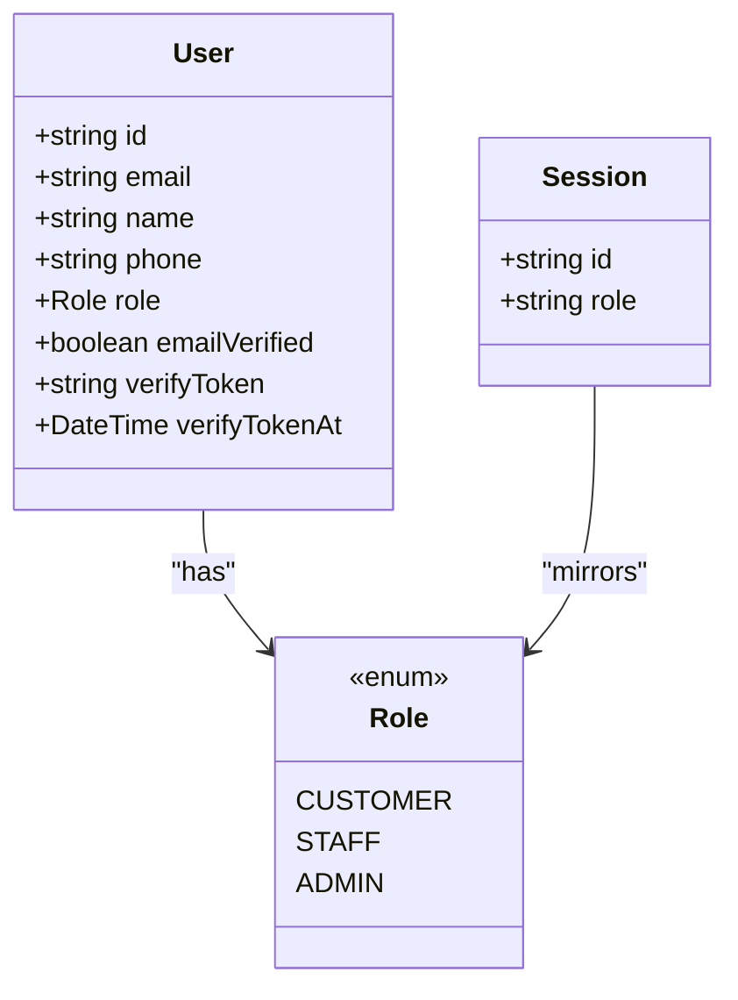
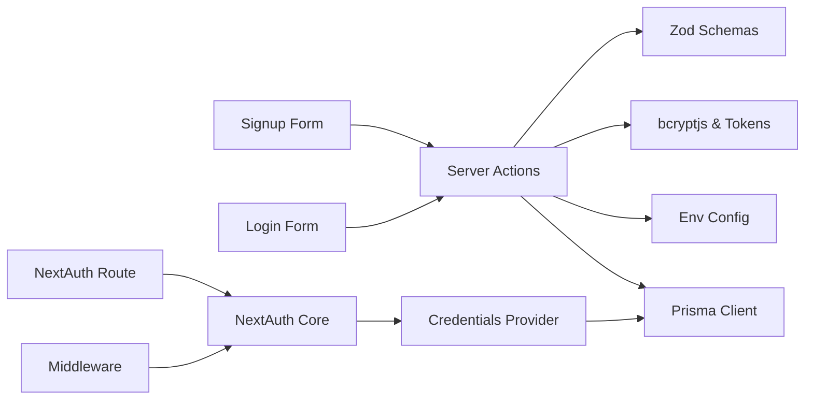

# User Management

<cite>
**Referenced Files in This Document**
- [route.ts](file://app/api/auth/[...nextauth]/route.ts)
- [auth.config.ts](file://lib/auth.config.ts)
- [auth.ts](file://lib/auth.ts)
- [auth.actions.ts](file://server/auth.actions.ts)
- [validation.ts](file://lib/validation.ts)
- [crypto.ts](file://lib/crypto.ts)
- [schema.prisma](file://prisma/schema.prisma)
- [signup-form.tsx](file://components/auth/signup-form.tsx)
- [login-form.tsx](file://components/auth/login-form.tsx)
- [page.tsx (signup)](file://app/signup/page.tsx)
- [page.tsx (login)](file://app/login/page.tsx)
- [page.tsx (verify)](file://app/verify/page.tsx)
- [page.tsx (account dashboard)](file://app/account/page.tsx)
- [env.ts](file://lib/env.ts)
- [middleware.ts](file://middleware.ts)
</cite>

## Table of Contents
1. Introduction
2. Project Structure
3. Core Components
4. Architecture Overview
5. Detailed Component Analysis
6. Dependency Analysis
7. Performance Considerations
8. Troubleshooting Guide
9. Conclusion

## Introduction
This document explains the user management functionality in Timberland’s authentication system. It covers registration with form validation and password hashing, email verification workflows, login flow with credential validation, role-based session state, and account lifecycle operations. It also provides implementation references for forms, server actions, and security utilities to help developers understand and extend the system safely.

## Project Structure
The user management feature spans several layers:
- UI pages and client components for signup and login
- Server actions handling registration, login, and logout
- NextAuth configuration and providers for authentication
- Prisma schema defining users, roles, and related entities
- Security utilities for password hashing and token generation
- Environment configuration for optional email and Google provider

**Diagram sources**
- [page.tsx (signup):1-31](file://app/signup/page.tsx#L1-L31)
- [page.tsx (login):1-50](file://app/login/page.tsx#L1-L50)
- [page.tsx (verify):1-60](file://app/verify/page.tsx#L1-L60)
- [page.tsx (account dashboard):1-98](file://app/account/page.tsx#L1-L98)
- [signup-form.tsx:1-39](file://components/auth/signup-form.tsx#L1-L39)
- [login-form.tsx:1-40](file://components/auth/login-form.tsx#L1-L40)
- [auth.actions.ts:1-101](file://server/auth.actions.ts#L1-L101)
- [route.ts:1-4](file://app/api/auth/[...nextauth]/route.ts#L1-L4)
- [auth.ts:1-42](file://lib/auth.ts#L1-L42)
- [crypto.ts:1-29](file://lib/crypto.ts#L1-L29)
- [validation.ts:1-87](file://lib/validation.ts#L1-L87)
- [env.ts:1-66](file://lib/env.ts#L1-L66)
- [middleware.ts:1-14](file://middleware.ts#L1-L14)

**Section sources**
- [page.tsx (signup):1-31](file://app/signup/page.tsx#L1-L31)
- [page.tsx (login):1-50](file://app/login/page.tsx#L1-L50)
- [page.tsx (verify):1-60](file://app/verify/page.tsx#L1-L60)
- [page.tsx (account dashboard):1-98](file://app/account/page.tsx#L1-L98)
- [signup-form.tsx:1-39](file://components/auth/signup-form.tsx#L1-L39)
- [login-form.tsx:1-40](file://components/auth/login-form.tsx#L1-L40)
- [auth.actions.ts:1-101](file://server/auth.actions.ts#L1-L101)
- [route.ts:1-4](file://app/api/auth/[...nextauth]/route.ts#L1-L4)
- [auth.ts:1-42](file://lib/auth.ts#L1-L42)
- [crypto.ts:1-29](file://lib/crypto.ts#L1-L29)
- [validation.ts:1-87](file://lib/validation.ts#L1-L87)
- [env.ts:1-66](file://lib/env.ts#L1-L66)
- [middleware.ts:1-14](file://middleware.ts#L1-L14)

## Core Components
- Registration pipeline:
  - Client form collects name, email, phone, and password.
  - Server action validates input using Zod schemas, hashes the password, creates a user with default role CUSTOMER, generates a hashed verification token, optionally sends an email, and signs the user in.
- Login pipeline:
  - Client form submits credentials; server action calls NextAuth credentials provider which verifies the password against the stored hash and returns a minimal user object.
  - Session is populated with id and role via JWT callbacks.
- Email verification:
  - Verification link contains a token; server hashes the token and matches it against the stored hash to mark the user as verified.
- Role assignment:
  - Default role is CUSTOMER at signup. The schema supports STAFF and ADMIN roles.
- Account dashboard:
  - Protected by middleware; displays user-specific shipments and metrics.

**Section sources**
- [auth.actions.ts:17-81](file://server/auth.actions.ts#L17-L81)
- [auth.ts:9-31](file://lib/auth.ts#L9-L31)
- [auth.config.ts:11-41](file://lib/auth.config.ts#L11-L41)
- [page.tsx (verify):10-31](file://app/verify/page.tsx#L10-L31)
- [schema.prisma:17-21](file://prisma/schema.prisma#L17-L21)
- [schema.prisma:57-78](file://prisma/schema.prisma#L57-L78)
- [page.tsx (account dashboard):12-15](file://app/account/page.tsx#L12-L15)

## Architecture Overview
The authentication architecture uses NextAuth with a Credentials provider, edge-safe middleware, and server actions for mutations. Passwords are hashed with bcryptjs, and verification tokens are hashed before storage.

**Diagram sources**
- [signup-form.tsx:13-36](file://components/auth/signup-form.tsx#L13-L36)
- [auth.actions.ts:26-81](file://server/auth.actions.ts#L26-L81)
- [validation.ts:4-19](file://lib/validation.ts#L4-L19)
- [crypto.ts:8-10](file://lib/crypto.ts#L8-L10)
- [schema.prisma:57-78](file://prisma/schema.prisma#L57-L78)
- [env.ts:48-51](file://lib/env.ts#L48-L51)

## Detailed Component Analysis

### Registration Flow
- Input collection and display:
  - The signup page renders a card containing the signup form.
  - The form includes fields for name, email, phone, and password, with error hints and a submit button.
- Validation:
  - Zod schemas enforce required fields, email format, phone pattern, and password length constraints.
- Server-side processing:
  - The server action converts FormData to typed input, validates it, checks for duplicate emails, hashes the password, creates the user with default role CUSTOMER, sets up notification preferences, and handles email verification.
  - When SMTP is not configured, the user is auto-verified to enable end-to-end testing.
- Sign-in after registration:
  - The action triggers NextAuth sign-in with credentials and redirects to the account dashboard.

**Diagram sources**
- [auth.actions.ts:26-81](file://server/auth.actions.ts#L26-L81)
- [validation.ts:4-19](file://lib/validation.ts#L4-L19)
- [crypto.ts:8-10](file://lib/crypto.ts#L8-L10)
- [env.ts:48-51](file://lib/env.ts#L48-L51)

**Section sources**
- [page.tsx (signup):8-29](file://app/signup/page.tsx#L8-L29)
- [signup-form.tsx:13-36](file://components/auth/signup-form.tsx#L13-L36)
- [auth.actions.ts:17-81](file://server/auth.actions.ts#L17-L81)
- [validation.ts:4-19](file://lib/validation.ts#L4-L19)
- [crypto.ts:8-10](file://lib/crypto.ts#L8-L10)
- [env.ts:48-51](file://lib/env.ts#L48-L51)

### Login Flow
- Client component:
  - The login form prevents default submission, builds FormData, and invokes the server action within a React transition.
  - Errors from the server action are displayed inline.
- Server action:
  - Normalizes email and delegates to NextAuth credentials provider.
  - On success, NextAuth throws a redirect; on failure, returns a uniform error message.
- Credentials provider:
  - Looks up the user by normalized email and compares the provided password with the stored hash.
  - Returns a minimal user object including id, email, name, and role.
- Session and JWT:
  - Edge-safe config populates session.user.id and session.user.role from the JWT token.

**Diagram sources**
- [login-form.tsx:11-36](file://components/auth/login-form.tsx#L11-L36)
- [auth.actions.ts:83-96](file://server/auth.actions.ts#L83-L96)
- [auth.ts:9-31](file://lib/auth.ts#L9-L31)
- [auth.config.ts:18-39](file://lib/auth.config.ts#L18-L39)

**Section sources**
- [page.tsx (login):14-45](file://app/login/page.tsx#L14-L45)
- [login-form.tsx:11-36](file://components/auth/login-form.tsx#L11-L36)
- [auth.actions.ts:83-96](file://server/auth.actions.ts#L83-L96)
- [auth.ts:9-31](file://lib/auth.ts#L9-L31)
- [auth.config.ts:18-39](file://lib/auth.config.ts#L18-L39)

### Email Verification Workflow
- Token generation and storage:
  - During signup, a random token is generated and hashed before being persisted alongside a timestamp.
- Verification endpoint:
  - The verify page receives a token, hashes it, and looks up the matching user.
  - On match, the user is marked as verified and the token fields are cleared.
- Behavior when email is disabled:
  - In development without SMTP, users are auto-verified during signup.

**Diagram sources**
- [page.tsx (verify):10-31](file://app/verify/page.tsx#L10-L31)
- [crypto.ts:17-28](file://lib/crypto.ts#L17-L28)
- [auth.actions.ts:46-76](file://server/auth.actions.ts#L46-L76)

**Section sources**
- [page.tsx (verify):10-31](file://app/verify/page.tsx#L10-L31)
- [crypto.ts:17-28](file://lib/crypto.ts#L17-L28)
- [auth.actions.ts:46-76](file://server/auth.actions.ts#L46-L76)

### User Profile and Role Management
- Roles:
  - The database defines Role enum with CUSTOMER, STAFF, and ADMIN.
  - New users are created with role CUSTOMER by default.
- Session enrichment:
  - JWT callback attaches id and role to the token; session callback mirrors these values onto session.user.
- Access control:
  - Middleware protects routes under /account using the authorized callback.
- Account dashboard:
  - Requires a valid session; shows user-specific shipment statistics and links to create new shipments.

**Diagram sources**
- [schema.prisma:17-21](file://prisma/schema.prisma#L17-L21)
- [schema.prisma:57-78](file://prisma/schema.prisma#L57-L78)
- [auth.config.ts:26-39](file://lib/auth.config.ts#L26-L39)

**Section sources**
- [schema.prisma:17-21](file://prisma/schema.prisma#L17-L21)
- [schema.prisma:57-78](file://prisma/schema.prisma#L57-L78)
- [auth.config.ts:26-39](file://lib/auth.config.ts#L26-L39)
- [middleware.ts:1-14](file://middleware.ts#L1-L14)
- [page.tsx (account dashboard):12-15](file://app/account/page.tsx#L12-L15)

### Implementation Examples
- Registration form:
  - See [signup-form.tsx:13-36](file://components/auth/signup-form.tsx#L13-L36) for field layout, error display, and submission behavior.
  - See [page.tsx (signup):8-29](file://app/signup/page.tsx#L8-L29) for page-level composition.
- Login form:
  - See [login-form.tsx:11-36](file://components/auth/login-form.tsx#L11-L36) for transition-based submission and error handling.
  - See [page.tsx (login):14-45](file://app/login/page.tsx#L14-L45) for error mapping and navigation.
- Data validation:
  - See [validation.ts:4-24](file://lib/validation.ts#L4-L24) for signup and login schemas.
- Password hashing:
  - See [crypto.ts:8-15](file://lib/crypto.ts#L8-L15) for bcrypt-based hashing and verification.

**Section sources**
- [signup-form.tsx:13-36](file://components/auth/signup-form.tsx#L13-L36)
- [page.tsx (signup):8-29](file://app/signup/page.tsx#L8-L29)
- [login-form.tsx:11-36](file://components/auth/login-form.tsx#L11-L36)
- [page.tsx (login):14-45](file://app/login/page.tsx#L14-L45)
- [validation.ts:4-24](file://lib/validation.ts#L4-L24)
- [crypto.ts:8-15](file://lib/crypto.ts#L8-L15)

## Dependency Analysis
Key dependencies and relationships:
- UI components depend on server actions for mutations.
- Server actions depend on validation schemas, crypto utilities, environment configuration, and Prisma client.
- NextAuth core depends on environment variables and the credentials provider.
- Middleware depends on NextAuth edge-safe configuration.

**Diagram sources**
- [signup-form.tsx:13-36](file://components/auth/signup-form.tsx#L13-L36)
- [login-form.tsx:11-36](file://components/auth/login-form.tsx#L11-L36)
- [auth.actions.ts:1-101](file://server/auth.actions.ts#L1-L101)
- [validation.ts:1-87](file://lib/validation.ts#L1-L87)
- [crypto.ts:1-29](file://lib/crypto.ts#L1-L29)
- [env.ts:1-66](file://lib/env.ts#L1-L66)
- [route.ts:1-4](file://app/api/auth/[...nextauth]/route.ts#L1-L4)
- [auth.ts:1-42](file://lib/auth.ts#L1-L42)
- [middleware.ts:1-14](file://middleware.ts#L1-L14)

**Section sources**
- [auth.actions.ts:1-101](file://server/auth.actions.ts#L1-L101)
- [auth.ts:1-42](file://lib/auth.ts#L1-L42)
- [route.ts:1-4](file://app/api/auth/[...nextauth]/route.ts#L1-L4)
- [middleware.ts:1-14](file://middleware.ts#L1-L14)

## Performance Considerations
- Password hashing:
  - bcryptjs rounds are set to a secure default; ensure hardware resources can handle concurrent hashing during peak signups.
- Database queries:
  - Unique index on email ensures fast duplicate checks; consider adding indexes on frequently queried fields like userId and status where applicable.
- Email sending:
  - Offload email delivery to background jobs in production to avoid blocking request flows.
- Session strategy:
  - JWT strategy reduces server-side session store pressure; keep payload minimal (id and role).

[No sources needed since this section provides general guidance]

## Troubleshooting Guide
- Duplicate email on signup:
  - The server action returns a field error indicating the email is already registered.
- Invalid credentials on login:
  - The server action catches non-redirect errors and returns a uniform message that does not reveal whether the email exists.
- Email verification failures:
  - Ensure the token is present and unmodified; the verify page hashes the token and clears token fields upon success.
- Missing environment variables:
  - The env module throws on missing required variables; configure DATABASE_URL, AUTH_SECRET, and optionally SMTP and Google OAuth settings.
- Protected route access:
  - Middleware blocks access to /account unless the user is authenticated; check session presence and role population.

**Section sources**
- [auth.actions.ts:41-44](file://server/auth.actions.ts#L41-L44)
- [auth.actions.ts:83-96](file://server/auth.actions.ts#L83-L96)
- [page.tsx (verify):10-31](file://app/verify/page.tsx#L10-L31)
- [env.ts:8-15](file://lib/env.ts#L8-L15)
- [middleware.ts:1-14](file://middleware.ts#L1-L14)

## Conclusion
Timberland’s user management combines robust client-side forms, server-side validation, secure password handling, and a clear email verification workflow. Roles are enforced through the database schema and session enrichment, while middleware protects sensitive areas. The modular design makes it straightforward to extend features such as additional roles, advanced profile editing, and enhanced security measures.