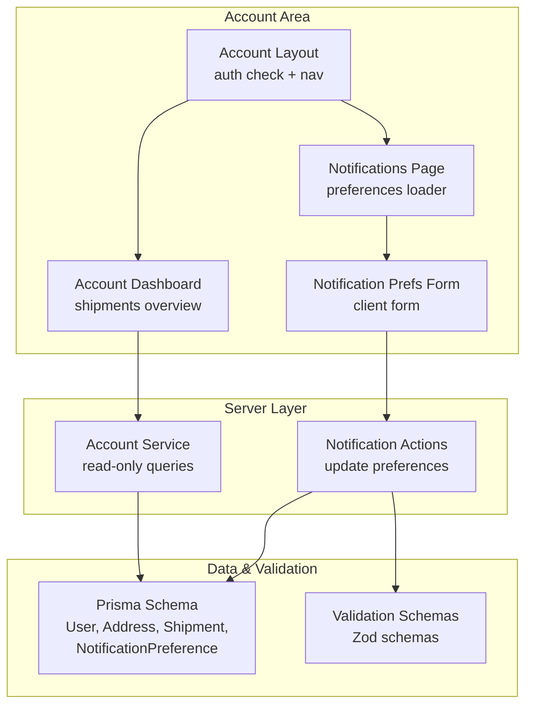
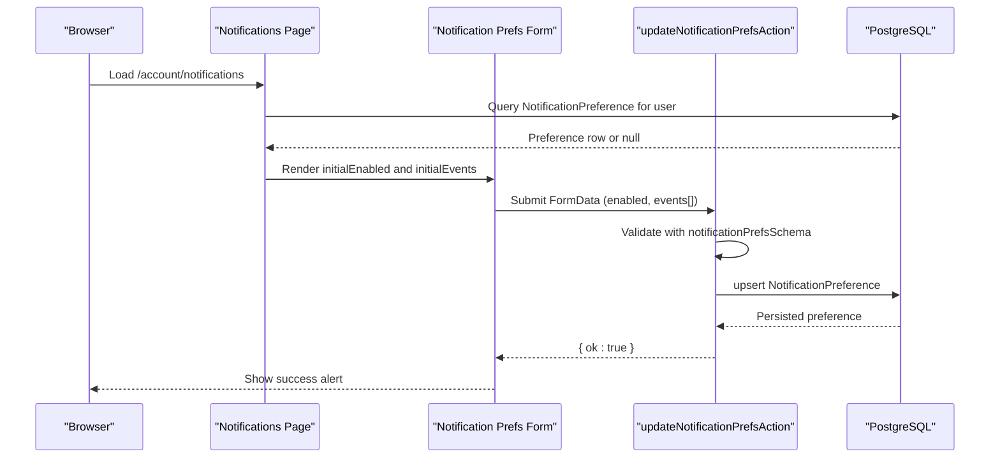
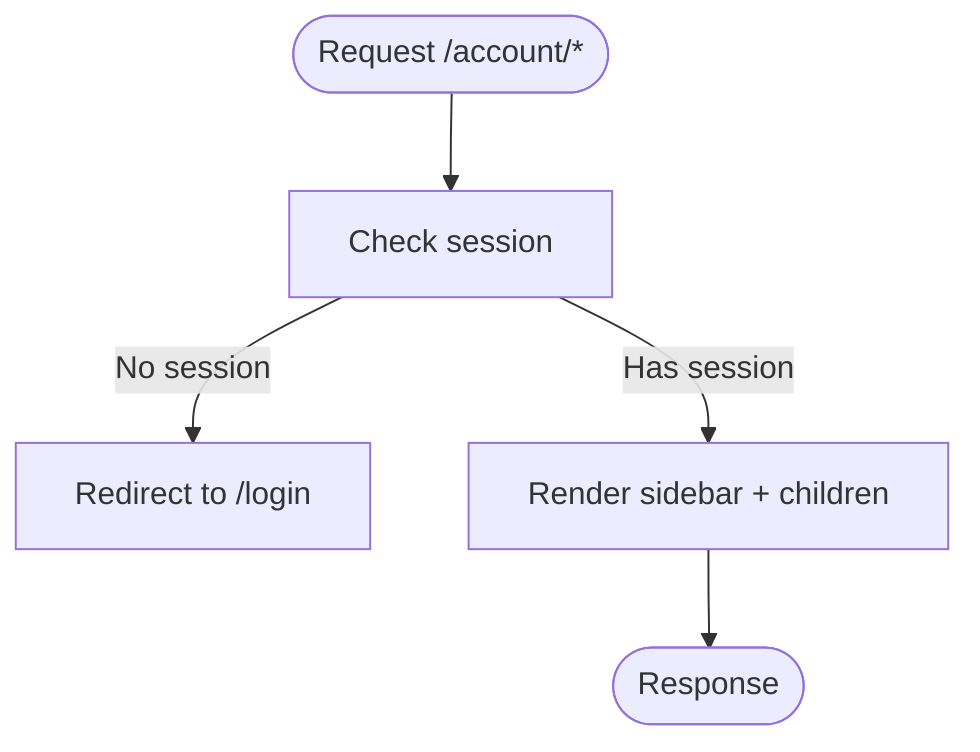
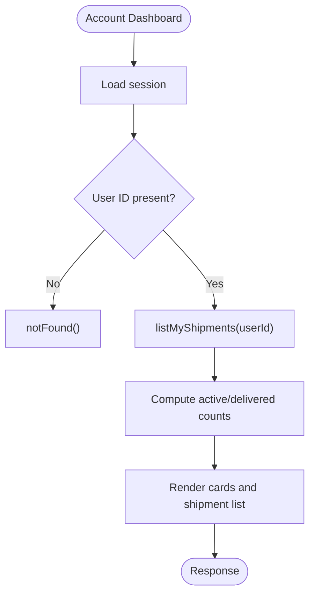
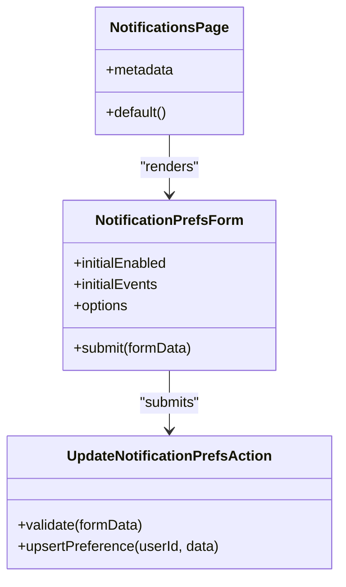
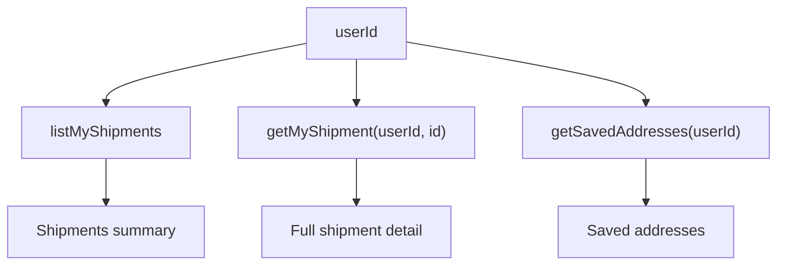
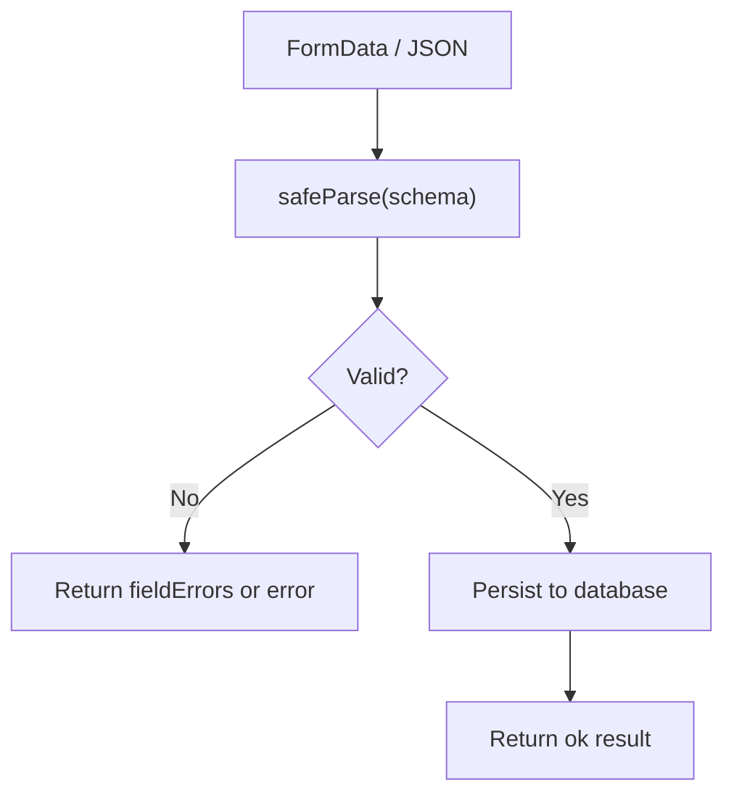
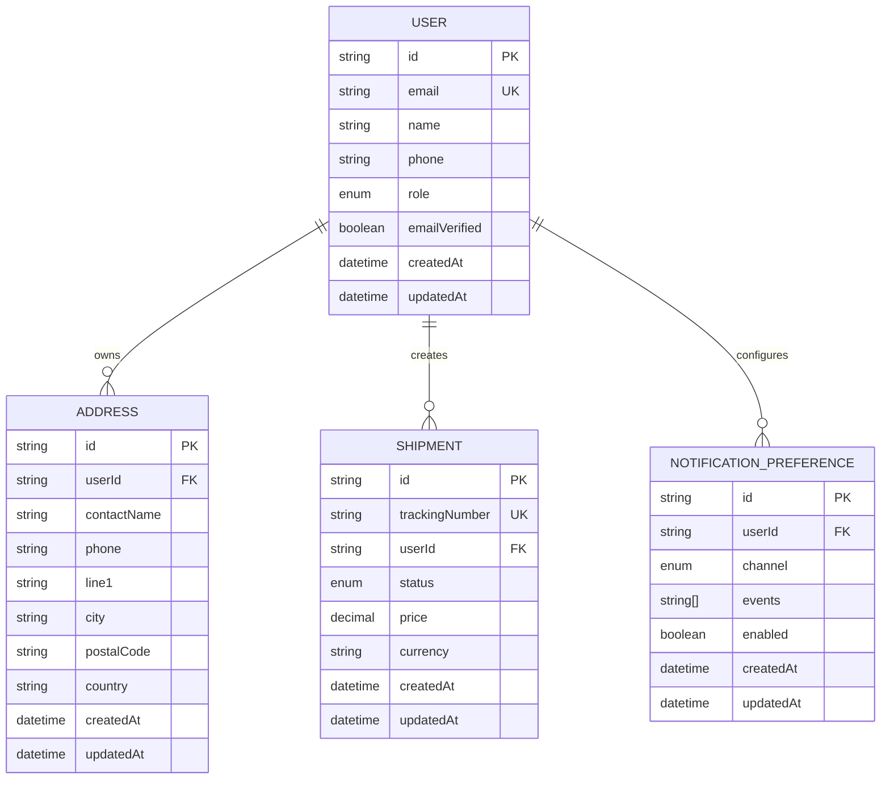
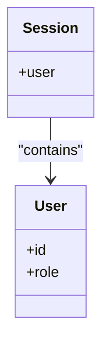
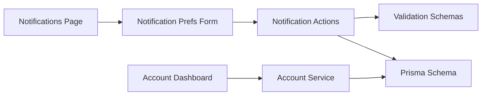

# User Profile Management

<cite>
**Referenced Files in This Document**
- [account.page.tsx](file://app/account/page.tsx)
- [account.layout.tsx](file://app/account/layout.tsx)
- [notifications.page.tsx](file://app/account/notifications/page.tsx)
- [notification-prefs-form.tsx](file://components/account/notification-prefs-form.tsx)
- [account.service.ts](file://server/account.service.ts)
- [notification.actions.ts](file://server/notification.actions.ts)
- [validation.ts](file://lib/validation.ts)
- [schema.prisma](file://prisma/schema.prisma)
- [next-auth.d.ts](file://types/next-auth.d.ts)
</cite>

## Table of Contents
1. [Introduction](#introduction)
2. [Project Structure](#project-structure)
3. [Core Components](#core-components)
4. [Architecture Overview](#architecture-overview)
5. [Detailed Component Analysis](#detailed-component-analysis)
6. [Dependency Analysis](#dependency-analysis)
7. [Performance Considerations](#performance-considerations)
8. [Troubleshooting Guide](#troubleshooting-guide)
9. [Conclusion](#conclusion)

## Introduction
This document explains how user profile and account-related features are implemented in Timberland. It focuses on:
- How the account area is structured and protected.
- What user data exists in the database schema.
- How notifications preferences are viewed and updated.
- The server-side service layer for reading user-owned data.
- Validation rules that protect personal data integrity.
- Current gaps in profile editing, avatar upload, and privacy controls.

The goal is to help developers understand what is already implemented and where to extend the system for full profile management capabilities.

## Project Structure
The account area is a Next.js App Router feature folder under `app/account`. It includes:
- A layout that enforces authentication and provides navigation.
- A dashboard page showing user shipments.
- A notifications page with a client form backed by a server action.
- Shared UI components for forms and feedback.

**Diagram sources**
- [account.layout.tsx:13-38](file://app/account/layout.tsx#L13-L38)
- [account.page.tsx:12-97](file://app/account/page.tsx#L12-L97)
- [notifications.page.tsx:18-39](file://app/account/notifications/page.tsx#L18-L39)
- [notification-prefs-form.tsx:16-63](file://components/account/notification-prefs-form.tsx#L16-L63)
- [account.service.ts:5-51](file://server/account.service.ts#L5-L51)
- [notification.actions.ts:8-28](file://server/notification.actions.ts#L8-L28)
- [schema.prisma:57-78](file://prisma/schema.prisma#L57-L78)
- [schema.prisma:232-244](file://prisma/schema.prisma#L232-L244)
- [validation.ts:77-80](file://lib/validation.ts#L77-L80)

**Section sources**
- [account.layout.tsx:1-39](file://app/account/layout.tsx#L1-L39)
- [account.page.tsx:1-98](file://app/account/page.tsx#L1-L98)
- [notifications.page.tsx:1-40](file://app/account/notifications/page.tsx#L1-L40)
- [notification-prefs-form.tsx:1-64](file://components/account/notification-prefs-form.tsx#L1-L64)

## Core Components
- Account layout: Protects all account routes by requiring an authenticated session and renders a sidebar with links to Dashboard, New shipment, Addresses, and Notifications.
- Account dashboard: Displays a welcome message using the session user name and lists the user’s shipments with summary counts.
- Notifications page: Loads the current email notification preference for the signed-in user and passes it to a client form.
- Notification preferences form: Client component that submits enabled state and selected event types via a server action.
- Account service: Server-only functions for listing and retrieving user-owned shipments and saved addresses.
- Notification actions: Server action that validates and persists notification preferences.
- Validation schemas: Zod schemas for signup, login, address, parcel, shipment, quote, and notification preferences.
- Prisma schema: Defines the User, Address, Shipment, Parcel, TrackingEvent, NotificationPreference, and related models.

Key responsibilities:
- Authentication gating at the layout level.
- Read-only access to user data through the account service.
- Controlled updates through server actions with validation.
- Data integrity enforced by Zod and Prisma constraints.

**Section sources**
- [account.layout.tsx:13-38](file://app/account/layout.tsx#L13-L38)
- [account.page.tsx:12-97](file://app/account/page.tsx#L12-L97)
- [notifications.page.tsx:18-39](file://app/account/notifications/page.tsx#L18-L39)
- [notification-prefs-form.tsx:16-63](file://components/account/notification-prefs-form.tsx#L16-L63)
- [account.service.ts:5-51](file://server/account.service.ts#L5-L51)
- [notification.actions.ts:8-28](file://server/notification.actions.ts#L8-L28)
- [validation.ts:77-80](file://lib/validation.ts#L77-L80)
- [schema.prisma:57-78](file://prisma/schema.prisma#L57-L78)
- [schema.prisma:232-244](file://prisma/schema.prisma#L232-L244)

## Architecture Overview
The account area follows a layered architecture:
- Presentation layer: Next.js pages and client components render user-facing views.
- Server actions: Mutate data securely on the server after validation.
- Service layer: Encapsulates read operations and ownership checks.
- Data layer: Prisma client interacts with PostgreSQL.

**Diagram sources**
- [notifications.page.tsx:18-39](file://app/account/notifications/page.tsx#L18-L39)
- [notification-prefs-form.tsx:16-63](file://components/account/notification-prefs-form.tsx#L16-L63)
- [notification.actions.ts:8-28](file://server/notification.actions.ts#L8-L28)
- [schema.prisma:232-244](file://prisma/schema.prisma#L232-L244)

## Detailed Component Analysis

### Account Layout and Navigation
The account layout ensures only authenticated users can access account routes. It also defines the navigation structure for the account area.

- Authentication gate: Redirects unauthenticated visitors to `/login`.
- Navigation links: Dashboard, New shipment, Addresses, Notifications.
- Layout rendering: Sidebar plus content area.

**Diagram sources**
- [account.layout.tsx:13-38](file://app/account/layout.tsx#L13-L38)

**Section sources**
- [account.layout.tsx:1-39](file://app/account/layout.tsx#L1-L39)

### Account Dashboard
The dashboard displays a personalized greeting and summarizes the user’s shipments.

- Session usage: Reads `session.user.name` for greeting.
- Data loading: Calls `listMyShipments` with the authenticated user ID.
- Summary metrics: Computes active and delivered counts from the returned list.
- Empty state: Shows a call-to-action when no shipments exist.

**Diagram sources**
- [account.page.tsx:12-97](file://app/account/page.tsx#L12-L97)
- [account.service.ts:5-21](file://server/account.service.ts#L5-L21)

**Section sources**
- [account.page.tsx:1-98](file://app/account/page.tsx#L1-L98)
- [account.service.ts:5-21](file://server/account.service.ts#L5-L21)

### Notifications Page and Preferences Form
The notifications page loads the user’s email notification preferences and renders a form to update them.

- Data loading: Queries `NotificationPreference` for the current user and channel.
- Options mapping: Maps status codes to labels using shared status metadata.
- Client form: Uses React Server Actions with optimistic UI feedback.
- Server mutation: Validates input and upserts the preference record.

**Diagram sources**
- [notifications.page.tsx:18-39](file://app/account/notifications/page.tsx#L18-L39)
- [notification-prefs-form.tsx:16-63](file://components/account/notification-prefs-form.tsx#L16-L63)
- [notification.actions.ts:8-28](file://server/notification.actions.ts#L8-L28)

**Section sources**
- [notifications.page.tsx:1-40](file://app/account/notifications/page.tsx#L1-L40)
- [notification-prefs-form.tsx:1-64](file://components/account/notification-prefs-form.tsx#L1-L64)
- [notification.actions.ts:1-29](file://server/notification.actions.ts#L1-L29)

### Account Service Layer
The account service provides read-only access to user-owned data.

- `listMyShipments`: Returns summary rows for the dashboard.
- `getMyShipment`: Enforces ownership by filtering on `userId`.
- `getSavedAddresses`: Retrieves the user’s saved addresses with zone info.

**Diagram sources**
- [account.service.ts:5-51](file://server/account.service.ts#L5-L51)

**Section sources**
- [account.service.ts:1-52](file://server/account.service.ts#L1-L52)

### Validation Rules and Data Integrity
Validation schemas define acceptable inputs and constraints for user-provided data.

- Password and signup schemas enforce length, format, and required fields.
- Address and parcel schemas constrain strings, numbers, and ranges.
- Notification preferences schema coerces boolean and array values.

**Diagram sources**
- [validation.ts:4-80](file://lib/validation.ts#L4-L80)
- [notification.actions.ts:15-19](file://server/notification.actions.ts#L15-L19)

**Section sources**
- [validation.ts:1-87](file://lib/validation.ts#L1-L87)
- [notification.actions.ts:1-29](file://server/notification.actions.ts#L1-L29)

### Database Models Relevant to Profile Management
The Prisma schema defines core entities used by profile and account features.

- User: Identity and basic profile fields including role and verification tokens.
- Address: Personal and shipping addresses linked to users.
- NotificationPreference: Per-user, per-channel notification settings.
- Shipment and related models: Ownership ties to users and addresses.

**Diagram sources**
- [schema.prisma:57-78](file://prisma/schema.prisma#L57-L78)
- [schema.prisma:131-154](file://prisma/schema.prisma#L131-L154)
- [schema.prisma:160-186](file://prisma/schema.prisma#L160-L186)
- [schema.prisma:232-244](file://prisma/schema.prisma#L232-L244)

**Section sources**
- [schema.prisma:1-261](file://prisma/schema.prisma#L1-L261)

### Session Types and User Identity
NextAuth types are extended to include user identity and role.

- Session.user.id and role are available throughout server and client code.
- JWT payload includes id and role for consistent identity handling.

**Diagram sources**
- [next-auth.d.ts:4-15](file://types/next-auth.d.ts#L4-L15)

**Section sources**
- [next-auth.d.ts:1-23](file://types/next-auth.d.ts#L1-L23)

## Dependency Analysis
The following diagram shows key dependencies between presentation, server actions, services, and data layers.

**Diagram sources**
- [account.page.tsx:12-97](file://app/account/page.tsx#L12-L97)
- [account.service.ts:5-51](file://server/account.service.ts#L5-L51)
- [notifications.page.tsx:18-39](file://app/account/notifications/page.tsx#L18-L39)
- [notification-prefs-form.tsx:16-63](file://components/account/notification-prefs-form.tsx#L16-L63)
- [notification.actions.ts:8-28](file://server/notification.actions.ts#L8-L28)
- [validation.ts:77-80](file://lib/validation.ts#L77-L80)
- [schema.prisma:232-244](file://prisma/schema.prisma#L232-L244)

**Section sources**
- [account.page.tsx:1-98](file://app/account/page.tsx#L1-L98)
- [account.service.ts:1-52](file://server/account.service.ts#L1-L52)
- [notifications.page.tsx:1-40](file://app/account/notifications/page.tsx#L1-L40)
- [notification-prefs-form.tsx:1-64](file://components/account/notification-prefs-form.tsx#L1-L64)
- [notification.actions.ts:1-29](file://server/notification.actions.ts#L1-L29)
- [validation.ts:1-87](file://lib/validation.ts#L1-L87)
- [schema.prisma:1-261](file://prisma/schema.prisma#L1-L261)

## Performance Considerations
- Server-only reads: The account service uses Prisma with selective field projection to reduce payload size for the dashboard.
- Minimal mutations: Notification preferences use upsert to avoid unnecessary writes when data has not changed.
- Client-side pending state: The form disables submit while pending to prevent duplicate submissions.
- No client-side caching: Currently, there is no explicit cache invalidation; re-renders occur on successful submission via React Server Actions.

[No sources needed since this section provides general guidance]

## Troubleshooting Guide
Common issues and recovery patterns:
- Unauthenticated access: The account layout redirects to `/login`; ensure the session is established before accessing account routes.
- Invalid preferences: The notification action returns a failure result if validation fails; the form displays an error alert.
- Missing user preference: If no preference exists, the notifications page defaults to enabled and all events; the form will create a new preference on save.
- Duplicate unique constraints: When extending to other mutations, handle Prisma unique constraint errors similarly to existing patterns.

Operational tips:
- Always validate incoming data with Zod before persisting.
- Use server actions for mutations to keep business logic secure and centralized.
- Provide clear user feedback using alerts and spinner states.

**Section sources**
- [account.layout.tsx:13-15](file://app/account/layout.tsx#L13-L15)
- [notification.actions.ts:12-19](file://server/notification.actions.ts#L12-L19)
- [notification-prefs-form.tsx:25-33](file://components/account/notification-prefs-form.tsx#L25-L33)

## Conclusion
Timberland currently implements a solid foundation for account-related functionality:
- Protected account routes with a clear navigation structure.
- A dashboard that surfaces user shipment summaries.
- A notifications preferences flow with robust validation and persistence.
- A service layer for safe, owned-data reads.

To complete user profile management, consider adding:
- A profile edit page to update name, phone, and other user fields.
- Avatar upload handling with secure file storage and validation.
- Privacy controls for visibility of personal data.
- Optimistic updates and error recovery patterns for smoother UX.

These extensions should follow the existing patterns: server actions for mutations, Zod for validation, Prisma for data integrity, and client components for responsive UI feedback.

[No sources needed since this section summarizes without analyzing specific files]