Based on my analysis of the codebase, I can see that the account dashboard has been significantly enhanced with real-time search, status-based filtering, pagination support, and summary cards. Let me now update the documentation to reflect these changes.

# User Profile Management

<cite>
**Referenced Files in This Document**
- [account.page.tsx](file://app/account/page.tsx)
- [account.layout.tsx](file://app/account/layout.tsx)
- [notifications.page.tsx](file://app/account/notifications/page.tsx)
- [notification-prefs-form.tsx](file://components/account/notification-prefs-form.tsx)
- [account.service.ts](file://server/account.service.ts)
- [shipment-status.ts](file://lib/shipment-status.ts)
- [notification.actions.ts](file://server/notification.actions.ts)
- [validation.ts](file://lib/validation.ts)
- [schema.prisma](file://prisma/schema.prisma)
- [next-auth.d.ts](file://types/next-auth.d.ts)
</cite>

## Update Summary
**Changes Made**
- Updated Account Dashboard section to reflect enhanced features including real-time search, status filtering, pagination, and summary cards
- Added new sections for Search and Filtering functionality
- Enhanced Architecture Overview diagram to show new dashboard capabilities
- Updated Detailed Component Analysis to include advanced dashboard features
- Added comprehensive coverage of URL query parameter handling and state management

## Table of Contents
1. [Introduction](#introduction)
2. [Project Structure](#project-structure)
3. [Core Components](#core-components)
4. [Architecture Overview](#architecture-overview)
5. [Detailed Component Analysis](#detailed-component-analysis)
6. [Dependency Analysis](#dependency-analysis)
7. [Performance Considerations](#performance-considerations)
8. [Troubleshooting Guide](#troubleshooting-guide)
9. [Conclusion](#conclusion)

## Introduction
This document explains how user profile and account-related features are implemented in Timberland. It focuses on:
- How the account area is structured and protected.
- What user data exists in the database schema.
- The enhanced account dashboard with real-time search, status filtering, and pagination.
- How notifications preferences are viewed and updated.
- The server-side service layer for reading user-owned data.
- Validation rules that protect personal data integrity.
- Current gaps in profile editing, avatar upload, and privacy controls.

The goal is to help developers understand what is already implemented and where to extend the system for full profile management capabilities.

## Project Structure
The account area is a Next.js App Router feature folder under `app/account`. It includes:
- A layout that enforces authentication and provides navigation.
- An enhanced dashboard page showing user shipments with search, filtering, and pagination.
- A notifications page with a client form backed by a server action.
- Shared UI components for forms and feedback.

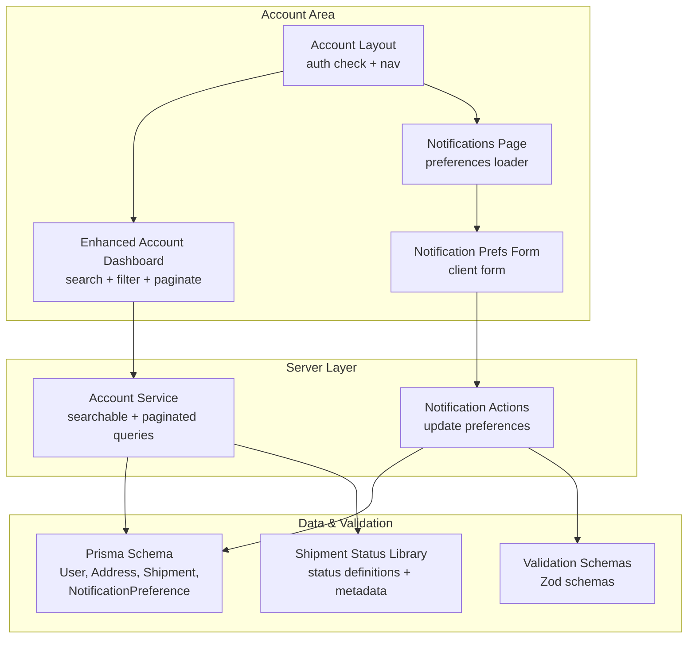

**Diagram sources**
- [account.layout.tsx:13-38](file://app/account/layout.tsx#L13-L38)
- [account.page.tsx:20-218](file://app/account/page.tsx#L20-L218)
- [notifications.page.tsx:18-39](file://app/account/notifications/page.tsx#L18-L39)
- [notification-prefs-form.tsx:16-63](file://components/account/notification-prefs-form.tsx#L16-L63)
- [account.service.ts:23-61](file://server/account.service.ts#L23-L61)
- [notification.actions.ts:8-28](file://server/notification.actions.ts#L8-L28)
- [schema.prisma:57-78](file://prisma/schema.prisma#L57-L78)
- [schema.prisma:232-244](file://prisma/schema.prisma#L232-L244)
- [shipment-status.ts:9-77](file://lib/shipment-status.ts#L9-L77)

**Section sources**
- [account.layout.tsx:1-39](file://app/account/layout.tsx#L1-L39)
- [account.page.tsx:1-218](file://app/account/page.tsx#L1-L218)
- [notifications.page.tsx:1-40](file://app/account/notifications/page.tsx#L1-L40)
- [notification-prefs-form.tsx:1-64](file://components/account/notification-prefs-form.tsx#L1-L64)

## Core Components
- Account layout: Protects all account routes by requiring an authenticated session and renders a sidebar with links to Dashboard, New shipment, Addresses, and Notifications.
- **Enhanced Account Dashboard**: Displays personalized greeting, summary cards (Total, In progress, Delivered), real-time search by tracking number, status-based filtering with URL query parameters, and paginated shipment list.
- Notifications page: Loads the current email notification preference for the signed-in user and passes it to a client form.
- Notification preferences form: Client component that submits enabled state and selected event types via a server action.
- **Enhanced Account Service**: Server-only functions for searchable, filterable, and paginated listing of user-owned shipments plus summary statistics.
- Notification actions: Server action that validates and persists notification preferences.
- Validation schemas: Zod schemas for signup, login, address, parcel, shipment, quote, and notification preferences.
- **Shipment Status Library**: Centralized definition of shipment lifecycle states, transitions, and metadata used across the application.
- Prisma schema: Defines the User, Address, Shipment, Parcel, TrackingEvent, NotificationPreference, and related models.

Key responsibilities:
- Authentication gating at the layout level.
- **Advanced dashboard with real-time search, status filtering, and pagination**.
- Read-only access to user data through the enhanced account service.
- Controlled updates through server actions with validation.
- Data integrity enforced by Zod and Prisma constraints.

**Section sources**
- [account.layout.tsx:13-38](file://app/account/layout.tsx#L13-L38)
- [account.page.tsx:20-218](file://app/account/page.tsx#L20-L218)
- [notifications.page.tsx:18-39](file://app/account/notifications/page.tsx#L18-L39)
- [notification-prefs-form.tsx:16-63](file://components/account/notification-prefs-form.tsx#L16-L63)
- [account.service.ts:23-61](file://server/account.service.ts#L23-L61)
- [notification.actions.ts:8-28](file://server/notification.actions.ts#L8-L28)
- [shipment-status.ts:9-77](file://lib/shipment-status.ts#L9-L77)
- [validation.ts:77-80](file://lib/validation.ts#L77-L80)
- [schema.prisma:57-78](file://prisma/schema.prisma#L57-L78)
- [schema.prisma:232-244](file://prisma/schema.prisma#L232-L244)

## Architecture Overview
The account area follows a layered architecture with enhanced dashboard capabilities:
- Presentation layer: Next.js pages and client components render user-facing views with advanced filtering and search.
- Server actions: Mutate data securely on the server after validation.
- **Enhanced service layer**: Encapsulates searchable, filterable, and paginated read operations with ownership checks.
- Data layer: Prisma client interacts with PostgreSQL.

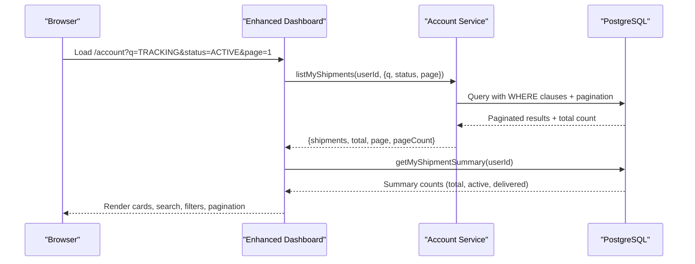

**Diagram sources**
- [account.page.tsx:20-37](file://app/account/page.tsx#L20-L37)
- [account.service.ts:23-61](file://server/account.service.ts#L23-L61)
- [account.service.ts:72-91](file://server/account.service.ts#L72-L91)

## Detailed Component Analysis

### Account Layout and Navigation
The account layout ensures only authenticated users can access account routes. It also defines the navigation structure for the account area.

- Authentication gate: Redirects unauthenticated visitors to `/login`.
- Navigation links: Dashboard, New shipment, Addresses, Notifications.
- Layout rendering: Sidebar plus content area.

**Diagram sources**
- [account.layout.tsx:13-38](file://app/account/layout.tsx#L13-L38)

**Section sources**
- [account.layout.tsx:1-39](file://app/account/layout.tsx#L1-L39)

### Enhanced Account Dashboard
The dashboard now provides a comprehensive shipment management interface with advanced search, filtering, and pagination capabilities.

**Updated** The dashboard has been significantly enhanced with:
- **Real-time search by tracking number**: Users can search shipments using a dedicated search form that preserves other filter states.
- **Status-based filtering**: Interactive status chips allow filtering by shipment status (All, In progress, or specific statuses).
- **URL query parameter synchronization**: All filters and search terms are reflected in the URL for bookmarking and sharing.
- **Pagination support**: Shipments are paginated with 8 items per page, with previous/next navigation.
- **Summary cards**: Three prominent cards show Total, In progress, and Delivered shipment counts with clickable filters.
- **Dynamic status chips**: Only statuses that have shipments are displayed, providing contextual filtering options.

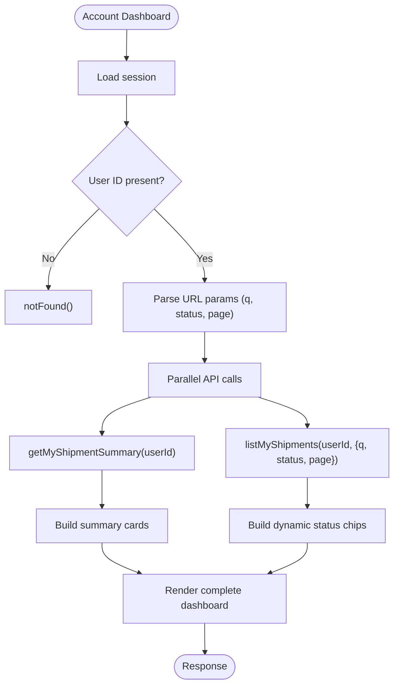

**Diagram sources**
- [account.page.tsx:20-47](file://app/account/page.tsx#L20-L47)
- [account.service.ts:23-61](file://server/account.service.ts#L23-L61)
- [account.service.ts:72-91](file://server/account.service.ts#L72-L91)

**Section sources**
- [account.page.tsx:1-218](file://app/account/page.tsx#L1-L218)
- [account.service.ts:23-61](file://server/account.service.ts#L23-L61)
- [account.service.ts:72-91](file://server/account.service.ts#L72-L91)

### Search and Filtering System
The dashboard implements a sophisticated search and filtering system that maintains state through URL query parameters.

**Search Functionality:**
- Real-time search input for tracking numbers with visual search icon
- Search term preservation across filter changes
- Clear button to reset search while maintaining other filters
- Case-insensitive tracking number matching on server side

**Status Filtering:**
- Dynamic status chips based on actual shipment data
- "All" chip shows total count
- "In progress" chip aggregates non-terminal statuses
- Individual status chips show counts from summary data
- Active status highlighting with visual feedback

**URL State Management:**
- Query parameters: `?q=searchTerm&status=STATUS&page=1`
- Helper function `buildQuery()` manages parameter construction
- Preserves existing filters when navigating between pages
- Clean URL structure for bookmarking and sharing

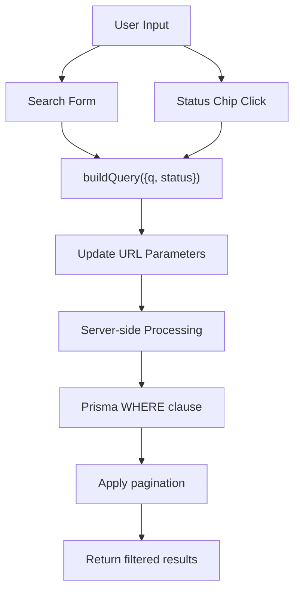

**Diagram sources**
- [account.page.tsx:13-18](file://app/account/page.tsx#L13-L18)
- [account.page.tsx:89-144](file://app/account/page.tsx#L89-L144)
- [account.service.ts:14-20](file://server/account.service.ts#L14-L20)

**Section sources**
- [account.page.tsx:13-18](file://app/account/page.tsx#L13-L18)
- [account.page.tsx:89-144](file://app/account/page.tsx#L89-L144)
- [account.service.ts:14-20](file://server/account.service.ts#L14-L20)

### Pagination System
The dashboard implements robust pagination with configurable page sizes and intelligent navigation.

**Pagination Features:**
- Configurable page size (default 8, max 50)
- Previous/Next navigation buttons
- Page counter display ("Page X of Y")
- Range indicator ("Showing X-Y of Z")
- Preserves search and filter state across pages
- Safe page number validation and bounds checking

**Implementation Details:**
- Server-side pagination with Prisma's `skip` and `take`
- Transactional query for performance optimization
- Page count calculation with minimum of 1
- Bounds checking for edge cases

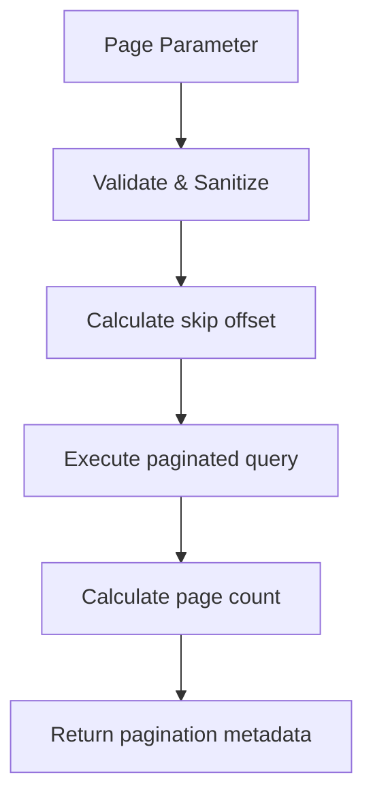

**Diagram sources**
- [account.service.ts:30-60](file://server/account.service.ts#L30-L60)

**Section sources**
- [account.page.tsx:185-210](file://app/account/page.tsx#L185-L210)
- [account.service.ts:30-60](file://server/account.service.ts#L30-L60)

### Summary Cards and Statistics
The dashboard displays three primary summary cards that provide at-a-glance insights into shipment status distribution.

**Card Types:**
- **Total**: Shows total number of shipments with link to clear filters
- **In Progress**: Aggregates all non-terminal statuses with direct filter link
- **Delivered**: Shows completed deliveries with status filter link

**Data Source:**
- Uses `getMyShipmentSummary()` for accurate counts
- Groups shipments by status using Prisma's `groupBy`
- Calculates active count by summing non-terminal statuses
- Provides detailed breakdown by individual status

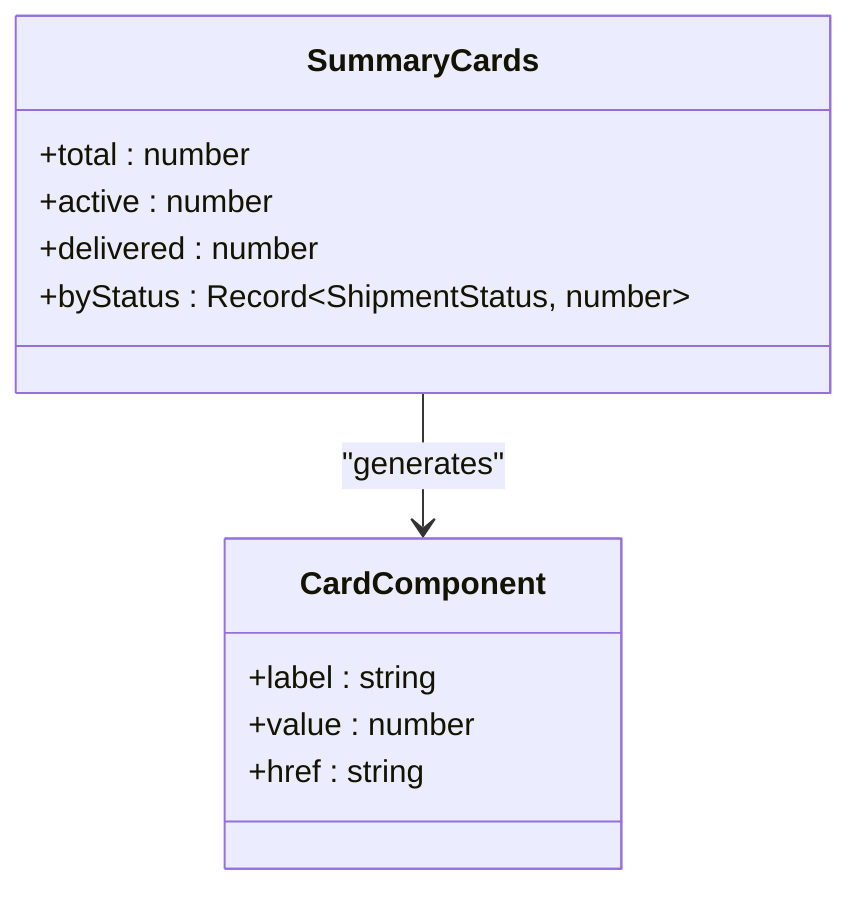

**Diagram sources**
- [account.page.tsx:39-43](file://app/account/page.tsx#L39-L43)
- [account.service.ts:63-91](file://server/account.service.ts#L63-L91)

**Section sources**
- [account.page.tsx:39-43](file://app/account/page.tsx#L39-L43)
- [account.service.ts:63-91](file://server/account.service.ts#L63-L91)

### Notifications Page and Preferences Form
The notifications page loads the user's email notification preferences and renders a form to update them.

- Data loading: Queries `NotificationPreference` for the current user and channel.
- Options mapping: Maps status codes to labels using shared status metadata.
- Client form: Uses React Server Actions with optimistic UI feedback.
- Server mutation: Validates input and upserts the preference record.

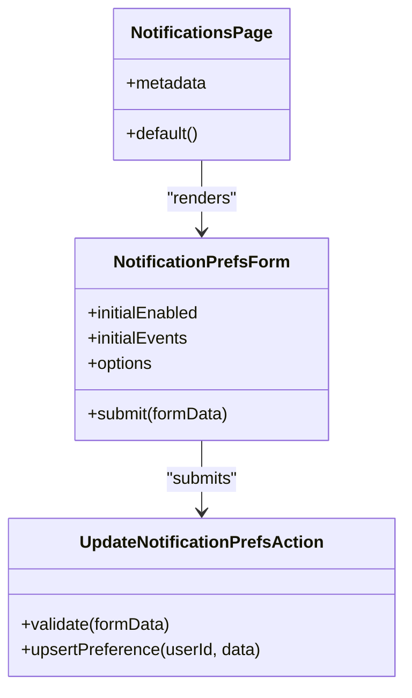

**Diagram sources**
- [notifications.page.tsx:18-39](file://app/account/notifications/page.tsx#L18-L39)
- [notification-prefs-form.tsx:16-63](file://components/account/notification-prefs-form.tsx#L16-L63)
- [notification.actions.ts:8-28](file://server/notification.actions.ts#L8-L28)

**Section sources**
- [notifications.page.tsx:1-40](file://app/account/notifications/page.tsx#L1-L40)
- [notification-prefs-form.tsx:1-64](file://components/account/notification-prefs-form.tsx#L1-L64)
- [notification.actions.ts:1-29](file://server/notification.actions.ts#L1-L29)

### Enhanced Account Service Layer
The account service now provides comprehensive searchable, filterable, and paginated access to user-owned data.

**New Capabilities:**
- **Searchable queries**: Supports tracking number search with case-insensitive matching
- **Status filtering**: Filters by specific statuses or "ACTIVE" for non-terminal states
- **Pagination**: Built-in pagination with configurable page sizes and safe bounds checking
- **Transaction optimization**: Uses Prisma transactions for efficient counting and querying
- **Summary statistics**: Provides aggregated counts and status breakdowns

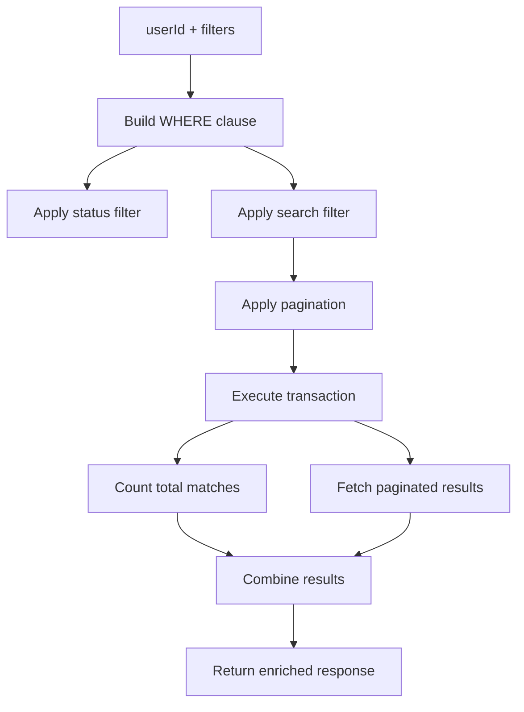

**Diagram sources**
- [account.service.ts:23-61](file://server/account.service.ts#L23-L61)

**Section sources**
- [account.service.ts:1-122](file://server/account.service.ts#L1-L122)

### Shipment Status Library
A centralized library defining shipment lifecycle states, transitions, and metadata used throughout the application.

**Key Features:**
- Complete status enumeration with type safety
- Valid transition rules between states
- Terminal vs. non-terminal status classification
- Rich metadata with labels, descriptions, and tone indicators
- Utility functions for status validation and manipulation

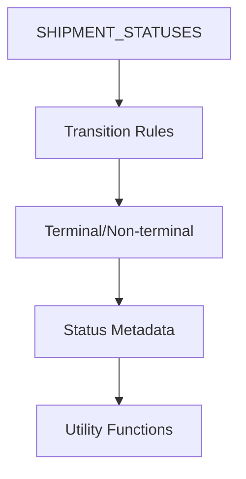

**Diagram sources**
- [shipment-status.ts:9-77](file://lib/shipment-status.ts#L9-L77)

**Section sources**
- [shipment-status.ts:1-77](file://lib/shipment-status.ts#L1-L77)

### Validation Rules and Data Integrity
Validation schemas define acceptable inputs and constraints for user-provided data.

- Password and signup schemas enforce length, format, and required fields.
- Address and parcel schemas constrain strings, numbers, and ranges.
- Notification preferences schema coerces boolean and array values.

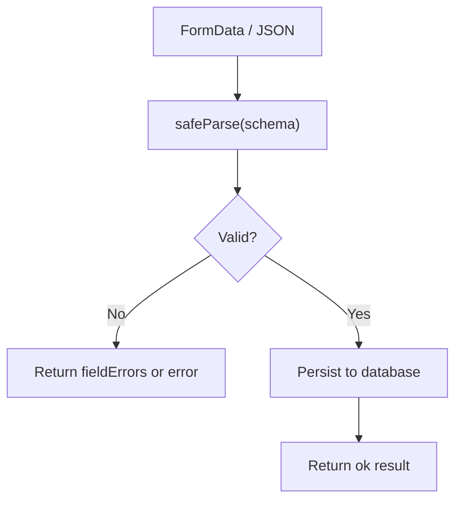

**Diagram sources**
- [validation.ts:4-80](file://lib/validation.ts#L4-L80)
- [notification.actions.ts:15-19](file://server/notification.actions.ts#L15-L19)

**Section sources**
- [validation.ts:1-87](file://lib/validation.ts#L1-L87)
- [notification.actions.ts:1-29](file://server/notification.actions.ts#L1-L29)

### Database Models Relevant to Profile Management
The Prisma schema defines core entities used by profile and account features.

- User: Identity and basic profile fields including role and verification tokens.
- Address: Personal and shipping addresses linked to users.
- NotificationPreference: Per-user, per-channel notification settings.
- Shipment and related models: Ownership ties to users and addresses.

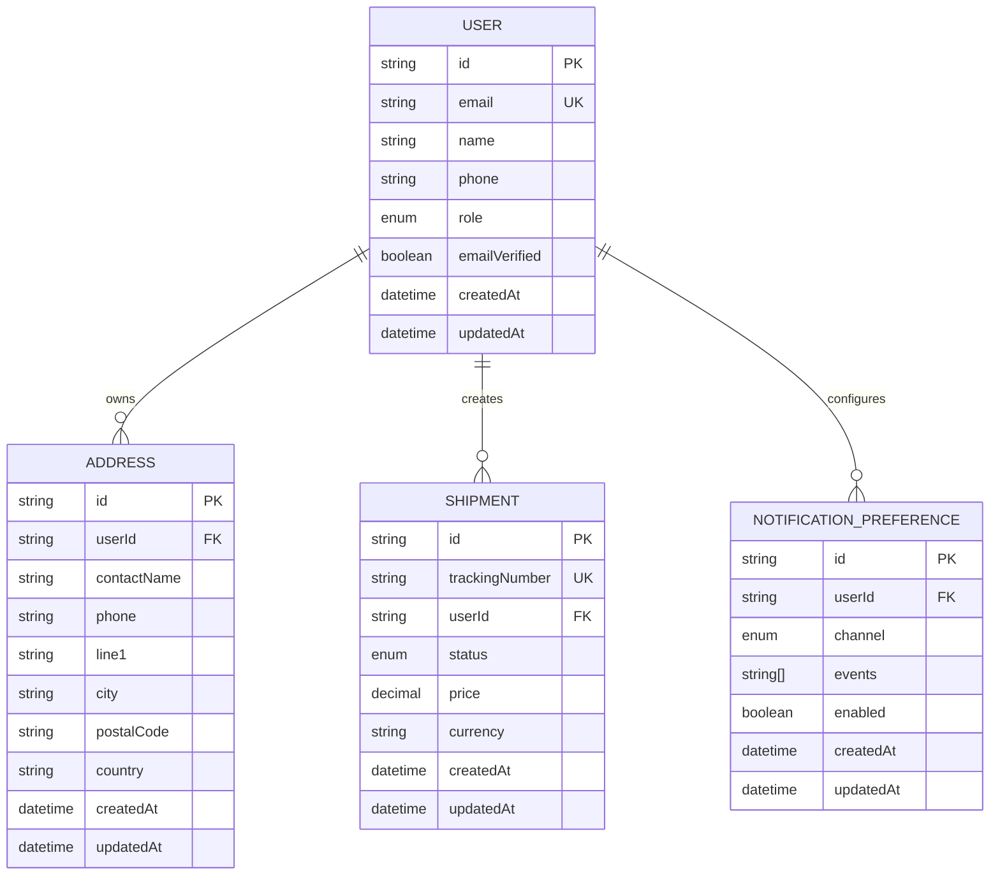

**Diagram sources**
- [schema.prisma:57-78](file://prisma/schema.prisma#L57-L78)
- [schema.prisma:131-154](file://prisma/schema.prisma#L131-L154)
- [schema.prisma:160-186](file://prisma/schema.prisma#L160-L186)
- [schema.prisma:232-244](file://prisma/schema.prisma#L232-L244)

**Section sources**
- [schema.prisma:1-261](file://prisma/schema.prisma#L1-L261)

### Session Types and User Identity
NextAuth types are extended to include user identity and role.

- Session.user.id and role are available throughout server and client code.
- JWT payload includes id and role for consistent identity handling.

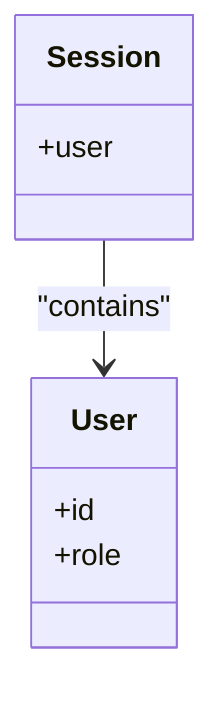

**Diagram sources**
- [next-auth.d.ts:4-15](file://types/next-auth.d.ts#L4-L15)

**Section sources**
- [next-auth.d.ts:1-23](file://types/next-auth.d.ts#L1-L23)

## Dependency Analysis
The following diagram shows key dependencies between presentation, server actions, services, and data layers with enhanced dashboard capabilities.

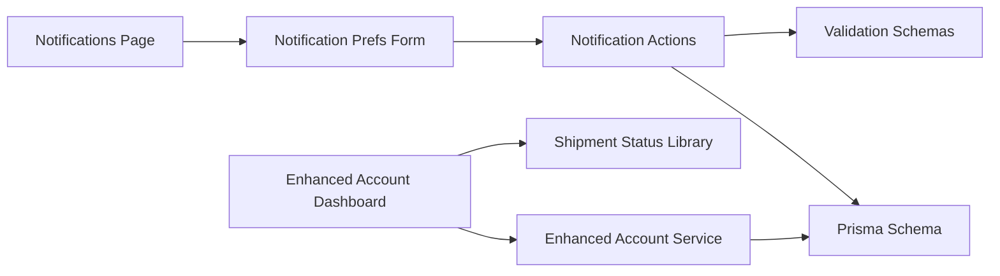

**Diagram sources**
- [account.page.tsx:20-218](file://app/account/page.tsx#L20-L218)
- [account.service.ts:23-61](file://server/account.service.ts#L23-L61)
- [shipment-status.ts:9-77](file://lib/shipment-status.ts#L9-L77)
- [notifications.page.tsx:18-39](file://app/account/notifications/page.tsx#L18-L39)
- [notification-prefs-form.tsx:16-63](file://components/account/notification-prefs-form.tsx#L16-L63)
- [notification.actions.ts:8-28](file://server/notification.actions.ts#L8-L28)
- [validation.ts:77-80](file://lib/validation.ts#L77-L80)
- [schema.prisma:232-244](file://prisma/schema.prisma#L232-L244)

**Section sources**
- [account.page.tsx:1-218](file://app/account/page.tsx#L1-L218)
- [account.service.ts:1-122](file://server/account.service.ts#L1-L122)
- [shipment-status.ts:1-77](file://lib/shipment-status.ts#L1-L77)
- [notifications.page.tsx:1-40](file://app/account/notifications/page.tsx#L1-L40)
- [notification-prefs-form.tsx:1-64](file://components/account/notification-prefs-form.tsx#L1-L64)
- [notification.actions.ts:1-29](file://server/notification.actions.ts#L1-L29)
- [validation.ts:1-87](file://lib/validation.ts#L1-L87)
- [schema.prisma:1-261](file://prisma/schema.prisma#L1-L261)

## Performance Considerations
- **Enhanced server-only reads**: The account service uses Prisma with selective field projection and transactional queries to optimize dashboard performance.
- **Efficient pagination**: Uses Prisma's native pagination with calculated offsets and bounded page sizes.
- **Minimal mutations**: Notification preferences use upsert to avoid unnecessary writes when data has not changed.
- **Client-side pending state**: The form disables submit while pending to prevent duplicate submissions.
- **Parallel data loading**: Dashboard loads summary and shipment data concurrently using Promise.all.
- **Optimized status filtering**: Leverages Prisma's groupBy for efficient status aggregation.
- **No client-side caching**: Currently, there is no explicit cache invalidation; re-renders occur on successful submission via React Server Actions.

## Troubleshooting Guide
Common issues and recovery patterns:
- Unauthenticated access: The account layout redirects to `/login`; ensure the session is established before accessing account routes.
- **Invalid search parameters**: The dashboard handles malformed page numbers and out-of-bounds values gracefully with default fallbacks.
- **Empty filter results**: When no shipments match the current filters, a helpful message is displayed instead of breaking the UI.
- **Invalid preferences**: The notification action returns a failure result if validation fails; the form displays an error alert.
- **Missing user preference**: If no preference exists, the notifications page defaults to enabled and all events; the form will create a new preference on save.
- **Duplicate unique constraints**: When extending to other mutations, handle Prisma unique constraint errors similarly to existing patterns.

Operational tips:
- Always validate incoming data with Zod before persisting.
- Use server actions for mutations to keep business logic secure and centralized.
- Provide clear user feedback using alerts and spinner states.
- **Test URL parameter combinations thoroughly** to ensure proper state persistence across navigation.
- **Monitor query performance** when adding new filter criteria to maintain responsive dashboard experience.

**Section sources**
- [account.layout.tsx:13-15](file://app/account/layout.tsx#L13-L15)
- [account.page.tsx:30-32](file://app/account/page.tsx#L30-L32)
- [account.page.tsx:146-149](file://app/account/page.tsx#L146-L149)
- [notification.actions.ts:12-19](file://server/notification.actions.ts#L12-L19)
- [notification-prefs-form.tsx:25-33](file://components/account/notification-prefs-form.tsx#L25-L33)

## Conclusion
Timberland currently implements a solid foundation for account-related functionality with significant enhancements:
- Protected account routes with a clear navigation structure.
- **Enhanced dashboard with real-time search, status filtering, pagination, and summary cards**.
- A notifications preferences flow with robust validation and persistence.
- **Advanced service layer for searchable, filterable, and paginated data access**.
- Centralized shipment status management with rich metadata.

To complete user profile management, consider adding:
- A profile edit page to update name, phone, and other user fields.
- Avatar upload handling with secure file storage and validation.
- Privacy controls for visibility of personal data.
- Optimistic updates and error recovery patterns for smoother UX.

These extensions should follow the existing patterns: server actions for mutations, Zod for validation, Prisma for data integrity, and client components for responsive UI feedback. The enhanced dashboard architecture provides a strong foundation for implementing additional interactive features.