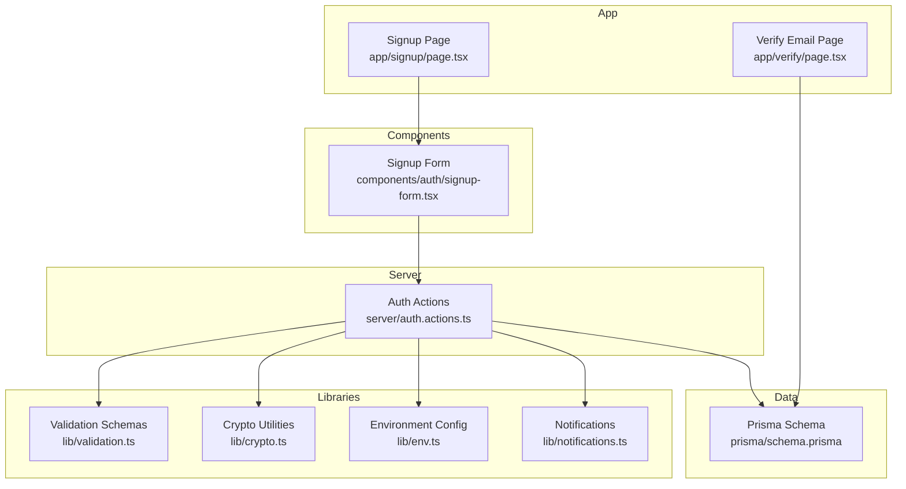
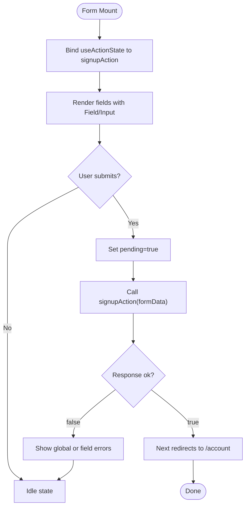
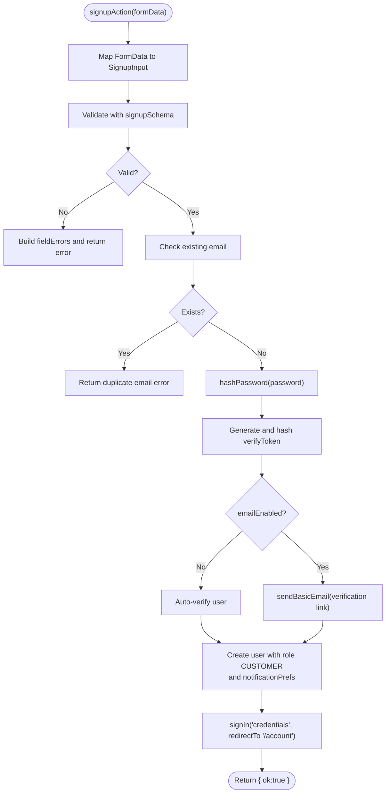
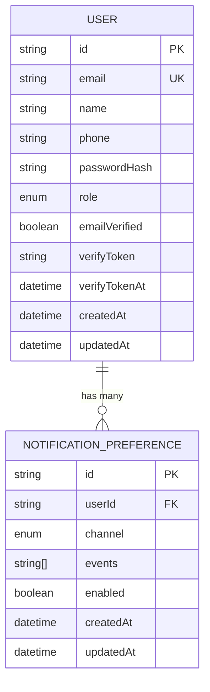
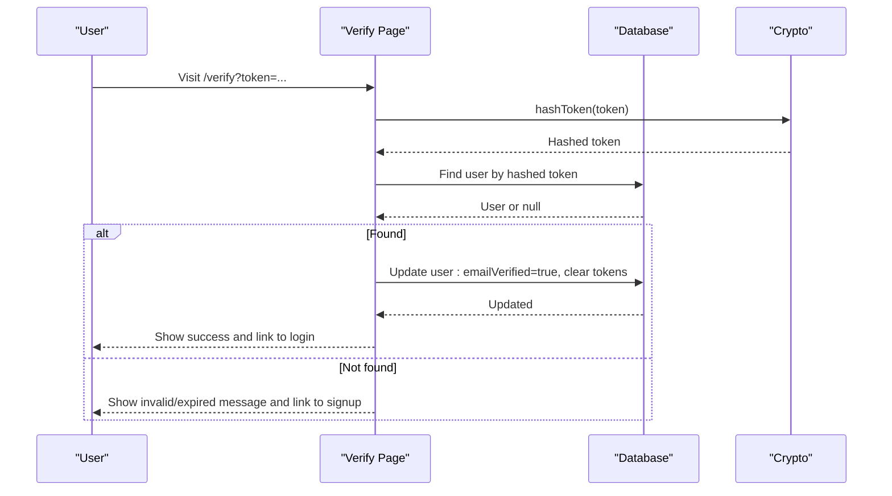
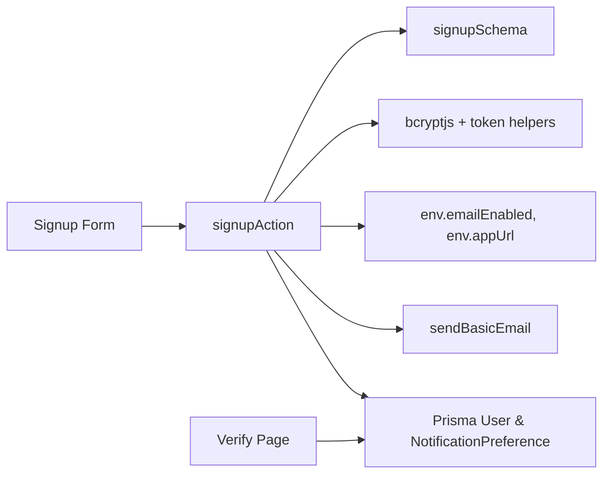

# User Registration

<cite>
**Referenced Files in This Document**
- [page.tsx](file://app/signup/page.tsx)
- [signup-form.tsx](file://components/auth/signup-form.tsx)
- [auth.actions.ts](file://server/auth.actions.ts)
- [validation.ts](file://lib/validation.ts)
- [crypto.ts](file://lib/crypto.ts)
- [env.ts](file://lib/env.ts)
- [notifications.ts](file://lib/notifications.ts)
- [schema.prisma](file://prisma/schema.prisma)
- [page.tsx](file://app/verify/page.tsx)
</cite>

## Table of Contents
1. [Introduction](#introduction)
2. [Project Structure](#project-structure)
3. [Core Components](#core-components)
4. [Architecture Overview](#architecture-overview)
5. [Detailed Component Analysis](#detailed-component-analysis)
6. [Dependency Analysis](#dependency-analysis)
7. [Performance Considerations](#performance-considerations)
8. [Troubleshooting Guide](#troubleshooting-guide)
9. [Conclusion](#conclusion)

## Introduction
This document explains the user registration system in Timberland, covering the complete flow from form submission to account creation. It includes client-side validation with Zod schemas, password strength requirements, email verification, server-side registration logic, password hashing with bcryptjs, database operations via Prisma, initial role assignment, and integration with the notification system for welcome and verification emails.

## Project Structure
The registration feature spans a Next.js App Router page, a client-side form component, a server action, shared validation schemas, crypto utilities, environment configuration, notifications, and the Prisma data model.



**Diagram sources**
- [page.tsx:1-31](file://app/signup/page.tsx#L1-L31)
- [signup-form.tsx:1-39](file://components/auth/signup-form.tsx#L1-L39)
- [auth.actions.ts:1-101](file://server/auth.actions.ts#L1-L101)
- [validation.ts:1-87](file://lib/validation.ts#L1-L87)
- [crypto.ts:1-29](file://lib/crypto.ts#L1-L29)
- [env.ts:1-66](file://lib/env.ts#L1-L66)
- [notifications.ts:1-114](file://lib/notifications.ts#L1-L114)
- [schema.prisma:57-78](file://prisma/schema.prisma#L57-L78)
- [page.tsx:1-60](file://app/verify/page.tsx#L1-L60)

**Section sources**
- [page.tsx:1-31](file://app/signup/page.tsx#L1-L31)
- [signup-form.tsx:1-39](file://components/auth/signup-form.tsx#L1-L39)
- [auth.actions.ts:1-101](file://server/auth.actions.ts#L1-L101)
- [validation.ts:1-87](file://lib/validation.ts#L1-L87)
- [crypto.ts:1-29](file://lib/crypto.ts#L1-L29)
- [env.ts:1-66](file://lib/env.ts#L1-L66)
- [notifications.ts:1-114](file://lib/notifications.ts#L1-L114)
- [schema.prisma:57-78](file://prisma/schema.prisma#L57-L78)
- [page.tsx:1-60](file://app/verify/page.tsx#L1-L60)

## Core Components
- Signup page: Renders the card layout and embeds the signup form.
- Signup form: Client-side React form using `useActionState`, bound to the server action. Displays field-level errors and global errors.
- Server action: Validates input with Zod, checks uniqueness, hashes the password, creates the user with default role and notification preferences, optionally sends a verification email, and signs the user in.
- Validation schemas: Zod schemas for signup inputs including name, email, optional phone, and password rules.
- Crypto utilities: Password hashing with bcryptjs and token generation/hashing for verification links.
- Environment config: Centralized access to SMTP settings and app URL; determines whether email is enabled.
- Notifications: Nodemailer transport and helper functions for sending transactional emails.
- Verify page: Processes verification tokens, marks the email as verified, and clears stored tokens.

**Section sources**
- [page.tsx:1-31](file://app/signup/page.tsx#L1-L31)
- [signup-form.tsx:1-39](file://components/auth/signup-form.tsx#L1-L39)
- [auth.actions.ts:1-101](file://server/auth.actions.ts#L1-L101)
- [validation.ts:1-87](file://lib/validation.ts#L1-L87)
- [crypto.ts:1-29](file://lib/crypto.ts#L1-L29)
- [env.ts:1-66](file://lib/env.ts#L1-L66)
- [notifications.ts:1-114](file://lib/notifications.ts#L1-L114)
- [page.tsx:1-60](file://app/verify/page.tsx#L1-L60)

## Architecture Overview
The registration workflow combines a client-side form with a server action, leveraging Zod for validation, bcryptjs for password hashing, Prisma for persistence, and nodemailer for email delivery.

```mermaid
sequenceDiagram
participant U as "User"
participant P as "Signup Page"
participant F as "Signup Form"
participant A as "signupAction"
participant V as "Zod Validator"
participant D as "Database (Prisma)"
participant C as "Crypto"
participant E as "Email Service"
U->>P : Open /signup
P->>F : Render SignupForm
U->>F : Submit form data
F->>A : Call server action
A->>V : Validate with signupSchema
V-->>A : Validated data or fieldErrors
alt Invalid
A-->>F : Return { ok : false, error, fieldErrors }
F-->>U : Show validation messages
else Valid
A->>D : Check existing email
D-->>A : Existing or null
alt Already exists
A-->>F : Return { ok : false, error, fieldErrors }
F-->>U : Show duplicate email message
else New user
A->>C : hashPassword(password)
C-->>A : Hashed password
A->>C : randomToken() + hashToken()
C-->>A : Tokens
A->>D : Create user with role CUSTOMER<br/>and notification prefs
D-->>A : Created user
opt Email enabled
A->>E : sendBasicEmail(verification link)
E-->>A : Sent or queued
else Dev fallback
A-->>A : Auto-verify user
end
A->>A : signIn("credentials", redirectTo "/account")
A-->>F : Return { ok : true }
F-->>U : Redirect to account
end
end
```

**Diagram sources**
- [signup-form.tsx:1-39](file://components/auth/signup-form.tsx#L1-L39)
- [auth.actions.ts:1-101](file://server/auth.actions.ts#L1-L101)
- [validation.ts:1-87](file://lib/validation.ts#L1-L87)
- [crypto.ts:1-29](file://lib/crypto.ts#L1-L29)
- [env.ts:1-66](file://lib/env.ts#L1-L66)
- [notifications.ts:1-114](file://lib/notifications.ts#L1-L114)
- [schema.prisma:57-78](file://prisma/schema.prisma#L57-L78)

## Detailed Component Analysis

### Signup Page
- Purpose: Provides the route and UI shell for account creation.
- Behavior: Renders a card with a title, description, and the `SignupForm` component. Includes a link to sign in.

Key responsibilities:
- Metadata definition for SEO.
- Layout composition using reusable UI primitives.

**Section sources**
- [page.tsx:1-31](file://app/signup/page.tsx#L1-L31)

### Signup Form Component
- Purpose: Collects user input and submits it to the server action.
- State management: Uses `useActionState` to bind form submissions to `signupAction`.
- Error handling:
  - Global error displayed when `state.ok` is false and no field-level errors are present.
  - Field-level errors mapped from `state.fieldErrors` to each input via the `Field` wrapper.
- Inputs:
  - Full name: required.
  - Email: required, type email.
  - Phone: optional with hint text.
  - Password: required, minimum length indicated by hint.
- Feedback:
  - Button disabled while pending.
  - Spinner shown during submission.



**Diagram sources**
- [signup-form.tsx:1-39](file://components/auth/signup-form.tsx#L1-L39)
- [auth.actions.ts:26-81](file://server/auth.actions.ts#L26-L81)

**Section sources**
- [signup-form.tsx:1-39](file://components/auth/signup-form.tsx#L1-L39)

### Server Registration Action
- Input mapping: Converts `FormData` into a typed object for validation.
- Validation: Uses `signupSchema.safeParse` to validate name, email, phone, and password. Returns structured field errors on failure.
- Uniqueness check: Queries the database for an existing email before creating a user.
- Security:
  - Password hashed with bcryptjs using a configured number of rounds.
  - Verification token generated and hashed before storage.
- Database operations:
  - Creates a new user with default role `CUSTOMER`.
  - Sets `emailVerified` based on whether email is enabled; auto-verifies in development.
  - Creates initial notification preferences for all shipment statuses.
- Email verification:
  - If email is enabled, constructs a verification link and sends a basic email.
  - Otherwise, skips email and proceeds with auto-verified account.
- Authentication:
  - Signs the user in immediately using credentials provider and redirects to `/account`.



**Diagram sources**
- [auth.actions.ts:17-81](file://server/auth.actions.ts#L17-L81)
- [validation.ts:4-19](file://lib/validation.ts#L4-L19)
- [crypto.ts:8-27](file://lib/crypto.ts#L8-L27)
- [env.ts:48-51](file://lib/env.ts#L48-L51)
- [notifications.ts:110-113](file://lib/notifications.ts#L110-L113)

**Section sources**
- [auth.actions.ts:17-81](file://server/auth.actions.ts#L17-L81)

### Validation Rules and Password Requirements
- Name: Required, trimmed, non-empty, max length enforced.
- Email: Required, trimmed, lowercased, validated as email format.
- Phone: Optional; if provided, must match a numeric pattern allowing common formatting characters within a length range.
- Password: Minimum length requirement enforced; maximum length also constrained.

These rules are defined in a single Zod schema used by the server action.

**Section sources**
- [validation.ts:4-19](file://lib/validation.ts#L4-L19)

### Password Hashing and Security
- Password hashing uses bcryptjs with a fixed number of rounds for consistent security.
- Verification tokens are generated cryptographically and hashed before being persisted to prevent replay attacks.

**Section sources**
- [crypto.ts:1-29](file://lib/crypto.ts#L1-L29)

### Database Model and Initial Role Assignment
- User model includes identity fields, role, verification flags, and timestamps.
- Default role assigned at registration is `CUSTOMER`.
- Notification preferences are created per user with channel `EMAIL` and events set to all shipment statuses.



**Diagram sources**
- [schema.prisma:57-78](file://prisma/schema.prisma#L57-L78)
- [schema.prisma:232-244](file://prisma/schema.prisma#L232-L244)

**Section sources**
- [schema.prisma:57-78](file://prisma/schema.prisma#L57-L78)
- [schema.prisma:232-244](file://prisma/schema.prisma#L232-L244)

### Email Verification Flow
- When email is enabled, the registration action sends a verification email containing a link with a secure token.
- The verify page validates the token against the hashed token stored in the database.
- On success, it marks the user’s email as verified and clears the token and timestamp.
- In development (when email is not enabled), users are auto-verified so the flow remains testable end-to-end.



**Diagram sources**
- [page.tsx:1-60](file://app/verify/page.tsx#L1-L60)
- [crypto.ts:17-27](file://lib/crypto.ts#L17-L27)

**Section sources**
- [page.tsx:1-60](file://app/verify/page.tsx#L1-L60)

### Notification System Integration
- The registration action integrates with the notification layer by creating initial notification preferences for the user.
- For verification emails, it uses a simple transactional email function that delegates to nodemailer.
- In development without SMTP configured, the transport captures mail payloads instead of sending them.

**Section sources**
- [auth.actions.ts:48-76](file://server/auth.actions.ts#L48-L76)
- [notifications.ts:1-114](file://lib/notifications.ts#L1-L114)
- [env.ts:36-51](file://lib/env.ts#L36-L51)

## Dependency Analysis
The registration feature depends on several modules:



**Diagram sources**
- [signup-form.tsx:1-39](file://components/auth/signup-form.tsx#L1-L39)
- [auth.actions.ts:1-101](file://server/auth.actions.ts#L1-L101)
- [validation.ts:1-87](file://lib/validation.ts#L1-L87)
- [crypto.ts:1-29](file://lib/crypto.ts#L1-L29)
- [env.ts:1-66](file://lib/env.ts#L1-L66)
- [notifications.ts:1-114](file://lib/notifications.ts#L1-L114)
- [schema.prisma:57-78](file://prisma/schema.prisma#L57-L78)
- [page.tsx:1-60](file://app/verify/page.tsx#L1-L60)

**Section sources**
- [auth.actions.ts:1-101](file://server/auth.actions.ts#L1-L101)
- [validation.ts:1-87](file://lib/validation.ts#L1-L87)
- [crypto.ts:1-29](file://lib/crypto.ts#L1-L29)
- [env.ts:1-66](file://lib/env.ts#L1-L66)
- [notifications.ts:1-114](file://lib/notifications.ts#L1-L114)
- [schema.prisma:57-78](file://prisma/schema.prisma#L57-L78)
- [page.tsx:1-60](file://app/verify/page.tsx#L1-L60)

## Performance Considerations
- Password hashing cost: bcrypt rounds add CPU overhead; ensure appropriate hardware sizing and consider rate limiting around registration endpoints if exposed publicly.
- Database queries: Single lookup for email uniqueness plus one create operation; indexes on email and role help performance.
- Email delivery: In production, SMTP latency can affect perceived response time; consider queuing background jobs for email sending if needed.
- Development mode: Auto-verification avoids network calls to SMTP, improving local iteration speed.

[No sources needed since this section provides general guidance]

## Troubleshooting Guide
Common issues and resolutions:
- Duplicate email:
  - Symptom: Registration fails with a duplicate email error.
  - Resolution: Use a different email or confirm existing account via login.
- Invalid input:
  - Symptom: Field-level errors appear for name, email, phone, or password.
  - Resolution: Follow the hints and validation rules; ensure email format and password length.
- Email not received:
  - Symptom: No verification email arrives.
  - Resolution: Check SMTP configuration; in development, emails may be captured rather than sent.
- Verification link invalid:
  - Symptom: Verification page shows invalid or expired token.
  - Resolution: Request a new account or re-run registration; ensure the full link is used.

**Section sources**
- [auth.actions.ts:30-44](file://server/auth.actions.ts#L30-L44)
- [validation.ts:4-19](file://lib/validation.ts#L4-L19)
- [notifications.ts:1-114](file://lib/notifications.ts#L1-L114)
- [page.tsx:1-60](file://app/verify/page.tsx#L1-L60)

## Conclusion
Timberland’s registration system combines a clean client-side form with robust server-side validation, secure password handling, and flexible email verification. It defaults to a customer role, sets up notification preferences, and supports both production SMTP and development-friendly behavior. The modular design makes it straightforward to extend validation rules, integrate additional authentication providers, or adapt the notification strategy.

[No sources needed since this section summarizes without analyzing specific files]