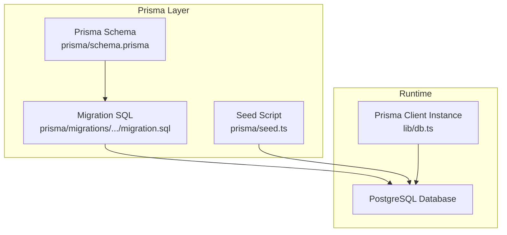
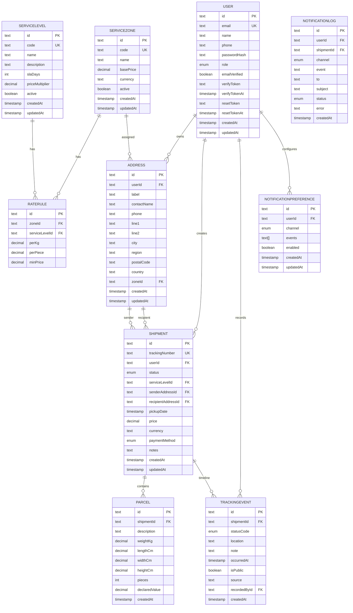
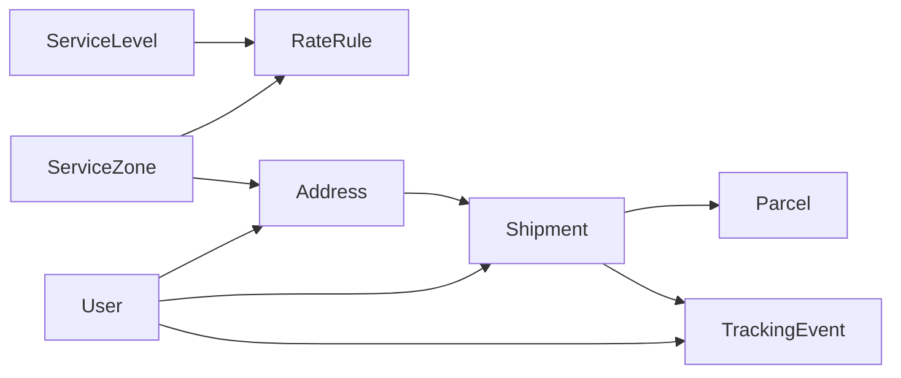

# Database Schema

<cite>
**Referenced Files in This Document**
- [schema.prisma](file://prisma/schema.prisma)
- [migration.sql](file://prisma/migrations/20261018135712_init/migration.sql)
- [seed.ts](file://prisma/seed.ts)
- [db.ts](file://lib/db.ts)
- [validation.ts](file://lib/validation.ts)
- [shipment-status.ts](file://lib/shipment-status.ts)
</cite>

## Update Summary
**Changes Made**
- Enhanced entity relationship documentation with detailed field definitions
- Added comprehensive validation rules and business constraints
- Updated performance considerations with specific indexing strategies
- Expanded data access patterns with practical examples
- Added detailed foreign key constraint explanations
- Included state machine logic for shipment lifecycle management

## Table of Contents
1. [Introduction](#introduction)
2. [Project Structure](#project-structure)
3. [Core Components](#core-components)
4. [Architecture Overview](#architecture-overview)
5. [Detailed Component Analysis](#detailed-component-analysis)
6. [Dependency Analysis](#dependency-analysis)
7. [Performance Considerations](#performance-considerations)
8. [Validation Rules and Business Constraints](#validation-rules-and-business-constraints)
9. [Data Access Patterns](#data-access-patterns)
10. [Troubleshooting Guide](#troubleshooting-guide)
11. [Conclusion](#conclusion)
12. [Appendices](#appendices)

## Introduction
This document describes Timberland's PostgreSQL data model for the courier and delivery platform. It focuses on the core entities: users, shipments, parcels, addresses, and tracking events, along with supporting pricing, service levels, zones, and notification structures. The documentation explains entity relationships, field definitions, primary and foreign keys, constraints, Prisma schema structure, migration strategy, seed data organization, validation rules, business constraints, indexing strategies, and common data access patterns.

## Project Structure
The database schema is defined using Prisma and applied to PostgreSQL via migrations. Seed data provides a realistic demo dataset for development and testing.

**Diagram sources**
- [schema.prisma:1-11](file://prisma/schema.prisma#L1-L11)
- [migration.sql:1-263](file://prisma/migrations/20261018135712_init/migration.sql#L1-L263)
- [seed.ts:1-177](file://prisma/seed.ts#L1-L177)
- [db.ts:1-16](file://lib/db.ts#L1-L16)

**Section sources**
- [schema.prisma:1-11](file://prisma/schema.prisma#L1-L11)
- [migration.sql:1-263](file://prisma/migrations/20261018135712_init/migration.sql#L1-L263)
- [seed.ts:1-177](file://prisma/seed.ts#L1-L177)
- [db.ts:1-16](file://lib/db.ts#L1-L16)

## Core Components
This section summarizes the main entities and their roles.

- **User**: Identity and account information, including authentication-related fields and role-based access.
- **ServiceZone**: Geographic or operational zone used for pricing and routing logic.
- **ServiceLevel**: Delivery speed tiers (e.g., standard, express, same-day).
- **RateRule**: Pricing rules combining zone and service level with per-kg, per-piece, and minimum price.
- **Address**: Physical location records linked to users and zones; used as sender and recipient locations.
- **Shipment**: A shipping order with status, pricing, payment method, and links to sender/recipient addresses.
- **Parcel**: One or more physical packages within a shipment.
- **TrackingEvent**: Timeline entries for shipment progress, with public/internal visibility.
- **NotificationPreference**: Per-user channel and event preferences.
- **NotificationLog**: Audit log of notification attempts.

Key relationships:
- User has many Addresses and Shipments.
- Address belongs to a User and can be linked to a ServiceZone.
- Shipment references a User, ServiceLevel, Sender Address, Recipient Address, and has many Parcels and TrackingEvents.
- Parcel belongs to a Shipment.
- TrackingEvent belongs to a Shipment and optionally to a User who recorded it.

**Section sources**
- [schema.prisma:17-261](file://prisma/schema.prisma#L17-L261)
- [migration.sql:17-263](file://prisma/migrations/20261018135712_init/migration.sql#L17-L263)

## Architecture Overview
The following diagram maps the core entities and their relationships as implemented in the database.

**Diagram sources**
- [schema.prisma:17-261](file://prisma/schema.prisma#L17-L261)
- [migration.sql:17-263](file://prisma/migrations/20261018135712_init/migration.sql#L17-L263)

## Detailed Component Analysis

### User
- **Purpose**: Represents system users with authentication and role attributes.
- **Primary key**: id (text, cuid).
- **Unique constraints**: email.
- **Indexes**: role.
- **Relationships**:
  - One-to-many with Address.
  - One-to-many with Shipment.
  - One-to-many with NotificationPreference.
  - One-to-many with TrackingEvent (as recorder).
- **Notable fields**:
  - Authentication tokens and timestamps for verification/reset flows.
  - Role enum controls access levels (CUSTOMER, STAFF, ADMIN).

**Validation and constraints**:
- Email uniqueness enforced at the database level.
- Role defaults to CUSTOMER.
- Password hash storage for authentication.

**Section sources**
- [schema.prisma:17-78](file://prisma/schema.prisma#L17-L78)
- [migration.sql:17-33](file://prisma/migrations/20261018135712_init/migration.sql#L17-L33)
- [migration.sql:178-181](file://prisma/migrations/20261018135712_init/migration.sql#L178-L181)

### ServiceZone
- **Purpose**: Defines geographic or operational zones for pricing and routing.
- **Primary key**: id (text, cuid).
- **Unique constraints**: code.
- **Relationships**:
  - One-to-many with RateRule.
  - One-to-many with Address (optional assignment).

**Business rules**:
- Base price and currency define baseline costs per zone.
- Active flag controls whether the zone is available for new operations.

**Section sources**
- [schema.prisma:84-96](file://prisma/schema.prisma#L84-L96)
- [migration.sql:36-47](file://prisma/migrations/20261018135712_init/migration.sql#L36-L47)
- [migration.sql:183-184](file://prisma/migrations/20261018135712_init/migration.sql#L183-L184)

### ServiceLevel
- **Purpose**: Represents delivery speed tiers with SLA and pricing multiplier.
- **Primary key**: id (text, cuid).
- **Unique constraints**: code.
- **Relationships**:
  - One-to-many with RateRule.
  - One-to-many with Shipment.

**Business rules**:
- SLA days indicate expected delivery timeframes.
- Price multiplier scales base pricing.

**Section sources**
- [schema.prisma:98-111](file://prisma/schema.prisma#L98-L111)
- [migration.sql:50-62](file://prisma/migrations/20261018135712_init/migration.sql#L50-L62)
- [migration.sql:186-187](file://prisma/migrations/20261018135712_init/migration.sql#L186-L187)

### RateRule
- **Purpose**: Combines zone and service level into concrete pricing rules.
- **Primary key**: id (text, cuid).
- **Unique constraints**: composite unique on zoneId + serviceLevelId.
- **Foreign keys**:
  - zoneId references ServiceZone (cascade delete).
  - serviceLevelId references ServiceLevel (cascade delete).

**Business rules**:
- perKg and perPiece define variable cost components.
- minPrice ensures a floor for total cost.

**Section sources**
- [schema.prisma:113-125](file://prisma/schema.prisma#L113-L125)
- [migration.sql:64-74](file://prisma/migrations/20261018135712_init/migration.sql#L64-L74)
- [migration.sql:189-190](file://prisma/migrations/20261018135712_init/migration.sql#L189-L190)
- [migration.sql:228-232](file://prisma/migrations/20261018135712_init/migration.sql#L228-L232)

### Address
- **Purpose**: Stores physical addresses associated with users and optional zone mapping.
- **Primary key**: id (text, cuid).
- **Foreign keys**:
  - userId references User (cascade delete).
  - zoneId references ServiceZone (set null on delete).
- **Indexes**:
  - userId for user-scoped address queries.
  - postalCode for postal lookups.
- **Relationships**:
  - Many-to-one with User.
  - Many-to-one with ServiceZone (optional).
  - Many-to-many with Shipment via two named relations: sender and recipient.

**Business rules**:
- Required fields include contactName, phone, line1, city, postalCode, country defaulting to US.
- Optional label helps users organize saved addresses.

**Section sources**
- [schema.prisma:131-154](file://prisma/schema.prisma#L131-L154)
- [migration.sql:77-94](file://prisma/migrations/20261018135712_init/migration.sql#L77-L94)
- [migration.sql:192-196](file://prisma/migrations/20261018135712_init/migration.sql#L192-L196)
- [migration.sql:234-238](file://prisma/migrations/20261018135712_init/migration.sql#L234-L238)

### Shipment
- **Purpose**: Represents a shipping order with lifecycle status and pricing details.
- **Primary key**: id (text, cuid).
- **Unique constraints**: trackingNumber.
- **Foreign keys**:
  - userId references User (set null on delete).
  - serviceLevelId references ServiceLevel (restrict delete).
  - senderAddressId references Address (restrict delete).
  - recipientAddressId references Address (restrict delete).
- **Indexes**:
  - userId for user-scoped shipment queries.
  - status for filtering by current state.
  - createdAt for chronological queries.
- **Relationships**:
  - Many-to-one with User (optional).
  - Many-to-one with ServiceLevel.
  - Many-to-one with Address (sender and recipient).
  - One-to-many with Parcel.
  - One-to-many with TrackingEvent.

**Business rules**:
- Default status is CREATED.
- Payment method defaults to PAY_ON_DELIVERY.
- Currency defaults to USD.

**Section sources**
- [schema.prisma:160-186](file://prisma/schema.prisma#L160-L186)
- [migration.sql:97-114](file://prisma/migrations/20261018135712_init/migration.sql#L97-L114)
- [migration.sql:198-208](file://prisma/migrations/20261018135712_init/migration.sql#L198-L208)
- [migration.sql:240-250](file://prisma/migrations/20261018135712_init/migration.sql#L240-L250)

### Parcel
- **Purpose**: Describes individual packages within a shipment.
- **Primary key**: id (text, cuid).
- **Foreign keys**:
  - shipmentId references Shipment (cascade delete).
- **Indexes**:
  - shipmentId for efficient retrieval of all parcels per shipment.

**Business rules**:
- Weight is required; dimensions are optional.
- Pieces defaults to 1; declared value is optional for insurance purposes.

**Section sources**
- [schema.prisma:188-203](file://prisma/schema.prisma#L188-L203)
- [migration.sql:117-130](file://prisma/migrations/20261018135712_init/migration.sql#L117-L130)
- [migration.sql:210-211](file://prisma/migrations/20261018135712_init/migration.sql#L210-L211)
- [migration.sql:252-253](file://prisma/migrations/20261018135712_init/migration.sql#L252-L253)

### TrackingEvent
- **Purpose**: Records timeline events for a shipment, supporting both public and internal feeds.
- **Primary key**: id (text, cuid).
- **Foreign keys**:
  - shipmentId references Shipment (cascade delete).
  - recordedById references User (set null on delete).
- **Indexes**:
  - shipmentId for retrieving all events per shipment.
  - Composite index on shipmentId + isPublic for efficient public timeline queries.

**Business rules**:
- Default source is SYSTEM; drivers or staff may record events.
- isPublic controls visibility on public tracking pages.

**Section sources**
- [schema.prisma:209-226](file://prisma/schema.prisma#L209-L226)
- [migration.sql:133-146](file://prisma/migrations/20261018135712_init/migration.sql#L133-L146)
- [migration.sql:213-217](file://prisma/migrations/20261018135712_init/migration.sql#L213-L217)
- [migration.sql:255-259](file://prisma/migrations/20261018135712_init/migration.sql#L255-L259)

### NotificationPreference
- **Purpose**: Per-user configuration for notification channels and events.
- **Primary key**: id (text, cuid).
- **Unique constraints**: composite unique on userId + channel.
- **Foreign keys**:
  - userId references User (cascade delete).

**Business rules**:
- Events stored as an array of strings representing event types.
- Enabled flag toggles notifications for the channel.

**Section sources**
- [schema.prisma:232-244](file://prisma/schema.prisma#L232-L244)
- [migration.sql:149-159](file://prisma/migrations/20261018135712_init/migration.sql#L149-L159)
- [migration.sql:219-220](file://prisma/migrations/20261018135712_init/migration.sql#L219-L220)
- [migration.sql:261-262](file://prisma/migrations/20261018135712_init/migration.sql#L261-L262)

### NotificationLog
- **Purpose**: Audit trail for notification attempts.
- **Primary key**: id (text, cuid).
- **Indexes**:
  - shipmentId for tracing notifications per shipment.
  - userId for tracing notifications per user.

**Business rules**:
- Status indicates SENT, FAILED, or SKIPPED.
- Error field captures failure details.

**Section sources**
- [schema.prisma:246-261](file://prisma/schema.prisma#L246-L261)
- [migration.sql:162-175](file://prisma/migrations/20261018135712_init/migration.sql#L162-L175)
- [migration.sql:222-226](file://prisma/migrations/20261018135712_init/migration.sql#L222-L226)

## Dependency Analysis
The following diagram highlights direct dependencies between tables through foreign keys.

**Diagram sources**
- [migration.sql:228-262](file://prisma/migrations/20261018135712_init/migration.sql#L228-L262)

**Section sources**
- [migration.sql:228-262](file://prisma/migrations/20261018135712_init/migration.sql#L228-L262)

## Performance Considerations
Indexing strategy:
- **User.role**: supports role-based queries and filters.
- **Address.userId and Address.postalCode**: optimize user-scoped address retrieval and postal code searches.
- **Shipment.user, Shipment.status, Shipment.createdAt**: support dashboard queries, status filtering, and chronological listing.
- **Parcel.shipmentId**: fast retrieval of parcels per shipment.
- **TrackingEvent.shipmentId and TrackingEvent.shipmentId+isPublic**: efficient timeline loading, especially for public timelines.

Data types and precision:
- Decimal fields use explicit precision for monetary values and weights to avoid rounding issues.
- Timestamps use high-resolution timestamps for accurate event ordering.

Constraints:
- Unique constraints on identifiers like email, trackingNumber, and codes ensure data integrity.
- Composite unique on RateRule(zoneId, serviceLevelId) prevents duplicate pricing rules.
- Cascade deletes maintain referential integrity for dependent records such as parcels and tracking events when shipments are removed.

Recommendations:
- Monitor query plans for heavy tracking timeline reads; consider partitioning TrackingEvent by date if volumes grow significantly.
- Keep indexes aligned with frequent query patterns; add composite indexes where needed for combined filters (e.g., status + createdAt).

**Section sources**
- [schema.prisma:77-78](file://prisma/schema.prisma#L77-L78)
- [schema.prisma:152-153](file://prisma/schema.prisma#L152-L153)
- [schema.prisma:183-185](file://prisma/schema.prisma#L183-L185)
- [schema.prisma:202](file://prisma/schema.prisma#L202)
- [schema.prisma:224-225](file://prisma/schema.prisma#L224-L225)
- [migration.sql:178-226](file://prisma/migrations/20261018135712_init/migration.sql#L178-L226)

## Validation Rules and Business Constraints

### Input Validation
The application layer implements comprehensive validation using Zod schemas:

- **User Registration**: Validates email format, phone number patterns, and password strength requirements.
- **Address Validation**: Ensures required fields (contactName, phone, line1, city, postalCode) and validates phone number formats.
- **Parcel Validation**: Enforces positive weight limits, piece count ranges, and optional dimension validation.
- **Shipment Validation**: Requires at least one parcel and validates service level selection.
- **Quote Validation**: Ensures valid postal codes and weight/piece combinations.

### Shipment State Machine
The system enforces strict shipment lifecycle transitions:

- **Linear Progression**: CREATED → CONFIRMED → PICKED_UP → IN_TRANSIT → AT_HUB → OUT_FOR_DELIVERY → DELIVERED
- **Exception Handling**: Any state can transition to EXCEPTION, which can then move to various recovery states.
- **Terminal States**: RETURNED and CANCELLED are final states with no further transitions.
- **Status Metadata**: Each status includes human-readable labels, descriptions, and visual tone indicators.

### Database Constraints
- **Referential Integrity**: Foreign key constraints prevent orphaned records.
- **Cascade Operations**: Automatic cleanup of related records when parent entities are deleted.
- **Set Null Operations**: Graceful handling when referenced entities are deleted (e.g., user deletion doesn't remove shipments).
- **Restrict Operations**: Prevents deletion of critical reference data (addresses, service levels).

**Section sources**
- [validation.ts:1-87](file://lib/validation.ts#L1-L87)
- [shipment-status.ts:1-77](file://lib/shipment-status.ts#L1-L77)
- [schema.prisma:228-262](file://prisma/schema.prisma#L228-L262)

## Data Access Patterns

### Common Query Patterns
- **User Profile Retrieval**: Query User by id with included Address list and NotificationPreferences.
- **Shipment Listing**: Filter Shipment by userId, ordered by createdAt for dashboard displays.
- **Timeline Queries**: Query TrackingEvent by shipmentId with isPublic filter for customer-facing views.
- **Address Management**: Retrieve all addresses for a user with optional zone filtering.
- **Pricing Calculations**: Join RateRule with ServiceZone and ServiceLevel for dynamic pricing.

### Transaction Patterns
- **Shipment Creation**: Atomic creation of shipment with multiple parcels and initial tracking events.
- **Status Updates**: Transactional updates to shipment status with corresponding tracking event creation.
- **Address Association**: Safe association of addresses with users while maintaining referential integrity.

### Optimization Strategies
- **Eager Loading**: Use Prisma's include feature to reduce N+1 query problems.
- **Selective Fields**: Query only necessary fields to minimize data transfer.
- **Connection Pooling**: Reuse PrismaClient instances to prevent connection exhaustion.

**Section sources**
- [db.ts:1-16](file://lib/db.ts#L1-L16)
- [seed.ts:90-159](file://prisma/seed.ts#L90-L159)

## Troubleshooting Guide
Common issues and resolutions:
- **Missing or invalid foreign keys**: Ensure referenced entities exist before creating related records (e.g., valid serviceLevelId, senderAddressId, recipientAddressId).
- **Duplicate tracking numbers**: Enforce uniqueness at the application layer and rely on the database constraint to prevent duplicates.
- **Notification preference conflicts**: Avoid inserting duplicate preferences per user/channel; use upsert semantics in application logic.
- **Event recording without a user**: recordedById is optional; if unset, the event still records but will not link to a specific user.
- **Invalid shipment transitions**: Validate state transitions using the shipment-status utility functions before updating.

Operational tips:
- Use the provided Prisma client instance from lib/db.ts to reuse connections and reduce connection exhaustion during development.
- Run migrations before seeding to ensure schema consistency.
- Validate inputs at the API layer to complement database constraints.
- Monitor database connection pools and adjust pool sizes based on application load.

**Section sources**
- [migration.sql:228-262](file://prisma/migrations/20261018135712_init/migration.sql#L228-L262)
- [db.ts:1-16](file://lib/db.ts#L1-L16)
- [shipment-status.ts:45-55](file://lib/shipment-status.ts#L45-L55)

## Conclusion
Timberland's database schema models a robust courier and delivery workflow centered around users, shipments, parcels, addresses, and tracking events. It leverages Prisma for type-safe schema management and PostgreSQL for reliable relational storage. The design emphasizes clear relationships, strong constraints, and targeted indexing to support efficient queries across user dashboards, tracking timelines, and administrative operations. The comprehensive validation layer and state machine enforcement ensure data integrity throughout the shipment lifecycle.

## Appendices

### Prisma Schema Structure
- **Generator**: Prisma Client JS.
- **Datasource**: PostgreSQL configured via environment variable DATABASE_URL.
- **Enums**: Role, ShipmentStatus, PaymentMethod, NotificationChannel, NotificationLogStatus.

**Section sources**
- [schema.prisma:1-11](file://prisma/schema.prisma#L1-L11)
- [schema.prisma:17-51](file://prisma/schema.prisma#L17-L51)

### Migration Strategy
- Single initial migration creates all tables, enums, indexes, and foreign keys.
- Migrations should be applied before running seed scripts.
- Provider lock file ensures consistent migration provider (PostgreSQL).

**Section sources**
- [migration.sql:1-263](file://prisma/migrations/20261018135712_init/migration.sql#L1-L263)
- [migration_lock.toml:1-3](file://prisma/migrations/migration_lock.toml#L1-L3)

### Seed Data Organization
- Idempotent reset sequence clears dependent tables first.
- Creates zones, service levels, rate rules, demo users, addresses, and sample shipments with parcels and tracking events.
- Prints login credentials and tracking numbers for quick verification.

**Section sources**
- [seed.ts:7-18](file://prisma/seed.ts#L7-L18)
- [seed.ts:20-47](file://prisma/seed.ts#L20-L47)
- [seed.ts:49-73](file://prisma/seed.ts#L49-L73)
- [seed.ts:74-177](file://prisma/seed.ts#L74-L177)

### Sample Data Structures
- **Zones**: METRO, REGION, REMOTE with base prices and currencies.
- **Service Levels**: STANDARD, EXPRESS, SAME_DAY with SLA days and multipliers.
- **Rate Rules**: Combinations of zone and service level with per-kg, per-piece, and minimum price.
- **Demo Users**: Customer and ops staff with hashed passwords and notification preferences.
- **Addresses**: Sender and recipients across different zones.
- **Shipments**: Three examples covering delivered, out-for-delivery, and created states with parcels and timeline events.

**Section sources**
- [seed.ts:20-47](file://prisma/seed.ts#L20-L47)
- [seed.ts:49-73](file://prisma/seed.ts#L49-L73)
- [seed.ts:74-177](file://prisma/seed.ts#L74-L177)