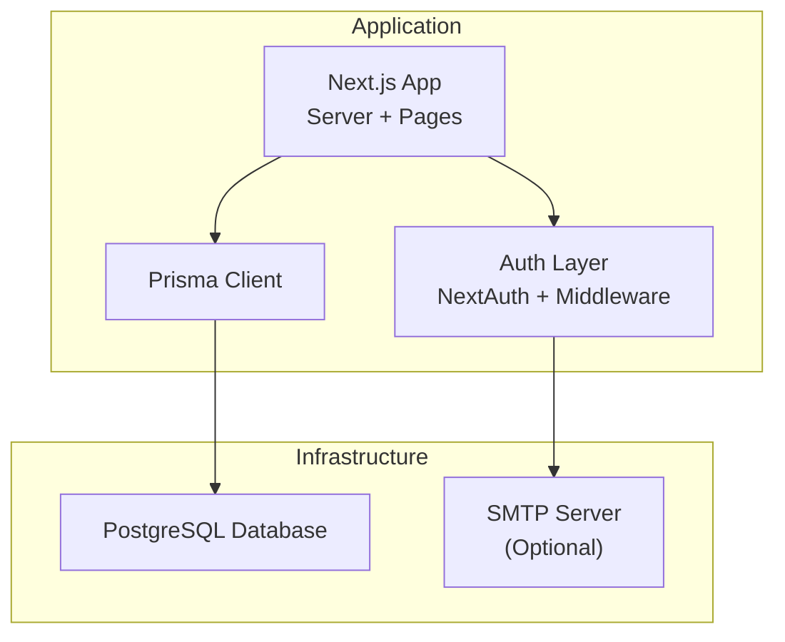
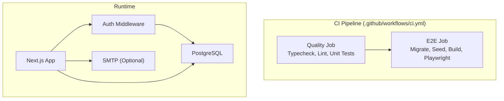
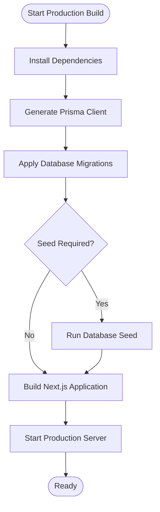
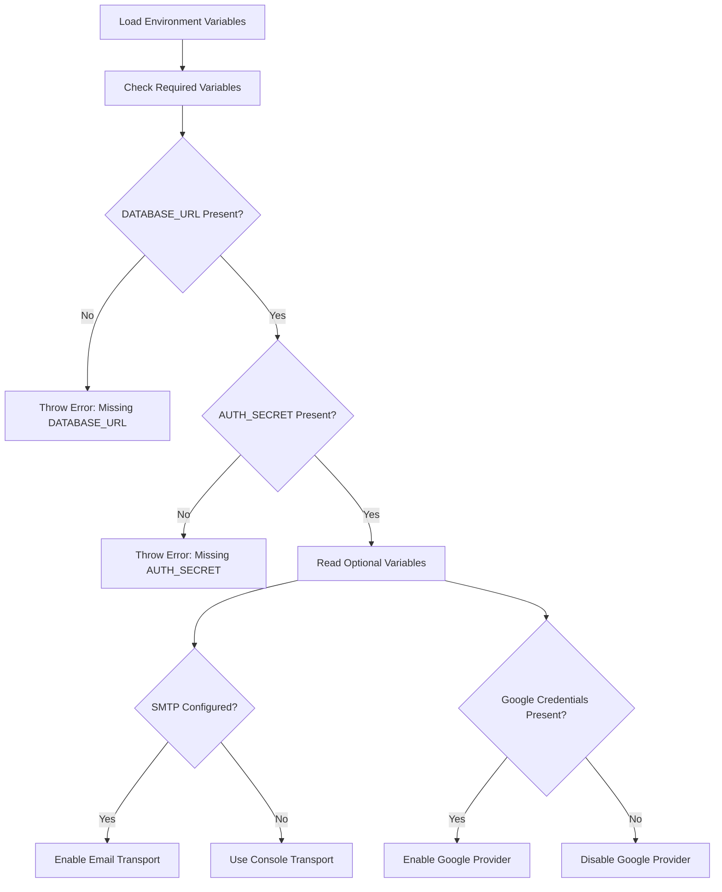
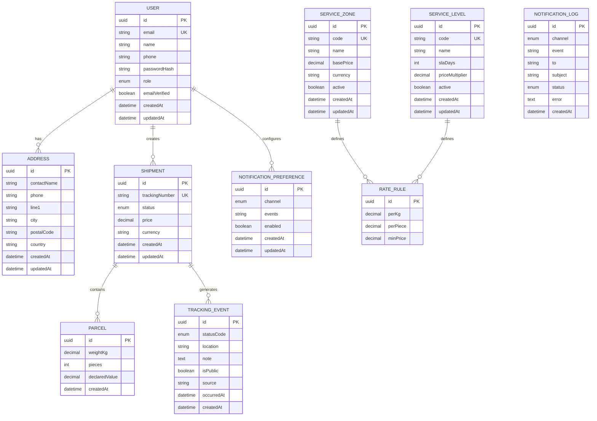
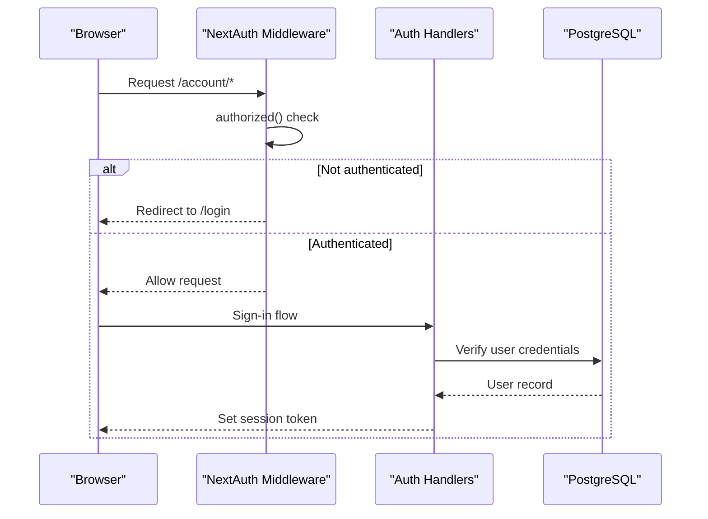
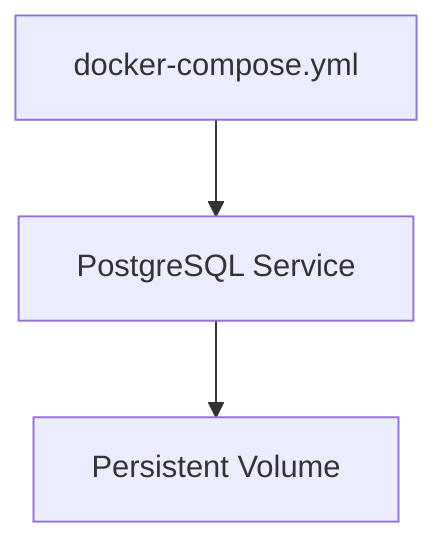
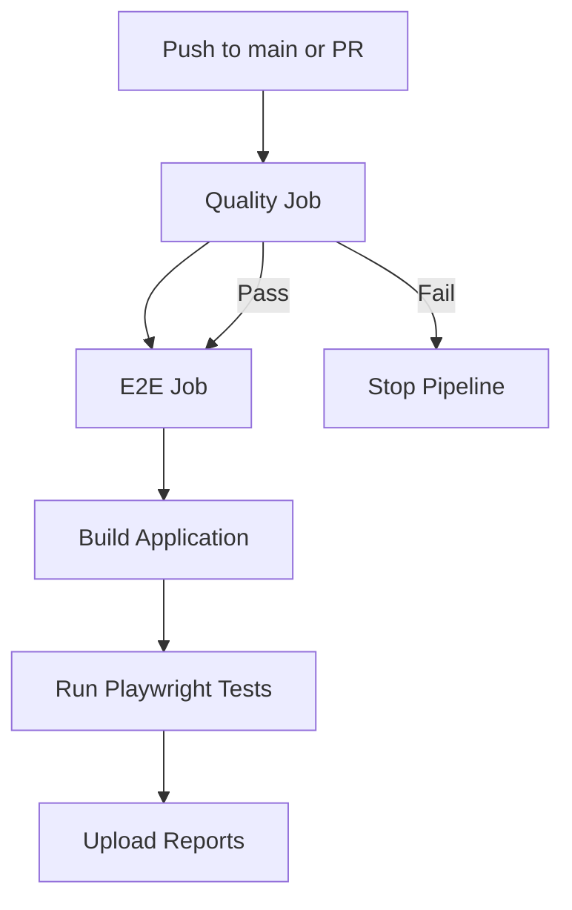
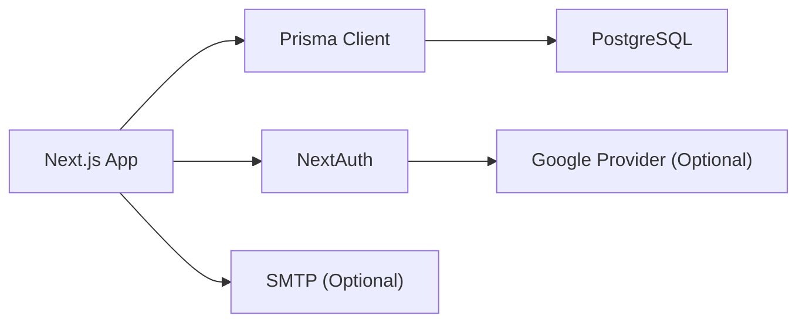

# Deployment Guide

<cite>
**Referenced Files in This Document**
- [README.md](file://README.md)
- [package.json](file://package.json)
- [next.config.ts](file://next.config.ts)
- [docker-compose.yml](file://docker-compose.yml)
- [.github/workflows/ci.yml](file://.github/workflows/ci.yml)
- [lib/env.ts](file://lib/env.ts)
- [lib/db.ts](file://lib/db.ts)
- [prisma/schema.prisma](file://prisma/schema.prisma)
- [lib/auth.config.ts](file://lib/auth.config.ts)
- [middleware.ts](file://middleware.ts)
- [lib/rate-limit.ts](file://lib/rate-limit.ts)
- [app/layout.tsx](file://app/layout.tsx)
- [app/robots.ts](file://app/robots.ts)
- [app/sitemap.ts](file://app/sitemap.ts)
</cite>

## Table of Contents
1. [Introduction](#introduction)
2. [Project Structure](#project-structure)
3. [Core Components](#core-components)
4. [Architecture Overview](#architecture-overview)
5. [Detailed Component Analysis](#detailed-component-analysis)
6. [Dependency Analysis](#dependency-analysis)
7. [Performance Considerations](#performance-considerations)
8. [Troubleshooting Guide](#troubleshooting-guide)
9. [Conclusion](#conclusion)
10. [Appendices](#appendices)

## Introduction
This deployment guide explains how to build, configure, and deploy Timberland’s Next.js application to production. It covers the build pipeline, environment configuration, Docker Compose usage, database setup with Prisma and PostgreSQL, security hardening, monitoring, scaling, backups, and disaster recovery. The guidance is based on the repository’s scripts, configuration files, CI workflow, and runtime modules.

## Project Structure
Timberland is a Next.js application using:
- Next.js 16 for server-side rendering and API routes
- Prisma with PostgreSQL for data persistence
- NextAuth (Auth.js) for authentication
- Playwright for end-to-end tests
- Vitest for unit tests
- ESLint and TypeScript for quality and type safety
- GitHub Actions for continuous integration

**Diagram sources**
- [package.json:25-41](file://package.json#L25-L41)
- [lib/db.ts:1-16](file://lib/db.ts#L1-L16)
- [lib/auth.config.ts:1-42](file://lib/auth.config.ts#L1-L42)
- [docker-compose.yml:1-22](file://docker-compose.yml#L1-L22)

**Section sources**
- [README.md:1-1](file://README.md#L1-L1)
- [package.json:1-59](file://package.json#L1-L59)

## Core Components
- Build and runtime scripts define how the app is built and started.
- Environment variables are centralized and validated at runtime.
- Database access uses Prisma with a single shared client instance.
- Authentication is configured via NextAuth with edge-safe middleware.
- Rate limiting is implemented as an in-memory fixed-window limiter.

Key responsibilities:
- `package.json`: Scripts for development, build, start, testing, and database operations.
- `lib/env.ts`: Centralized, typed environment configuration with required and optional values.
- `lib/db.ts`: Shared Prisma client with logging tuned per environment.
- `lib/auth.config.ts` and `middleware.ts`: Edge-safe auth configuration and route protection.
- `lib/rate-limit.ts`: In-memory rate limiter suitable for single-instance deployments.

**Section sources**
- [package.json:5-20](file://package.json#L5-L20)
- [lib/env.ts:1-66](file://lib/env.ts#L1-L66)
- [lib/db.ts:1-16](file://lib/db.ts#L1-L16)
- [lib/auth.config.ts:1-42](file://lib/auth.config.ts#L1-L42)
- [middleware.ts:1-14](file://middleware.ts#L1-L14)
- [lib/rate-limit.ts:1-56](file://lib/rate-limit.ts#L1-L56)

## Architecture Overview
The production architecture consists of:
- A Next.js application serving pages and API routes
- A PostgreSQL database for persistent data
- Optional SMTP server for email notifications
- CI pipeline that validates code, runs tests, and builds artifacts

**Diagram sources**
- [.github/workflows/ci.yml:13-94](file://.github/workflows/ci.yml#L13-L94)
- [docker-compose.yml:1-22](file://docker-compose.yml#L1-L22)
- [lib/auth.config.ts:1-42](file://lib/auth.config.ts#L1-L42)

## Detailed Component Analysis

### Build Process
- Development: Use the dev script to run the Next.js development server.
- Build: Generate Prisma client and build the Next.js application.
- Start: Run the production server with Next.js.

Recommended production steps:
1. Install dependencies with a clean install.
2. Generate Prisma client.
3. Apply migrations to the target database.
4. Seed the database if needed.
5. Build the application.
6. Start the production server.

**Diagram sources**
- [package.json:5-20](file://package.json#L5-L20)
- [.github/workflows/ci.yml:72-79](file://.github/workflows/ci.yml#L72-L79)

**Section sources**
- [package.json:5-20](file://package.json#L5-L20)
- [.github/workflows/ci.yml:72-79](file://.github/workflows/ci.yml#L72-L79)

### Environment Configuration
Environment variables are centrally accessed through a typed module. Required variables fail fast; optional variables degrade gracefully.

Required variables:
- DATABASE_URL: PostgreSQL connection string used by Prisma.
- AUTH_SECRET: Secret used by NextAuth for signing tokens.

Optional variables:
- NEXT_PUBLIC_APP_URL: Base URL for metadata generation and SEO.
- NEXT_PUBLIC_DEFAULT_CURRENCY: Default currency for pricing display.
- SMTP_HOST, SMTP_PORT, SMTP_USER, SMTP_PASSWORD, EMAIL_FROM: Email transport settings.
- AUTH_GOOGLE_ID, AUTH_GOOGLE_SECRET: Google OAuth provider credentials.

Notes:
- Missing required variables throw errors at runtime.
- Email functionality degrades to console transport when SMTP is not configured.
- Google provider is enabled only when both ID and secret are present.

**Diagram sources**
- [lib/env.ts:8-63](file://lib/env.ts#L8-L63)
- [lib/auth.ts:32-34](file://lib/auth.ts#L32-L34)

**Section sources**
- [lib/env.ts:1-66](file://lib/env.ts#L1-L66)

### Database Setup
- Database provider: PostgreSQL.
- Schema: Defined in Prisma schema with models for users, addresses, shipments, parcels, tracking events, service zones, service levels, rate rules, notification preferences, and notification logs.
- Connection: Prisma reads DATABASE_URL from environment.
- Client reuse: A single PrismaClient instance is reused across hot reloads in development to avoid exhausting connections.

Production recommendations:
- Use a managed PostgreSQL service.
- Ensure DATABASE_URL points to the production database.
- Run migrations before starting the app.
- Optionally seed initial data for production.

**Diagram sources**
- [prisma/schema.prisma:1-261](file://prisma/schema.prisma#L1-L261)

**Section sources**
- [lib/db.ts:1-16](file://lib/db.ts#L1-L16)
- [prisma/schema.prisma:1-261](file://prisma/schema.prisma#L1-L261)

### Authentication and Authorization
- NextAuth is configured with JWT strategy.
- Protected routes under `/account` require authentication via middleware.
- Credentials provider authenticates against the database.
- Google provider can be enabled via environment variables.

Security considerations:
- Use strong AUTH_SECRET in production.
- Restrict trusted hosts appropriately.
- Protect sensitive routes with middleware.

**Diagram sources**
- [lib/auth.config.ts:11-41](file://lib/auth.config.ts#L11-L41)
- [middleware.ts:1-14](file://middleware.ts#L1-L14)
- [lib/auth.ts:1-41](file://lib/auth.ts#L1-L41)

**Section sources**
- [lib/auth.config.ts:1-42](file://lib/auth.config.ts#L1-L42)
- [middleware.ts:1-14](file://middleware.ts#L1-L14)
- [lib/auth.ts:1-41](file://lib/auth.ts#L1-L41)

### Rate Limiting
- In-memory fixed-window rate limiter protects endpoints from abuse.
- Suitable for single-instance deployments.
- For multi-instance or serverless environments, replace with a shared store like Redis.

Operational notes:
- Periodically sweep expired buckets to bound memory usage.
- Tune limits and window sizes according to traffic patterns.

**Section sources**
- [lib/rate-limit.ts:1-56](file://lib/rate-limit.ts#L1-L56)

### Docker Containerization
The repository includes a Docker Compose file that defines a PostgreSQL service for local development and testing. It does not include a Next.js application container definition.

What it provides:
- PostgreSQL 16 Alpine image
- Persistent volume for database data
- Health checks for readiness
- Exposed port for local access

Recommendations for production:
- Add a Next.js application service to the compose file or use a container orchestrator.
- Externalize secrets and database credentials.
- Use managed databases instead of containers for production.

**Diagram sources**
- [docker-compose.yml:1-22](file://docker-compose.yml#L1-L22)

**Section sources**
- [docker-compose.yml:1-22](file://docker-compose.yml#L1-L22)

### CI/CD Pipeline
GitHub Actions performs:
- Dependency installation
- Prisma client generation
- Type checking
- Linting
- Unit tests
- E2E tests with a temporary PostgreSQL service
- Build step
- Artifact upload for test reports

Environment variables for E2E:
- DATABASE_URL
- AUTH_SECRET
- AUTH_TRUST_HOST
- NEXT_PUBLIC_APP_URL
- NEXT_PUBLIC_DEFAULT_CURRENCY

**Diagram sources**
- [.github/workflows/ci.yml:13-94](file://.github/workflows/ci.yml#L13-L94)

**Section sources**
- [.github/workflows/ci.yml:1-94](file://.github/workflows/ci.yml#L1-L94)

### Next.js-Specific Deployment Considerations
- Turbopack is configured for Tailwind CSS v4 via Next.js configuration.
- Metadata base URL is derived from NEXT_PUBLIC_APP_URL for robots and sitemap generation.
- Ensure the production server is started with the correct environment variables.

Optimization tips:
- Keep static assets in the public directory.
- Avoid heavy computations in server components where possible.
- Use appropriate caching headers at your reverse proxy or CDN.

**Section sources**
- [next.config.ts:1-16](file://next.config.ts#L1-L16)
- [app/layout.tsx:17-17](file://app/layout.tsx#L17-L17)
- [app/robots.ts:3-3](file://app/robots.ts#L3-L3)
- [app/sitemap.ts:3-3](file://app/sitemap.ts#L3-L3)

## Dependency Analysis
High-level runtime dependencies:
- Next.js application server
- Prisma client connecting to PostgreSQL
- NextAuth for authentication
- Optional SMTP for email notifications
- Optional Google OAuth provider

**Diagram sources**
- [package.json:25-41](file://package.json#L25-L41)
- [lib/db.ts:1-16](file://lib/db.ts#L1-L16)
- [lib/auth.ts:1-41](file://lib/auth.ts#L1-L41)

**Section sources**
- [package.json:25-41](file://package.json#L25-L41)
- [lib/db.ts:1-16](file://lib/db.ts#L1-L16)
- [lib/auth.ts:1-41](file://lib/auth.ts#L1-L41)

## Performance Considerations
- Use a managed PostgreSQL service with appropriate sizing and connection pooling.
- Monitor Prisma query performance and add indexes where necessary.
- Configure a reverse proxy or CDN for static asset caching and compression.
- Tune rate limits to balance security and usability.
- Consider horizontal scaling behind a load balancer; ensure shared state (like rate limiting) is externalized.

[No sources needed since this section provides general guidance]

## Troubleshooting Guide
Common issues and resolutions:
- Missing required environment variables: The app throws errors when DATABASE_URL or AUTH_SECRET are absent. Ensure they are set in the production environment.
- Database connectivity failures: Verify DATABASE_URL format, network access, and firewall rules.
- Authentication failures: Confirm AUTH_SECRET is consistent across deployments and sessions.
- Email not sending: Check SMTP_HOST, SMTP_USER, SMTP_PASSWORD, and EMAIL_FROM. If not configured, the app falls back to console transport.
- E2E test failures: Ensure DATABASE_URL matches the test database and that migrations have been applied.

Operational checks:
- Validate health of PostgreSQL using standard tools.
- Review application logs for Prisma errors and NextAuth warnings.
- Inspect rate limiter metrics to detect abuse patterns.

**Section sources**
- [lib/env.ts:8-15](file://lib/env.ts#L8-L15)
- [lib/db.ts:7-11](file://lib/db.ts#L7-L11)
- [.github/workflows/ci.yml:44-49](file://.github/workflows/ci.yml#L44-L49)

## Conclusion
Timberland’s production deployment relies on a Next.js application backed by PostgreSQL, with NextAuth for authentication and optional email and Google OAuth integrations. The CI pipeline ensures code quality and functional correctness. For production, externalize secrets, use managed services, apply migrations before startup, and implement robust monitoring, scaling, backup, and disaster recovery procedures.

[No sources needed since this section summarizes without analyzing specific files]

## Appendices

### Step-by-Step Deployment Instructions
1. Prepare the environment:
   - Provision a managed PostgreSQL database.
   - Create environment variables: DATABASE_URL, AUTH_SECRET, NEXT_PUBLIC_APP_URL, NEXT_PUBLIC_DEFAULT_CURRENCY.
   - Optionally configure SMTP and Google OAuth credentials.

2. Deploy the application:
   - Install dependencies.
   - Generate Prisma client.
   - Apply migrations.
   - Seed the database if required.
   - Build the application.
   - Start the production server.

3. Verify deployment:
   - Access the application via NEXT_PUBLIC_APP_URL.
   - Test login and protected routes.
   - Confirm database connectivity and basic CRUD operations.

4. Post-deployment:
   - Set up monitoring and alerting.
   - Configure backups and retention policies.
   - Establish disaster recovery procedures.

**Section sources**
- [package.json:5-20](file://package.json#L5-L20)
- [lib/env.ts:22-63](file://lib/env.ts#L22-L63)
- [.github/workflows/ci.yml:72-79](file://.github/workflows/ci.yml#L72-L79)

### Monitoring Setup
- Application metrics: Track request latency, error rates, and throughput.
- Database metrics: Monitor connection pool usage, query latency, and disk I/O.
- Logs: Centralize application and database logs.
- Alerts: Define thresholds for CPU, memory, disk, and error rates.

[No sources needed since this section provides general guidance]

### Scaling Considerations
- Horizontal scaling: Run multiple instances behind a load balancer.
- Statelessness: Avoid in-process state; externalize sessions and rate limiting.
- Database scaling: Use read replicas and connection pooling.
- Caching: Introduce CDN and application-level caches where appropriate.

[No sources needed since this section provides general guidance]

### Security Hardening
- Secrets management: Use a secrets manager or platform-provided secret stores.
- HTTPS: Enforce TLS termination at the reverse proxy or CDN.
- Input validation: Leverage Zod schemas and server-side validation.
- Least privilege: Restrict database permissions and network access.
- Rate limiting: Protect endpoints from enumeration and abuse.

**Section sources**
- [lib/rate-limit.ts:1-56](file://lib/rate-limit.ts#L1-L56)
- [lib/env.ts:8-15](file://lib/env.ts#L8-L15)

### Backup Strategies
- Automated daily backups of PostgreSQL.
- Retain backups for a defined period.
- Test restore procedures regularly.
- Encrypt backups at rest and in transit.

[No sources needed since this section provides general guidance]

### Disaster Recovery Procedures
- Define RTO and RPO targets.
- Document recovery steps for database and application.
- Conduct periodic drills to validate recovery processes.
- Maintain runbooks for common failure scenarios.

[No sources needed since this section provides general guidance]