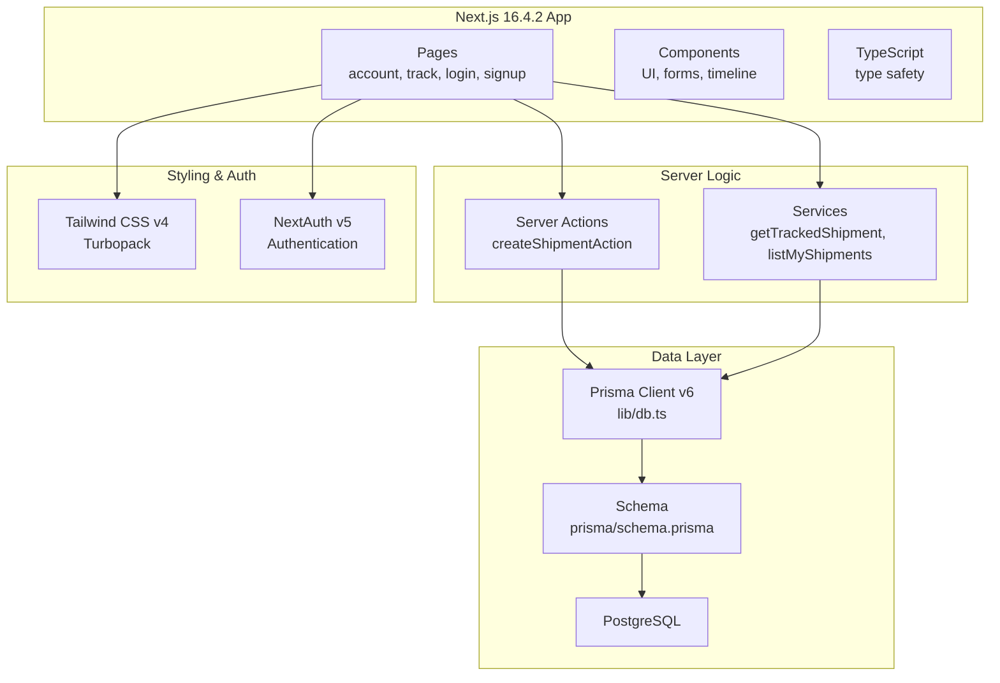
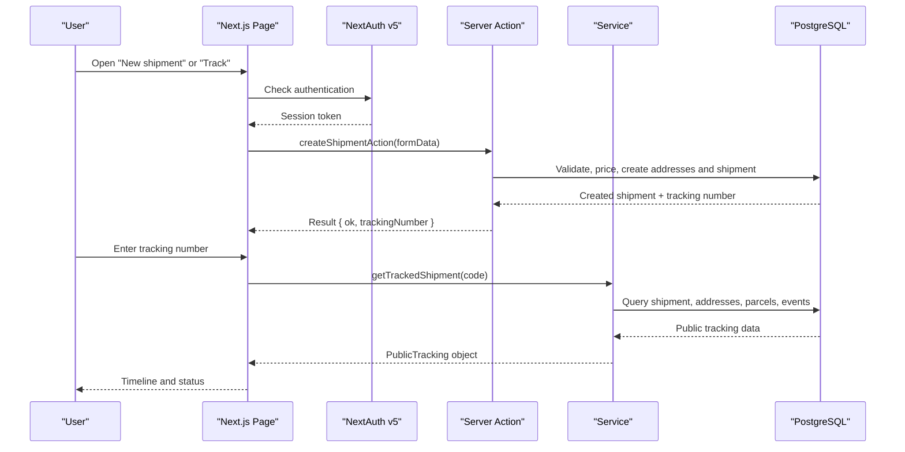
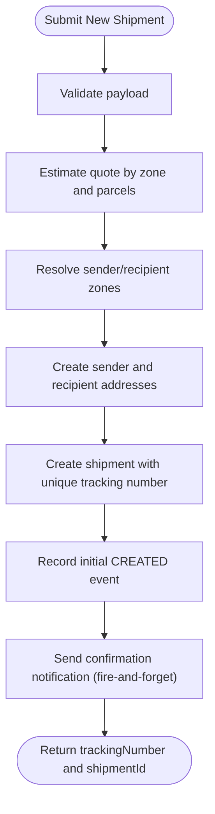
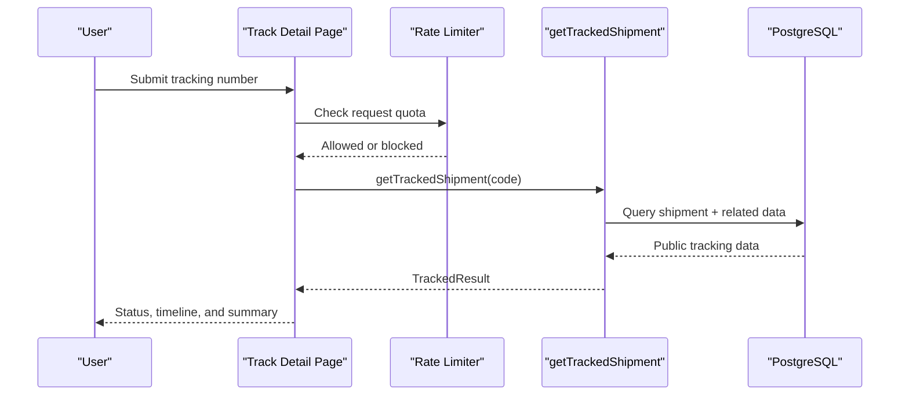
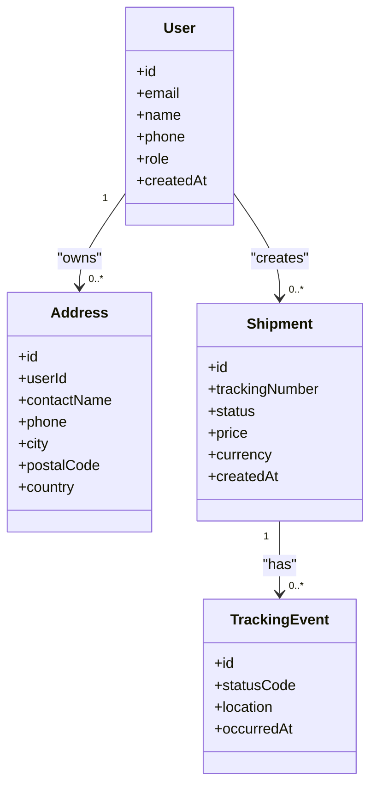
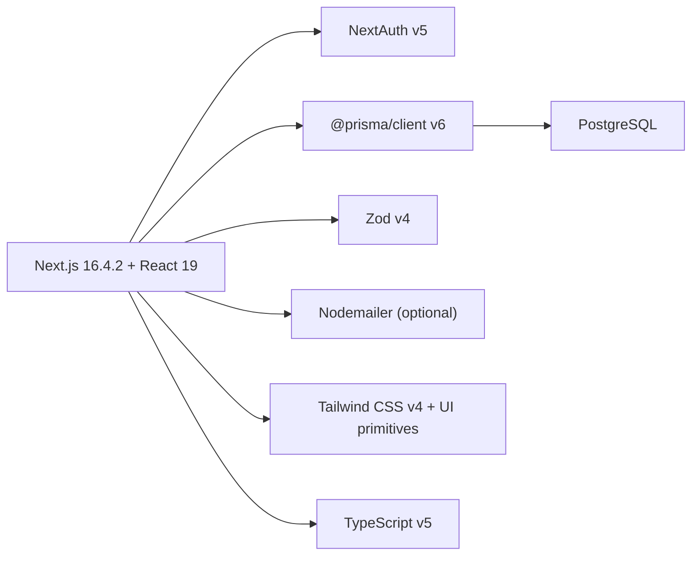

# Getting Started

<cite>
**Referenced Files in This Document**
- [package.json](file://package.json)
- [docker-compose.yml](file://docker-compose.yml)
- [prisma/schema.prisma](file://prisma/schema.prisma)
- [lib/db.ts](file://lib/db.ts)
- [lib/env.ts](file://lib/env.ts)
- [server/shipment.actions.ts](file://server/shipment.actions.ts)
- [server/tracking.service.ts](file://server/tracking.service.ts)
- [server/account.service.ts](file://server/account.service.ts)
- [app/account/new-shipment/page.tsx](file://app/account/new-shipment/page.tsx)
- [app/track/[trackingNumber]/page.tsx](file://app/track/[trackingNumber]/page.tsx)
- [app/login/page.tsx](file://app/login/page.tsx)
- [app/signup/page.tsx](file://app/signup/page.tsx)
- [prisma/seed.ts](file://prisma/seed.ts)
- [next.config.ts](file://next.config.ts)
- [lib/auth.ts](file://lib/auth.ts)
- [lib/auth.config.ts](file://lib/auth.config.ts)
</cite>

## Update Summary
**Changes Made**
- Updated technology stack to reflect Next.js 16.4.2, TypeScript, Prisma ORM v6, PostgreSQL, and Tailwind CSS v4
- Added Tailwind CSS v4 Turbopack configuration details
- Updated dependency versions and development tooling information
- Enhanced environment configuration documentation with new auth and email settings
- Updated database setup instructions for Prisma v6 migration commands
- Added authentication system documentation with NextAuth v5 beta

## Table of Contents
1. [Introduction](#introduction)
2. [Project Structure](#project-structure)
3. [Core Components](#core-components)
4. [Architecture Overview](#architecture-overview)
5. [Detailed Component Analysis](#detailed-component-analysis)
6. [Dependency Analysis](#dependency-analysis)
7. [Performance Considerations](#performance-considerations)
8. [Troubleshooting Guide](#troubleshooting-guide)
9. [Conclusion](#conclusion)

## Introduction
Timberland is a full-stack Next.js courier and delivery platform built with the latest technologies including Next.js 16.4.2, TypeScript, Prisma ORM v6, PostgreSQL, and Tailwind CSS v4. The platform manages shipments, tracks deliveries, and handles customer accounts with modern web standards. It provides:
- Customer account creation and authentication using NextAuth v5
- Shipment creation with pricing and parcel details
- Public shipment tracking with a timeline
- A seeded demo dataset to explore the application quickly
- Type-safe database operations with Prisma
- Modern UI components with Tailwind CSS v4

This guide helps you install dependencies, configure environment variables, initialize the database, and run the development server. It also includes basic usage examples and troubleshooting tips.

**Section sources**
- [package.json:1-59](file://package.json#L1-L59)
- [next.config.ts:1-16](file://next.config.ts#L1-L16)

## Project Structure
The project follows a modern Next.js layout with server actions and services, utilizing the latest development tools:
- app/: Next.js pages and route handlers with TypeScript
- components/: Reusable UI components with Tailwind CSS v4
- lib/: Shared utilities, environment configuration, and database client
- prisma/: Database schema, migrations, and seed script with Prisma v6
- server/: Server-side business logic (actions and services)
- tests/: Unit and end-to-end tests with Vitest and Playwright
- docker-compose.yml: Local PostgreSQL service

**Diagram sources**
- [app/account/new-shipment/page.tsx:1-55](file://app/account/new-shipment/page.tsx#L1-L55)
- [app/track/[trackingNumber]/page.tsx:1-182](file://app/track/[trackingNumber]/page.tsx#L1-L182)
- [server/shipment.actions.ts:1-146](file://server/shipment.actions.ts#L1-L146)
- [server/tracking.service.ts:1-147](file://server/tracking.service.ts#L1-L147)
- [lib/db.ts:1-16](file://lib/db.ts#L1-L16)
- [prisma/schema.prisma:1-261](file://prisma/schema.prisma#L1-L261)
- [next.config.ts:1-16](file://next.config.ts#L1-L16)
- [lib/auth.ts:1-42](file://lib/auth.ts#L1-L42)

**Section sources**
- [package.json:1-59](file://package.json#L1-L59)
- [docker-compose.yml:1-22](file://docker-compose.yml#L1-L22)

## Core Components
- Environment configuration: Centralized access to required and optional environment variables with type safety.
- Database client: Singleton Prisma client configured for development and production logging with connection pooling.
- Data model: Comprehensive schema covering users, addresses, zones, service levels, rate rules, shipments, parcels, tracking events, notifications, and logs.
- Server actions: Create shipments with validation, pricing, address resolution, and initial tracking event.
- Tracking service: Guest-safe public tracking view with progress calculation and event mapping.
- Account services: Dashboard queries for user-owned shipments and saved addresses.
- Authentication: NextAuth v5 integration with credentials and Google OAuth providers.

Key responsibilities:
- lib/env.ts: Validates and exposes typed environment values.
- lib/db.ts: Provides a single PrismaClient instance across hot reloads.
- prisma/schema.prisma: Defines all entities and relationships with Prisma v6.
- server/shipment.actions.ts: Creates shipments, validates input, estimates quotes, and emits initial events.
- server/tracking.service.ts: Builds public tracking data without exposing sensitive fields.
- server/account.service.ts: Fetches user-specific shipment summaries and details.
- lib/auth.ts: Configures NextAuth v5 with multiple authentication providers.

**Section sources**
- [lib/env.ts:1-66](file://lib/env.ts#L1-L66)
- [lib/db.ts:1-16](file://lib/db.ts#L1-L16)
- [prisma/schema.prisma:1-261](file://prisma/schema.prisma#L1-L261)
- [server/shipment.actions.ts:1-146](file://server/shipment.actions.ts#L1-L146)
- [server/tracking.service.ts:1-147](file://server/tracking.service.ts#L1-L147)
- [server/account.service.ts:1-52](file://server/account.service.ts#L1-L52)
- [lib/auth.ts:1-42](file://lib/auth.ts#L1-L42)

## Architecture Overview
High-level flow from page to database with modern authentication:

**Diagram sources**
- [app/account/new-shipment/page.tsx:1-55](file://app/account/new-shipment/page.tsx#L1-L55)
- [server/shipment.actions.ts:1-146](file://server/shipment.actions.ts#L1-L146)
- [app/track/[trackingNumber]/page.tsx:1-182](file://app/track/[trackingNumber]/page.tsx#L1-L182)
- [server/tracking.service.ts:1-147](file://server/tracking.service.ts#L1-L147)
- [lib/auth.ts:1-42](file://lib/auth.ts#L1-L42)

## Detailed Component Analysis

### Installation and Setup
- Install Node.js (recommended latest LTS).
- Ensure Docker is installed if you want to run PostgreSQL locally via compose.
- Clone the repository and install dependencies:
  - npm ci
- Start the local database:
  - docker compose up -d db
- Configure environment variables:
  - Copy .env.example to .env and set DATABASE_URL and AUTH_SECRET.
- Initialize the database:
  - npm run db:migrate
- Seed demo data:
  - npm run db:seed
- Run the development server:
  - npm run dev

Environment variables overview:
- Required: DATABASE_URL, AUTH_SECRET
- Optional: SMTP settings, Google OAuth credentials, NEXT_PUBLIC_APP_URL, NEXT_PUBLIC_DEFAULT_CURRENCY

Database initialization:
- Migrations apply schema changes to PostgreSQL using Prisma v6.
- The seed script creates zones, service levels, rate rules, a demo user, sample addresses, and example shipments with tracking events.

Development tools:
- Scripts include build, lint, typecheck, test, e2e testing, and Prisma commands for generate, migrate, studio, seed, and reset.
- TypeScript compilation and type checking are integrated into the build process.
- Tailwind CSS v4 with Turbopack for optimized styling.

**Section sources**
- [docker-compose.yml:1-22](file://docker-compose.yml#L1-L22)
- [package.json:1-59](file://package.json#L1-L59)
- [prisma/seed.ts:1-177](file://prisma/seed.ts#L1-L177)
- [next.config.ts:1-16](file://next.config.ts#L1-L16)

### Creating a Shipment
End-to-end flow:
- Navigate to the New Shipment page.
- Fill sender and recipient addresses, select a service level, add parcels, and submit.
- The server action validates input, estimates the quote, resolves service zones, creates addresses, generates a unique tracking number, and records an initial tracking event.

**Diagram sources**
- [server/shipment.actions.ts:1-146](file://server/shipment.actions.ts#L1-L146)

Usage example:
- Visit /account/new-shipment after signing in.
- Provide parcel weight and piece count; the system calculates pricing based on destination zone and service level.
- After submission, use the returned tracking number to view the shipment timeline.

**Section sources**
- [app/account/new-shipment/page.tsx:1-55](file://app/account/new-shipment/page.tsx#L1-L55)
- [server/shipment.actions.ts:1-146](file://server/shipment.actions.ts#L1-L146)

### Tracking a Package
Public tracking flow:
- Enter a tracking number on the Track page.
- The page applies rate limiting by IP, validates the format, and calls the tracking service.
- The service returns a guest-safe view with status, origin/destination, pieces, total weight, estimated delivery, and public events.

**Diagram sources**
- [app/track/[trackingNumber]/page.tsx:1-182](file://app/track/[trackingNumber]/page.tsx#L1-L182)
- [server/tracking.service.ts:1-147](file://server/tracking.service.ts#L1-L147)

Usage example:
- Visit /track to enter a tracking number.
- For demo data, run the seed script and use one of the printed tracking numbers.

**Section sources**
- [app/track/[trackingNumber]/page.tsx:1-182](file://app/track/[trackingNumber]/page.tsx#L1-L182)
- [server/tracking.service.ts:1-147](file://server/tracking.service.ts#L1-L147)
- [prisma/seed.ts:1-177](file://prisma/seed.ts#L1-L177)

### Managing User Accounts
Account pages:
- Sign up: Create a new customer account.
- Sign in: Authenticate using credentials or Google OAuth.
- Dashboard: View your shipments and manage saved addresses.

**Diagram sources**
- [prisma/schema.prisma:57-226](file://prisma/schema.prisma#L57-L226)

Usage example:
- Visit /signup to create an account.
- Visit /login to sign in with email/password or Google.
- After signing in, visit /account to see your shipments and saved addresses.

**Section sources**
- [app/signup/page.tsx:1-31](file://app/signup/page.tsx#L1-L31)
- [app/login/page.tsx:1-50](file://app/login/page.tsx#L1-L50)
- [server/account.service.ts:1-52](file://server/account.service.ts#L1-L52)
- [lib/auth.ts:1-42](file://lib/auth.ts#L1-L42)

## Dependency Analysis
External and internal dependencies with updated versions:
- Next.js 16.4.2 application framework and React 19 runtime.
- NextAuth v5 beta for authentication with multiple providers.
- Prisma v6 client for type-safe database access.
- Zod v4 for input validation.
- Nodemailer for email notifications (optional).
- Tailwind CSS v4 and component primitives for UI with Turbopack optimization.
- TypeScript for type safety across the entire codebase.

**Diagram sources**
- [package.json:1-59](file://package.json#L1-L59)

**Section sources**
- [package.json:1-59](file://package.json#L1-L59)

## Performance Considerations
- Prisma client reuse: The singleton pattern avoids exhausting database connections during development hot reloads.
- Rate limiting: Public tracking endpoints are protected against enumeration by rate limiting per IP.
- Efficient queries: Services select only necessary fields and relations for dashboard and tracking views.
- Notification decoupling: Confirmation emails are sent asynchronously to avoid blocking the main request path.
- Tailwind CSS v4 optimization: Turbopack integration provides faster builds and development experience.
- TypeScript compilation: Type safety reduces runtime errors and improves developer productivity.

Recommendations:
- Keep SELECT projections minimal in high-traffic routes.
- Monitor database connection pools and adjust Prisma log levels appropriately in production.
- Use caching strategies for static content and frequently accessed metadata like service levels and zones.
- Leverage Tailwind CSS v4's performance improvements for large applications.

**Section sources**
- [lib/db.ts:1-16](file://lib/db.ts#L1-L16)
- [app/track/[trackingNumber]/page.tsx:1-182](file://app/track/[trackingNumber]/page.tsx#L1-L182)
- [server/tracking.service.ts:1-147](file://server/tracking.service.ts#L1-L147)
- [next.config.ts:1-16](file://next.config.ts#L1-L16)

## Troubleshooting Guide
Common setup issues and resolutions:
- Missing environment variables:
  - Ensure DATABASE_URL and AUTH_SECRET are set in .env.
  - If SMTP is not configured, email notifications fall back to console transport.
- Database connectivity errors:
  - Verify PostgreSQL is running via docker compose.
  - Confirm DATABASE_URL matches container credentials and port.
- Migration failures:
  - Run npm run db:migrate to apply pending migrations with Prisma v6.
  - Use npm run db:studio to inspect data and schema.
- Seed errors:
  - Run npm run db:seed to populate demo data.
  - Check console output for demo credentials and tracking numbers.
- Authentication issues:
  - Generate a secure AUTH_SECRET using openssl or another secure generator.
  - Clear browser cookies and retry sign-in if sessions fail.
  - Verify NextAuth v5 configuration in lib/auth.ts and lib/auth.config.ts.
- Tailwind CSS v4 issues:
  - Ensure @tailwindcss/turbopack is properly configured in next.config.ts.
  - Clear node_modules and reinstall dependencies if styling doesn't work.
- TypeScript compilation errors:
  - Run npm run typecheck to identify type-related issues.
  - Ensure all dependencies are compatible with TypeScript v5.

Helpful commands:
- npm run dev: Start development server
- npm run build: Build the application with TypeScript and Prisma
- npm run db:generate: Regenerate Prisma client
- npm run db:migrate: Apply migrations
- npm run db:seed: Seed demo data
- npm run db:studio: Open Prisma Studio
- npm run typecheck: Run TypeScript compiler
- npm run lint: Run ESLint checks

**Section sources**
- [docker-compose.yml:1-22](file://docker-compose.yml#L1-L22)
- [package.json:1-59](file://package.json#L1-L59)
- [prisma/seed.ts:1-177](file://prisma/seed.ts#L1-L177)
- [lib/auth.ts:1-42](file://lib/auth.ts#L1-L42)
- [lib/auth.config.ts:1-42](file://lib/auth.config.ts#L1-L42)
- [next.config.ts:1-16](file://next.config.ts#L1-L16)

## Conclusion
You now have everything needed to set up and run Timberland locally with the latest technology stack. The platform leverages Next.js 16.4.2, TypeScript, Prisma v6, PostgreSQL, and Tailwind CSS v4 to provide a modern, type-safe courier and delivery management system. Use the provided scripts to manage the database, seed demo data, and start the development server. Explore creating shipments, tracking packages, and managing user accounts through the documented pages and flows. For advanced customization, review the environment configuration, Prisma schema, server-side services, and authentication setup. The combination of modern tools ensures excellent developer experience and production-ready performance.