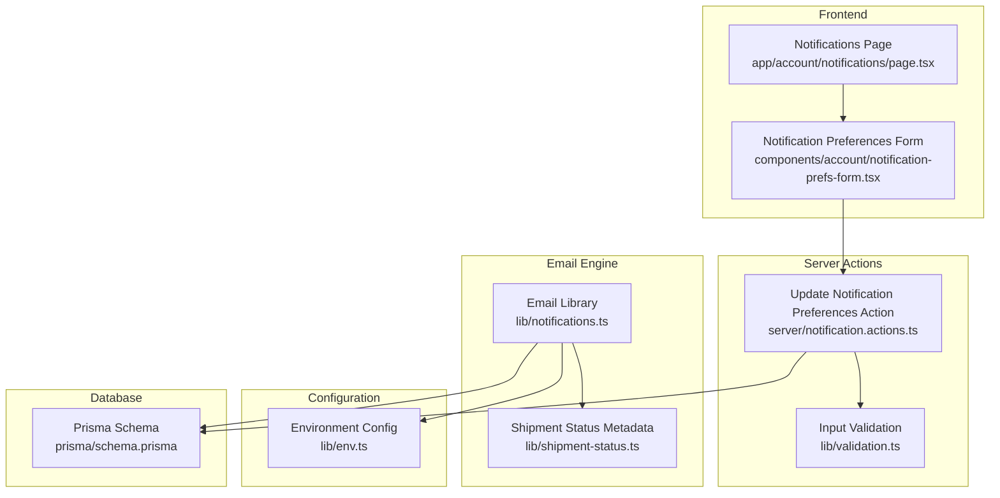
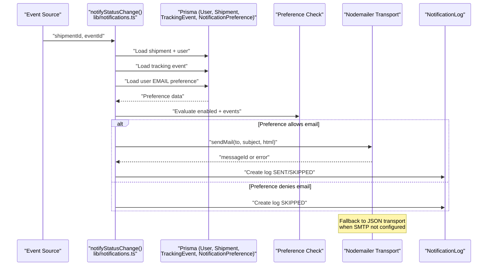
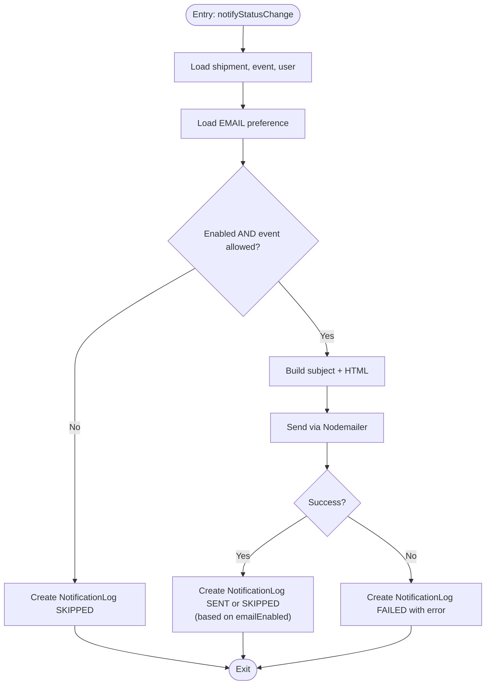
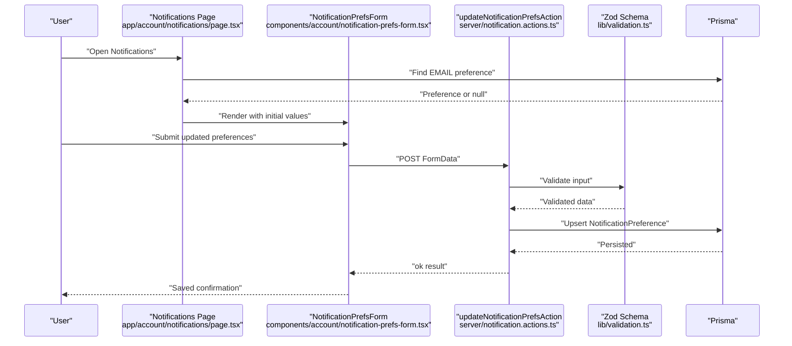
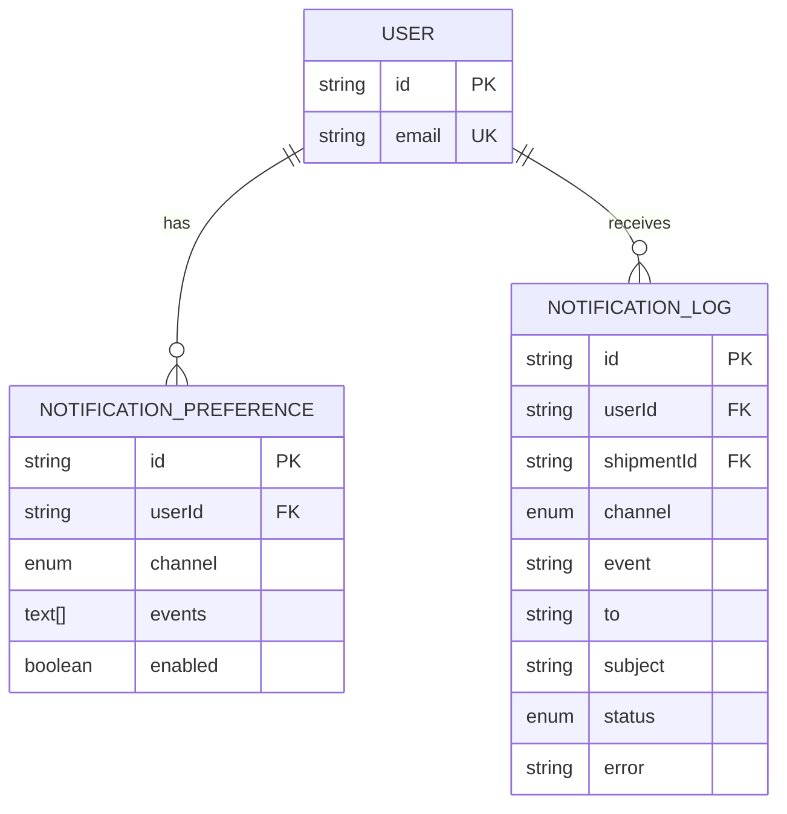
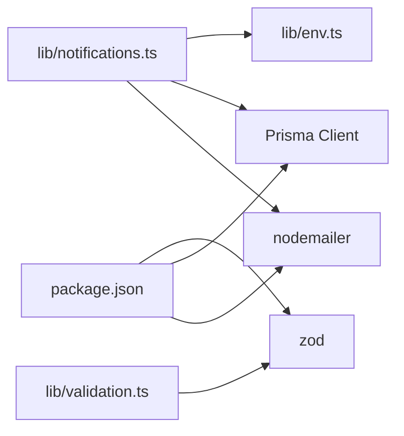

# Notification System

<cite>
**Referenced Files in This Document**
- [lib/notifications.ts](file://lib/notifications.ts)
- [server/notification.actions.ts](file://server/notification.actions.ts)
- [components/account/notification-prefs-form.tsx](file://components/account/notification-prefs-form.tsx)
- [app/account/notifications/page.tsx](file://app/account/notifications/page.tsx)
- [lib/env.ts](file://lib/env.ts)
- [prisma/schema.prisma](file://prisma/schema.prisma)
- [package.json](file://package.json)
- [lib/validation.ts](file://lib/validation.ts)
- [lib/shipment-status.ts](file://lib/shipment-status.ts)
</cite>

## Update Summary
**Changes Made**
- Updated file references to use correct paths (notifications.ts → notifications.ts)
- Enhanced architecture diagrams with more detailed component interactions
- Added comprehensive error handling and fallback strategies documentation
- Expanded troubleshooting guide with specific SMTP configuration details
- Updated data model documentation to reflect complete schema structure

## Table of Contents
1. [Introduction](#introduction)
2. [Project Structure](#project-structure)
3. [Core Components](#core-components)
4. [Architecture Overview](#architecture-overview)
5. [Detailed Component Analysis](#detailed-component-analysis)
6. [Dependency Analysis](#dependency-analysis)
7. [Performance Considerations](#performance-considerations)
8. [Troubleshooting Guide](#troubleshooting-guide)
9. [Conclusion](#conclusion)

## Introduction
This document explains Timberland's email notification system. It covers the Nodemailer integration, HTML template generation for shipment updates, user notification preferences, event-driven notifications, delivery attempt logging, configuration and environment variables, error handling, fallback strategies, and operational guidance for deliverability and troubleshooting.

The system is designed to:
- Send transactional emails for shipment status changes.
- Respect per-user email preferences with granular event control.
- Log every delivery attempt with clear statuses (SENT, SKIPPED, FAILED).
- Degrade gracefully when SMTP credentials are missing by capturing messages without sending them.
- Provide a user-friendly interface for managing notification preferences.

## Project Structure
The notification system spans server-side logic, React components for preference management, Prisma data models, and comprehensive validation.

**Diagram sources**
- [app/account/notifications/page.tsx:18-39](file://app/account/notifications/page.tsx#L18-L39)
- [components/account/notification-prefs-form.tsx:16-63](file://components/account/notification-prefs-form.tsx#L16-L63)
- [server/notification.actions.ts:8-28](file://server/notification.actions.ts#L8-L28)
- [lib/validation.ts:77-80](file://lib/validation.ts#L77-L80)
- [lib/notifications.ts:10-30](file://lib/notifications.ts#L10-L30)
- [lib/shipment-status.ts:62-76](file://lib/shipment-status.ts#L62-L76)
- [lib/env.ts:22-51](file://lib/env.ts#L22-L51)
- [prisma/schema.prisma:232-260](file://prisma/schema.prisma#L232-L260)

**Section sources**
- [app/account/notifications/page.tsx:1-40](file://app/account/notifications/page.tsx#L1-L40)
- [components/account/notification-prefs-form.tsx:1-64](file://components/account/notification-prefs-form.tsx#L1-L64)
- [server/notification.actions.ts:1-29](file://server/notification.actions.ts#L1-L29)
- [lib/notifications.ts:1-114](file://lib/notifications.ts#L1-L114)
- [lib/env.ts:1-66](file://lib/env.ts#L1-L66)
- [prisma/schema.prisma:228-260](file://prisma/schema.prisma#L228-L260)
- [lib/validation.ts:77-80](file://lib/validation.ts#L77-L80)
- [lib/shipment-status.ts:62-76](file://lib/shipment-status.ts#L62-L76)

## Core Components
- **Email engine**: Centralized Nodemailer transport, HTML template builder, preference-aware dispatch, and delivery logging.
- **User preferences UI**: Server action-backed form to enable/disable email notifications and select specific events.
- **Configuration**: Typed environment accessors for SMTP settings and feature flags.
- **Data model**: Prisma schema defines notification preferences and delivery logs.
- **Validation**: Zod schemas for input validation and type safety.
- **Status metadata**: Centralized shipment status definitions with labels and descriptions.

Key responsibilities:
- `lib/notifications.ts`: Transport creation, email delivery, template rendering, preference checks, and logging.
- `server/notification.actions.ts`: Validates and persists user notification preferences using Zod schemas.
- `components/account/notification-prefs-form.tsx`: Client-side form that calls the server action with proper state management.
- `app/account/notifications/page.tsx`: Loads current preferences and renders the form with available event options.
- `lib/env.ts`: Provides SMTP configuration and an `emailEnabled` flag with graceful degradation.
- `prisma/schema.prisma`: Defines `NotificationPreference` and `NotificationLog` with proper relationships.
- `lib/validation.ts`: Zod schemas for validating notification preferences.
- `lib/shipment-status.ts`: Centralized status metadata used in email templates.

**Section sources**
- [lib/notifications.ts:10-30](file://lib/notifications.ts#L10-L30)
- [lib/notifications.ts:32-43](file://lib/notifications.ts#L32-L43)
- [lib/notifications.ts:49-108](file://lib/notifications.ts#L49-L108)
- [server/notification.actions.ts:8-28](file://server/notification.actions.ts#L8-L28)
- [components/account/notification-prefs-form.tsx:16-63](file://components/account/notification-prefs-form.tsx#L16-L63)
- [app/account/notifications/page.tsx:18-39](file://app/account/notifications/page.tsx#L18-L39)
- [lib/env.ts:38-51](file://lib/env.ts#L38-L51)
- [prisma/schema.prisma:232-260](file://prisma/schema.prisma#L232-L260)
- [lib/validation.ts:77-80](file://lib/validation.ts#L77-L80)
- [lib/shipment-status.ts:62-76](file://lib/shipment-status.ts#L62-L76)

## Architecture Overview
The notification flow integrates user preferences, event processing, and email delivery with robust logging and error handling.

**Diagram sources**
- [lib/notifications.ts:49-108](file://lib/notifications.ts#L49-L108)
- [lib/env.ts:38-51](file://lib/env.ts#L38-L51)
- [prisma/schema.prisma:232-260](file://prisma/schema.prisma#L232-L260)

## Detailed Component Analysis

### Email Engine (`lib/notifications.ts`)
Responsibilities:
- Create and cache a Nodemailer transporter based on environment configuration.
- Provide a generic `deliver` helper.
- Render HTML templates for shipment status updates.
- Enforce user preferences before sending.
- Record delivery attempts with detailed status.

Transport strategy:
- If SMTP credentials are present (`env.emailEnabled`), create a real SMTP transporter.
- Otherwise, use a JSON transport that captures messages without sending them for development.

Template strategy:
- Build inline HTML using shipment and event metadata.
- Use shared status labels from the shipment status module for consistency.
- Include live tracking links using the application URL.

Preference enforcement:
- Load the user's EMAIL channel preference.
- Skip sending if disabled or if the event is not included in the allowed list.
- Always record a log entry indicating whether the message was skipped, sent, or failed.

Error handling:
- Wrap delivery in try/catch blocks.
- On failure, persist a FAILED log with the error message.
- Handle both successful sends and environment-based skips appropriately.

Transactional helper:
- Expose a simple function for other transactional emails beyond shipment notifications.

**Diagram sources**
- [lib/notifications.ts:49-108](file://lib/notifications.ts#L49-L108)

**Section sources**
- [lib/notifications.ts:10-30](file://lib/notifications.ts#L10-L30)
- [lib/notifications.ts:32-43](file://lib/notifications.ts#L32-L43)
- [lib/notifications.ts:49-108](file://lib/notifications.ts#L49-L108)
- [lib/notifications.ts:111-113](file://lib/notifications.ts#L111-L113)

### User Notification Preferences
The preferences page loads the current EMAIL preference for the authenticated user and renders a form. The form posts to a server action that validates input using Zod schemas and upserts the preference.

**Diagram sources**
- [app/account/notifications/page.tsx:18-39](file://app/account/notifications/page.tsx#L18-L39)
- [components/account/notification-prefs-form.tsx:16-63](file://components/account/notification-prefs-form.tsx#L16-L63)
- [server/notification.actions.ts:8-28](file://server/notification.actions.ts#L8-L28)
- [lib/validation.ts:77-80](file://lib/validation.ts#L77-L80)

**Section sources**
- [app/account/notifications/page.tsx:1-40](file://app/account/notifications/page.tsx#L1-L40)
- [components/account/notification-prefs-form.tsx:1-64](file://components/account/notification-prefs-form.tsx#L1-L64)
- [server/notification.actions.ts:1-29](file://server/notification.actions.ts#L1-L29)

### Data Model and Logging
The database schema defines:
- `NotificationPreference`: Per-user, per-channel preferences including enabled state and allowed event codes.
- `NotificationLog`: Audit trail for each attempted notification with status and optional error details.

**Diagram sources**
- [prisma/schema.prisma:232-260](file://prisma/schema.prisma#L232-L260)

**Section sources**
- [prisma/schema.prisma:228-260](file://prisma/schema.prisma#L228-L260)

## Dependency Analysis
External dependencies and their roles:
- **Nodemailer**: Email transport used to send or capture messages.
- **Prisma**: Database client used to read preferences and write logs.
- **Environment config**: Supplies SMTP settings and feature toggles.
- **Zod**: Input validation for form data.
- **React**: Client-side state management for forms.

**Diagram sources**
- [package.json:35-47](file://package.json#L35-L47)
- [lib/notifications.ts:2-5](file://lib/notifications.ts#L2-L5)
- [lib/env.ts:22-51](file://lib/env.ts#L22-L51)
- [lib/validation.ts:1](file://lib/validation.ts#L1)

**Section sources**
- [package.json:35-47](file://package.json#L35-L47)
- [lib/notifications.ts:2-5](file://lib/notifications.ts#L2-L5)
- [lib/env.ts:22-51](file://lib/env.ts#L22-L51)
- [lib/validation.ts:1](file://lib/validation.ts#L1)

## Performance Considerations
- **Transport caching**: A single Nodemailer transporter instance is cached to avoid repeated initialization overhead.
- **Minimal payload**: HTML templates are lightweight and built inline to reduce complexity.
- **Preference check early exit**: Skips expensive operations when preferences deny the event.
- **Logging writes**: Each path writes exactly one log entry; consider batching logs if throughput increases significantly.
- **Database queries**: Efficient querying with proper indexing on frequently accessed fields.
- **Client-side optimization**: React hooks minimize re-renders and provide immediate feedback.

## Troubleshooting Guide

Common issues and resolutions:
- **Missing SMTP configuration**:
  - Symptom: Emails are captured but not sent.
  - Cause: `emailEnabled` is false because host/user/password are missing.
  - Resolution: Set `SMTP_HOST`, `SMTP_PORT`, `SMTP_USER`, `SMTP_PASSWORD`, and optionally `EMAIL_FROM`.
- **Authentication failures**:
  - Symptom: Logs show FAILED with authentication errors.
  - Resolution: Verify SMTP credentials and port security settings.
- **Template rendering issues**:
  - Symptom: Incorrect or missing content in emails.
  - Resolution: Ensure required fields exist on shipment and event objects and that status labels are defined.
- **Preference misconfiguration**:
  - Symptom: Users do not receive expected emails.
  - Resolution: Confirm `enabled` is true and the event code is included in `events`.
- **Form validation errors**:
  - Symptom: Form submissions fail with validation errors.
  - Resolution: Check Zod schema constraints and ensure form data matches expected types.
- **Deliverability problems**:
  - Symptom: Messages land in spam or bounce.
  - Resolution: Configure proper sender identity, SPF/DKIM/DMARC at your SMTP provider, and monitor bounces and complaints.

Operational monitoring:
- Inspect `NotificationLog` for `FAILED` entries and associated error messages.
- Track `SKIPPED` logs to understand preference-driven suppression.
- Review `SENT` vs `SKIPPED` distribution to validate environment behavior.
- Monitor user preference changes through the admin interface.

Development workflow:
- Without SMTP configured, all emails are captured as JSON for inspection.
- Use the captured messages to test email templates and content.
- Gradually configure SMTP settings to move from development to production.

**Section sources**
- [lib/env.ts:38-51](file://lib/env.ts#L38-L51)
- [lib/notifications.ts:94-107](file://lib/notifications.ts#L94-L107)
- [prisma/schema.prisma:246-260](file://prisma/schema.prisma#L246-L260)
- [lib/validation.ts:77-80](file://lib/validation.ts#L77-L80)

## Conclusion
Timberland's notification system provides a clean, preference-aware email pipeline backed by explicit delivery logs. It uses Nodemailer with a graceful development fallback, enforces user choices through a user-friendly interface, and records outcomes for observability. With proper SMTP configuration and monitoring of logs, the system supports reliable transactional communication for shipment updates and can be extended to additional channels or templates as needed.

The system's modular architecture, comprehensive validation, and robust error handling make it suitable for production use while maintaining flexibility for future enhancements. The separation of concerns between email delivery, preference management, and data persistence ensures maintainability and testability.