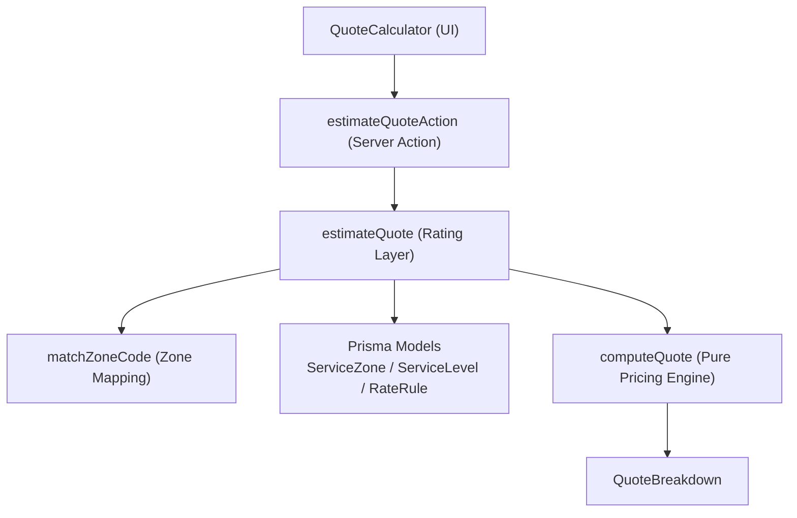
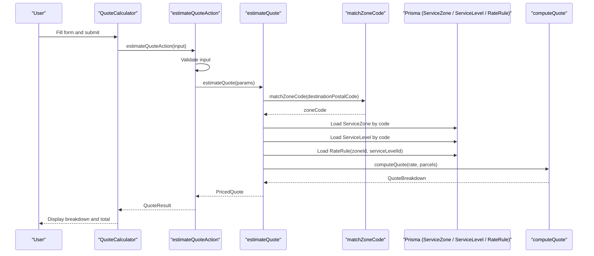
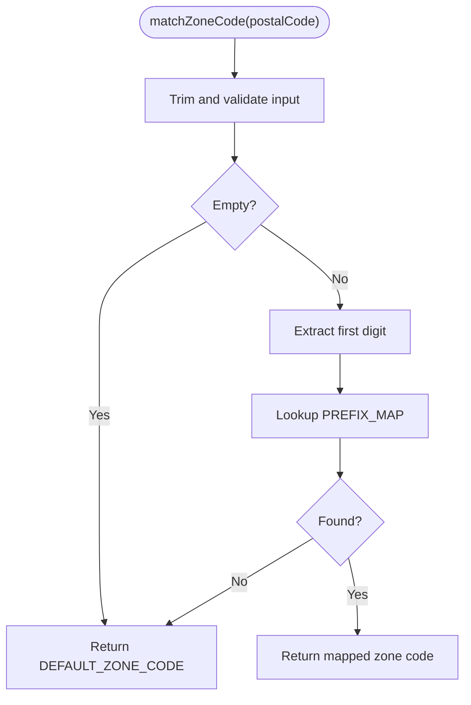
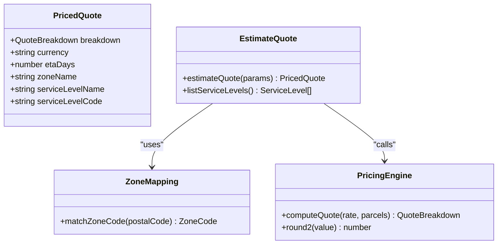
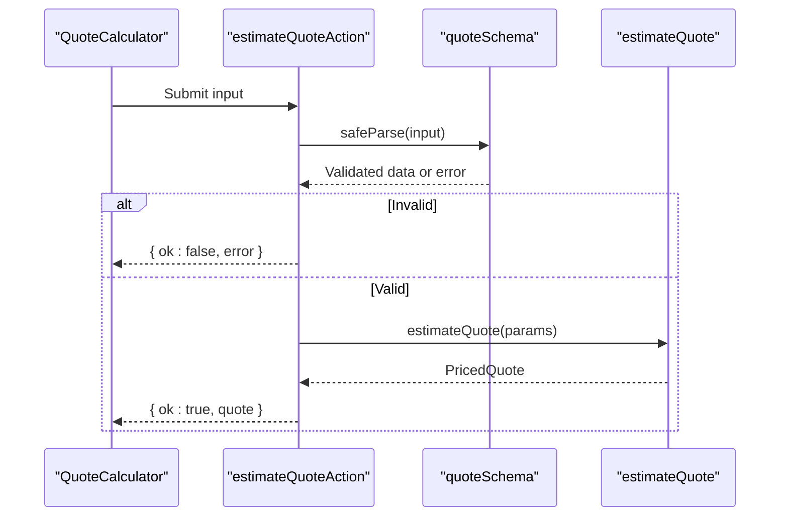
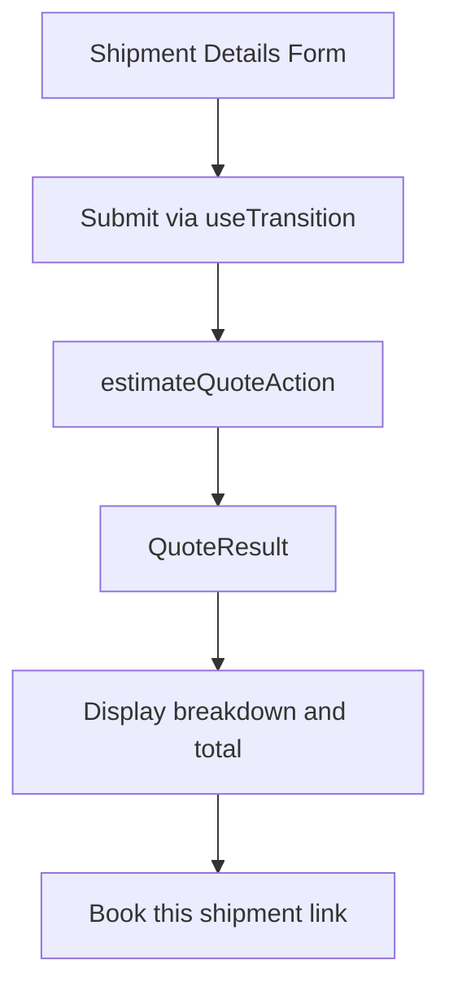
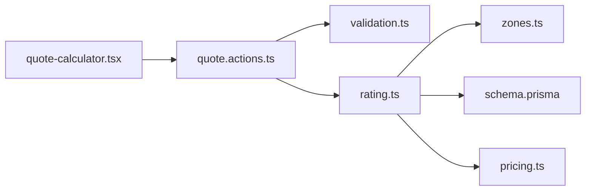

# Pricing Engine

<cite>
**Referenced Files in This Document**
- [pricing.ts](file://lib/pricing.ts)
- [zones.ts](file://lib/zones.ts)
- [rating.ts](file://lib/rating.ts)
- [quote.actions.ts](file://server/quote.actions.ts)
- [quote-calculator.tsx](file://components/quote/quote-calculator.tsx)
- [validation.ts](file://lib/validation.ts)
- [schema.prisma](file://prisma/schema.prisma)
- [pricing.test.ts](file://tests/pricing.test.ts)
</cite>

## Table of Contents
1. [Introduction](#introduction)
2. [Project Structure](#project-structure)
3. [Core Components](#core-components)
4. [Architecture Overview](#architecture-overview)
5. [Detailed Component Analysis](#detailed-component-analysis)
6. [Dependency Analysis](#dependency-analysis)
7. [Performance Considerations](#performance-considerations)
8. [Troubleshooting Guide](#troubleshooting-guide)
9. [Conclusion](#conclusion)
10. [Appendices](#appendices)

## Introduction
This document explains Timberland’s dynamic pricing engine for its own-fleet delivery service. It covers the zone-based pricing model, service level multipliers, quote calculation algorithm, rate rules, and the end-to-end flow from user input to a real-time price breakdown. It also provides practical examples, configuration guidance, and extension points for adding new zones or pricing strategies.

The engine is intentionally split into:
- A pure pricing module that computes quotes without database or framework dependencies.
- A rating layer that resolves zones, service levels, and rate rules from the database.
- A server action that validates inputs and returns a structured quote view.
- A client-side calculator component that collects shipment details and displays the computed breakdown.

## Project Structure
The pricing-related code spans several layers:

**Diagram sources**
- [quote-calculator.tsx:1-155](file://components/quote/quote-calculator.tsx#L1-L155)
- [quote.actions.ts:1-65](file://server/quote.actions.ts#L1-L65)
- [rating.ts:1-70](file://lib/rating.ts#L1-L70)
- [zones.ts:1-35](file://lib/zones.ts#L1-L35)
- [pricing.ts:1-89](file://lib/pricing.ts#L1-L89)
- [schema.prisma:84-125](file://prisma/schema.prisma#L84-L125)

**Section sources**
- [quote-calculator.tsx:1-155](file://components/quote/quote-calculator.tsx#L1-L155)
- [quote.actions.ts:1-65](file://server/quote.actions.ts#L1-L65)
- [rating.ts:1-70](file://lib/rating.ts#L1-L70)
- [zones.ts:1-35](file://lib/zones.ts#L1-L35)
- [pricing.ts:1-89](file://lib/pricing.ts#L1-L89)
- [schema.prisma:84-125](file://prisma/schema.prisma#L84-L125)

## Core Components
- Pure pricing engine: Computes the final quote from base zone price, per-kilogram charge, per-piece charge, minimum price floor, and service multiplier. It aggregates multiple parcels and rounds values safely.
- Zone mapping: Maps destination postal codes to internal zone codes using a simple digit-prefix table for v1.
- Rating layer: Resolves the zone, service level, and rate rule from the database, then calls the pure pricing engine to compute the quote.
- Server action: Validates the quote request, invokes the rating layer, and returns a structured quote view with breakdown fields.
- Client calculator: Collects service level, origin/destination postcodes, weight, and pieces; displays the resulting breakdown and total.

Key responsibilities:
- Input validation occurs at the server action boundary.
- Database queries resolve configuration data.
- The pure engine performs deterministic arithmetic and rounding.
- The UI renders the breakdown and highlights when a minimum charge applies.

**Section sources**
- [pricing.ts:9-89](file://lib/pricing.ts#L9-L89)
- [zones.ts:10-34](file://lib/zones.ts#L10-L34)
- [rating.ts:6-60](file://lib/rating.ts#L6-L60)
- [quote.actions.ts:6-64](file://server/quote.actions.ts#L6-L64)
- [quote-calculator.tsx:21-144](file://components/quote/quote-calculator.tsx#L21-L144)

## Architecture Overview
The quote generation follows a layered architecture:

**Diagram sources**
- [quote-calculator.tsx:31-43](file://components/quote/quote-calculator.tsx#L31-L43)
- [quote.actions.ts:27-64](file://server/quote.actions.ts#L27-L64)
- [rating.ts:19-60](file://lib/rating.ts#L19-L60)
- [zones.ts:29-34](file://lib/zones.ts#L29-L34)
- [pricing.ts:53-87](file://lib/pricing.ts#L53-L87)

## Detailed Component Analysis

### Pure Pricing Engine
The pricing engine is a stateless, testable module that calculates the final quote based on:
- Zone base price
- Per-kilogram charge applied to total parcel weight
- Per-piece charge applied to total parcel count
- Minimum price floor
- Service multiplier derived from the selected service level

It aggregates multiple parcels, normalizes invalid or non-positive values, rounds intermediate results to two decimals, and ensures the final total respects the minimum price floor.

**Diagram sources**
- [pricing.ts:45-87](file://lib/pricing.ts#L45-L87)

Key behaviors:
- Rounding uses a half-up strategy with epsilon to avoid floating-point drift.
- Non-positive weights and invalid numbers are treated as zero.
- Pieces are floored to whole units and clamped to non-negative totals.
- The minimum price floor is enforced after applying the service multiplier.

**Section sources**
- [pricing.ts:9-89](file://lib/pricing.ts#L9-L89)
- [pricing.test.ts:12-58](file://tests/pricing.test.ts#L12-L58)

### Zone Mapping
The zone mapping module converts a destination postal code into an internal zone code. In v1, it uses a simple first-digit prefix map:
- Certain prefixes map to METRO
- Others map to REGION
- Remaining prefixes map to REMOTE
- Empty or unknown inputs default to REGION

This allows public quotes to work without full coverage data. When real coverage arrives, this can be replaced with a database-backed lookup.

**Diagram sources**
- [zones.ts:15-34](file://lib/zones.ts#L15-L34)

**Section sources**
- [zones.ts:1-35](file://lib/zones.ts#L1-L35)

### Rating Layer
The rating layer orchestrates configuration resolution and quote computation:
- Determines the zone code from the destination postal code.
- Loads the corresponding ServiceZone, ServiceLevel, and RateRule from the database.
- Throws clear errors if configuration is missing or incomplete.
- Converts Prisma Decimal fields to numbers and calls the pure pricing engine.
- Returns a priced quote including currency, ETA days, zone name, service level name, and the detailed breakdown.

**Diagram sources**
- [rating.ts:6-69](file://lib/rating.ts#L6-L69)
- [zones.ts:29-34](file://lib/zones.ts#L29-L34)
- [pricing.ts:40-87](file://lib/pricing.ts#L40-L87)

**Section sources**
- [rating.ts:1-70](file://lib/rating.ts#L1-L70)

### Server Action and Validation
The server action validates incoming quote requests using a schema, then delegates to the rating layer. It returns either a successful quote view or an error message.

Validation includes:
- Required service level code
- Required origin and destination postal codes
- Positive weight within bounds
- Piece count within bounds

The returned quote view contains:
- Total price and currency
- Estimated delivery time in days
- Zone and service level names
- Full breakdown fields mirroring the pricing engine output

**Diagram sources**
- [quote.actions.ts:27-64](file://server/quote.actions.ts#L27-L64)
- [validation.ts:69-75](file://lib/validation.ts#L69-L75)
- [rating.ts:19-60](file://lib/rating.ts#L19-L60)

**Section sources**
- [quote.actions.ts:1-65](file://server/quote.actions.ts#L1-L65)
- [validation.ts:69-75](file://lib/validation.ts#L69-L75)

### Client-Side Calculator
The client component collects:
- Selected service level
- Origin and destination postal codes
- Total weight in kilograms
- Number of pieces

It submits the form via a React transition and displays:
- Zone name
- Base charge, weight charge, piece charge
- Subtotal before service
- Service multiplier
- Whether the minimum charge was applied
- Final total formatted in currency
- Estimated delivery time

**Diagram sources**
- [quote-calculator.tsx:31-43](file://components/quote/quote-calculator.tsx#L31-L43)
- [quote-calculator.tsx:102-140](file://components/quote/quote-calculator.tsx#L102-L140)

**Section sources**
- [quote-calculator.tsx:1-155](file://components/quote/quote-calculator.tsx#L1-L155)

## Dependency Analysis
The pricing system has clear separation between UI, server actions, configuration resolution, and pure computation:

**Diagram sources**
- [quote-calculator.tsx:1-155](file://components/quote/quote-calculator.tsx#L1-L155)
- [quote.actions.ts:1-65](file://server/quote.actions.ts#L1-L65)
- [validation.ts:69-75](file://lib/validation.ts#L69-L75)
- [rating.ts:1-70](file://lib/rating.ts#L1-L70)
- [zones.ts:1-35](file://lib/zones.ts#L1-L35)
- [pricing.ts:1-89](file://lib/pricing.ts#L1-L89)
- [schema.prisma:84-125](file://prisma/schema.prisma#L84-L125)

Coupling and cohesion:
- The pure pricing engine has no external dependencies, maximizing testability and reusability.
- The rating layer depends on Prisma models and the pure engine.
- The server action depends on validation and the rating layer.
- The UI depends only on the server action and formatting utilities.

Potential circular dependencies:
- None observed; imports are directional from UI to server to library modules.

External integration points:
- Database via Prisma models for ServiceZone, ServiceLevel, and RateRule.
- Zod schemas for input validation.

**Section sources**
- [quote-calculator.tsx:1-155](file://components/quote/quote-calculator.tsx#L1-L155)
- [quote.actions.ts:1-65](file://server/quote.actions.ts#L1-L65)
- [validation.ts:69-75](file://lib/validation.ts#L69-L75)
- [rating.ts:1-70](file://lib/rating.ts#L1-L70)
- [zones.ts:1-35](file://lib/zones.ts#L1-L35)
- [pricing.ts:1-89](file://lib/pricing.ts#L1-L89)
- [schema.prisma:84-125](file://prisma/schema.prisma#L84-L125)

## Performance Considerations
- The pure pricing engine performs constant-time arithmetic per parcel set; aggregation is linear in the number of parcels.
- Rounding is done incrementally to keep intermediate values stable.
- Database queries are minimal: one zone, one service level, and one rate rule lookup per quote.
- For high-throughput scenarios, consider caching frequently used zone mappings or rate rules if coverage becomes large.
- Avoid unnecessary recomputation by memoizing service level lists in the UI where appropriate.

[No sources needed since this section provides general guidance]

## Troubleshooting Guide
Common issues and resolutions:
- Missing pricing configuration: If the zone or service level is not found, the rating layer throws an error indicating incomplete configuration. Ensure ServiceZone and ServiceLevel records exist for the selected route.
- No rate rule configured: If there is no RateRule for the given zone and service level combination, the rating layer throws an error. Create a unique rule keyed by zoneId and serviceLevelId.
- Invalid input: The server action validates the quote request. Check required fields and value ranges for service level code, postal codes, weight, and pieces.
- Minimum charge applied: The UI indicates when the minimum price floor is applied. Adjust per-kg/per-piece rates or service multiplier if business rules require different behavior.

Operational checks:
- Verify database records for ServiceZone, ServiceLevel, and RateRule.
- Confirm zone mapping logic matches expected postal code prefixes.
- Inspect validation schema constraints for accurate error messages.

**Section sources**
- [rating.ts:31-40](file://lib/rating.ts#L31-L40)
- [quote.actions.ts:27-31](file://server/quote.actions.ts#L27-L31)
- [validation.ts:69-75](file://lib/validation.ts#L69-L75)
- [quote-calculator.tsx:125-127](file://components/quote/quote-calculator.tsx#L125-L127)

## Conclusion
Timberland’s pricing engine combines a robust, testable pure pricing module with a configuration-driven rating layer and a clean server-client interface. The zone-based model, service level multipliers, and rate rules provide flexible control over cost calculations. The quote generation process is transparent, producing a detailed breakdown that helps users understand how their total is computed. Configuration lives in the database, making it easy to extend with new zones, service levels, and rate rules while maintaining consistent computation and presentation.

[No sources needed since this section summarizes without analyzing specific files]

## Appendices

### Pricing Strategy and Rate Rules
- Zone base price: Fixed charge associated with the delivery zone.
- Per-kilogram charge: Applied to the aggregated weight across all parcels.
- Per-piece charge: Applied to the aggregated number of pieces across all parcels.
- Minimum price floor: Ensures a hard lower bound on the final quote after applying the service multiplier.
- Service multiplier: Multiplies the subtotal to reflect faster or premium service levels.

Configuration entities:
- ServiceZone: Defines zone code, name, base price, currency, and active status.
- ServiceLevel: Defines service code, name, description, SLA days, price multiplier, and active status.
- RateRule: Links a zone and service level with per-kg, per-piece, and minimum price values.

**Section sources**
- [schema.prisma:84-125](file://prisma/schema.prisma#L84-L125)
- [pricing.ts:9-38](file://lib/pricing.ts#L9-L38)

### Practical Examples

Example 1: Standard regional delivery
- Destination postcode maps to REGION.
- Service level: standard with multiplier 1.
- Parcels: one parcel weighing 3 kg and 1 piece.
- Calculation steps:
  - Weight charge = per-kg × 3
  - Piece charge = per-piece × 1
  - Subtotal = zone base + weight charge + piece charge
  - After service = subtotal × 1
  - Total = max(after service, minimum price)

Example 2: Express delivery with higher multiplier
- Destination postcode maps to REGION.
- Service level: express with multiplier greater than 1.
- Parcels: one parcel weighing 3 kg and 1 piece.
- Calculation steps:
  - Subtotal same as above
  - After service = subtotal × express multiplier
  - Total = max(after service, minimum price)

Example 3: Multiple parcels
- Destination postcode maps to REGION.
- Service level: standard with multiplier 1.
- Parcels: two parcels with combined weight and piece counts.
- Calculation steps:
  - Aggregate total weight and total pieces
  - Compute charges and subtotal
  - Apply multiplier and enforce minimum price

These examples align with the unit tests validating summation, minimum price enforcement, multiplier application, parcel aggregation, and rounding behavior.

**Section sources**
- [pricing.test.ts:12-58](file://tests/pricing.test.ts#L12-L58)
- [pricing.ts:53-87](file://lib/pricing.ts#L53-L87)

### Extension Points

Adding new zones:
- Extend the zone mapping logic to include additional postal code prefixes or replace the static map with a database-backed coverage table.
- Add corresponding ServiceZone records in the database.

Adding new service levels:
- Insert a new ServiceLevel record with an appropriate price multiplier and SLA days.
- Ensure the UI lists the new service level via the service levels listing function.

Adding new rate rules:
- Create a RateRule linking the desired zone and service level with per-kg, per-piece, and minimum price values.
- Maintain uniqueness by zoneId and serviceLevelId.

Customizing quote display:
- Extend the QuoteView type and the client component to show additional breakdown fields or annotations.
- Update the server action to pass through any new fields from the rated quote.

**Section sources**
- [zones.ts:1-35](file://lib/zones.ts#L1-L35)
- [rating.ts:63-69](file://lib/rating.ts#L63-L69)
- [schema.prisma:84-125](file://prisma/schema.prisma#L84-L125)
- [quote.actions.ts:6-23](file://server/quote.actions.ts#L6-L23)
- [quote-calculator.tsx:102-140](file://components/quote/quote-calculator.tsx#L102-L140)