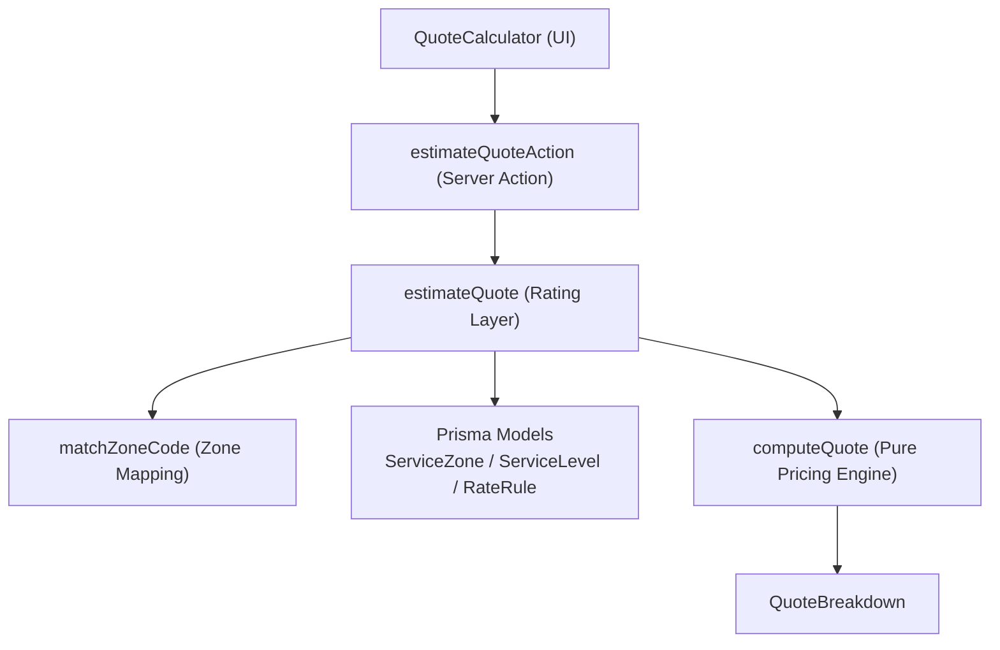
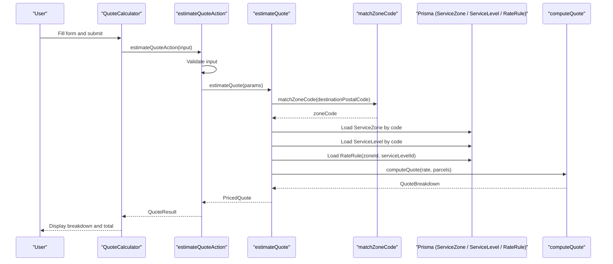
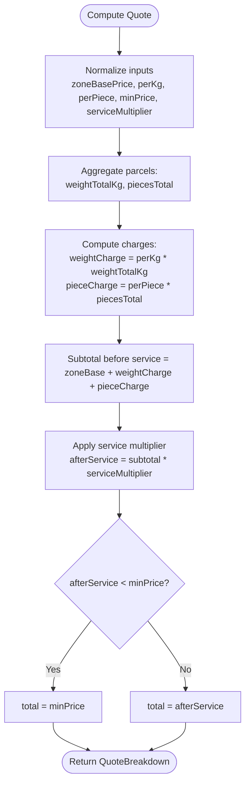
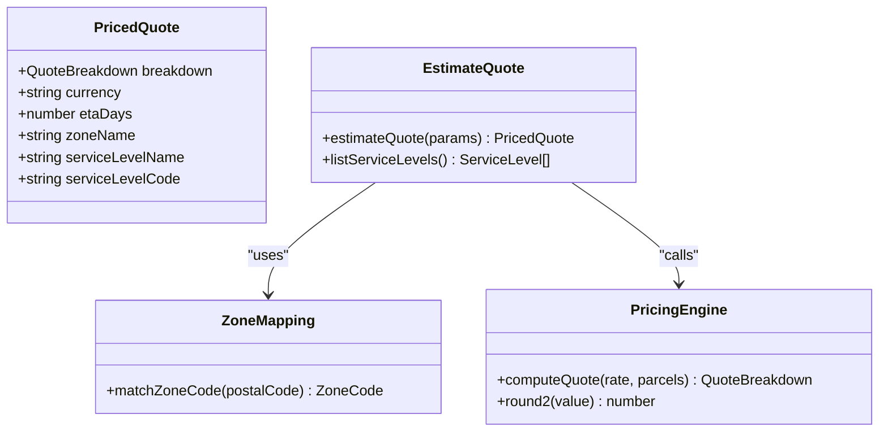
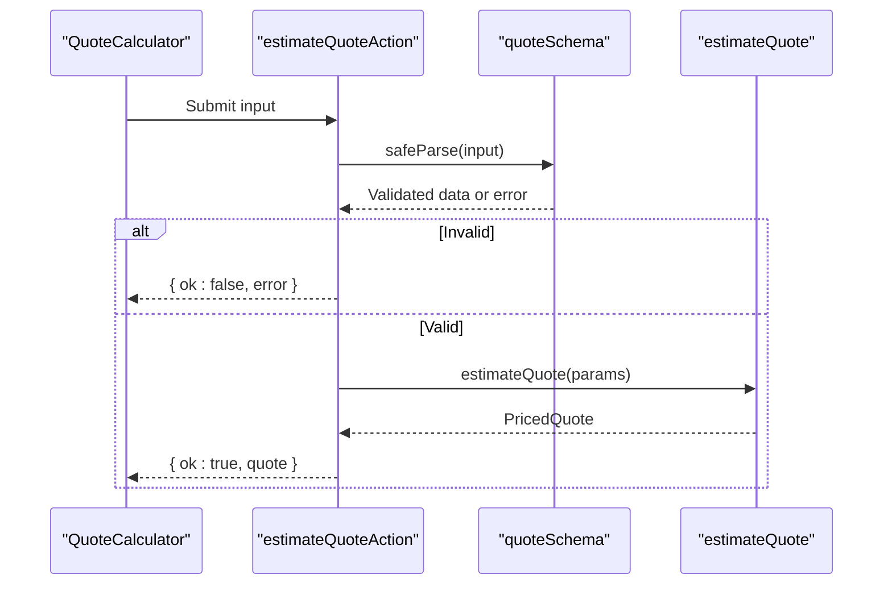
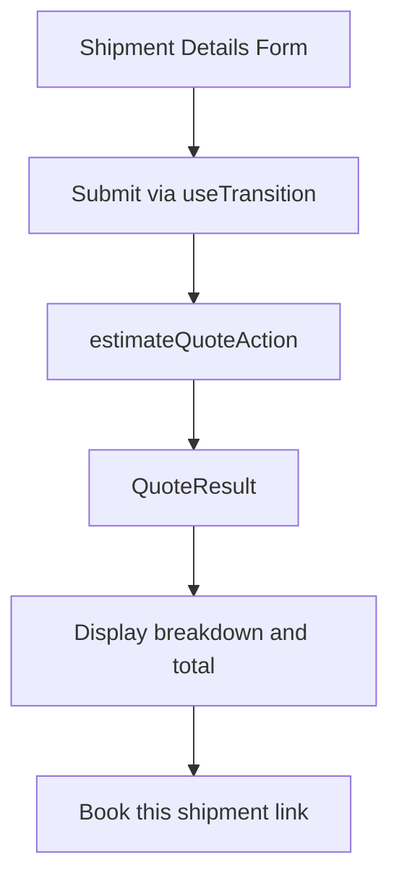
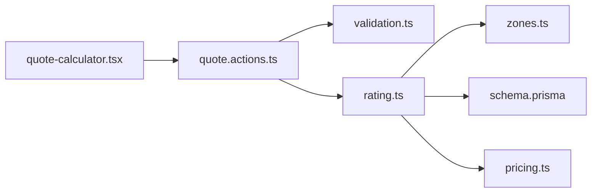

# Pricing Engine

<cite>
**Referenced Files in This Document**
- [pricing.ts](file://lib/pricing.ts)
- [zones.ts](file://lib/zones.ts)
- [rating.ts](file://lib/rating.ts)
- [quote.actions.ts](file://server/quote.actions.ts)
- [quote-calculator.tsx](file://components/quote/quote-calculator.tsx)
- [validation.ts](file://lib/validation.ts)
- [schema.prisma](file://prisma/schema.prisma)
- [pricing.test.ts](file://tests/pricing.test.ts)
</cite>

## Update Summary
**Changes Made**
- Updated to reflect the complete sophisticated pricing system implementation
- Enhanced documentation of zone-based rates and weight calculation algorithms
- Added detailed coverage of service level selection and configurable rate rules
- Improved examples and practical usage scenarios
- Updated architectural diagrams to match current implementation

## Table of Contents
1. [Introduction](#introduction)
2. [Project Structure](#project-structure)
3. [Core Components](#core-components)
4. [Architecture Overview](#architecture-overview)
5. [Detailed Component Analysis](#detailed-component-analysis)
6. [Dependency Analysis](#dependency-analysis)
7. [Performance Considerations](#performance-considerations)
8. [Troubleshooting Guide](#troubleshooting-guide)
9. [Conclusion](#conclusion)
10. [Appendices](#appendices)

## Introduction
This document explains Timberland's sophisticated dynamic pricing engine for its own-fleet delivery service. The system implements a comprehensive zone-based pricing model with configurable rate rules, weight calculations, service level multipliers, and real-time quote generation. It covers the complete flow from user input through database configuration resolution to final price computation and breakdown display.

The engine architecture separates concerns into:
- A pure pricing module that performs deterministic arithmetic without external dependencies
- A rating layer that resolves zones, service levels, and rate rules from the database
- A server action that validates inputs and returns structured quote views
- A client-side calculator component that collects shipment details and displays computed breakdowns

## Project Structure
The pricing-related code spans several layers with clear separation of concerns:

**Diagram sources**
- [quote-calculator.tsx:21-44](file://components/quote/quote-calculator.tsx#L21-L44)
- [quote.actions.ts:27-64](file://server/quote.actions.ts#L27-L64)
- [rating.ts:19-60](file://lib/rating.ts#L19-L60)
- [zones.ts:29-34](file://lib/zones.ts#L29-L34)
- [pricing.ts:53-87](file://lib/pricing.ts#L53-L87)
- [schema.prisma:84-125](file://prisma/schema.prisma#L84-L125)

**Section sources**
- [quote-calculator.tsx:21-44](file://components/quote/quote-calculator.tsx#L21-L44)
- [quote.actions.ts:27-64](file://server/quote.actions.ts#L27-L64)
- [rating.ts:19-60](file://lib/rating.ts#L19-L60)
- [zones.ts:29-34](file://lib/zones.ts#L29-L34)
- [pricing.ts:53-87](file://lib/pricing.ts#L53-L87)
- [schema.prisma:84-125](file://prisma/schema.prisma#L84-L125)

## Core Components
The pricing system consists of five core components working together:

### Pure Pricing Engine
A stateless, testable module that calculates final quotes based on:
- Zone base price (fixed charge for entering delivery zone)
- Per-kilogram charge applied to total parcel weight
- Per-piece charge applied to total parcel count
- Minimum price floor (hard lower bound)
- Service multiplier derived from selected service level

### Zone Mapping System
Converts destination postal codes to internal zone codes using a digit-prefix mapping table:
- METRO zone for prefixes 0-1
- REGION zone for prefixes 2-4  
- REMOTE zone for prefixes 5-9
- Default fallback to REGION for unknown inputs

### Rating Layer
Orchestrates configuration resolution by:
- Determining zone code from destination postal code
- Loading corresponding ServiceZone, ServiceLevel, and RateRule from database
- Converting Prisma Decimal fields to numbers
- Calling pure pricing engine for final computation

### Server Action Handler
Validates incoming quote requests and manages the workflow:
- Schema validation using Zod
- Error handling and response formatting
- Integration between UI and rating layer

### Client-Side Calculator
User interface component that:
- Collects service level, origin/destination postcodes, weight, and pieces
- Submits form via React transitions
- Displays detailed cost breakdown and estimated delivery time

**Section sources**
- [pricing.ts:9-89](file://lib/pricing.ts#L9-L89)
- [zones.ts:10-34](file://lib/zones.ts#L10-L34)
- [rating.ts:6-60](file://lib/rating.ts#L6-L60)
- [quote.actions.ts:6-64](file://server/quote.actions.ts#L6-L64)
- [quote-calculator.tsx:21-144](file://components/quote/quote-calculator.tsx#L21-L144)

## Architecture Overview
The quote generation follows a layered architecture with clear separation between presentation, business logic, and data access:

**Diagram sources**
- [quote-calculator.tsx:31-43](file://components/quote/quote-calculator.tsx#L31-L43)
- [quote.actions.ts:27-64](file://server/quote.actions.ts#L27-L64)
- [rating.ts:19-60](file://lib/rating.ts#L19-L60)
- [zones.ts:29-34](file://lib/zones.ts#L29-L34)
- [pricing.ts:53-87](file://lib/pricing.ts#L53-L87)

## Detailed Component Analysis

### Pure Pricing Engine
The pricing engine implements sophisticated arithmetic with proper rounding and validation:

**Diagram sources**
- [pricing.ts:45-87](file://lib/pricing.ts#L45-L87)

Key behaviors include:
- Half-up rounding strategy with epsilon to avoid floating-point drift
- Non-positive weights and invalid numbers treated as zero
- Pieces floored to whole units and clamped to non-negative totals
- Minimum price floor enforced after applying service multiplier
- Comprehensive input validation and sanitization

**Section sources**
- [pricing.ts:9-89](file://lib/pricing.ts#L9-L89)
- [pricing.test.ts:12-58](file://tests/pricing.test.ts#L12-L58)

### Zone Mapping System
The zone mapping converts postal codes to internal zone codes using a simple but effective prefix-based approach:

**Diagram sources**
- [zones.ts:15-34](file://lib/zones.ts#L15-L34)

The system uses digit-prefix ranges:
- METRO: postal codes starting with 0 or 1
- REGION: postal codes starting with 2, 3, or 4
- REMOTE: postal codes starting with 5, 6, 7, 8, or 9
- Default fallback ensures quotes work even without full coverage data

**Section sources**
- [zones.ts:1-35](file://lib/zones.ts#L1-L35)

### Rating Layer
The rating layer orchestrates the complete pricing workflow:

**Diagram sources**
- [rating.ts:6-69](file://lib/rating.ts#L6-L69)
- [zones.ts:29-34](file://lib/zones.ts#L29-L34)
- [pricing.ts:40-87](file://lib/pricing.ts#L40-L87)

The rating layer provides robust error handling:
- Validates zone and service level existence
- Ensures rate rules are configured for zone/service combinations
- Converts database Decimal types to JavaScript numbers
- Returns comprehensive pricing information including currency and ETA

**Section sources**
- [rating.ts:1-70](file://lib/rating.ts#L1-L70)

### Server Action and Validation
The server action provides a secure boundary between client and server:

**Diagram sources**
- [quote.actions.ts:27-64](file://server/quote.actions.ts#L27-L64)
- [validation.ts:69-75](file://lib/validation.ts#L69-L75)
- [rating.ts:19-60](file://lib/rating.ts#L19-L60)

Validation includes comprehensive checks:
- Required service level code selection
- Origin and destination postal code requirements
- Positive weight within bounds (0.01 to 2000 kg)
- Piece count validation (1 to 50 pieces)

**Section sources**
- [quote.actions.ts:1-65](file://server/quote.actions.ts#L1-L65)
- [validation.ts:69-75](file://lib/validation.ts#L69-L75)

### Client-Side Calculator
The client component provides an intuitive user experience:

**Diagram sources**
- [quote-calculator.tsx:31-43](file://components/quote/quote-calculator.tsx#L31-L43)
- [quote-calculator.tsx:102-140](file://components/quote/quote-calculator.tsx#L102-L140)

Features include:
- Real-time form validation
- Service level dropdown with SLA information
- Detailed cost breakdown display
- Currency formatting and minimum charge warnings
- Estimated delivery time display
- Direct booking integration

**Section sources**
- [quote-calculator.tsx:1-155](file://components/quote/quote-calculator.tsx#L1-L155)

## Dependency Analysis
The pricing system maintains clean separation between layers:

**Diagram sources**
- [quote-calculator.tsx:1-155](file://components/quote/quote-calculator.tsx#L1-L155)
- [quote.actions.ts:1-65](file://server/quote.actions.ts#L1-L65)
- [validation.ts:69-75](file://lib/validation.ts#L69-L75)
- [rating.ts:1-70](file://lib/rating.ts#L1-L70)
- [zones.ts:1-35](file://lib/zones.ts#L1-L35)
- [pricing.ts:1-89](file://lib/pricing.ts#L1-L89)
- [schema.prisma:84-125](file://prisma/schema.prisma#L84-L125)

Architectural benefits:
- Pure pricing engine has no external dependencies, maximizing testability
- Rating layer depends only on Prisma models and pure engine
- Server action depends on validation and rating layer
- UI depends only on server action and formatting utilities
- No circular dependencies; imports are strictly directional

**Section sources**
- [quote-calculator.tsx:1-155](file://components/quote/quote-calculator.tsx#L1-L155)
- [quote.actions.ts:1-65](file://server/quote.actions.ts#L1-L65)
- [validation.ts:69-75](file://lib/validation.ts#L69-L75)
- [rating.ts:1-70](file://lib/rating.ts#L1-L70)
- [zones.ts:1-35](file://lib/zones.ts#L1-L35)
- [pricing.ts:1-89](file://lib/pricing.ts#L1-L89)
- [schema.prisma:84-125](file://prisma/schema.prisma#L84-L125)

## Performance Considerations
The pricing system is optimized for performance:
- Pure pricing engine performs constant-time arithmetic per parcel set
- Aggregation operations are linear in the number of parcels
- Rounding is done incrementally to maintain numerical stability
- Database queries are minimal: one zone, one service level, and one rate rule lookup per quote
- For high-throughput scenarios, consider caching frequently used zone mappings or rate rules
- Avoid unnecessary recomputation by memoizing service level lists in the UI

## Troubleshooting Guide
Common issues and their resolutions:

### Missing Pricing Configuration
**Problem**: Zone or service level not found
**Solution**: Ensure ServiceZone and ServiceLevel records exist for the selected route

### No Rate Rule Configured
**Problem**: No RateRule for zone/service combination
**Solution**: Create a unique rule keyed by zoneId and serviceLevelId

### Invalid Input
**Problem**: Server action validation failures
**Solution**: Check required fields and value ranges for service level code, postal codes, weight, and pieces

### Minimum Charge Applied
**Problem**: UI indicates minimum price floor was applied
**Solution**: Adjust per-kg/per-piece rates or service multiplier if business rules require different behavior

Operational verification steps:
- Verify database records for ServiceZone, ServiceLevel, and RateRule
- Confirm zone mapping logic matches expected postal code prefixes
- Inspect validation schema constraints for accurate error messages

**Section sources**
- [rating.ts:31-40](file://lib/rating.ts#L31-L40)
- [quote.actions.ts:27-31](file://server/quote.actions.ts#L27-L31)
- [validation.ts:69-75](file://lib/validation.ts#L69-L75)
- [quote-calculator.tsx:125-127](file://components/quote/quote-calculator.tsx#L125-L127)

## Conclusion
Timberland's pricing engine combines a robust, testable pure pricing module with a configuration-driven rating layer and a clean server-client interface. The sophisticated zone-based model, service level multipliers, and configurable rate rules provide flexible control over cost calculations. The quote generation process is transparent, producing detailed breakdowns that help users understand how their total is computed. Configuration lives in the database, making it easy to extend with new zones, service levels, and rate rules while maintaining consistent computation and presentation.

## Appendices

### Pricing Strategy and Rate Rules
The pricing system uses multiple configurable components:

#### Core Pricing Elements
- **Zone Base Price**: Fixed charge associated with the delivery zone
- **Per-Kilogram Charge**: Applied to aggregated weight across all parcels
- **Per-Piece Charge**: Applied to aggregated number of pieces across all parcels
- **Minimum Price Floor**: Hard lower bound on final quote after service multiplier
- **Service Multiplier**: Multiplies subtotal to reflect faster/premium service levels

#### Database Configuration Entities
- **ServiceZone**: Defines zone code, name, base price, currency, and active status
- **ServiceLevel**: Defines service code, name, description, SLA days, price multiplier, and active status
- **RateRule**: Links zone and service level with per-kg, per-piece, and minimum price values

**Section sources**
- [schema.prisma:84-125](file://prisma/schema.prisma#L84-L125)
- [pricing.ts:9-38](file://lib/pricing.ts#L9-L38)

### Practical Examples

#### Example 1: Standard Regional Delivery
- Destination postcode maps to REGION zone
- Service level: standard with multiplier 1.0
- Parcels: one parcel weighing 3 kg and 1 piece
- Calculation:
  - Weight charge = per-kg × 3
  - Piece charge = per-piece × 1
  - Subtotal = zone base + weight charge + piece charge
  - After service = subtotal × 1.0
  - Total = max(after service, minimum price)

#### Example 2: Express Delivery with Higher Multiplier
- Destination postcode maps to REGION zone
- Service level: express with multiplier > 1.0
- Parcels: one parcel weighing 3 kg and 1 piece
- Calculation:
  - Subtotal same as above
  - After service = subtotal × express multiplier
  - Total = max(after service, minimum price)

#### Example 3: Multiple Parcels
- Destination postcode maps to REGION zone
- Service level: standard with multiplier 1.0
- Parcels: two parcels with combined weight and piece counts
- Calculation:
  - Aggregate total weight and total pieces
  - Compute charges and subtotal
  - Apply multiplier and enforce minimum price

These examples align with unit tests validating summation, minimum price enforcement, multiplier application, parcel aggregation, and rounding behavior.

**Section sources**
- [pricing.test.ts:12-58](file://tests/pricing.test.ts#L12-L58)
- [pricing.ts:53-87](file://lib/pricing.ts#L53-L87)

### Extension Points

#### Adding New Zones
- Extend zone mapping logic to include additional postal code prefixes
- Replace static map with database-backed coverage table for production
- Add corresponding ServiceZone records in the database

#### Adding New Service Levels
- Insert new ServiceLevel record with appropriate price multiplier and SLA days
- Ensure UI lists new service level via service levels listing function
- Configure rate rules for each zone/service combination

#### Adding New Rate Rules
- Create RateRule linking desired zone and service level
- Configure per-kg, per-piece, and minimum price values
- Maintain uniqueness by zoneId and serviceLevelId

#### Customizing Quote Display
- Extend QuoteView type and client component for additional breakdown fields
- Update server action to pass through new fields from rated quote
- Modify UI components to display new pricing information

**Section sources**
- [zones.ts:1-35](file://lib/zones.ts#L1-L35)
- [rating.ts:63-69](file://lib/rating.ts#L63-L69)
- [schema.prisma:84-125](file://prisma/schema.prisma#L84-L125)
- [quote.actions.ts:6-23](file://server/quote.actions.ts#L6-L23)
- [quote-calculator.tsx:102-140](file://components/quote/quote-calculator.tsx#L102-L140)