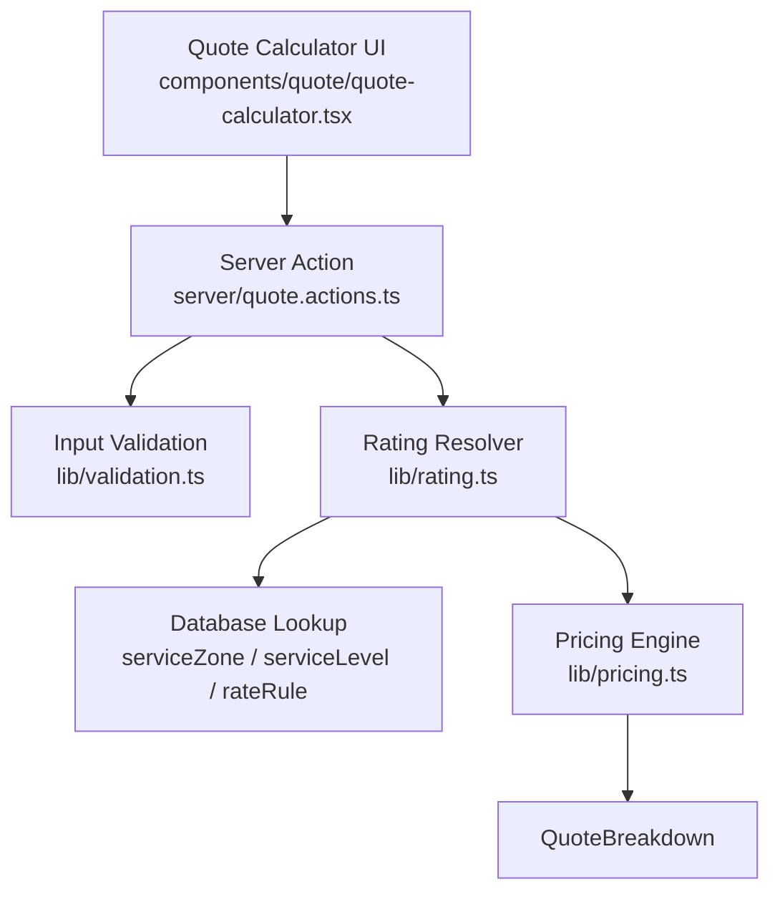
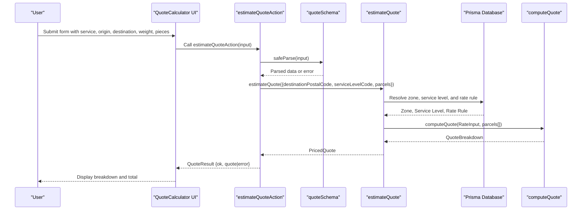
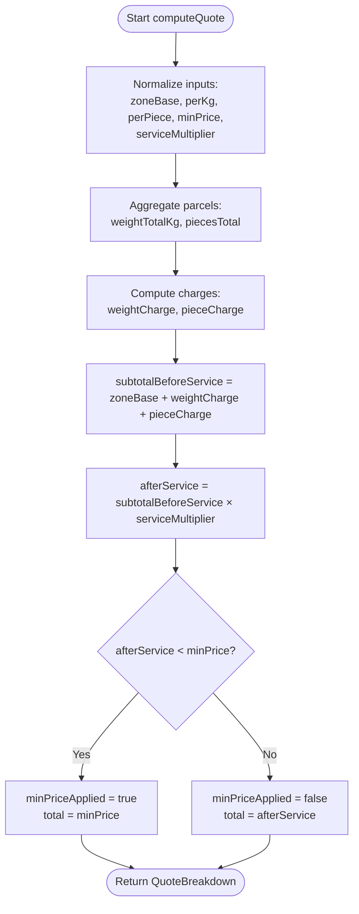
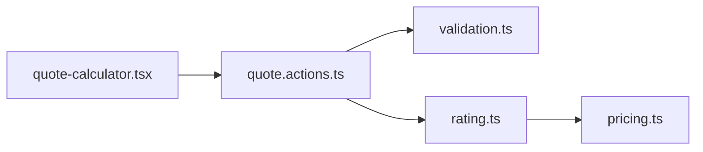

# Quote Calculation Engine

<cite>
**Referenced Files in This Document**
- [pricing.ts](file://lib/pricing.ts)
- [rating.ts](file://lib/rating.ts)
- [quote.actions.ts](file://server/quote.actions.ts)
- [validation.ts](file://lib/validation.ts)
- [quote-calculator.tsx](file://components/quote/quote-calculator.tsx)
- [page.tsx](file://app/quote/page.tsx)
- [pricing.test.ts](file://tests/pricing.test.ts)
</cite>

## Table of Contents
1. [Introduction](#introduction)
2. [Project Structure](#project-structure)
3. [Core Components](#core-components)
4. [Architecture Overview](#architecture-overview)
5. [Detailed Component Analysis](#detailed-component-analysis)
6. [Dependency Analysis](#dependency-analysis)
7. [Performance Considerations](#performance-considerations)
8. [Troubleshooting Guide](#troubleshooting-guide)
9. [Conclusion](#conclusion)

## Introduction
This document explains the core quote calculation engine used to estimate delivery prices. The engine computes a final price using a transparent, zone-based formula:

total = max(minPrice, (zoneBase + perKg × weight + perPiece × pieces) × serviceMultiplier)

The implementation is intentionally pure and testable: it does not access databases or frameworks directly. Higher layers resolve zones, service levels, and rate rules from the database, then delegate pricing to this engine.

## Project Structure
The quote feature spans UI, server actions, validation, rating resolution, and the pure pricing engine:

- UI layer: renders the quote form and displays the breakdown.
- Server action: validates input and calls the rating resolver.
- Rating resolver: maps destination postal code to a zone, selects a service level, loads the matching rate rule, and invokes the pricing engine.
- Pricing engine: performs the actual calculation and returns a detailed breakdown.

**Diagram sources**
- [quote-calculator.tsx:31-43](file://components/quote/quote-calculator.tsx#L31-L43)
- [quote.actions.ts:27-63](file://server/quote.actions.ts#L27-L63)
- [validation.ts:69-75](file://lib/validation.ts#L69-L75)
- [rating.ts:19-60](file://lib/rating.ts#L19-L60)
- [pricing.ts:53-88](file://lib/pricing.ts#L53-L88)

**Section sources**
- [quote-calculator.tsx:31-43](file://components/quote/quote-calculator.tsx#L31-L43)
- [quote.actions.ts:27-63](file://server/quote.actions.ts#L27-L63)
- [validation.ts:69-75](file://lib/validation.ts#L69-L75)
- [rating.ts:19-60](file://lib/rating.ts#L19-L60)
- [pricing.ts:53-88](file://lib/pricing.ts#L53-L88)

## Core Components
- RateInput: defines the pricing parameters for a zone and service level.
- ParcelInput: describes one parcel’s weight and piece count.
- QuoteBreakdown: exposes every intermediate value used to compute the final total.
- computeQuote: the pure function that implements the pricing formula.
- round2: helper for stable two-decimal rounding without floating-point drift.

Key responsibilities:
- Normalize inputs defensively (non-positive values become zero).
- Aggregate multiple parcels into totals.
- Compute base, weight, and piece charges.
- Apply the service multiplier.
- Enforce the minimum price floor.
- Return a full breakdown for transparency and UI display.

**Section sources**
- [pricing.ts:9-38](file://lib/pricing.ts#L9-L38)
- [pricing.ts:40-47](file://lib/pricing.ts#L40-L47)
- [pricing.ts:53-88](file://lib/pricing.ts#L53-L88)

## Architecture Overview
End-to-end flow from user input to quoted price:

**Diagram sources**
- [quote-calculator.tsx:31-43](file://components/quote/quote-calculator.tsx#L31-L43)
- [quote.actions.ts:27-63](file://server/quote.actions.ts#L27-L63)
- [validation.ts:69-75](file://lib/validation.ts#L69-L75)
- [rating.ts:19-60](file://lib/rating.ts#L19-L60)
- [pricing.ts:53-88](file://lib/pricing.ts#L53-L88)

## Detailed Component Analysis

### Pricing Formula and Algorithm
The engine computes:
- zoneBase: fixed charge for entering the delivery zone.
- weightCharge: perKg multiplied by aggregated weight across all parcels.
- pieceCharge: perPiece multiplied by aggregated piece counts across all parcels.
- subtotalBeforeService: sum of zoneBase, weightCharge, and pieceCharge.
- afterService: subtotalBeforeService multiplied by serviceMultiplier.
- minPriceApplied: whether the computed afterService falls below the configured minimum.
- total: the greater of afterService and minPrice.

Rounding behavior:
- All monetary subtotals are rounded to two decimals using a half-up strategy that avoids classic floating-point drift.
- Intermediate values are rounded at each step to ensure consistent display and arithmetic.

Input normalization:
- Non-positive or invalid numeric inputs are treated as zero for weights and pieces.
- A non-positive serviceMultiplier defaults to 1.

Edge cases handled:
- Zero or negative weights/pieces are ignored.
- NaN or non-finite values are treated as zero.
- Minimum price enforcement ensures a hard floor.

**Diagram sources**
- [pricing.ts:53-88](file://lib/pricing.ts#L53-L88)

**Section sources**
- [pricing.ts:40-47](file://lib/pricing.ts#L40-L47)
- [pricing.ts:53-88](file://lib/pricing.ts#L53-L88)

### computeQuote Function Specification
Parameters:
- rate: RateInput
  - zoneBasePrice: fixed base price for the zone.
  - perKg: price per kilogram.
  - perPiece: price per parcel piece.
  - minPrice: hard floor for the final price.
  - serviceMultiplier: multiplier applied by the selected service level.
- parcels: array of ParcelInput
  - weightKg: weight of a single parcel.
  - pieces: number of pieces in a single parcel.

Return value:
- QuoteBreakdown containing all intermediate and final values, including:
  - zoneBase, weightTotalKg, weightCharge
  - piecesTotal, pieceCharge
  - subtotalBeforeService, serviceMultiplier, afterService
  - minPriceApplied, total

Behavior highlights:
- Aggregates all parcels before computing charges.
- Rounds monetary values to two decimals at each stage.
- Applies the minimum price floor after the service multiplier.
- Returns minPriceApplied flag to indicate when the floor was enforced.

**Section sources**
- [pricing.ts:9-38](file://lib/pricing.ts#L9-L38)
- [pricing.ts:53-88](file://lib/pricing.ts#L53-L88)

### Input Validation and Data Flow
Client-side:
- The UI collects service, origin, destination, weight, and pieces from the form.

Server-side:
- The server action validates the request using a schema that enforces:
  - serviceLevelCode must be present.
  - originPostalCode and destinationPostalCode must be non-empty strings.
  - weightKg must be a positive number up to a maximum.
  - pieces must be an integer between defined bounds.

If validation fails, the server action returns an error result instead of calling the rating resolver.

**Section sources**
- [quote-calculator.tsx:31-43](file://components/quote/quote-calculator.tsx#L31-L43)
- [quote.actions.ts:27-31](file://server/quote.actions.ts#L27-L31)
- [validation.ts:69-75](file://lib/validation.ts#L69-L75)

### Rating Resolution and Integration
The rating resolver:
- Maps the destination postal code to a zone code.
- Loads the service zone, service level, and matching rate rule from the database.
- Converts database Decimal fields to numbers before invoking the pricing engine.
- Wraps the engine output with currency, ETA days, zone name, and service level metadata.

Errors:
- Missing configuration or missing rate rule throws descriptive errors.

**Section sources**
- [rating.ts:19-60](file://lib/rating.ts#L19-L60)

### UI Presentation
The quote calculator:
- Renders a form with service selection, postal codes, weight, and pieces.
- Calls the server action on submit.
- Displays the zone, base charge, weight charge, piece charge, subtotal, service multiplier, minimum charge notice, and final total.
- Shows estimated delivery time based on the selected service level.

**Section sources**
- [quote-calculator.tsx:31-43](file://components/quote/quote-calculator.tsx#L31-L43)
- [quote-calculator.tsx:102-135](file://components/quote/quote-calculator.tsx#L102-L135)
- [page.tsx:10-27](file://app/quote/page.tsx#L10-L27)

## Dependency Analysis
High-level dependencies:

Coupling and cohesion:
- The pricing engine is decoupled from I/O and can be unit tested in isolation.
- The rating resolver depends on the database but delegates all arithmetic to the pure engine.
- The server action coordinates validation and presentation while keeping business logic in the engine.

External integration points:
- Prisma database for service zones, service levels, and rate rules.
- Postal code to zone mapping utility used by the rating resolver.

Potential circular dependencies:
- None observed; imports flow from UI to server action to rating to pricing.

**Diagram sources**
- [quote-calculator.tsx:5-13](file://components/quote/quote-calculator.tsx#L5-L13)
- [quote.actions.ts:3-4](file://server/quote.actions.ts#L3-L4)
- [rating.ts:3-4](file://lib/rating.ts#L3-L4)
- [pricing.ts:1-7](file://lib/pricing.ts#L1-L7)

**Section sources**
- [quote-calculator.tsx:5-13](file://components/quote/quote-calculator.tsx#L5-L13)
- [quote.actions.ts:3-4](file://server/quote.actions.ts#L3-L4)
- [rating.ts:3-4](file://lib/rating.ts#L3-L4)
- [pricing.ts:1-7](file://lib/pricing.ts#L1-L7)

## Performance Considerations
- The pricing engine is O(n) over the number of parcels due to aggregation.
- Rounding is constant-time per operation.
- For typical UI usage with small parcel lists, performance is negligible.
- If parcel lists grow large, consider pre-aggregating or batching calculations.

[No sources needed since this section provides general guidance]

## Troubleshooting Guide
Common issues and resolutions:
- Invalid or missing input:
  - Ensure serviceLevelCode, originPostalCode, destinationPostalCode, weightKg, and pieces satisfy the schema constraints.
  - The server action returns a structured error when validation fails.
- No rate configured:
  - If the destination postal code resolves to a zone but no rate rule exists for the selected service level, the rating resolver throws an error indicating missing configuration.
- Unexpected minimum charge:
  - When afterService is below minPrice, the engine sets minPriceApplied to true and uses minPrice as the total. Verify the configured minPrice and serviceMultiplier.
- Floating-point precision:
  - Monetary values are rounded to two decimals using a half-up strategy. Use the provided rounding helper where applicable.

Relevant tests demonstrate:
- Summation of base, weight, and piece charges.
- Minimum price enforcement.
- Service multiplier application.
- Multiple parcel aggregation.
- Handling of non-positive or invalid values.
- Correct rounding behavior.

**Section sources**
- [quote.actions.ts:27-63](file://server/quote.actions.ts#L27-L63)
- [rating.ts:31-40](file://lib/rating.ts#L31-L40)
- [pricing.ts:53-88](file://lib/pricing.ts#L53-L88)
- [pricing.test.ts:12-58](file://tests/pricing.test.ts#L12-L58)

## Conclusion
The quote calculation engine provides a clear, auditable pricing model grounded in zone-based base charges, weight and piece fees, service multipliers, and a hard minimum price. Its pure design enables reliable testing and predictable results. The surrounding layers handle validation, database-driven rate resolution, and user-facing presentation, ensuring a robust end-to-end quoting experience.

[No sources needed since this section summarizes without analyzing specific files]