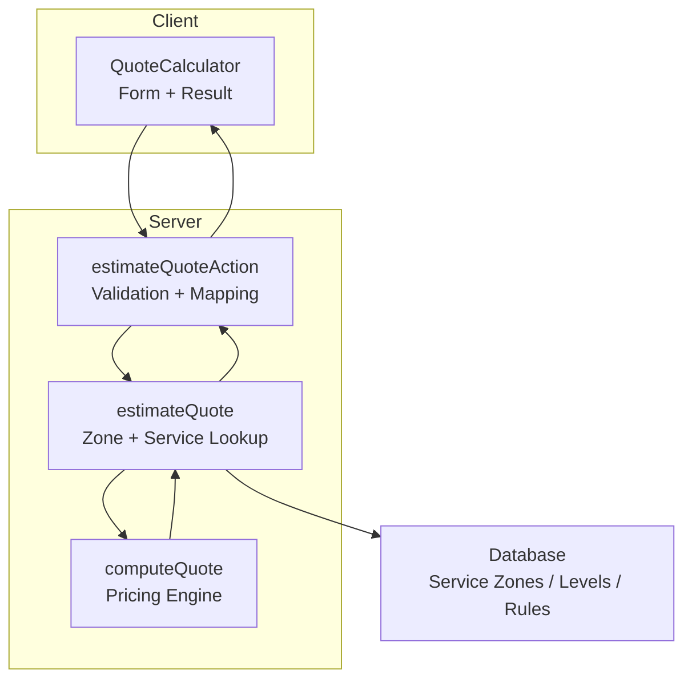
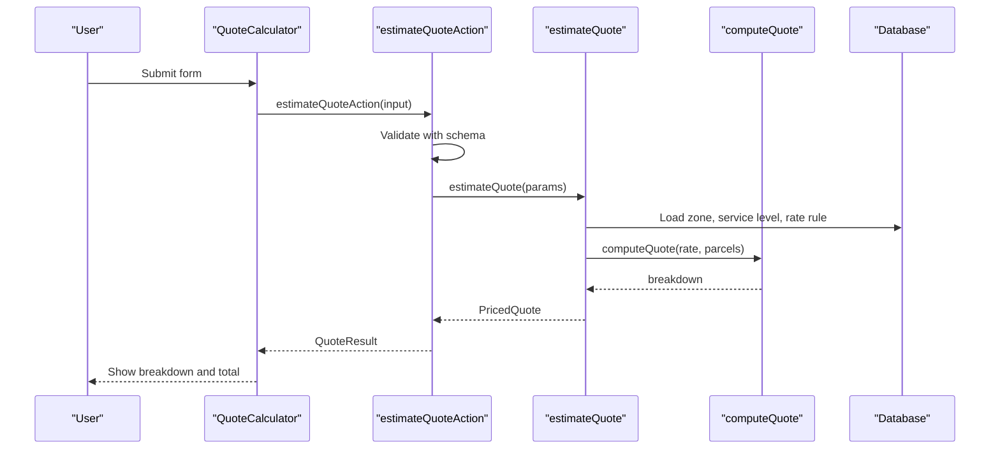
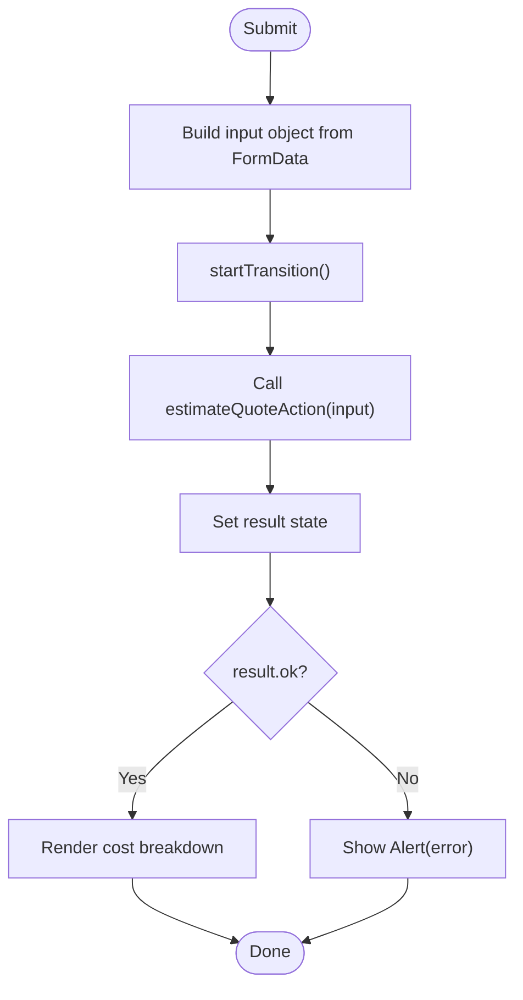
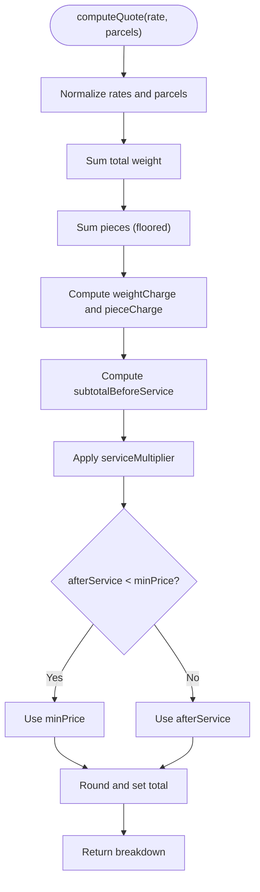
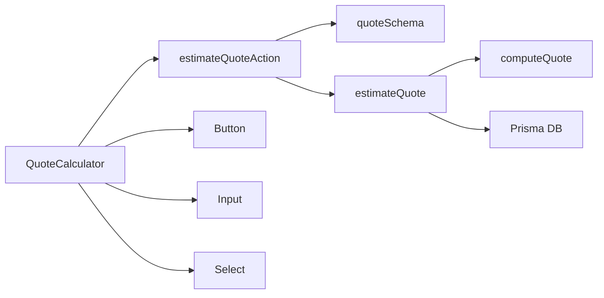

# Quote Calculator UI

<cite>
**Referenced Files in This Document**
- [quote-calculator.tsx](file://components/quote/quote-calculator.tsx)
- [page.tsx](file://app/quote/page.tsx)
- [quote.actions.ts](file://server/quote.actions.ts)
- [rating.ts](file://lib/rating.ts)
- [pricing.ts](file://lib/pricing.ts)
- [validation.ts](file://lib/validation.ts)
- [button.tsx](file://components/ui/button.tsx)
- [input.tsx](file://components/ui/input.tsx)
- [select.tsx](file://components/ui/select.tsx)
</cite>

## Table of Contents
1. [Introduction](#introduction)
2. [Project Structure](#project-structure)
3. [Core Components](#core-components)
4. [Architecture Overview](#architecture-overview)
5. [Detailed Component Analysis](#detailed-component-analysis)
6. [Dependency Analysis](#dependency-analysis)
7. [Performance Considerations](#performance-considerations)
8. [Troubleshooting Guide](#troubleshooting-guide)
9. [Conclusion](#conclusion)
10. [Appendices](#appendices)

## Introduction
This document explains the quote calculator user interface component used to estimate delivery prices. It covers the form layout, input fields for origin and destination postcodes, parcel details, service level selection, real-time quote display, cost breakdown visualization, state management, server action integration, customization options, responsive design, accessibility, and user experience best practices.

## Project Structure
The quote calculator is composed of:
- A client-side React component that renders the form and result card.
- A Next.js page that loads available service levels and passes them into the component.
- A server action that validates inputs, resolves pricing configuration, and returns a structured quote.
- A pure pricing engine that computes the cost breakdown.
- Shared UI primitives for buttons, inputs, and selects.

**Diagram sources**
- [quote-calculator.tsx:21-44](file://components/quote/quote-calculator.tsx#L21-L44)
- [quote.actions.ts:27-64](file://server/quote.actions.ts#L27-L64)
- [rating.ts:19-60](file://lib/rating.ts#L19-L60)
- [pricing.ts:49-88](file://lib/pricing.ts#L49-L88)

**Section sources**
- [quote-calculator.tsx:1-155](file://components/quote/quote-calculator.tsx#L1-L155)
- [page.tsx:1-31](file://app/quote/page.tsx#L1-L31)
- [quote.actions.ts:1-65](file://server/quote.actions.ts#L1-L65)
- [rating.ts:1-70](file://lib/rating.ts#L1-L70)
- [pricing.ts:1-89](file://lib/pricing.ts#L1-L89)

## Core Components
- QuoteCalculator (client): Renders shipment details form and estimate result. Manages pending state and result state using React hooks. Submits via a server action and displays error or success states.
- QuotePage (server): Loads active service levels and renders the QuoteCalculator with default service from URL search params.
- estimateQuoteAction (server): Validates request payload, calls rating engine, and maps results to a view model consumed by the UI.
- estimateQuote (server library): Resolves zone and service level, fetches rate rules, and delegates to computeQuote.
- computeQuote (pure module): Calculates base, weight, piece charges, applies service multiplier, enforces minimum price, and returns a detailed breakdown.

Key responsibilities:
- Form handling and validation at the UI layer.
- Server-side schema validation and error mapping.
- Pricing computation with transparent breakdown.
- Currency formatting and ETA display.

**Section sources**
- [quote-calculator.tsx:21-44](file://components/quote/quote-calculator.tsx#L21-L44)
- [page.tsx:10-27](file://app/quote/page.tsx#L10-L27)
- [quote.actions.ts:27-64](file://server/quote.actions.ts#L27-L64)
- [rating.ts:19-60](file://lib/rating.ts#L19-L60)
- [pricing.ts:49-88](file://lib/pricing.ts#L49-L88)

## Architecture Overview
The quote flow connects the client form to server actions and a pricing engine:

**Diagram sources**
- [quote-calculator.tsx:31-44](file://components/quote/quote-calculator.tsx#L31-L44)
- [quote.actions.ts:27-64](file://server/quote.actions.ts#L27-L64)
- [rating.ts:19-60](file://lib/rating.ts#L19-L60)
- [pricing.ts:49-88](file://lib/pricing.ts#L49-L88)

## Detailed Component Analysis

### QuoteCalculator Component
Responsibilities:
- Render a two-column layout: left column for shipment details, right column for estimate.
- Provide service level selection populated from props.
- Collect origin and destination postcodes, weight, and pieces.
- Trigger server action on submit and show loading state.
- Display error alerts or a detailed cost breakdown when successful.

Props:
- services: Array of service options with code, name, and slaDays.
- defaultService: Optional preselected service code.

State:
- pending: Indicates an in-flight calculation.
- result: Holds either a successful quote or an error message.

Form fields:
- Service: Select dropdown driven by services prop.
- Origin postcode: Text input with default value.
- Destination postcode: Required text input.
- Total weight (kg): Numeric input with step and min constraints.
- Pieces: Numeric input with min/max constraints.

Result visualization:
- Zone name.
- Base charge by zone.
- Weight charge based on total weight.
- Piece charge based on number of pieces.
- Subtotal before service multiplier.
- Service multiplier display.
- Minimum charge applied notice when applicable.
- Final total formatted with currency.
- Estimated delivery days.
- Call-to-action link to book the shipment.

Interaction patterns:
- Submit triggers useTransition to avoid blocking UI.
- Button disabled while pending.
- Error alert shown when result.ok is false.
- Empty state instructs users to fill the form.

Customization points:
- Replace services prop to change available options.
- Adjust defaultService to preselect a service.
- Extend form fields by adding new inputs and updating the FormData extraction and server action payload.
- Style via Tailwind classes or override component styles.

Accessibility highlights:
- Labels are associated with inputs via htmlFor/id.
- Inputs have appropriate types and constraints.
- Errors are presented in a dedicated Alert region.
- Focus-visible ring styles are provided by shared UI components.

Responsive behavior:
- Two-column grid on medium screens and above; single column below.
- Grid-based field layout for compact input pairs.

**Diagram sources**
- [quote-calculator.tsx:31-44](file://components/quote/quote-calculator.tsx#L31-L44)
- [quote-calculator.tsx:98-142](file://components/quote/quote-calculator.tsx#L98-L142)

**Section sources**
- [quote-calculator.tsx:21-155](file://components/quote/quote-calculator.tsx#L21-L155)

### Quote Page Integration
Responsibilities:
- Define page metadata.
- Fetch active service levels and merge with URL search params.
- Render QuoteCalculator with computed options and default service.

Integration notes:
- The page composes service options by mapping database objects to the shape expected by QuoteCalculator.
- Default service can be passed via query string parameter.

**Section sources**
- [page.tsx:1-31](file://app/quote/page.tsx#L1-L31)

### Server Action and Validation
Responsibilities:
- Validate incoming quote input using a Zod schema.
- Map validated input to the rating engine parameters.
- Wrap pricing call in try/catch and return a typed result union.
- Transform the priced quote into a view model consumed by the UI.

Validation schema:
- Requires service level code, origin and destination postal codes, numeric weight, and integer pieces within allowed ranges.

Error handling:
- Returns structured error messages for invalid input or missing pricing configuration.

**Section sources**
- [quote.actions.ts:1-65](file://server/quote.actions.ts#L1-L65)
- [validation.ts:69-75](file://lib/validation.ts#L69-L75)

### Pricing Engine and Rate Resolution
Responsibilities:
- Resolve destination zone and selected service level.
- Fetch corresponding rate rule.
- Compute a detailed breakdown including base, weight, piece charges, service multiplier, minimum price enforcement, and final total.

Algorithm overview:
- Normalize inputs and ensure positive values.
- Sum weights and floor pieces to integers.
- Calculate per-component charges and subtotal.
- Apply service multiplier.
- Enforce minimum price if needed.
- Return comprehensive breakdown.

**Diagram sources**
- [pricing.ts:49-88](file://lib/pricing.ts#L49-L88)

**Section sources**
- [rating.ts:19-60](file://lib/rating.ts#L19-L60)
- [pricing.ts:1-89](file://lib/pricing.ts#L1-L89)

### UI Primitives
Shared components provide consistent styling, focus states, and accessibility attributes:
- Button: Variants and sizes, focus-visible rings, disabled states.
- Input: Standardized input styling and focus rings.
- Select: Styled select element with focus rings.

These primitives are used throughout the QuoteCalculator to maintain visual consistency and accessibility.

**Section sources**
- [button.tsx:1-40](file://components/ui/button.tsx#L1-L40)
- [input.tsx:1-17](file://components/ui/input.tsx#L1-L17)
- [select.tsx:1-19](file://components/ui/select.tsx#L1-L19)

## Dependency Analysis
The following diagram shows how the components and modules depend on each other:

**Diagram sources**
- [quote-calculator.tsx:1-155](file://components/quote/quote-calculator.tsx#L1-L155)
- [quote.actions.ts:1-65](file://server/quote.actions.ts#L1-L65)
- [rating.ts:1-70](file://lib/rating.ts#L1-L70)
- [pricing.ts:1-89](file://lib/pricing.ts#L1-L89)
- [validation.ts:69-75](file://lib/validation.ts#L69-L75)

Coupling and cohesion:
- QuoteCalculator depends on server action and UI primitives; it remains focused on presentation and interaction.
- estimateQuoteAction isolates validation and mapping logic, keeping the UI free of schema concerns.
- estimateQuote encapsulates data access and orchestration between zones, service levels, and pricing.
- computeQuote is a pure function with no side effects, improving testability and reusability.

Potential circular dependencies:
- No direct cycles observed; imports flow from client to server action to libraries.

External integrations:
- Database via Prisma for service zones, service levels, and rate rules.
- Zod for runtime validation.

**Section sources**
- [quote-calculator.tsx:1-155](file://components/quote/quote-calculator.tsx#L1-L155)
- [quote.actions.ts:1-65](file://server/quote.actions.ts#L1-L65)
- [rating.ts:1-70](file://lib/rating.ts#L1-L70)
- [pricing.ts:1-89](file://lib/pricing.ts#L1-L89)
- [validation.ts:69-75](file://lib/validation.ts#L69-L75)

## Performance Considerations
- Client-side transitions: useTransition prevents UI blocking during server calls.
- Minimal re-renders: Only result state changes trigger updates.
- Pure pricing engine: computeQuote has O(n) complexity over parcels and avoids I/O.
- Avoid unnecessary network calls: The form submits only on explicit user action.
- Formatting utilities: formatCurrency is called only when rendering results.

Recommendations:
- Debounce or throttle repeated submissions if you add auto-submit behaviors.
- Cache service levels on the client if frequently accessed across routes.
- Keep parcel arrays small; the engine scales linearly with parcel count.

[No sources needed since this section provides general guidance]

## Troubleshooting Guide
Common issues and resolutions:
- Invalid input errors: Ensure all required fields are filled and conform to validation rules (service level, postal codes, weight, pieces).
- Missing pricing configuration: If the destination zone or service level lacks a rate rule, the server will return an error indicating incomplete configuration.
- Unexpected totals: Verify the selected service multiplier and minimum price settings in the database.
- UI not updating: Confirm that the server action returns a valid QuoteResult and that the component sets result state correctly.

Debugging steps:
- Inspect the result object in the component to determine whether ok is true or false.
- Check the error message returned by the server action.
- Validate the input payload against the quote schema.
- Review database entries for service zones, service levels, and rate rules.

**Section sources**
- [quote-calculator.tsx:98-142](file://components/quote/quote-calculator.tsx#L98-L142)
- [quote.actions.ts:27-64](file://server/quote.actions.ts#L27-L64)
- [validation.ts:69-75](file://lib/validation.ts#L69-L75)

## Conclusion
The QuoteCalculator provides a clear, accessible, and responsive interface for estimating delivery costs. It separates concerns between client presentation, server validation, data resolution, and pure pricing computation. The component’s props enable easy customization of service options and defaults, while its state management ensures smooth user interactions. With transparent cost breakdowns and robust error handling, it offers a strong foundation for extending functionality and maintaining high usability.

[No sources needed since this section summarizes without analyzing specific files]

## Appendices

### Customization Examples

- Customize appearance:
  - Override Tailwind classes on the container, cards, and fields.
  - Replace shared UI components with themed variants.
  - Adjust spacing and typography to match brand guidelines.

- Add custom fields:
  - Extend the form with additional inputs (for example, declared value or dimensions).
  - Update the FormData extraction to include the new fields.
  - Extend the quoteSchema to validate the new inputs.
  - Update estimateQuoteAction and the pricing engine to incorporate the new logic.

- Extend calculation logic:
  - Introduce new rate factors in computeQuote (for example, volumetric weight or surcharges).
  - Adjust service multipliers or minimum price thresholds in the database.
  - Surface new breakdown items in the UI result visualization.

### Responsive Design Notes
- Two-column layout on medium screens and above; single column below.
- Grid-based input pairs improve compactness on smaller screens.
- Buttons and alerts scale naturally with the shared UI system.

### Accessibility Notes
- All inputs are labeled and have appropriate types and constraints.
- Focus-visible styles are provided by shared components.
- Errors are announced through a dedicated Alert region.
- Interactive elements are keyboard-accessible.

### User Experience Best Practices
- Provide helpful placeholders and default values where appropriate.
- Disable the submit button during calculations to prevent duplicate requests.
- Show clear feedback for errors and success states.
- Present a concise summary of the estimated delivery time alongside the total price.
- Offer a clear next step (for example, booking) after generating a quote.

[No sources needed since this section provides general guidance]