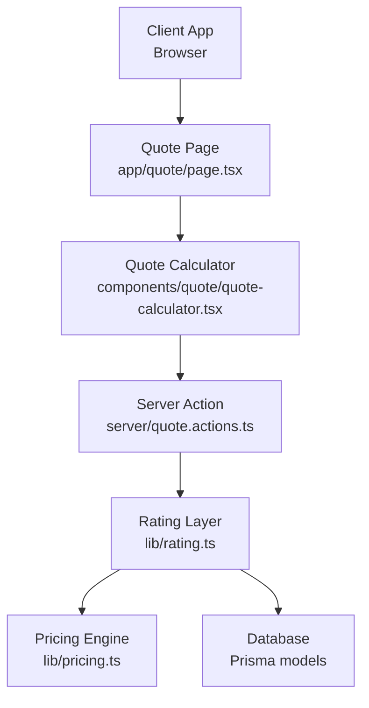
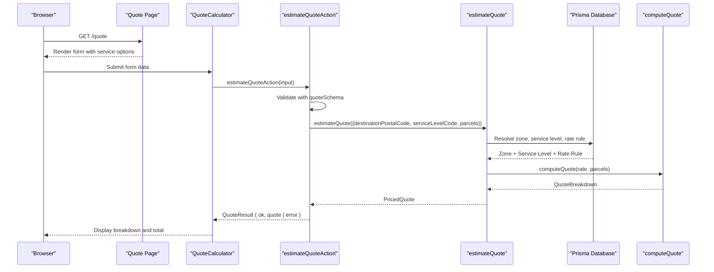
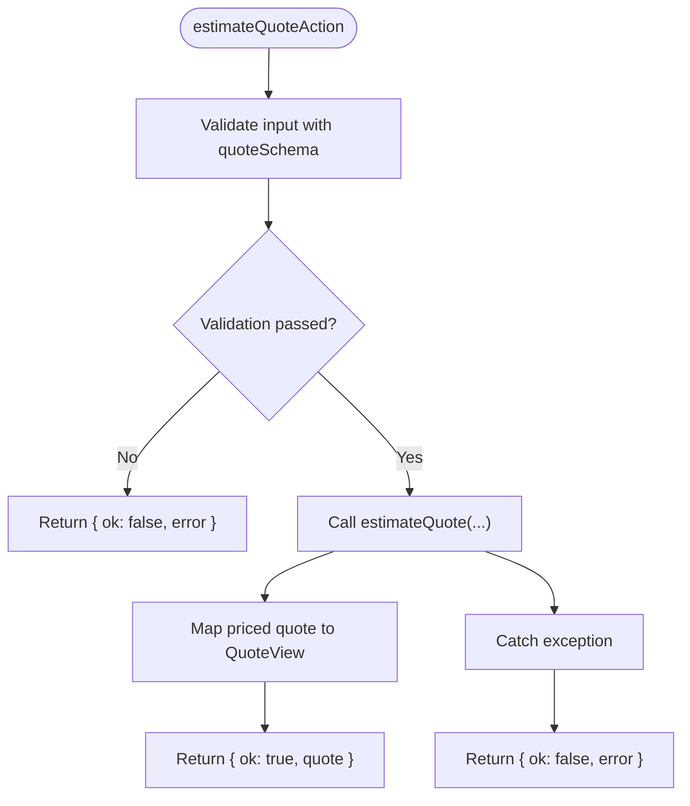
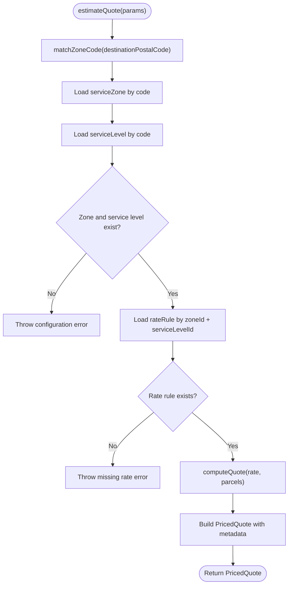
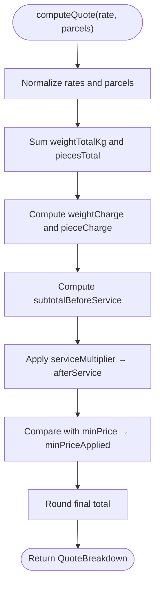
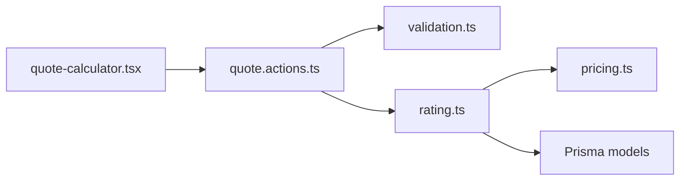

# Server Actions & API

<cite>
**Referenced Files in This Document**
- [quote.actions.ts](file://server/quote.actions.ts)
- [rating.ts](file://lib/rating.ts)
- [pricing.ts](file://lib/pricing.ts)
- [validation.ts](file://lib/validation.ts)
- [rate-limit.ts](file://lib/rate-limit.ts)
- [quote-calculator.tsx](file://components/quote/quote-calculator.tsx)
- [page.tsx](file://app/quote/page.tsx)
- [route.ts](file://app/api/auth/[...nextauth]/route.ts)
- [new-shipment-form.tsx](file://components/shipment/new-shipment-form.tsx)
</cite>

## Table of Contents
1. [Introduction](#introduction)
2. [Project Structure](#project-structure)
3. [Core Components](#core-components)
4. [Architecture Overview](#architecture-overview)
5. [Detailed Component Analysis](#detailed-component-analysis)
6. [Dependency Analysis](#dependency-analysis)
7. [Performance Considerations](#performance-considerations)
8. [Troubleshooting Guide](#troubleshooting-guide)
9. [Conclusion](#conclusion)

## Introduction
This document explains the server-side quote calculation workflow and how client requests are processed, validated, converted into pricing calculations, and returned to callers. The system is built around:

- A Next.js page that renders a quote calculator UI.
- A client component that submits form data to a server action.
- A server action that validates input, calls the rating layer, and returns a structured quote result.
- A rating layer that resolves zones, service levels, and rate rules from the database and delegates pure math to the pricing engine.
- A pure pricing engine that computes zone base charges, weight and piece charges, service multipliers, and minimum price floors.

There is no dedicated REST endpoint for quote calculation; instead, the application uses a Next.js server action invoked directly from React components. Authentication is not required for quote estimation. Rate limiting exists as a reusable utility but is not currently applied to the quote action.

## Project Structure
The quote feature spans UI, server actions, business logic, and configuration layers:

**Diagram sources**
- [page.tsx:10-30](file://app/quote/page.tsx#L10-L30)
- [quote-calculator.tsx:21-43](file://components/quote/quote-calculator.tsx#L21-L43)
- [quote.actions.ts:27-63](file://server/quote.actions.ts#L27-L63)
- [rating.ts:19-60](file://lib/rating.ts#L19-L60)
- [pricing.ts:49-87](file://lib/pricing.ts#L49-L87)

**Section sources**
- [page.tsx:1-30](file://app/quote/page.tsx#L1-L30)
- [quote-calculator.tsx:1-43](file://components/quote/quote-calculator.tsx#L1-L43)
- [quote.actions.ts:1-65](file://server/quote.actions.ts#L1-L65)
- [rating.ts:1-70](file://lib/rating.ts#L1-L70)
- [pricing.ts:1-89](file://lib/pricing.ts#L1-L89)

## Core Components
- Quote server action: Validates incoming quote inputs, converts them into a parcel list, calls the rating layer, and returns a typed success or error result.
- Rating layer: Resolves destination zone, service level, and rate rule from the database, then computes the quote using the pure pricing engine.
- Pricing engine: Pure numeric computation with rounding, positive-value guards, weight and piece aggregation, service multiplier, and minimum price floor.
- Validation schema: Enforces allowed fields, types, ranges, and defaults for quote inputs.
- Client UI: Collects user input, calls the server action, and displays the quote breakdown and total.

Key responsibilities:
- Input validation and sanitization occur at the server action boundary.
- Business logic for pricing is isolated in a testable module.
- Database access is confined to the rating layer.
- The client never touches the database or pricing rules directly.

**Section sources**
- [quote.actions.ts:6-63](file://server/quote.actions.ts#L6-L63)
- [rating.ts:6-60](file://lib/rating.ts#L6-L60)
- [pricing.ts:9-87](file://lib/pricing.ts#L9-L87)
- [validation.ts:69-75](file://lib/validation.ts#L69-L75)
- [quote-calculator.tsx:21-43](file://components/quote/quote-calculator.tsx#L21-L43)

## Architecture Overview
The quote calculation flow is a layered pipeline:

**Diagram sources**
- [page.tsx:10-30](file://app/quote/page.tsx#L10-L30)
- [quote-calculator.tsx:31-43](file://components/quote/quote-calculator.tsx#L31-L43)
- [quote.actions.ts:27-63](file://server/quote.actions.ts#L27-L63)
- [rating.ts:19-60](file://lib/rating.ts#L19-L60)
- [pricing.ts:49-87](file://lib/pricing.ts#L49-L87)

## Detailed Component Analysis

### Server Action: `estimateQuoteAction`
Responsibilities:
- Accept an untyped input object.
- Validate it against `quoteSchema`.
- Convert validated input into a single-parcel request for the rating layer.
- Return a discriminated union result indicating success or failure.

Input validation:
- Uses Zod via `quoteSchema.safeParse`.
- On validation failure, returns `{ ok: false, error }` with the first validation message or a generic message.

Pricing call:
- Calls `estimateQuote` with destination postal code, service level code, and a parcels array containing one parcel with weight and pieces.

Response mapping:
- Maps the priced quote into a simplified view including total, currency, ETA days, zone name, service level name, and breakdown details.

Error handling:
- Catches exceptions from the rating layer and returns `{ ok: false, error }` with either the error message or a fallback message.

**Diagram sources**
- [quote.actions.ts:27-63](file://server/quote.actions.ts#L27-L63)

**Section sources**
- [quote.actions.ts:1-65](file://server/quote.actions.ts#L1-L65)

### Rating Layer: `estimateQuote`
Responsibilities:
- Map destination postal code to a zone code.
- Load zone, service level, and rate rule from the database.
- Throw descriptive errors when configuration is missing.
- Compute the quote by delegating to the pure pricing engine.
- Attach display metadata such as currency, ETA days, zone name, and service level names.

Data resolution:
- Uses Prisma to query `serviceZone`, `serviceLevel`, and `rateRule`.
- Requires a matching rate rule for the selected zone and service level.

Pricing delegation:
- Converts database decimals to numbers and passes them to `computeQuote`.

**Diagram sources**
- [rating.ts:19-60](file://lib/rating.ts#L19-L60)

**Section sources**
- [rating.ts:1-70](file://lib/rating.ts#L1-L70)

### Pricing Engine: `computeQuote`
Responsibilities:
- Normalize inputs using positive-value guards.
- Aggregate total weight and total pieces across parcels.
- Calculate zone base, weight charge, and piece charge.
- Apply service multiplier.
- Enforce minimum price floor.
- Round monetary values safely.

Algorithm summary:
- Total before service = zone base + weight charge + piece charge.
- After service = total before service × service multiplier.
- Final total = max(after service, minimum price).
- All monetary values are rounded to two decimal places.

**Diagram sources**
- [pricing.ts:49-87](file://lib/pricing.ts#L49-L87)

**Section sources**
- [pricing.ts:1-89](file://lib/pricing.ts#L1-L89)

### Validation Schema: `quoteSchema`
Fields enforced:
- `serviceLevelCode`: non-empty trimmed string.
- `originPostalCode`: non-empty trimmed string with minimum length.
- `destinationPostalCode`: non-empty trimmed string with minimum length.
- `weightKg`: coerced number, positive, maximum 2000.
- `pieces`: coerced integer, minimum 1, maximum 50, default 1.

Security and sanitization:
- Trims whitespace.
- Coerces numeric strings to numbers.
- Applies range constraints to prevent extreme values.
- Provides clear human-readable error messages.

**Section sources**
- [validation.ts:69-75](file://lib/validation.ts#L69-L75)

### Client Integration: Quote Calculator
Behavior:
- Renders a form with service selection, origin and destination postal codes, weight, and pieces.
- Serializes form data into the expected shape.
- Calls `estimateQuoteAction` inside a React transition.
- Displays error alerts on failure.
- Displays detailed breakdown and formatted total on success.

Usage example (conceptual):
- A user selects a service, enters destination postal code, weight, and pieces, then clicks “Estimate price.”
- The component sends the input to the server action and updates the UI based on the result.

**Section sources**
- [quote-calculator.tsx:21-43](file://components/quote/quote-calculator.tsx#L21-L43)
- [quote-calculator.tsx:46-143](file://components/quote/quote-calculator.tsx#L46-L143)

### Server-Side Usage from Other Components
The quote action can also be called from other server-facing components, such as the new shipment form, which may pre-calculate or confirm pricing during booking flows.

**Section sources**
- [new-shipment-form.tsx:7-7](file://components/shipment/new-shipment-form.tsx#L7-L7)
- [new-shipment-form.tsx:121-121](file://components/shipment/new-shipment-form.tsx#L121-L121)

## Dependency Analysis
High-level dependencies:

Coupling and cohesion:
- The server action depends on validation and rating modules, keeping concerns separated.
- The rating module encapsulates all database interactions and exposes a clean interface to the action.
- The pricing engine is fully decoupled from framework and database concerns, improving testability.

External integration points:
- Database queries through Prisma for zones, service levels, and rate rules.
- No external pricing API is used; pricing is computed locally.

Potential circular dependencies:
- None observed among the analyzed files.

**Diagram sources**
- [quote-calculator.tsx:5-5](file://components/quote/quote-calculator.tsx#L5-L5)
- [quote.actions.ts:3-4](file://server/quote.actions.ts#L3-L4)
- [rating.ts:2-4](file://lib/rating.ts#L2-L4)
- [pricing.ts:3-3](file://lib/pricing.ts#L3-L3)

**Section sources**
- [quote.actions.ts:1-65](file://server/quote.actions.ts#L1-L65)
- [rating.ts:1-70](file://lib/rating.ts#L1-L70)
- [pricing.ts:1-89](file://lib/pricing.ts#L1-L89)

## Performance Considerations
Current characteristics:
- Each quote request performs multiple database reads to resolve zone, service level, and rate rule.
- The pricing computation itself is lightweight and deterministic.
- There is no caching layer for zone/service/rate lookups.

Recommendations:
- Cache frequently accessed configuration such as service levels and rate rules.
- Use a short-lived cache for zone-to-rate mappings keyed by destination postal code and service level code.
- Consider read replicas or connection pooling if quote volume increases.
- Avoid recomputing identical quotes by introducing a memoization layer keyed on normalized inputs.

[No sources needed since this section provides general guidance]

## Troubleshooting Guide
Common issues and patterns:

- Invalid input:
  - The server action returns `{ ok: false, error }` when validation fails.
  - Inspect the first validation issue message returned by the schema.

- Missing pricing configuration:
  - If the destination zone or service level is not found, the rating layer throws an error indicating incomplete configuration.

- Missing rate rule:
  - If no rate rule exists for the selected zone and service level, the rating layer throws an error identifying the missing combination.

- Generic pricing failure:
  - Any exception thrown by the rating layer is caught and converted into a user-friendly error response.

Operational checks:
- Verify that service zones, service levels, and rate rules are configured in the database.
- Ensure destination postal codes map to valid zone codes.
- Confirm that the selected service level has an active rate rule for the target zone.

**Section sources**
- [quote.actions.ts:27-63](file://server/quote.actions.ts#L27-L63)
- [rating.ts:31-40](file://lib/rating.ts#L31-L40)

## Security and Safety Notes
Input validation:
- All quote inputs are validated and sanitized on the server side using a strict schema.
- Numeric coercion and range limits reduce injection-like risks and malformed payloads.

Authentication:
- Quote estimation does not require authentication.
- Authentication routes are handled separately by NextAuth handlers.

Rate limiting:
- A minimal fixed-window rate limiter exists in memory.
- It is not currently applied to the quote action.
- For production protection against abuse, consider applying rate limiting per IP or per session before calling the quote action.

**Section sources**
- [validation.ts:69-75](file://lib/validation.ts#L69-L75)
- [rate-limit.ts:1-56](file://lib/rate-limit.ts#L1-L56)
- [route.ts:1-4](file://app/api/auth/[...nextauth]/route.ts#L1-L4)

## Request and Response Schemas

### Request Schema
The server action accepts an object validated by `quoteSchema`:

- `serviceLevelCode`: string, required, trimmed, non-empty.
- `originPostalCode`: string, required, trimmed, minimum length.
- `destinationPostalCode`: string, required, trimmed, minimum length.
- `weightKg`: number, positive, maximum 2000.
- `pieces`: integer, minimum 1, maximum 50, default 1.

Notes:
- Origin postal code is accepted by the schema but is not forwarded to the rating layer in the current implementation.
- Weight and pieces are wrapped into a single parcel for pricing.

**Section sources**
- [validation.ts:69-75](file://lib/validation.ts#L69-L75)
- [quote.actions.ts:32-39](file://server/quote.actions.ts#L32-L39)

### Response Schema
The server action returns a discriminated union:

Success:
- `ok`: true
- `quote`:
  - `total`: number
  - `currency`: string
  - `etaDays`: number
  - `zoneName`: string
  - `serviceLevelName`: string
  - `breakdown`:
    - `zoneBase`: number
    - `weightTotalKg`: number
    - `weightCharge`: number
    - `piecesTotal`: number
    - `pieceCharge`: number
    - `subtotalBeforeService`: number
    - `serviceMultiplier`: number
    - `afterService`: number
    - `minPriceApplied`: boolean

Failure:
- `ok`: false
- `error`: string describing validation or pricing failure.

**Section sources**
- [quote.actions.ts:6-25](file://server/quote.actions.ts#L6-L25)
- [quote.actions.ts:40-63](file://server/quote.actions.ts#L40-L63)

## Examples

### Calling from a Client Application
Conceptual steps:
1. Gather form values: service level code, origin postal code, destination postal code, weight, and pieces.
2. Call `estimateQuoteAction` with those values.
3. Handle the result:
   - On success, display the total, currency, ETA, zone, service level, and breakdown.
   - On failure, show the error message.

Example usage pattern:
- Import the server action.
- Serialize form data into the expected shape.
- Await the result and update state accordingly.

**Section sources**
- [quote-calculator.tsx:31-43](file://components/quote/quote-calculator.tsx#L31-L43)
- [quote-calculator.tsx:98-143](file://components/quote/quote-calculator.tsx#L98-L143)

### Calling from Server Components
Conceptual steps:
- Import `estimateQuoteAction`.
- Prepare validated input.
- Call the action and handle the resulting quote or error.

This pattern is used by other forms that need pricing context during booking workflows.

**Section sources**
- [new-shipment-form.tsx:7-7](file://components/shipment/new-shipment-form.tsx#L7-L7)
- [new-shipment-form.tsx:121-121](file://components/shipment/new-shipment-form.tsx#L121-L121)

## Conclusion
The quote calculation system separates concerns cleanly:

- The client collects user intent.
- The server action enforces a strict contract and maps results.
- The rating layer handles configuration resolution and database access.
- The pricing engine performs deterministic, testable math.

For production readiness, consider adding caching for pricing configuration, applying rate limiting to the quote action, and expanding input validation to include explicit postal code format checks where appropriate. These changes will improve performance, security, and resilience under load while preserving the clarity and correctness of the pricing workflow.