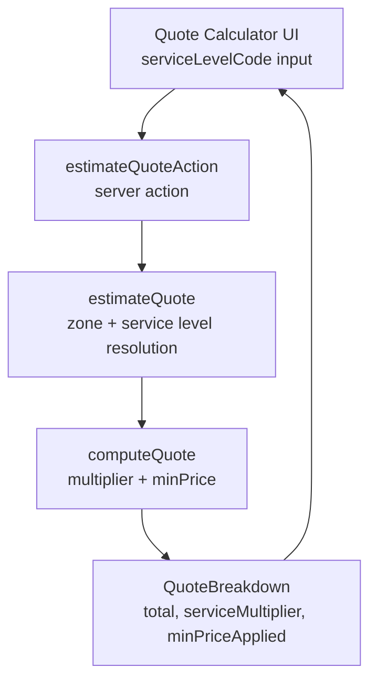
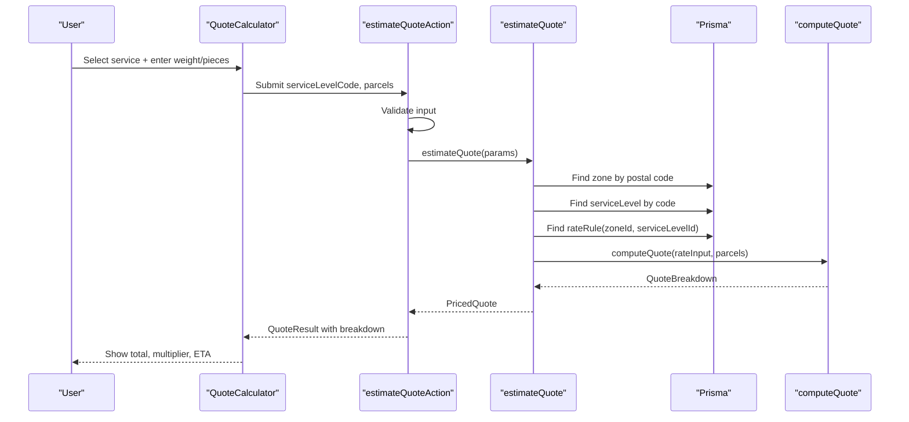
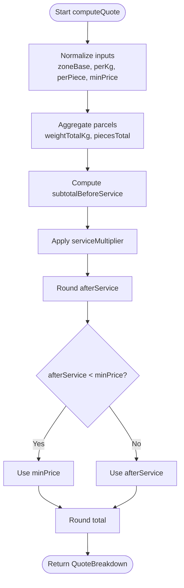
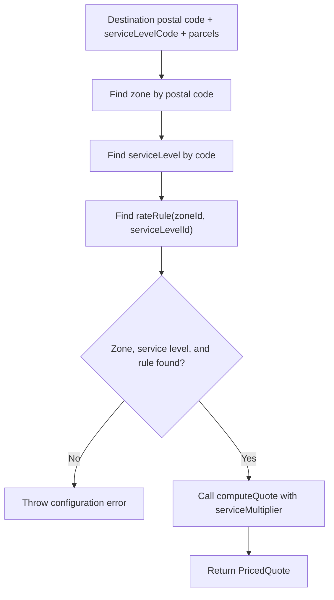
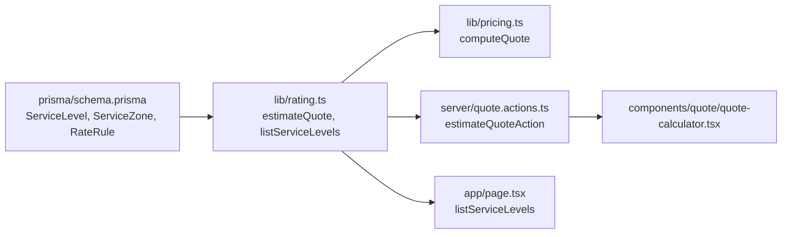

# Service Levels

<cite>
**Referenced Files in This Document**
- [pricing.ts](file://lib/pricing.ts)
- [rating.ts](file://lib/rating.ts)
- [schema.prisma](file://prisma/schema.prisma)
- [quote.actions.ts](file://server/quote.actions.ts)
- [quote-calculator.tsx](file://components/quote/quote-calculator.tsx)
- [page.tsx](file://app/page.tsx)
- [pricing.test.ts](file://tests/pricing.test.ts)
</cite>

## Table of Contents
1. [Introduction](#introduction)
2. [Project Structure](#project-structure)
3. [Core Components](#core-components)
4. [Architecture Overview](#architecture-overview)
5. [Detailed Component Analysis](#detailed-component-analysis)
6. [Dependency Analysis](#dependency-analysis)
7. [Performance Considerations](#performance-considerations)
8. [Troubleshooting Guide](#troubleshooting-guide)
9. [Conclusion](#conclusion)

## Introduction
This document explains how service levels are modeled and applied in the pricing engine. A service level represents a delivery promise such as standard or express, with an associated estimated delivery time and a price multiplier. The multiplier scales the base zone rate before the minimum price floor is applied.

Service levels are configured in the database and exposed to the user interface through active service level records. When a customer selects a service, the system resolves the destination zone, finds the matching rate rule for that zone and service level, applies the service multiplier, and returns a detailed quote breakdown.

## Project Structure
The service level feature spans several layers:

- Database schema defines service levels, zones, and rate rules.
- Server-side rating logic resolves zones and service levels and computes quotes.
- Pure pricing module performs the actual calculation using the service multiplier.
- UI components expose service levels and display the resulting quote breakdown.



**Diagram sources**
- [quote-calculator.tsx:31-44](file://components/quote/quote-calculator.tsx#L31-L44)
- [quote.actions.ts:27-64](file://server/quote.actions.ts#L27-L64)
- [rating.ts:19-60](file://lib/rating.ts#L19-L60)
- [pricing.ts:49-88](file://lib/pricing.ts#L49-L88)

**Section sources**
- [schema.prisma:84-125](file://prisma/schema.prisma#L84-L125)
- [rating.ts:1-70](file://lib/rating.ts#L1-L70)
- [pricing.ts:1-89](file://lib/pricing.ts#L1-L89)
- [quote.actions.ts:1-65](file://server/quote.actions.ts#L1-L65)
- [quote-calculator.tsx:1-155](file://components/quote/quote-calculator.tsx#L1-L155)

## Core Components
The service level pricing flow is built around three core pieces:

- Service level model: stores code, name, description, estimated delivery days, price multiplier, and active status.
- Rate rule model: binds a zone and a service level to per-kilogram, per-piece, and minimum price values.
- Pricing engine: calculates the final quote by applying the service multiplier and enforcing the minimum price.

Key responsibilities:

- `ServiceLevel` provides the service identity and its price multiplier.
- `RateRule` provides zone-specific pricing parameters for each service level.
- `estimateQuote` resolves the correct zone and service level, then delegates to the pure pricing function.
- `computeQuote` implements the pricing formula and returns a detailed breakdown.

**Section sources**
- [schema.prisma:84-125](file://prisma/schema.prisma#L84-L125)
- [rating.ts:19-60](file://lib/rating.ts#L19-L60)
- [pricing.ts:9-38](file://lib/pricing.ts#L9-L38)

## Architecture Overview
The end-to-end request path for a quoted shipment is:

1. The user selects a service level and enters parcel details in the quote calculator.
2. The form submits a server action with the selected service level code.
3. The server validates the input and calls the rating resolver.
4. The rating resolver looks up the destination zone and the service level.
5. It finds the rate rule for that zone and service level.
6. It passes the zone base price, per-kg, per-piece, minimum price, and service multiplier into the pricing engine.
7. The pricing engine computes the subtotal, applies the multiplier, enforces the minimum price, and returns the total.
8. The server action wraps the result and sends it back to the UI.



**Diagram sources**
- [quote-calculator.tsx:31-44](file://components/quote/quote-calculator.tsx#L31-L44)
- [quote.actions.ts:27-64](file://server/quote.actions.ts#L27-L64)
- [rating.ts:19-60](file://lib/rating.ts#L19-L60)
- [pricing.ts:49-88](file://lib/pricing.ts#L49-L88)

## Detailed Component Analysis

### Service Level Data Model
A service level captures:

- `code`: unique identifier used when requesting quotes.
- `name` and `description`: human-readable label and explanation.
- `slaDays`: estimated delivery time; zero means same-day.
- `priceMultiplier`: multiplier applied to the zone subtotal.
- `active`: whether the service level is available to customers.

The service level is linked to rate rules and shipments. Only active service levels are listed in the UI.

```mermaid
classDiagram
class ServiceLevel {
+string id
+string code
+string name
+string description
+int slaDays
+decimal priceMultiplier
+boolean active
}
class ServiceZone {
+string id
+string code
+string name
+decimal basePrice
+string currency
+boolean active
}
class RateRule {
+string id
+string zoneId
+string serviceLevelId
+decimal perKg
+decimal perPiece
+decimal minPrice
}
ServiceZone ||--o{ RateRule : "has many"
ServiceLevel ||--o{ RateRule : "has many"
```

**Diagram sources**
- [schema.prisma:84-125](file://prisma/schema.prisma#L84-L125)

**Section sources**
- [schema.prisma:98-125](file://prisma/schema.prisma#L98-L125)

### Pricing Formula and Service Multiplier
The pricing engine computes the quote as follows:

- Sum the zone base price, weight charge, and piece charge.
- Multiply the subtotal by the service multiplier.
- Apply the minimum price floor if needed.
- Return a detailed breakdown including the multiplier and whether the minimum was applied.

The service multiplier comes from the selected service level’s `priceMultiplier`. If no valid multiplier is provided, the engine defaults to one, so invalid data does not break pricing.



**Diagram sources**
- [pricing.ts:49-88](file://lib/pricing.ts#L49-L88)

**Section sources**
- [pricing.ts:9-38](file://lib/pricing.ts#L9-L38)
- [pricing.ts:49-88](file://lib/pricing.ts#L49-L88)

### Service Level Resolution and Validation
When estimating a quote:

- The destination postal code determines the service zone.
- The selected service level code identifies the service level.
- A rate rule must exist for the combination of zone and service level.
- If any required configuration is missing, the operation fails with a clear error.

This validation ensures that only supported combinations can be priced.



**Diagram sources**
- [rating.ts:19-60](file://lib/rating.ts#L19-L60)

**Section sources**
- [rating.ts:19-60](file://lib/rating.ts#L19-L60)

### UI Exposure of Service Levels
The homepage lists active service levels and shows their estimated delivery time. The quote calculator renders a dropdown of services and displays the selected service multiplier in the quote breakdown.

Available service levels are those marked active in the database. Their names, descriptions, and SLA days are shown to users. The service multiplier itself is not directly editable in the UI; it is controlled by the database configuration.

**Section sources**
- [page.tsx:15-16](file://app/page.tsx#L15-L16)
- [page.tsx:77-104](file://app/page.tsx#L77-L104)
- [quote-calculator.tsx:15-64](file://components/quote/quote-calculator.tsx#L15-L64)
- [quote-calculator.tsx:102-135](file://components/quote/quote-calculator.tsx#L102-L135)
- [rating.ts:63-69](file://lib/rating.ts#L63-L69)

## Dependency Analysis
The following diagram shows how service level data flows through the application layers.



**Diagram sources**
- [schema.prisma:84-125](file://prisma/schema.prisma#L84-L125)
- [rating.ts:1-70](file://lib/rating.ts#L1-L70)
- [pricing.ts:1-89](file://lib/pricing.ts#L1-L89)
- [quote.actions.ts:1-65](file://server/quote.actions.ts#L1-L65)
- [quote-calculator.tsx:1-155](file://components/quote/quote-calculator.tsx#L1-L155)
- [page.tsx:15-16](file://app/page.tsx#L15-L16)

**Section sources**
- [schema.prisma:84-125](file://prisma/schema.prisma#L84-L125)
- [rating.ts:1-70](file://lib/rating.ts#L1-L70)
- [pricing.ts:1-89](file://lib/pricing.ts#L1-L89)
- [quote.actions.ts:1-65](file://server/quote.actions.ts#L1-L65)
- [quote-calculator.tsx:1-155](file://components/quote/quote-calculator.tsx#L1-L155)
- [page.tsx:15-16](file://app/page.tsx#L15-L16)

## Performance Considerations
- The pricing calculation is a small, deterministic computation over parcel arrays. Its complexity is linear in the number of parcels because weights and pieces are summed once.
- Rounding is performed at key steps to avoid floating-point drift.
- The most expensive part is database access: resolving the zone, service level, and rate rule. Caching could be considered if the same routes are quoted frequently.
- The service multiplier is a simple multiplication and has negligible computational cost.

[No sources needed since this section provides general guidance]

## Troubleshooting Guide

Common issues related to service levels and pricing:

- No rate configured for the selected route:
  - Cause: A rate rule does not exist for the combination of destination zone and selected service level.
  - Resolution: Create a `RateRule` for the relevant `ServiceZone` and `ServiceLevel`.
  - Evidence: The rating resolver throws an error when the rule is missing.

- Incomplete pricing configuration:
  - Cause: The destination zone or service level cannot be resolved.
  - Resolution: Ensure the postal code maps to a valid zone and the service level code exists and is active.
  - Evidence: The rating resolver throws an error when either lookup fails.

- Unexpected minimum charge:
  - Cause: The calculated amount after applying the service multiplier is below the minimum price for that zone and service level.
  - Resolution: Adjust the rate rule’s minimum price, per-kg/per-piece rates, or the service level’s multiplier.
  - Evidence: The quote breakdown includes `minPriceApplied` and the final total equals the minimum price.

- Service multiplier not affecting price:
  - Cause: The service level’s `priceMultiplier` may be one or invalid.
  - Resolution: Update the service level’s multiplier in the database. Invalid multipliers default to one.
  - Evidence: The pricing engine uses the multiplier from the service level and defaults to one if invalid.

- Service level not visible in the UI:
  - Cause: The service level is not active.
  - Resolution: Mark the service level as active.
  - Evidence: The listing function filters by active status.

**Section sources**
- [rating.ts:27-40](file://lib/rating.ts#L27-L40)
- [pricing.ts:61-74](file://lib/pricing.ts#L61-L74)
- [rating.ts:63-69](file://lib/rating.ts#L63-L69)

## Conclusion
Service levels provide a clean way to differentiate delivery speed and pricing. Each service level carries a price multiplier that scales the zone subtotal before the minimum price floor is enforced. Configuration lives in the database through `ServiceLevel`, `ServiceZone`, and `RateRule`, while the pricing engine remains a pure, testable module. To add a new service level, create the service level record with an appropriate multiplier, define rate rules for the zones you support, and ensure the record is active so it appears in the UI.

[No sources needed since this section summarizes without analyzing specific files]