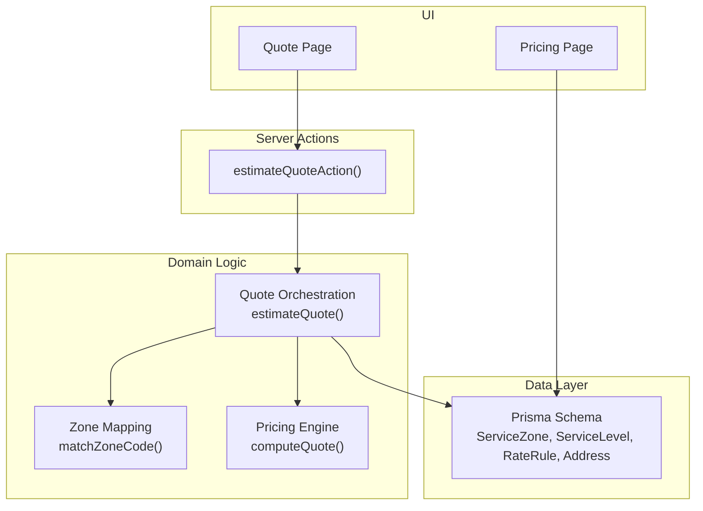
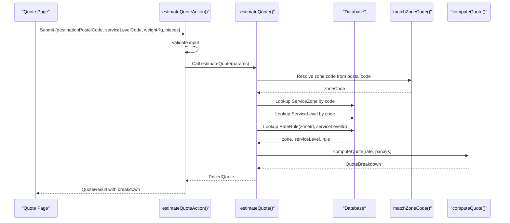
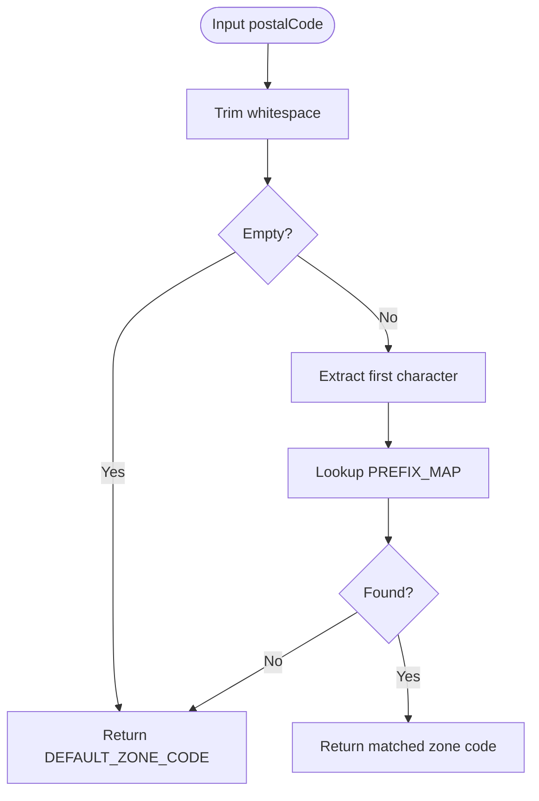
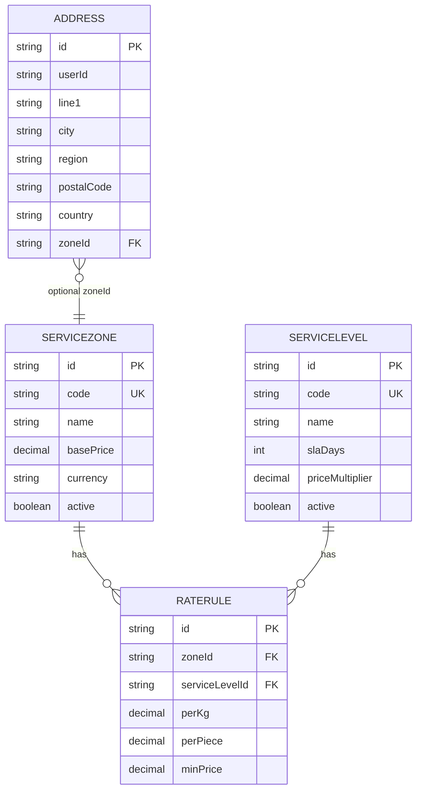
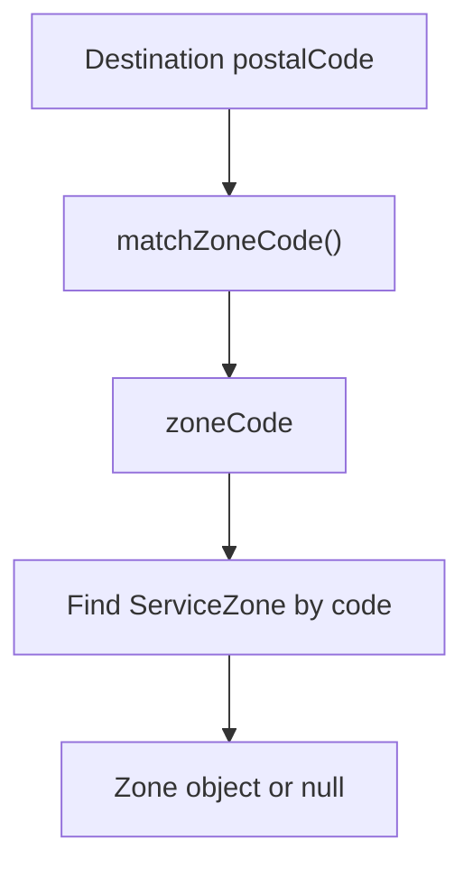
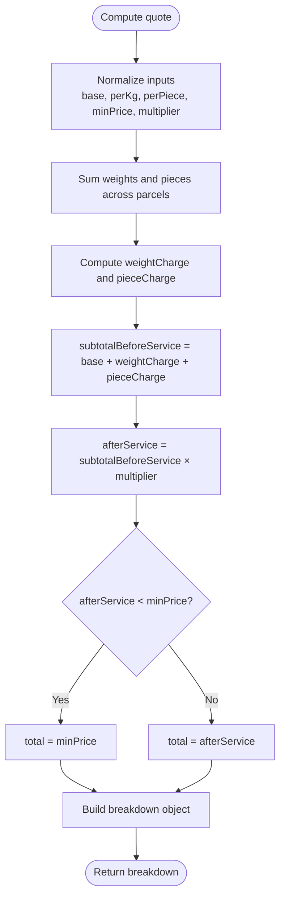
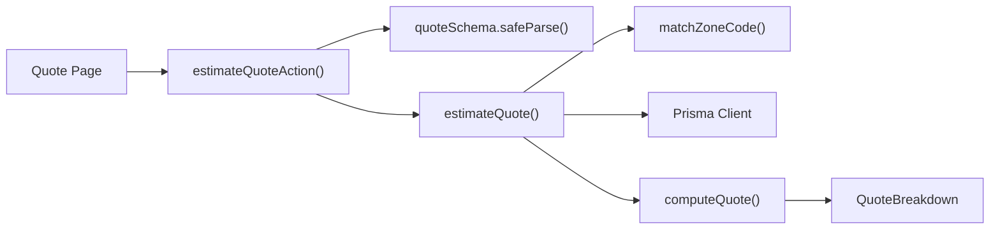

# Zone Management

<cite>
**Referenced Files in This Document**
- [zones.ts](file://lib/zones.ts)
- [pricing.ts](file://lib/pricing.ts)
- [rating.ts](file://lib/rating.ts)
- [quote.actions.ts](file://server/quote.actions.ts)
- [schema.prisma](file://prisma/schema.prisma)
- [page.tsx (Pricing page)](file://app/pricing/page.tsx)
- [page.tsx (Quote page)](file://app/quote/page.tsx)
</cite>

## Table of Contents
1. [Introduction](#introduction)
2. [Project Structure](#project-structure)
3. [Core Components](#core-components)
4. [Architecture Overview](#architecture-overview)
5. [Detailed Component Analysis](#detailed-component-analysis)
6. [Dependency Analysis](#dependency-analysis)
7. [Performance Considerations](#performance-considerations)
8. [Troubleshooting Guide](#troubleshooting-guide)
9. [Conclusion](#conclusion)

## Introduction
This document explains the zone management system used by Timberland’s pricing engine. It covers how delivery zones are defined and configured, how addresses and destinations are mapped to zones, and how zone-based pricing is calculated using base prices, per-kilogram rates, per-piece charges, service-level multipliers, and minimum price floors. It also documents validation, error handling, and extension points for adding or modifying zones.

## Project Structure
The zone-related logic spans a small set of focused modules:
- Data model: Prisma schema defines zones, service levels, rate rules, and addresses.
- Zone mapping: A lightweight module maps postal codes to zone codes.
- Pricing engine: A pure function computes quotes from zone/service parameters and parcel inputs.
- Quote orchestration: Server-side functions resolve zones and service levels, then compute quotes.
- UI surfaces: Pages display active zones and service levels and provide quote entry.

**Diagram sources**
- [schema.prisma:84-125](file://prisma/schema.prisma#L84-L125)
- [zones.ts:29-34](file://lib/zones.ts#L29-L34)
- [pricing.ts:53-88](file://lib/pricing.ts#L53-L88)
- [rating.ts:19-60](file://lib/rating.ts#L19-L60)
- [quote.actions.ts:27-64](file://server/quote.actions.ts#L27-L64)
- [page.tsx (Pricing page):14-18](file://app/pricing/page.tsx#L14-L18)
- [page.tsx (Quote page):10-27](file://app/quote/page.tsx#L10-L27)

**Section sources**
- [schema.prisma:84-125](file://prisma/schema.prisma#L84-L125)
- [zones.ts:1-34](file://lib/zones.ts#L1-L34)
- [pricing.ts:1-88](file://lib/pricing.ts#L1-L88)
- [rating.ts:1-70](file://lib/rating.ts#L1-L70)
- [quote.actions.ts:1-65](file://server/quote.actions.ts#L1-L65)
- [page.tsx (Pricing page):1-70](file://app/pricing/page.tsx#L1-L70)
- [page.tsx (Quote page):1-30](file://app/quote/page.tsx#L1-L30)

## Core Components
- Zone mapping: Converts a destination postal code into a zone code using a simple prefix table. The default zone is used when input is empty or unmapped.
- Pricing engine: Computes a quote given a rate configuration and parcel list. It applies base price, weight charge, piece charge, service multiplier, and minimum price floor.
- Quote orchestration: Resolves the zone and service level from the database, finds the matching rate rule, and delegates calculation to the pricing engine.
- Server action: Validates user input, calls the orchestration layer, and returns a structured result with breakdown details.
- Database models: Define zones, service levels, rate rules, and address-to-zone relationships.

Key responsibilities:
- Zone definition and coverage: ServiceZone and Address.zoneId define where deliveries occur; matchZoneCode provides v1 coverage.
- Rate configuration: RateRule ties a ServiceZone and ServiceLevel to perKg, perPiece, and minPrice.
- Pricing calculation: computeQuote implements the pricing formula and rounding.
- Error handling: Missing zones, missing rate rules, and invalid inputs produce clear errors.

**Section sources**
- [zones.ts:10-34](file://lib/zones.ts#L10-L34)
- [pricing.ts:9-88](file://lib/pricing.ts#L9-L88)
- [rating.ts:19-60](file://lib/rating.ts#L19-L60)
- [quote.actions.ts:27-64](file://server/quote.actions.ts#L27-L64)
- [schema.prisma:84-125](file://prisma/schema.prisma#L84-L125)

## Architecture Overview
The zone-based pricing flow connects user input to database-backed configuration and a pure pricing calculator.

**Diagram sources**
- [quote.actions.ts:27-64](file://server/quote.actions.ts#L27-L64)
- [rating.ts:19-60](file://lib/rating.ts#L19-L60)
- [zones.ts:29-34](file://lib/zones.ts#L29-L34)
- [pricing.ts:53-88](file://lib/pricing.ts#L53-L88)
- [schema.prisma:84-125](file://prisma/schema.prisma#L84-L125)

## Detailed Component Analysis

### Zone Definition and Coverage
- Zone codes: METRO, REGION, REMOTE.
- Default zone: REGION when postal code is empty or unmapped.
- Coverage model: A digit-prefix map assigns zone codes based on the first character of the postal code. This is a v1 demo approach intended to be replaced by a database-backed coverage lookup later.

**Diagram sources**
- [zones.ts:10-34](file://lib/zones.ts#L10-L34)

**Section sources**
- [zones.ts:10-34](file://lib/zones.ts#L10-L34)

### Database Models for Zones and Rates
- ServiceZone: Represents a delivery zone with a unique code, name, base price, currency, and active flag.
- ServiceLevel: Represents a service tier (e.g., standard, express) with a multiplier and SLA days.
- RateRule: Links a ServiceZone and ServiceLevel to perKg, perPiece, and minPrice. Unique constraint ensures one rule per zone-service pair.
- Address: Stores delivery locations and can hold an optional zoneId link.

**Diagram sources**
- [schema.prisma:84-125](file://prisma/schema.prisma#L84-L125)
- [schema.prisma:131-154](file://prisma/schema.prisma#L131-L154)

**Section sources**
- [schema.prisma:84-125](file://prisma/schema.prisma#L84-L125)
- [schema.prisma:131-154](file://prisma/schema.prisma#L131-L154)

### Zone Assignment Logic for Addresses and Destinations
- Destination assignment: When estimating a quote, the destination postal code is passed to matchZoneCode to derive a zone code.
- Address storage: Addresses may store a zoneId for persistence, but the current quote path resolves the zone dynamically from the postal code at quote time.

**Diagram sources**
- [rating.ts:24-26](file://lib/rating.ts#L24-L26)
- [zones.ts:29-34](file://lib/zones.ts#L29-L34)

**Section sources**
- [rating.ts:24-26](file://lib/rating.ts#L24-L26)
- [zones.ts:29-34](file://lib/zones.ts#L29-L34)
- [schema.prisma:131-154](file://prisma/schema.prisma#L131-L154)

### Zone-Based Pricing Structure and Calculation
- Inputs:
  - Base price: zoneBasePrice from ServiceZone.basePrice.
  - Per-kg rate: perKg from RateRule.
  - Per-piece charge: perPiece from RateRule.
  - Minimum price: minPrice from RateRule.
  - Service multiplier: priceMultiplier from ServiceLevel.
- Formula: total = max(minPrice, (zoneBase + perKg × totalWeight + perPiece × totalPieces) × serviceMultiplier).
- Output: A detailed breakdown including subtotal before service, after-service amount, whether the minimum price applied, and final total.

**Diagram sources**
- [pricing.ts:53-88](file://lib/pricing.ts#L53-L88)

**Section sources**
- [pricing.ts:9-88](file://lib/pricing.ts#L9-L88)
- [rating.ts:42-51](file://lib/rating.ts#L42-L51)

### Example Zone Configuration and Rate Definitions
- Zones: Active ServiceZone records expose base fees and currency. The pricing page lists active zones sorted by base price.
- Service levels: Active ServiceLevel records expose SLA days and price multipliers.
- Rate rules: For each zone and service level, a RateRule defines perKg, perPiece, and minPrice.

How to configure:
- Create a ServiceZone with a unique code, name, basePrice, and currency.
- Create a ServiceLevel with a code, name, slaDays, and priceMultiplier.
- Create a RateRule linking the zone and service level with perKg, perPiece, and minPrice.

How it affects pricing:
- The pricing page displays zone base fees and service level multipliers.
- The quote flow uses these values to compute the final price and shows a transparent breakdown.

**Section sources**
- [page.tsx (Pricing page):14-59](file://app/pricing/page.tsx#L14-L59)
- [schema.prisma:84-125](file://prisma/schema.prisma#L84-L125)

### How Zones Affect Final Pricing Calculations
- The destination postal code determines the zone via matchZoneCode.
- The zone’s base price contributes to the subtotal.
- The selected service level’s multiplier scales the subtotal.
- The minimum price ensures a floor on the final total.
- The breakdown exposes all intermediate values for transparency.

**Section sources**
- [rating.ts:24-60](file://lib/rating.ts#L24-L60)
- [pricing.ts:53-88](file://lib/pricing.ts#L53-L88)

## Dependency Analysis
The following diagram shows how components depend on each other during a quote request.

**Diagram sources**
- [quote.actions.ts:27-64](file://server/quote.actions.ts#L27-L64)
- [rating.ts:19-60](file://lib/rating.ts#L19-L60)
- [zones.ts:29-34](file://lib/zones.ts#L29-L34)
- [pricing.ts:53-88](file://lib/pricing.ts#L53-L88)

**Section sources**
- [quote.actions.ts:1-65](file://server/quote.actions.ts#L1-L65)
- [rating.ts:1-70](file://lib/rating.ts#L1-L70)
- [zones.ts:1-34](file://lib/zones.ts#L1-L34)
- [pricing.ts:1-88](file://lib/pricing.ts#L1-L88)

## Performance Considerations
- Zone mapping is O(1) due to direct array indexing by the first character of the postal code.
- Quote computation is O(n) over parcels for summing weights and pieces.
- Database lookups are constant-time per entity (unique indexes on codes and composite unique on zoneId_serviceLevelId).
- Rounding uses a stable half-up method to avoid float drift.

[No sources needed since this section provides general guidance]

## Troubleshooting Guide
Common issues and resolutions:
- Invalid or missing input: The server action validates the request and returns a structured error if required fields are missing or malformed.
- Incomplete pricing configuration: If the zone or service level cannot be found, an error indicates incomplete configuration for the route.
- Missing rate rule: If no RateRule exists for the resolved zone and service level, an error specifies the missing combination.
- Unmapped postal code: If the postal code does not map to a known zone prefix, the default zone is used. Ensure the zone exists in the database.

Recommended checks:
- Verify that the destination postal code matches the expected format and prefix mapping.
- Confirm that ServiceZone and ServiceLevel records exist and are active.
- Ensure a RateRule exists for the specific zone and service level combination.
- Inspect the returned breakdown to identify which component (base, weight, pieces, multiplier, minimum) impacts the final price.

**Section sources**
- [quote.actions.ts:27-64](file://server/quote.actions.ts#L27-L64)
- [rating.ts:31-40](file://lib/rating.ts#L31-L40)
- [zones.ts:29-34](file://lib/zones.ts#L29-L34)

## Conclusion
Timberland’s zone management system separates concerns cleanly:
- Zone coverage is decoupled from rate configuration.
- Zone codes are derived from destination postal codes and mapped to database-backed zones.
- Pricing is computed by a pure engine using base price, per-kg and per-piece rates, service multipliers, and minimum price floors.
- Errors are explicit and actionable, making it straightforward to diagnose configuration gaps.
- Extension points include updating the prefix map, replacing it with a database-backed coverage model, and adding new zones, service levels, and rate rules.

[No sources needed since this section summarizes without analyzing specific files]