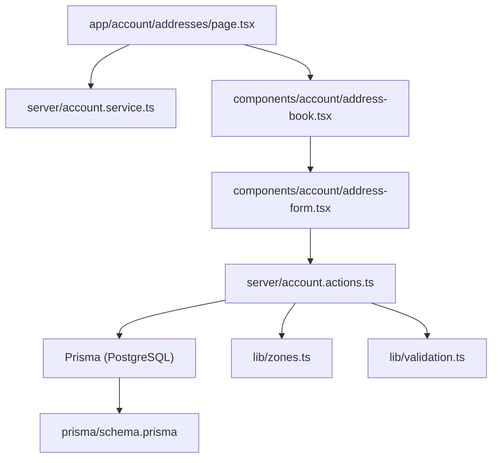
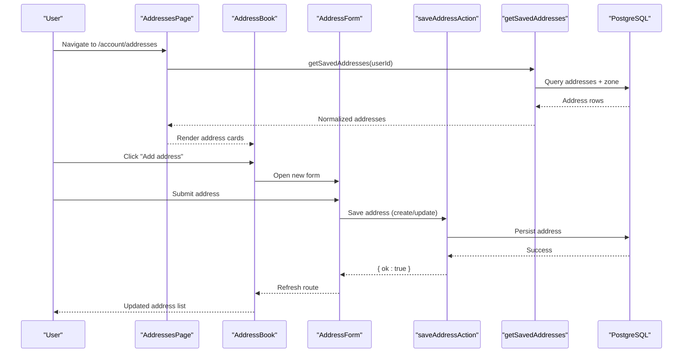
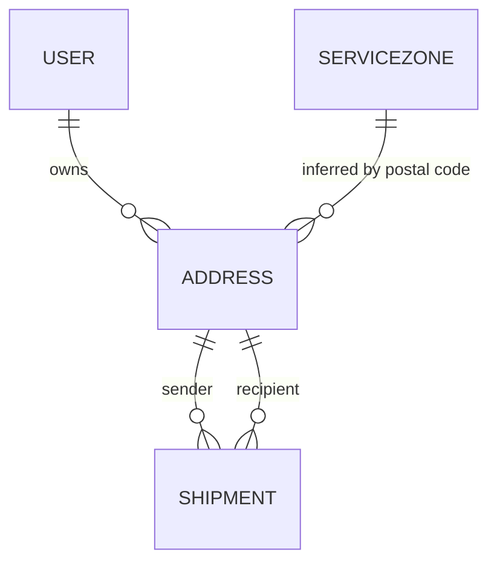
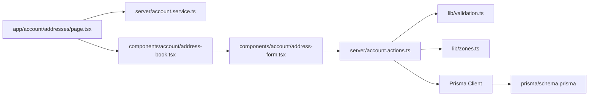

# Address Book Management

<cite>
**Referenced Files in This Document**   
- [page.tsx](file://app/account/addresses/page.tsx)
- [address-book.tsx](file://components/account/address-book.tsx)
- [address-form.tsx](file://components/account/address-form.tsx)
- [account.actions.ts](file://server/account.actions.ts)
- [account.service.ts](file://server/account.service.ts)
- [schema.prisma](file://prisma/schema.prisma)
- [validation.ts](file://lib/validation.ts)
- [zones.ts](file://lib/zones.ts)
- [address-crud.spec.ts](file://tests/e2e/address-crud.spec.ts)
</cite>

## Table of Contents
1. [Introduction](#introduction)
2. [Project Structure](#project-structure)
3. [Core Components](#core-components)
4. [Architecture Overview](#architecture-overview)
5. [Detailed Component Analysis](#detailed-component-analysis)
6. [Dependency Analysis](#dependency-analysis)
7. [Performance Considerations](#performance-considerations)
8. [Troubleshooting Guide](#troubleshooting-guide)
9. [Conclusion](#conclusion)

## Introduction
This document explains the Address Book Management feature for the application. It covers how users create, edit, and delete saved addresses; how address data is validated and persisted; how service zones are inferred from postal codes; and how the UI integrates with server actions and the database. The goal is to make the system understandable for both technical and non-technical readers while providing precise references to the source code.

## Project Structure
The Address Book feature spans a small set of focused files:
- A Next.js page renders the list of saved addresses.
- Client components provide the address book view and form.
- Server actions handle persistence and validation.
- A service layer queries saved addresses.
- Prisma schema defines the data model.
- Validation rules enforce input correctness.
- Zone mapping infers service zones from postal codes.
- End-to-end tests validate user flows.

**Diagram sources**
- [page.tsx:1-34](file://app/account/addresses/page.tsx#L1-L34)
- [address-book.tsx:1-110](file://components/account/address-book.tsx#L1-L110)
- [address-form.tsx:1-96](file://components/account/address-form.tsx#L1-L96)
- [account.actions.ts:1-87](file://server/account.actions.ts#L1-L87)
- [account.service.ts:114-121](file://server/account.service.ts#L114-L121)
- [zones.ts:1-35](file://lib/zones.ts#L1-L35)
- [validation.ts:50-60](file://lib/validation.ts#L50-L60)
- [schema.prisma:131-154](file://prisma/schema.prisma#L131-L154)

**Section sources**
- [page.tsx:1-34](file://app/account/addresses/page.tsx#L1-L34)
- [address-book.tsx:1-110](file://components/account/address-book.tsx#L1-L110)
- [address-form.tsx:1-96](file://components/account/address-form.tsx#L1-L96)
- [account.actions.ts:1-87](file://server/account.actions.ts#L1-L87)
- [account.service.ts:114-121](file://server/account.service.ts#L114-L121)
- [schema.prisma:131-154](file://prisma/schema.prisma#L131-L154)
- [validation.ts:50-60](file://lib/validation.ts#L50-L60)
- [zones.ts:1-35](file://lib/zones.ts#L1-L35)

## Core Components
- Addresses page: Loads the authenticated user’s saved addresses and passes them to the client component.
- AddressBook component: Displays saved addresses, opens new/edit forms, and triggers deletion via server action.
- AddressForm component: Renders a validated form for creating or editing an address using a server action.
- Account actions: Implement save and delete operations with ownership scoping, validation, zone inference, and cache revalidation.
- Account service: Provides a query to fetch saved addresses with related zone information.
- Data model: Defines the Address entity and its relationships.
- Validation: Enforces field constraints for address inputs.
- Zones: Maps postal code prefixes to service zone codes.

**Section sources**
- [page.tsx:7-31](file://app/account/addresses/page.tsx#L7-L31)
- [address-book.tsx:11-109](file://components/account/address-book.tsx#L11-L109)
- [address-form.tsx:13-95](file://components/account/address-form.tsx#L13-L95)
- [account.actions.ts:15-86](file://server/account.actions.ts#L15-L86)
- [account.service.ts:114-121](file://server/account.service.ts#L114-L121)
- [schema.prisma:131-154](file://prisma/schema.prisma#L131-L154)
- [validation.ts:50-60](file://lib/validation.ts#L50-L60)
- [zones.ts:15-34](file://lib/zones.ts#L15-L34)

## Architecture Overview
The feature follows a layered architecture:
- Presentation layer: Next.js page and React components render the UI and manage local state.
- Server actions: Handle mutations with authentication, validation, and database writes.
- Service layer: Encapsulates read logic and returns normalized data.
- Data layer: Prisma models map to PostgreSQL tables.
- Utilities: Validation schemas and zone mapping support business rules.

**Diagram sources**
- [page.tsx:7-31](file://app/account/addresses/page.tsx#L7-L31)
- [address-book.tsx:16-42](file://components/account/address-book.tsx#L16-L42)
- [address-form.tsx:26-39](file://components/account/address-form.tsx#L26-L39)
- [account.actions.ts:30-72](file://server/account.actions.ts#L30-L72)
- [account.service.ts:114-121](file://server/account.service.ts#L114-L121)

## Detailed Component Analysis

### Addresses Page
Responsibilities:
- Authenticate the request and extract the user ID.
- Fetch saved addresses using the service layer.
- Normalize rows into the component interface, including zone name.
- Render the AddressBook component with the prepared data.

Key behaviors:
- If no session exists, it renders an empty list safely.
- It maps database rows to the SavedAddress type expected by the UI.

**Section sources**
- [page.tsx:7-31](file://app/account/addresses/page.tsx#L7-L31)

### AddressBook Component
Responsibilities:
- Display saved addresses in a responsive grid.
- Manage UI modes: idle, new, edit.
- Trigger creation/editing via the shared AddressForm.
- Delete addresses through a server action and refresh the route.

Data model:
- SavedAddress extends AddressValues with id and zoneName.

User interactions:
- Add address opens a new form.
- Edit address pre-populates the form with existing data.
- Delete uses a transition to disable controls during mutation.

Error handling:
- Deletion is guarded by pending state to prevent concurrent operations.

**Section sources**
- [address-book.tsx:11-109](file://components/account/address-book.tsx#L11-L109)

### AddressForm Component
Responsibilities:
- Render a form for creating or editing an address.
- Use useActionState to integrate with the server action result.
- Show field-level errors returned by the server.
- On success, refresh the route and optionally call onDone to close the form.

Validation integration:
- Field errors are mapped from the server action response.
- Native HTML required attributes complement server-side validation.

UX details:
- Hidden id field when editing.
- Spinner shown during submission.
- Cancel button available when provided by the parent.

**Section sources**
- [address-form.tsx:13-95](file://components/account/address-form.tsx#L13-L95)

### Server Actions: Save and Delete
Save flow:
- Authenticate the request and ensure a user context.
- Parse and validate the form payload against the address schema.
- Infer the service zone based on the postal code prefix.
- Create or update the address scoped to the current user.
- Revalidate the relevant routes to reflect changes immediately.

Delete flow:
- Authenticate and validate the presence of an address id.
- Delete the address scoped to the current user.
- Revalidate account pages to keep lists consistent.

Security and ownership:
- All mutations are scoped by userId to prevent cross-user access.
- UpdateMany ensures zero-row updates are treated as not found.

**Section sources**
- [account.actions.ts:15-86](file://server/account.actions.ts#L15-L86)

### Service Layer: Get Saved Addresses
Responsibilities:
- Retrieve all addresses belonging to the authenticated user.
- Order by most recent first.
- Include related zone information for display.

Output:
- Array of address records with optional zone metadata.

**Section sources**
- [account.service.ts:114-121](file://server/account.service.ts#L114-L121)

### Data Model: Address Entity
Fields:
- Identifier, owner reference, label, contact details, address lines, city, region, postal code, country, zone reference, timestamps.

Relationships:
- Belongs to a User (optional).
- Optionally linked to a ServiceZone.
- Referenced by shipments as sender or recipient.

Indexes:
- Optimized lookups by userId and postalCode.

**Diagram sources**
- [schema.prisma:57-78](file://prisma/schema.prisma#L57-L78)
- [schema.prisma:84-96](file://prisma/schema.prisma#L84-L96)
- [schema.prisma:131-154](file://prisma/schema.prisma#L131-L154)
- [schema.prisma:160-186](file://prisma/schema.prisma#L160-L186)

**Section sources**
- [schema.prisma:131-154](file://prisma/schema.prisma#L131-L154)

### Validation Rules
Address schema enforces:
- Label length limits and optionality.
- Contact name required and bounded.
- Phone number format validation.
- Address line 1 required and bounded.
- Optional address line 2 bounded.
- City required and bounded.
- Optional region bounded.
- Postal code required and bounded.
- Country defaulting to US and constrained to two characters.

These rules are applied server-side to ensure data integrity even if client validation is bypassed.

**Section sources**
- [validation.ts:50-60](file://lib/validation.ts#L50-L60)

### Zone Mapping
Behavior:
- Maps a postal code to a service zone code based on the first digit.
- Defaults to a predefined zone when the postal code is empty or unmapped.

Usage:
- During address save, the zone id is resolved and attached to the address record.

**Section sources**
- [zones.ts:15-34](file://lib/zones.ts#L15-L34)
- [account.actions.ts:10-13](file://server/account.actions.ts#L10-L13)

### End-to-End Tests
Coverage:
- Login flow before accessing the address page.
- Creating a new address and verifying it appears.
- Editing an address and confirming changes.
- Deleting an address and ensuring removal.
- Rejecting invalid input with appropriate error messages.

Test utilities:
- Helpers fill fields by id and submit until success signals appear.

**Section sources**
- [address-crud.spec.ts:1-108](file://tests/e2e/address-crud.spec.ts#L1-L108)

## Dependency Analysis
The following diagram shows how modules depend on each other within the Address Book feature.

**Diagram sources**
- [page.tsx:1-34](file://app/account/addresses/page.tsx#L1-L34)
- [address-book.tsx:1-110](file://components/account/address-book.tsx#L1-L110)
- [address-form.tsx:1-96](file://components/account/address-form.tsx#L1-L96)
- [account.actions.ts:1-87](file://server/account.actions.ts#L1-L87)
- [account.service.ts:114-121](file://server/account.service.ts#L114-L121)
- [validation.ts:50-60](file://lib/validation.ts#L50-L60)
- [zones.ts:1-35](file://lib/zones.ts#L1-L35)
- [schema.prisma:131-154](file://prisma/schema.prisma#L131-L154)

**Section sources**
- [page.tsx:1-34](file://app/account/addresses/page.tsx#L1-L34)
- [address-book.tsx:1-110](file://components/account/address-book.tsx#L1-L110)
- [address-form.tsx:1-96](file://components/account/address-form.tsx#L1-L96)
- [account.actions.ts:1-87](file://server/account.actions.ts#L1-L87)
- [account.service.ts:114-121](file://server/account.service.ts#L114-L121)
- [validation.ts:50-60](file://lib/validation.ts#L50-L60)
- [zones.ts:1-35](file://lib/zones.ts#L1-L35)
- [schema.prisma:131-154](file://prisma/schema.prisma#L131-L154)

## Performance Considerations
- Read path optimization: Saved addresses are limited to the latest 20 entries and include only necessary zone fields to reduce payload size.
- Mutation efficiency: Updates use updateMany scoped by userId to avoid unnecessary writes and to detect ownership mismatches quickly.
- Cache revalidation: After mutations, only the relevant routes are revalidated to minimize full-page reloads.
- Zone lookup: Zone resolution is a single Prisma query per save; consider caching zone mappings if coverage grows significantly.

[No sources needed since this section provides general guidance]

## Troubleshooting Guide
Common issues and resolutions:
- “Please sign in to manage addresses.”
  - Cause: Missing or expired session.
  - Resolution: Ensure the user is authenticated before accessing the address page or performing mutations.

- “Address not found.”
  - Cause: Attempting to update an address that does not belong to the current user or does not exist.
  - Resolution: Verify the address id and ownership; do not allow clients to mutate arbitrary ids.

- Field validation failures (e.g., phone number).
  - Cause: Input does not match the address schema.
  - Resolution: Correct the highlighted fields according to the error messages.

- UI not refreshing after save.
  - Cause: Client did not receive a successful action result or route refresh was not triggered.
  - Resolution: Confirm the server action returns ok: true and the form handles success to refresh the route.

- Zone not displayed.
  - Cause: Postal code could not be matched to a zone or the zone record is missing.
  - Resolution: Check the postal code prefix and ensure the corresponding ServiceZone exists.

**Section sources**
- [account.actions.ts:34-72](file://server/account.actions.ts#L34-L72)
- [account.actions.ts:76-86](file://server/account.actions.ts#L76-L86)
- [validation.ts:50-60](file://lib/validation.ts#L50-L60)
- [zones.ts:29-34](file://lib/zones.ts#L29-L34)

## Conclusion
The Address Book Management feature provides a secure, validated, and user-friendly way to manage saved addresses. It leverages Next.js server actions for safe mutations, Prisma for robust data access, and Zod for strict validation. Ownership scoping protects user data, while zone inference enriches address records for pricing and routing. The end-to-end tests confirm core CRUD workflows and error handling. Future enhancements may include richer zone coverage, pagination for large address sets, and improved UX feedback for network errors.

[No sources needed since this section summarizes without analyzing specific files]