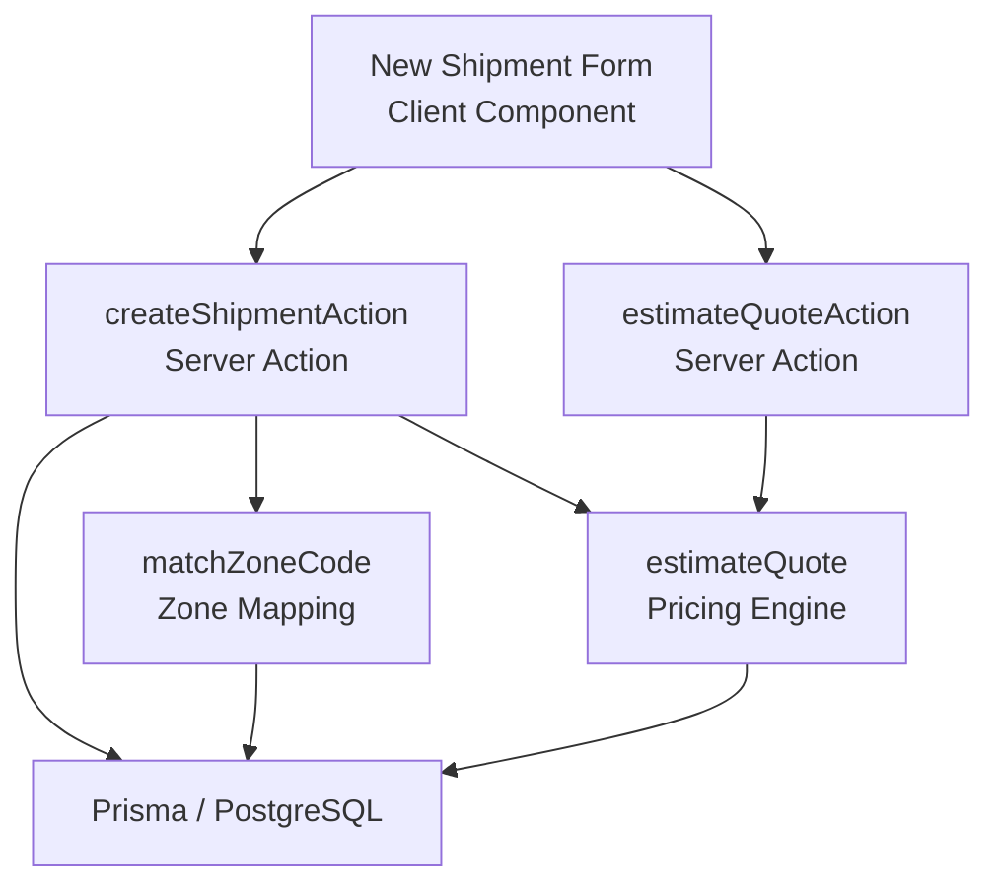
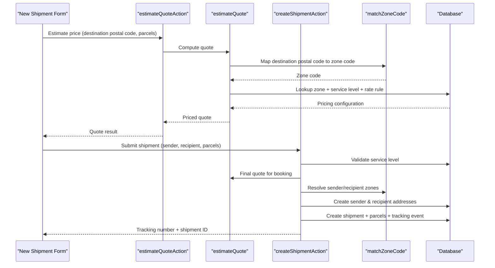
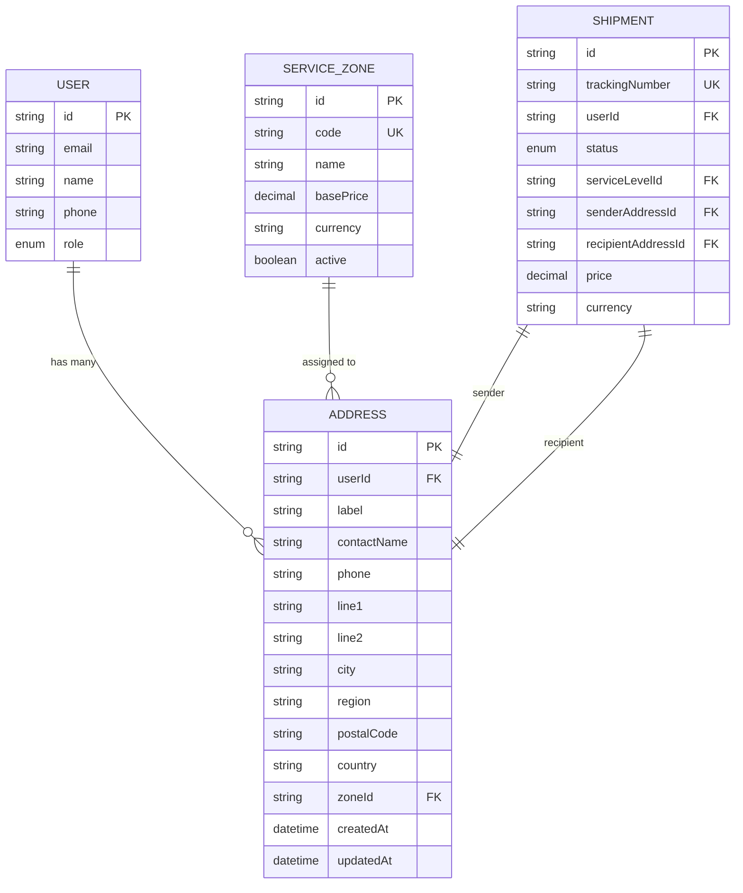
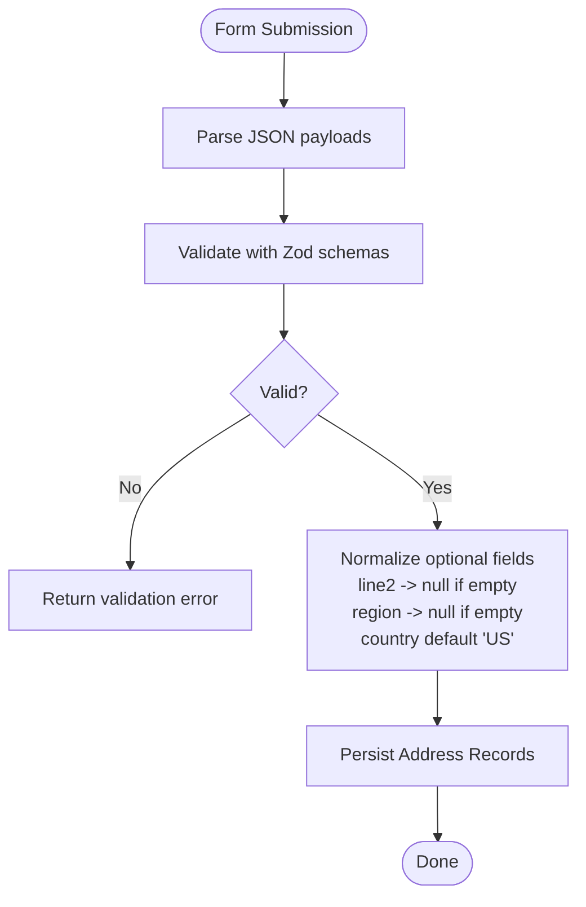
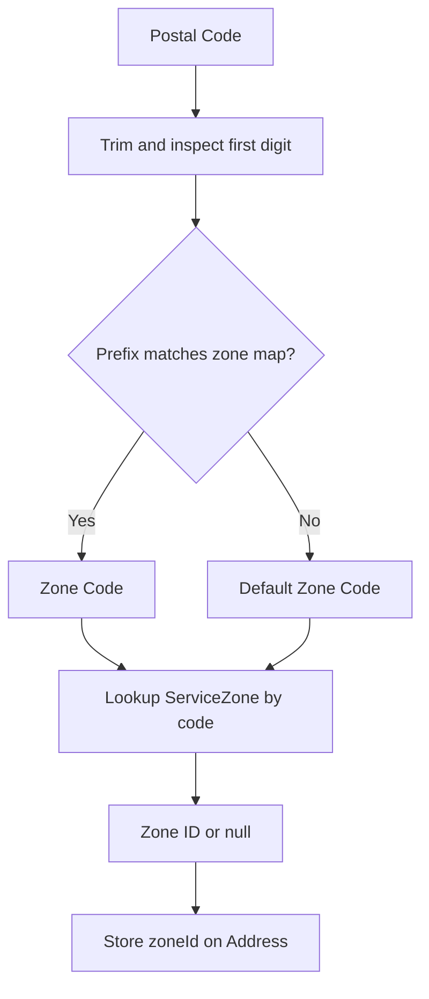
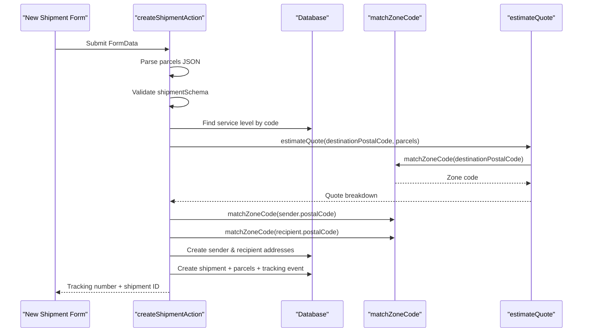
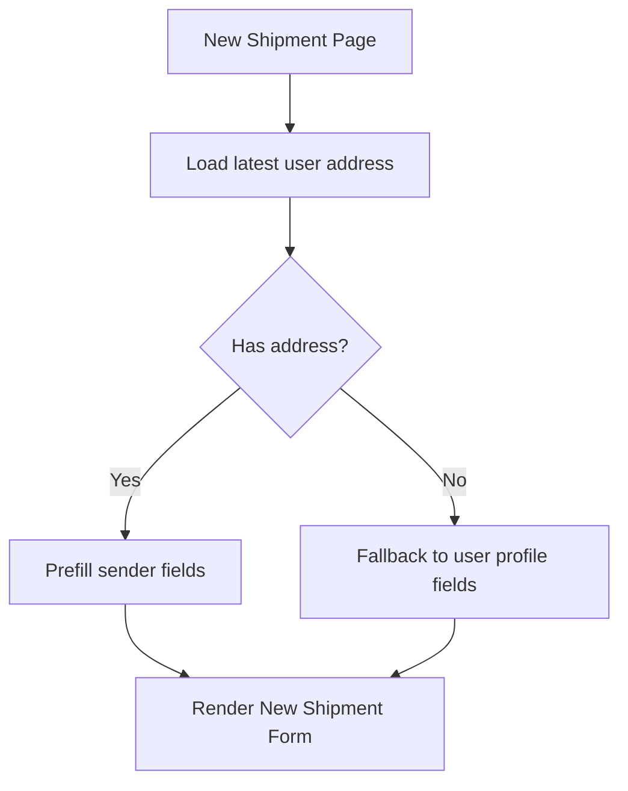
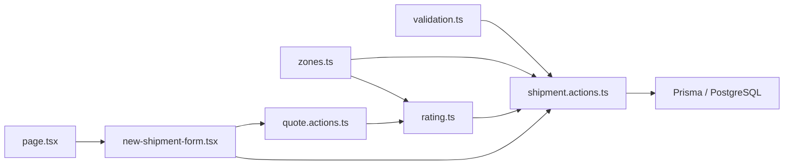

# Address Management

<cite>
**Referenced Files in This Document**
- [schema.prisma](file://prisma/schema.prisma)
- [zones.ts](file://lib/zones.ts)
- [rating.ts](file://lib/rating.ts)
- [validation.ts](file://lib/validation.ts)
- [shipment.actions.ts](file://server/shipment.actions.ts)
- [quote.actions.ts](file://server/quote.actions.ts)
- [new-shipment-form.tsx](file://components/shipment/new-shipment-form.tsx)
- [page.tsx](file://app/account/new-shipment/page.tsx)
</cite>

## Table of Contents
1. [Introduction](#introduction)
2. [Project Structure](#project-structure)
3. [Core Components](#core-components)
4. [Architecture Overview](#architecture-overview)
5. [Detailed Component Analysis](#detailed-component-analysis)
6. [Dependency Analysis](#dependency-analysis)
7. [Performance Considerations](#performance-considerations)
8. [Troubleshooting Guide](#troubleshooting-guide)
9. [Conclusion](#conclusion)

## Introduction
This document explains how addresses are created, stored, validated, and associated with users and shipments in the shipment system. It covers the address schema, postal code validation rules, zone assignment logic, integration with pricing, and user-to-address relationships. It also documents address reuse patterns during booking, data normalization behavior, duplicate handling, and geographic validation through the zone system.

## Project Structure
Address-related functionality spans database schema definitions, server-side actions, client-side forms, and pricing/zone utilities:

- Database schema defines the `Address` model and its relationships to `User`, `ServiceZone`, and `Shipment`.
- Server actions validate input, compute quotes, assign zones, and persist addresses and shipments.
- Client components render address fields and submit shipment requests.
- Zone utilities map postal codes to service zones for pricing and address tagging.

**Diagram sources**
- [new-shipment-form.tsx:136-163](file://components/shipment/new-shipment-form.tsx#L136-L163)
- [shipment.actions.ts:45-145](file://server/shipment.actions.ts#L45-L145)
- [quote.actions.ts:27-64](file://server/quote.actions.ts#L27-L64)
- [zones.ts:29-34](file://lib/zones.ts#L29-L34)
- [rating.ts:19-60](file://lib/rating.ts#L19-L60)

**Section sources**
- [schema.prisma:131-154](file://prisma/schema.prisma#L131-L154)
- [new-shipment-form.tsx:17-87](file://components/shipment/new-shipment-form.tsx#L17-L87)
- [shipment.actions.ts:14-17](file://server/shipment.actions.ts#L14-L17)
- [zones.ts:1-34](file://lib/zones.ts#L1-L34)
- [rating.ts:1-60](file://lib/rating.ts#L1-L60)

## Core Components
- Address Schema and Relationships: The `Address` model stores contact details, street lines, city, region, postal code, country, optional label, and an optional link to a `ServiceZone`. It is linked to a `User` and referenced by both sender and recipient roles on `Shipment`.
- Validation Rules: Zod schemas enforce required fields, length limits, phone format, and postal code presence. Country defaults to a two-letter code.
- Zone Assignment: Postal codes are mapped to zone codes using a simple prefix-based rule; the zone code resolves to a database zone used for pricing and address tagging.
- Pricing Integration: Destination postal code determines the zone used to calculate quotes via rate rules and service level multipliers.
- User Association: Addresses are created under the authenticated user’s ID during shipment creation.

**Section sources**
- [schema.prisma:57-78](file://prisma/schema.prisma#L57-L78)
- [schema.prisma:84-125](file://prisma/schema.prisma#L84-L125)
- [schema.prisma:131-154](file://prisma/schema.prisma#L131-L154)
- [schema.prisma:160-186](file://prisma/schema.prisma#L160-L186)
- [validation.ts:38-48](file://lib/validation.ts#L38-L48)
- [zones.ts:10-34](file://lib/zones.ts#L10-L34)
- [rating.ts:19-60](file://lib/rating.ts#L19-L60)

## Architecture Overview
The address lifecycle during shipment booking follows this flow:

1. The user fills sender and recipient address fields in the form.
2. The client optionally estimates pricing using destination postal code and parcel totals.
3. On submission, the server validates the payload, checks the selected service level, computes a quote, resolves zones for both addresses, creates address records, and then creates the shipment with parcels and initial tracking event.
4. A notification is fired asynchronously after successful creation.

**Diagram sources**
- [new-shipment-form.tsx:118-163](file://components/shipment/new-shipment-form.tsx#L118-L163)
- [quote.actions.ts:27-64](file://server/quote.actions.ts#L27-L64)
- [rating.ts:19-60](file://lib/rating.ts#L19-L60)
- [shipment.actions.ts:45-145](file://server/shipment.actions.ts#L45-L145)
- [zones.ts:29-34](file://lib/zones.ts#L29-L34)

## Detailed Component Analysis

### Address Data Model and Relationships
The address model includes:
- Required fields: contact name, phone, line 1, city, postal code, country.
- Optional fields: label, line 2, region, zoneId.
- Indexes: userId and postalCode for efficient lookups.
- Relationships:
  - Optional link to a user (addresses belong to a user).
  - Optional link to a service zone (for geographic classification).
  - Two relations to shipments: sender and recipient.

**Diagram sources**
- [schema.prisma:57-78](file://prisma/schema.prisma#L57-L78)
- [schema.prisma:84-125](file://prisma/schema.prisma#L84-L125)
- [schema.prisma:131-154](file://prisma/schema.prisma#L131-L154)
- [schema.prisma:160-186](file://prisma/schema.prisma#L160-L186)

**Section sources**
- [schema.prisma:131-154](file://prisma/schema.prisma#L131-L154)

### Address Input Validation and Normalization
Validation rules ensure:
- Contact name and city are required and bounded.
- Phone numbers match a flexible numeric pattern.
- Line 1 is required; line 2 is optional.
- Region is optional.
- Postal code must be present and within length bounds.
- Country defaults to a two-letter code.

Normalization behaviors:
- Trimming whitespace from all text inputs.
- Optional fields converted to null when empty before persistence.
- Default country applied if not provided.

**Diagram sources**
- [validation.ts:38-48](file://lib/validation.ts#L38-L48)
- [shipment.actions.ts:90-97](file://server/shipment.actions.ts#L90-L97)

**Section sources**
- [validation.ts:38-48](file://lib/validation.ts#L38-L48)
- [shipment.actions.ts:90-97](file://server/shipment.actions.ts#L90-L97)

### Zone Assignment and Geographic Validation
Zone mapping uses a simple postal code prefix table:
- Prefixes determine zone codes: METRO, REGION, REMOTE.
- If no match or empty postal code, the default zone is REGION.
- The zone code is resolved to a database ServiceZone record.
- Addresses store the resolved zoneId for future reference.
- Pricing uses the destination postal code to select the appropriate zone and rate rule.

**Diagram sources**
- [zones.ts:15-34](file://lib/zones.ts#L15-L34)
- [shipment.actions.ts:14-17](file://server/shipment.actions.ts#L14-L17)
- [rating.ts:24-37](file://lib/rating.ts#L24-L37)

**Section sources**
- [zones.ts:1-34](file://lib/zones.ts#L1-L34)
- [shipment.actions.ts:14-17](file://server/shipment.actions.ts#L14-L17)
- [rating.ts:19-60](file://lib/rating.ts#L19-L60)

### Address Creation During Shipment Booking
When a shipment is booked:
- The server authenticates the user and parses parcel data.
- It validates the shipment payload against the schema.
- It verifies the selected service level exists.
- It computes a final quote using destination postal code and parcels.
- It resolves zones for both sender and recipient postal codes.
- It creates both addresses in a transaction, linking them to the user and their respective zones.
- It creates the shipment with parcels and an initial tracking event.

**Diagram sources**
- [shipment.actions.ts:45-145](file://server/shipment.actions.ts#L45-L145)
- [rating.ts:19-60](file://lib/rating.ts#L19-L60)
- [zones.ts:29-34](file://lib/zones.ts#L29-L34)

**Section sources**
- [shipment.actions.ts:45-145](file://server/shipment.actions.ts#L45-L145)

### Address Reuse Patterns and User Profile Integration
- Default sender population: The new shipment page loads the latest address for the current user and pre-fills the sender fields. If no address exists, it falls back to the user’s profile name and phone where available.
- Reuse pattern: While the current implementation always creates new address records per shipment, the UI supports reusing the last saved address as a starting point. Future enhancements could deduplicate by matching normalized fields (contact name, phone, line1, city, postal code, country) to avoid duplicates.
- Relationship: Each address is tied to the authenticated user at creation time, enabling per-user address management and history.

**Diagram sources**
- [page.tsx:8-40](file://app/account/new-shipment/page.tsx#L8-L40)
- [new-shipment-form.tsx:89-105](file://components/shipment/new-shipment-form.tsx#L89-L105)

**Section sources**
- [page.tsx:8-40](file://app/account/new-shipment/page.tsx#L8-L40)
- [new-shipment-form.tsx:89-105](file://components/shipment/new-shipment-form.tsx#L89-L105)

### Duplicate Handling and Geographic Validation
- Duplicate handling: The current address creation path does not check for existing addresses with identical normalized content; each booking creates new address rows. Deduplication can be implemented by querying normalized fields before insertion.
- Geographic validation: Postal code validation ensures presence and length but does not validate format per country. Zone assignment provides basic geographic classification based on postal code prefixes. For stronger validation, consider integrating a postal code format library and geocoding service.

[No sources needed since this section provides general guidance]

## Dependency Analysis
Key dependencies between address-related modules:

**Diagram sources**
- [validation.ts:60-67](file://lib/validation.ts#L60-L67)
- [zones.ts:29-34](file://lib/zones.ts#L29-L34)
- [rating.ts:19-60](file://lib/rating.ts#L19-L60)
- [shipment.actions.ts:45-145](file://server/shipment.actions.ts#L45-L145)
- [quote.actions.ts:27-64](file://server/quote.actions.ts#L27-L64)
- [new-shipment-form.tsx:136-163](file://components/shipment/new-shipment-form.tsx#L136-L163)
- [page.tsx:8-40](file://app/account/new-shipment/page.tsx#L8-L40)

**Section sources**
- [validation.ts:60-67](file://lib/validation.ts#L60-L67)
- [zones.ts:29-34](file://lib/zones.ts#L29-L34)
- [rating.ts:19-60](file://lib/rating.ts#L19-L60)
- [shipment.actions.ts:45-145](file://server/shipment.actions.ts#L45-L145)
- [quote.actions.ts:27-64](file://server/quote.actions.ts#L27-L64)
- [new-shipment-form.tsx:136-163](file://components/shipment/new-shipment-form.tsx#L136-L163)
- [page.tsx:8-40](file://app/account/new-shipment/page.tsx#L8-L40)

## Performance Considerations
- Address indexes: The schema indexes userId and postalCode, improving lookup performance for user-specific queries and postal code scans.
- Transactional address creation: Sender and recipient addresses are created in a single transaction to maintain consistency.
- Zone resolution cost: Zone mapping is lightweight; however, repeated lookups for the same postal code could benefit from caching if high volume.
- Quote estimation: The pricing engine performs database reads for zone, service level, and rate rule; caching these configurations may reduce latency.

[No sources needed since this section provides general guidance]

## Troubleshooting Guide
Common issues and resolutions:
- Missing or invalid service level: Ensure the selected service level exists and is active.
- Incomplete pricing configuration: Verify that a rate rule exists for the destination zone and service level combination.
- Invalid parcel data: Confirm parcels JSON is valid and conforms to the parcel schema.
- Authentication failures: Ensure the user is signed in before creating a shipment.
- Notification delivery: Notifications are fire-and-forget; failures are logged silently. Check logs if confirmation emails are expected.

**Section sources**
- [shipment.actions.ts:77-79](file://server/shipment.actions.ts#L77-L79)
- [rating.ts:31-40](file://lib/rating.ts#L31-L40)
- [shipment.actions.ts:55-60](file://server/shipment.actions.ts#L55-L60)
- [shipment.actions.ts:49-53](file://server/shipment.actions.ts#L49-L53)
- [shipment.actions.ts:135-142](file://server/shipment.actions.ts#L135-L142)

## Conclusion
Address management in the shipment system centers around a well-defined schema, strict validation, and integration with the zone and pricing systems. Addresses are created per shipment, linked to users, and tagged with zones derived from postal codes. While the current implementation does not deduplicate addresses automatically, it provides a solid foundation for future enhancements such as address reuse, advanced postal code validation, and geocoding. The architecture cleanly separates concerns across client forms, server actions, validation, zone mapping, and pricing, ensuring maintainability and clarity.