# Address Management

<cite>
**Referenced Files in This Document**
- [schema.prisma](file://prisma/schema.prisma)
- [zones.ts](file://lib/zones.ts)
- [rating.ts](file://lib/rating.ts)
- [validation.ts](file://lib/validation.ts)
- [shipment.actions.ts](file://server/shipment.actions.ts)
- [quote.actions.ts](file://server/quote.actions.ts)
- [account.actions.ts](file://server/account.actions.ts)
- [account.service.ts](file://server/account.service.ts)
- [new-shipment-form.tsx](file://components/shipment/new-shipment-form.tsx)
- [address-book.tsx](file://components/account/address-book.tsx)
- [address-form.tsx](file://components/account/address-form.tsx)
- [page.tsx](file://app/account/new-shipment/page.tsx)
- [page.tsx](file://app/account/addresses/page.tsx)
- [layout.tsx](file://app/account/layout.tsx)
</cite>

## Update Summary
**Changes Made**
- Added comprehensive documentation for the new address book management system with full CRUD operations
- Updated address persistence model to support user-owned addresses separate from shipment addresses
- Documented the new server actions for address management (saveAddressAction, deleteAddressAction)
- Added documentation for the dedicated address management UI at /account/addresses
- Enhanced zone resolution integration for saved addresses
- Updated relationship documentation to distinguish between saved addresses and shipment addresses

## Table of Contents
1. [Introduction](#introduction)
2. [Project Structure](#project-structure)
3. [Core Components](#core-components)
4. [Architecture Overview](#architecture-overview)
5. [Detailed Component Analysis](#detailed-component-analysis)
6. [Address Book Management System](#address-book-management-system)
7. [Dependency Analysis](#dependency-analysis)
8. [Performance Considerations](#performance-considerations)
9. [Troubleshooting Guide](#troubleshooting-guide)
10. [Conclusion](#conclusion)

## Introduction
This document explains how addresses are created, stored, validated, and associated with users and shipments in the shipment system. It covers the dual address management approach: a dedicated address book for persistent user-owned addresses and temporary addresses used during shipment booking. The system includes comprehensive validation rules, zone assignment logic, integration with pricing, and user-to-address relationships. It also documents address reuse patterns during booking, data normalization behavior, duplicate handling, and geographic validation through the zone system.

## Project Structure
Address-related functionality spans database schema definitions, server-side actions, client-side forms, and pricing/zone utilities across two distinct workflows:

- **Address Book Management**: Dedicated system for saving and managing user-owned addresses with full CRUD operations
- **Shipment Address Creation**: Temporary address creation during shipment booking process
- Database schema defines the `Address` model supporting both use cases with optional user association
- Server actions handle both address book operations and shipment-related address creation
- Client components provide separate interfaces for address management and shipment booking
- Zone utilities map postal codes to service zones for pricing and address tagging

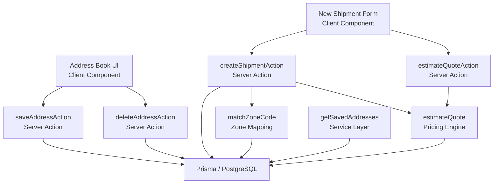

**Diagram sources**
- [address-book.tsx:1-110](file://components/account/address-book.tsx#L1-L110)
- [account.actions.ts:30-86](file://server/account.actions.ts#L30-L86)
- [new-shipment-form.tsx:136-163](file://components/shipment/new-shipment-form.tsx#L136-L163)
- [shipment.actions.ts:45-145](file://server/shipment.actions.ts#L45-L145)
- [quote.actions.ts:27-64](file://server/quote.actions.ts#L27-L64)
- [account.service.ts:114-121](file://server/account.service.ts#L114-L121)
- [zones.ts:29-34](file://lib/zones.ts#L29-L34)
- [rating.ts:19-60](file://lib/rating.ts#L19-L60)

**Section sources**
- [schema.prisma:131-154](file://prisma/schema.prisma#L131-L154)
- [address-book.tsx:1-110](file://components/account/address-book.tsx#L1-L110)
- [address-form.tsx:1-96](file://components/account/address-form.tsx#L1-L96)
- [account.actions.ts:1-87](file://server/account.actions.ts#L1-L87)
- [account.service.ts:114-121](file://server/account.service.ts#L114-L121)
- [zones.ts:1-34](file://lib/zones.ts#L1-L34)
- [rating.ts:1-60](file://lib/rating.ts#L1-L60)

## Core Components
- **Dual Address Model**: The `Address` model supports both user-owned addresses (with userId) and shipment-specific addresses (without userId), maintaining backward compatibility while enabling the new address book feature.
- **Validation Rules**: Zod schemas enforce required fields, length limits, phone format, and postal code presence. Country defaults to a two-letter code.
- **Zone Assignment**: Postal codes are mapped to zone codes using a simple prefix-based rule; the zone code resolves to a database zone used for pricing and address tagging.
- **Pricing Integration**: Destination postal code determines the zone used to calculate quotes via rate rules and service level multipliers.
- **User Association**: Saved addresses are created under the authenticated user's ID during address book operations, while shipment addresses may or may not be associated with users.

**Section sources**
- [schema.prisma:131-154](file://prisma/schema.prisma#L131-L154)
- [validation.ts:50-60](file://lib/validation.ts#L50-L60)
- [zones.ts:10-34](file://lib/zones.ts#L10-L34)
- [rating.ts:19-60](file://lib/rating.ts#L19-L60)

## Architecture Overview
The address lifecycle now follows two distinct flows:

### Address Book Management Flow
1. User navigates to `/account/addresses` to manage saved addresses
2. User creates, edits, or deletes addresses through the dedicated interface
3. Each operation validates input, resolves zones, and persists user-owned addresses
4. Changes trigger path revalidation to refresh the UI

### Shipment Booking Flow
1. The user fills sender and recipient address fields in the form
2. The client optionally estimates pricing using destination postal code and parcel totals
3. On submission, the server validates the payload, checks the selected service level, computes a quote, resolves zones for both addresses, creates address records, and then creates the shipment with parcels and initial tracking event
4. A notification is fired asynchronously after successful creation

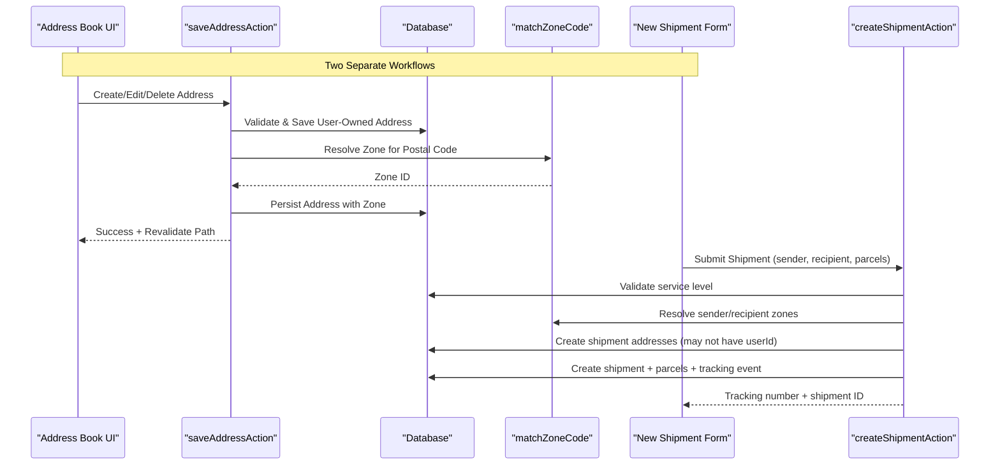

**Diagram sources**
- [address-book.tsx:35-42](file://components/account/address-book.tsx#L35-L42)
- [account.actions.ts:30-86](file://server/account.actions.ts#L30-L86)
- [new-shipment-form.tsx:118-163](file://components/shipment/new-shipment-form.tsx#L118-L163)
- [shipment.actions.ts:45-145](file://server/shipment.actions.ts#L45-L145)
- [zones.ts:29-34](file://lib/zones.ts#L29-L34)

## Detailed Component Analysis

### Address Data Model and Relationships
The address model has been enhanced to support both use cases:
- Required fields: contact name, phone, line 1, city, postal code, country.
- Optional fields: label, line 2, region, zoneId, userId.
- Indexes: userId and postalCode for efficient lookups.
- Relationships:
  - Optional link to a user (for saved addresses only).
  - Optional link to a service zone (for geographic classification).
  - Two relations to shipments: sender and recipient.

**Diagram sources**
- [schema.prisma:131-154](file://prisma/schema.prisma#L131-L154)
- [schema.prisma:160-186](file://prisma/schema.prisma#L160-L186)

**Section sources**
- [schema.prisma:131-154](file://prisma/schema.prisma#L131-L154)

### Address Input Validation and Normalization
Validation rules ensure:
- Contact name and city are required and bounded.
- Phone numbers match a flexible numeric pattern.
- Line 1 is required; line 2 is optional.
- Region is optional.
- Postal code must be present and within length bounds.
- Country defaults to a two-letter code.

Normalization behaviors:
- Trimming whitespace from all text inputs.
- Optional fields converted to null when empty before persistence.
- Default country applied if not provided.

**Diagram sources**
- [validation.ts:50-60](file://lib/validation.ts#L50-L60)
- [account.actions.ts:48-61](file://server/account.actions.ts#L48-L61)

**Section sources**
- [validation.ts:50-60](file://lib/validation.ts#L50-L60)
- [account.actions.ts:48-61](file://server/account.actions.ts#L48-L61)

### Zone Assignment and Geographic Validation
Zone mapping uses a simple postal code prefix table:
- Prefixes determine zone codes: METRO, REGION, REMOTE.
- If no match or empty postal code, the default zone is REGION.
- The zone code is resolved to a database ServiceZone record.
- Addresses store the resolved zoneId for future reference.
- Pricing uses the destination postal code to select the appropriate zone and rate rule.

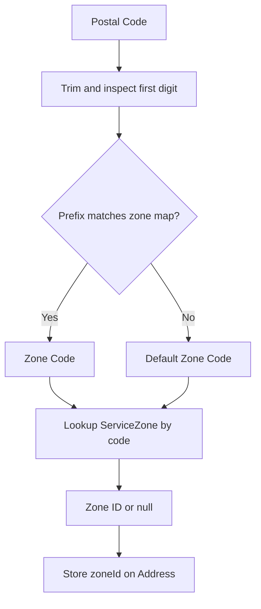

**Diagram sources**
- [zones.ts:15-34](file://lib/zones.ts#L15-L34)
- [account.actions.ts:10-13](file://server/account.actions.ts#L10-L13)
- [rating.ts:24-37](file://lib/rating.ts#L24-L37)

**Section sources**
- [zones.ts:1-34](file://lib/zones.ts#L1-L34)
- [account.actions.ts:10-13](file://server/account.actions.ts#L10-L13)
- [rating.ts:19-60](file://lib/rating.ts#L19-L60)

### Address Creation During Shipment Booking
When a shipment is booked:
- The server authenticates the user and parses parcel data.
- It validates the shipment payload against the schema.
- It verifies the selected service level exists.
- It computes a final quote using destination postal code and parcels.
- It resolves zones for both sender and recipient postal codes.
- It creates both addresses in a transaction, linking them to the user and their respective zones.
- It creates the shipment with parcels and an initial tracking event.

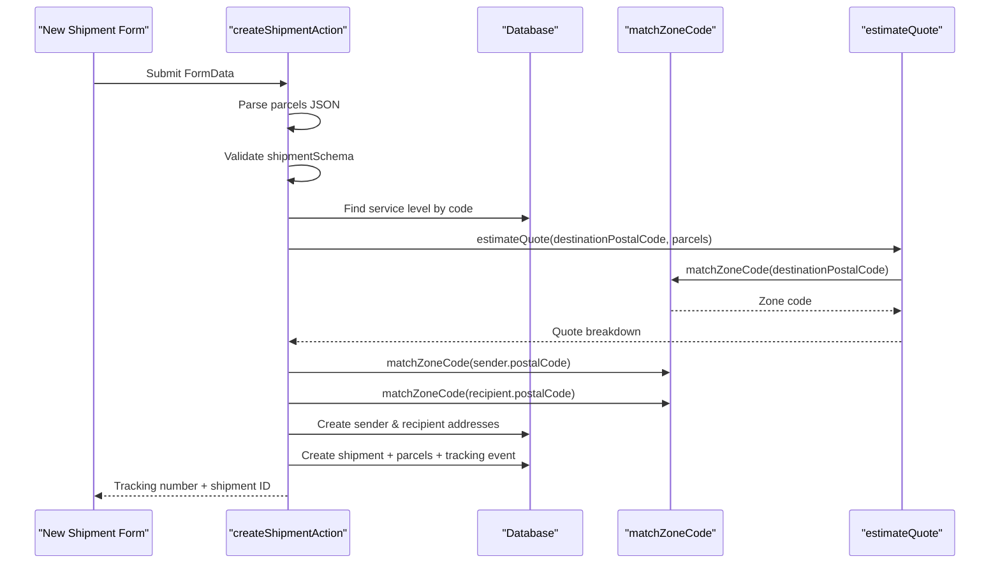

**Diagram sources**
- [shipment.actions.ts:45-145](file://server/shipment.actions.ts#L45-L145)
- [rating.ts:19-60](file://lib/rating.ts#L19-L60)
- [zones.ts:29-34](file://lib/zones.ts#L29-L34)

**Section sources**
- [shipment.actions.ts:45-145](file://server/shipment.actions.ts#L45-L145)

### Address Reuse Patterns and User Profile Integration
- Default sender population: The new shipment page loads the latest address for the current user and pre-fills the sender fields. If no address exists, it falls back to the user's profile name and phone where available.
- Reuse pattern: While the current implementation always creates new address records per shipment, the UI supports reusing the last saved address as a starting point. Future enhancements could deduplicate by matching normalized fields (contact name, phone, line1, city, postal code, country) to avoid duplicates.
- Relationship: Each address is tied to the authenticated user at creation time, enabling per-user address management and history.

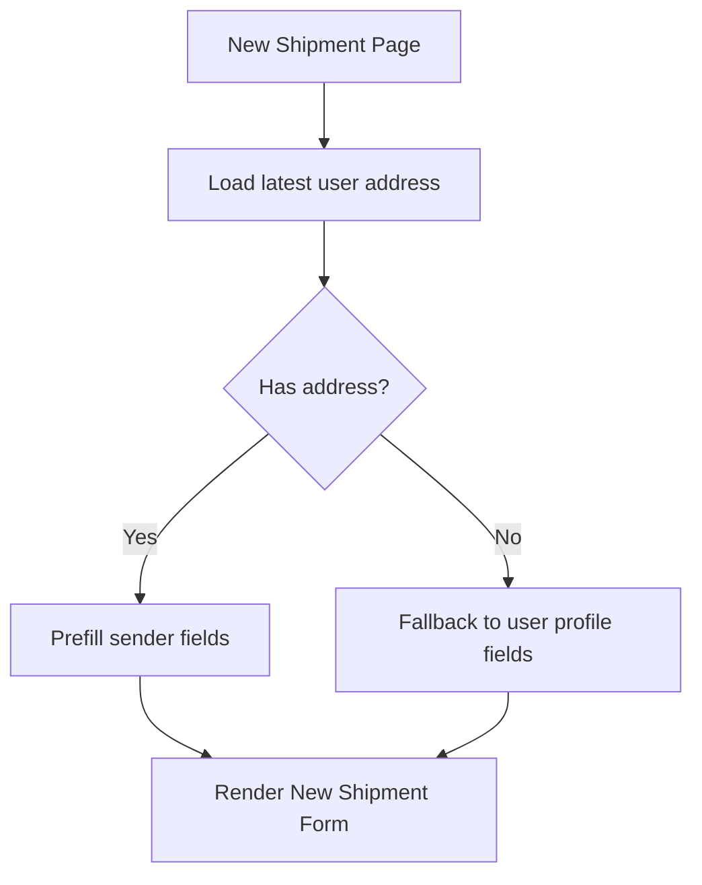

**Diagram sources**
- [page.tsx:8-40](file://app/account/new-shipment/page.tsx#L8-L40)
- [new-shipment-form.tsx:89-105](file://components/shipment/new-shipment-form.tsx#L89-L105)

**Section sources**
- [page.tsx:8-40](file://app/account/new-shipment/page.tsx#L8-L40)
- [new-shipment-form.tsx:89-105](file://components/shipment/new-shipment-form.tsx#L89-L105)

### Duplicate Handling and Geographic Validation
- Duplicate handling: The current address creation path does not check for existing addresses with identical normalized content; each booking creates new address rows. Deduplication can be implemented by querying normalized fields before insertion.
- Geographic validation: Postal code validation ensures presence and length but does not validate format per country. Zone assignment provides basic geographic classification based on postal code prefixes. For stronger validation, consider integrating a postal code format library and geocoding service.

[No sources needed since this section provides general guidance]

## Address Book Management System

### Overview
The new address book management system provides users with a dedicated interface to save, edit, and manage their frequently used addresses separately from the shipment booking process. This system enhances user experience by reducing repetitive data entry and providing better organization of shipping information.

### Key Features
- **Full CRUD Operations**: Complete create, read, update, and delete functionality for saved addresses
- **User Ownership**: Each saved address is explicitly linked to a user account for security and organization
- **Zone Resolution Integration**: Automatic zone detection and assignment based on postal codes
- **Real-time Updates**: Immediate UI updates through Next.js revalidation
- **Responsive Design**: Mobile-friendly interface with card-based layout

### Server-Side Implementation

#### Save Address Action
The `saveAddressAction` handles both creating new addresses and updating existing ones:

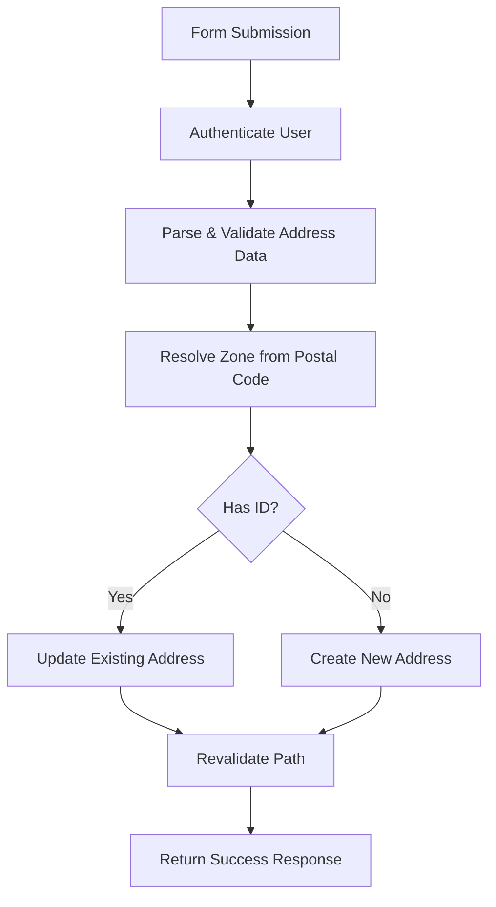

**Diagram sources**
- [account.actions.ts:30-73](file://server/account.actions.ts#L30-L73)

#### Delete Address Action
The `deleteAddressAction` provides secure deletion with ownership verification:

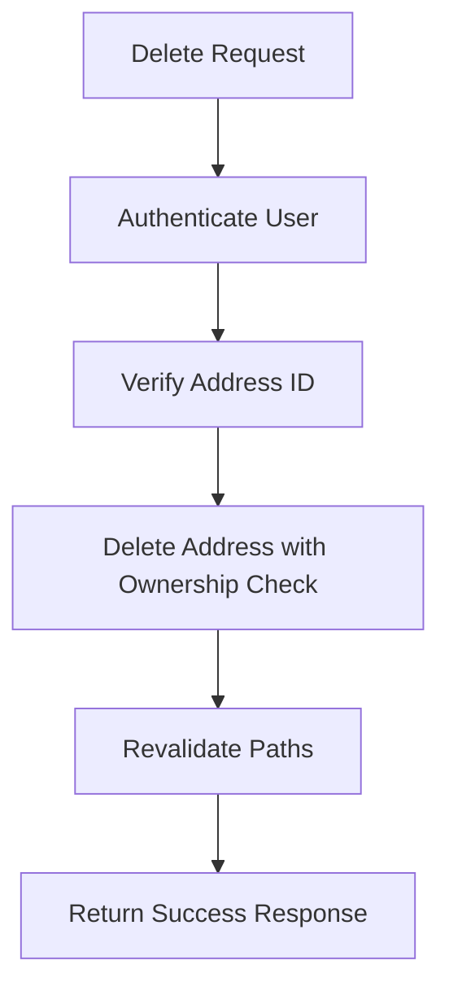

**Diagram sources**
- [account.actions.ts:76-86](file://server/account.actions.ts#L76-L86)

### Client-Side Implementation

#### Address Book Component
The `AddressBook` component manages the complete user interface for address management:

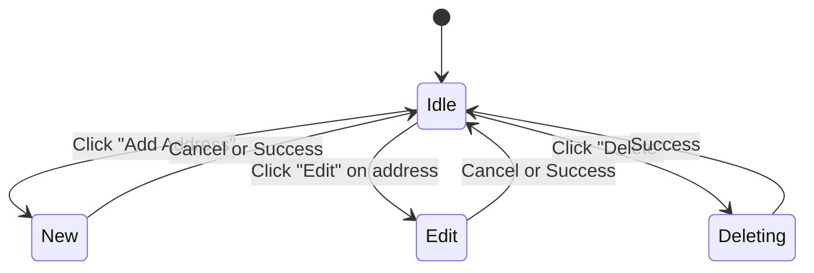

**Diagram sources**
- [address-book.tsx:18-42](file://components/account/address-book.tsx#L18-L42)

#### Address Form Component
The `AddressForm` component provides a reusable form interface for both creating and editing addresses:

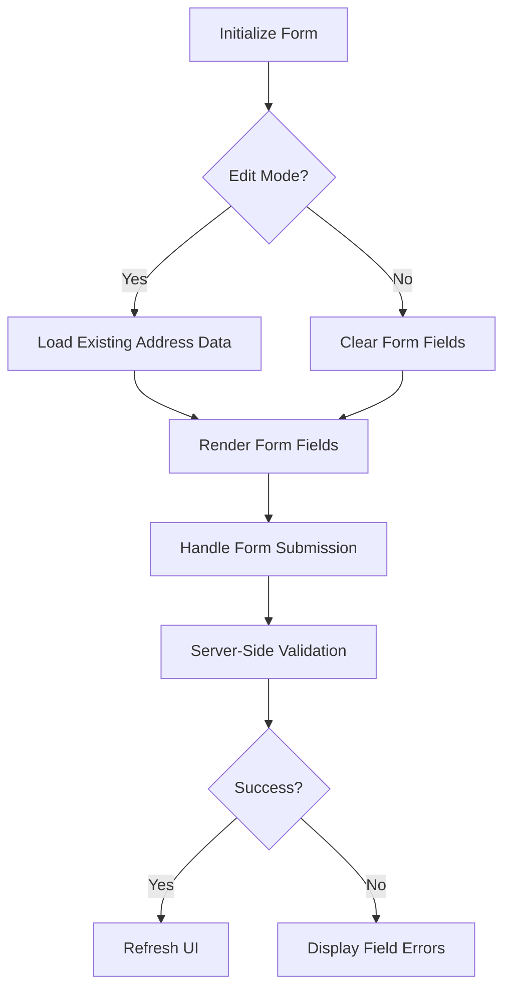

**Diagram sources**
- [address-form.tsx:26-41](file://components/account/address-form.tsx#L26-L41)

### Data Flow Architecture

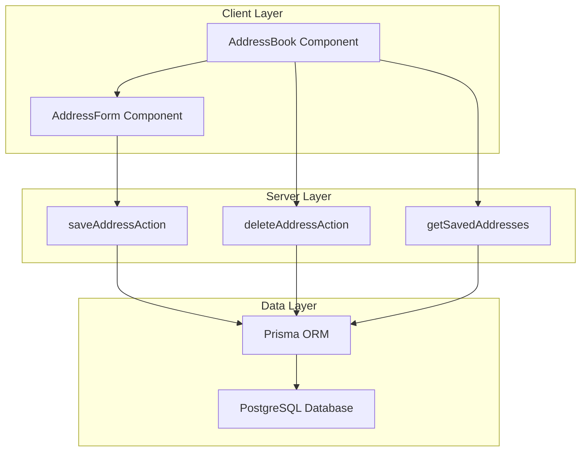

**Diagram sources**
- [address-book.tsx:1-110](file://components/account/address-book.tsx#L1-L110)
- [address-form.tsx:1-96](file://components/account/address-form.tsx#L1-L96)
- [account.actions.ts:1-87](file://server/account.actions.ts#L1-L87)
- [account.service.ts:114-121](file://server/account.service.ts#L114-L121)

### Security and Validation
- **Authentication Required**: All address operations require user authentication
- **Ownership Verification**: Users can only modify/delete their own addresses
- **Input Validation**: Comprehensive server-side validation using Zod schemas
- **SQL Injection Prevention**: Parameterized queries through Prisma ORM
- **XSS Protection**: Proper escaping and sanitization of user inputs

### Performance Optimizations
- **Lazy Loading**: Addresses are loaded on-demand when accessing the address book page
- **Efficient Queries**: Indexed queries on userId and postalCode fields
- **Path Revalidation**: Targeted revalidation instead of full page reloads
- **Connection Pooling**: Efficient database connection management through Prisma

**Section sources**
- [account.actions.ts:1-87](file://server/account.actions.ts#L1-L87)
- [account.service.ts:114-121](file://server/account.service.ts#L114-L121)
- [address-book.tsx:1-110](file://components/account/address-book.tsx#L1-L110)
- [address-form.tsx:1-96](file://components/account/address-form.tsx#L1-L96)
- [page.tsx:1-33](file://app/account/addresses/page.tsx#L1-L33)

## Dependency Analysis
Key dependencies between address-related modules:

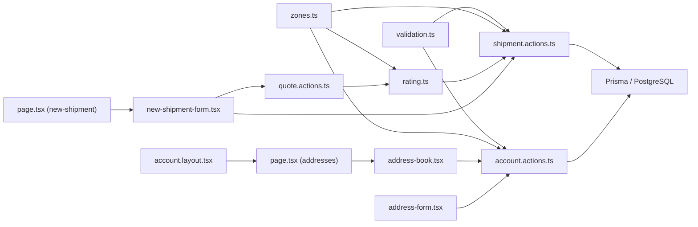

**Diagram sources**
- [validation.ts:50-60](file://lib/validation.ts#L50-L60)
- [zones.ts:29-34](file://lib/zones.ts#L29-L34)
- [rating.ts:19-60](file://lib/rating.ts#L19-L60)
- [shipment.actions.ts:45-145](file://server/shipment.actions.ts#L45-L145)
- [account.actions.ts:1-87](file://server/account.actions.ts#L1-L87)
- [quote.actions.ts:27-64](file://server/quote.actions.ts#L27-L64)
- [new-shipment-form.tsx:136-163](file://components/shipment/new-shipment-form.tsx#L136-L163)
- [address-book.tsx:1-110](file://components/account/address-book.tsx#L1-L110)
- [address-form.tsx:1-96](file://components/account/address-form.tsx#L1-L96)
- [page.tsx:1-33](file://app/account/addresses/page.tsx#L1-L33)
- [page.tsx:8-40](file://app/account/new-shipment/page.tsx#L8-L40)
- [layout.tsx:1-39](file://app/account/layout.tsx#L1-L39)

**Section sources**
- [validation.ts:50-60](file://lib/validation.ts#L50-L60)
- [zones.ts:29-34](file://lib/zones.ts#L29-L34)
- [rating.ts:19-60](file://lib/rating.ts#L19-L60)
- [shipment.actions.ts:45-145](file://server/shipment.actions.ts#L45-L145)
- [account.actions.ts:1-87](file://server/account.actions.ts#L1-L87)
- [quote.actions.ts:27-64](file://server/quote.actions.ts#L27-L64)
- [new-shipment-form.tsx:136-163](file://components/shipment/new-shipment-form.tsx#L136-L163)
- [address-book.tsx:1-110](file://components/account/address-book.tsx#L1-L110)
- [address-form.tsx:1-96](file://components/account/address-form.tsx#L1-L96)
- [page.tsx:1-33](file://app/account/addresses/page.tsx#L1-L33)
- [page.tsx:8-40](file://app/account/new-shipment/page.tsx#L8-L40)
- [layout.tsx:1-39](file://app/account/layout.tsx#L1-L39)

## Performance Considerations
- **Address indexes**: The schema indexes userId and postalCode, improving lookup performance for user-specific queries and postal code scans.
- **Transaction handling**: Both address book operations and shipment creation maintain database consistency through proper transaction management.
- **Zone resolution cost**: Zone mapping is lightweight; however, repeated lookups for the same postal code could benefit from caching if high volume.
- **Quote estimation**: The pricing engine performs database reads for zone, service level, and rate rule; caching these configurations may reduce latency.
- **Address book optimization**: The getSavedAddresses function limits results to 20 most recent addresses and includes only necessary zone information.

[No sources needed since this section provides general guidance]

## Troubleshooting Guide
Common issues and resolutions:

### Address Book Issues
- **Authentication failures**: Ensure the user is signed in before accessing the address book. The system requires authentication for all address operations.
- **Permission errors**: Users can only modify/delete their own addresses. Verify that the address belongs to the authenticated user.
- **Validation errors**: Check that all required fields are properly filled and meet the validation criteria (phone format, postal code length, etc.).
- **Zone resolution failures**: If zone assignment fails, the address will still be saved but without a zoneId. Check the postal code format and zone configuration.

### Shipment Address Issues
- **Missing or invalid service level**: Ensure the selected service level exists and is active.
- **Incomplete pricing configuration**: Verify that a rate rule exists for the destination zone and service level combination.
- **Invalid parcel data**: Confirm parcels JSON is valid and conforms to the parcel schema.
- **Notification delivery**: Notifications are fire-and-forget; failures are logged silently. Check logs if confirmation emails are expected.

**Section sources**
- [account.actions.ts:34-46](file://server/account.actions.ts#L34-L46)
- [account.actions.ts:63-66](file://server/account.actions.ts#L63-L66)
- [shipment.actions.ts:77-79](file://server/shipment.actions.ts#L77-L79)
- [rating.ts:31-40](file://lib/rating.ts#L31-L40)
- [shipment.actions.ts:55-60](file://server/shipment.actions.ts#L55-L60)
- [shipment.actions.ts:49-53](file://server/shipment.actions.ts#L49-L53)
- [shipment.actions.ts:135-142](file://server/shipment.actions.ts#L135-L142)

## Conclusion
Address management in the shipment system now provides a comprehensive dual approach: a dedicated address book for persistent user-owned addresses and streamlined address creation during shipment booking. The new address book system offers full CRUD operations with robust security, validation, and zone resolution integration. The architecture maintains backward compatibility while providing enhanced functionality for address organization and reuse. The system cleanly separates concerns across client forms, server actions, validation, zone mapping, and pricing, ensuring maintainability and clarity for both user-facing features and backend operations.

The enhanced address management system improves user experience by reducing repetitive data entry, providing better organization of shipping information, and offering seamless integration with the existing shipment workflow. Future enhancements could include advanced deduplication algorithms, international postal code validation, and geocoding services for more precise location data.