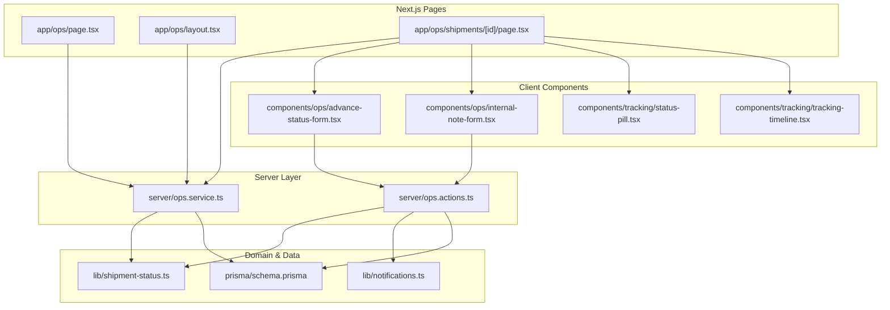
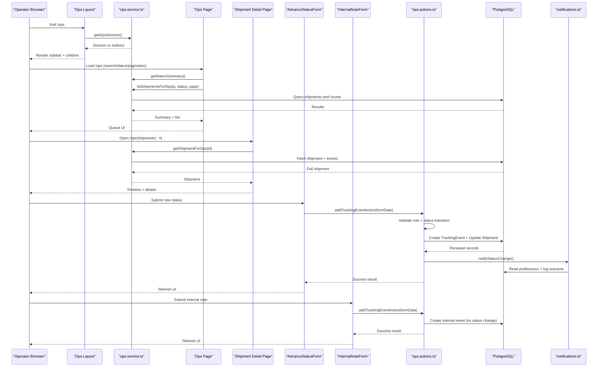
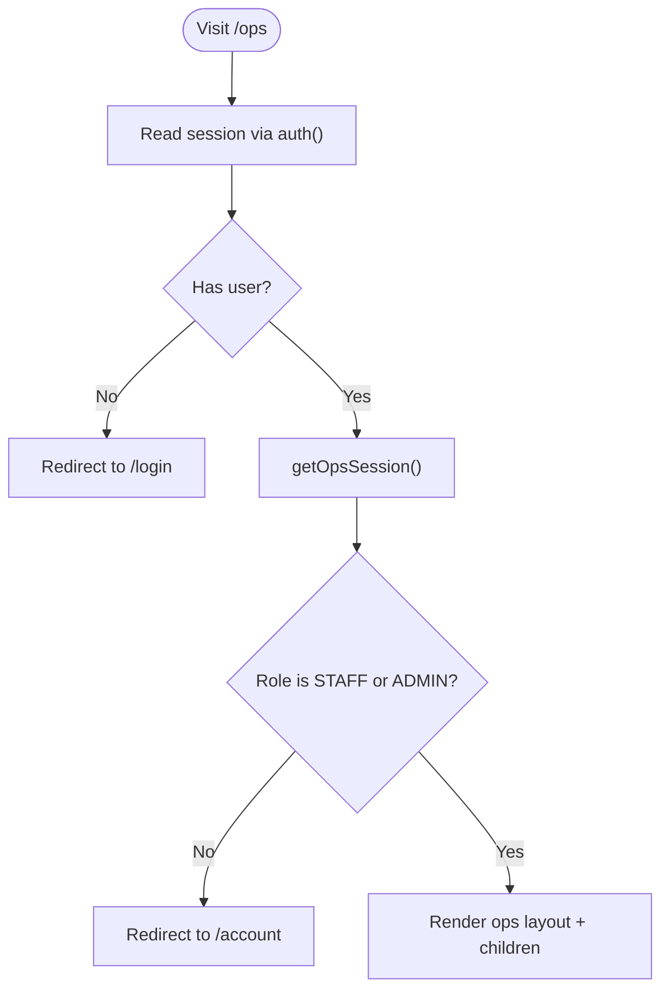
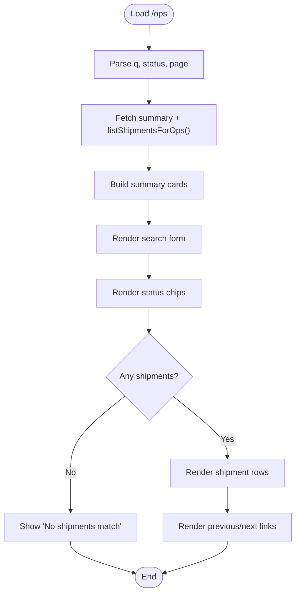
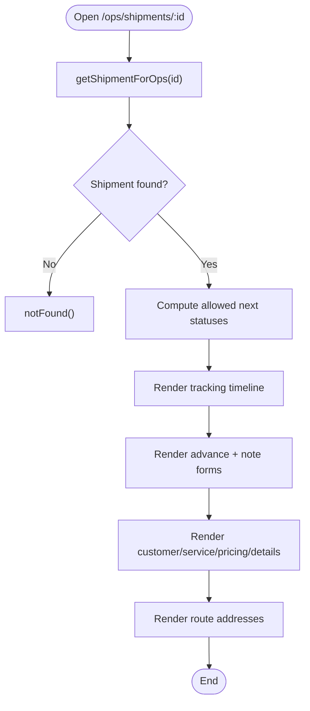
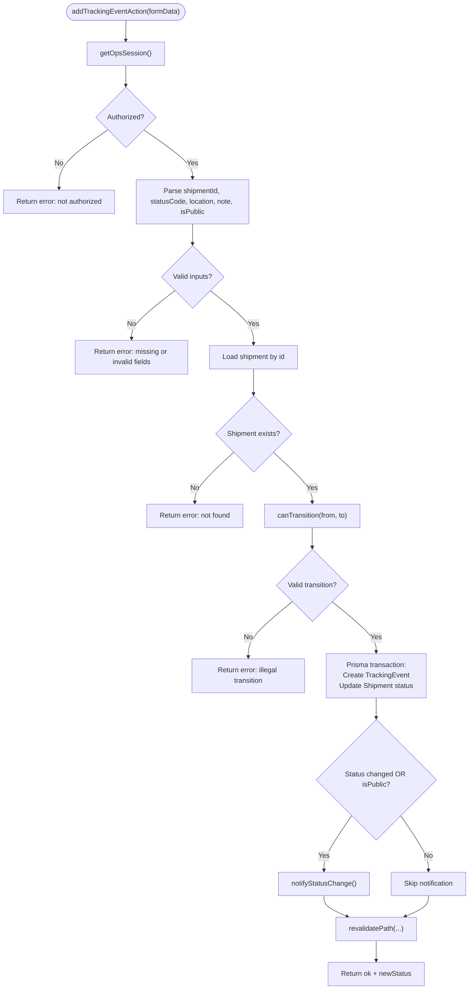
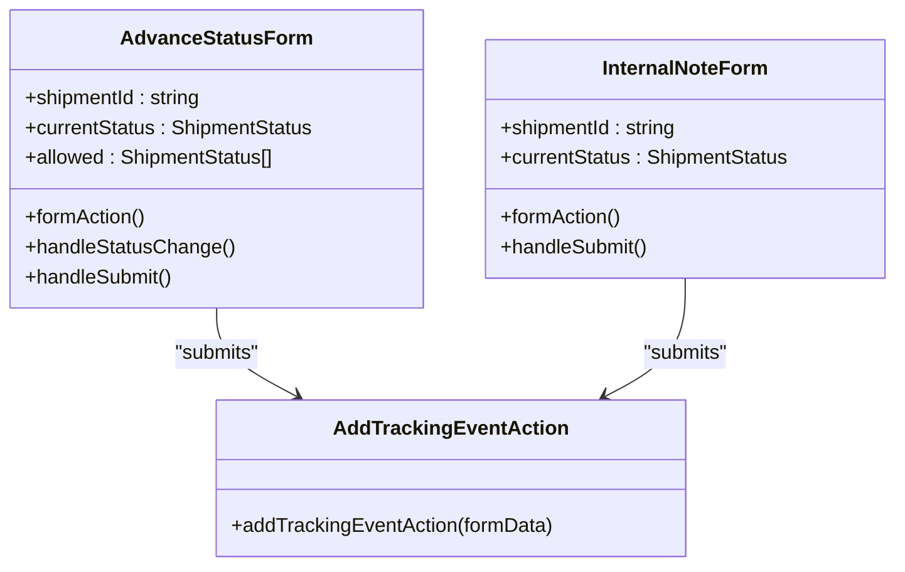
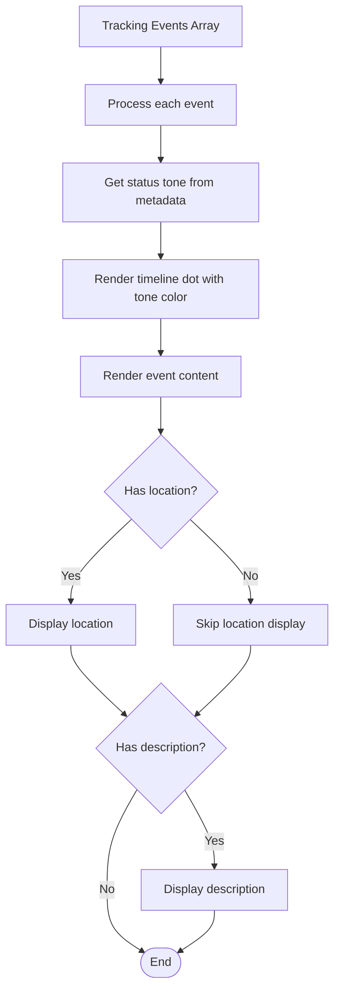
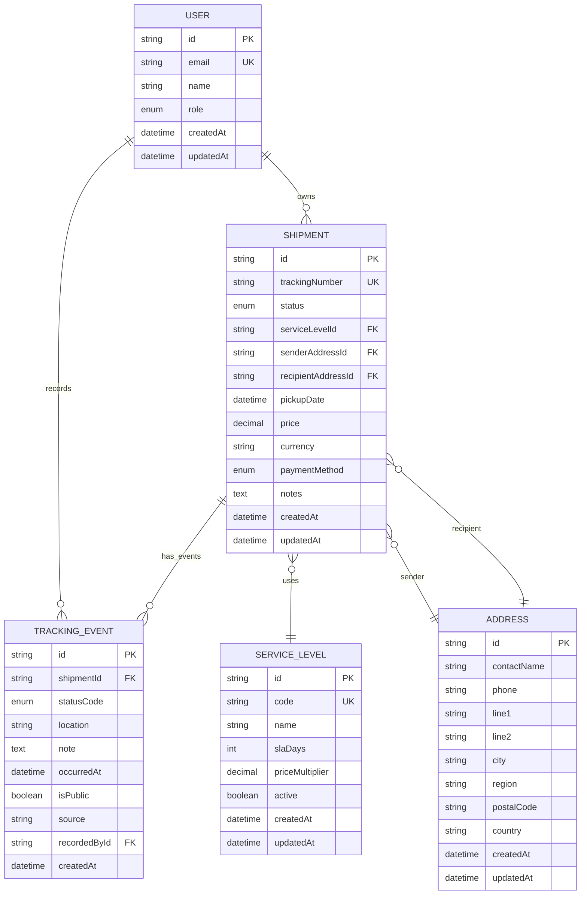
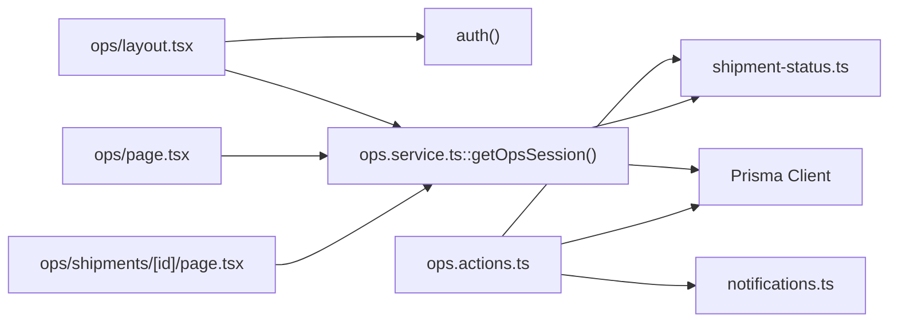

# Operations Back Office

<cite>
**Referenced Files in This Document**
- [app/ops/page.tsx](file://app/ops/page.tsx)
- [app/ops/layout.tsx](file://app/ops/layout.tsx)
- [app/ops/shipments/[id]/page.tsx](file://app/ops/shipments/[id]/page.tsx)
- [server/ops.actions.ts](file://server/ops.actions.ts)
- [server/ops.service.ts](file://server/ops.service.ts)
- [components/ops/advance-status-form.tsx](file://components/ops/advance-status-form.tsx)
- [components/ops/internal-note-form.tsx](file://components/ops/internal-note-form.tsx)
- [components/tracking/status-pill.tsx](file://components/tracking/status-pill.tsx)
- [components/tracking/tracking-timeline.tsx](file://components/tracking/tracking-timeline.tsx)
- [lib/shipment-status.ts](file://lib/shipment-status.ts)
- [lib/notifications.ts](file://lib/notifications.ts)
- [prisma/schema.prisma](file://prisma/schema.prisma)
- [middleware.ts](file://middleware.ts)
</cite>

## Update Summary
**Changes Made**
- Updated to reflect comprehensive operations back office system implementation with role-based access control
- Added documentation for shipment management dashboard with advanced search and filtering capabilities
- Enhanced internal notes functionality documentation with staff-only visibility controls
- Updated architecture diagrams to show complete data flow including notification system integration
- Added detailed component analysis for tracking timeline and status pill components
- Expanded troubleshooting guide with specific scenarios for the new features

## Table of Contents
1. [Introduction](#introduction)
2. [Project Structure](#project-structure)
3. [Core Components](#core-components)
4. [Architecture Overview](#architecture-overview)
5. [Detailed Component Analysis](#detailed-component-analysis)
6. [Dependency Analysis](#dependency-analysis)
7. [Performance Considerations](#performance-considerations)
8. [Troubleshooting Guide](#troubleshooting-guide)
9. [Conclusion](#conclusion)

## Introduction
The Operations Back Office is a comprehensive staff-facing area where authorized operators manage shipments, advance their lifecycle status through a validated state machine, and record both public tracking events and internal notes. The system provides:
- A paginated shipment queue with advanced search by tracking number and status filters
- A detailed shipment view showing full history, addresses, pricing, and operational controls
- Role-based access control ensuring only STAFF or ADMIN users can access back-office features
- Server-side validation for all state transitions through a centralized state machine
- Internal notes functionality for staff-only context that remains hidden from customers
- Optional customer notifications when meaningful updates occur
- Real-time UI updates with automatic revalidation after successful operations

This document explains how the UI, server actions, services, data model, and notification system work together to provide a secure and auditable operations workflow.

## Project Structure
The Operations Back Office spans Next.js App Router pages, server-only service functions, server actions, client-side forms, shared business logic, and the Prisma schema.

**Diagram sources**
- [app/ops/page.tsx:1-200](file://app/ops/page.tsx#L1-L200)
- [app/ops/layout.tsx:1-48](file://app/ops/layout.tsx#L1-L48)
- [app/ops/shipments/[id]/page.tsx:1-166](file://app/ops/shipments/[id]/page.tsx#L1-L166)
- [server/ops.service.ts:1-163](file://server/ops.service.ts#L1-L163)
- [server/ops.actions.ts:1-91](file://server/ops.actions.ts#L1-L91)
- [components/ops/advance-status-form.tsx:1-92](file://components/ops/advance-status-form.tsx#L1-L92)
- [components/ops/internal-note-form.tsx:1-57](file://components/ops/internal-note-form.tsx#L1-L57)
- [components/tracking/status-pill.tsx:1-8](file://components/tracking/status-pill.tsx#L1-L8)
- [components/tracking/tracking-timeline.tsx:1-51](file://components/tracking/tracking-timeline.tsx#L1-L51)
- [lib/shipment-status.ts:1-77](file://lib/shipment-status.ts#L1-L77)
- [lib/notifications.ts:1-114](file://lib/notifications.ts#L1-L114)
- [prisma/schema.prisma:1-261](file://prisma/schema.prisma#L1-L261)

**Section sources**
- [app/ops/page.tsx:1-200](file://app/ops/page.tsx#L1-L200)
- [app/ops/layout.tsx:1-48](file://app/ops/layout.tsx#L1-L48)
- [app/ops/shipments/[id]/page.tsx:1-166](file://app/ops/shipments/[id]/page.tsx#L1-L166)
- [server/ops.service.ts:1-163](file://server/ops.service.ts#L1-L163)
- [server/ops.actions.ts:1-91](file://server/ops.actions.ts#L1-L91)
- [components/ops/advance-status-form.tsx:1-92](file://components/ops/advance-status-form.tsx#L1-L92)
- [components/ops/internal-note-form.tsx:1-57](file://components/ops/internal-note-form.tsx#L1-L57)
- [components/tracking/status-pill.tsx:1-8](file://components/tracking/status-pill.tsx#L1-L8)
- [components/tracking/tracking-timeline.tsx:1-51](file://components/tracking/tracking-timeline.tsx#L1-L51)
- [lib/shipment-status.ts:1-77](file://lib/shipment-status.ts#L1-L77)
- [lib/notifications.ts:1-114](file://lib/notifications.ts#L1-L114)
- [prisma/schema.prisma:1-261](file://prisma/schema.prisma#L1-L261)

## Core Components
- **Operations layout** enforces operator access by checking session role before rendering back-office content, redirecting unauthorized users to appropriate locations.
- **Operations queue page** lists shipments across all customers with search by tracking number, status filter chips using centralized status definitions, summary cards for active/exceptions/delivered/total counts, and pagination controls.
- **Shipment detail page** shows full history with tracking timeline, addresses, pricing details, and allows operators to advance status or add internal notes through dedicated forms.
- **Server actions** validate authorization, enforce the state machine, persist tracking events, update shipment status, trigger revalidation, and handle conditional customer notifications.
- **Service layer** provides read helpers for listing, summarizing, and fetching full shipment details for operators with proper role-based access control.
- **Status library** defines allowed states, transitions, terminal/completed checks, human-readable metadata, and status tone classifications.
- **Notification helper** sends emails on meaningful updates while honoring user preferences and logging outcomes with detailed status tracking.
- **Tracking components** provide reusable UI elements for status pills and timeline visualization with consistent styling and behavior.

**Section sources**
- [app/ops/layout.tsx:1-48](file://app/ops/layout.tsx#L1-L48)
- [app/ops/page.tsx:1-200](file://app/ops/page.tsx#L1-L200)
- [app/ops/shipments/[id]/page.tsx:1-166](file://app/ops/shipments/[id]/page.tsx#L1-L166)
- [server/ops.actions.ts:1-91](file://server/ops.actions.ts#L1-L91)
- [server/ops.service.ts:1-163](file://server/ops.service.ts#L1-L163)
- [lib/shipment-status.ts:1-77](file://lib/shipment-status.ts#L1-L77)
- [lib/notifications.ts:1-114](file://lib/notifications.ts#L1-L114)
- [components/tracking/status-pill.tsx:1-8](file://components/tracking/status-pill.tsx#L1-L8)
- [components/tracking/tracking-timeline.tsx:1-51](file://components/tracking/tracking-timeline.tsx#L1-L51)

## Architecture Overview
The Operations Back Office follows a layered architecture with clear separation of concerns:
- **Presentation layer**: Next.js pages render queues and details with server-side data fetching
- **Client components**: Forms collect operator input and call server actions with real-time feedback
- **Server actions**: Validate inputs, enforce roles and state transitions, write to the database, and invalidate caches
- **Services**: Encapsulate read queries and role-gated access checks with optimized database queries
- **Domain logic**: Centralized state machine and metadata ensuring consistency across the application
- **Notifications**: Asynchronous email delivery with preference handling, logging, and error tracking

**Diagram sources**
- [app/ops/layout.tsx:1-48](file://app/ops/layout.tsx#L1-L48)
- [app/ops/page.tsx:1-200](file://app/ops/page.tsx#L1-L200)
- [app/ops/shipments/[id]/page.tsx:1-166](file://app/ops/shipments/[id]/page.tsx#L1-L166)
- [server/ops.service.ts:1-163](file://server/ops.service.ts#L1-L163)
- [server/ops.actions.ts:1-91](file://server/ops.actions.ts#L1-L91)
- [lib/notifications.ts:1-114](file://lib/notifications.ts#L1-L114)

## Detailed Component Analysis

### Operations Layout and Access Control
The layout ensures only authenticated operators can access the back office through a multi-layered security approach:
- It reads the current session via NextAuth and redirects unauthenticated users to login
- It calls `getOpsSession()` which validates STAFF or ADMIN roles, otherwise redirects to the customer account area
- It renders a minimal sidebar navigation for the operations queue with breadcrumb-style header

**Diagram sources**
- [app/ops/layout.tsx:1-48](file://app/ops/layout.tsx#L1-L48)
- [server/ops.service.ts:11-19](file://server/ops.service.ts#L11-L19)

**Section sources**
- [app/ops/layout.tsx:1-48](file://app/ops/layout.tsx#L1-L48)
- [server/ops.service.ts:11-19](file://server/ops.service.ts#L11-L19)

### Operations Queue Page
The queue page provides a comprehensive dashboard for shipment management:
- **Summary cards** for active, exceptions, delivered, and total shipments with quick filter links
- **Search functionality** by tracking number with real-time query parameter handling
- **Status filter chips** using the centralized status definitions with count badges
- **Paginated results** with links to individual shipment details and preserved filter state

Key behaviors include concurrent data fetching for summary and list data, empty-state messaging, and sophisticated query parameter building that preserves existing filters across navigation.

**Diagram sources**
- [app/ops/page.tsx:1-200](file://app/ops/page.tsx#L1-L200)
- [server/ops.service.ts:46-103](file://server/ops.service.ts#L46-L103)
- [lib/shipment-status.ts:9-20](file://lib/shipment-status.ts#L9-L20)

**Section sources**
- [app/ops/page.tsx:1-200](file://app/ops/page.tsx#L1-L200)
- [server/ops.service.ts:46-103](file://server/ops.service.ts#L46-L103)

### Shipment Detail Page
The detail page displays comprehensive shipment information and operational controls:
- **Current status** with label, description, and visual status pill
- **Full tracking timeline** including both public and internal events with chronological ordering
- **Operational controls** through dedicated forms for advancing status and adding internal notes
- **Customer and service details** including created date, pickup date, payment method, and total price
- **Route information** showing sender and recipient addresses with contact details

It computes allowed next statuses from the state machine and passes them to the advance form, ensuring only valid transitions are presented to operators.

**Diagram sources**
- [app/ops/shipments/[id]/page.tsx:1-166](file://app/ops/shipments/[id]/page.tsx#L1-L166)
- [server/ops.service.ts:146-162](file://server/ops.service.ts#L146-L162)
- [lib/shipment-status.ts:45-51](file://lib/shipment-status.ts#L45-L51)

**Section sources**
- [app/ops/shipments/[id]/page.tsx:1-166](file://app/ops/shipments/[id]/page.tsx#L1-L166)
- [server/ops.service.ts:146-162](file://server/ops.service.ts#L146-L162)
- [lib/shipment-status.ts:45-51](file://lib/shipment-status.ts#L45-L51)

### Server Actions: Advancing Status and Recording Notes
The server action centralizes all critical business logic for shipment updates:
- **Authorization check** for operators using role-based access control
- **Input parsing and validation** for all form fields including status codes and optional location/note
- **State transition validation** against the centralized state machine preventing illegal jumps
- **Atomic persistence** of tracking events and shipment updates within database transactions
- **Conditional customer notifications** based on status changes or public event flags
- **Cache invalidation** for relevant routes ensuring UI consistency across the application

**Diagram sources**
- [server/ops.actions.ts:1-91](file://server/ops.actions.ts#L1-L91)
- [lib/shipment-status.ts:45-51](file://lib/shipment-status.ts#L45-L51)
- [lib/notifications.ts:49-108](file://lib/notifications.ts#L49-L108)

**Section sources**
- [server/ops.actions.ts:1-91](file://server/ops.actions.ts#L1-L91)
- [lib/shipment-status.ts:45-51](file://lib/shipment-status.ts#L45-L51)
- [lib/notifications.ts:49-108](file://lib/notifications.ts#L49-L108)

### Client Forms: Advance Status and Internal Note
The client forms provide intuitive interfaces for operators to interact with the system:

**AdvanceStatusForm:**
- Uses `useActionState` to submit to the server action with real-time feedback
- Displays allowed statuses based on the current state from the state machine
- Shows success/error alerts and automatically refreshes the page after successful submissions
- Supports optional location and note fields, plus toggling public visibility for customer notifications

**InternalNoteForm:**
- Submits the same server action but keeps the current status unchanged (no-op transition)
- Records an internal-only note without notifying customers or affecting public tracking
- Provides a streamlined interface for staff-only context recording

**Diagram sources**
- [components/ops/advance-status-form.tsx:1-92](file://components/ops/advance-status-form.tsx#L1-L92)
- [components/ops/internal-note-form.tsx:1-57](file://components/ops/internal-note-form.tsx#L1-L57)
- [server/ops.actions.ts:1-91](file://server/ops.actions.ts#L1-L91)

**Section sources**
- [components/ops/advance-status-form.tsx:1-92](file://components/ops/advance-status-form.tsx#L1-L92)
- [components/ops/internal-note-form.tsx:1-57](file://components/ops/internal-note-form.tsx#L1-L57)
- [server/ops.actions.ts:1-91](file://server/ops.actions.ts#L1-L91)

### Tracking Components: Status Pill and Timeline
The tracking components provide reusable UI elements for consistent visualization:

**StatusPill:**
- Renders status badges with appropriate color coding based on status tone
- Uses centralized status metadata for consistent labeling and styling
- Integrates seamlessly with the broader status system throughout the application

**TrackingTimeline:**
- Displays chronological tracking events with visual timeline indicators
- Handles both public and internal events with appropriate visual distinction
- Formats dates consistently and provides location and description support
- Uses tone-based color coding for different status types

**Diagram sources**
- [components/tracking/status-pill.tsx:1-8](file://components/tracking/status-pill.tsx#L1-L8)
- [components/tracking/tracking-timeline.tsx:1-51](file://components/tracking/tracking-timeline.tsx#L1-L51)
- [lib/shipment-status.ts:62-76](file://lib/shipment-status.ts#L62-L76)

**Section sources**
- [components/tracking/status-pill.tsx:1-8](file://components/tracking/status-pill.tsx#L1-L8)
- [components/tracking/tracking-timeline.tsx:1-51](file://components/tracking/tracking-timeline.tsx#L1-L51)

### Data Model and Relationships
The Operations Back Office primarily interacts with several interconnected entities:
- **Shipment**: core entity with status, addresses, pricing, timestamps, and relationships to other entities
- **TrackingEvent**: audit trail of status changes and notes, including source and visibility flags
- **User**: owner of shipments and recorder of events with role-based access control
- **ServiceLevel**: shipping tier used in the detail view with SLA and pricing information
- **Address**: sender and recipient locations with contact information and zone associations

**Diagram sources**
- [prisma/schema.prisma:57-78](file://prisma/schema.prisma#L57-L78)
- [prisma/schema.prisma:98-111](file://prisma/schema.prisma#L98-L111)
- [prisma/schema.prisma:131-154](file://prisma/schema.prisma#L131-L154)
- [prisma/schema.prisma:160-186](file://prisma/schema.prisma#L160-L186)
- [prisma/schema.prisma:209-226](file://prisma/schema.prisma#L209-L226)

**Section sources**
- [prisma/schema.prisma:57-78](file://prisma/schema.prisma#L57-L78)
- [prisma/schema.prisma:98-111](file://prisma/schema.prisma#L98-L111)
- [prisma/schema.prisma:131-154](file://prisma/schema.prisma#L131-L154)
- [prisma/schema.prisma:160-186](file://prisma/schema.prisma#L160-L186)
- [prisma/schema.prisma:209-226](file://prisma/schema.prisma#L209-L226)

## Dependency Analysis
The Operations Back Office depends on several key subsystems working together:
- **Authentication and session utilities** for role-based access control and user session management
- **Prisma client** for database queries, transactions, and type-safe data access
- **Shared status library** for consistent state machine rules and metadata across the application
- **Notification subsystem** for customer communications with preference handling and logging

**Diagram sources**
- [app/ops/layout.tsx:1-48](file://app/ops/layout.tsx#L1-L48)
- [app/ops/page.tsx:1-200](file://app/ops/page.tsx#L1-L200)
- [app/ops/shipments/[id]/page.tsx:1-166](file://app/ops/shipments/[id]/page.tsx#L1-L166)
- [server/ops.actions.ts:1-91](file://server/ops.actions.ts#L1-L91)
- [server/ops.service.ts:1-163](file://server/ops.service.ts#L1-L163)
- [lib/shipment-status.ts:1-77](file://lib/shipment-status.ts#L1-L77)
- [lib/notifications.ts:1-114](file://lib/notifications.ts#L1-L114)

**Section sources**
- [app/ops/layout.tsx:1-48](file://app/ops/layout.tsx#L1-L48)
- [app/ops/page.tsx:1-200](file://app/ops/page.tsx#L1-L200)
- [app/ops/shipments/[id]/page.tsx:1-166](file://app/ops/shipments/[id]/page.tsx#L1-L166)
- [server/ops.actions.ts:1-91](file://server/ops.actions.ts#L1-L91)
- [server/ops.service.ts:1-163](file://server/ops.service.ts#L1-L163)
- [lib/shipment-status.ts:1-77](file://lib/shipment-status.ts#L1-L77)
- [lib/notifications.ts:1-114](file://lib/notifications.ts#L1-L114)

## Performance Considerations
The Operations Back Office implements several performance optimizations:
- **Concurrent reads**: The queue page fetches summary and list data in parallel using `Promise.all` to reduce latency
- **Efficient queries**: The service layer uses grouped aggregation for summaries and selective field projection for listings to minimize data transfer
- **Pagination limits**: Page size is bounded to prevent excessive payloads and ensure responsive UI performance
- **Database transactions**: Writes are wrapped in single transactions to ensure consistency between event creation and shipment updates
- **Selective notifications**: Notifications are only sent for meaningful updates or public events, reducing unnecessary I/O overhead
- **Targeted cache invalidation**: Specific path revalidation minimizes unnecessary refetches across related routes
- **Optimized data loading**: The detail page loads comprehensive shipment data with necessary relations in a single query

## Troubleshooting Guide
Common issues and resolutions for the Operations Back Office:

**Unauthorized access to operations:**
- Ensure the user has STAFF or ADMIN role in the database
- Verify session initialization and middleware configuration
- Check that the user is properly authenticated before accessing `/ops` routes

**Illegal status transitions:**
- Confirm the requested target status is allowed from the current status according to the state machine
- Review the error message returned by the server action for specific transition violations
- Verify the shipment exists and has a valid current status

**Missing shipment:**
- Verify the shipment ID exists in the database and is accessible
- Check that the shipment hasn't been deleted or moved to another tenant
- Ensure proper routing parameters are passed to the detail page

**No notifications received:**
- Check user notification preferences for the relevant event type in the database
- Inspect notification logs for skipped or failed deliveries with detailed error messages
- Validate SMTP configuration and environment variables for email delivery
- Verify the user has a valid email address associated with their account

**UI does not reflect updates:**
- Ensure server action returns success and triggers appropriate revalidation paths
- Confirm client component refresh behavior after successful submission
- Check that the router.refresh() is called in client components after successful operations

**Internal notes not visible:**
- Verify the note was recorded with `isPublic: false` for internal-only visibility
- Check that the note appears in the tracking timeline for staff users
- Ensure the note doesn't appear on public tracking pages for guests

**Section sources**
- [app/ops/layout.tsx:1-48](file://app/ops/layout.tsx#L1-L48)
- [server/ops.actions.ts:26-90](file://server/ops.actions.ts#L26-L90)
- [lib/notifications.ts:49-108](file://lib/notifications.ts#L49-L108)
- [middleware.ts:1-14](file://middleware.ts#L1-L14)

## Conclusion
The Operations Back Office provides a secure, auditable, and user-friendly interface for managing shipments with comprehensive role-based access control. It enforces strict state machine validation for all status transitions, integrates with a robust notification system to keep customers informed, and provides specialized tools for staff-only internal notes. The separation of concerns between pages, server actions, services, and domain logic makes the system maintainable and testable, while the modern Next.js architecture ensures optimal performance and user experience. The system successfully balances operational efficiency with security requirements, providing operators with powerful tools while maintaining data integrity and audit trails.