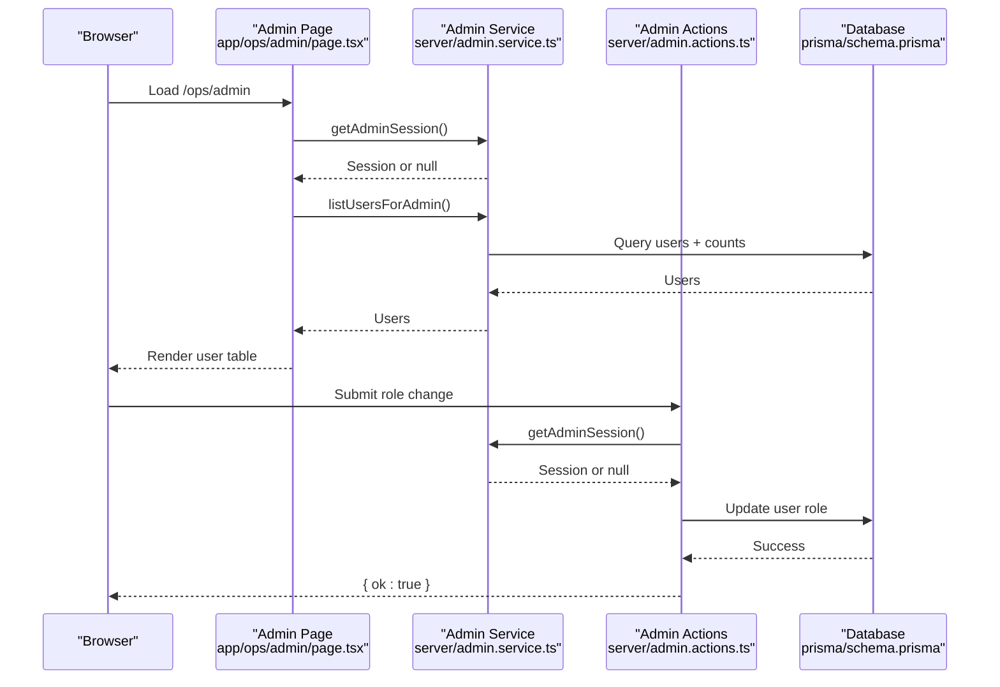
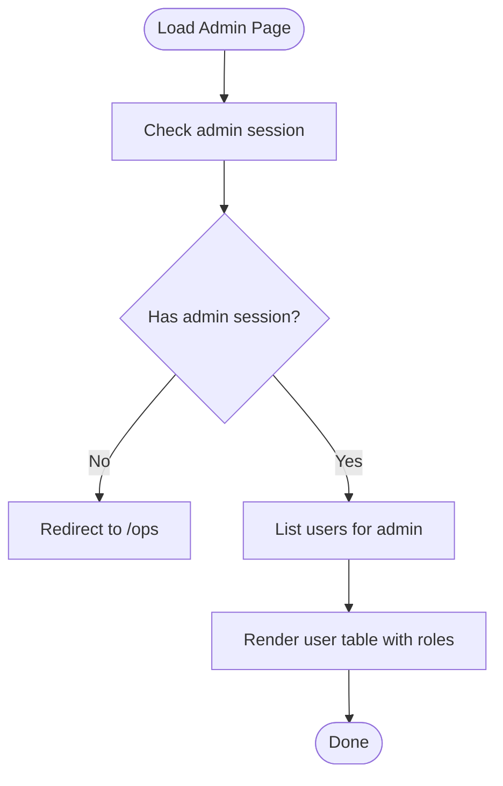
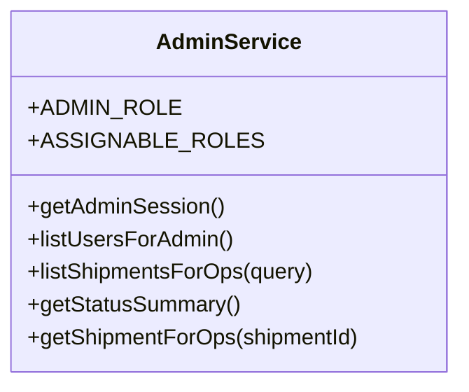
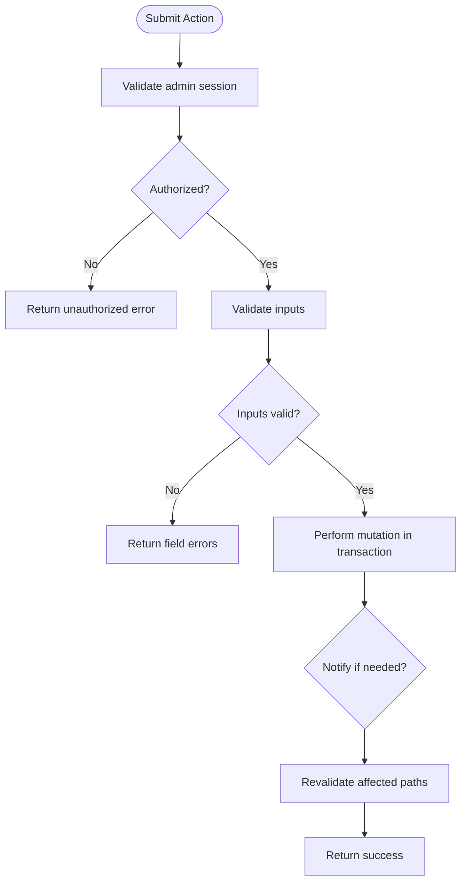
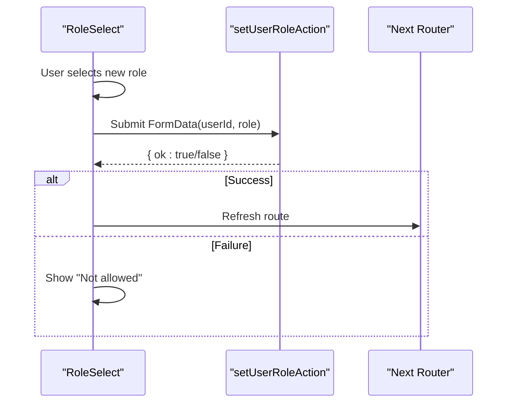
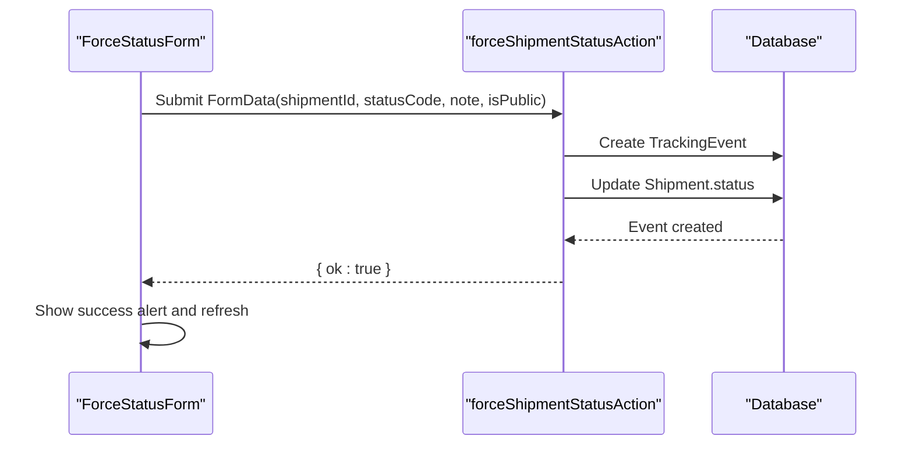
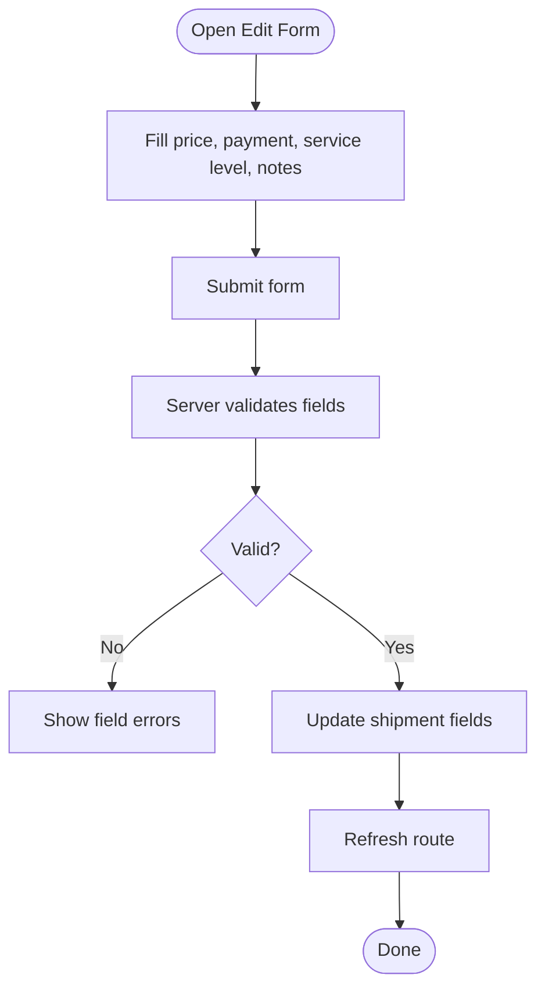
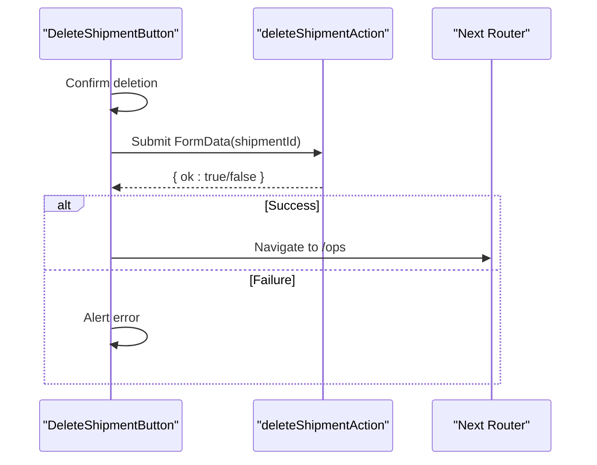
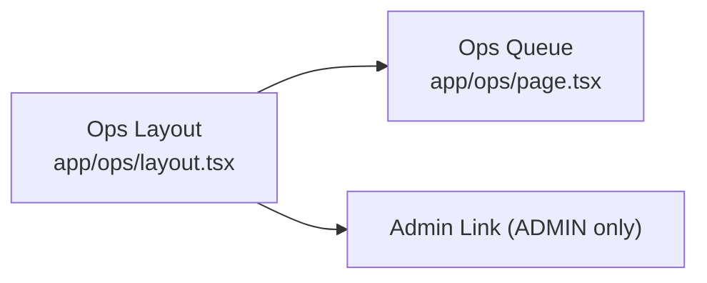
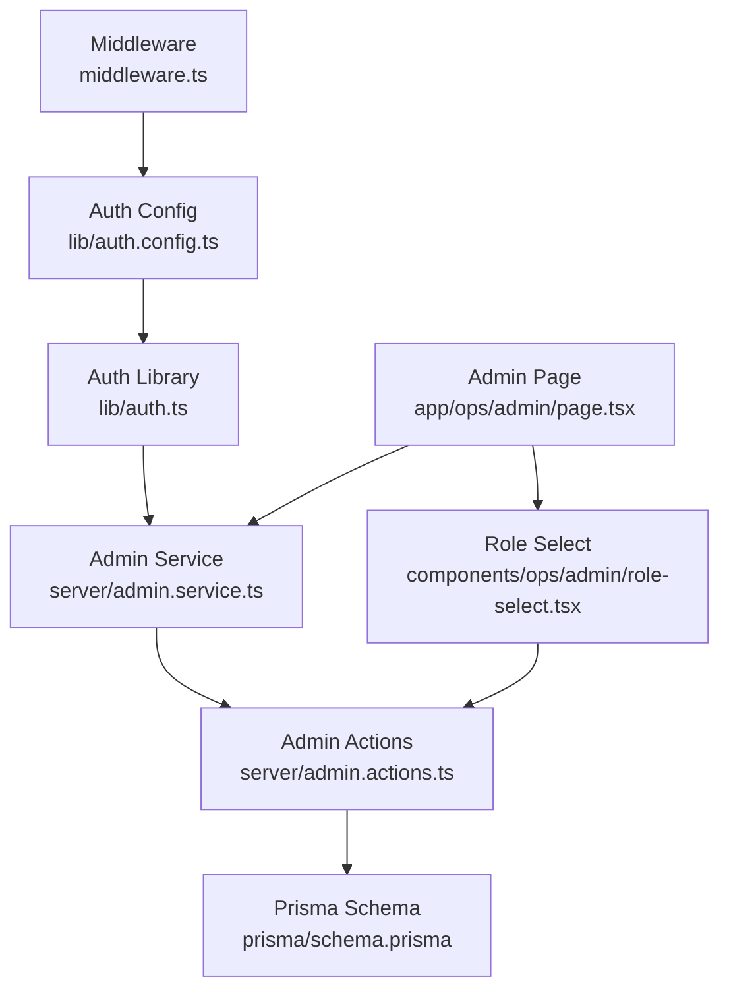

# Administrative Console

<cite>
**Referenced Files in This Document**
- [app/ops/admin/page.tsx](file://app/ops/admin/page.tsx)
- [app/ops/layout.tsx](file://app/ops/layout.tsx)
- [app/ops/page.tsx](file://app/ops/page.tsx)
- [server/admin.actions.ts](file://server/admin.actions.ts)
- [server/admin.service.ts](file://server/admin.service.ts)
- [components/ops/admin/delete-shipment-button.tsx](file://components/ops/admin/delete-shipment-button.tsx)
- [components/ops/admin/edit-shipment-form.tsx](file://components/ops/admin/edit-shipment-form.tsx)
- [components/ops/admin/force-status-form.tsx](file://components/ops/admin/force-status-form.tsx)
- [components/ops/admin/role-select.tsx](file://components/ops/admin/role-select.tsx)
- [lib/auth.config.ts](file://lib/auth.config.ts)
- [lib/auth.ts](file://lib/auth.ts)
- [middleware.ts](file://middleware.ts)
- [prisma/schema.prisma](file://prisma/schema.prisma)
</cite>

## Table of Contents
1. [Introduction](#introduction)
2. [Project Structure](#project-structure)
3. [Core Components](#core-components)
4. [Architecture Overview](#architecture-overview)
5. [Detailed Component Analysis](#detailed-component-analysis)
6. [Dependency Analysis](#dependency-analysis)
7. [Performance Considerations](#performance-considerations)
8. [Troubleshooting Guide](#troubleshooting-guide)
9. [Conclusion](#conclusion)

## Introduction
The Administrative Console is the privileged back-office area for operators and administrators to manage shipments, override shipment statuses, edit commercial details, delete shipments, and manage user roles. It sits under the Operations workspace and is gated by role-based access control. Administrators have full control, while operators can advance shipments through the normal state machine and add internal notes.

This document explains how the console is structured, how authorization works, what actions are available, and how data flows between UI components, server actions, services, and the database.

## Project Structure
The administrative console spans pages, layout, server actions, server services, and client-side admin components:

- Pages and layout:
  - Operations layout and queue page provide navigation and context.
  - Admin console page lists users and their roles.
- Server layer:
  - Admin service provides session checks and read helpers.
  - Admin actions implement privileged mutations (status override, edit, delete, role change).
- Client components:
  - Forms and buttons that call server actions and refresh routes.
- Auth and middleware:
  - NextAuth configuration and edge middleware protect routes and inject role into sessions.
- Data model:
  - Prisma schema defines roles, statuses, and relationships.

```mermaid
graph TB
subgraph "Next.js App"
OpsLayout["Operations Layout<br/>app/ops/layout.tsx"]
OpsPage["Operations Queue<br/>app/ops/page.tsx"]
AdminPage["Admin Console Page<br/>app/ops/admin/page.tsx"]
end
subgraph "Server Layer"
AdminService["Admin Service<br/>server/admin.service.ts"]
AdminActions["Admin Actions<br/>server/admin.actions.ts"]
end
subgraph "Client Components"
RoleSelect["Role Select<br/>components/ops/admin/role-select.tsx"]
ForceStatusForm["Force Status Form<br/>components/ops/admin/force-status-form.tsx"]
EditShipmentForm["Edit Shipment Form<br/>components/ops/admin/edit-shipment-form.tsx]
DeleteButton["Delete Shipment Button<br/>components/ops/admin/delete-shipment-button.tsx"]
end
subgraph "Auth & Middleware"
AuthConfig["Auth Config<br/>lib/auth.config.ts"]
AuthLib["Auth Library<br/>lib/auth.ts"]
Middleware["Middleware<br/>middleware.ts"]
end
subgraph "Database"
Schema["Prisma Schema<br/>prisma/schema.prisma"]
end
OpsLayout --> OpsPage
OpsLayout --> AdminPage
AdminPage --> AdminService
AdminPage --> RoleSelect
RoleSelect --> AdminActions
ForceStatusForm --> AdminActions
EditShipmentForm --> AdminActions
DeleteButton --> AdminActions
AdminActions --> AdminService
AdminService --> Schema
AuthConfig --> AuthLib
Middleware --> AuthConfig
OpsLayout --> AuthLib
```

**Diagram sources**
- [app/ops/layout.tsx:10-17](file://app/ops/layout.tsx#L10-L17)
- [app/ops/admin/page.tsx:19-25](file://app/ops/admin/page.tsx#L19-L25)
- [server/admin.service.ts:18-22](file://server/admin.service.ts#L18-L22)
- [server/admin.actions.ts:26-72](file://server/admin.actions.ts#L26-L72)
- [components/ops/admin/role-select.tsx:19-56](file://components/ops/admin/role-select.tsx#L19-L56)
- [components/ops/admin/force-status-form.tsx:14-66](file://components/ops/admin/force-status-form.tsx#L14-L66)
- [components/ops/admin/edit-shipment-form.tsx:30-99](file://components/ops/admin/edit-shipment-form.tsx#L30-L99)
- [components/ops/admin/delete-shipment-button.tsx:10-30](file://components/ops/admin/delete-shipment-button.tsx#L10-L30)
- [lib/auth.config.ts:11-41](file://lib/auth.config.ts#L11-L41)
- [lib/auth.ts:37-41](file://lib/auth.ts#L37-L41)
- [middleware.ts:1-13](file://middleware.ts#L1-L13)
- [prisma/schema.prisma:17-22](file://prisma/schema.prisma#L17-L22)

**Section sources**
- [app/ops/layout.tsx:10-17](file://app/ops/layout.tsx#L10-L17)
- [app/ops/admin/page.tsx:19-25](file://app/ops/admin/page.tsx#L19-L25)
- [server/admin.service.ts:18-22](file://server/admin.service.ts#L18-L22)
- [server/admin.actions.ts:26-72](file://server/admin.actions.ts#L26-L72)
- [components/ops/admin/role-select.tsx:19-56](file://components/ops/admin/role-select.tsx#L19-L56)
- [components/ops/admin/force-status-form.tsx:14-66](file://components/ops/admin/force-status-form.tsx#L14-L66)
- [components/ops/admin/edit-shipment-form.tsx:30-99](file://components/ops/admin/edit-shipment-form.tsx#L30-L99)
- [components/ops/admin/delete-shipment-button.tsx:10-30](file://components/ops/admin/delete-shipment-button.tsx#L10-L30)
- [lib/auth.config.ts:11-41](file://lib/auth.config.ts#L11-L41)
- [lib/auth.ts:37-41](file://lib/auth.ts#L37-L41)
- [middleware.ts:1-13](file://middleware.ts#L1-L13)
- [prisma/schema.prisma:17-22](file://prisma/schema.prisma#L17-L22)

## Core Components
- Admin console page:
  - Enforces administrator-only access and renders a table of users with role badges and inline role selectors.
- Admin service:
  - Provides `getAdminSession` to gate privileged operations and helper functions to list users and shipments.
- Admin actions:
  - Implement server-side mutations: force status override, update shipment commercial details, delete shipment, and set user role.
- Client components:
  - Role select, force status form, edit shipment form, and delete button integrate with server actions and handle pending states and success/error feedback.

Key responsibilities:
- Authorization: Only ADMIN users can access the console and perform privileged mutations.
- Data integrity: Server actions validate inputs and use transactions where needed.
- User experience: Client components show loading states, alerts, and route refreshes after successful mutations.

**Section sources**
- [app/ops/admin/page.tsx:19-89](file://app/ops/admin/page.tsx#L19-L89)
- [server/admin.service.ts:18-22](file://server/admin.service.ts#L18-L22)
- [server/admin.actions.ts:26-169](file://server/admin.actions.ts#L26-L169)
- [components/ops/admin/role-select.tsx:19-83](file://components/ops/admin/role-select.tsx#L19-L83)
- [components/ops/admin/force-status-form.tsx:14-66](file://components/ops/admin/force-status-form.tsx#L14-L66)
- [components/ops/admin/edit-shipment-form.tsx:30-99](file://components/ops/admin/edit-shipment-form.tsx#L30-L99)
- [components/ops/admin/delete-shipment-button.tsx:10-30](file://components/ops/admin/delete-shipment-button.tsx#L10-L30)

## Architecture Overview
The administrative console follows a layered architecture:

- Presentation layer:
  - Next.js app pages render the console UI.
  - Client components encapsulate forms and buttons.
- Server layer:
  - Server actions enforce authorization and business rules.
  - Services provide reusable read helpers and session checks.
- Data layer:
  - Prisma models define entities and relationships.
- Auth layer:
  - NextAuth config and middleware protect routes and inject role into sessions.



**Diagram sources**
- [app/ops/admin/page.tsx:19-25](file://app/ops/admin/page.tsx#L19-L25)
- [server/admin.service.ts:18-22](file://server/admin.service.ts#L18-L22)
- [server/admin.service.ts:181-203](file://server/admin.service.ts#L181-L203)
- [server/admin.actions.ts:150-169](file://server/admin.actions.ts#L150-L169)
- [prisma/schema.prisma:58-79](file://prisma/schema.prisma#L58-L79)

## Detailed Component Analysis

### Admin Console Page
- Purpose:
  - Display all users with roles and allow admins to change roles inline.
- Authorization:
  - Calls `getAdminSession`; non-admins are redirected to `/ops`.
- Data:
  - Fetches users via `listUsersForAdmin`, including email, name, role, join date, and shipment count.
- UI:
  - Shows a table with badges indicating role tone and a role selector per row.



**Diagram sources**
- [app/ops/admin/page.tsx:19-25](file://app/ops/admin/page.tsx#L19-L25)
- [app/ops/admin/page.tsx:25-89](file://app/ops/admin/page.tsx#L25-L89)

**Section sources**
- [app/ops/admin/page.tsx:19-89](file://app/ops/admin/page.tsx#L19-L89)

### Admin Service
- Responsibilities:
  - Provide `getAdminSession` to ensure only administrators proceed.
  - Expose helpers for listing users and shipments, computing summaries, and retrieving detailed shipment info.
- Key exports:
  - `ADMIN_ROLE`, `ASSIGNABLE_ROLES`, `AssignableRole`.
  - `listUsersForAdmin`, `listShipmentsForOps`, `getStatusSummary`, `getShipmentForOps`.
- Notes:
  - The schema defines only CUSTOMER and ADMIN roles; some client code references STAFF for UI labels but the authoritative backend role set is CUSTOMER and ADMIN.



**Diagram sources**
- [server/admin.service.ts:13-22](file://server/admin.service.ts#L13-L22)
- [server/admin.service.ts:54-110](file://server/admin.service.ts#L54-L110)
- [server/admin.service.ts:121-146](file://server/admin.service.ts#L121-L146)
- [server/admin.service.ts:149-164](file://server/admin.service.ts#L149-L164)
- [server/admin.service.ts:181-203](file://server/admin.service.ts#L181-L203)

**Section sources**
- [server/admin.service.ts:13-22](file://server/admin.service.ts#L13-L22)
- [server/admin.service.ts:54-110](file://server/admin.service.ts#L54-L110)
- [server/admin.service.ts:121-146](file://server/admin.service.ts#L121-L146)
- [server/admin.service.ts:149-164](file://server/admin.service.ts#L149-L164)
- [server/admin.service.ts:181-203](file://server/admin.service.ts#L181-L203)

### Admin Actions
- Mutations:
  - Force shipment status: bypasses state machine, records an OPS event, updates shipment status, optionally notifies, and revalidates relevant paths.
  - Update shipment details: validates price, payment method, service level, and notes; updates shipment fields.
  - Delete shipment: removes shipment record and revalidates related routes.
  - Set user role: validates assignable roles, prevents self-demotion from ADMIN, updates user role.
- Authorization:
  - All actions check `getAdminSession` and return errors if not authorized.
- Revalidation:
  - Uses Next.js cache revalidation to keep UI consistent across ops queue, account shipment detail, and public tracking pages.



**Diagram sources**
- [server/admin.actions.ts:26-72](file://server/admin.actions.ts#L26-L72)
- [server/admin.actions.ts:75-123](file://server/admin.actions.ts#L75-L123)
- [server/admin.actions.ts:126-144](file://server/admin.actions.ts#L126-L144)
- [server/admin.actions.ts:150-169](file://server/admin.actions.ts#L150-L169)

**Section sources**
- [server/admin.actions.ts:26-72](file://server/admin.actions.ts#L26-L72)
- [server/admin.actions.ts:75-123](file://server/admin.actions.ts#L75-L123)
- [server/admin.actions.ts:126-144](file://server/admin.actions.ts#L126-L144)
- [server/admin.actions.ts:150-169](file://server/admin.actions.ts#L150-L169)

### Client Components

#### Role Select
- Behavior:
  - Allows changing a user’s role; disables editing for the current admin user.
  - Calls `setUserRoleAction` and refreshes the route on success.
- Guards:
  - Mirrors server-side protection against self-demotion.



**Diagram sources**
- [components/ops/admin/role-select.tsx:19-56](file://components/ops/admin/role-select.tsx#L19-L56)
- [server/admin.actions.ts:150-169](file://server/admin.actions.ts#L150-L169)

**Section sources**
- [components/ops/admin/role-select.tsx:19-83](file://components/ops/admin/role-select.tsx#L19-L83)

#### Force Status Form
- Behavior:
  - Lets admins bypass the state machine and set any shipment status.
  - Records a tracking event with an explicit note and optional public visibility.
  - Refreshes the route on success.



**Diagram sources**
- [components/ops/admin/force-status-form.tsx:14-66](file://components/ops/admin/force-status-form.tsx#L14-L66)
- [server/admin.actions.ts:26-72](file://server/admin.actions.ts#L26-L72)

**Section sources**
- [components/ops/admin/force-status-form.tsx:14-66](file://components/ops/admin/force-status-form.tsx#L14-L66)
- [server/admin.actions.ts:26-72](file://server/admin.actions.ts#L26-L72)

#### Edit Shipment Form
- Behavior:
  - Edits price, payment method, service level, and notes.
  - Validates inputs and shows field-level errors.
  - Refreshes the route on success.



**Diagram sources**
- [components/ops/admin/edit-shipment-form.tsx:30-99](file://components/ops/admin/edit-shipment-form.tsx#L30-L99)
- [server/admin.actions.ts:75-123](file://server/admin.actions.ts#L75-L123)

**Section sources**
- [components/ops/admin/edit-shipment-form.tsx:30-99](file://components/ops/admin/edit-shipment-form.tsx#L30-L99)
- [server/admin.actions.ts:75-123](file://server/admin.actions.ts#L75-L123)

#### Delete Shipment Button
- Behavior:
  - Confirms deletion with the user.
  - Calls `deleteShipmentAction` and navigates to the ops queue on success.



**Diagram sources**
- [components/ops/admin/delete-shipment-button.tsx:10-30](file://components/ops/admin/delete-shipment-button.tsx#L10-L30)
- [server/admin.actions.ts:126-144](file://server/admin.actions.ts#L126-L144)

**Section sources**
- [components/ops/admin/delete-shipment-button.tsx:10-30](file://components/ops/admin/delete-shipment-button.tsx#L10-L30)
- [server/admin.actions.ts:126-144](file://server/admin.actions.ts#L126-L144)

### Operations Layout and Queue
- Layout:
  - Ensures signed-in operators (STAFF/ADMIN) can access the operations area.
  - Adds an “Admin console” link only for ADMIN users.
- Queue page:
  - Displays summary cards, search, status filters, paginated results, and links to individual shipment details.



**Diagram sources**
- [app/ops/layout.tsx:10-17](file://app/ops/layout.tsx#L10-L17)
- [app/ops/page.tsx:27-40](file://app/ops/page.tsx#L27-L40)

**Section sources**
- [app/ops/layout.tsx:10-17](file://app/ops/layout.tsx#L10-L17)
- [app/ops/page.tsx:27-40](file://app/ops/page.tsx#L27-L40)

## Dependency Analysis
- Authorization chain:
  - Middleware protects `/account` routes using NextAuth.
  - Auth config injects role into JWT and session.
  - Admin service enforces ADMIN role for privileged operations.
- Component dependencies:
  - Admin page depends on admin service for session and user list.
  - Client components depend on admin actions for mutations.
- Database dependencies:
  - Prisma schema defines roles, statuses, and relationships used throughout the console.



**Diagram sources**
- [middleware.ts:1-13](file://middleware.ts#L1-L13)
- [lib/auth.config.ts:11-41](file://lib/auth.config.ts#L11-L41)
- [lib/auth.ts:37-41](file://lib/auth.ts#L37-L41)
- [server/admin.service.ts:18-22](file://server/admin.service.ts#L18-L22)
- [server/admin.actions.ts:26-169](file://server/admin.actions.ts#L26-L169)
- [prisma/schema.prisma:17-22](file://prisma/schema.prisma#L17-L22)
- [app/ops/admin/page.tsx:19-25](file://app/ops/admin/page.tsx#L19-L25)
- [components/ops/admin/role-select.tsx:19-56](file://components/ops/admin/role-select.tsx#L19-L56)

**Section sources**
- [middleware.ts:1-13](file://middleware.ts#L1-L13)
- [lib/auth.config.ts:11-41](file://lib/auth.config.ts#L11-L41)
- [lib/auth.ts:37-41](file://lib/auth.ts#L37-L41)
- [server/admin.service.ts:18-22](file://server/admin.service.ts#L18-L22)
- [server/admin.actions.ts:26-169](file://server/admin.actions.ts#L26-L169)
- [prisma/schema.prisma:17-22](file://prisma/schema.prisma#L17-L22)
- [app/ops/admin/page.tsx:19-25](file://app/ops/admin/page.tsx#L19-L25)
- [components/ops/admin/role-select.tsx:19-56](file://components/ops/admin/role-select.tsx#L19-L56)

## Performance Considerations
- Use server-side pagination and filtering for large datasets in the ops queue.
- Prefer batched queries and transactions for mutations that affect multiple entities.
- Leverage Next.js route revalidation to minimize unnecessary refetches.
- Avoid heavy computations on the client; offload validation and business logic to server actions.

[No sources needed since this section provides general guidance]

## Troubleshooting Guide
- Access denied on admin console:
  - Ensure the user has the ADMIN role; non-admins are redirected to `/ops`.
- Role change fails:
  - Self-demotion from ADMIN is blocked both client-side and server-side.
- Status override not reflected:
  - Verify that the action revalidates the correct paths and that notifications are triggered when required.
- Edit shipment form errors:
  - Check field-level validation messages for price, payment method, and service level.
- Deletion issues:
  - Confirm the shipment exists before deletion; verify route revalidation after deletion.

**Section sources**
- [app/ops/admin/page.tsx:19-25](file://app/ops/admin/page.tsx#L19-L25)
- [server/admin.actions.ts:150-169](file://server/admin.actions.ts#L150-L169)
- [server/admin.actions.ts:26-72](file://server/admin.actions.ts#L26-L72)
- [server/admin.actions.ts:75-123](file://server/admin.actions.ts#L75-L123)
- [server/admin.actions.ts:126-144](file://server/admin.actions.ts#L126-L144)

## Conclusion
The Administrative Console provides secure, role-gated controls for managing shipments and user roles. It combines Next.js server actions, a clear service layer, and focused client components to deliver a robust back-office experience. Authorization is enforced at multiple layers, mutations are validated and transactional, and the UI remains responsive with incremental revalidation.

[No sources needed since this section summarizes without analyzing specific files]