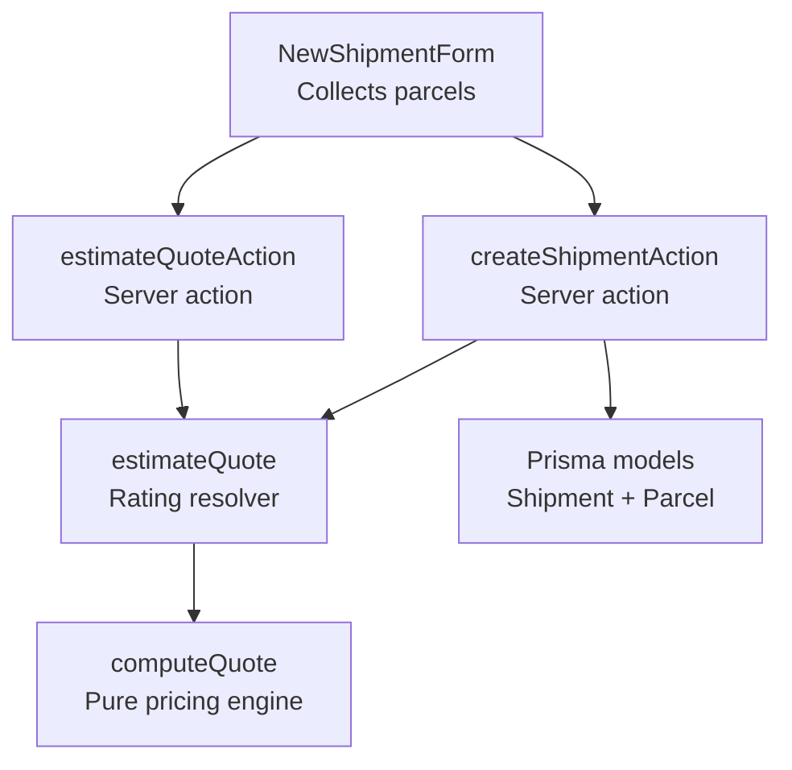
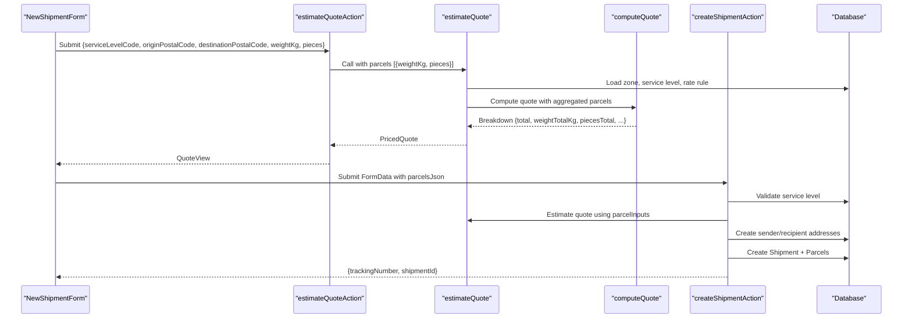
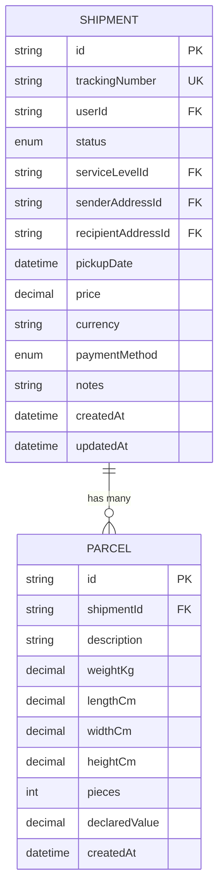
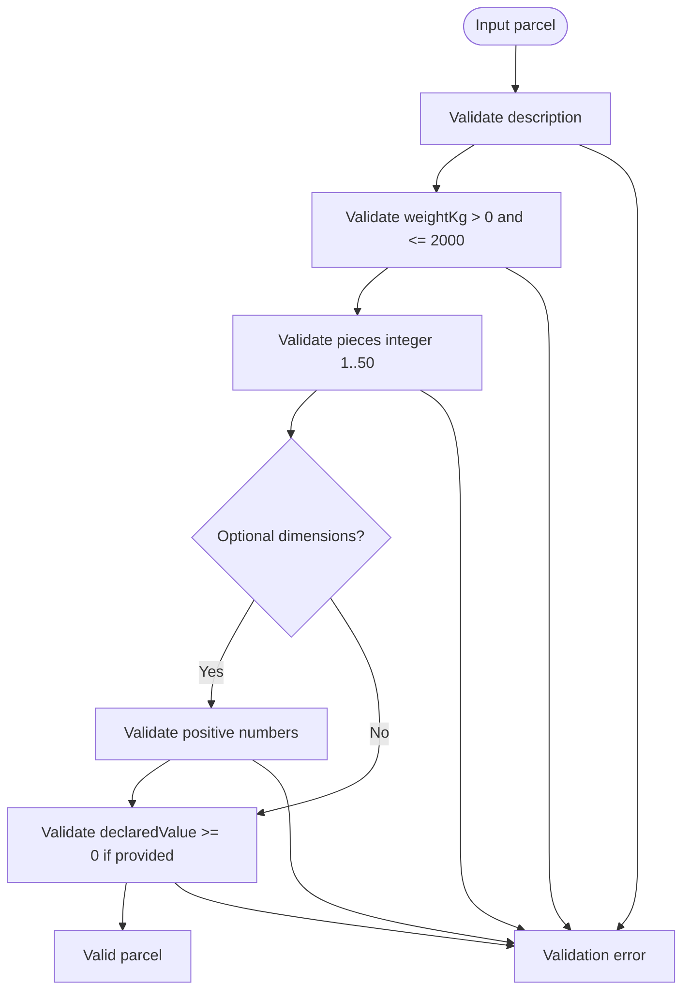
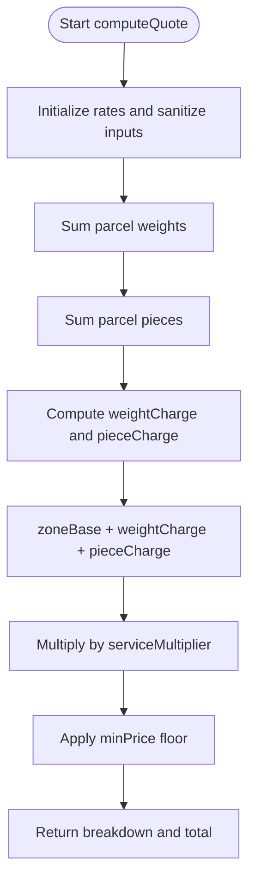
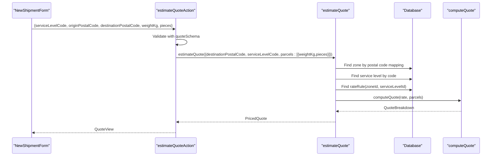
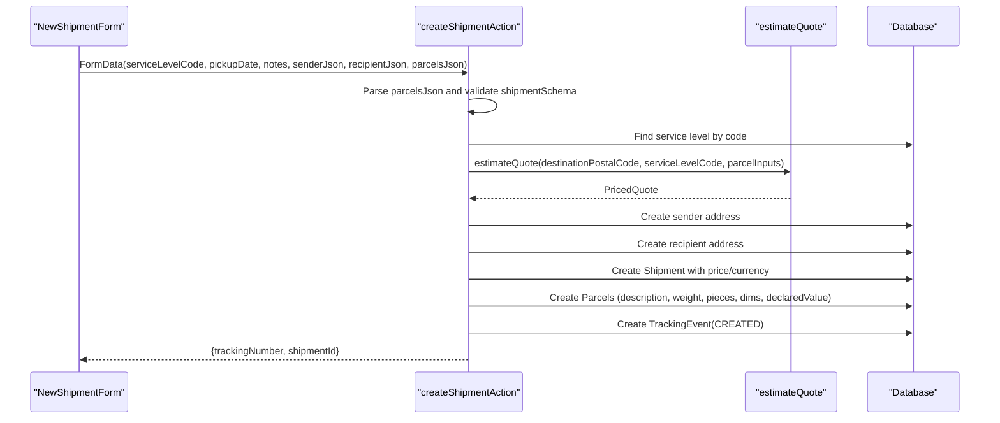
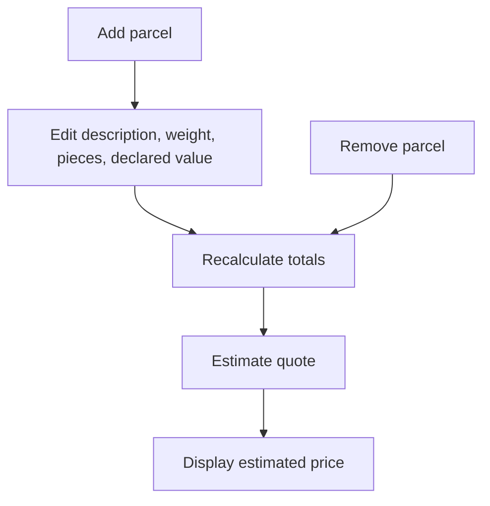
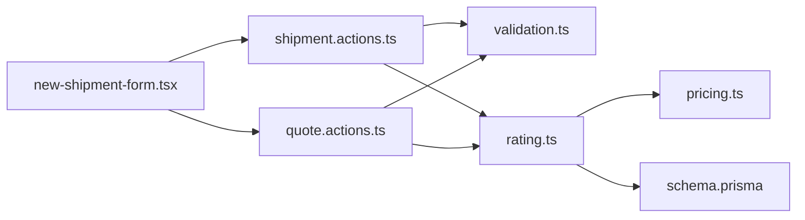

# Parcel Handling

<cite>
**Referenced Files in This Document**
- [schema.prisma](file://prisma/schema.prisma)
- [pricing.ts](file://lib/pricing.ts)
- [rating.ts](file://lib/rating.ts)
- [validation.ts](file://lib/validation.ts)
- [quote.actions.ts](file://server/quote.actions.ts)
- [shipment.actions.ts](file://server/shipment.actions.ts)
- [new-shipment-form.tsx](file://components/shipment/new-shipment-form.tsx)
- [page.tsx](file://app/account/new-shipment/page.tsx)
- [pricing.test.ts](file://tests/pricing.test.ts)
</cite>

## Table of Contents
1. [Introduction](#introduction)
2. [Project Structure](#project-structure)
3. [Core Components](#core-components)
4. [Architecture Overview](#architecture-overview)
5. [Detailed Component Analysis](#detailed-component-analysis)
6. [Dependency Analysis](#dependency-analysis)
7. [Performance Considerations](#performance-considerations)
8. [Troubleshooting Guide](#troubleshooting-guide)
9. [Conclusion](#conclusion)
10. [Appendices](#appendices)

## Introduction
This document explains how parcels are modeled, validated, priced, and stored within shipments. It focuses on multi-parcel support: how parcel inputs are collected, how dimensions and declared values are handled, how weight and piece counts drive pricing, and how multiple parcels affect quotes and final shipping costs. It also provides practical guidance for creating shipments with various parcel configurations, including optional dimensions and parcel-specific attributes such as descriptions and insurance-like declared values.

## Project Structure
Parcel handling spans the database schema, validation layer, pricing engine, server actions, and the new shipment form UI. The key files involved are:

- Database model definitions for Shipment and Parcel
- Validation schemas for parcels and shipments
- Pure pricing engine that aggregates parcel weights and pieces
- Server-side quote estimation and shipment creation
- Client-side parcel input form and totals calculation

**Diagram sources**
- [new-shipment-form.tsx:118-163](file://components/shipment/new-shipment-form.tsx#L118-L163)
- [quote.actions.ts:27-64](file://server/quote.actions.ts#L27-L64)
- [rating.ts:19-60](file://lib/rating.ts#L19-L60)
- [pricing.ts:49-88](file://lib/pricing.ts#L49-L88)
- [shipment.actions.ts:45-145](file://server/shipment.actions.ts#L45-L145)
- [schema.prisma:160-203](file://prisma/schema.prisma#L160-L203)

**Section sources**
- [schema.prisma:160-203](file://prisma/schema.prisma#L160-L203)
- [new-shipment-form.tsx:89-163](file://components/shipment/new-shipment-form.tsx#L89-L163)
- [quote.actions.ts:27-64](file://server/quote.actions.ts#L27-L64)
- [rating.ts:19-60](file://lib/rating.ts#L19-L60)
- [pricing.ts:49-88](file://lib/pricing.ts#L49-L88)
- [shipment.actions.ts:45-145](file://server/shipment.actions.ts#L45-L145)

## Core Components
- Parcel data model: Stores per-parcel description, weight, optional dimensions, piece count, and optional declared value.
- Validation: Enforces required fields, ranges, and types for parcels and shipments.
- Pricing engine: Aggregates total weight and total pieces across all parcels to compute a quote using zone base price, per-kg charge, per-piece charge, service multiplier, and minimum price floor.
- Server actions: Validate inputs, estimate quotes, create addresses, create shipments, persist parcels, and emit tracking events.
- UI: Allows adding/removing parcels, entering parcel attributes, computing live estimates, and submitting the full shipment.

**Section sources**
- [schema.prisma:188-203](file://prisma/schema.prisma#L188-L203)
- [validation.ts:50-67](file://lib/validation.ts#L50-L67)
- [pricing.ts:22-88](file://lib/pricing.ts#L22-L88)
- [quote.actions.ts:27-64](file://server/quote.actions.ts#L27-L64)
- [shipment.actions.ts:45-145](file://server/shipment.actions.ts#L45-L145)
- [new-shipment-form.tsx:108-163](file://components/shipment/new-shipment-form.tsx#L108-L163)

## Architecture Overview
The parcel flow has two main paths:

1. Quote estimation path:
   - The UI collects parcel weight and piece counts (and other parcel attributes).
   - A server action validates the request and calls the rating resolver.
   - The rating resolver loads zone/service configuration and delegates to the pure pricing engine.
   - The pricing engine aggregates parcel weights and pieces and returns a breakdown.

2. Shipment creation path:
   - The UI serializes all parcel attributes into JSON and submits them via FormData.
   - The server action validates the payload, computes the quote using the same pricing engine, persists sender/recipient addresses, creates the shipment, and persists each parcel.
   - A tracking event is created and a notification is sent asynchronously.

**Diagram sources**
- [quote.actions.ts:27-64](file://server/quote.actions.ts#L27-L64)
- [rating.ts:19-60](file://lib/rating.ts#L19-L60)
- [pricing.ts:49-88](file://lib/pricing.ts#L49-L88)
- [shipment.actions.ts:45-145](file://server/shipment.actions.ts#L45-L145)

## Detailed Component Analysis

### Data Model: Shipment and Parcel
- Shipment holds high-level shipment metadata, including service level, addresses, status, price, currency, notes, and timestamps.
- Parcel belongs to a shipment and includes:
  - description: Required string describing contents.
  - weightKg: Required decimal weight in kilograms.
  - lengthCm, widthCm, heightCm: Optional dimensions in centimeters.
  - pieces: Integer number of items inside the parcel; defaults to 1.
  - declaredValue: Optional numeric value representing insurance or declared value.

**Diagram sources**
- [schema.prisma:160-203](file://prisma/schema.prisma#L160-L203)

**Section sources**
- [schema.prisma:160-203](file://prisma/schema.prisma#L160-L203)

### Validation Schema for Parcels and Shipments
- parcelSchema enforces:
  - description: non-empty, up to 200 characters.
  - weightKg: positive number, maximum 2000 kg.
  - pieces: integer between 1 and 50, default 1.
  - lengthCm, widthCm, heightCm: optional positive numbers.
  - declaredValue: optional non-negative number.
- shipmentSchema requires at least one parcel and up to 20 parcels, plus valid sender/recipient addresses and service level code.

**Diagram sources**
- [validation.ts:50-67](file://lib/validation.ts#L50-L67)

**Section sources**
- [validation.ts:50-67](file://lib/validation.ts#L50-L67)

### Pricing Engine: Multi-Parcel Aggregation
The pricing engine computes a quote by aggregating all parcels:
- Total weight is the sum of all parcel weights.
- Total pieces is the sum of all parcel piece counts.
- Charges include:
  - Zone base price
  - Weight charge = perKg × total weight
  - Piece charge = perPiece × total pieces
- Subtotal before service multiplier is the sum of these charges.
- After applying the service multiplier, the minimum price floor may be applied.

**Diagram sources**
- [pricing.ts:49-88](file://lib/pricing.ts#L49-L88)

Key behaviors:
- Non-positive or invalid values are treated as zero for aggregation.
- Rounding uses a half-up strategy to avoid float drift.
- Multiple parcels increase both total weight and total pieces, directly affecting the quote.

**Section sources**
- [pricing.ts:49-88](file://lib/pricing.ts#L49-L88)
- [pricing.test.ts:12-58](file://tests/pricing.test.ts#L12-L58)

### Quote Estimation Flow
- The client sends service level, origin postal code, destination postal code, total weight, and total pieces.
- The server validates the input and calls the rating resolver.
- The rating resolver maps the destination postal code to a zone, loads the service level and rate rule, then delegates to the pricing engine.
- The result includes a breakdown with total, currency, ETA days, zone name, and service level name.

**Diagram sources**
- [quote.actions.ts:27-64](file://server/quote.actions.ts#L27-L64)
- [rating.ts:19-60](file://lib/rating.ts#L19-L60)
- [pricing.ts:49-88](file://lib/pricing.ts#L49-L88)

**Section sources**
- [quote.actions.ts:27-64](file://server/quote.actions.ts#L27-L64)
- [rating.ts:19-60](file://lib/rating.ts#L19-L60)

### Shipment Creation and Parcel Persistence
- The form serializes parcels into JSON and submits them via FormData.
- The server action parses and validates the payload, including parcels array.
- It extracts parcelInputs for pricing (weightKg and pieces), computes the quote, and persists:
  - Sender and recipient addresses
  - Shipment with price and currency from the quote
  - All parcels with description, weight, pieces, optional dimensions, and declared value
- A tracking event is created and a notification is sent asynchronously.

**Diagram sources**
- [shipment.actions.ts:45-145](file://server/shipment.actions.ts#L45-L145)
- [new-shipment-form.tsx:136-163](file://components/shipment/new-shipment-form.tsx#L136-L163)

**Section sources**
- [shipment.actions.ts:45-145](file://server/shipment.actions.ts#L45-L145)
- [new-shipment-form.tsx:136-163](file://components/shipment/new-shipment-form.tsx#L136-L163)

### UI: Parcel Input and Totals
- The form allows adding and removing parcels.
- Each parcel supports:
  - Description (required)
  - Weight in kilograms (required)
  - Pieces (required)
  - Declared value (optional)
- Dimensions are not exposed in this form but are supported by the schema and validation.
- Totals are computed client-side by summing parcel weights and pieces, used for estimating quotes.

**Diagram sources**
- [new-shipment-form.tsx:108-163](file://components/shipment/new-shipment-form.tsx#L108-L163)

**Section sources**
- [new-shipment-form.tsx:108-163](file://components/shipment/new-shipment-form.tsx#L108-L163)

## Dependency Analysis
The parcel-related dependencies are layered:

- UI depends on server actions for quoting and creation.
- Server actions depend on validation schemas and the rating resolver.
- Rating resolver depends on database models and the pure pricing engine.
- Pricing engine is framework-agnostic and only depends on numeric inputs.

**Diagram sources**
- [new-shipment-form.tsx:118-163](file://components/shipment/new-shipment-form.tsx#L118-L163)
- [quote.actions.ts:27-64](file://server/quote.actions.ts#L27-L64)
- [shipment.actions.ts:45-145](file://server/shipment.actions.ts#L45-L145)
- [rating.ts:19-60](file://lib/rating.ts#L19-L60)
- [pricing.ts:49-88](file://lib/pricing.ts#L49-L88)
- [schema.prisma:160-203](file://prisma/schema.prisma#L160-L203)

**Section sources**
- [new-shipment-form.tsx:118-163](file://components/shipment/new-shipment-form.tsx#L118-L163)
- [quote.actions.ts:27-64](file://server/quote.actions.ts#L27-L64)
- [shipment.actions.ts:45-145](file://server/shipment.actions.ts#L45-L145)
- [rating.ts:19-60](file://lib/rating.ts#L19-L60)
- [pricing.ts:49-88](file://lib/pricing.ts#L49-L88)
- [schema.prisma:160-203](file://prisma/schema.prisma#L160-L203)

## Performance Considerations
- Pricing computation is O(n) over parcels for weight and piece aggregation.
- Quote estimation involves database reads for zone, service level, and rate rule; caching these lookups could reduce latency under heavy load.
- Form-side totals calculation is lightweight and avoids unnecessary server calls until the user requests an estimate.
- Minimum price floor and rounding are constant-time operations.

[No sources needed since this section provides general guidance]

## Troubleshooting Guide
Common issues and resolutions:

- Invalid parcel data during shipment creation:
  - Cause: Malformed parcelsJson or failed validation.
  - Resolution: Ensure parcelsJson contains valid objects matching parcelSchema. Check description, weightKg, pieces, and optional fields.

- Missing service level or incomplete pricing configuration:
  - Cause: Service level not found or no rate rule configured for the selected zone/service combination.
  - Resolution: Verify service levels are active and rate rules exist for the destination zone.

- Dimensional fields not accepted:
  - Cause: Dimensions must be positive numbers when provided.
  - Resolution: Provide positive numeric values for lengthCm, widthCm, heightCm, or omit them entirely.

- Declared value not persisted:
  - Cause: Empty declared value is treated as undefined and omitted.
  - Resolution: Provide a non-negative numeric value if you need it stored.

- Quote errors:
  - Cause: Invalid quote request parameters or missing configuration.
  - Resolution: Validate serviceLevelCode, originPostalCode, destinationPostalCode, weightKg, and pieces according to quoteSchema.

**Section sources**
- [validation.ts:50-75](file://lib/validation.ts#L50-L75)
- [rating.ts:31-40](file://lib/rating.ts#L31-L40)
- [shipment.actions.ts:55-74](file://server/shipment.actions.ts#L55-L74)
- [quote.actions.ts:27-64](file://server/quote.actions.ts#L27-L64)

## Conclusion
The parcel handling system supports flexible multi-parcel shipments through a clear separation of concerns:
- The UI collects parcel attributes and computes totals.
- Validation ensures robust input constraints.
- The pricing engine aggregates parcel weights and pieces to produce accurate quotes.
- Server actions orchestrate quote estimation, address management, shipment creation, and parcel persistence.
- Optional dimensions and declared values are fully supported in the data model and validation, even if not exposed in the current form.

This architecture makes it straightforward to extend parcel attributes, refine dimension-based pricing, and integrate additional services while maintaining clean boundaries between UI, validation, pricing, and persistence.

[No sources needed since this section summarizes without analyzing specific files]

## Appendices

### Practical Examples

- Creating a single-parcel shipment:
  - Enter one parcel with description, weight, and pieces.
  - Optionally add a declared value.
  - Estimate the quote and submit the shipment.

- Creating a multi-parcel shipment:
  - Add multiple parcels, each with its own description, weight, and pieces.
  - The quote will aggregate total weight and total pieces across all parcels.
  - Optional dimensions can be added later if needed.

- Handling optional dimensions:
  - If dimensions are required by your business logic, provide positive numeric values for lengthCm, widthCm, and heightCm.
  - If not provided, they will be stored as null.

- Managing parcel-specific attributes:
  - Description: Required and visible in the parcel record.
  - Weight: Drives the per-kg charge.
  - Pieces: Drives the per-piece charge.
  - Declared value: Optional; useful for insurance or valuation purposes.

**Section sources**
- [schema.prisma:188-203](file://prisma/schema.prisma#L188-L203)
- [validation.ts:50-67](file://lib/validation.ts#L50-L67)
- [pricing.ts:49-88](file://lib/pricing.ts#L49-L88)
- [new-shipment-form.tsx:108-163](file://components/shipment/new-shipment-form.tsx#L108-L163)