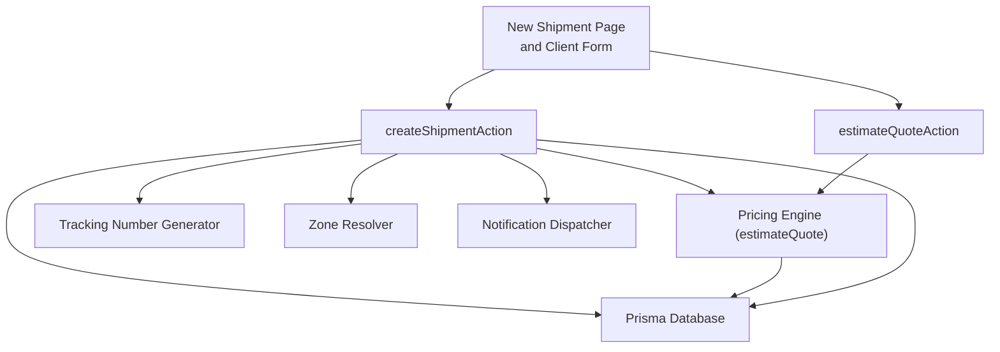
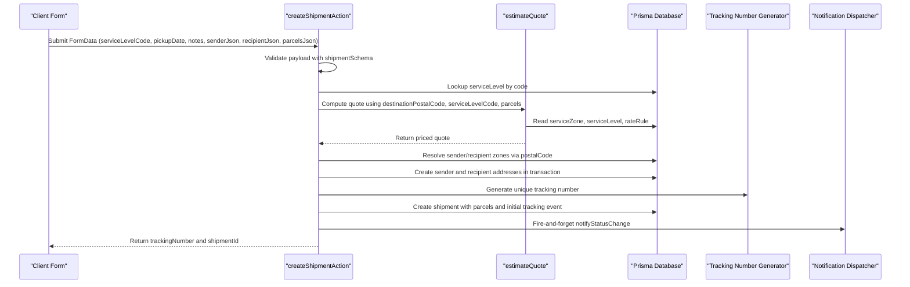
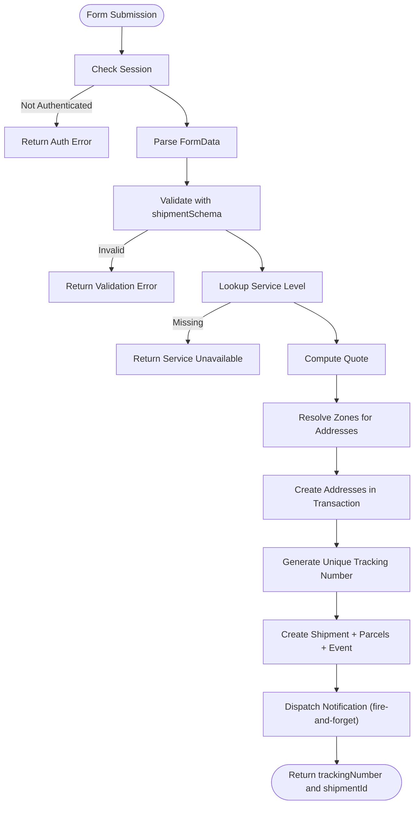
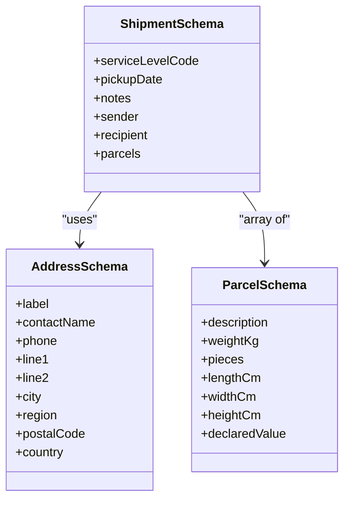
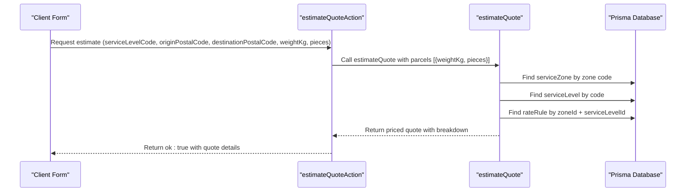
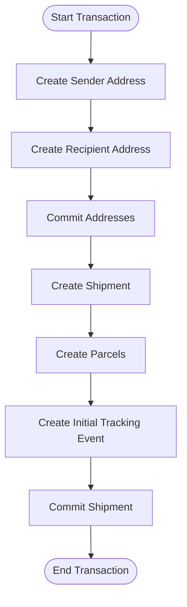
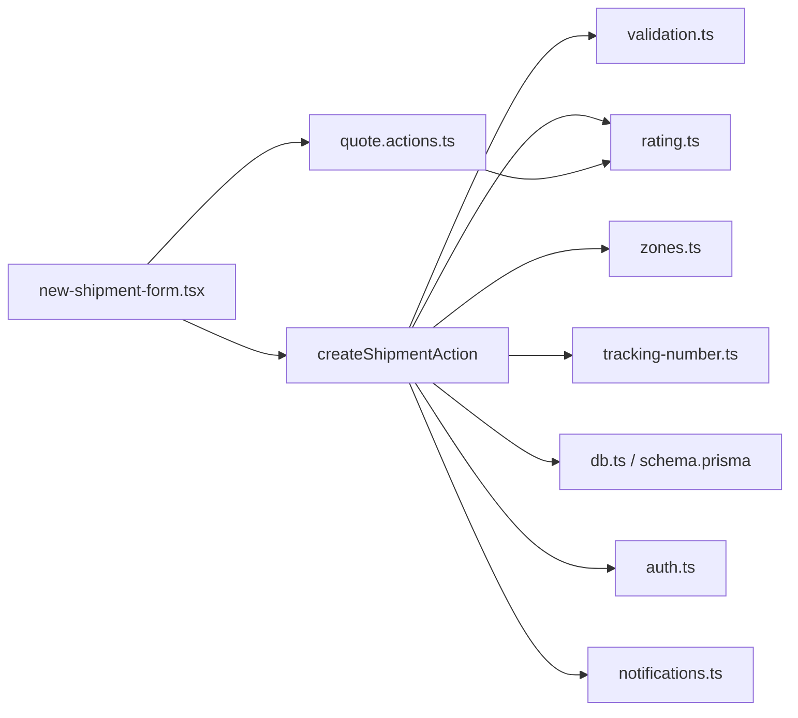

# Shipment Creation

<cite>
**Referenced Files in This Document**
- [shipment.actions.ts](file://server/shipment.actions.ts)
- [validation.ts](file://lib/validation.ts)
- [new-shipment-form.tsx](file://components/shipment/new-shipment-form.tsx)
- [page.tsx](file://app/account/new-shipment/page.tsx)
- [quote.actions.ts](file://server/quote.actions.ts)
- [rating.ts](file://lib/rating.ts)
- [zones.ts](file://lib/zones.ts)
- [tracking-number.ts](file://lib/tracking-number.ts)
- [schema.prisma](file://prisma/schema.prisma)
- [auth.ts](file://lib/auth.ts)
- [db.ts](file://lib/db.ts)
- [notifications.ts](file://lib/notifications.ts)
- [middleware.ts](file://middleware.ts)
</cite>

## Table of Contents
1. [Introduction](#introduction)
2. [Project Structure](#project-structure)
3. [Core Components](#core-components)
4. [Architecture Overview](#architecture-overview)
5. [Detailed Component Analysis](#detailed-component-analysis)
6. [Dependency Analysis](#dependency-analysis)
7. [Performance Considerations](#performance-considerations)
8. [Troubleshooting Guide](#troubleshooting-guide)
9. [Conclusion](#conclusion)

## Introduction
This document explains the end-to-end shipment creation workflow in Timberland, from the customer-facing form to database persistence. It covers:
- The server action that creates shipments
- Validation schema and data transformation
- Multi-parcel support and address management
- Service level selection and quote calculation integration
- Authentication requirements, zone resolution, and tracking number generation
- Transaction flow and notification behavior

The goal is to make the process understandable for both technical and non-technical readers while providing precise references to the source code.

## Project Structure
Shipment creation spans several layers:
- UI layer: Next.js page and client-side form
- Server actions: Form submission handler and quote estimation
- Pricing engine: Zone resolution, service level lookup, and quote computation
- Data layer: Prisma models and database transactions
- Identity and security: Authentication middleware and session checks
- Notifications: Post-creation status update notifications

**Diagram sources**
- [page.tsx:8-50](file://app/account/new-shipment/page.tsx#L8-L50)
- [new-shipment-form.tsx:89-163](file://components/shipment/new-shipment-form.tsx#L89-L163)
- [shipment.actions.ts:45-145](file://server/shipment.actions.ts#L45-L145)
- [quote.actions.ts:27-64](file://server/quote.actions.ts#L27-L64)
- [rating.ts:19-60](file://lib/rating.ts#L19-L60)
- [zones.ts:29-34](file://lib/zones.ts#L29-L34)
- [tracking-number.ts:36-41](file://lib/tracking-number.ts#L36-L41)
- [notifications.ts:49-108](file://lib/notifications.ts#L49-L108)

**Section sources**
- [page.tsx:8-50](file://app/account/new-shipment/page.tsx#L8-L50)
- [new-shipment-form.tsx:89-163](file://components/shipment/new-shipment-form.tsx#L89-L163)
- [shipment.actions.ts:45-145](file://server/shipment.actions.ts#L45-L145)
- [quote.actions.ts:27-64](file://server/quote.actions.ts#L27-L64)
- [rating.ts:19-60](file://lib/rating.ts#L19-L60)
- [zones.ts:29-34](file://lib/zones.ts#L29-L34)
- [tracking-number.ts:36-41](file://lib/tracking-number.ts#L36-L41)
- [notifications.ts:49-108](file://lib/notifications.ts#L49-L108)

## Core Components
- createShipmentAction: Server action handling form submission, validation, pricing, address creation, parcel persistence, tracking number allocation, and initial tracking event creation.
- Validation schemas: Zod-based schemas for addresses, parcels, and full shipment payloads.
- Quote estimation: Server action and pricing engine that compute price breakdowns based on zones, service levels, and parcel inputs.
- Zone resolver: Maps postal codes to service zone codes for rate rule lookup.
- Tracking number generator: Produces random, check-digit validated public tracking numbers.
- Notification dispatcher: Sends email updates after successful shipment creation.

Key responsibilities:
- Input normalization and validation
- Service level existence verification
- Quote calculation with multi-parcel support
- Address creation with optional fields and zone assignment
- Unique tracking number allocation with retry logic
- Initial tracking event insertion
- Asynchronous notification dispatch

**Section sources**
- [shipment.actions.ts:14-145](file://server/shipment.actions.ts#L14-L145)
- [validation.ts:38-67](file://lib/validation.ts#L38-L67)
- [quote.actions.ts:27-64](file://server/quote.actions.ts#L27-L64)
- [rating.ts:19-60](file://lib/rating.ts#L19-L60)
- [zones.ts:29-34](file://lib/zones.ts#L29-L34)
- [tracking-number.ts:36-41](file://lib/tracking-number.ts#L36-L41)
- [notifications.ts:49-108](file://lib/notifications.ts#L49-L108)

## Architecture Overview
The shipment creation architecture integrates UI, server actions, pricing, database, and notifications.

**Diagram sources**
- [new-shipment-form.tsx:136-163](file://components/shipment/new-shipment-form.tsx#L136-L163)
- [shipment.actions.ts:45-145](file://server/shipment.actions.ts#L45-L145)
- [rating.ts:19-60](file://lib/rating.ts#L19-L60)
- [tracking-number.ts:36-41](file://lib/tracking-number.ts#L36-L41)
- [notifications.ts:49-108](file://lib/notifications.ts#L49-L108)

## Detailed Component Analysis

### Server Action: createShipmentAction
Responsibilities:
- Enforce authentication via session
- Parse and validate FormData into a structured payload
- Verify selected service level exists
- Calculate quote using destination postal code, service level, and parcel inputs
- Resolve service zones for sender and recipient postal codes
- Persist addresses and shipment within database transactions
- Generate unique tracking number with collision retry
- Insert initial tracking event
- Dispatch asynchronous notification

Authentication:
- Session is checked; unauthenticated users receive an error.

Validation:
- Payload is parsed and validated against shipmentSchema.
- Errors return user-friendly messages.

Service Level Resolution:
- Service level is looked up by code; missing service returns an error.

Quote Calculation:
- Parcels are transformed into ParcelInput objects.
- estimateQuote computes pricing based on zone and service level rules.

Address Management:
- Sender and recipient addresses are created in a single transaction.
- Optional fields line2 and region are normalized to null when empty.
- Zone IDs are resolved from postal codes.

Tracking Number Generation:
- Random tracking numbers are generated until uniqueness succeeds.
- On repeated collisions, a final error is returned.

Persistence:
- Shipment is created with service level, addresses, price, currency, notes, parcels, and initial tracking event.

Notifications:
- After creation, the latest CREATED tracking event triggers a fire-and-forget notification.

**Diagram sources**
- [shipment.actions.ts:45-145](file://server/shipment.actions.ts#L45-L145)

**Section sources**
- [shipment.actions.ts:14-145](file://server/shipment.actions.ts#L14-L145)

### Validation Schema
The validation layer uses Zod to enforce constraints:
- Address fields: required contact name, phone format, address lines, city, postal code, country defaulting to US.
- Parcel fields: description, positive weight, integer pieces range, optional dimensions and declared value.
- Shipment fields: service level code, optional pickup date and notes, sender and recipient addresses, and at least one parcel up to 20.

Data transformation:
- The form serializes sender, recipient, and parcels into JSON strings.
- The server action parses these JSON values back into typed structures before validation.

**Diagram sources**
- [validation.ts:38-67](file://lib/validation.ts#L38-L67)

**Section sources**
- [validation.ts:38-67](file://lib/validation.ts#L38-L67)

### Multi-Parcel Support
- The form allows adding multiple parcels, each with description, weight, pieces, and optional declared value.
- Totals for weight and pieces are computed client-side to inform estimates.
- The server action maps each parcel into ParcelInput for quote calculation and persists all parcels under the shipment.

Practical example:
- A shipment with three parcels: two small items and one larger item with a declared value.
- The total weight and piece count are summed and used for quote estimation.

**Section sources**
- [new-shipment-form.tsx:108-134](file://components/shipment/new-shipment-form.tsx#L108-L134)
- [shipment.actions.ts:80-118](file://server/shipment.actions.ts#L80-L118)

### Address Management
- Sender and recipient addresses are created during shipment creation.
- Optional fields line2 and region are normalized to null if empty.
- Zone IDs are resolved from postal codes and attached to addresses.

Practical example:
- Creating a shipment where the sender has no region and the recipient includes a region.
- Both addresses are persisted with appropriate zone assignments.

**Section sources**
- [shipment.actions.ts:87-97](file://server/shipment.actions.ts#L87-L97)
- [schema.prisma:131-154](file://prisma/schema.prisma#L131-L154)

### Service Level Selection
- The UI lists active service levels fetched from the pricing module.
- The server action verifies the selected service level exists before proceeding.
- The service level influences pricing through its multiplier and SLA days.

Practical example:
- Selecting a same-day service versus a standard 3-day service changes the ETA and potentially the price.

**Section sources**
- [page.tsx:10-16](file://app/account/new-shipment/page.tsx#L10-L16)
- [new-shipment-form.tsx:170-177](file://components/shipment/new-shipment-form.tsx#L170-L177)
- [shipment.actions.ts:77-78](file://server/shipment.actions.ts#L77-L78)
- [rating.ts:64-69](file://lib/rating.ts#L64-L69)

### Quote Calculation Integration
- The client can request an estimate before submission using estimateQuoteAction.
- The server action calls estimateQuote with destination postal code, service level code, and parcel inputs.
- The pricing engine resolves the zone, service level, and rate rule, then computes a detailed breakdown.

Practical example:
- Estimating a quote for a remote zone with a high base price and per-piece charge.
- The breakdown shows how weight, pieces, and service multiplier affect the final price.

**Diagram sources**
- [quote.actions.ts:27-64](file://server/quote.actions.ts#L27-L64)
- [rating.ts:19-60](file://lib/rating.ts#L19-L60)

**Section sources**
- [quote.actions.ts:27-64](file://server/quote.actions.ts#L27-L64)
- [rating.ts:19-60](file://lib/rating.ts#L19-L60)

### Authentication Requirements
- The account area is protected by NextAuth middleware.
- createShipmentAction checks the session and rejects unauthenticated requests.
- Authentication providers include credentials and optional Google provider.

Practical example:
- Attempting to create a shipment without being signed in results in an immediate error.

**Section sources**
- [middleware.ts:1-14](file://middleware.ts#L1-L14)
- [shipment.actions.ts:49-53](file://server/shipment.actions.ts#L49-L53)
- [auth.ts:9-41](file://lib/auth.ts#L9-L41)

### Zone Resolution
- Postal codes are mapped to zone codes using a prefix-based mapping.
- The zone code is used to find the corresponding service zone in the database.
- Default zone is applied when postal code is empty or unmapped.

Practical example:
- A postal code starting with “0” maps to METRO; “5” maps to REMOTE.

**Section sources**
- [zones.ts:16-34](file://lib/zones.ts#L16-L34)
- [shipment.actions.ts:14-17](file://server/shipment.actions.ts#L14-L17)
- [rating.ts:24-26](file://lib/rating.ts#L24-L26)

### Tracking Number Generation
- Tracking numbers follow a specific format with a prefix, random body, and check character.
- The generator produces random codes to resist enumeration.
- The server retries up to five times on unique constraint violations.

Practical example:
- If a generated tracking number collides, the system generates another candidate until success.

**Section sources**
- [tracking-number.ts:36-41](file://lib/tracking-number.ts#L36-L41)
- [shipment.actions.ts:19-43](file://server/shipment.actions.ts#L19-L43)

### Transaction Flow
- Address creation occurs within a single transaction to ensure consistency.
- Shipment creation includes nested creation of parcels and tracking events.
- Notifications are dispatched asynchronously and do not block the main flow.

**Diagram sources**
- [shipment.actions.ts:90-133](file://server/shipment.actions.ts#L90-L133)

**Section sources**
- [shipment.actions.ts:90-133](file://server/shipment.actions.ts#L90-L133)

### Practical Examples

#### Example 1: Single Parcel Standard Shipment
- Inputs:
  - Service level: STANDARD
  - Pickup date: next business day
  - Sender: existing saved address
  - Recipient: new address with region
  - Parcels: one parcel with weight and pieces
- Expected outcome:
  - Quote calculated based on destination zone and service level
  - Addresses persisted with zone IDs
  - Shipment created with tracking number and initial event
  - Notification sent asynchronously

#### Example 2: Multi-Parcel Express Shipment with Declared Value
- Inputs:
  - Service level: EXPRESS
  - Pickup date: today
  - Sender: new address
  - Recipient: existing saved address
  - Parcels: three parcels, including one with declared value
- Expected outcome:
  - Higher price due to service multiplier and additional pieces
  - All parcels persisted under the shipment
  - Tracking number allocated uniquely
  - Notification sent asynchronously

#### Handling Validation Errors
- Missing required fields (e.g., contact name, postal code) return validation errors.
- Invalid phone formats or out-of-range weights/pieces are rejected.
- The UI displays the first validation error message.

#### Managing Transaction Failures
- If address creation fails, the transaction rolls back.
- If tracking number allocation fails after retries, a user-facing error is returned.
- Notification failures are logged but do not affect shipment creation.

**Section sources**
- [validation.ts:38-67](file://lib/validation.ts#L38-L67)
- [shipment.actions.ts:71-74](file://server/shipment.actions.ts#L71-L74)
- [shipment.actions.ts:25-43](file://server/shipment.actions.ts#L25-L43)

## Dependency Analysis
The shipment creation process depends on several modules:

**Diagram sources**
- [shipment.actions.ts:1-145](file://server/shipment.actions.ts#L1-L145)
- [validation.ts:38-67](file://lib/validation.ts#L38-L67)
- [rating.ts:19-60](file://lib/rating.ts#L19-L60)
- [zones.ts:29-34](file://lib/zones.ts#L29-L34)
- [tracking-number.ts:36-41](file://lib/tracking-number.ts#L36-L41)
- [db.ts:1-16](file://lib/db.ts#L1-L16)
- [schema.prisma:160-203](file://prisma/schema.prisma#L160-L203)
- [auth.ts:37-41](file://lib/auth.ts#L37-L41)
- [notifications.ts:49-108](file://lib/notifications.ts#L49-L108)
- [new-shipment-form.tsx:89-163](file://components/shipment/new-shipment-form.tsx#L89-L163)
- [quote.actions.ts:27-64](file://server/quote.actions.ts#L27-L64)

**Section sources**
- [shipment.actions.ts:1-145](file://server/shipment.actions.ts#L1-L145)
- [validation.ts:38-67](file://lib/validation.ts#L38-L67)
- [rating.ts:19-60](file://lib/rating.ts#L19-L60)
- [zones.ts:29-34](file://lib/zones.ts#L29-L34)
- [tracking-number.ts:36-41](file://lib/tracking-number.ts#L36-L41)
- [db.ts:1-16](file://lib/db.ts#L1-L16)
- [schema.prisma:160-203](file://prisma/schema.prisma#L160-L203)
- [auth.ts:37-41](file://lib/auth.ts#L37-L41)
- [notifications.ts:49-108](file://lib/notifications.ts#L49-L108)
- [new-shipment-form.tsx:89-163](file://components/shipment/new-shipment-form.tsx#L89-L163)
- [quote.actions.ts:27-64](file://server/quote.actions.ts#L27-L64)

## Performance Considerations
- Use batched database operations where possible; the current implementation already batches address creation.
- Avoid unnecessary re-renders in the client form by memoizing totals and estimates.
- Cache service levels and zones if they change infrequently to reduce database reads.
- Monitor notification delivery failures and implement retry strategies for critical events.
- Ensure database indexes on frequently queried fields like userId, status, and createdAt remain effective.

[No sources needed since this section provides general guidance]

## Troubleshooting Guide
Common issues and resolutions:
- Authentication errors: Ensure the user is signed in; check middleware configuration and session validity.
- Validation errors: Review required fields and formats; use the displayed error messages to guide corrections.
- Service unavailable: Verify that the selected service level exists and is active.
- Pricing configuration incomplete: Ensure service zones, service levels, and rate rules are configured in the database.
- Tracking number allocation failure: Retry creating the shipment; the system handles collisions automatically.
- Notification failures: Check SMTP configuration and notification preferences; logs will record failures.

Operational tips:
- Inspect the first validation error message for quick fixes.
- Confirm zone mapping for postal codes if quotes seem incorrect.
- Verify database connectivity and Prisma client logging in development.

**Section sources**
- [shipment.actions.ts:49-74](file://server/shipment.actions.ts#L49-L74)
- [rating.ts:31-40](file://lib/rating.ts#L31-L40)
- [notifications.ts:94-108](file://lib/notifications.ts#L94-L108)

## Conclusion
The shipment creation workflow in Timberland combines robust validation, secure authentication, flexible multi-parcel support, and reliable pricing calculations. By integrating zone resolution, service level selection, and unique tracking number generation, it ensures accurate and consistent data persistence. Asynchronous notifications provide timely updates without blocking core operations. Following the guidelines and examples in this document will help developers and operators understand, maintain, and extend the shipment creation process effectively.

[No sources needed since this section summarizes without analyzing specific files]