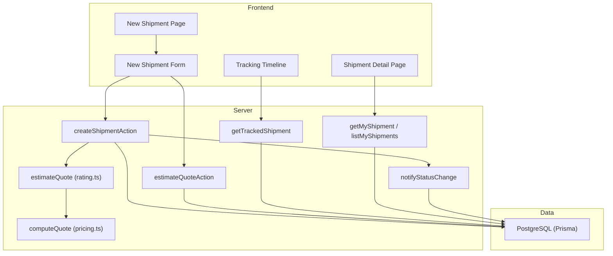
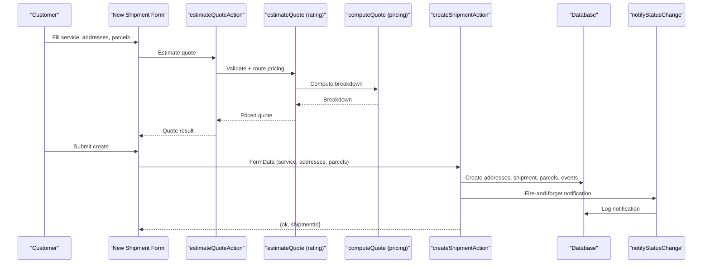
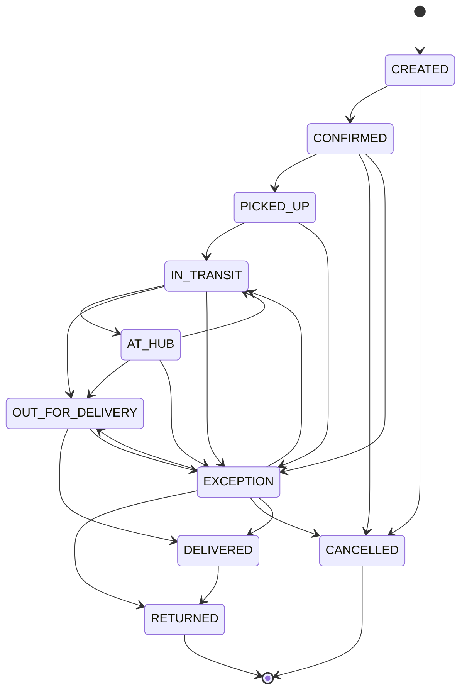
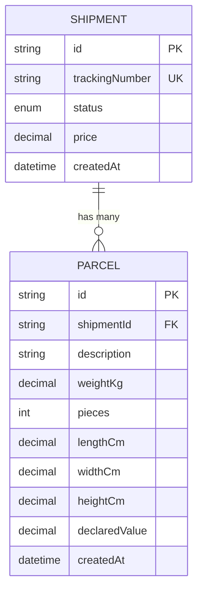
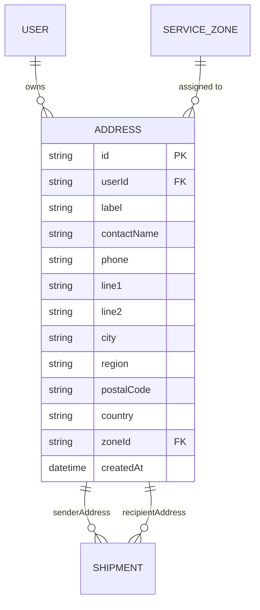
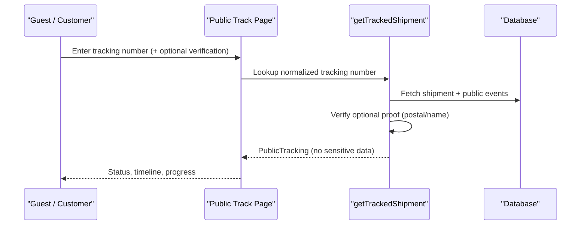
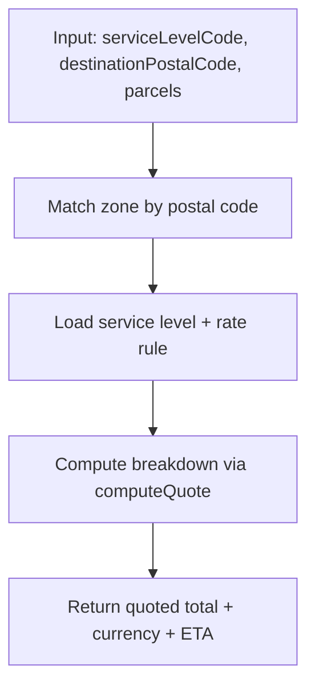
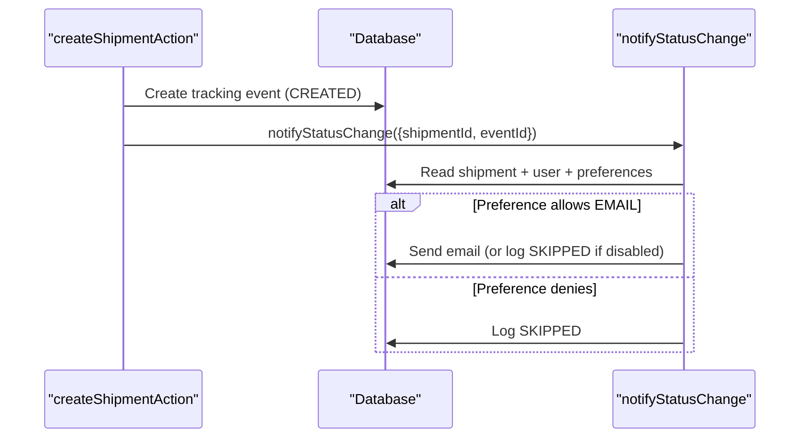
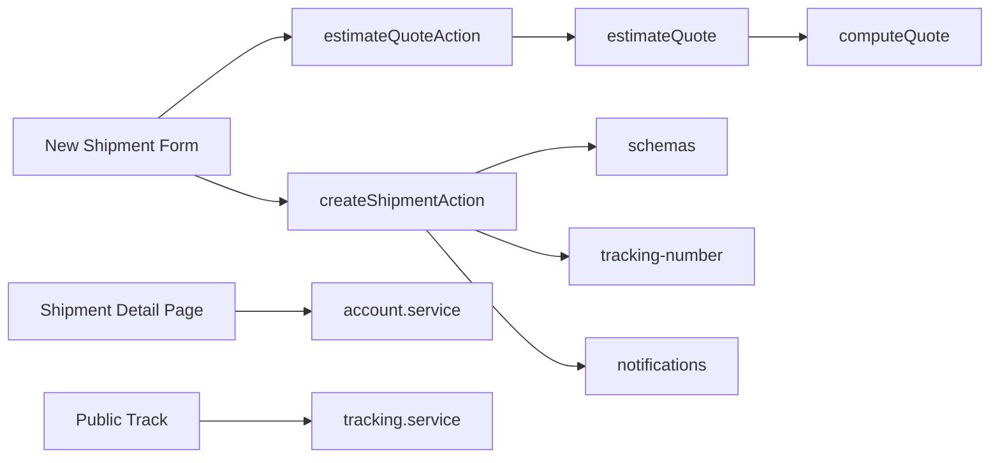

# Shipment Management

<cite>
**Referenced Files in This Document**
- [schema.prisma](file://prisma/schema.prisma)
- [shipment.actions.ts](file://server/shipment.actions.ts)
- [new-shipment-form.tsx](file://components/shipment/new-shipment-form.tsx)
- [page.tsx (New shipment page)](file://app/account/new-shipment/page.tsx)
- [validation.ts](file://lib/validation.ts)
- [rating.ts](file://lib/rating.ts)
- [pricing.ts](file://lib/pricing.ts)
- [quote.actions.ts](file://server/quote.actions.ts)
- [tracking-number.ts](file://lib/tracking-number.ts)
- [shipment-status.ts](file://lib/shipment-status.ts)
- [tracking.service.ts](file://server/tracking.service.ts)
- [account.service.ts](file://server/account.service.ts)
- [page.tsx (Shipment detail page)](file://app/account/shipments/[id]/page.tsx)
- [tracking-timeline.tsx](file://components/tracking/tracking-timeline.tsx)
- [notifications.ts](file://lib/notifications.ts)
</cite>

## Table of Contents
1. Introduction
2. Project Structure
3. Core Components
4. Architecture Overview
5. Detailed Component Analysis
6. Dependency Analysis
7. Performance Considerations
8. Troubleshooting Guide
9. Conclusion

## Introduction
This document explains Timberland’s shipment management system end-to-end: how shipments are created, priced, tracked, and delivered; how multi-parcel shipments are handled; how addresses are managed; and how status transitions and history are recorded. It also documents the database schema, validation rules, business constraints, and error handling patterns used throughout the system.

## Project Structure
The shipment feature spans server actions, UI components, pricing logic, tracking services, and a Prisma data model. The key areas are:
- Data model: Prisma schema defines users, addresses, service zones, service levels, rate rules, shipments, parcels, tracking events, and notifications.
- Server actions: Create shipment and estimate quote endpoints that enforce authentication, validation, pricing, and persistence.
- UI: New shipment form for customers to enter sender/recipient addresses, parcels, and service options; shipment detail view with timeline.
- Tracking: Public tracking lookup and internal account views with progress calculation and event rendering.
- Notifications: Email delivery on status changes with preference handling and logging.

**Diagram sources**
- [page.tsx (New shipment page):8-50](file://app/account/new-shipment/page.tsx#L8-L50)
- [new-shipment-form.tsx:118-162](file://components/shipment/new-shipment-form.tsx#L118-L162)
- [shipment.actions.ts:45-145](file://server/shipment.actions.ts#L45-L145)
- [rating.ts:19-60](file://lib/rating.ts#L19-L60)
- [pricing.ts:53-87](file://lib/pricing.ts#L53-L87)
- [tracking.service.ts:69-146](file://server/tracking.service.ts#L69-L146)
- [account.service.ts:27-38](file://server/account.service.ts#L27-L38)
- [notifications.ts:49-107](file://lib/notifications.ts#L49-L107)

**Section sources**
- [schema.prisma:1-261](file://prisma/schema.prisma#L1-L261)
- [page.tsx (New shipment page):8-50](file://app/account/new-shipment/page.tsx#L8-L50)
- [new-shipment-form.tsx:89-162](file://components/shipment/new-shipment-form.tsx#L89-L162)
- [shipment.actions.ts:45-145](file://server/shipment.actions.ts#L45-L145)
- [tracking.service.ts:69-146](file://server/tracking.service.ts#L69-L146)
- [account.service.ts:27-38](file://server/account.service.ts#L27-L38)

## Core Components
- Shipment lifecycle state machine: Defines valid statuses and allowed transitions, terminal states, and completion semantics.
- Shipment creation: Validates input, estimates price, persists addresses and parcels, creates tracking events, and triggers notifications.
- Quoting engine: Pure pricing math applied over zone/service-level rules and parcel inputs.
- Tracking: Public and private views of shipment status, events, and progress.
- Address management: Addresses are created per shipment and linked to users and zones.

Key responsibilities:
- Validation: Centralized schemas for addresses, parcels, quotes, and tracking numbers.
- Pricing: Zone-based base price, per-kg and per-piece charges, service multiplier, minimum price floor.
- Status transitions: Enforced via a state machine helper.
- Notifications: Optional email updates based on user preferences.

**Section sources**
- [shipment-status.ts:9-76](file://lib/shipment-status.ts#L9-L76)
- [shipment.actions.ts:45-145](file://server/shipment.actions.ts#L45-L145)
- [pricing.ts:53-87](file://lib/pricing.ts#L53-L87)
- [tracking.service.ts:38-54](file://server/tracking.service.ts#L38-L54)
- [validation.ts:38-67](file://lib/validation.ts#L38-L67)

## Architecture Overview
The system follows a layered architecture:
- Presentation layer: Next.js pages and React components render forms and timelines.
- Server actions: Secure endpoints perform auth checks, validation, pricing, and persistence.
- Domain logic: State machine, pure pricing engine, and tracking computations.
- Data layer: Prisma client against PostgreSQL.

**Diagram sources**
- [new-shipment-form.tsx:118-162](file://components/shipment/new-shipment-form.tsx#L118-L162)
- [quote.actions.ts:27-64](file://server/quote.actions.ts#L27-L64)
- [rating.ts:19-60](file://lib/rating.ts#L19-L60)
- [pricing.ts:53-87](file://lib/pricing.ts#L53-L87)
- [shipment.actions.ts:45-145](file://server/shipment.actions.ts#L45-L145)
- [notifications.ts:49-107](file://lib/notifications.ts#L49-L107)

## Detailed Component Analysis

### Shipment Lifecycle and Status Transitions
- Valid statuses include CREATED, CONFIRMED, PICKED_UP, IN_TRANSIT, AT_HUB, OUT_FOR_DELIVERY, DELIVERED, EXCEPTION, RETURNED, CANCELLED.
- Forward transitions are constrained by a state machine; terminal states are RETURNED and CANCELLED.
- Completion is defined as DELIVERED, RETURNED, or CANCELLED.
- Progress percentage is computed from the ordered progression, with special handling for EXCEPTION and terminal states.

**Diagram sources**
- [shipment-status.ts:29-40](file://lib/shipment-status.ts#L29-L40)

**Section sources**
- [shipment-status.ts:9-76](file://lib/shipment-status.ts#L9-L76)
- [tracking.service.ts:38-54](file://server/tracking.service.ts#L38-L54)

### Shipment Creation Workflow
- Authentication check ensures only signed-in users can create shipments.
- Input parsing and validation: service level, optional pickup date, notes, sender/recipient addresses, and parcels array.
- Service level existence check.
- Quote estimation using destination postal code, service level, and parcel totals.
- Address resolution to service zones and creation of sender/recipient addresses.
- Shipment creation with unique tracking number generation and retry on collision.
- Multi-parcel creation in one transactional step.
- Initial tracking event recorded (CREATED).
- Notification fired asynchronously for the CREATED event.

**Diagram sources**
- [shipment.actions.ts:45-145](file://server/shipment.actions.ts#L45-L145)
- [validation.ts:60-67](file://lib/validation.ts#L60-L67)
- [rating.ts:19-60](file://lib/rating.ts#L19-L60)
- [tracking-number.ts:34-41](file://lib/tracking-number.ts#L34-L41)

**Section sources**
- [shipment.actions.ts:45-145](file://server/shipment.actions.ts#L45-L145)
- [validation.ts:60-67](file://lib/validation.ts#L60-L67)
- [tracking-number.ts:34-41](file://lib/tracking-number.ts#L34-L41)

### Parcel Handling Mechanisms
- Multiple parcels per shipment are supported (up to 20).
- Each parcel includes description, weight, pieces, optional dimensions, and optional declared value.
- Totals (weight and pieces) are aggregated for quoting and display.
- Parcels are persisted alongside the shipment in a single operation.

**Diagram sources**
- [schema.prisma:160-203](file://prisma/schema.prisma#L160-L203)

**Section sources**
- [new-shipment-form.tsx:108-116](file://components/shipment/new-shipment-form.tsx#L108-L116)
- [shipment.actions.ts:109-119](file://server/shipment.actions.ts#L109-L119)
- [schema.prisma:188-203](file://prisma/schema.prisma#L188-L203)

### Address Management
- Sender and recipient addresses are created during shipment creation.
- Addresses are associated with the creating user and resolved to service zones by postal code.
- The address model supports labels, contact details, lines, city, region, postal code, country, and zone linkage.

**Diagram sources**
- [schema.prisma:57-78](file://prisma/schema.prisma#L57-L78)
- [schema.prisma:84-96](file://prisma/schema.prisma#L84-L96)
- [schema.prisma:131-154](file://prisma/schema.prisma#L131-L154)
- [schema.prisma:160-186](file://prisma/schema.prisma#L160-L186)

**Section sources**
- [shipment.actions.ts:87-97](file://server/shipment.actions.ts#L87-L97)
- [schema.prisma:131-154](file://prisma/schema.prisma#L131-L154)

### Tracking and History
- Public tracking view hides sensitive fields and optionally verifies access via postal code or recipient name token.
- Internal account view returns full details including all tracking events.
- Progress percent is derived from the current status and the predefined order.
- Estimated delivery is calculated from pickup date or service SLA days added to creation time.

**Diagram sources**
- [tracking.service.ts:69-146](file://server/tracking.service.ts#L69-L146)

**Section sources**
- [tracking.service.ts:38-54](file://server/tracking.service.ts#L38-L54)
- [tracking.service.ts:69-146](file://server/tracking.service.ts#L69-L146)
- [account.service.ts:27-38](file://server/account.service.ts#L27-L38)
- [page.tsx (Shipment detail page):30-169](file://app/account/shipments/[id]/page.tsx#L30-L169)
- [tracking-timeline.tsx:21-49](file://components/tracking/tracking-timeline.tsx#L21-L49)

### Quoting and Pricing
- Quote estimation validates service level and destination postal code, resolves zone and service level, finds the matching rate rule, and computes the breakdown.
- Pure pricing engine applies base price, per-kg charge, per-piece charge, service multiplier, and minimum price floor.
- UI shows estimated total and currency before submission.

**Diagram sources**
- [rating.ts:19-60](file://lib/rating.ts#L19-L60)
- [pricing.ts:53-87](file://lib/pricing.ts#L53-L87)

**Section sources**
- [quote.actions.ts:27-64](file://server/quote.actions.ts#L27-L64)
- [rating.ts:19-60](file://lib/rating.ts#L19-L60)
- [pricing.ts:53-87](file://lib/pricing.ts#L53-L87)

### Notifications
- On shipment creation, a CREATED event triggers an asynchronous notification.
- Notifications respect user preferences and channel settings, and log outcomes (SENT, SKIPPED, FAILED).

**Diagram sources**
- [shipment.actions.ts:135-142](file://server/shipment.actions.ts#L135-L142)
- [notifications.ts:49-107](file://lib/notifications.ts#L49-L107)

**Section sources**
- [notifications.ts:49-107](file://lib/notifications.ts#L49-L107)

## Dependency Analysis
High-level dependencies between modules:
- UI depends on server actions for quoting and creation.
- Server actions depend on validation, rating, pricing, tracking number generator, and notifications.
- Tracking and account services depend on Prisma models and status metadata.

**Diagram sources**
- [new-shipment-form.tsx:118-162](file://components/shipment/new-shipment-form.tsx#L118-L162)
- [quote.actions.ts:27-64](file://server/quote.actions.ts#L27-L64)
- [rating.ts:19-60](file://lib/rating.ts#L19-L60)
- [pricing.ts:53-87](file://lib/pricing.ts#L53-L87)
- [shipment.actions.ts:45-145](file://server/shipment.actions.ts#L45-L145)
- [tracking.service.ts:69-146](file://server/tracking.service.ts#L69-L146)
- [account.service.ts:27-38](file://server/account.service.ts#L27-L38)

**Section sources**
- [new-shipment-form.tsx:118-162](file://components/shipment/new-shipment-form.tsx#L118-L162)
- [shipment.actions.ts:45-145](file://server/shipment.actions.ts#L45-L145)
- [tracking.service.ts:69-146](file://server/tracking.service.ts#L69-L146)
- [account.service.ts:27-38](file://server/account.service.ts#L27-L38)

## Performance Considerations
- Unique tracking number allocation retries up to five times on collision to avoid blocking.
- Parallel loading of service levels, latest address, and user data on the new shipment page reduces perceived latency.
- Notifications are fire-and-forget to avoid blocking the critical path of shipment creation.
- Public tracking queries filter to public events only and normalize inputs to reduce enumeration risk.

[No sources needed since this section provides general guidance]

## Troubleshooting Guide
Common issues and resolutions:
- Invalid parcel data: Ensure parcelsJson is valid JSON and conforms to the parcel schema (description, positive weight, integer pieces within bounds).
- Service unavailable: Confirm the selected service level exists and is active.
- Pricing configuration incomplete: Ensure zone and service level exist with a matching rate rule.
- Tracking number collisions: System retries automatically; if repeated failures occur, verify uniqueness constraints and retry later.
- Verification failed on public tracking: Provide correct postal code or recipient name token when requested.

Operational tips:
- Inspect notification logs for SENT/SKIPPED/FAILED outcomes to diagnose email delivery issues.
- Use the internal shipment detail page to review full tracking history and address details.

**Section sources**
- [shipment.actions.ts:55-74](file://server/shipment.actions.ts#L55-L74)
- [shipment.actions.ts:77-78](file://server/shipment.actions.ts#L77-L78)
- [rating.ts:31-40](file://lib/rating.ts#L31-L40)
- [tracking.service.ts:91-93](file://server/tracking.service.ts#L91-L93)
- [notifications.ts:81-107](file://lib/notifications.ts#L81-L107)

## Conclusion
Timberland’s shipment management system provides a robust, validated workflow for creating multi-parcel shipments, computing accurate quotes, managing addresses, and tracking lifecycle events. The state machine enforces consistent status transitions, while the pure pricing engine ensures predictable cost calculations. Public and private tracking views offer safe visibility into shipment progress, and asynchronous notifications keep customers informed without impacting performance.