# Shipment Management

<cite>
**Referenced Files in This Document**
- [schema.prisma](file://prisma/schema.prisma)
- [shipment.actions.ts](file://server/shipment.actions.ts)
- [ops.actions.ts](file://server/ops.actions.ts)
- [admin.actions.ts](file://server/admin.actions.ts)
- [admin.service.ts](file://server/admin.service.ts)
- [new-shipment-form.tsx](file://components/shipment/new-shipment-form.tsx)
- [page.tsx (New shipment page)](file://app/account/new-shipment/page.tsx)
- [validation.ts](file://lib/validation.ts)
- [rating.ts](file://lib/rating.ts)
- [pricing.ts](file://lib/pricing.ts)
- [quote.actions.ts](file://server/quote.actions.ts)
- [tracking-number.ts](file://lib/tracking-number.ts)
- [shipment-status.ts](file://lib/shipment-status.ts)
- [tracking.service.ts](file://server/tracking.service.ts)
- [account.service.ts](file://server/account.service.ts)
- [page.tsx (Shipment detail page)](file://app/account/shipments/[id]/page.tsx)
- [tracking-timeline.tsx](file://components/tracking/tracking-timeline.tsx)
- [notifications.ts](file://lib/notifications.ts)
- [advance-status-form.tsx](file://components/ops/advance-status-form.tsx)
- [zones.ts](file://lib/zones.ts)
- [page.tsx (Admin page)](file://app/ops/admin/page.tsx)
- [delete-shipment-button.tsx](file://components/ops/admin/delete-shipment-button.tsx)
- [edit-shipment-form.tsx](file://components/ops/admin/edit-shipment-form.tsx)
- [force-status-form.tsx](file://components/ops/admin/force-status-form.tsx)
- [role-select.tsx](file://components/ops/admin/role-select.tsx)
- [layout.tsx (Ops layout)](file://app/ops/layout.tsx)
- [page.tsx (Ops shipment detail)](file://app/ops/shipments/[id]/page.tsx)
</cite>

## Update Summary
**Changes Made**
- Added comprehensive Admin Console section documenting force status overrides, commercial data editing, and permanent deletion capabilities
- Enhanced Operations workflow with admin-specific controls and role-based access control
- Updated architecture diagram to include admin components and services
- Added detailed documentation for admin-only actions and security guards
- Expanded user management capabilities with role assignment functionality

## Table of Contents
1. Introduction
2. Project Structure
3. Core Components
4. Architecture Overview
5. Detailed Component Analysis
6. Admin Console and Advanced Operations
7. Dependency Analysis
8. Performance Considerations
9. Troubleshooting Guide
10. Conclusion

## Introduction
This document explains Timberland's shipment management system end-to-end: how shipments are created, priced, tracked, and delivered; how multi-parcel shipments are handled; how addresses are managed with comprehensive validation; and how status transitions follow a strict state machine with predefined progression paths. The system now includes comprehensive administrative capabilities including force status overrides, commercial data editing, permanent shipment deletion, and user role management through a dedicated admin console. It also documents the database schema, validation rules, business constraints, and error handling patterns used throughout the system.

## Project Structure
The shipment feature spans server actions, UI components, pricing logic, tracking services, admin operations, and a Prisma data model. The key areas are:
- Data model: Prisma schema defines users, addresses, service zones, service levels, rate rules, shipments, parcels, tracking events, and notifications.
- Server actions: Create shipment and estimate quote endpoints that enforce authentication, validation, pricing, and persistence.
- Admin operations: Force status overrides, commercial data editing, permanent deletion, and user role management.
- UI: New shipment form for customers to enter sender/recipient addresses, parcels, and service options; shipment detail view with timeline; admin console for advanced operations.
- Tracking: Public tracking lookup and internal account views with progress calculation and event rendering.
- Notifications: Email delivery on status changes with preference handling and logging.

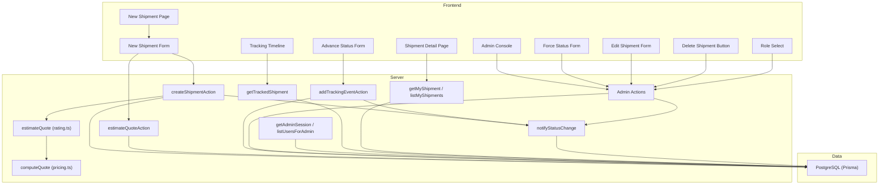

**Diagram sources**
- [page.tsx (New shipment page):8-50](file://app/account/new-shipment/page.tsx#L8-L50)
- [new-shipment-form.tsx:118-162](file://components/shipment/new-shipment-form.tsx#L118-L162)
- [shipment.actions.ts:45-145](file://server/shipment.actions.ts#L45-L145)
- [ops.actions.ts:26-87](file://server/ops.actions.ts#L26-L87)
- [admin.actions.ts:26-170](file://server/admin.actions.ts#L26-L170)
- [advance-status-form.tsx:20-91](file://components/ops/advance-status-form.tsx#L20-L91)
- [force-status-form.tsx:14-67](file://components/ops/admin/force-status-form.tsx#L14-L67)
- [edit-shipment-form.tsx:30-100](file://components/ops/admin/edit-shipment-form.tsx#L30-L100)
- [delete-shipment-button.tsx:10-31](file://components/ops/admin/delete-shipment-button.tsx#L10-L31)
- [role-select.tsx:19-84](file://components/ops/admin/role-select.tsx#L19-L84)
- [rating.ts:19-60](file://lib/rating.ts#L19-L60)
- [pricing.ts:53-87](file://lib/pricing.ts#L53-L87)
- [tracking.service.ts:69-146](file://server/tracking.service.ts#L69-L146)
- [account.service.ts:27-38](file://server/account.service.ts#L27-L38)
- [notifications.ts:49-107](file://lib/notifications.ts#L49-L107)

**Section sources**
- [schema.prisma:1-261](file://prisma/schema.prisma#L1-L261)
- [page.tsx (New shipment page):8-50](file://app/account/new-shipment/page.tsx#L8-L50)
- [new-shipment-form.tsx:89-162](file://components/shipment/new-shipment-form.tsx#L89-L162)
- [shipment.actions.ts:45-145](file://server/shipment.actions.ts#L45-L145)
- [tracking.service.ts:69-146](file://server/tracking.service.ts#L69-L146)
- [account.service.ts:27-38](file://server/account.service.ts#L27-L38)

## Core Components
- **Complete Shipment Lifecycle State Machine**: Defines 10 valid statuses (CREATED, CONFIRMED, PICKED_UP, IN_TRANSIT, AT_HUB, OUT_FOR_DELIVERY, DELIVERED, EXCEPTION, RETURNED, CANCELLED) with strict transition rules, terminal states, and completion semantics.
- **Shipment Creation**: Validates input with comprehensive address validation, estimates price, persists addresses and parcels, creates tracking events, and triggers notifications.
- **Quoting Engine**: Pure pricing math applied over zone/service-level rules and parcel inputs.
- **Tracking**: Public and private views of shipment status, events, and progress with verification controls.
- **Address Management**: Addresses are created per shipment with comprehensive validation and automatic zone resolution by postal code.
- **Admin Console**: Comprehensive administrative interface for force status overrides, commercial data editing, permanent shipment deletion, and user role management.

Key responsibilities:
- **Validation**: Centralized schemas for addresses, parcels, quotes, and tracking numbers with strict field requirements.
- **Pricing**: Zone-based base price, per-kg and per-piece charges, service multiplier, minimum price floor.
- **Status Transitions**: Enforced via a state machine helper with forward-only progression and exception handling.
- **Admin Controls**: Role-based access control with ADMIN-only operations for bypassing normal workflows.
- **Notifications**: Optional email updates based on user preferences.

**Section sources**
- [shipment-status.ts:9-76](file://lib/shipment-status.ts#L9-L76)
- [shipment.actions.ts:45-145](file://server/shipment.actions.ts#L45-L145)
- [pricing.ts:53-87](file://lib/pricing.ts#L53-L87)
- [tracking.service.ts:38-54](file://server/tracking.service.ts#L38-L54)
- [validation.ts:38-67](file://lib/validation.ts#L38-L67)
- [admin.service.ts:6-22](file://server/admin.service.ts#L6-L22)

## Architecture Overview
The system follows a layered architecture with enhanced administrative capabilities:
- Presentation layer: Next.js pages and React components render forms and timelines, including dedicated admin interfaces.
- Server actions: Secure endpoints perform auth checks, validation, pricing, persistence, and admin operations.
- Domain logic: State machine, pure pricing engine, tracking computations, and admin role validation.
- Data layer: Prisma client against PostgreSQL with cascading deletes and transactional integrity.

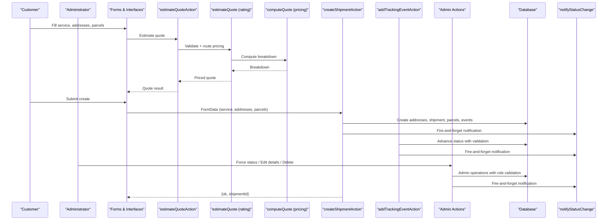

**Diagram sources**
- [new-shipment-form.tsx:118-162](file://components/shipment/new-shipment-form.tsx#L118-L162)
- [quote.actions.ts:27-64](file://server/quote.actions.ts#L27-L64)
- [rating.ts:19-60](file://lib/rating.ts#L19-L60)
- [pricing.ts:53-87](file://lib/pricing.ts#L53-L87)
- [shipment.actions.ts:45-145](file://server/shipment.actions.ts#L45-L145)
- [ops.actions.ts:26-87](file://server/ops.actions.ts#L26-L87)
- [admin.actions.ts:26-170](file://server/admin.actions.ts#L26-L170)
- [notifications.ts:49-107](file://lib/notifications.ts#L49-L107)

## Detailed Component Analysis

### Complete Shipment Lifecycle and Status Transitions
The system implements a comprehensive state machine with 10 predefined statuses and strict transition rules:

**Valid Statuses:**
- CREATED → CONFIRMED → PICKED_UP → IN_TRANSIT → AT_HUB → OUT_FOR_DELIVERY → DELIVERED
- EXCEPTION can occur at any stage and allows recovery or termination
- Terminal states: RETURNED, CANCELLED (no further transitions allowed)

**Forward Transition Rules:**
- CREATED can advance to CONFIRMED or be CANCELLED immediately
- CONFIRMED can proceed to PICKED_UP, be CANCELLED, or encounter EXCEPTION
- Each operational stage (IN_TRANSIT, AT_HUB, OUT_FOR_DELIVERY) can transition to EXCEPTION
- DELIVERED can only transition to RETURNED
- EXCEPTION provides multiple recovery paths back to normal flow or termination

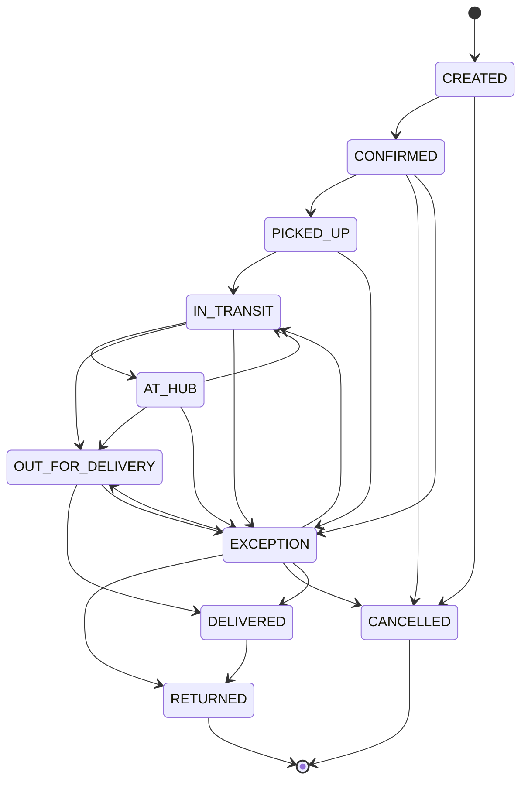

**Progress Calculation:**
- Normal progression: Linear percentage based on position in sequence
- EXCEPTION handling: Special case showing 60% progress to indicate issue without blocking
- Terminal states: DELIVERED, RETURNED, CANCELLED all show 100% completion

**Section sources**
- [shipment-status.ts:9-76](file://lib/shipment-status.ts#L9-L76)
- [tracking.service.ts:38-54](file://server/tracking.service.ts#L38-L54)
- [ops.actions.ts:49-56](file://server/ops.actions.ts#L49-L56)

### Comprehensive Address Validation and Management
Addresses undergo rigorous validation during shipment creation with comprehensive field requirements:

**Address Field Requirements:**
- Contact name: Required, 1-120 characters
- Phone: Required, regex pattern `/^[0-9+\-\s()]{6,20}$/` for international formats
- Address line 1: Required, 1-160 characters
- Address line 2: Optional, max 160 characters
- City: Required, 1-80 characters
- Region/State: Optional, max 80 characters
- Postal code: Required, 2-16 characters
- Country: Required, exactly 2 characters, defaults to "US"

**Zone-Based Address Resolution:**
- Postal codes are automatically mapped to service zones using prefix matching
- METRO zone: Postal codes starting with 0-1
- REGION zone: Postal codes starting with 2-4 (default)
- REMOTE zone: Postal codes starting with 5-9
- Zone assignment affects pricing calculations and delivery timeframes

**Address Persistence:**
- Both sender and recipient addresses are created during shipment creation
- Addresses are linked to the creating user for future reuse
- Zone IDs are automatically assigned based on postal code mapping
- Addresses support labels, contact details, and full address components

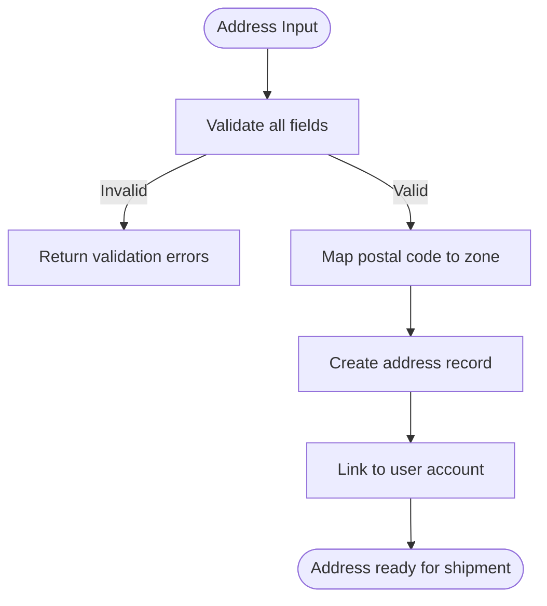

**Diagram sources**
- [validation.ts:38-48](file://lib/validation.ts#L38-L48)
- [zones.ts:15-34](file://lib/zones.ts#L15-L34)
- [shipment.actions.ts:87-97](file://server/shipment.actions.ts#L87-L97)

**Section sources**
- [validation.ts:38-48](file://lib/validation.ts#L38-L48)
- [zones.ts:15-34](file://lib/zones.ts#L15-L34)
- [shipment.actions.ts:87-97](file://server/shipment.actions.ts#L87-L97)

### Shipment Creation Workflow
- Authentication check ensures only signed-in users can create shipments.
- Input parsing and validation: service level, optional pickup date, notes, sender/recipient addresses, and parcels array.
- Service level existence check.
- Quote estimation using destination postal code, service level, and parcel totals.
- Address resolution to service zones and creation of sender/recipient addresses.
- Shipment creation with unique tracking number generation and retry on collision.
- Multi-parcel creation in one transactional step.
- Initial tracking event recorded (CREATED).
- Notification fired asynchronously for the CREATED event.

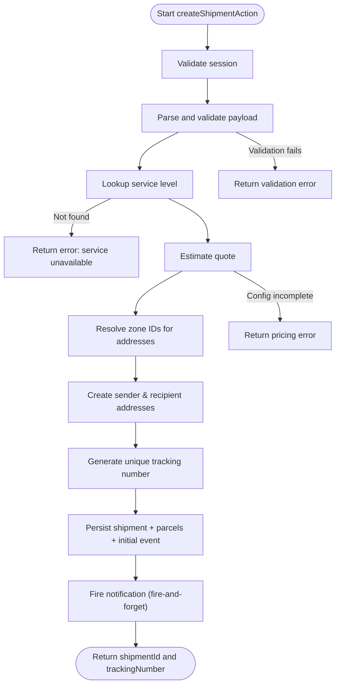

**Diagram sources**
- [shipment.actions.ts:45-145](file://server/shipment.actions.ts#L45-L145)
- [validation.ts:60-67](file://lib/validation.ts#L60-L67)
- [rating.ts:19-60](file://lib/rating.ts#L19-L60)
- [tracking-number.ts:34-41](file://lib/tracking-number.ts#L34-L41)

**Section sources**
- [shipment.actions.ts:45-145](file://server/shipment.actions.ts#L45-L145)
- [validation.ts:60-67](file://lib/validation.ts#L60-L67)
- [tracking-number.ts:34-41](file://lib/tracking-number.ts#L34-L41)

### Operator-Controlled Status Advancement
The operations team can advance shipment status through a controlled interface that enforces state machine rules:

**Status Advancement Process:**
- Operators must be authenticated with appropriate permissions
- Only valid transitions according to the state machine are allowed
- Status changes are recorded as tracking events with source attribution
- Customer notifications are automatically triggered for status changes
- UI prevents selection of invalid next states

**Validation Controls:**
- Terminal states (RETURNED, CANCELLED) cannot be advanced further
- Exception states provide recovery paths back to normal flow
- All transitions are logged with timestamps and operator attribution
- Real-time path revalidation after successful updates

**Section sources**
- [ops.actions.ts:26-87](file://server/ops.actions.ts#L26-L87)
- [advance-status-form.tsx:20-91](file://components/ops/advance-status-form.tsx#L20-L91)

### Parcel Handling Mechanisms
- Multiple parcels per shipment are supported (up to 20).
- Each parcel includes description, weight, pieces, optional dimensions, and optional declared value.
- Totals (weight and pieces) are aggregated for quoting and display.
- Parcels are persisted alongside the shipment in a single operation.

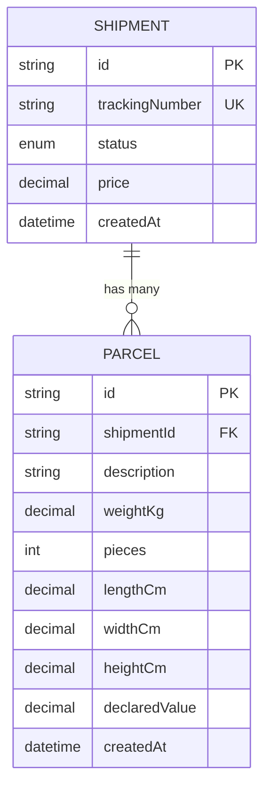

**Diagram sources**
- [schema.prisma:160-203](file://prisma/schema.prisma#L160-L203)

**Section sources**
- [new-shipment-form.tsx:108-116](file://components/shipment/new-shipment-form.tsx#L108-L116)
- [shipment.actions.ts:109-119](file://server/shipment.actions.ts#L109-L119)
- [schema.prisma:188-203](file://prisma/schema.prisma#L188-L203)

### Address Management
- Sender and recipient addresses are created during shipment creation.
- Addresses are associated with the creating user and resolved to service zones by postal code.
- The address model supports labels, contact details, lines, city, region, postal code, country, and zone linkage.

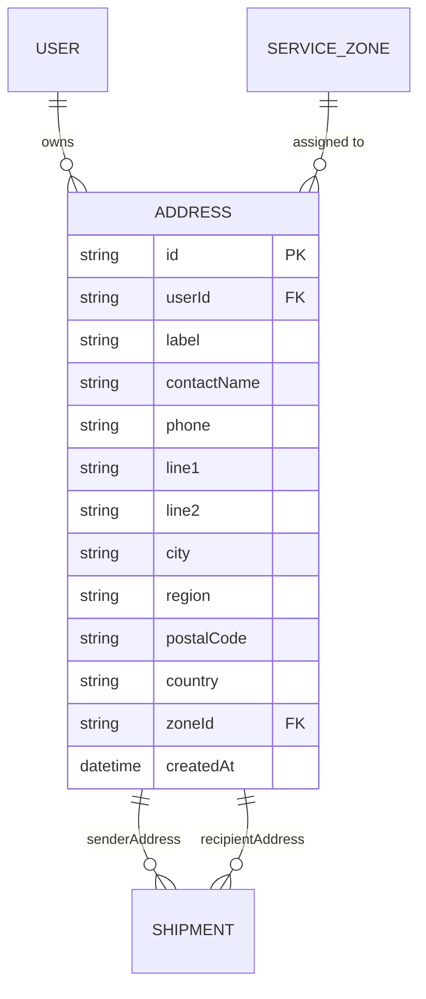

**Diagram sources**
- [schema.prisma:57-78](file://prisma/schema.prisma#L57-L78)
- [schema.prisma:84-96](file://prisma/schema.prisma#L84-L96)
- [schema.prisma:131-154](file://prisma/schema.prisma#L131-L154)
- [schema.prisma:160-186](file://prisma/schema.prisma#L160-L186)

**Section sources**
- [shipment.actions.ts:87-97](file://server/shipment.actions.ts#L87-L97)
- [schema.prisma:131-154](file://prisma/schema.prisma#L131-L154)

### Tracking and History
- Public tracking view hides sensitive fields and optionally verifies access via postal code or recipient name token.
- Internal account view returns full details including all tracking events.
- Progress percent is derived from the current status and the predefined order.
- Estimated delivery is calculated from pickup date or service SLA days added to creation time.

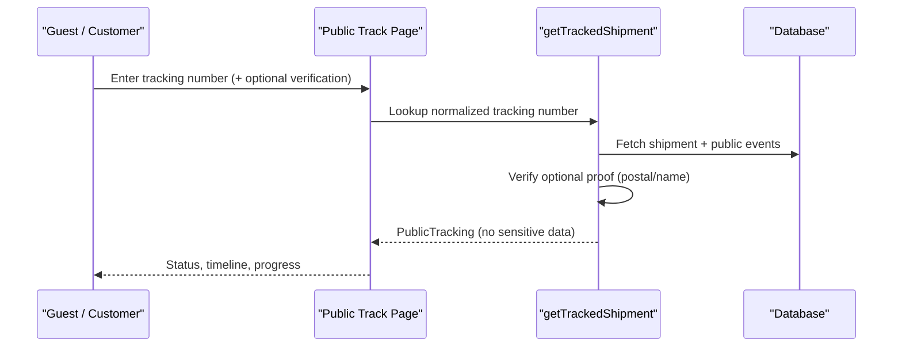

**Diagram sources**
- [tracking.service.ts:69-146](file://server/tracking.service.ts#L69-L146)

**Section sources**
- [tracking.service.ts:38-54](file://server/tracking.service.ts#L38-L54)
- [tracking.service.ts:69-146](file://server/tracking.service.ts#L69-L146)
- [account.service.ts:27-38](file://server/account.service.ts#L27-L38)
- [page.tsx (Shipment detail page):30-169](file://app/account/shipments/[id]/page.tsx#L30-L169)
- [tracking-timeline.tsx:21-49](file://components/tracking/tracking-timeline.tsx#L21-L49)

### Quoting and Pricing
- Quote estimation validates service level and destination postal code, resolves zone and service level, finds the matching rate rule, and computes the breakdown.
- Pure pricing engine applies base price, per-kg charge, per-piece charge, service multiplier, and minimum price floor.
- UI shows estimated total and currency before submission.

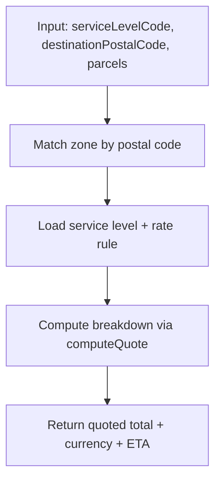

**Diagram sources**
- [rating.ts:19-60](file://lib/rating.ts#L19-L60)
- [pricing.ts:53-87](file://lib/pricing.ts#L53-L87)

**Section sources**
- [quote.actions.ts:27-64](file://server/quote.actions.ts#L27-L64)
- [rating.ts:19-60](file://lib/rating.ts#L19-L60)
- [pricing.ts:53-87](file://lib/pricing.ts#L53-L87)

### Notifications
- On shipment creation, a CREATED event triggers an asynchronous notification.
- Notifications respect user preferences and channel settings, and log outcomes (SENT, SKIPPED, FAILED).

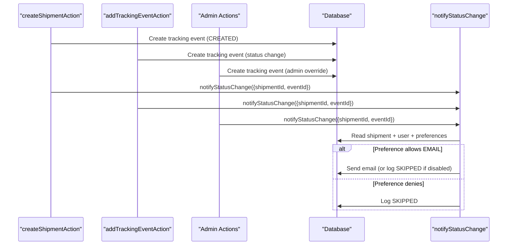

**Diagram sources**
- [shipment.actions.ts:135-142](file://server/shipment.actions.ts#L135-L142)
- [ops.actions.ts:78-79](file://server/ops.actions.ts#L78-L79)
- [admin.actions.ts:66-68](file://server/admin.actions.ts#L66-L68)
- [notifications.ts:49-107](file://lib/notifications.ts#L49-L107)

**Section sources**
- [notifications.ts:49-107](file://lib/notifications.ts#L49-L107)

## Admin Console and Advanced Operations

### Admin Console Overview
The admin console provides comprehensive administrative capabilities with strict role-based access control. Administrators have full control over the system, including the ability to bypass normal workflows, edit commercial data, delete shipments permanently, and manage user roles.

**Access Control:**
- Admin-only routes protected by `getAdminSession()` function
- Navigation menu conditionally shows admin links for administrators
- All admin actions require ADMIN role verification
- Self-protection mechanisms prevent administrators from demoting themselves

**Section sources**
- [admin.service.ts:17-22](file://server/admin.service.ts#L17-L22)
- [layout.tsx (Ops layout):10-17](file://app/ops/layout.tsx#L10-L17)
- [page.tsx (Admin page):19-23](file://app/ops/admin/page.tsx#L19-L23)

### Force Status Override
Administrators can bypass the normal state machine to set any shipment status, providing emergency intervention capabilities when standard workflows fail.

**Force Status Features:**
- Bypasses all state machine validation rules
- Records override as public tracking event with explicit "admin override" note
- Supports optional public visibility for customer transparency
- Includes audit trail with administrator attribution
- Triggers notifications for significant status changes

**Security Controls:**
- Requires ADMIN role authentication
- Validates target status against available shipment statuses
- Creates transactional updates to ensure data consistency
- Logs all override attempts with timestamps and operator information

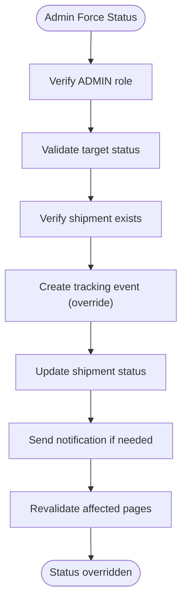

**Diagram sources**
- [admin.actions.ts:26-72](file://server/admin.actions.ts#L26-L72)
- [force-status-form.tsx:14-67](file://components/ops/admin/force-status-form.tsx#L14-L67)

**Section sources**
- [admin.actions.ts:26-72](file://server/admin.actions.ts#L26-L72)
- [force-status-form.tsx:14-67](file://components/ops/admin/force-status-form.tsx#L14-L67)

### Commercial Data Editing
Administrators can modify commercial aspects of shipments including pricing, payment methods, service levels, and internal notes.

**Editable Fields:**
- Price: Numeric validation with minimum zero constraint
- Payment method: Restricted to predefined methods (PAY_ON_DELIVERY, CASH, CARD_ON_DELIVERY, INVOICE)
- Service level: Reference to active service levels with SLA implications
- Notes: Free-form internal documentation

**Validation and Integrity:**
- Server-side validation for all editable fields
- Service level existence verification
- Transactional updates to maintain data consistency
- Automatic revalidation of dependent pages

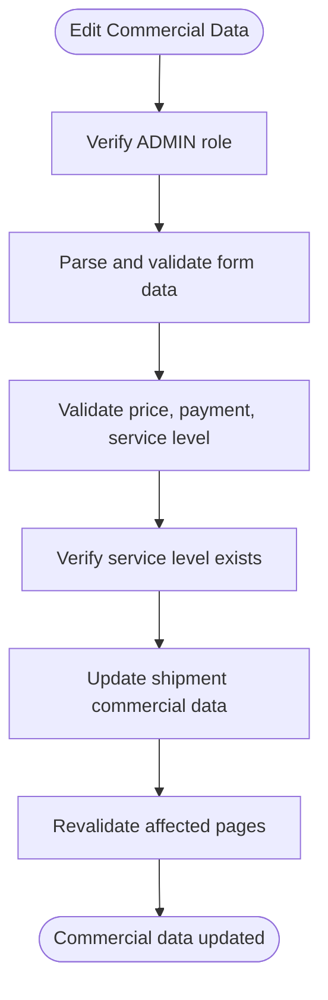

**Diagram sources**
- [admin.actions.ts:74-123](file://server/admin.actions.ts#L74-L123)
- [edit-shipment-form.tsx:30-100](file://components/ops/admin/edit-shipment-form.tsx#L30-L100)

**Section sources**
- [admin.actions.ts:74-123](file://server/admin.actions.ts#L74-L123)
- [edit-shipment-form.tsx:30-100](file://components/ops/admin/edit-shipment-form.tsx#L30-L100)

### Permanent Shipment Deletion
Administrators can permanently delete shipments along with all associated data including parcels and tracking events through cascade deletion.

**Deletion Process:**
- Confirmation dialog prevents accidental deletions
- Cascades deletion to related parcels and tracking events
- Removes all traces from public and internal views
- Updates navigation and revalidates affected routes

**Data Integrity:**
- Uses Prisma cascade relationships for complete cleanup
- Transactional deletion ensures atomic operations
- Immediate removal from all cached views

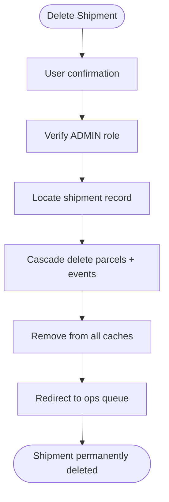

**Diagram sources**
- [admin.actions.ts:125-144](file://server/admin.actions.ts#L125-L144)
- [delete-shipment-button.tsx:10-31](file://components/ops/admin/delete-shipment-button.tsx#L10-L31)

**Section sources**
- [admin.actions.ts:125-144](file://server/admin.actions.ts#L125-L144)
- [delete-shipment-button.tsx:10-31](file://components/ops/admin/delete-shipment-button.tsx#L10-L31)

### User Role Management
Administrators can manage user roles across the system with built-in protection mechanisms to prevent self-lockout scenarios.

**Role Assignment:**
- Three-tier role system: CUSTOMER, STAFF, ADMIN
- Real-time role updates with immediate effect
- Visual indicators for role types with color coding
- Shipment count integration for administrative oversight

**Self-Protection Guards:**
- Prevents administrators from demoting themselves
- Frontend and backend validation for role changes
- Clear feedback on failed role assignments
- Maintains system accessibility for administrators

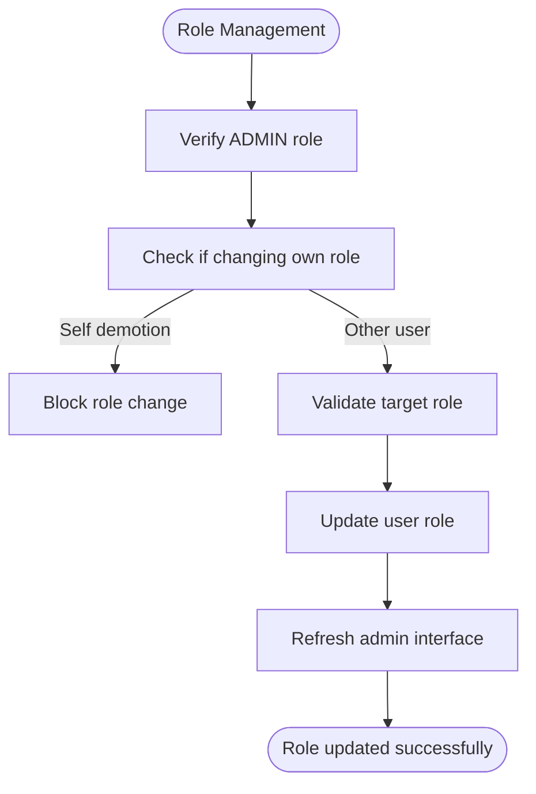

**Diagram sources**
- [admin.actions.ts:146-170](file://server/admin.actions.ts#L146-L170)
- [role-select.tsx:19-84](file://components/ops/admin/role-select.tsx#L19-L84)

**Section sources**
- [admin.actions.ts:146-170](file://server/admin.actions.ts#L146-L170)
- [role-select.tsx:19-84](file://components/ops/admin/role-select.tsx#L19-L84)
- [page.tsx (Admin page):19-90](file://app/ops/admin/page.tsx#L19-L90)

## Dependency Analysis
High-level dependencies between modules with enhanced admin capabilities:
- UI depends on server actions for quoting, creation, and admin operations.
- Server actions depend on validation, rating, pricing, tracking number generator, notifications, and admin services.
- Tracking and account services depend on Prisma models and status metadata.
- Admin components depend on admin actions and services for role-based operations.

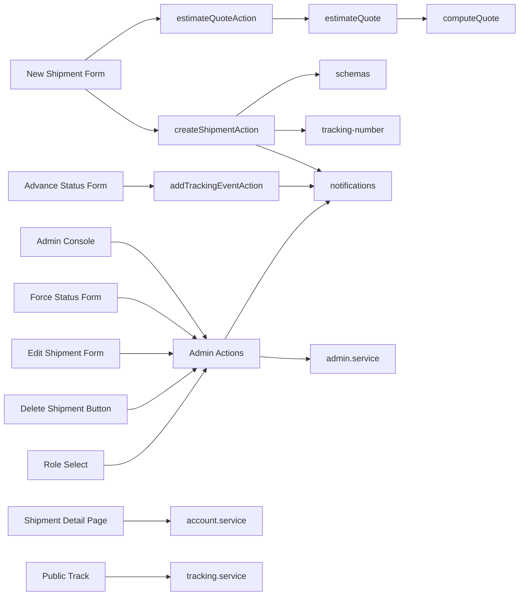

**Diagram sources**
- [new-shipment-form.tsx:118-162](file://components/shipment/new-shipment-form.tsx#L118-L162)
- [advance-status-form.tsx:20-91](file://components/ops/advance-status-form.tsx#L20-L91)
- [force-status-form.tsx:14-67](file://components/ops/admin/force-status-form.tsx#L14-L67)
- [edit-shipment-form.tsx:30-100](file://components/ops/admin/edit-shipment-form.tsx#L30-L100)
- [delete-shipment-button.tsx:10-31](file://components/ops/admin/delete-shipment-button.tsx#L10-L31)
- [role-select.tsx:19-84](file://components/ops/admin/role-select.tsx#L19-L84)
- [quote.actions.ts:27-64](file://server/quote.actions.ts#L27-L64)
- [rating.ts:19-60](file://lib/rating.ts#L19-L60)
- [pricing.ts:53-87](file://lib/pricing.ts#L53-L87)
- [shipment.actions.ts:45-145](file://server/shipment.actions.ts#L45-L145)
- [ops.actions.ts:26-87](file://server/ops.actions.ts#L26-L87)
- [admin.actions.ts:26-170](file://server/admin.actions.ts#L26-L170)
- [tracking.service.ts:69-146](file://server/tracking.service.ts#L69-L146)
- [account.service.ts:27-38](file://server/account.service.ts#L27-L38)

**Section sources**
- [new-shipment-form.tsx:118-162](file://components/shipment/new-shipment-form.tsx#L118-L162)
- [advance-status-form.tsx:20-91](file://components/ops/advance-status-form.tsx#L20-L91)
- [force-status-form.tsx:14-67](file://components/ops/admin/force-status-form.tsx#L14-L67)
- [edit-shipment-form.tsx:30-100](file://components/ops/admin/edit-shipment-form.tsx#L30-L100)
- [delete-shipment-button.tsx:10-31](file://components/ops/admin/delete-shipment-button.tsx#L10-L31)
- [role-select.tsx:19-84](file://components/ops/admin/role-select.tsx#L19-L84)
- [shipment.actions.ts:45-145](file://server/shipment.actions.ts#L45-L145)
- [ops.actions.ts:26-87](file://server/ops.actions.ts#L26-L87)
- [admin.actions.ts:26-170](file://server/admin.actions.ts#L26-L170)
- [tracking.service.ts:69-146](file://server/tracking.service.ts#L69-L146)
- [account.service.ts:27-38](file://server/account.service.ts#L27-L38)

## Performance Considerations
- Unique tracking number allocation retries up to five times on collision to avoid blocking.
- Parallel loading of service levels, latest address, and user data on the new shipment page reduces perceived latency.
- Notifications are fire-and-forget to avoid blocking the critical path of shipment creation.
- Public tracking queries filter to public events only and normalize inputs to reduce enumeration risk.
- Address zone resolution uses efficient prefix matching for postal code categorization.
- Admin operations use targeted revalidation to minimize unnecessary page refreshes.
- Role-based access control checks are optimized with early returns for non-admin users.

## Troubleshooting Guide
Common issues and resolutions:
- **Invalid parcel data**: Ensure parcelsJson is valid JSON and conforms to the parcel schema (description, positive weight, integer pieces within bounds).
- **Service unavailable**: Confirm the selected service level exists and is active.
- **Pricing configuration incomplete**: Ensure zone and service level exist with a matching rate rule.
- **Tracking number collisions**: System retries automatically; if repeated failures occur, verify uniqueness constraints and retry later.
- **Verification failed on public tracking**: Provide correct postal code or recipient name token when requested.
- **Address validation errors**: Check that all required fields are filled and phone numbers match the expected format pattern.
- **Illegal status transitions**: Verify the current shipment status and ensure the target status is a valid next state in the state machine.
- **Zone mapping issues**: Confirm postal codes start with valid prefixes (0-9) for proper zone assignment.
- **Admin access denied**: Verify user has ADMIN role and not attempting self-demotion.
- **Force status override failed**: Check that target status is valid and shipment exists.
- **Commercial data update errors**: Validate price format, payment method, and service level references.
- **Permanent deletion issues**: Ensure admin privileges and confirm cascade deletion permissions.

Operational tips:
- Inspect notification logs for SENT/SKIPPED/FAILED outcomes to diagnose email delivery issues.
- Use the internal shipment detail page to review full tracking history and address details.
- Monitor the state machine transitions to identify potential workflow bottlenecks.
- Review address validation errors to improve customer data quality.
- Check admin action logs for override attempts and their outcomes.
- Monitor role changes and their impact on system access patterns.

**Section sources**
- [shipment.actions.ts:55-74](file://server/shipment.actions.ts#L55-L74)
- [shipment.actions.ts:77-78](file://server/shipment.actions.ts#L77-L78)
- [ops.actions.ts:49-56](file://server/ops.actions.ts#L49-L56)
- [admin.actions.ts:38-46](file://server/admin.actions.ts#L38-L46)
- [admin.actions.ts:88-109](file://server/admin.actions.ts#L88-L109)
- [admin.actions.ts:131-137](file://server/admin.actions.ts#L131-L137)
- [admin.actions.ts:154-164](file://server/admin.actions.ts#L154-L164)
- [rating.ts:31-40](file://lib/rating.ts#L31-L40)
- [tracking.service.ts:91-93](file://server/tracking.service.ts#L91-L93)
- [notifications.ts:81-107](file://lib/notifications.ts#L81-L107)
- [validation.ts:38-48](file://lib/validation.ts#L38-L48)
- [zones.ts:15-34](file://lib/zones.ts#L15-L34)

## Conclusion
Timberland's shipment management system provides a robust, validated workflow for creating multi-parcel shipments, computing accurate quotes, managing addresses with comprehensive validation, and tracking lifecycle events through a complete state machine. The system now includes comprehensive administrative capabilities with force status overrides, commercial data editing, permanent shipment deletion, and user role management through a dedicated admin console. The strict status progression ensures consistent operational workflows, while the pure pricing engine ensures predictable cost calculations. Public and private tracking views offer safe visibility into shipment progress, and asynchronous notifications keep customers informed without impacting performance. The system's comprehensive address validation and zone-based routing enable accurate delivery planning and customer experience management. The enhanced admin capabilities provide operators with powerful tools for emergency interventions, data corrections, and system maintenance while maintaining strict security controls and audit trails.