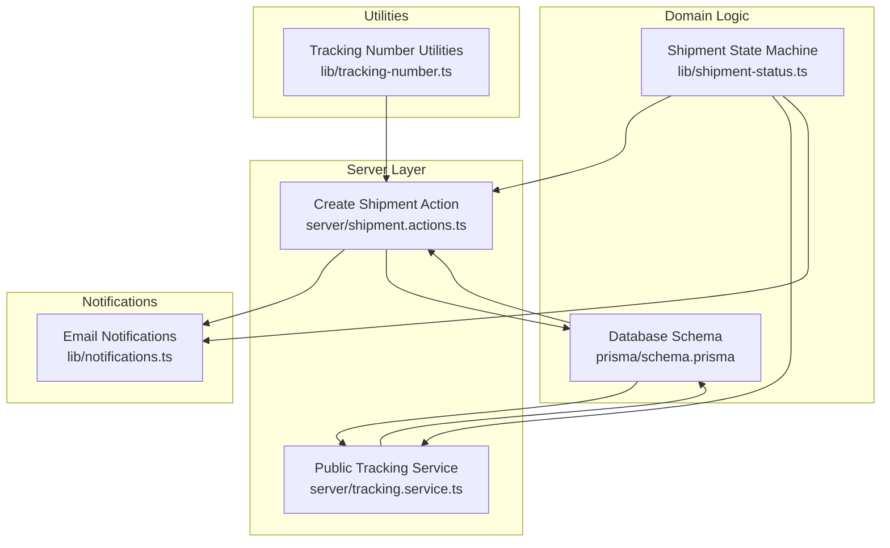
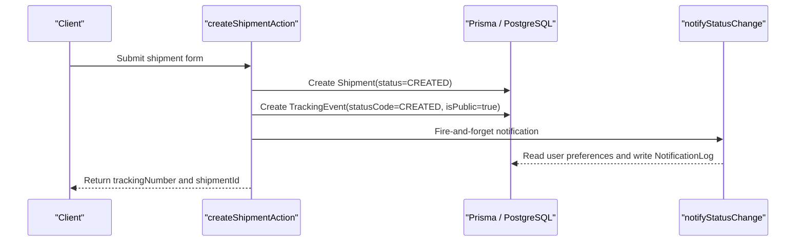
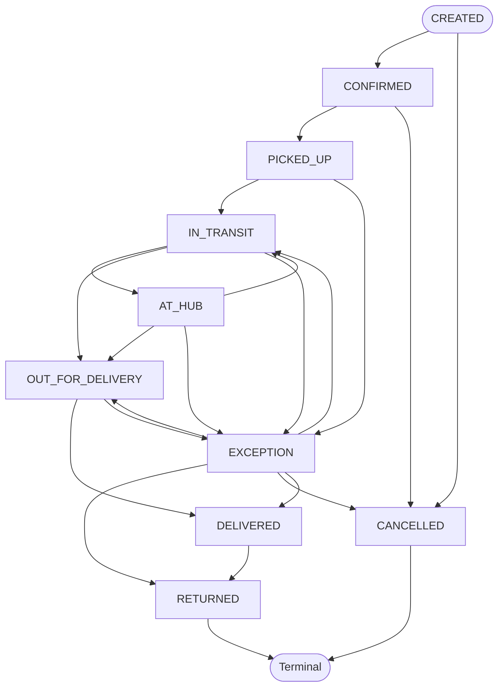
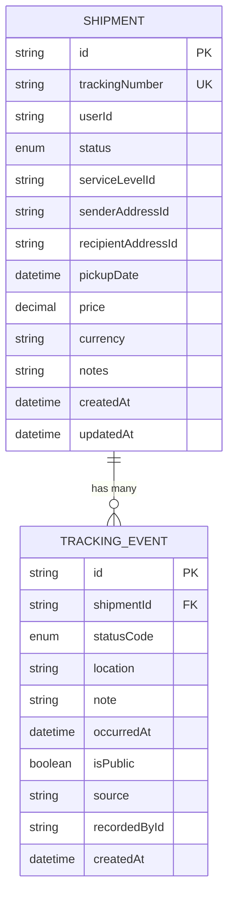
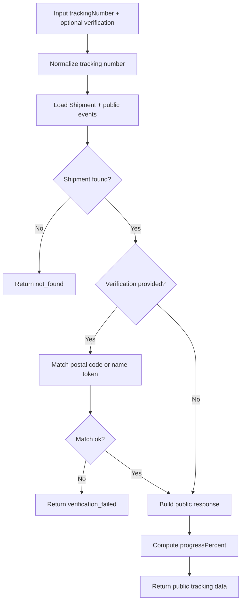
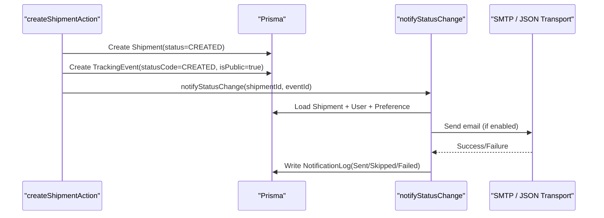
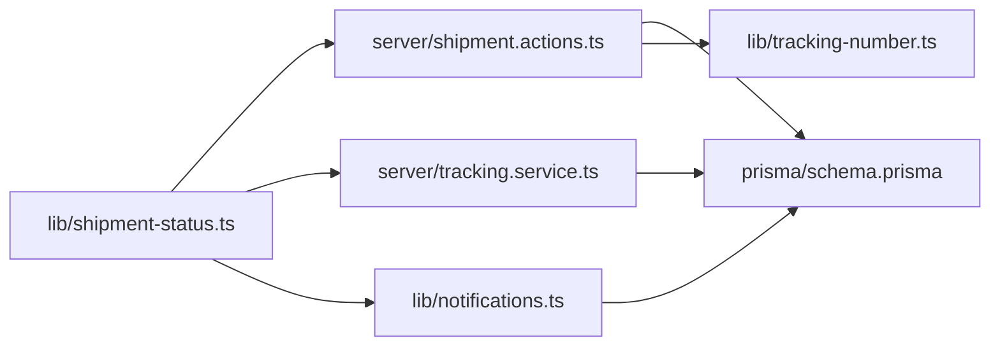

# Status Management

<cite>
**Referenced Files in This Document**
- [shipment-status.ts](file://lib/shipment-status.ts)
- [schema.prisma](file://prisma/schema.prisma)
- [tracking.service.ts](file://server/tracking.service.ts)
- [notifications.ts](file://lib/noti cations.ts)
- [shipment.actions.ts](file://server/shipment.actions.ts)
- [tracking-number.ts](file://lib/tracking-number.ts)
- [shipment-status.test.ts](file://tests/shipment-status.test.ts)
</cite>

## Table of Contents
1. [Introduction](#introduction)
2. [Project Structure](#project-structure)
3. [Core Components](#core-components)
4. [Architecture Overview](#architecture-overview)
5. [Detailed Component Analysis](#detailed-component-analysis)
6. [Dependency Analysis](#dependency-analysis)
7. [Performance Considerations](#performance-considerations)
8. [Troubleshooting Guide](#troubleshooting-guide)
9. [Conclusion](#conclusion)

## Introduction
This document explains the shipment status management system, including the complete lifecycle from CREATED to DELIVERED, all valid states and transitions, business constraints, audit trails, public visibility controls, and integration with the notification system. It is intended for developers, operators, and product stakeholders who need a clear understanding of how shipments move through the system and how that movement is recorded and communicated.

## Project Structure
The status management logic is implemented across a small set of focused modules:
- A state machine module defines statuses, allowed transitions, terminal/completed helpers, and human-readable metadata.
- The database schema defines the ShipmentStatus enum and tracking-related tables.
- Server actions create shipments and record initial tracking events.
- A tracking service builds guest-safe public views and computes progress.
- The notification module sends emails based on user preferences and logs outcomes.
- Tests assert transition rules and metadata completeness.

**Diagram sources**
- [shipment-status.ts:1-77](file://lib/shipment-status.ts#L1-L77)
- [schema.prisma:23-34](file://prisma/schema.prisma#L23-L34)
- [schema.prisma:160-186](file://prisma/schema.prisma#L160-L186)
- [schema.prisma:209-226](file://prisma/schema.prisma#L209-L226)
- [shipment.actions.ts:45-145](file://server/shipment.actions.ts#L45-L145)
- [tracking.service.ts:1-147](file://server/tracking.service.ts#L1-L147)
- [notifications.ts:1-114](file://lib/notifications.ts#L1-L114)
- [tracking-number.ts:1-57](file://lib/tracking-number.ts#L1-L57)

**Section sources**
- [shipment-status.ts:1-77](file://lib/shipment-status.ts#L1-L77)
- [schema.prisma:23-34](file://prisma/schema.prisma#L23-L34)
- [schema.prisma:160-186](file://prisma/schema.prisma#L160-L186)
- [schema.prisma:209-226](file://prisma/schema.prisma#L209-L226)
- [shipment.actions.ts:45-145](file://server/shipment.actions.ts#L45-L145)
- [tracking.service.ts:1-147](file://server/tracking.service.ts#L1-L147)
- [notifications.ts:1-114](file://lib/notifications.ts#L1-L114)
- [tracking-number.ts:1-57](file://lib/tracking-number.ts#L1-L57)

## Core Components
- Shipment state machine: Defines all statuses, allowed transitions, terminal/completed checks, and display metadata.
- Database models: Shipment stores current status; TrackingEvent records each status change with location, note, source, author, and visibility flags.
- Public tracking view: Builds a safe, read-only timeline using only public events and status metadata.
- Notification pipeline: Sends email updates when enabled by user preferences and records delivery outcomes.
- Tracking number utilities: Generate and validate public tracking codes used to access shipment data.

Key responsibilities:
- Enforce valid transitions at the domain layer.
- Persist both the shipment’s current status and an immutable event history.
- Expose a guest-safe tracking endpoint that filters non-public events.
- Honor user notification preferences and log every attempt.

**Section sources**
- [shipment-status.ts:9-76](file://lib/shipment-status.ts#L9-L76)
- [schema.prisma:160-186](file://prisma/schema.prisma#L160-L186)
- [schema.prisma:209-226](file://prisma/schema.prisma#L209-L226)
- [tracking.service.ts:38-54](file://server/tracking.service.ts#L38-L54)
- [tracking.service.ts:69-146](file://server/tracking.service.ts#L69-L146)
- [notifications.ts:49-108](file://lib/notifications.ts#L49-L108)
- [tracking-number.ts:34-56](file://lib/tracking-number.ts#L34-L56)

## Architecture Overview
The status lifecycle is enforced by a central state machine and applied consistently across server actions, future back-office flows, and tests. When a shipment is created, it starts in CREATED and a corresponding tracking event is recorded. Subsequent operations (e.g., confirmation, pickup, transit, delivery) should update the Shipment.status and append a new TrackingEvent. Notifications are triggered after successful event creation.

**Diagram sources**
- [shipment.actions.ts:99-142](file://server/shipment.actions.ts#L99-L142)
- [notifications.ts:49-108](file://lib/notifications.ts#L49-L108)
- [schema.prisma:160-186](file://prisma/schema.prisma#L160-L186)
- [schema.prisma:209-226](file://prisma/schema.prisma#L209-L226)

## Detailed Component Analysis

### Shipment Status Lifecycle and Transition Rules
The state machine defines:
- All statuses: CREATED, CONFIRMED, PICKED_UP, IN_TRANSIT, AT_HUB, OUT_FOR_DELIVERY, DELIVERED, EXCEPTION, RETURNED, CANCELLED.
- Allowed transitions per status, including recovery paths from EXCEPTION and cancellation paths.
- Terminal statuses: RETURNED and CANCELLED have no further transitions.
- Completed statuses: DELIVERED, RETURNED, CANCELLED are considered closed for UI rendering.

Valid progression examples:
- Happy path: CREATED → CONFIRMED → PICKED_UP → IN_TRANSIT → AT_HUB → OUT_FOR_DELIVERY → DELIVERED.
- Exception handling: Any pre-delivery stage can transition to EXCEPTION; from EXCEPTION, the flow may resume or close via RETURNED/CANCELLED/DELIVERED.
- Cancellation: CREATED or CONFIRMED can be cancelled directly.

**Diagram sources**
- [shipment-status.ts:29-40](file://lib/shipment-status.ts#L29-L40)
- [shipment-status.ts:42-55](file://lib/shipment-status.ts#L42-L55)
- [shipment-status.ts:57-60](file://lib/shipment-status.ts#L57-L60)

Business constraints:
- Transitions must pass validation before being persisted.
- Terminal statuses cannot advance further.
- Completed statuses are treated as closed for progress calculations and UI.

Validation functions:
- nextStatuses(from): Returns allowed targets.
- canTransition(from, to): Boolean check against allowed targets.
- isTerminal(status): Checks if no further moves are allowed.
- isCompleted(status): Determines if the shipment is effectively closed.

Tests verify happy-path transitions, rejection of skipped steps, terminal behavior, exception recovery, metadata coverage, and completed-state classification.

**Section sources**
- [shipment-status.ts:9-76](file://lib/shipment-status.ts#L9-L76)
- [shipment-status.test.ts:4-39](file://tests/shipment-status.test.ts#L4-L39)

### Data Model and Audit Trail
The database model enforces:
- Shipment.status holds the current lifecycle state.
- TrackingEvent captures each status change with:
  - statusCode: mirrors ShipmentStatus.
  - location and note: contextual details.
  - occurredAt: timestamp of the event.
  - isPublic: controls visibility in the public timeline.
  - source: origin of the event (e.g., CUSTOMER, SYSTEM).
  - recordedById: optional operator who recorded the event.

Indexes optimize queries by shipmentId and public visibility.

**Diagram sources**
- [schema.prisma:160-186](file://prisma/schema.prisma#L160-L186)
- [schema.prisma:209-226](file://prisma/schema.prisma#L209-L226)

Audit trail best practices:
- Always append a TrackingEvent whenever Shipment.status changes.
- Record source and recordedById for accountability.
- Use isPublic=false for internal notes not suitable for guests.

**Section sources**
- [schema.prisma:160-186](file://prisma/schema.prisma#L160-L186)
- [schema.prisma:209-226](file://prisma/schema.prisma#L209-L226)

### Public Visibility Controls
The public tracking service:
- Loads only public tracking events (isPublic=true).
- Normalizes and validates the tracking number input.
- Optionally verifies access using recipient postal code or name tokens.
- Computes progress percentage based on status order and special cases for EXCEPTION, DELIVERED, RETURNED, and CANCELLED.
- Exposes a safe subset of fields without sensitive address or pricing details.

**Diagram sources**
- [tracking.service.ts:38-54](file://server/tracking.service.ts#L38-L54)
- [tracking.service.ts:56-62](file://server/tracking.service.ts#L56-L62)
- [tracking.service.ts:69-146](file://server/tracking.service.ts#L69-L146)
- [tracking-number.ts:43-56](file://lib/tracking-number.ts#L43-L56)

**Section sources**
- [tracking.service.ts:38-54](file://server/tracking.service.ts#L38-L54)
- [tracking.service.ts:56-62](file://server/tracking.service.ts#L56-L62)
- [tracking.service.ts:69-146](file://server/tracking.service.ts#L69-L146)
- [tracking-number.ts:43-56](file://lib/tracking-number.ts#L43-L56)

### Notification Integration
When a shipment is created, the action:
- Creates the Shipment with status CREATED.
- Creates a TrackingEvent with statusCode CREATED and isPublic=true.
- Fires a notification asynchronously.

The notification module:
- Resolves the shipment and event.
- Reads the user’s email preference and enabled event list.
- Skips sending if preferences do not allow the event, logging SKIPPED.
- Sends email via configured transport and logs SENT or SKIPPED depending on environment.
- On failure, logs FAILED with error details.

**Diagram sources**
- [shipment.actions.ts:99-142](file://server/shipment.actions.ts#L99-L142)
- [notifications.ts:49-108](file://lib/notifications.ts#L49-L108)
- [schema.prisma:232-260](file://prisma/schema.prisma#L232-L260)

Custom status handling:
- New statuses require updates to:
  - The Prisma enum ShipmentStatus.
  - The SHIPMENT_STATUSES array and FORWARD map.
  - STATUS_META labels, descriptions, and tones.
  - PROGRESS_ORDER if the status affects progress calculation.
  - Tests asserting new transitions and metadata.

Integration points:
- STATUS_META is reused by notifications and public tracking to render consistent labels and tones.
- Tracking events carry statusCode so notifications and UI remain aligned with the state machine.

**Section sources**
- [shipment.actions.ts:99-142](file://server/shipment.actions.ts#L99-L142)
- [notifications.ts:32-43](file://lib/notifications.ts#L32-L43)
- [notifications.ts:49-108](file://lib/notifications.ts#L49-L108)
- [tracking.service.ts:96-112](file://server/tracking.service.ts#L96-L112)
- [schema.prisma:23-34](file://prisma/schema.prisma#L23-L34)
- [schema.prisma:232-260](file://prisma/schema.prisma#L232-L260)

### Example Status Progression
A typical customer journey:
- Customer creates a shipment: status becomes CREATED; a public event is recorded.
- Staff confirms pickup: status becomes CONFIRMED; a new event is appended.
- Courier picks up: status becomes PICKED_UP; event recorded.
- Shipment moves between facilities: status becomes IN_TRANSIT; event recorded.
- Shipment arrives at hub: status becomes AT_HUB; event recorded.
- Out for delivery: status becomes OUT_FOR_DELIVERY; event recorded.
- Delivered: status becomes DELIVERED; event recorded; progress reaches 100%.
- If issues occur: any pre-delivery stage can transition to EXCEPTION; later resume or close via RETURNED/CANCELLED/DELIVERED.

Progress computation:
- DELIVERED, RETURNED, CANCELLED yield 100%.
- EXCEPTION yields a fixed intermediate value.
- Other statuses compute a percentage based on their position in the progress order.

**Section sources**
- [shipment-status.ts:29-40](file://lib/shipment-status.ts#L29-L40)
- [shipment-status.ts:57-60](file://lib/shipment-status.ts#L57-L60)
- [tracking.service.ts:38-54](file://server/tracking.service.ts#L38-L54)
- [shipment.actions.ts:120-131](file://server/shipment.actions.ts#L120-L131)

## Dependency Analysis
The following diagram shows key dependencies among modules involved in status management.

**Diagram sources**
- [shipment-status.ts:1-77](file://lib/shipment-status.ts#L1-L77)
- [shipment.actions.ts:1-146](file://server/shipment.actions.ts#L1-L146)
- [tracking.service.ts:1-147](file://server/tracking.service.ts#L1-L147)
- [notifications.ts:1-114](file://lib/notifications.ts#L1-L114)
- [schema.prisma:1-261](file://prisma/schema.prisma#L1-L261)
- [tracking-number.ts:1-57](file://lib/tracking-number.ts#L1-L57)

Coupling and cohesion:
- The state machine is cohesive and decoupled from persistence, enabling reuse across server actions, services, and tests.
- Notifications depend on the state machine for labels and tones but are independent of business logic beyond preference resolution.
- Public tracking composes status metadata with query results, keeping presentation concerns separate.

Potential circular dependencies:
- None observed; imports are directional from domain to server layers.

External integrations:
- SMTP transport for email notifications.
- Prisma client for database operations.

**Section sources**
- [shipment-status.ts:1-77](file://lib/shipment-status.ts#L1-L77)
- [shipment.actions.ts:1-146](file://server/shipment.actions.ts#L1-L146)
- [tracking.service.ts:1-147](file://server/tracking.service.ts#L1-L147)
- [notifications.ts:1-114](file://lib/notifications.ts#L1-L114)
- [schema.prisma:1-261](file://prisma/schema.prisma#L1-L261)
- [tracking-number.ts:1-57](file://lib/tracking-number.ts#L1-L57)

## Performance Considerations
- Event writes: Each status change appends a TrackingEvent; ensure indexes on shipmentId and isPublic are leveraged by queries.
- Notification firing: Notifications are fired asynchronously to avoid blocking request completion; failures are logged rather than failing the primary operation.
- Public tracking queries: Only public events are loaded, reducing payload size and exposure risk.
- Progress calculation: Simple arithmetic over a fixed-order array; negligible overhead.

[No sources needed since this section provides general guidance]

## Troubleshooting Guide
Common issues and resolutions:
- Invalid transition attempted:
  - Validate using canTransition before updating status.
  - Review FORWARD mapping and ensure business rules align with desired workflow.
- Missing status metadata:
  - Ensure STATUS_META includes label, description, and tone for every status.
  - Run tests to verify metadata completeness.
- Notification not received:
  - Check user’s NotificationPreference for EMAIL channel and enabled events.
  - Inspect NotificationLog for SKIPPED or FAILED entries and associated errors.
- Public tracking not visible:
  - Confirm TrackingEvent.isPublic=true for events you want guests to see.
  - Verify tracking number normalization and optional verification match.
- Progress appears incorrect:
  - Review PROGRESS_ORDER and computeProgress logic for new statuses.
  - Ensure EXCEPTION and terminal statuses are handled as expected.

Operational checks:
- Database indexes on shipmentId and isPublic exist and are used by queries.
- SMTP configuration is correct; in development, emails may be captured without sending.

**Section sources**
- [shipment-status.ts:45-60](file://lib/shipment-status.ts#L45-L60)
- [notifications.ts:49-108](file://lib/notifications.ts#L49-L108)
- [tracking.service.ts:69-146](file://server/tracking.service.ts#L69-L146)
- [schema.prisma:209-226](file://prisma/schema.prisma#L209-L226)
- [schema.prisma:232-260](file://prisma/schema.prisma#L232-L260)

## Conclusion
The shipment status management system centers on a well-defined state machine, robust audit trails via TrackingEvent, and a guest-safe public tracking view. Notifications are integrated thoughtfully, honoring user preferences and recording outcomes. By enforcing transitions at the domain layer and mirroring them in the database schema and tests, the system ensures consistency, traceability, and extensibility for future status additions and operational needs.

[No sources needed since this section summarizes without analyzing specific files]