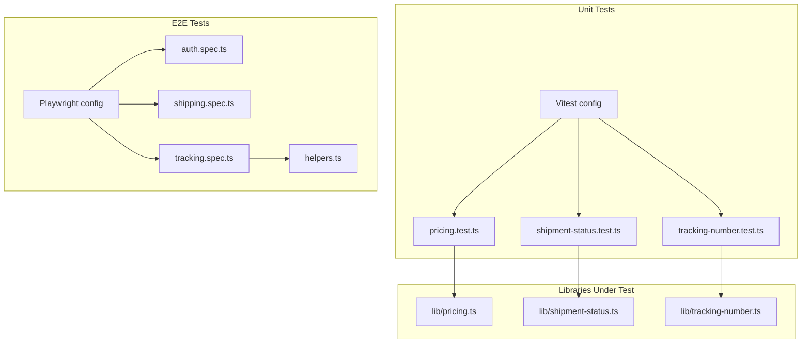
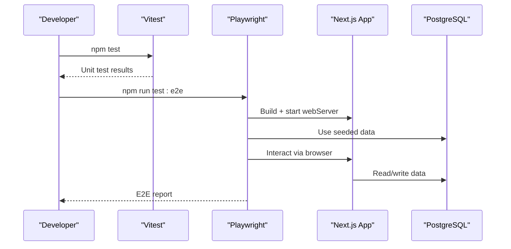
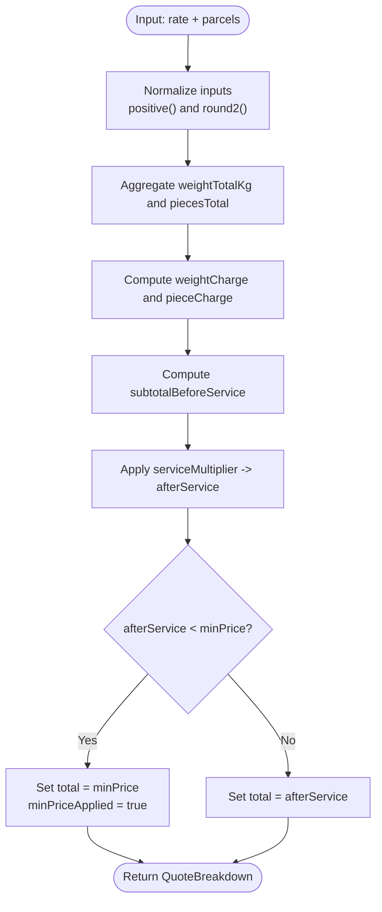
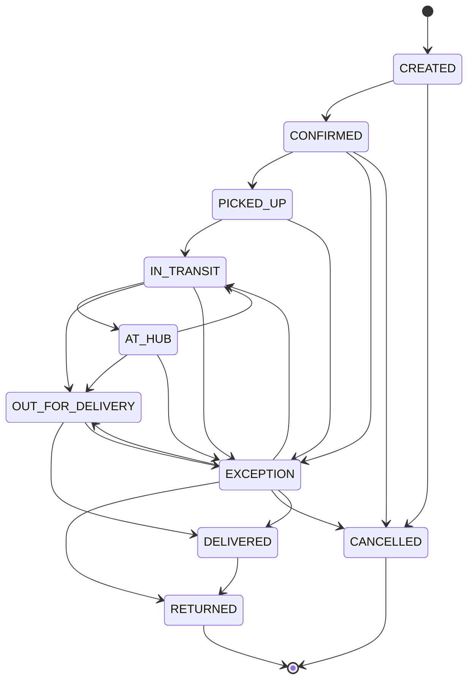
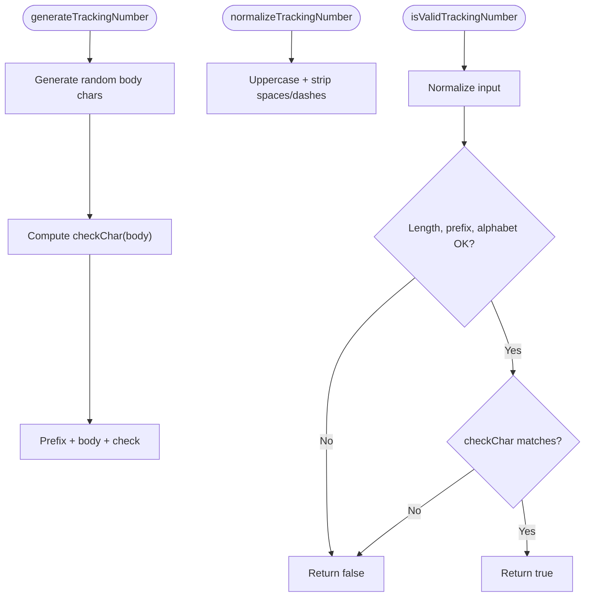
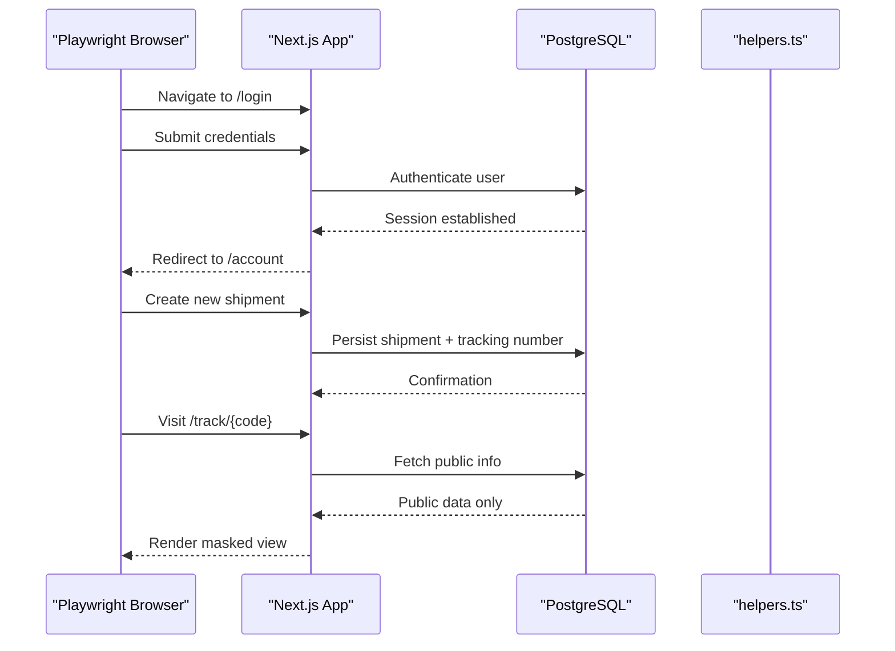
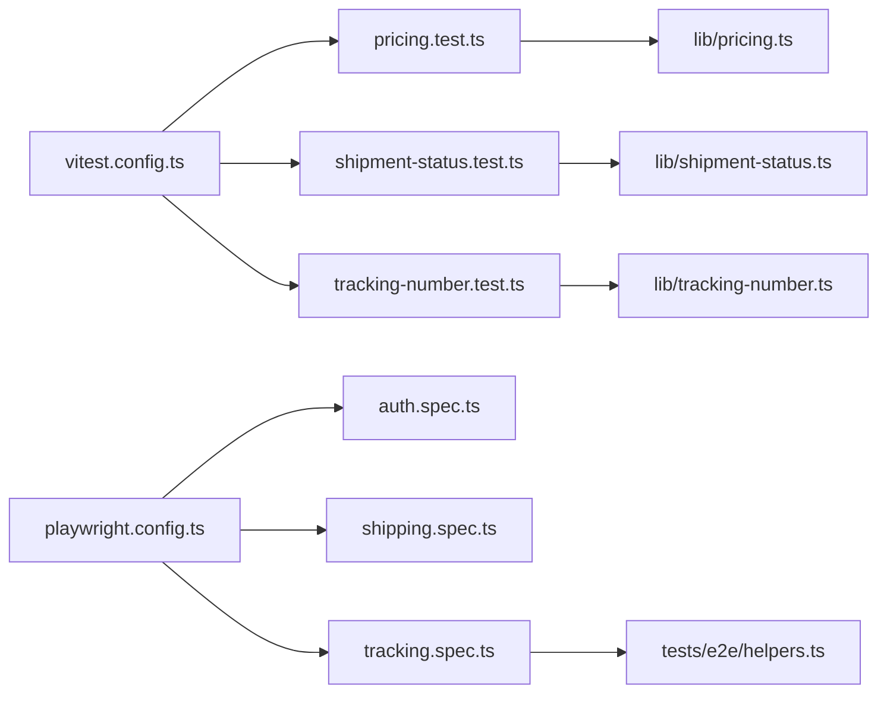
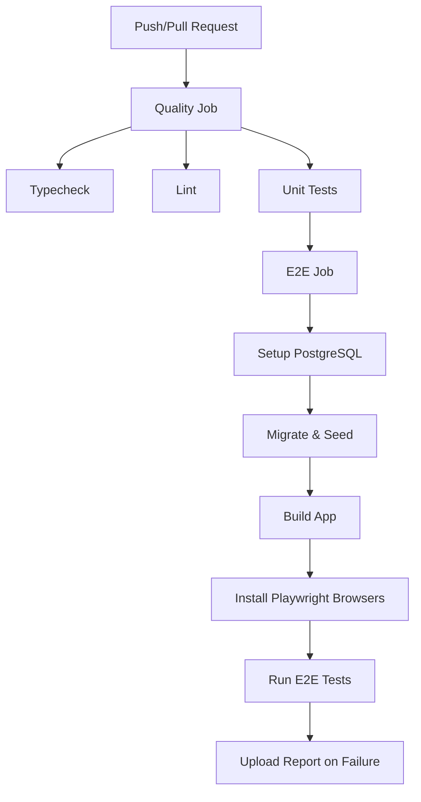

# Testing Guide

<cite>
**Referenced Files in This Document**
- [package.json](file://package.json)
- [vitest.config.ts](file://vitest.config.ts)
- [playwright.config.ts](file://playwright.config.ts)
- [ci.yml](file://.github/workflows/ci.yml)
- [pricing.test.ts](file://tests/pricing.test.ts)
- [shipment-status.test.ts](file://tests/shipment-status.test.ts)
- [tracking-number.test.ts](file://tests/tracking-number.test.ts)
- [auth.spec.ts](file://tests/e2e/auth.spec.ts)
- [shipping.spec.ts](file://tests/e2e/shipping.spec.ts)
- [tracking.spec.ts](file://tests/e2e/tracking.spec.ts)
- [helpers.ts](file://tests/e2e/helpers.ts)
- [pricing.ts](file://lib/pricing.ts)
- [shipment-status.ts](file://lib/shipment-status.ts)
- [tracking-number.ts](file://lib/tracking-number.ts)
</cite>

## Table of Contents
1. [Introduction](#introduction)
2. [Project Structure](#project-structure)
3. [Core Components](#core-components)
4. [Architecture Overview](#architecture-overview)
5. [Detailed Component Analysis](#detailed-component-analysis)
6. [Dependency Analysis](#dependency-analysis)
7. [Performance Considerations](#performance-considerations)
8. [Troubleshooting Guide](#troubleshooting-guide)
9. [Conclusion](#conclusion)

## Introduction
This document explains Timberland’s testing strategy, which uses Vitest for unit tests and Playwright for end-to-end (E2E) tests. It covers test organization, naming conventions, patterns, mocking strategies, assertion styles, coverage guidance, CI/CD integration, and debugging techniques. The goal is to help contributors write reliable tests for pricing calculations, shipment status logic, utility functions, and user flows such as authentication, shipment creation, and tracking.

## Project Structure
The repository separates unit tests from E2E tests:
- Unit tests live under `tests/*.test.ts` and use Vitest.
- E2E tests live under `tests/e2e/*.spec.ts` and use Playwright.
- Configuration files define how each runner discovers and executes tests.

**Diagram sources**
- [vitest.config.ts:1-15](file://vitest.config.ts#L1-L15)
- [playwright.config.ts:1-32](file://playwright.config.ts#L1-L32)
- [pricing.test.ts:1-60](file://tests/pricing.test.ts#L1-L60)
- [shipment-status.test.ts:1-40](file://tests/shipment-status.test.ts#L1-L40)
- [tracking-number.test.ts:1-29](file://tests/tracking-number.test.ts#L1-L29)
- [auth.spec.ts:1-37](file://tests/e2e/auth.spec.ts#L1-L37)
- [shipping.spec.ts:1-55](file://tests/e2e/shipping.spec.ts#L1-L55)
- [tracking.spec.ts:1-42](file://tests/e2e/tracking.spec.ts#L1-L42)
- [helpers.ts:1-49](file://tests/e2e/helpers.ts#L1-L49)
- [pricing.ts:1-89](file://lib/pricing.ts#L1-L89)
- [shipment-status.ts:1-77](file://lib/shipment-status.ts#L1-L77)
- [tracking-number.ts:1-57](file://lib/tracking-number.ts#L1-L57)

**Section sources**
- [vitest.config.ts:1-15](file://vitest.config.ts#L1-L15)
- [playwright.config.ts:1-32](file://playwright.config.ts#L1-L32)
- [package.json:5-20](file://package.json#L5-L20)

## Core Components
This section summarizes the core libraries under test and their responsibilities.

- Pricing engine (`lib/pricing.ts`)
  - Pure functions for quote computation and rounding.
  - Handles base price, weight/piece charges, service multiplier, minimum price floor, and multi-parcel aggregation.
  - Exposes `computeQuote` and `round2`.

- Shipment state machine (`lib/shipment-status.ts`)
  - Defines allowed transitions, terminal states, completion semantics, and metadata for UI rendering.
  - Exposes helpers like `canTransition`, `nextStatuses`, `isTerminal`, `isCompleted`, plus constants.

- Tracking number utilities (`lib/tracking-number.ts`)
  - Generates random, non-sequential codes with a check character.
  - Normalizes input and validates format.
  - Supports injectable randomness via options for deterministic tests.

**Section sources**
- [pricing.ts:1-89](file://lib/pricing.ts#L1-L89)
- [shipment-status.ts:1-77](file://lib/shipment-status.ts#L1-L77)
- [tracking-number.ts:1-57](file://lib/tracking-number.ts#L1-L57)

## Architecture Overview
The testing architecture consists of two runners:

- Vitest runs unit tests against pure modules without a browser or server.
- Playwright runs E2E tests against a built Next.js application backed by a seeded PostgreSQL database.

**Diagram sources**
- [vitest.config.ts:1-15](file://vitest.config.ts#L1-L15)
- [playwright.config.ts:1-32](file://playwright.config.ts#L1-L32)
- [ci.yml:14-38](file://.github/workflows/ci.yml#L14-L38)
- [ci.yml:40-94](file://.github/workflows/ci.yml#L40-L94)

**Section sources**
- [vitest.config.ts:1-15](file://vitest.config.ts#L1-L15)
- [playwright.config.ts:1-32](file://playwright.config.ts#L1-L32)

## Detailed Component Analysis

### Unit Testing Strategy with Vitest
- Discovery and environment
  - Tests are discovered under `tests/**/*.test.ts`.
  - Node environment is used; an alias `@` points to the project root.
- Naming conventions
  - File names end with `.test.ts`.
  - Group tests using `describe` blocks that mirror module responsibilities.
  - Individual cases use `it` with descriptive strings.
- Assertion style
  - Uses Vitest’s `expect` API with exact numeric assertions for pricing and boolean checks for state machine rules.
- Mocking strategy
  - Prefer pure functions and dependency injection where possible.
  - For randomness, inject a custom function via options to make tests deterministic.

#### Pricing Calculations
- What is tested
  - Summation of zone base, weight, and piece charges.
  - Minimum price floor enforcement.
  - Service multiplier application.
  - Multi-parcel aggregation.
  - Handling of invalid/non-positive values.
  - Rounding behavior for half-up precision.
- Patterns
  - Define a base rate fixture once per describe block.
  - Assert intermediate breakdown fields to ensure internal correctness.
  - Validate both computed totals and flags indicating whether the minimum price was applied.

**Diagram sources**
- [pricing.ts:40-89](file://lib/pricing.ts#L40-L89)

**Section sources**
- [pricing.test.ts:1-60](file://tests/pricing.test.ts#L1-L60)
- [pricing.ts:1-89](file://lib/pricing.ts#L1-L89)

#### Shipment Status Logic
- What is tested
  - Allowed transitions along the happy path.
  - Rejection of illegal jumps.
  - Terminal states and recovery from exceptions.
  - Metadata completeness for all statuses.
  - Completion semantics for closed states.
- Patterns
  - Use explicit transition pairs to assert `canTransition`.
  - Iterate over defined statuses to verify metadata presence.
  - Combine multiple helper functions in one test suite to validate the entire state machine contract.

**Diagram sources**
- [shipment-status.ts:9-40](file://lib/shipment-status.ts#L9-L40)

**Section sources**
- [shipment-status.test.ts:1-40](file://tests/shipment-status.test.ts#L1-L40)
- [shipment-status.ts:1-77](file://lib/shipment-status.ts#L1-L77)

#### Tracking Number Utilities
- What is tested
  - Generation produces valid, well-formed codes.
  - Tampered codes are rejected.
  - Normalization handles case and separators.
  - Generated codes vary sufficiently to resist enumeration.
- Patterns
  - Loop generation to assert length, prefix, and validity.
  - Mutate a generated code to assert validation rejects tampering.
  - Normalize mixed-case and spaced inputs to canonical form.
  - Use a set to measure uniqueness across many generations.

**Diagram sources**
- [tracking-number.ts:12-56](file://lib/tracking-number.ts#L12-L56)

**Section sources**
- [tracking-number.test.ts:1-29](file://tests/tracking-number.test.ts#L1-L29)
- [tracking-number.ts:1-57](file://lib/tracking-number.ts#L1-L57)

### E2E Testing Strategy with Playwright
- Discovery and execution
  - Tests live under `tests/e2e`.
  - A single Chromium project is configured.
  - The web server is started automatically by Playwright during tests.
- Environment and data
  - Tests run against a real built app and a seeded PostgreSQL database.
  - Helpers query the database to obtain real tracking numbers and PII for masking assertions.
- User flow coverage
  - Authentication: login success/failure, route guards, logout.
  - Shipment creation: authenticated flow, redirect, dashboard listing, and guest visibility constraints.
  - Tracking: public status/timeline display, PII masking, not-found handling, and home bar navigation.

**Diagram sources**
- [auth.spec.ts:1-37](file://tests/e2e/auth.spec.ts#L1-L37)
- [shipping.spec.ts:1-55](file://tests/e2e/shipping.spec.ts#L1-L55)
- [tracking.spec.ts:1-42](file://tests/e2e/tracking.spec.ts#L1-L42)
- [helpers.ts:1-49](file://tests/e2e/helpers.ts#L1-L49)
- [playwright.config.ts:1-32](file://playwright.config.ts#L1-L32)

**Section sources**
- [auth.spec.ts:1-37](file://tests/e2e/auth.spec.ts#L1-L37)
- [shipping.spec.ts:1-55](file://tests/e2e/shipping.spec.ts#L1-L55)
- [tracking.spec.ts:1-42](file://tests/e2e/tracking.spec.ts#L1-L42)
- [helpers.ts:1-49](file://tests/e2e/helpers.ts#L1-L49)
- [playwright.config.ts:1-32](file://playwright.config.ts#L1-L32)

## Dependency Analysis
The following diagram shows how tests depend on libraries and configuration.

**Diagram sources**
- [vitest.config.ts:1-15](file://vitest.config.ts#L1-L15)
- [playwright.config.ts:1-32](file://playwright.config.ts#L1-L32)
- [pricing.test.ts:1-60](file://tests/pricing.test.ts#L1-L60)
- [shipment-status.test.ts:1-40](file://tests/shipment-status.test.ts#L1-L40)
- [tracking-number.test.ts:1-29](file://tests/tracking-number.test.ts#L1-L29)
- [auth.spec.ts:1-37](file://tests/e2e/auth.spec.ts#L1-L37)
- [shipping.spec.ts:1-55](file://tests/e2e/shipping.spec.ts#L1-L55)
- [tracking.spec.ts:1-42](file://tests/e2e/tracking.spec.ts#L1-L42)
- [helpers.ts:1-49](file://tests/e2e/helpers.ts#L1-L49)
- [pricing.ts:1-89](file://lib/pricing.ts#L1-L89)
- [shipment-status.ts:1-77](file://lib/shipment-status.ts#L1-L77)
- [tracking-number.ts:1-57](file://lib/tracking-number.ts#L1-L57)

**Section sources**
- [vitest.config.ts:1-15](file://vitest.config.ts#L1-L15)
- [playwright.config.ts:1-32](file://playwright.config.ts#L1-L32)

## Performance Considerations
- Unit tests
  - Keep fixtures small and reuse them within a describe block.
  - Avoid heavy computations inside loops; precompute when possible.
  - Prefer deterministic helpers (like injected randomness) to avoid flakiness.
- E2E tests
  - Run a single worker to reduce contention on the shared database.
  - Use seeded data to minimize setup time and stabilize outcomes.
  - Limit screenshots and traces to failures or retries to keep reports manageable.

[No sources needed since this section provides general guidance]

## Troubleshooting Guide

### Running Tests Locally
- Unit tests
  - Run all unit tests: `npm test`
  - Watch mode: `npm run test:watch`
- E2E tests
  - Run E2E tests: `npm run test:e2e`
  - Open Playwright UI: `npm run test:e2e:ui`

**Section sources**
- [package.json:5-20](file://package.json#L5-L20)

### Common Issues and Fixes
- Missing Prisma client
  - Ensure Prisma client is generated before running tests.
  - In CI, this is done explicitly; locally, run the generation step if you see client-related errors.
- Database not seeded
  - E2E tests rely on seeded data. If helpers cannot find expected records, seed the database first.
- Browser or dependencies missing
  - Install Playwright browsers with dependencies before running E2E tests.

**Section sources**
- [ci.yml:28-30](file://.github/workflows/ci.yml#L28-L30)
- [ci.yml:75-82](file://.github/workflows/ci.yml#L75-L82)
- [helpers.ts:23-41](file://tests/e2e/helpers.ts#L23-L41)

### Debugging Failing Tests
- Unit tests
  - Inspect console logs and assertion messages.
  - Isolate failing cases by running a specific file or test name.
- E2E tests
  - Playwright captures screenshots on failure and traces on retry.
  - Use the HTML report to inspect steps and network activity.
  - Run tests in UI mode to interactively debug selectors and flows.

**Section sources**
- [playwright.config.ts:17-23](file://playwright.config.ts#L17-L23)

### CI/CD Integration
- Quality job
  - Installs dependencies, generates Prisma client, typechecks, lints, and runs unit tests.
- E2E job
  - Starts a PostgreSQL service, applies migrations, seeds data, builds the app, installs Playwright browsers, and runs E2E tests.
  - Uploads the Playwright report on failure.

**Diagram sources**
- [ci.yml:14-38](file://.github/workflows/ci.yml#L14-L38)
- [ci.yml:40-94](file://.github/workflows/ci.yml#L40-L94)

**Section sources**
- [ci.yml:14-38](file://.github/workflows/ci.yml#L14-L38)
- [ci.yml:40-94](file://.github/workflows/ci.yml#L40-L94)

## Conclusion
Timberland’s testing strategy combines fast, isolated unit tests with robust E2E scenarios. Unit tests focus on pure business logic—pricing, state transitions, and utility functions—while E2E tests validate critical user journeys across authentication, shipment creation, and tracking. The configuration and CI pipeline ensure consistent execution, meaningful reporting, and stable outcomes. By following the patterns and guidelines outlined here, contributors can extend coverage confidently and maintain high reliability across the application.