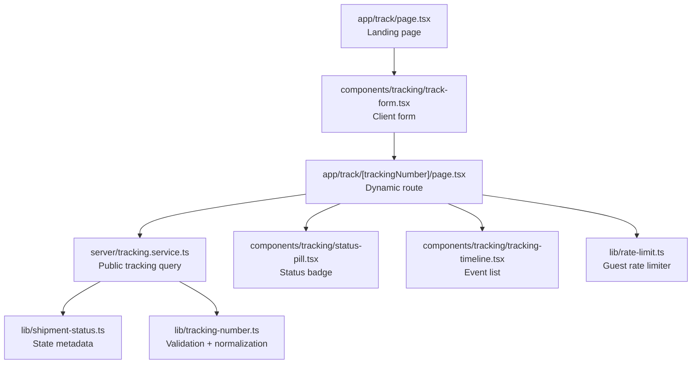
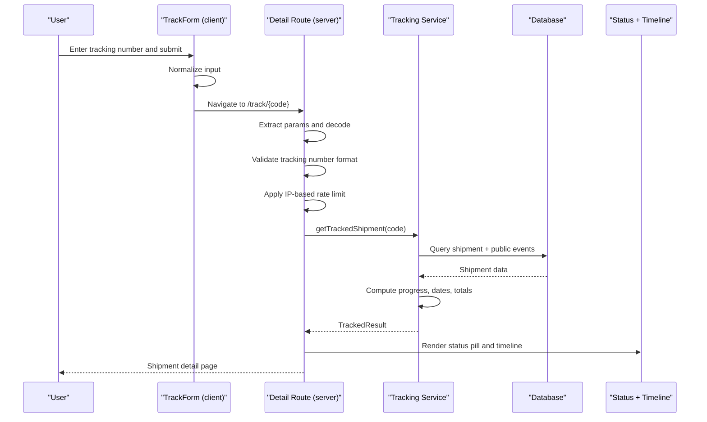
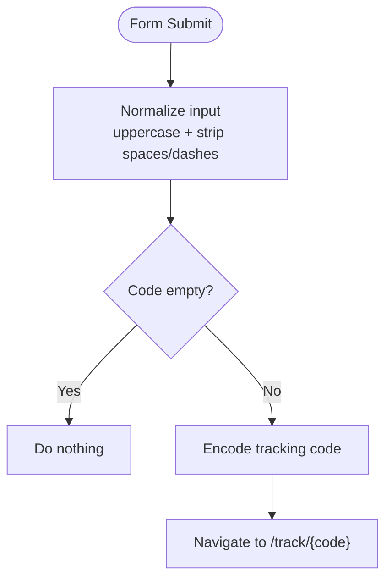
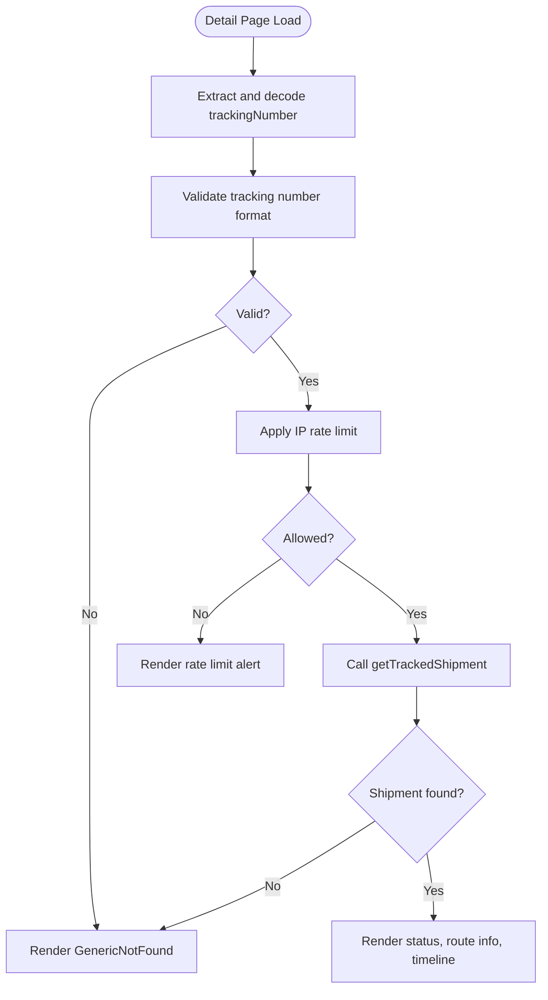
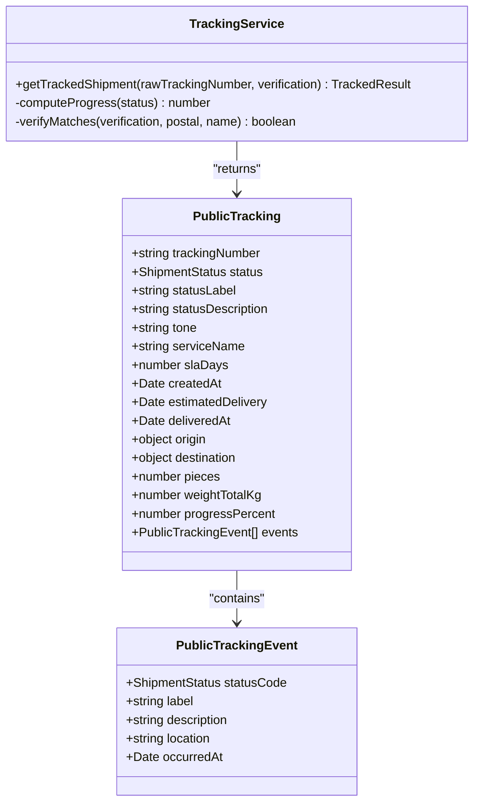
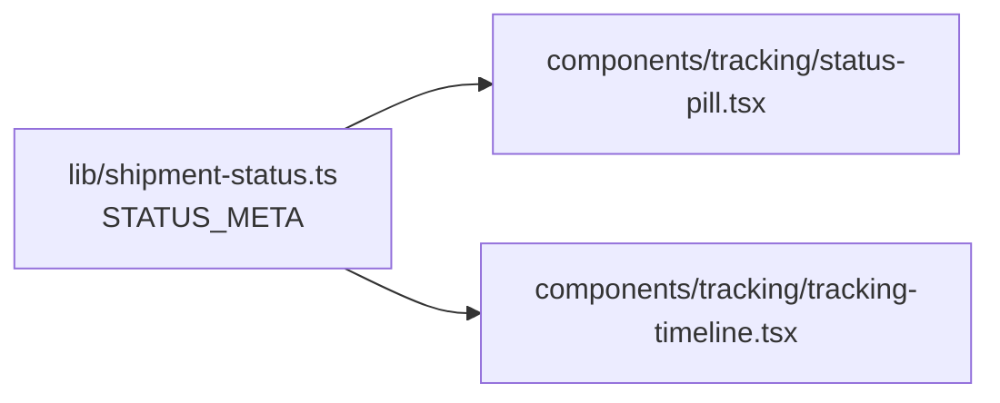
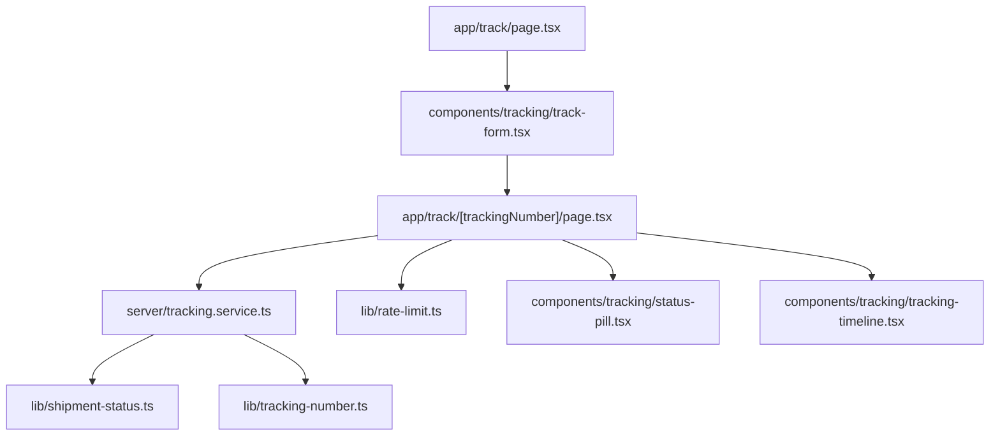

# Public Tracking Interface

<cite>
**Referenced Files in This Document**
- [app/track/page.tsx](file://app/track/page.tsx)
- [app/track/[trackingNumber]/page.tsx](file://app/track/[trackingNumber]/page.tsx)
- [components/tracking/track-form.tsx](file://components/tracking/track-form.tsx)
- [components/tracking/status-pill.tsx](file://components/tracking/status-pill.tsx)
- [components/tracking/tracking-timeline.tsx](file://components/tracking/tracking-timeline.tsx)
- [server/tracking.service.ts](file://server/tracking.service.ts)
- [lib/validation.ts](file://lib/validation.ts)
- [lib/tracking-number.ts](file://lib/tracking-number.ts)
- [lib/shipment-status.ts](file://lib/shipment-status.ts)
- [lib/rate-limit.ts](file://lib/rate-limit.ts)
- [app/robots.ts](file://app/robots.ts)
- [app/sitemap.ts](file://app/sitemap.ts)
</cite>

## Table of Contents
1. [Introduction](#introduction)
2. [Project Structure](#project-structure)
3. [Core Components](#core-components)
4. [Architecture Overview](#architecture-overview)
5. [Detailed Component Analysis](#detailed-component-analysis)
6. [Dependency Analysis](#dependency-analysis)
7. [Performance Considerations](#performance-considerations)
8. [SEO Optimization for Public Tracking Pages](#seo-optimization-for-public-tracking-pages)
9. [Troubleshooting Guide](#troubleshooting-guide)
10. [Conclusion](#conclusion)

## Introduction
This document explains the public tracking interface used to look up shipments without requiring an account. It covers:
- The track form component and how user input is handled and validated.
- Dynamic routing for individual tracking pages, parameter extraction, and data fetching.
- Integration with the tracking service layer.
- Handling different tracking states and rendering status and timeline components.
- SEO considerations and performance characteristics for public tracking pages.

The goal is to help developers implement custom tracking forms, extend state handling, and integrate safely with the backend while keeping guest enumeration and abuse under control.

## Project Structure
Public tracking is implemented as a Next.js App Router feature:
- A static landing page at `/track` renders the tracking form.
- A dynamic route at `/track/[trackingNumber]` fetches and displays shipment details.
- Reusable UI components render status pills and timelines.
- A server-side service builds a public-safe view from database records.
- Validation utilities ensure tracking numbers are well-formed.
- Rate limiting protects against enumeration attacks.

**Diagram sources**
- [app/track/page.tsx:1-30](file://app/track/page.tsx#L1-L30)
- [components/tracking/track-form.tsx:1-47](file://components/tracking/track-form.tsx#L1-L47)
- [app/track/[trackingNumber]/page.tsx:1-182](file://app/track/[trackingNumber]/page.tsx#L1-L182)
- [server/tracking.service.ts:1-147](file://server/tracking.service.ts#L1-L147)
- [lib/shipment-status.ts:1-77](file://lib/shipment-status.ts#L1-L77)
- [lib/tracking-number.ts:1-57](file://lib/tracking-number.ts#L1-L57)
- [components/tracking/status-pill.tsx:1-8](file://components/tracking/status-pill.tsx#L1-L8)
- [components/tracking/tracking-timeline.tsx:1-51](file://components/tracking/tracking-timeline.tsx#L1-L51)
- [lib/rate-limit.ts:1-56](file://lib/rate-limit.ts#L1-L56)

**Section sources**
- [app/track/page.tsx:1-30](file://app/track/page.tsx#L1-L30)
- [app/track/[trackingNumber]/page.tsx:1-182](file://app/track/[trackingNumber]/page.tsx#L1-L182)

## Core Components
- Track form component: A client-side form that normalizes input and navigates to the dynamic tracking route.
- Dynamic tracking page: A server component that validates the tracking number, applies rate limiting, fetches data, and renders status and timeline.
- Tracking service: A server-only function that queries the database and returns a public-safe tracking object.
- Status and timeline components: Present the current status and historical events.

Key responsibilities:
- Input normalization happens on the client for convenience; full validation occurs on the server.
- The dynamic route enforces guest rate limits and rejects invalid or missing shipments.
- The service computes derived fields like progress percentage and estimated delivery.

**Section sources**
- [components/tracking/track-form.tsx:1-47](file://components/tracking/track-form.tsx#L1-L47)
- [app/track/[trackingNumber]/page.tsx:1-182](file://app/track/[trackingNumber]/page.tsx#L1-L182)
- [server/tracking.service.ts:1-147](file://server/tracking.service.ts#L1-L147)
- [components/tracking/status-pill.tsx:1-8](file://components/tracking/status-pill.tsx#L1-L8)
- [components/tracking/tracking-timeline.tsx:1-51](file://components/tracking/tracking-timeline.tsx#L1-L51)

## Architecture Overview
The public tracking flow combines client navigation with server-side data fetching and rendering.

**Diagram sources**
- [components/tracking/track-form.tsx:1-47](file://components/tracking/track-form.tsx#L1-L47)
- [app/track/[trackingNumber]/page.tsx:1-182](file://app/track/[trackingNumber]/page.tsx#L1-L182)
- [server/tracking.service.ts:1-147](file://server/tracking.service.ts#L1-L147)

## Detailed Component Analysis

### Track Form Component
Responsibilities:
- Accepts optional default value and compact layout mode.
- Normalizes input by uppercasing and removing spaces/dashes.
- Prevents empty submissions and navigates to the dynamic route with an encoded tracking code.

Input handling and validation patterns:
- Client-side normalization improves UX but does not replace server validation.
- Full format validation is performed on the server using the tracking number utility.

Extensibility:
- You can wrap this component to add client-side error messages, analytics, or additional fields before navigation.
- For server-side validation flows, use the shared schema and validation utilities.

**Diagram sources**
- [components/tracking/track-form.tsx:1-47](file://components/tracking/track-form.tsx#L1-L47)

**Section sources**
- [components/tracking/track-form.tsx:1-47](file://components/tracking/track-form.tsx#L1-L47)

### Dynamic Routing and Parameter Extraction
Behavior:
- The dynamic route receives `trackingNumber` via the URL segment.
- The parameter is decoded to handle percent-encoded values.
- Invalid formats return a generic “not found” view with a reusable form.
- Guest requests are protected by an IP-based rate limiter.

Data fetching strategy:
- Fetches the shipment and public events through the tracking service.
- Renders a summary card with status, origin/destination, service info, weight, pieces, and progress.
- Renders a timeline of public tracking events.

Error handling:
- Invalid tracking number → generic not found view.
- Missing shipment → generic not found view.
- Too many requests → explicit rate-limited message.

**Diagram sources**
- [app/track/[trackingNumber]/page.tsx:1-182](file://app/track/[trackingNumber]/page.tsx#L1-L182)
- [lib/tracking-number.ts:1-57](file://lib/tracking-number.ts#L1-L57)
- [lib/rate-limit.ts:1-56](file://lib/rate-limit.ts#L1-L56)

**Section sources**
- [app/track/[trackingNumber]/page.tsx:1-182](file://app/track/[trackingNumber]/page.tsx#L1-L182)

### Tracking Service Layer
Responsibilities:
- Builds a public-safe tracking object that excludes sensitive fields such as street address, contact name, phone, and price.
- Supports optional verification (postal code or recipient surname) to reduce enumeration risk.
- Computes derived fields:
  - Progress percentage based on status progression.
  - Estimated delivery date based on pickup or SLA.
  - Delivered timestamp if available.
  - Aggregated parcel weight and piece count.
- Maps internal event codes to public labels and descriptions using status metadata.

Security and privacy:
- Only includes public tracking events (`isPublic`).
- Enforces optional verification when provided.

Complexity notes:
- Database query includes related entities and filters events.
- Derived computations are linear over parcels and events.

**Diagram sources**
- [server/tracking.service.ts:1-147](file://server/tracking.service.ts#L1-L147)

**Section sources**
- [server/tracking.service.ts:1-147](file://server/tracking.service.ts#L1-L147)

### Status and Timeline Components
- Status Pill: Displays the current status label with a semantic tone using shared status metadata.
- Tracking Timeline: Renders a chronological list of public events with timestamps, locations, and descriptions.

These components depend on the shared status metadata to ensure consistent labeling and visual tone across the application.

**Diagram sources**
- [lib/shipment-status.ts:1-77](file://lib/shipment-status.ts#L1-L77)
- [components/tracking/status-pill.tsx:1-8](file://components/tracking/status-pill.tsx#L1-L8)
- [components/tracking/tracking-timeline.tsx:1-51](file://components/tracking/tracking-timeline.tsx#L1-L51)

**Section sources**
- [components/tracking/status-pill.tsx:1-8](file://components/tracking/status-pill.tsx#L1-L8)
- [components/tracking/tracking-timeline.tsx:1-51](file://components/tracking/tracking-timeline.tsx#L1-L51)
- [lib/shipment-status.ts:1-77](file://lib/shipment-status.ts#L1-L77)

### Validation Patterns
- Client-side normalization: Uppercase and remove whitespace/dashes for better UX.
- Server-side format validation: Uses a dedicated tracking number validator to enforce length, prefix, alphabet, and check character.
- Schema-based validation: Shared Zod schemas define expected shapes for tracking lookup inputs, including optional verification.

Recommended pattern:
- Always normalize on the client for usability.
- Always validate on the server using the shared validator.
- Use the schema for structured server actions or API endpoints.

**Section sources**
- [components/tracking/track-form.tsx:1-47](file://components/tracking/track-form.tsx#L1-L47)
- [lib/tracking-number.ts:1-57](file://lib/tracking-number.ts#L1-L57)
- [lib/validation.ts:1-87](file://lib/validation.ts#L1-L87)

### Implementing Custom Tracking Forms
Guidelines:
- Keep the form client-side only for navigation; do not perform business logic there.
- Normalize input similarly to the existing form.
- Navigate to `/track/{encodedCode}` to reuse the dynamic route.
- If you need server-side validation, use the shared schema and validators.
- Optionally include a verification field to reduce enumeration risk when building server actions.

Example integration points:
- Wrap the form to add analytics or error banners.
- Extend the dynamic route’s UI to show additional public fields exposed by the service.

**Section sources**
- [components/tracking/track-form.tsx:1-47](file://components/tracking/track-form.tsx#L1-L47)
- [lib/validation.ts:1-87](file://lib/validation.ts#L1-L87)

### Handling Different Tracking States
- Status metadata provides labels, descriptions, and tones for each state.
- The progress calculation treats terminal states as complete and maps intermediate states to percentages.
- The timeline uses status metadata to color-code events consistently.

When adding new states:
- Update the status metadata and transition rules.
- Ensure the progress calculation accounts for the new state.
- Verify timeline rendering handles unknown statuses gracefully.

**Section sources**
- [lib/shipment-status.ts:1-77](file://lib/shipment-status.ts#L1-L77)
- [server/tracking.service.ts:1-147](file://server/tracking.service.ts#L1-L147)
- [components/tracking/tracking-timeline.tsx:1-51](file://components/tracking/tracking-timeline.tsx#L1-L51)

### Integrating with the Tracking Service Layer
- Call `getTrackedShipment` from server components or server actions.
- Handle all result types: success, not found, and verification failed.
- Use the returned public object to render UI; avoid exposing raw database models.
- If implementing server actions, validate inputs with the shared schema before calling the service.

**Section sources**
- [server/tracking.service.ts:1-147](file://server/tracking.service.ts#L1-L147)
- [lib/validation.ts:1-87](file://lib/validation.ts#L1-L87)

## Dependency Analysis
The public tracking feature has clear boundaries between client navigation, server rendering, and data access.

**Diagram sources**
- [app/track/page.tsx:1-30](file://app/track/page.tsx#L1-L30)
- [components/tracking/track-form.tsx:1-47](file://components/tracking/track-form.tsx#L1-L47)
- [app/track/[trackingNumber]/page.tsx:1-182](file://app/track/[trackingNumber]/page.tsx#L1-L182)
- [server/tracking.service.ts:1-147](file://server/tracking.service.ts#L1-L147)
- [lib/shipment-status.ts:1-77](file://lib/shipment-status.ts#L1-L77)
- [lib/tracking-number.ts:1-57](file://lib/tracking-number.ts#L1-L57)
- [lib/rate-limit.ts:1-56](file://lib/rate-limit.ts#L1-L56)
- [components/tracking/status-pill.tsx:1-8](file://components/tracking/status-pill.tsx#L1-L8)
- [components/tracking/tracking-timeline.tsx:1-51](file://components/tracking/tracking-timeline.tsx#L1-L51)

**Section sources**
- [app/track/page.tsx:1-30](file://app/track/page.tsx#L1-L30)
- [app/track/[trackingNumber]/page.tsx:1-182](file://app/track/[trackingNumber]/page.tsx#L1-L182)
- [server/tracking.service.ts:1-147](file://server/tracking.service.ts#L1-L147)

## Performance Considerations
- Server-rendered detail page reduces client work and improves initial load time.
- Rate limiting prevents abuse and protects database resources during enumeration attempts.
- The service computes lightweight derived fields (progress, totals) rather than performing heavy transformations.
- Only public events are included in the response, reducing payload size.
- Consider caching strategies for frequently accessed tracking numbers if traffic grows.

[No sources needed since this section provides general guidance]

## SEO Optimization for Public Tracking Pages
- The landing page sets a descriptive title and description for search engines.
- The dynamic route sets a concise title for individual tracking pages.
- Robots configuration allows indexing of public routes while excluding sensitive areas.
- Sitemap includes the tracking landing page and other public utility pages.

Recommendations:
- Keep titles and descriptions specific and helpful for users searching for tracking tools.
- Avoid indexing private or auth-related routes.
- Monitor crawl behavior and adjust robots and sitemap entries as needed.

**Section sources**
- [app/track/page.tsx:1-30](file://app/track/page.tsx#L1-L30)
- [app/track/[trackingNumber]/page.tsx:1-182](file://app/track/[trackingNumber]/page.tsx#L1-L182)
- [app/robots.ts:1-17](file://app/robots.ts#L1-L17)
- [app/sitemap.ts:1-17](file://app/sitemap.ts#L1-L17)

## Troubleshooting Guide
Common issues and resolutions:
- Invalid tracking number:
  - Symptom: Generic not found view appears.
  - Cause: Format validation fails.
  - Resolution: Confirm the tracking number follows the expected format and contains a valid check character.

- Too many requests:
  - Symptom: Rate limit alert displayed.
  - Cause: Exceeded per-IP request limit within the time window.
  - Resolution: Wait before retrying or reduce automated polling.

- Shipment not found:
  - Symptom: Generic not found view appears even with a valid format.
  - Cause: No matching shipment exists in the database.
  - Resolution: Verify the tracking number and ensure the shipment record exists.

- Verification failed:
  - Symptom: Service returns verification_failed when optional verification is supplied.
  - Cause: Provided postal code or recipient name does not match stored data.
  - Resolution: Correct the verification input or omit it if not required.

**Section sources**
- [app/track/[trackingNumber]/page.tsx:1-182](file://app/track/[trackingNumber]/page.tsx#L1-L182)
- [lib/rate-limit.ts:1-56](file://lib/rate-limit.ts#L1-L56)
- [server/tracking.service.ts:1-147](file://server/tracking.service.ts#L1-L147)

## Conclusion
The public tracking interface provides a secure, user-friendly way to look up shipments without authentication. It separates concerns cleanly between client navigation, server rendering, and data access, while enforcing validation and rate limiting to protect against abuse. By following the established patterns—client normalization, server validation, service-driven data shaping, and consistent status rendering—you can extend the interface with custom forms, additional public fields, and improved experiences while maintaining security and performance.

[No sources needed since this section summarizes without analyzing specific files]