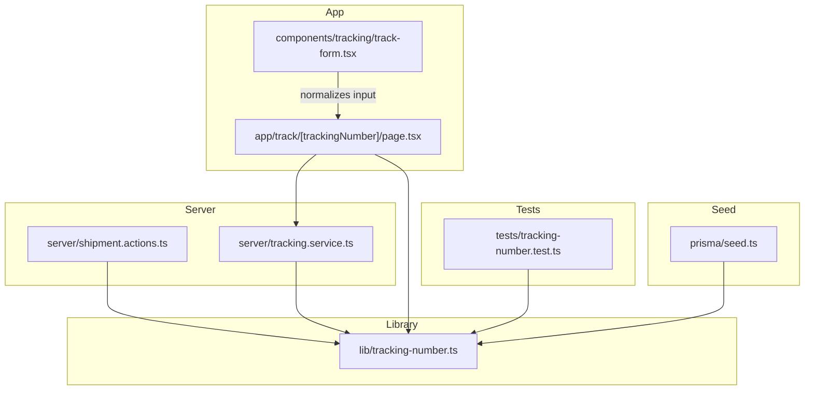
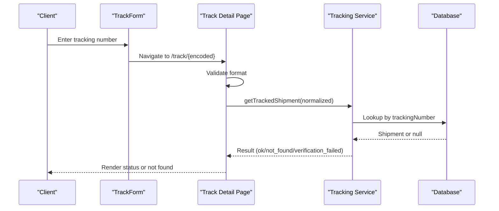
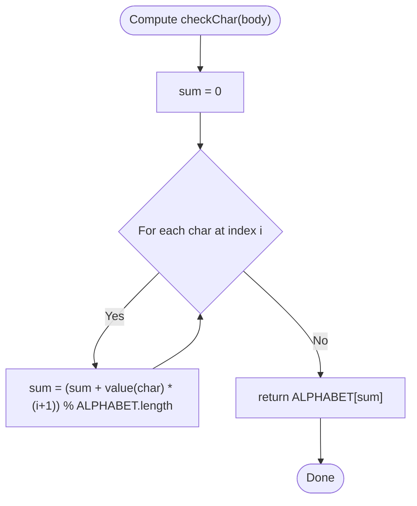
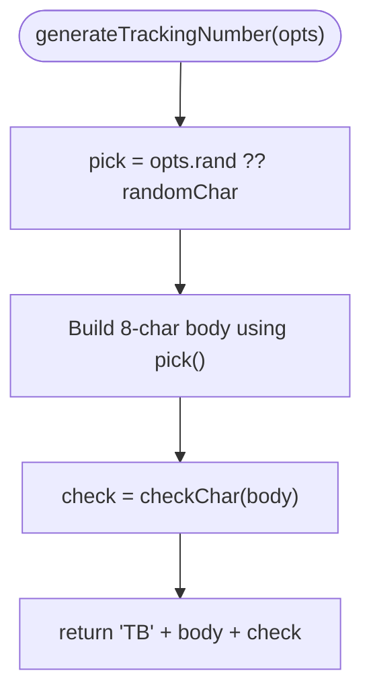
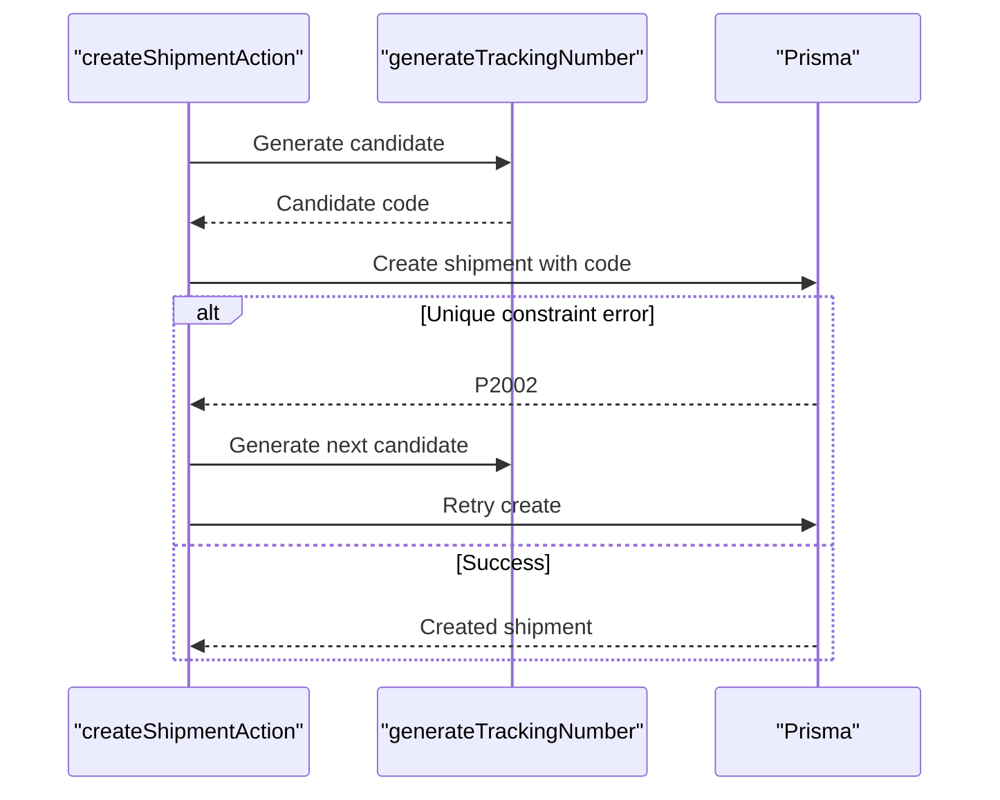
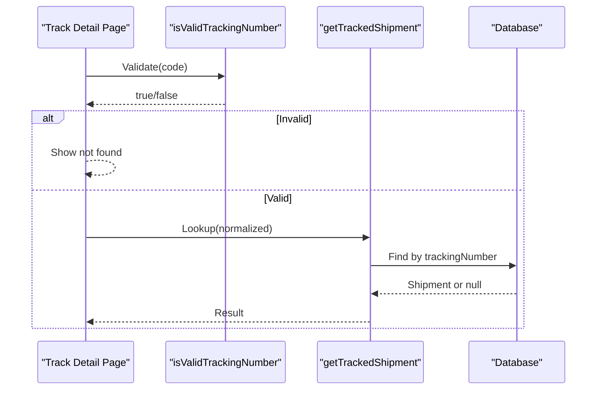
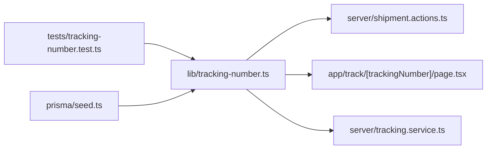

# Tracking Number Generation

<cite>
**Referenced Files in This Document**
- [tracking-number.ts](file://lib/tracking-number.ts)
- [tracking-number.test.ts](file://tests/tracking-number.test.ts)
- [shipment.actions.ts](file://server/shipment.actions.ts)
- [tracking.service.ts](file://server/tracking.service.ts)
- [page.tsx](file://app/track/[trackingNumber]/page.tsx)
- [track-form.tsx](file://components/tracking/track-form.tsx)
- [seed.ts](file://prisma/seed.ts)
</cite>

## Table of Contents
1. [Introduction](#introduction)
2. [Project Structure](#project-structure)
3. [Core Components](#core-components)
4. [Architecture Overview](#architecture-overview)
5. [Detailed Component Analysis](#detailed-component-analysis)
6. [Dependency Analysis](#dependency-analysis)
7. [Performance Considerations](#performance-considerations)
8. [Security Considerations](#security-considerations)
9. [Troubleshooting Guide](#troubleshooting-guide)
10. [Conclusion](#conclusion)

## Introduction
This document explains the tracking number generation system used across the application. It covers the Base32 encoding approach, the tracking number format and validation rules, the generateTrackingNumber function (parameters and return values), examples for generating and validating numbers, and security considerations including collision prevention and enumeration resistance.

## Project Structure
The tracking number logic is centralized in a small library module and consumed by server actions that create shipments, as well as by the public tracking page and service layer.

**Diagram sources**
- [tracking-number.ts:1-57](file://lib/tracking-number.ts#L1-L57)
- [shipment.actions.ts:19-43](file://server/shipment.actions.ts#L19-L43)
- [tracking.service.ts:69-94](file://server/tracking.service.ts#L69-L94)
- [page.tsx:68-76](file://app/track/[trackingNumber]/page.tsx#L68-L76)
- [track-form.tsx:15-27](file://components/tracking/track-form.tsx#L15-L27)
- [tracking-number.test.ts:1-28](file://tests/tracking-number.test.ts#L1-L28)
- [seed.ts:104-129](file://prisma/seed.ts#L104-L129)

**Section sources**
- [tracking-number.ts:1-57](file://lib/tracking-number.ts#L1-L57)
- [shipment.actions.ts:19-43](file://server/shipment.actions.ts#L19-L43)
- [tracking.service.ts:69-94](file://server/tracking.service.ts#L69-L94)
- [page.tsx:68-76](file://app/track/[trackingNumber]/page.tsx#L68-L76)
- [track-form.tsx:15-27](file://components/tracking/track-form.tsx#L15-L27)
- [tracking-number.test.ts:1-28](file://tests/tracking-number.test.ts#L1-L28)
- [seed.ts:104-129](file://prisma/seed.ts#L104-L129)

## Core Components
- Base32 alphabet and constants define the character set and fixed-length body.
- A deterministic check character is computed from the body to detect tampering.
- The generator produces random bodies using a cryptographically secure source.
- Normalization and validation functions ensure robust handling of user input.

Key responsibilities:
- Generate unique-looking, non-sequential codes with a checksum.
- Normalize inputs to uppercase and remove spaces/dashes.
- Validate structure, alphabet membership, and checksum.

**Section sources**
- [tracking-number.ts:12-27](file://lib/tracking-number.ts#L12-L27)
- [tracking-number.ts:34-41](file://lib/tracking-number.ts#L34-L41)
- [tracking-number.ts:43-56](file://lib/tracking-number.ts#L43-L56)

## Architecture Overview
The tracking number lifecycle spans creation, persistence, and lookup:

**Diagram sources**
- [track-form.tsx:15-27](file://components/tracking/track-form.tsx#L15-L27)
- [page.tsx:68-76](file://app/track/[trackingNumber]/page.tsx#L68-L76)
- [tracking.service.ts:69-94](file://server/tracking.service.ts#L69-L94)

## Detailed Component Analysis

### Base32 Encoding and Check Character
- Alphabet: Crockford’s Base32 without I, L, O, U to avoid ambiguity when spoken or typed.
- Body length: Fixed at 8 characters.
- Prefix: Two-letter prefix “TB”.
- Check character: Deterministic modulo-based checksum over the body using weighted position sums.

Complexity:
- Check character computation is O(n) where n is the body length (constant here).
- Validation checks each character against the alphabet and recomputes the checksum; also O(n).

**Diagram sources**
- [tracking-number.ts:20-27](file://lib/tracking-number.ts#L20-L27)

**Section sources**
- [tracking-number.ts:12-27](file://lib/tracking-number.ts#L12-L27)

### Tracking Number Format Specification
- Total length: 11 characters.
- Structure: PREFIX (2) + BODY (8) + CHECK (1).
- Characters: Only from the defined Base32 alphabet.
- Examples:
  - Valid: TB followed by 8 Base32 chars plus a valid check char.
  - Invalid: Wrong length, wrong prefix, invalid characters, or mismatched checksum.

Validation rules:
- Must start with the prefix.
- Body must be exactly 8 characters from the alphabet.
- Last character must match the computed check character.

**Section sources**
- [tracking-number.ts:3-10](file://lib/tracking-number.ts#L3-L10)
- [tracking-number.ts:48-56](file://lib/tracking-number.ts#L48-L56)

### generateTrackingNumber Function
Purpose:
- Generate a new tracking number with a random body and a deterministic check character.

Parameters:
- opts: Optional object with an injectable randomness function rand() for testing. Defaults to a secure random character picker.

Return value:
- A string in the format TB + 8 Base32 chars + 1 check char.

Behavior:
- Uses crypto.randomInt to pick characters from the Base32 alphabet.
- Does not guarantee database uniqueness; callers should handle collisions via retries.

Usage patterns:
- Server action creates up to 5 candidates and retries on unique constraint violation.
- Seed script uses it to populate demo data.

**Diagram sources**
- [tracking-number.ts:34-41](file://lib/tracking-number.ts#L34-L41)
- [tracking-number.ts:16-18](file://lib/tracking-number.ts#L16-L18)

**Section sources**
- [tracking-number.ts:34-41](file://lib/tracking-number.ts#L34-L41)
- [shipment.actions.ts:19-43](file://server/shipment.actions.ts#L19-L43)
- [seed.ts:104-129](file://prisma/seed.ts#L104-L129)

### normalizeTrackingNumber
Purpose:
- Normalize user input by uppercasing and removing spaces and dashes.

Input:
- Raw string possibly containing mixed case and separators.

Output:
- Cleaned string ready for validation and lookup.

**Section sources**
- [tracking-number.ts:43-46](file://lib/tracking-number.ts#L43-L46)
- [track-form.tsx:11-13](file://components/tracking/track-form.tsx#L11-L13)

### isValidTrackingNumber
Purpose:
- Validate a tracking number string after normalization.

Rules:
- Exact length check.
- Prefix check.
- All body characters belong to the Base32 alphabet.
- Check character matches the computed checksum.

Return:
- Boolean indicating validity.

**Section sources**
- [tracking-number.ts:48-56](file://lib/tracking-number.ts#L48-L56)

### Integration Points

#### Shipment Creation
- Generates multiple candidates and persists the first one accepted by the database.
- Retries on unique constraint violations to prevent collisions.

**Diagram sources**
- [shipment.actions.ts:19-43](file://server/shipment.actions.ts#L19-L43)

**Section sources**
- [shipment.actions.ts:19-43](file://server/shipment.actions.ts#L19-L43)

#### Public Tracking Lookup
- Validates the incoming tracking number before querying.
- Optionally verifies recipient postal code or name to resist enumeration.

**Diagram sources**
- [page.tsx:68-76](file://app/track/[trackingNumber]/page.tsx#L68-L76)
- [tracking.service.ts:69-94](file://server/tracking.service.ts#L69-L94)

**Section sources**
- [page.tsx:68-76](file://app/track/[trackingNumber]/page.tsx#L68-L76)
- [tracking.service.ts:69-94](file://server/tracking.service.ts#L69-L94)

## Dependency Analysis
- lib/tracking-number.ts is the single source of truth for generation, normalization, and validation.
- server/shipment.actions.ts depends on generateTrackingNumber for creating shipments.
- app/track/[trackingNumber]/page.tsx depends on isValidTrackingNumber and calls server/tracking.service.ts.
- server/tracking.service.ts depends on normalizeTrackingNumber for consistent lookups.
- tests/tracking-number.test.ts validates behavior of generation, normalization, and validation.
- prisma/seed.ts uses generateTrackingNumber to seed demo data.

**Diagram sources**
- [tracking-number.ts:1-57](file://lib/tracking-number.ts#L1-L57)
- [shipment.actions.ts:19-43](file://server/shipment.actions.ts#L19-L43)
- [tracking.service.ts:69-94](file://server/tracking.service.ts#L69-L94)
- [page.tsx:68-76](file://app/track/[trackingNumber]/page.tsx#L68-L76)
- [tracking-number.test.ts:1-28](file://tests/tracking-number.test.ts#L1-L28)
- [seed.ts:104-129](file://prisma/seed.ts#L104-L129)

**Section sources**
- [tracking-number.ts:1-57](file://lib/tracking-number.ts#L1-L57)
- [shipment.actions.ts:19-43](file://server/shipment.actions.ts#L19-L43)
- [tracking.service.ts:69-94](file://server/tracking.service.ts#L69-L94)
- [page.tsx:68-76](file://app/track/[trackingNumber]/page.tsx#L68-L76)
- [tracking-number.test.ts:1-28](file://tests/tracking-number.test.ts#L1-L28)
- [seed.ts:104-129](file://prisma/seed.ts#L104-L129)

## Performance Considerations
- Generation is constant-time relative to fixed body length; negligible overhead.
- Check character computation is linear in body length; with fixed length, effectively constant time.
- Validation performs a few passes over a short string; efficient for high-throughput tracking pages.
- Database lookup is indexed by trackingNumber; ensure the schema enforces uniqueness.

[No sources needed since this section provides general guidance]

## Security Considerations
- Randomness source: Uses a secure random integer generator for character selection to avoid predictable sequences.
- Non-sequential codes: Prevents enumeration by guests.
- Check character: Detects simple tampering and typos.
- Input normalization: Reduces attack surface by standardizing casing and separators.
- Enumeration resistance:
  - Public tracking page applies rate limiting per IP.
  - Optional verification step requires matching recipient postal code or name.

Recommendations:
- Keep the Base32 alphabet unchanged to maintain backward compatibility.
- Continue retrying on unique constraint violations during creation.
- Monitor rate-limiting effectiveness and adjust thresholds if necessary.

**Section sources**
- [tracking-number.ts:1-10](file://lib/tracking-number.ts#L1-L10)
- [tracking-number.ts:34-41](file://lib/tracking-number.ts#L34-L41)
- [page.tsx:56-66](file://app/track/[trackingNumber]/page.tsx#L56-L66)
- [tracking.service.ts:69-94](file://server/tracking.service.ts#L69-L94)

## Troubleshooting Guide
Common issues and resolutions:
- Invalid tracking number errors:
  - Cause: Wrong length, invalid characters, or mismatched checksum.
  - Resolution: Use normalizeTrackingNumber and isValidTrackingNumber before submission.
- Not found results:
  - Cause: No shipment exists for the provided code.
  - Resolution: Verify the code and try again; consider optional verification fields.
- Verification failed:
  - Cause: Provided verification does not match recipient postal code or name.
  - Resolution: Re-enter correct verification information.
- Collision during creation:
  - Cause: Extremely rare duplicate generated code.
  - Resolution: The server action retries up to five times; if still failing, retry the request.

Operational tips:
- Ensure the database has a unique constraint on trackingNumber.
- Log rate-limit hits to detect abuse patterns.
- Add unit tests for edge cases such as empty input, excessive whitespace, and malformed checksums.

**Section sources**
- [tracking-number.test.ts:14-22](file://tests/tracking-number.test.ts#L14-L22)
- [tracking.service.ts:89-94](file://server/tracking.service.ts#L89-L94)
- [shipment.actions.ts:25-43](file://server/shipment.actions.ts#L25-L43)

## Conclusion
The tracking number system uses a compact, unambiguous Base32 encoding with a deterministic check character to produce short, human-friendly identifiers. The generator leverages secure randomness to minimize predictability, while normalization and validation ensure robust handling of user input. Collision prevention is handled at the database layer with retry logic, and enumeration resistance is reinforced through rate limiting and optional verification. Together, these components provide a reliable, secure foundation for shipment tracking.

[No sources needed since this section summarizes without analyzing specific files]