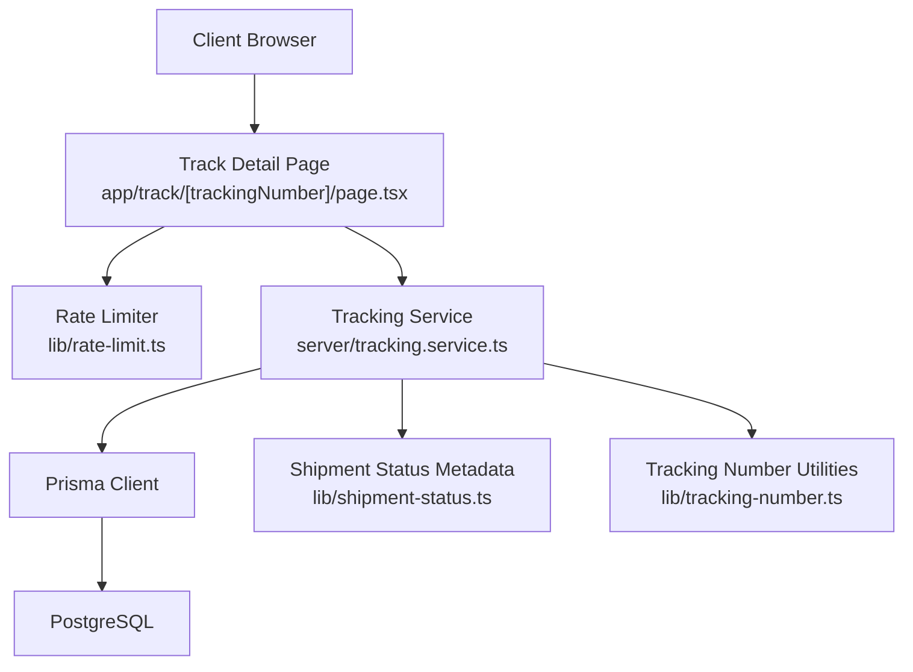
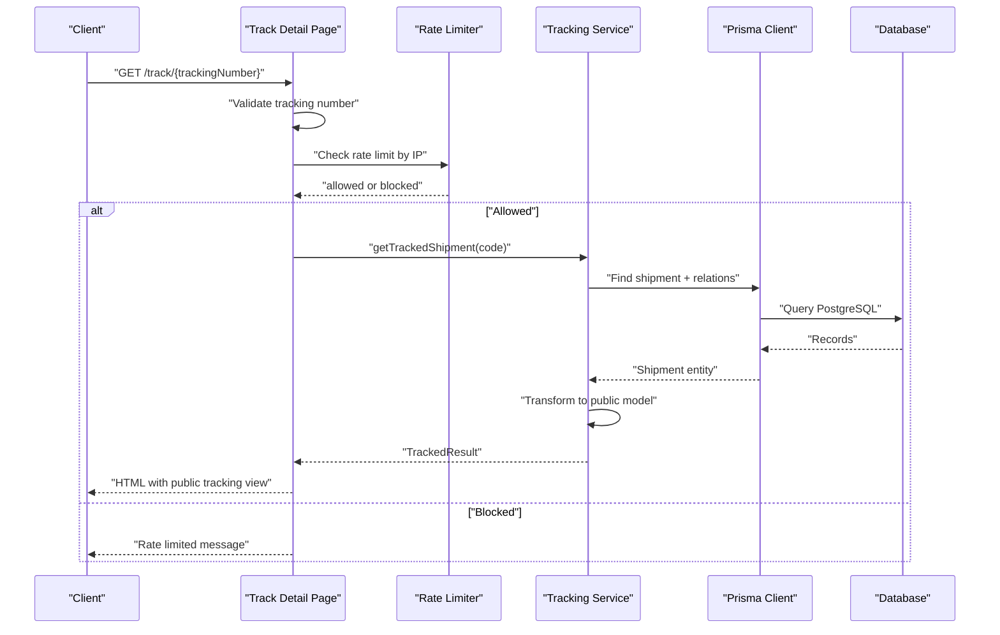
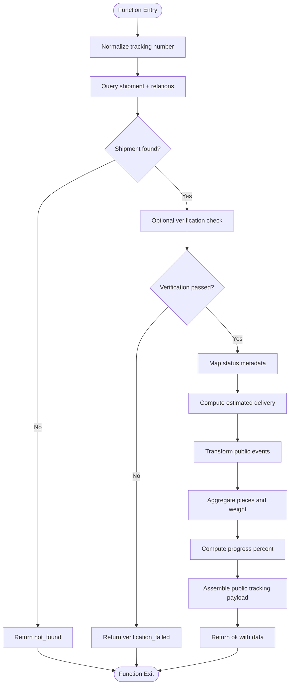
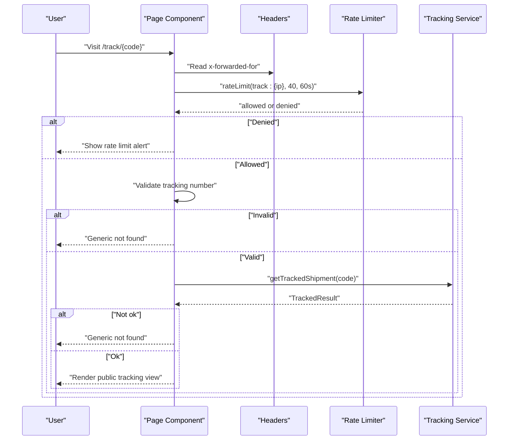
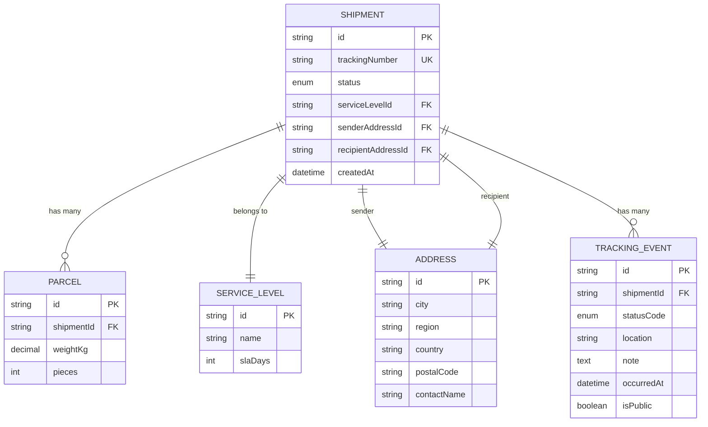
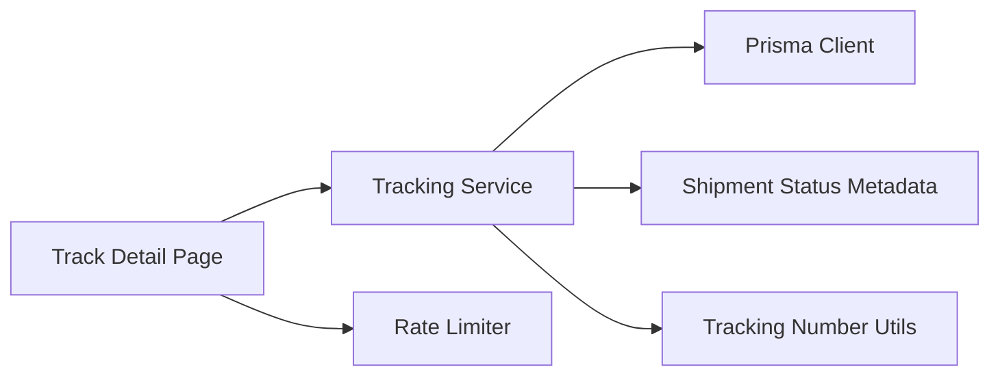

# Tracking Service Layer

<cite>
**Referenced Files in This Document**
- [tracking.service.ts](file://server/tracking.service.ts)
- [shipment-status.ts](file://lib/shipment-status.ts)
- [tracking-number.ts](file://lib/tracking-number.ts)
- [page.tsx](file://app/track/[trackingNumber]/page.tsx)
- [rate-limit.ts](file://lib/rate-limit.ts)
- [schema.prisma](file://prisma/schema.prisma)
</cite>

## Table of Contents
1. [Introduction](#introduction)
2. [Project Structure](#project-structure)
3. [Core Components](#core-components)
4. [Architecture Overview](#architecture-overview)
5. [Detailed Component Analysis](#detailed-component-analysis)
6. [Dependency Analysis](#dependency-analysis)
7. [Performance Considerations](#performance-considerations)
8. [Troubleshooting Guide](#troubleshooting-guide)
9. [Conclusion](#conclusion)
10. [Appendices](#appendices)

## Introduction
This document explains the tracking service layer that powers public shipment tracking. It covers the service architecture, query processing patterns, data retrieval strategies, error handling, and data transformation. It also provides guidance for extending the service, implementing custom tracking logic, optimizing database queries, and applying caching and rate limiting to public endpoints.

The primary entry point for public tracking is a Next.js route that validates input, applies rate limiting, and delegates data access to a server-only tracking service. The service builds a guest-safe response by querying Prisma, transforming status metadata, computing progress, and assembling a timeline of public tracking events.

## Project Structure
The tracking feature spans several layers:

- Route layer: renders the public tracking page, validates the tracking number, enforces rate limits, and calls the service.
- Service layer: performs secure data retrieval and transforms raw records into a public-facing model.
- Domain utilities: define shipment status semantics, status labels/tone, and tracking number generation/validation.
- Data layer: Prisma schema defines shipments, parcels, addresses, service levels, and tracking events.
- Rate limiting: in-memory fixed-window limiter used to blunt enumeration on single-instance deployments.

**Diagram sources**
- [page.tsx:48-76](file://app/track/[trackingNumber]/page.tsx#L48-L76)
- [tracking.service.ts:69-146](file://server/tracking.service.ts#L69-L146)
- [rate-limit.ts:24-47](file://lib/rate-limit.ts#L24-L47)
- [schema.prisma:160-226](file://prisma/schema.prisma#L160-L226)

**Section sources**
- [page.tsx:48-76](file://app/track/[trackingNumber]/page.tsx#L48-L76)
- [tracking.service.ts:1-146](file://server/tracking.service.ts#L1-L146)
- [rate-limit.ts:1-56](file://lib/rate-limit.ts#L1-L56)
- [schema.prisma:160-226](file://prisma/schema.prisma#L160-L226)

## Core Components
- Public tracking result types: the service returns a discriminated union indicating success, not found, or verification failure.
- Public tracking event and payload models: these are safe for guests and exclude sensitive fields such as street address, contact name, phone, and price.
- Progress computation: maps current status to a percentage for UI progress bars.
- Verification helper: optional guest verification against recipient postal code or name tokens.
- Status metadata: shared labels, descriptions, and tone values for rendering.
- Tracking number normalization and validation: ensures consistent formatting and format correctness before querying.

Key responsibilities:
- Input normalization and validation at the route and service boundaries.
- Secure data retrieval with minimal exposure via Prisma includes and filters.
- Transformation from internal entities to public models.
- Error signaling through typed results rather than exceptions.

**Section sources**
- [tracking.service.ts:6-36](file://server/tracking.service.ts#L6-L36)
- [tracking.service.ts:48-62](file://server/tracking.service.ts#L48-L62)
- [shipment-status.ts:62-76](file://lib/shipment-status.ts#L62-L76)
- [tracking-number.ts:43-56](file://lib/tracking-number.ts#L43-L56)

## Architecture Overview
The public tracking flow follows a layered approach:

1. The route receives a tracking number from the URL.
2. It normalizes and validates the tracking number using domain utilities.
3. It applies an IP-based rate limit to reduce enumeration risk.
4. It calls the tracking service to fetch and transform data.
5. The service queries Prisma for the shipment, related addresses, service level, parcels, and public tracking events.
6. The service computes derived fields like progress percentage, estimated delivery, and totals.
7. The route renders the transformed public model.

**Diagram sources**
- [page.tsx:48-76](file://app/track/[trackingNumber]/page.tsx#L48-L76)
- [tracking.service.ts:69-146](file://server/tracking.service.ts#L69-L146)
- [rate-limit.ts:24-47](file://lib/rate-limit.ts#L24-L47)

## Detailed Component Analysis

### Tracking Service: getTrackedShipment
The service function is the core of the tracking layer. It normalizes the tracking number, retrieves the shipment with necessary relations, optionally verifies guest access, and constructs a public tracking payload.

Responsibilities:
- Normalize input tracking numbers.
- Query shipment, service level, sender/recipient addresses, parcels, and public tracking events.
- Enforce optional verification against recipient postal code or name tokens.
- Map status codes to labels, descriptions, and tones.
- Compute progress percentage based on status progression.
- Aggregate parcel pieces and weight.
- Derive estimated delivery date when pickup date is absent.
- Return a typed result indicating success or specific failure modes.

**Diagram sources**
- [tracking.service.ts:69-146](file://server/tracking.service.ts#L69-L146)

Error handling:
- Not found: returned when no shipment matches the normalized tracking number.
- Verification failed: returned when optional verification does not match recipient postal code or name tokens.
- Success: returns a fully transformed public tracking object.

Data transformation highlights:
- Status mapping uses shared metadata for label, description, and tone.
- Events are filtered to public entries and mapped to a simplified structure.
- Estimated delivery defaults to pickup date if present; otherwise it is computed from creation time plus service-level SLA days.
- Progress calculation treats delivered, returned, and cancelled as complete.

**Section sources**
- [tracking.service.ts:6-36](file://server/tracking.service.ts#L6-L36)
- [tracking.service.ts:48-62](file://server/tracking.service.ts#L48-L62)
- [tracking.service.ts:69-146](file://server/tracking.service.ts#L69-L146)

### Route Layer: Track Detail Page
The route orchestrates user input validation, rate limiting, and service invocation. It renders a public-friendly view and handles not-found scenarios gracefully.

Key behaviors:
- Decodes the tracking number from the URL.
- Applies IP-based rate limiting to blunt enumeration.
- Validates the tracking number format using domain utilities.
- Calls the tracking service and renders the public model.
- Displays a generic not-found state for invalid or missing shipments.

**Diagram sources**
- [page.tsx:48-76](file://app/track/[trackingNumber]/page.tsx#L48-L76)
- [rate-limit.ts:24-47](file://lib/rate-limit.ts#L24-L47)

**Section sources**
- [page.tsx:48-76](file://app/track/[trackingNumber]/page.tsx#L48-L76)

### Domain Utilities: Shipment Status and Tracking Numbers
Shipment status utilities provide:
- A canonical list of statuses and type guards.
- Transition rules and terminal/completed checks.
- Shared metadata for labels, descriptions, and UI tones.

Tracking number utilities provide:
- Generation with a random body and deterministic check character.
- Normalization (uppercase, strip spaces/dashes).
- Validation against the expected format and checksum.

These utilities ensure consistency across routes, services, and tests.

**Section sources**
- [shipment-status.ts:9-76](file://lib/shipment-status.ts#L9-L76)
- [tracking-number.ts:1-56](file://lib/tracking-number.ts#L1-L56)

### Data Model: Prisma Schema
The tracking feature relies on:
- Shipment: central entity with status, service level, addresses, parcels, and events.
- Parcel: per-parcel details including weight and piece count.
- Address: sender and recipient locations.
- ServiceLevel: service name and SLA days.
- TrackingEvent: timestamped status updates with public visibility flag.

Indexes support efficient lookups by tracking number, shipment ID, and public event filtering.

**Diagram sources**
- [schema.prisma:98-111](file://prisma/schema.prisma#L98-L111)
- [schema.prisma:131-154](file://prisma/schema.prisma#L131-L154)
- [schema.prisma:160-203](file://prisma/schema.prisma#L160-L203)
- [schema.prisma:209-226](file://prisma/schema.prisma#L209-L226)

**Section sources**
- [schema.prisma:98-111](file://prisma/schema.prisma#L98-L111)
- [schema.prisma:131-154](file://prisma/schema.prisma#L131-L154)
- [schema.prisma:160-203](file://prisma/schema.prisma#L160-L203)
- [schema.prisma:209-226](file://prisma/schema.prisma#L209-L226)

## Dependency Analysis
The tracking service depends on:
- Prisma client for data access.
- Shipment status metadata for labels and tones.
- Tracking number utilities for normalization and validation.
- The route layer for orchestration and presentation.
- The rate limiter for request throttling.

**Diagram sources**
- [page.tsx:48-76](file://app/track/[trackingNumber]/page.tsx#L48-L76)
- [tracking.service.ts:1-10](file://server/tracking.service.ts#L1-L10)
- [rate-limit.ts:24-47](file://lib/rate-limit.ts#L24-L47)

**Section sources**
- [tracking.service.ts:1-10](file://server/tracking.service.ts#L1-L10)
- [page.tsx:48-76](file://app/track/[trackingNumber]/page.tsx#L48-L76)
- [rate-limit.ts:24-47](file://lib/rate-limit.ts#L24-L47)

## Performance Considerations
Current implementation characteristics:
- Single Prisma query with selective includes reduces N+1 issues for the tracked shipment view.
- Public events are filtered by `isPublic` and ordered by recency.
- In-memory rate limiter is simple but bounded to a single process instance.

Optimization recommendations:
- Database indexes:
  - Ensure indexes exist on `Shipment.trackingNumber`, `TrackingEvent.shipmentId`, and composite index on `TrackingEvent(shipmentId, isPublic)` for efficient public timeline queries.
- Query tuning:
  - If timelines grow large, paginate or cap the number of events returned for public views.
  - Consider selecting only needed fields for parcels and events to reduce payload size.
- Caching:
  - Add a short-lived cache keyed by tracking number for read-heavy endpoints. Cache busting can be triggered on event writes.
  - Use a distributed cache (Redis or Upstash) for multi-instance deployments.
- Rate limiting:
  - Replace in-memory buckets with a shared store for horizontal scaling.
  - Expose headers like `X-RateLimit-Remaining` and `Retry-After` for clients.
- Rendering:
  - Stream or lazy-load heavy components like timelines to improve perceived performance.

[No sources needed since this section provides general guidance]

## Troubleshooting Guide
Common issues and resolutions:
- Invalid tracking number:
  - Symptom: Generic not found page.
  - Cause: Format mismatch or checksum failure.
  - Resolution: Validate input using the tracking number utility and guide users to correct formatting.
- Rate limited requests:
  - Symptom: Rate limit alert shown to users.
  - Cause: Too many requests from the same IP within the window.
  - Resolution: Implement exponential backoff on the client; consider upgrading to a distributed rate limiter.
- Missing shipment:
  - Symptom: Not found result from the service.
  - Cause: No record matches the normalized tracking number.
  - Resolution: Confirm data integrity and ensure tracking numbers are generated and stored correctly.
- Verification failures:
  - Symptom: Verification failed result when optional verification is provided.
  - Cause: Provided value does not match recipient postal code or name tokens.
  - Resolution: Clarify acceptable verification inputs and ensure recipient data is accurate.

Operational tips:
- Monitor Prisma query logs to identify slow queries.
- Add structured logging around service calls for tracing.
- Use health checks to detect database connectivity issues.

**Section sources**
- [page.tsx:68-76](file://app/track/[trackingNumber]/page.tsx#L68-L76)
- [tracking.service.ts:89-94](file://server/tracking.service.ts#L89-L94)
- [rate-limit.ts:24-47](file://lib/rate-limit.ts#L24-L47)

## Conclusion
The tracking service layer provides a secure, guest-friendly interface for retrieving shipment status and timelines. It combines robust input validation, typed error handling, and careful data transformation to expose only non-sensitive information. With additional caching, distributed rate limiting, and query optimizations, the system can scale effectively while maintaining performance and security for public tracking endpoints.

[No sources needed since this section summarizes without analyzing specific files]

## Appendices

### Extending the Service Layer
To extend the service:
- Add new public fields by transforming additional Prisma relations or computed values.
- Introduce new status transitions and metadata entries in the status utilities.
- Update the public tracking payload types to include new fields.
- Ensure any new sensitive fields remain excluded from the public model.

Example extension pattern:
- Define a new field in the public payload type.
- Compute or map the field from Prisma relations or derived logic.
- Render the field in the route component.

[No sources needed since this section provides general guidance]

### Implementing Custom Tracking Logic
Custom logic options:
- Add webhook integrations to enrich events with external carrier data.
- Implement advanced progress calculations incorporating distance, weather, or carrier SLA deviations.
- Introduce conditional public visibility rules beyond the existing `isPublic` flag.

Guidelines:
- Keep custom logic in the service layer to maintain separation of concerns.
- Preserve guest safety by excluding sensitive data from public payloads.
- Write unit tests for new transformations and edge cases.

[No sources needed since this section provides general guidance]

### Optimizing Database Queries
Recommended steps:
- Profile queries using Prisma query logs and database explain plans.
- Add targeted indexes for frequent filters and joins.
- Reduce payload size by selecting only required fields.
- Paginate or truncate long event timelines for public views.
- Consider materialized views or summary tables for high-volume metrics.

[No sources needed since this section provides general guidance]