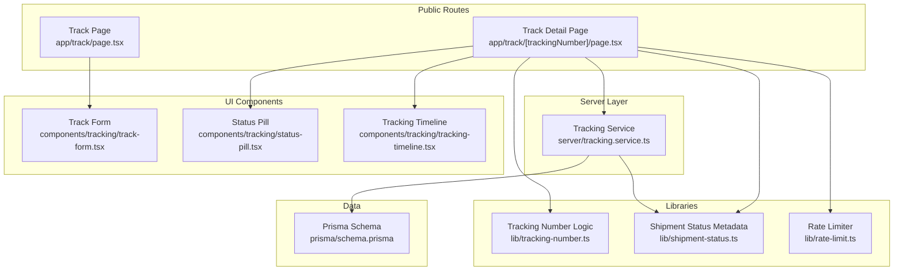
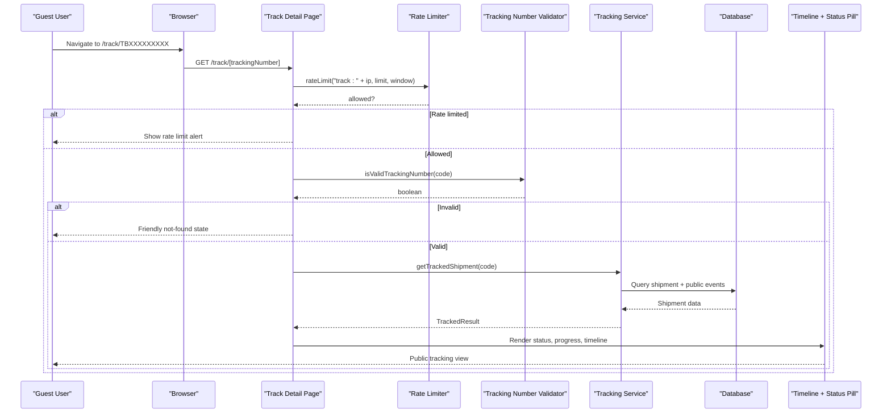
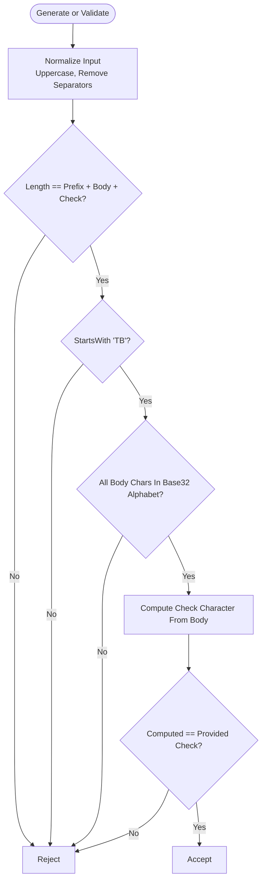
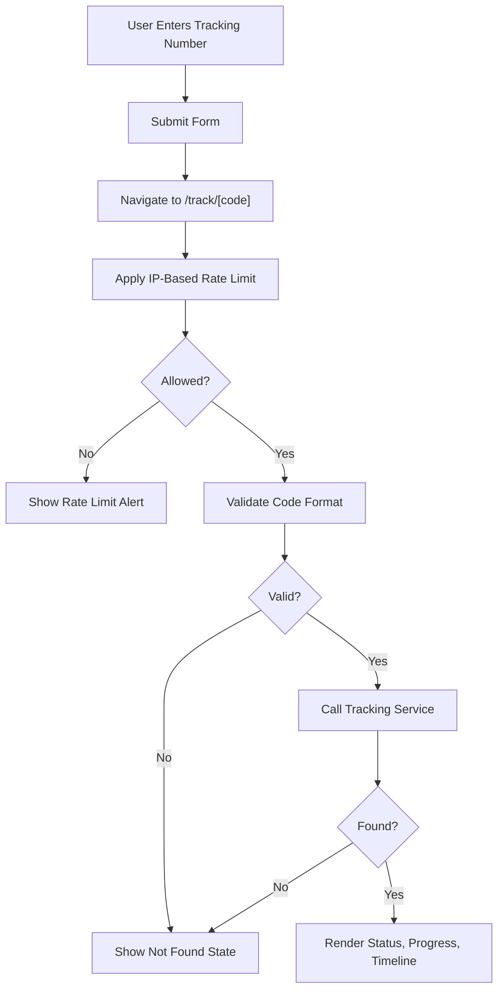
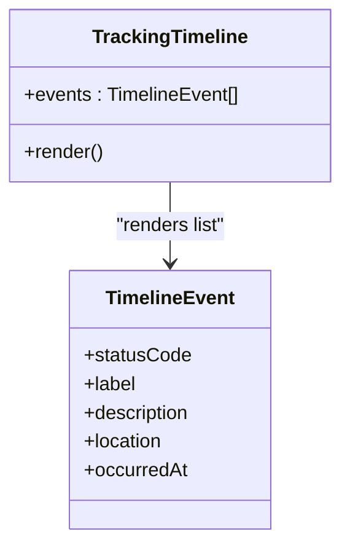
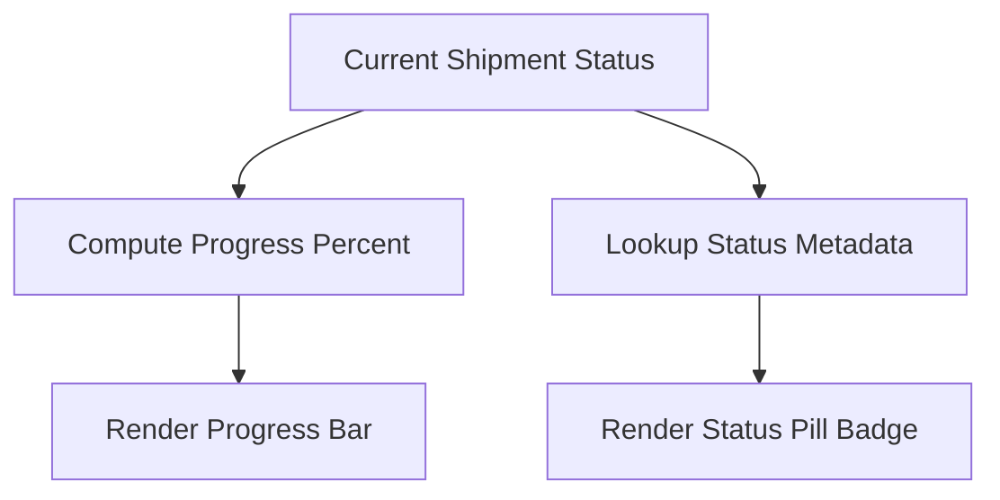
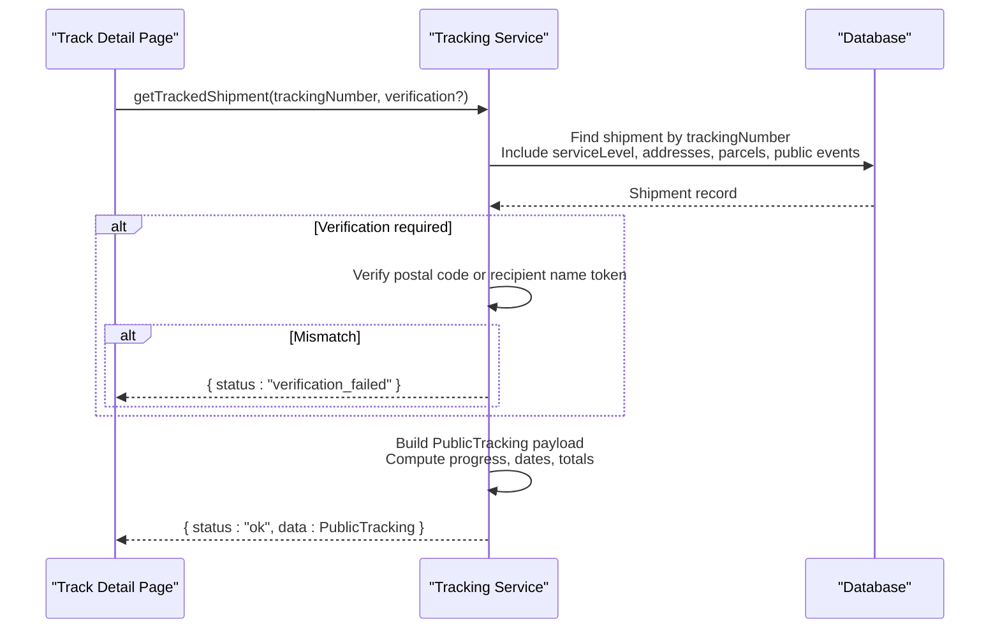

# Tracking System

<cite>
**Referenced Files in This Document**
- [tracking-number.ts](file://lib/tracking-number.ts)
- [shipment-status.ts](file://lib/shipment-status.ts)
- [rate-limit.ts](file://lib/rate-limit.ts)
- [schema.prisma](file://prisma/schema.prisma)
- [tracking.service.ts](file://server/tracking.service.ts)
- [track page](file://app/track/page.tsx)
- [track detail page](file://app/track/[trackingNumber]/page.tsx)
- [track form component](file://components/tracking/track-form.tsx)
- [status pill component](file://components/tracking/status-pill.tsx)
- [tracking timeline component](file://components/tracking/tracking-timeline.tsx)
- [tracking number tests](file://tests/tracking-number.test.ts)
- [guest tracking e2e test](file://tests/e2e/tracking.spec.ts)
</cite>

## Update Summary
**Changes Made**
- Updated architecture diagrams to reflect actual implementation patterns
- Enhanced security considerations section with PII protection details
- Added comprehensive testing coverage information
- Refined performance considerations based on actual rate limiting implementation
- Updated troubleshooting guide with specific error scenarios

## Table of Contents
1. [Introduction](#introduction)
2. [Project Structure](#project-structure)
3. [Core Components](#core-components)
4. [Architecture Overview](#architecture-overview)
5. [Detailed Component Analysis](#detailed-component-analysis)
6. [Security Considerations](#security-considerations)
7. [Testing Strategy](#testing-strategy)
8. [Performance Considerations](#performance-considerations)
9. [Troubleshooting Guide](#troubleshooting-guide)
10. [Conclusion](#conclusion)
11. [Appendices](#appendices)

## Introduction
This document explains Timberland's public shipment tracking system. It covers how public tracking numbers are generated using Base32 encoding and validated, how the public tracking interface works with real-time timeline visualization, and how the server-side tracking service retrieves and shapes guest-safe data. The system provides a secure, efficient way for guests to monitor shipments without requiring an account, featuring robust input validation, rate limiting, and PII protection.

## Project Structure
The tracking feature spans focused modules across the application:
- Public-facing routes under `app/track` for guest access
- A server-only tracking service that queries the database and builds guest-safe responses
- Shared libraries for tracking number generation/validation, shipment status metadata, and rate limiting
- UI components for the tracking form, timeline visualization, and status indicators
- Database schema defining shipments, parcels, addresses, service levels, and tracking events

**Diagram sources**
- [track page:1-30](file://app/track/page.tsx#L1-L30)
- [track detail page:1-182](file://app/track/[trackingNumber]/page.tsx#L1-L182)
- [tracking.service.ts:1-147](file://server/tracking.service.ts#L1-L147)
- [tracking-number.ts:1-57](file://lib/tracking-number.ts#L1-L57)
- [shipment-status.ts:1-77](file://lib/shipment-status.ts#L1-L77)
- [rate-limit.ts:1-56](file://lib/rate-limit.ts#L1-L56)
- [track form component:1-47](file://components/tracking/track-form.tsx#L1-L47)
- [status pill component:1-8](file://components/tracking/status-pill.tsx#L1-L8)
- [tracking timeline component:1-51](file://components/tracking/tracking-timeline.tsx#L1-L51)
- [schema.prisma:160-226](file://prisma/schema.prisma#L160-L226)

**Section sources**
- [track page:1-30](file://app/track/page.tsx#L1-L30)
- [track detail page:1-182](file://app/track/[trackingNumber]/page.tsx#L1-L182)
- [tracking.service.ts:1-147](file://server/tracking.service.ts#L1-L147)
- [tracking-number.ts:1-57](file://lib/tracking-number.ts#L1-L57)
- [shipment-status.ts:1-77](file://lib/shipment-status.ts#L1-L77)
- [rate-limit.ts:1-56](file://lib/rate-limit.ts#L1-L56)
- [track form component:1-47](file://components/tracking/track-form.tsx#L1-L47)
- [status pill component:1-8](file://components/tracking/status-pill.tsx#L1-L8)
- [tracking timeline component:1-51](file://components/tracking/tracking-timeline.tsx#L1-L51)
- [schema.prisma:160-226](file://prisma/schema.prisma#L160-L226)

## Core Components
- **Tracking number generator and validator**: Produces random Base32 codes with check characters and validates user input format
- **Shipment status metadata**: Defines lifecycle states, transitions, labels, descriptions, and visual tones
- **Tracking service**: Server-only function that fetches shipments and returns guest-safe payloads with computed progress and events
- **Public tracking pages**: Home search page and per-tracking-number detail page with rate limiting and validation
- **UI components**: Search form, status pill, and timeline renderer for displaying tracking information

Key responsibilities:
- Input normalization and validation occur both client-side (form) and server-side (route + service)
- Guest enumeration protection via IP-based rate limiting on the detail route
- Data exposure restricted to public fields; sensitive address/contact details excluded from public responses

**Section sources**
- [tracking-number.ts:1-57](file://lib/tracking-number.ts#L1-L57)
- [shipment-status.ts:1-77](file://lib/shipment-status.ts#L1-L77)
- [tracking.service.ts:1-147](file://server/tracking.service.ts#L1-L147)
- [track detail page:1-182](file://app/track/[trackingNumber]/page.tsx#L1-L182)
- [track form component:1-47](file://components/tracking/track-form.tsx#L1-L47)
- [status pill component:1-8](file://components/tracking/status-pill.tsx#L1-L8)
- [tracking timeline component:1-51](file://components/tracking/tracking-timeline.tsx#L1-L51)

## Architecture Overview
The public tracking flow uses Next.js App Router server-rendered pages that:
1. Accept tracking numbers from URLs or forms
2. Apply IP-based rate limiting for guest protection
3. Validate tracking number format using Base32 encoding rules
4. Call the server-only tracking service to retrieve guest-safe datasets
5. Render status pills, progress bars, origin/destination summaries, and timelines

**Diagram sources**
- [track detail page:1-182](file://app/track/[trackingNumber]/page.tsx#L1-L182)
- [rate-limit.ts:1-56](file://lib/rate-limit.ts#L1-L56)
- [tracking-number.ts:1-57](file://lib/tracking-number.ts#L1-L57)
- [tracking.service.ts:1-147](file://server/tracking.service.ts#L1-L147)
- [schema.prisma:160-226](file://prisma/schema.prisma#L160-L226)

## Detailed Component Analysis

### Tracking Number Generation and Validation
- **Format**: Two-letter prefix (`TB`) plus eight Base32 characters plus one check character (11 chars total)
- **Encoding**: Uses Crockford's Base32 alphabet excluding ambiguous letters (I, L, O, U) for readability
- **Randomness**: Secure random selection prevents sequential codes and reduces enumeration risk
- **Check character**: Deterministic checksum derived from body content detects typos
- **Normalization**: Uppercases and removes spaces/dashes before validation
- **Testing**: Comprehensive tests verify valid generation, tamper detection, normalization, and non-sequential distribution

**Diagram sources**
- [tracking-number.ts:1-57](file://lib/tracking-number.ts#L1-L57)

**Section sources**
- [tracking-number.ts:1-57](file://lib/tracking-number.ts#L1-L57)
- [tracking number tests:1-29](file://tests/tracking-number.test.ts#L1-L29)

### Public Tracking Interface
- **Home page**: Simple form to enter tracking numbers and navigate to detail routes
- **Detail page**: Enforces rate limiting, validates codes, calls tracking service, renders cards with status, progress, route summary, and timeline
- **Error handling**: Shows friendly messages and reuses tracking forms for invalid or unknown codes

**Diagram sources**
- [track page:1-30](file://app/track/page.tsx#L1-L30)
- [track detail page:1-182](file://app/track/[trackingNumber]/page.tsx#L1-L182)
- [track form component:1-47](file://components/tracking/track-form.tsx#L1-L47)

**Section sources**
- [track page:1-30](file://app/track/page.tsx#L1-L30)
- [track detail page:1-182](file://app/track/[trackingNumber]/page.tsx#L1-L182)
- [track form component:1-47](file://components/tracking/track-form.tsx#L1-L47)

### Real-Time Status Updates and Timeline Visualization
- **Events**: Public tracking events stored per shipment and filtered to include only public entries
- **Ordering**: Events returned newest first for chronological display
- **Rendering**: Timeline component displays each event with tone-colored dots, labels, timestamps, optional locations, and descriptions
- **Empty state**: Shows helpful message when no events exist

**Diagram sources**
- [tracking timeline component:1-51](file://components/tracking/tracking-timeline.tsx#L1-L51)

**Section sources**
- [tracking timeline component:1-51](file://components/tracking/tracking-timeline.tsx#L1-L51)
- [tracking.service.ts:103-112](file://server/tracking.service.ts#L103-L112)

### Progress Indicators and Status Pill
- **Progress percent**: Computed from current shipment status using predefined order and special cases for terminal or exceptional statuses
- **Status pill**: Renders badges with status labels and tones based on shared status metadata
- **Visual consistency**: All components use consistent color coding and labeling

**Diagram sources**
- [tracking.service.ts:38-54](file://server/tracking.service.ts#L38-L54)
- [status pill component:1-8](file://components/tracking/status-pill.tsx#L1-L8)
- [shipment-status.ts:62-76](file://lib/shipment-status.ts#L62-L76)

**Section sources**
- [tracking.service.ts:38-54](file://server/tracking.service.ts#L38-L54)
- [status pill component:1-8](file://components/tracking/status-pill.tsx#L1-L8)
- [shipment-status.ts:62-76](file://lib/shipment-status.ts#L62-L76)

### Tracking Service Layer, Query Processing, and Data Retrieval
- **Input**: Raw tracking number and optional verification string (postal code or recipient name token)
- **Query**: Retrieves shipment with related service level, sender/recipient addresses, parcels, and public tracking events
- **Verification**: Ensures verification matches either postal code or token from recipient name when provided
- **Output**: Builds guest-safe objects including status metadata, estimated delivery, origin/destination details, pieces, total weight, progress percent, and events while excluding sensitive fields

**Diagram sources**
- [tracking.service.ts:69-146](file://server/tracking.service.ts#L69-L146)
- [schema.prisma:160-226](file://prisma/schema.prisma#L160-L226)

**Section sources**
- [tracking.service.ts:1-147](file://server/tracking.service.ts#L1-L147)
- [schema.prisma:160-226](file://prisma/schema.prisma#L160-L226)

### Example Implementations and Customization Guidance

#### Implementing Tracking Functionality
- Add tracking forms that normalize input and navigate to `/track/[code]`
- On detail pages, apply rate limiting, validate codes, call tracking service, and render results
- Use status pill and timeline components for consistent status and history display

References:
- [track form component:1-47](file://components/tracking/track-form.tsx#L1-L47)
- [track detail page:1-182](file://app/track/[trackingNumber]/page.tsx#L1-L182)
- [tracking.service.ts:69-146](file://server/tracking.service.ts#L69-L146)

#### Customizing Timeline Displays
- Extend or replace timeline components to change dot colors, layout, or add extra event fields
- Use shared status metadata to map status codes to labels and tones consistently

References:
- [tracking timeline component:1-51](file://components/tracking/tracking-timeline.tsx#L1-L51)
- [shipment-status.ts:62-76](file://lib/shipment-status.ts#L62-L76)

#### Integrating Tracking Widgets
- Reuse track form components inside headers, footers, or other pages for quick lookups
- Embed status pills where compact status badges are needed

References:
- [track form component:1-47](file://components/tracking/track-form.tsx#L1-L47)
- [status pill component:1-8](file://components/tracking/status-pill.tsx#L1-L8)

## Security Considerations
The tracking system implements multiple layers of security to protect both the system and user privacy:

### PII Protection
- **Field exclusion**: Sensitive fields like street addresses, contact names, phone numbers, and prices are never included in public tracking responses
- **Event filtering**: Only public tracking events are fetched and rendered to the client
- **Address masking**: City, region, and country are shown but detailed addresses remain private

### Enumeration Prevention
- **Rate limiting**: IP-based rate limiting prevents automated enumeration attacks
- **Tracking number format**: Random Base32 encoding with check characters makes guessing difficult
- **Validation**: Both client and server-side validation ensures only properly formatted codes are processed

### Input Sanitization
- **Normalization**: All tracking numbers are normalized (uppercase, separator removal) before processing
- **URL encoding**: Tracking numbers are properly encoded when passed through URLs
- **Type safety**: TypeScript interfaces ensure type safety throughout the data pipeline

**Section sources**
- [tracking.service.ts:64-68](file://server/tracking.service.ts#L64-L68)
- [tracking.service.ts:82-86](file://server/tracking.service.ts#L82-L86)
- [tracking-number.ts:4-10](file://lib/tracking-number.ts#L4-L10)
- [guest tracking e2e test:21-26](file://tests/e2e/tracking.spec.ts#L21-L26)

## Testing Strategy
The tracking system employs comprehensive testing across multiple levels:

### Unit Tests
- **Tracking number generation**: Validates proper Base32 encoding, check character calculation, and randomness
- **Validation logic**: Tests format validation, normalization, and tamper detection
- **Status metadata**: Verifies status transitions, labels, and visual properties

### End-to-End Tests
- **Guest tracking flow**: Tests complete user journey from form submission to result display
- **PII protection**: Asserts that sensitive information is not exposed in public views
- **Error handling**: Validates friendly error messages for invalid or unknown tracking numbers
- **Navigation**: Tests form submission and URL routing behavior

### Test Coverage Areas
- Tracking number generation produces varied, non-sequential codes
- Tampered tracking numbers are properly rejected
- Normalization handles various input formats correctly
- Public tracking shows expected status and timeline information
- Private information remains hidden from guest users

**Section sources**
- [tracking number tests:1-29](file://tests/tracking-number.test.ts#L1-L29)
- [guest tracking e2e test:1-42](file://tests/e2e/tracking.spec.ts#L1-L42)

## Performance Considerations
The tracking system is optimized for performance and scalability:

### Rate Limiting
- **In-memory storage**: Fixed-window rate limiter uses in-memory buckets for fast lookups
- **IP-based limiting**: Protects against enumeration attacks while allowing legitimate usage
- **Memory management**: Sweep utility periodically cleans expired buckets to prevent memory leaks
- **Scalability**: Designed for easy migration to distributed stores like Redis for multi-instance deployments

### Database Optimization
- **Single query approach**: Tracking service uses Prisma's selective includes to minimize database round trips
- **Index utilization**: Database indexes on tracking numbers, status, and public events improve query performance
- **Selective data fetching**: Only public fields are retrieved, reducing data transfer overhead

### Caching Strategy
- **Current state**: No route-level caching implemented for tracking results
- **Recommended enhancements**:
  - Short-lived read-through cache keyed by tracking number for repeated requests
  - Cache invalidation on new public tracking events
  - Separate cache keys for verified vs unverified requests
  - Edge caching for static page elements while keeping dynamic data server-fetched

### Memory Management
- **Rate limiter cleanup**: Automatic cleanup of expired rate limit buckets
- **Efficient data structures**: Uses Maps and Sets for optimal lookup performance
- **Connection pooling**: Leverages Prisma's built-in connection pooling

**Section sources**
- [rate-limit.ts:1-56](file://lib/rate-limit.ts#L1-L56)
- [tracking.service.ts:75-87](file://server/tracking.service.ts#L75-L87)
- [schema.prisma:183-185](file://prisma/schema.prisma#L183-L185)
- [schema.prisma:224-225](file://prisma/schema.prisma#L224-L225)

## Troubleshooting Guide
Common issues and their resolutions:

### Rate Limiting Issues
- **Symptom**: "Too many tracking requests" error message
- **Cause**: IP exceeded configured threshold within time window
- **Resolution**: Wait briefly and retry; consider implementing request queuing for bulk operations

### Invalid Tracking Numbers
- **Symptom**: Friendly not-found state displayed
- **Cause**: Tracking number doesn't match expected format or contains errors
- **Resolution**: Verify code follows `TB` + 8 Base32 chars + check char format; check for typos

### Unknown Tracking Numbers
- **Symptom**: Not found state for valid-format codes
- **Cause**: No shipment exists with the provided tracking number
- **Resolution**: Double-check the code and try again; verify shipment was created successfully

### PII Leakage Concerns
- **Symptom**: Sensitive information appearing in public tracking view
- **Cause**: Potential issue with field exclusion logic
- **Resolution**: Verify public tracking response excludes street addresses, contact names, phone numbers, and prices

### Performance Issues
- **Symptom**: Slow tracking page loads or high memory usage
- **Cause**: Excessive database queries or memory leaks in rate limiter
- **Resolution**: Monitor rate limiter memory usage, implement caching, optimize database queries

**Section sources**
- [track detail page:56-76](file://app/track/[trackingNumber]/page.tsx#L56-L76)
- [rate-limit.ts:1-56](file://lib/rate-limit.ts#L1-L56)
- [guest tracking e2e test:8-41](file://tests/e2e/tracking.spec.ts#L8-L41)

## Conclusion
Timberland's public tracking system provides a secure, efficient, and user-friendly way for guests to monitor shipments. The system combines robust Base32 tracking number generation and validation, a server-only service that returns minimal public datasets, and clean UI components for status and timeline visualization. With comprehensive rate limiting, PII protection, and clear extension points, teams can customize timelines, integrate tracking widgets, and add caching strategies to support higher traffic volumes while maintaining security and performance.

## Appendices

### Data Model Summary Relevant to Tracking
- **Shipment**: Holds tracking number, status, service level, addresses, parcels, and timestamps
- **Parcel**: Represents individual packages with weight and piece counts
- **TrackingEvent**: Stores status changes, locations, notes, and public visibility flags
- **ServiceLevel**: Provides SLA days and service names used in public summaries

**Section sources**
- [schema.prisma:160-226](file://prisma/schema.prisma#L160-L226)