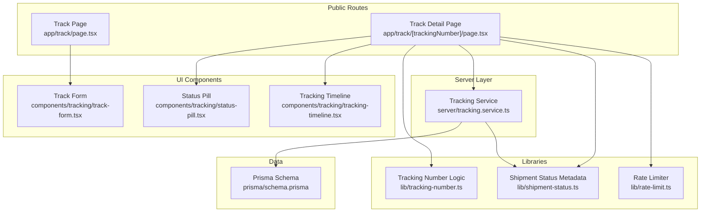
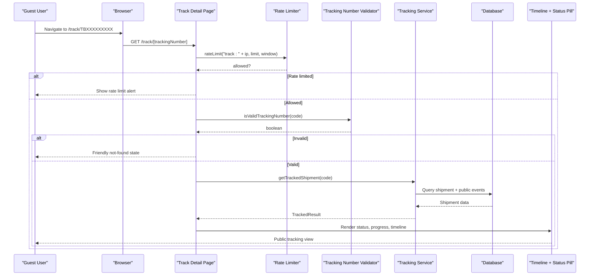
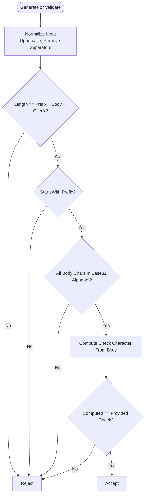
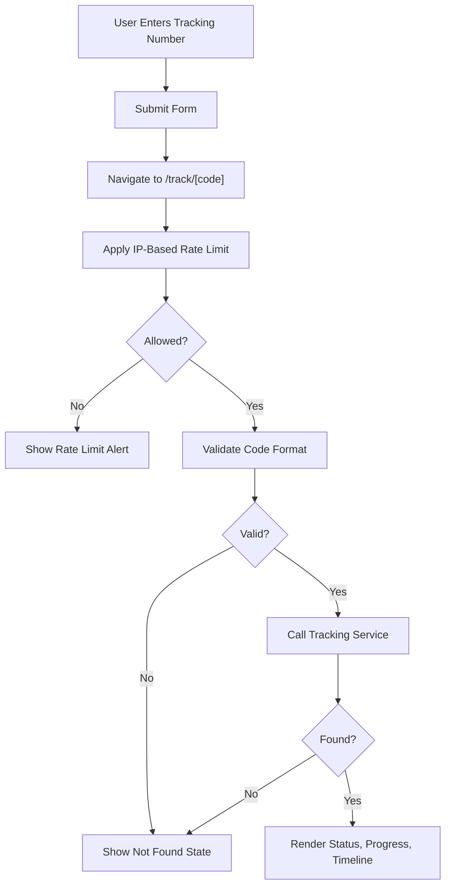
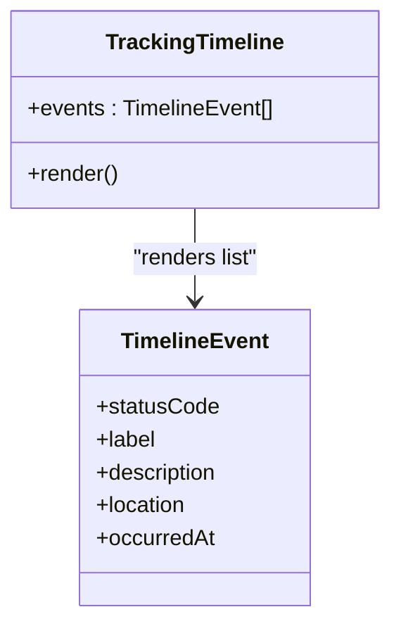
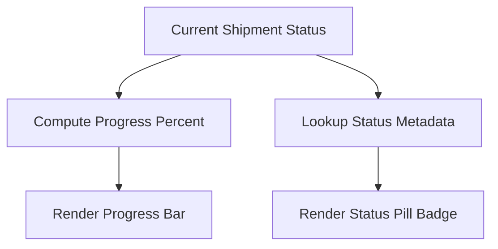
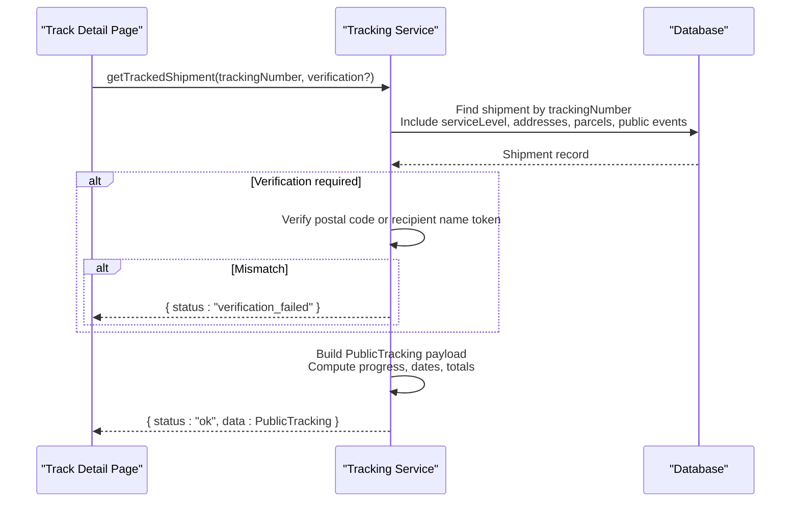
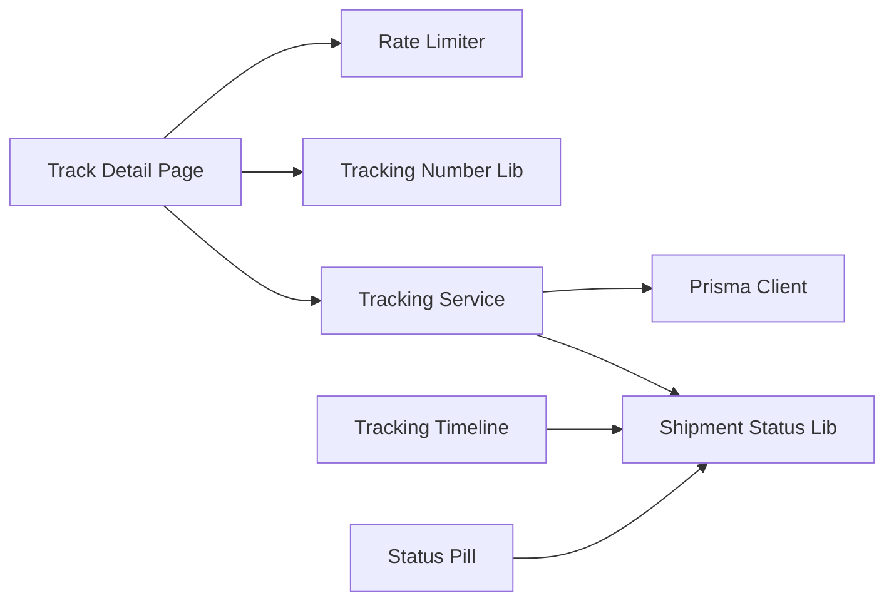

# Tracking System

<cite>
**Referenced Files in This Document**
- [tracking-number.ts](file://lib/tracking-number.ts)
- [shipment-status.ts](file://lib/shipment-status.ts)
- [rate-limit.ts](file://lib/rate-limit.ts)
- [schema.prisma](file://prisma/schema.prisma)
- [tracking.service.ts](file://server/tracking.service.ts)
- [track page](file://app/track/page.tsx)
- [track detail page](file://app/track/[trackingNumber]/page.tsx)
- [track form component](file://components/tracking/track-form.tsx)
- [status pill component](file://components/tracking/status-pill.tsx)
- [tracking timeline component](file://components/tracking/tracking-timeline.tsx)
- [tracking number tests](file://tests/tracking-number.test.ts)
- [guest tracking e2e test](file://tests/e2e/tracking.spec.ts)
</cite>

## Table of Contents
1. [Introduction](#introduction)
2. [Project Structure](#project-structure)
3. [Core Components](#core-components)
4. [Architecture Overview](#architecture-overview)
5. [Detailed Component Analysis](#detailed-component-analysis)
6. [Dependency Analysis](#dependency-analysis)
7. [Performance Considerations](#performance-considerations)
8. [Troubleshooting Guide](#troubleshooting-guide)
9. [Conclusion](#conclusion)
10. [Appendices](#appendices)

## Introduction
This document explains Timberland’s public shipment tracking system. It covers how public tracking numbers are generated and validated, how the public tracking interface works, how real-time status updates are displayed, and how the server-side tracking service retrieves and shapes data for guests. It also documents the timeline visualization, progress indicators, status pill components, query processing patterns, performance considerations, and guidance for implementing or customizing tracking features.

## Project Structure
The tracking feature spans a small set of focused modules:
- Public-facing routes under `app/track`.
- A server-only tracking service that queries the database and builds a guest-safe response.
- Shared libraries for tracking number generation/validation, shipment status metadata, and rate limiting.
- UI components for the tracking form, timeline, and status pill.
- Database schema defining shipments, parcels, addresses, service levels, and tracking events.

**Diagram sources**
- [track page:1-30](file://app/track/page.tsx#L1-L30)
- [track detail page:1-182](file://app/track/[trackingNumber]/page.tsx#L1-L182)
- [tracking.service.ts:1-147](file://server/tracking.service.ts#L1-L147)
- [tracking-number.ts:1-57](file://lib/tracking-number.ts#L1-L57)
- [shipment-status.ts:1-77](file://lib/shipment-status.ts#L1-L77)
- [rate-limit.ts:1-56](file://lib/rate-limit.ts#L1-L56)
- [track form component:1-47](file://components/tracking/track-form.tsx#L1-L47)
- [status pill component:1-8](file://components/tracking/status-pill.tsx#L1-L8)
- [tracking timeline component:1-51](file://components/tracking/tracking-timeline.tsx#L1-L51)
- [schema.prisma:160-226](file://prisma/schema.prisma#L160-L226)

**Section sources**
- [track page:1-30](file://app/track/page.tsx#L1-L30)
- [track detail page:1-182](file://app/track/[trackingNumber]/page.tsx#L1-L182)
- [tracking.service.ts:1-147](file://server/tracking.service.ts#L1-L147)
- [tracking-number.ts:1-57](file://lib/tracking-number.ts#L1-L57)
- [shipment-status.ts:1-77](file://lib/shipment-status.ts#L1-L77)
- [rate-limit.ts:1-56](file://lib/rate-limit.ts#L1-L56)
- [track form component:1-47](file://components/tracking/track-form.tsx#L1-L47)
- [status pill component:1-8](file://components/tracking/status-pill.tsx#L1-L8)
- [tracking timeline component:1-51](file://components/tracking/tracking-timeline.tsx#L1-L51)
- [schema.prisma:160-226](file://prisma/schema.prisma#L160-L226)

## Core Components
- Tracking number generator and validator: Produces random Base32 codes with a check character and validates user input.
- Shipment status metadata: Defines lifecycle states, transitions, labels, descriptions, and visual tones.
- Tracking service: Server-only function that fetches a shipment and returns a guest-safe payload with computed progress and events.
- Public tracking pages: Home search page and per-tracking-number detail page with rate limiting and validation.
- UI components: Search form, status pill, and timeline renderer.

Key responsibilities:
- Input normalization and validation occur both client-side (form) and server-side (route + service).
- Guest enumeration protection is implemented via IP-based rate limiting on the detail route.
- Data exposure is restricted to public fields; sensitive address/contact details are not included in the public response.

**Section sources**
- [tracking-number.ts:1-57](file://lib/tracking-number.ts#L1-L57)
- [shipment-status.ts:1-77](file://lib/shipment-status.ts#L1-L77)
- [tracking.service.ts:1-147](file://server/tracking.service.ts#L1-L147)
- [track detail page:1-182](file://app/track/[trackingNumber]/page.tsx#L1-L182)
- [track form component:1-47](file://components/tracking/track-form.tsx#L1-L47)
- [status pill component:1-8](file://components/tracking/status-pill.tsx#L1-L8)
- [tracking timeline component:1-51](file://components/tracking/tracking-timeline.tsx#L1-L51)

## Architecture Overview
The public tracking flow is a Next.js App Router server-rendered page that:
1. Accepts a tracking number from the URL.
2. Applies rate limiting by client IP.
3. Validates the tracking number format.
4. Calls the server-only tracking service to retrieve a guest-safe dataset.
5. Renders the status pill, progress bar, origin/destination summary, and timeline.

**Diagram sources**
- [track detail page:1-182](file://app/track/[trackingNumber]/page.tsx#L1-L182)
- [rate-limit.ts:1-56](file://lib/rate-limit.ts#L1-L56)
- [tracking-number.ts:1-57](file://lib/tracking-number.ts#L1-L57)
- [tracking.service.ts:1-147](file://server/tracking.service.ts#L1-L147)
- [schema.prisma:160-226](file://prisma/schema.prisma#L160-L226)

## Detailed Component Analysis

### Tracking Number Generation and Validation
- Format: Two-letter prefix plus eight Base32 characters plus one check character. The alphabet excludes ambiguous letters for readability.
- Randomness: Uses secure random selection to avoid sequential codes and reduce enumeration risk.
- Check character: Deterministic checksum derived from the body to detect typos.
- Normalization: Uppercases and removes spaces/dashes before validation.
- Tests verify valid generation, tamper detection, normalization, and non-sequential distribution.

**Diagram sources**
- [tracking-number.ts:1-57](file://lib/tracking-number.ts#L1-L57)

**Section sources**
- [tracking-number.ts:1-57](file://lib/tracking-number.ts#L1-L57)
- [tracking number tests:1-29](file://tests/tracking-number.test.ts#L1-L29)

### Public Tracking Interface
- Home page: Provides a simple form to enter a tracking number and navigate to the detail route.
- Detail page: Enforces rate limiting, validates the code, calls the tracking service, and renders a card with status, progress, route summary, and timeline.
- Not found handling: Shows a friendly message and reuses the tracking form.

**Diagram sources**
- [track page:1-30](file://app/track/page.tsx#L1-L30)
- [track detail page:1-182](file://app/track/[trackingNumber]/page.tsx#L1-L182)
- [track form component:1-47](file://components/tracking/track-form.tsx#L1-L47)

**Section sources**
- [track page:1-30](file://app/track/page.tsx#L1-L30)
- [track detail page:1-182](file://app/track/[trackingNumber]/page.tsx#L1-L182)
- [track form component:1-47](file://components/tracking/track-form.tsx#L1-L47)

### Real-Time Status Updates and Timeline Visualization
- Events: Public tracking events are stored per shipment and filtered to only include public entries.
- Ordering: Events are returned newest first.
- Rendering: The timeline component displays each event with a tone-colored dot, label, timestamp, optional location, and optional description.
- Empty state: Displays a message when no events exist.

**Diagram sources**
- [tracking timeline component:1-51](file://components/tracking/tracking-timeline.tsx#L1-L51)

**Section sources**
- [tracking timeline component:1-51](file://components/tracking/tracking-timeline.tsx#L1-L51)
- [tracking.service.ts:103-112](file://server/tracking.service.ts#L103-L112)

### Progress Indicators and Status Pill
- Progress percent: Computed from the current shipment status using a predefined order and special cases for terminal or exceptional statuses.
- Status pill: Renders a badge with the status label and tone based on shared status metadata.

**Diagram sources**
- [tracking.service.ts:38-54](file://server/tracking.service.ts#L38-L54)
- [status pill component:1-8](file://components/tracking/status-pill.tsx#L1-L8)
- [shipment-status.ts:62-76](file://lib/shipment-status.ts#L62-L76)

**Section sources**
- [tracking.service.ts:38-54](file://server/tracking.service.ts#L38-L54)
- [status pill component:1-8](file://components/tracking/status-pill.tsx#L1-L8)
- [shipment-status.ts:62-76](file://lib/shipment-status.ts#L62-L76)

### Tracking Service Layer, Query Processing, and Data Retrieval
- Input: Raw tracking number and optional verification string (postal code or recipient name token).
- Query: Retrieves the shipment with related service level, sender/recipient addresses, parcels, and public tracking events.
- Verification: If provided, ensures the verification matches either the postal code or a token from the recipient name.
- Output: Builds a guest-safe object including status metadata, estimated delivery, origin/destination cities/regions/countries, pieces, total weight, progress percent, and events. Sensitive fields like street address, contact name, phone, and price are excluded.

**Diagram sources**
- [tracking.service.ts:69-146](file://server/tracking.service.ts#L69-L146)
- [schema.prisma:160-226](file://prisma/schema.prisma#L160-L226)

**Section sources**
- [tracking.service.ts:1-147](file://server/tracking.service.ts#L1-L147)
- [schema.prisma:160-226](file://prisma/schema.prisma#L160-L226)

### Example Implementations and Customization Guidance

#### Implementing Tracking Functionality
- Add a tracking form that normalizes input and navigates to `/track/[code]`.
- On the detail page, apply rate limiting, validate the code, call the tracking service, and render the result.
- Use the status pill and timeline components to display status and history.

References:
- [track form component:1-47](file://components/tracking/track-form.tsx#L1-L47)
- [track detail page:1-182](file://app/track/[trackingNumber]/page.tsx#L1-L182)
- [tracking.service.ts:69-146](file://server/tracking.service.ts#L69-L146)

#### Customizing Timeline Displays
- Extend or replace the timeline component to change dot colors, layout, or add extra event fields.
- Use the shared status metadata to map status codes to labels and tones consistently.

References:
- [tracking timeline component:1-51](file://components/tracking/tracking-timeline.tsx#L1-L51)
- [shipment-status.ts:62-76](file://lib/shipment-status.ts#L62-L76)

#### Integrating Tracking Widgets
- Reuse the track form component inside headers, footers, or other pages to allow quick lookups.
- Embed the status pill where you need compact status badges.

References:
- [track form component:1-47](file://components/tracking/track-form.tsx#L1-L47)
- [status pill component:1-8](file://components/tracking/status-pill.tsx#L1-L8)

## Dependency Analysis
The tracking subsystem has clear boundaries:
- Pages depend on the tracking service and shared libraries.
- The tracking service depends on Prisma and status metadata.
- UI components depend on status metadata for consistent labeling and tones.
- Rate limiting is isolated and used by the detail page.

**Diagram sources**
- [track detail page:1-182](file://app/track/[trackingNumber]/page.tsx#L1-L182)
- [tracking.service.ts:1-147](file://server/tracking.service.ts#L1-L147)
- [tracking-number.ts:1-57](file://lib/tracking-number.ts#L1-L57)
- [rate-limit.ts:1-56](file://lib/rate-limit.ts#L1-L56)
- [shipment-status.ts:1-77](file://lib/shipment-status.ts#L1-L77)
- [tracking timeline component:1-51](file://components/tracking/tracking-timeline.tsx#L1-L51)
- [status pill component:1-8](file://components/tracking/status-pill.tsx#L1-L8)

**Section sources**
- [track detail page:1-182](file://app/track/[trackingNumber]/page.tsx#L1-L182)
- [tracking.service.ts:1-147](file://server/tracking.service.ts#L1-L147)
- [tracking-number.ts:1-57](file://lib/tracking-number.ts#L1-L57)
- [rate-limit.ts:1-56](file://lib/rate-limit.ts#L1-L56)
- [shipment-status.ts:1-77](file://lib/shipment-status.ts#L1-L77)
- [tracking timeline component:1-51](file://components/tracking/tracking-timeline.tsx#L1-L51)
- [status pill component:1-8](file://components/tracking/status-pill.tsx#L1-L8)

## Performance Considerations
- Rate limiting: The detail page applies an in-memory fixed-window rate limiter keyed by client IP to blunt enumeration. For multi-instance deployments, replace the in-memory store with a shared backend like Redis while keeping the same call signature.
- Query shape: The tracking service uses a single Prisma query with selective includes to minimize round trips and avoid leaking private fields.
- Event filtering: Only public tracking events are fetched and rendered.
- Memory management: The rate limiter includes a sweep utility to drop expired buckets and bound memory usage.
- Caching strategy:
  - Current implementation does not cache tracking results at the route layer.
  - Recommended additions:
    - Short-lived read-through cache keyed by tracking number for repeated requests within a short window.
    - Cache invalidation on new public tracking events.
    - Separate cache keys for verified vs unverified requests if verification affects content.
    - Consider edge caching for static parts of the page (e.g., status labels) but keep dynamic data server-fetched.

[No sources needed since this section provides general guidance]

## Troubleshooting Guide
Common issues and resolutions:
- Too many tracking requests: The detail page shows a rate limit alert when the IP exceeds the configured threshold. Wait briefly and retry.
- Invalid tracking number: The page shows a friendly not-found state. Ensure the code follows the expected format and contains no typos.
- Unknown tracking number: The page treats missing records as not found. Double-check the code and try again.
- PII leakage concerns: The public tracking view intentionally excludes sensitive fields such as street address, contact name, phone, and price. E2E tests assert these fields are not present in the rendered page.

Operational checks:
- Verify rate limiter configuration and consider moving to a distributed store for scaling.
- Confirm that only public events are included in the timeline.
- Validate that status metadata remains consistent across components.

**Section sources**
- [track detail page:56-76](file://app/track/[trackingNumber]/page.tsx#L56-L76)
- [rate-limit.ts:1-56](file://lib/rate-limit.ts#L1-L56)
- [guest tracking e2e test:8-41](file://tests/e2e/tracking.spec.ts#L8-L41)

## Conclusion
Timberland’s public tracking system provides a secure, efficient, and user-friendly way for guests to monitor shipments. It combines robust tracking number generation and validation, a server-only service that returns a minimal public dataset, and clean UI components for status and timeline visualization. With rate limiting in place and clear extension points, teams can customize timelines, integrate tracking widgets, and add caching strategies to support higher traffic volumes.

[No sources needed since this section summarizes without analyzing specific files]

## Appendices

### Data Model Summary Relevant to Tracking
- Shipment: Holds tracking number, status, service level, addresses, parcels, and timestamps.
- Parcel: Represents individual packages with weight and piece counts.
- TrackingEvent: Stores status changes, locations, notes, and whether they are public.
- ServiceLevel: Provides SLA days and service names used in public summaries.

**Section sources**
- [schema.prisma:160-226](file://prisma/schema.prisma#L160-L226)