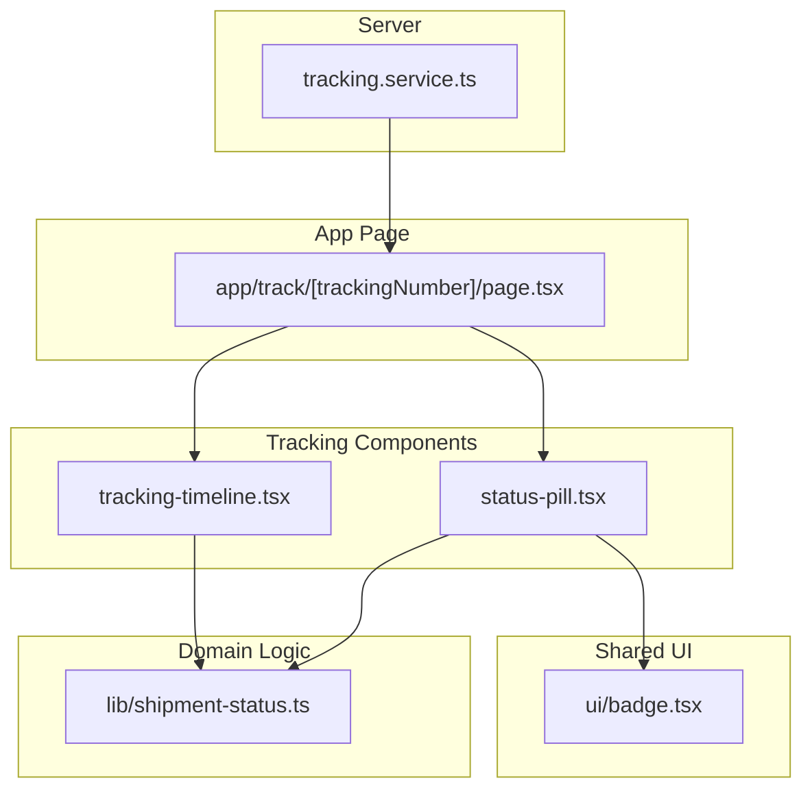
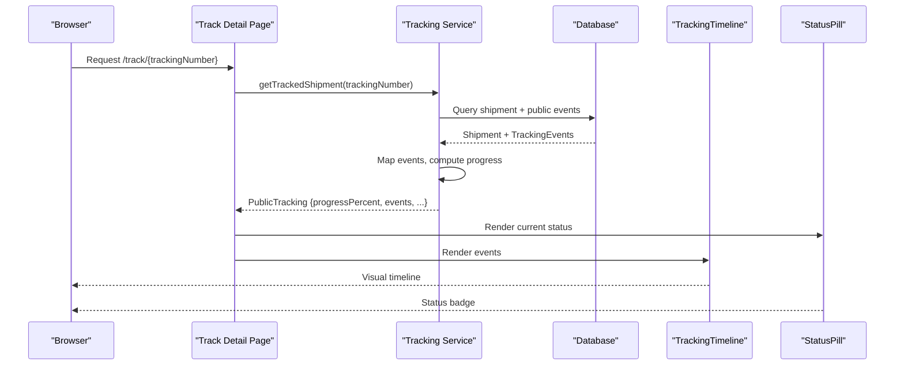
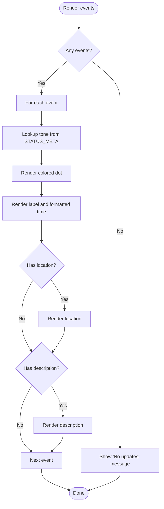
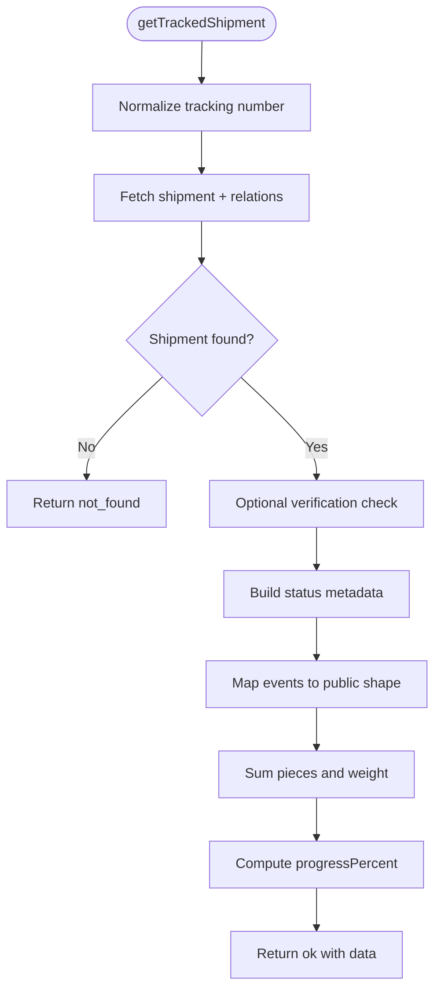
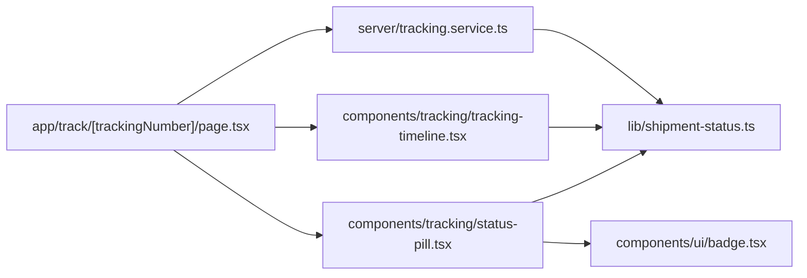

# Tracking Timeline Visualization

<cite>
**Referenced Files in This Document**
- [tracking-timeline.tsx](file://components/tracking/tracking-timeline.tsx)
- [status-pill.tsx](file://components/tracking/status-pill.tsx)
- [badge.tsx](file://components/ui/badge.tsx)
- [shipment-status.ts](file://lib/shipment-status.ts)
- [tracking.service.ts](file://server/tracking.service.ts)
- [page.tsx](file://app/track/[trackingNumber]/page.tsx)
</cite>

## Table of Contents
1. [Introduction](#introduction)
2. [Project Structure](#project-structure)
3. [Core Components](#core-components)
4. [Architecture Overview](#architecture-overview)
5. [Detailed Component Analysis](#detailed-component-analysis)
6. [Dependency Analysis](#dependency-analysis)
7. [Performance Considerations](#performance-considerations)
8. [Troubleshooting Guide](#troubleshooting-guide)
9. [Conclusion](#conclusion)
10. [Appendices](#appendices)

## Introduction
This document explains the tracking timeline visualization system used to display shipment status and history. It covers:
- The timeline component structure and how events are rendered as a vertical timeline with status dots.
- Status pill rendering for current shipment status.
- Progress indicator logic that calculates completion percentage based on shipment state.
- Data transformation from database shipment events to visual timeline elements.
- Customization options for appearance, adding custom status types, and implementing interactive features.
- Responsive design patterns and accessibility considerations for timeline displays.

## Project Structure
The tracking timeline is implemented across a small set of focused components and shared libraries:
- `components/tracking/tracking-timeline.tsx`: Renders the chronological event list.
- `components/tracking/status-pill.tsx`: Renders a compact status badge using shared UI.
- `components/ui/badge.tsx`: Shared badge component with tone variants.
- `lib/shipment-status.ts`: Defines allowed statuses, transitions, metadata, and helpers.
- `server/tracking.service.ts`: Builds public tracking data, transforms events, and computes progress.
- `app/track/[trackingNumber]/page.tsx`: Page that composes status pill, progress bar, and timeline.

**Diagram sources**
- [tracking.service.ts:1-147](file://server/tracking.service.ts#L1-L147)
- [page.tsx:1-182](file://app/track/[trackingNumber]/page.tsx#L1-L182)
- [tracking-timeline.tsx:1-51](file://components/tracking/tracking-timeline.tsx#L1-L51)
- [status-pill.tsx:1-8](file://components/tracking/status-pill.tsx#L1-L8)
- [badge.tsx:1-28](file://components/ui/badge.tsx#L1-L28)
- [shipment-status.ts:1-77](file://lib/shipment-status.ts#L1-L77)

**Section sources**
- [tracking-timeline.tsx:1-51](file://components/tracking/tracking-timeline.tsx#L1-L51)
- [status-pill.tsx:1-8](file://components/tracking/status-pill.tsx#L1-L8)
- [badge.tsx:1-28](file://components/ui/badge.tsx#L1-L28)
- [shipment-status.ts:1-77](file://lib/shipment-status.ts#L1-L77)
- [tracking.service.ts:1-147](file://server/tracking.service.ts#L1-L147)
- [page.tsx:1-182](file://app/track/[trackingNumber]/page.tsx#L1-L182)

## Core Components
- TrackingTimeline: Renders a vertical timeline of events with a left border and colored dots per status tone. It uses shared utilities to format dates and compute tone-based styles.
- StatusPill: Renders a compact status badge by looking up metadata for the given status.
- Badge (UI): Provides tone-based styling for badges via class variants.
- ShipmentStatus Library: Defines allowed statuses, transition rules, terminal/completed checks, and metadata including label, description, and tone.
- Tracking Service: Transforms database records into a public-facing shape, maps events to labels/descriptions, and computes progress percent.
- Track Detail Page: Composes status pill, progress bar, and timeline; passes transformed events to the timeline.

Key responsibilities:
- Domain model and presentation separation: status metadata lives in the library; components only consume it.
- Server-side data shaping: service prepares a stable, guest-safe payload with computed fields like progressPercent.
- Presentation layer: page orchestrates components; timeline renders event history.

**Section sources**
- [tracking-timeline.tsx:1-51](file://components/tracking/tracking-timeline.tsx#L1-L51)
- [status-pill.tsx:1-8](file://components/tracking/status-pill.tsx#L1-L8)
- [badge.tsx:1-28](file://components/ui/badge.tsx#L1-L28)
- [shipment-status.ts:1-77](file://lib/shipment-status.ts#L1-L77)
- [tracking.service.ts:1-147](file://server/tracking.service.ts#L1-L147)
- [page.tsx:1-182](file://app/track/[trackingNumber]/page.tsx#L1-L182)

## Architecture Overview
The tracking flow starts at the server, which fetches shipment data and builds a public payload. The page consumes this payload to render the current status, progress, and timeline.

**Diagram sources**
- [page.tsx:48-182](file://app/track/[trackingNumber]/page.tsx#L48-L182)
- [tracking.service.ts:69-146](file://server/tracking.service.ts#L69-L146)
- [tracking-timeline.tsx:21-50](file://components/tracking/tracking-timeline.tsx#L21-L50)
- [status-pill.tsx:4-7](file://components/tracking/status-pill.tsx#L4-L7)

## Detailed Component Analysis

### TrackingTimeline Component
Responsibilities:
- Accepts an array of timeline events.
- Renders a vertical timeline with a left border and a dot per event.
- Derives dot color from status tone via shared metadata.
- Formats timestamps and shows optional location and description.

Data contract:
- Each event includes statusCode, label, description, location, and occurredAt.

Rendering behavior:
- Empty events show a fallback message.
- Each event item contains a dot whose color depends on STATUS_META[tone].
- Time is displayed using a shared formatter and exposed as a semantic time element.

Customization points:
- Tone-to-color mapping can be extended or overridden by adjusting the internal DOT mapping or by passing additional props.
- Event content can be enhanced by wrapping items with interactive elements (e.g., expandable details).

Accessibility:
- Uses semantic `<ol>` and `<li>` for list semantics.
- Uses `<time>` with ISO datetime for machine-readable timestamps.
- Dots are decorative; ensure screen readers ignore them via appropriate ARIA if needed.

**Diagram sources**
- [tracking-timeline.tsx:21-50](file://components/tracking/tracking-timeline.tsx#L21-L50)
- [shipment-status.ts:62-76](file://lib/shipment-status.ts#L62-L76)

**Section sources**
- [tracking-timeline.tsx:1-51](file://components/tracking/tracking-timeline.tsx#L1-L51)
- [shipment-status.ts:62-76](file://lib/shipment-status.ts#L62-L76)

### StatusPill Component
Responsibilities:
- Renders a compact badge representing the current shipment status.
- Looks up metadata (label and tone) from the shared status library.
- Delegates styling to the shared Badge component.

Customization points:
- Change tone mapping by updating STATUS_META.
- Extend Badge tones to support new visual variants.

Accessibility:
- Badge text conveys status; consider adding aria-label when context requires more detail.

**Section sources**
- [status-pill.tsx:1-8](file://components/tracking/status-pill.tsx#L1-L8)
- [badge.tsx:1-28](file://components/ui/badge.tsx#L1-L28)
- [shipment-status.ts:62-76](file://lib/shipment-status.ts#L62-L76)

### Badge UI Component
Responsibilities:
- Provides tone-based styling through class variants.
- Supports neutral, active, success, warning, and danger tones.

Customization points:
- Add new tones by extending cva variants.
- Adjust base classes for size, spacing, or typography.

**Section sources**
- [badge.tsx:1-28](file://components/ui/badge.tsx#L1-L28)

### Shipment Status Library
Responsibilities:
- Defines allowed statuses and their lifecycle transitions.
- Provides helper functions for next states, terminal/completed checks.
- Supplies human-friendly metadata (label, description, tone) for each status.

Key concepts:
- SHIPMENT_STATUSES: Enumerated list of valid statuses.
- FORWARD: Transition map defining allowed next states.
- TERMINAL: States where no further movement is allowed.
- STATUS_META: Display metadata including tone for UI.

Extensibility:
- To add a new status, update SHIPMENT_STATUSES, FORWARD, TERMINAL (if applicable), and STATUS_META.
- Tests validate completeness and transition correctness.

**Section sources**
- [shipment-status.ts:1-77](file://lib/shipment-status.ts#L1-L77)
- [shipment-status.test.ts:1-39](file://tests/shipment-status.test.ts#L1-L39)

### Tracking Service
Responsibilities:
- Fetches shipment and related entities.
- Filters public-only tracking events.
- Maps raw events to public event shape with label and description.
- Computes progress percent based on status progression.
- Returns a stable, guest-safe payload consumed by the page.

Progress calculation:
- DELIVERED returns 100%.
- RETURNED and CANCELLED return 100% (closed states).
- For other statuses, progress is derived from PROGRESS_ORDER index.
- EXCEPTION receives a special default value to reflect partial progress.

Event mapping:
- Each event gets a label from STATUS_META.
- If the event has a note, it overrides the default description.

**Diagram sources**
- [tracking.service.ts:38-54](file://server/tracking.service.ts#L38-L54)
- [tracking.service.ts:69-146](file://server/tracking.service.ts#L69-L146)

**Section sources**
- [tracking.service.ts:1-147](file://server/tracking.service.ts#L1-L147)

### Track Detail Page
Responsibilities:
- Validates input and applies rate limiting.
- Calls the tracking service to retrieve public data.
- Renders current status via StatusPill.
- Renders a progress bar using progressPercent.
- Passes mapped events to TrackingTimeline.

Data transformation to timeline:
- The page maps service events to the timeline’s expected shape, preserving statusCode, label, description, location, and occurredAt.

Responsive layout:
- Uses container and grid utilities to adapt to different screen sizes.
- Timeline itself is responsive due to flex-wrap and relative positioning.

Accessibility:
- Semantic headings and descriptions.
- Time elements expose machine-readable timestamps.

**Section sources**
- [page.tsx:1-182](file://app/track/[trackingNumber]/page.tsx#L1-L182)

## Dependency Analysis
High-level dependencies:
- Page depends on Tracking Service and both TrackingTimeline and StatusPill.
- StatusPill depends on Badge and ShipmentStatus.
- TrackingTimeline depends on ShipmentStatus and formatting utilities.
- Tracking Service depends on ShipmentStatus for metadata and progress computation.

**Diagram sources**
- [page.tsx:1-182](file://app/track/[trackingNumber]/page.tsx#L1-L182)
- [tracking.service.ts:1-147](file://server/tracking.service.ts#L1-L147)
- [tracking-timeline.tsx:1-51](file://components/tracking/tracking-timeline.tsx#L1-L51)
- [status-pill.tsx:1-8](file://components/tracking/status-pill.tsx#L1-L8)
- [badge.tsx:1-28](file://components/ui/badge.tsx#L1-L28)
- [shipment-status.ts:1-77](file://lib/shipment-status.ts#L1-L77)

**Section sources**
- [page.tsx:1-182](file://app/track/[trackingNumber]/page.tsx#L1-L182)
- [tracking.service.ts:1-147](file://server/tracking.service.ts#L1-L147)
- [tracking-timeline.tsx:1-51](file://components/tracking/tracking-timeline.tsx#L1-L51)
- [status-pill.tsx:1-8](file://components/tracking/status-pill.tsx#L1-L8)
- [badge.tsx:1-28](file://components/ui/badge.tsx#L1-L28)
- [shipment-status.ts:1-77](file://lib/shipment-status.ts#L1-L77)

## Performance Considerations
- Server-side data shaping reduces client work by precomputing progress and mapping events.
- Filtering public-only events minimizes payload size.
- Timeline rendering is linear in the number of events; keep event lists concise.
- Avoid heavy computations in the render path; rely on service-computed values like progressPercent.

[No sources needed since this section provides general guidance]

## Troubleshooting Guide
Common issues and resolutions:
- No events displayed: Ensure the service returns events and the page maps them correctly before passing to the timeline.
- Incorrect progress percentage: Verify the current status and the PROGRESS_ORDER mapping in the service.
- Missing status metadata: Confirm STATUS_META includes all required statuses; tests enforce completeness.
- Rate limiting errors: The track page applies rate limiting; retry after a short delay if blocked.

**Section sources**
- [page.tsx:56-76](file://app/track/[trackingNumber]/page.tsx#L56-L76)
- [tracking.service.ts:38-54](file://server/tracking.service.ts#L38-L54)
- [shipment-status.ts:62-76](file://lib/shipment-status.ts#L62-L76)

## Conclusion
The tracking timeline system cleanly separates domain logic, data transformation, and presentation. The server prepares a stable payload with computed progress and mapped events, while the page composes reusable components to render status, progress, and timeline. Extending the system involves updating the shared status library and ensuring consistent metadata across components.

[No sources needed since this section summarizes without analyzing specific files]

## Appendices

### Customizing Timeline Appearance
- Change dot colors: Update the tone-to-class mapping inside the timeline component or extend the shared tone system.
- Adjust spacing and borders: Modify the timeline container classes to change spacing, border style, or padding.
- Enhance event content: Wrap event items with interactive elements such as expandable panels or links.

**Section sources**
- [tracking-timeline.tsx:13-19](file://components/tracking/tracking-timeline.tsx#L13-L19)
- [tracking-timeline.tsx:26-48](file://components/tracking/tracking-timeline.tsx#L26-L48)

### Adding Custom Status Types
Steps:
1. Add the new status to SHIPMENT_STATUSES.
2. Define allowed transitions in FORWARD.
3. Mark as terminal if applicable in TERMINAL.
4. Add metadata in STATUS_META with label, description, and tone.
5. Optionally adjust progress calculation if the new status affects progress.

Validation:
- Existing tests assert metadata completeness and transition rules.

**Section sources**
- [shipment-status.ts:9-22](file://lib/shipment-status.ts#L9-L22)
- [shipment-status.ts:29-43](file://lib/shipment-status.ts#L29-L43)
- [shipment-status.ts:62-76](file://lib/shipment-status.ts#L62-L76)
- [shipment-status.test.ts:1-39](file://tests/shipment-status.test.ts#L1-L39)

### Implementing Interactive Features
Examples:
- Expandable event details: Wrap each timeline item with a button that toggles expanded content.
- Click-to-copy tracking number: Add a copy action near the header.
- Keyboard navigation: Ensure focus management within expanded sections.

Implementation tips:
- Keep interactions accessible with proper roles and ARIA attributes.
- Use semantic elements for headings, buttons, and lists.

[No sources needed since this section provides general guidance]

### Responsive Design Patterns
- Container width constraints: The page uses a max-width container to maintain readability on large screens.
- Flex wrap for event headers: Ensures labels and times align well on narrow screens.
- Relative positioning for timeline dots: Keeps dots aligned regardless of content length.

**Section sources**
- [page.tsx:81-144](file://app/track/[trackingNumber]/page.tsx#L81-L144)
- [tracking-timeline.tsx:26-48](file://components/tracking/tracking-timeline.tsx#L26-L48)

### Accessibility Considerations
- Use semantic HTML: Lists for timelines, headings for sections, and time elements for timestamps.
- Provide descriptive labels: Status pills should convey meaning; consider aria-labels where necessary.
- Color contrast: Rely on theme tokens for sufficient contrast; avoid relying solely on color to convey meaning.
- Keyboard support: Ensure any interactive elements are reachable and operable via keyboard.

**Section sources**
- [tracking-timeline.tsx:26-48](file://components/tracking/tracking-timeline.tsx#L26-L48)
- [status-pill.tsx:4-7](file://components/tracking/status-pill.tsx#L4-L7)