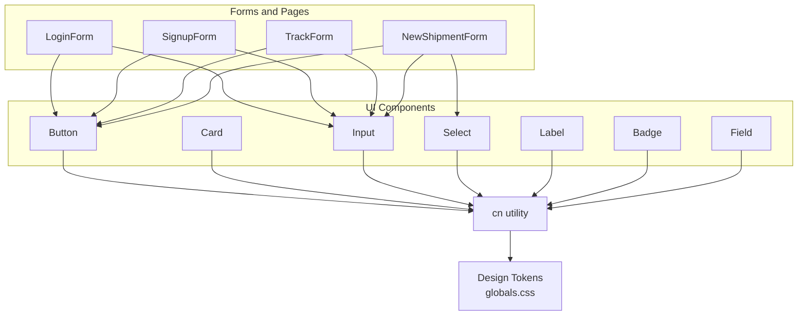
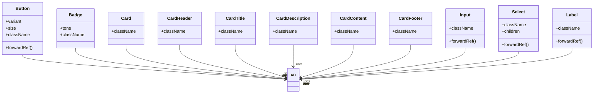
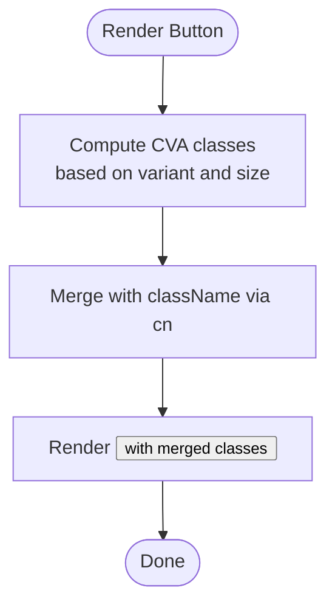
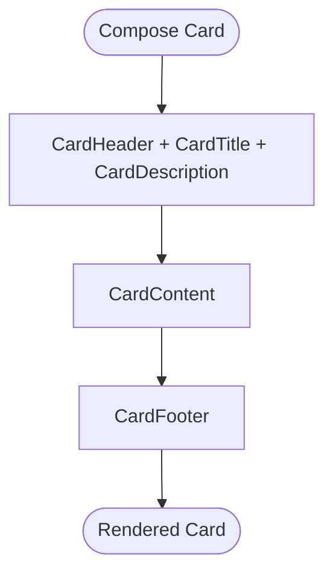
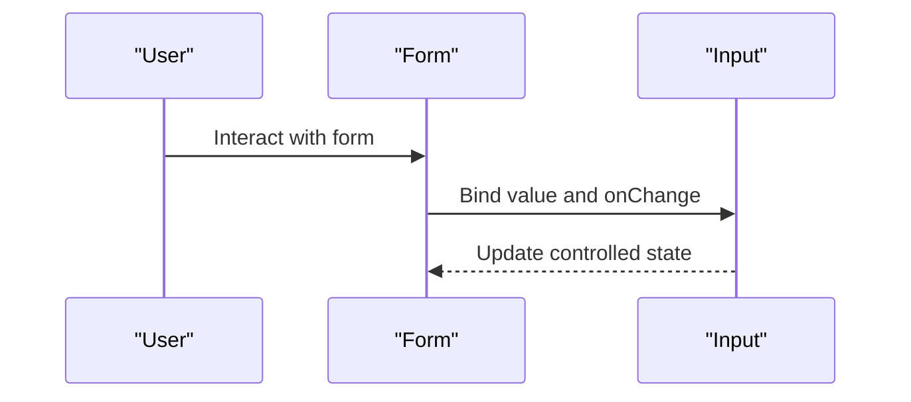
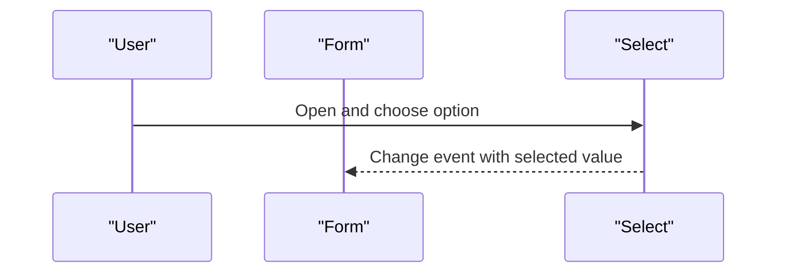
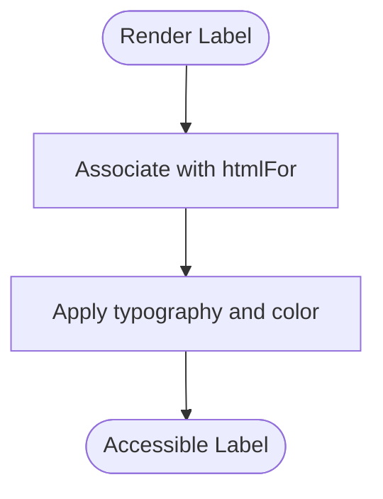
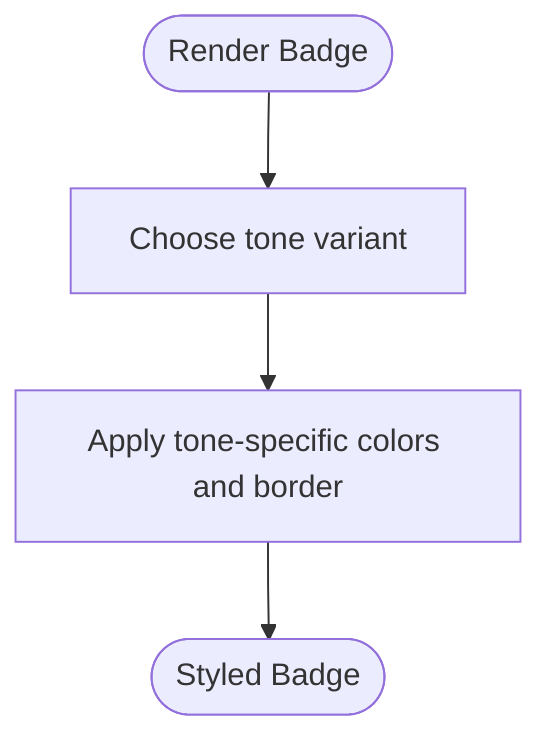
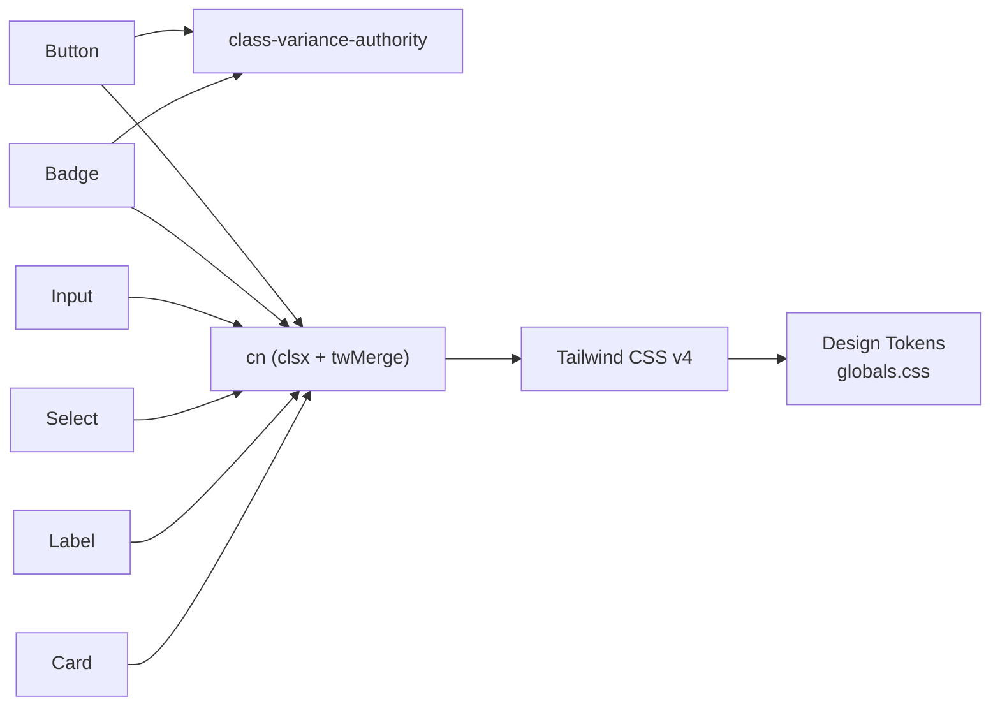
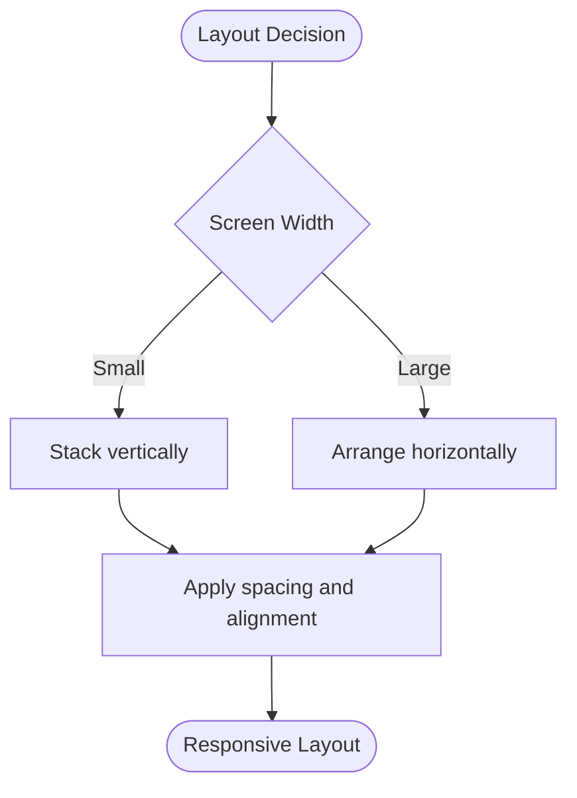

# Core UI Components

<cite>
**Referenced Files in This Document**
- [button.tsx](file://components/ui/button.tsx)
- [card.tsx](file://components/ui/card.tsx)
- [input.tsx](file://components/ui/input.tsx)
- [select.tsx](file://components/ui/select.tsx)
- [label.tsx](file://components/ui/label.tsx)
- [badge.tsx](file://components/ui/badge.tsx)
- [field.tsx](file://components/ui/field.tsx)
- [utils.ts](file://lib/utils.ts)
- [globals.css](file://app/globals.css)
- [login-form.tsx](file://components/auth/login-form.tsx)
- [signup-form.tsx](file://components/auth/signup-form.tsx)
- [track-form.tsx](file://components/tracking/track-form.tsx)
- [new-shipment-form.tsx](file://components/shipment/new-shipment-form.tsx)
</cite>

## Table of Contents
1. [Introduction](#introduction)
2. [Project Structure](#project-structure)
3. [Core Components](#core-components)
4. [Architecture Overview](#architecture-overview)
5. [Detailed Component Analysis](#detailed-component-analysis)
6. [Dependency Analysis](#dependency-analysis)
7. [Performance Considerations](#performance-considerations)
8. [Accessibility Guidelines](#accessibility-guidelines)
9. [Responsive Design Patterns](#responsive-design-patterns)
10. [Cross-Browser Compatibility](#cross-browser-compatibility)
11. [Troubleshooting Guide](#troubleshooting-guide)
12. [Conclusion](#conclusion)

## Introduction
This document explains Timberland’s core UI components: Button, Card, Input, Select, Label, and Badge. It covers their props, variants, sizes, styling options, and composition patterns using class-variance-authority (CVA). It also provides usage examples from the application, accessibility guidance, responsive design patterns, and cross-browser considerations. The components are built on Tailwind CSS v4 with a shared design token system defined in global styles.

## Project Structure
The UI components live under `components/ui` and are consumed by feature-specific forms and pages. Shared utilities and design tokens provide consistent styling across the app.

**Diagram sources**
- [button.tsx:1-40](file://components/ui/button.tsx#L1-L40)
- [card.tsx:1-32](file://components/ui/card.tsx#L1-L32)
- [input.tsx:1-17](file://components/ui/input.tsx#L1-L17)
- [select.tsx:1-19](file://components/ui/select.tsx#L1-L19)
- [label.tsx:1-14](file://components/ui/label.tsx#L1-L14)
- [badge.tsx:1-28](file://components/ui/badge.tsx#L1-L28)
- [field.tsx:1-29](file://components/ui/field.tsx#L1-L29)
- [utils.ts:1-29](file://lib/utils.ts#L1-L29)
- [globals.css:1-116](file://app/globals.css#L1-L116)
- [login-form.tsx:1-40](file://components/auth/login-form.tsx#L1-L40)
- [signup-form.tsx:1-39](file://components/auth/signup-form.tsx#L1-L39)
- [track-form.tsx:1-47](file://components/tracking/track-form.tsx#L1-L47)
- [new-shipment-form.tsx:1-257](file://components/shipment/new-shipment-form.tsx#L1-L257)

**Section sources**
- [button.tsx:1-40](file://components/ui/button.tsx#L1-L40)
- [card.tsx:1-32](file://components/ui/card.tsx#L1-L32)
- [input.tsx:1-17](file://components/ui/input.tsx#L1-L17)
- [select.tsx:1-19](file://components/ui/select.tsx#L1-L19)
- [label.tsx:1-14](file://components/ui/label.tsx#L1-L14)
- [badge.tsx:1-28](file://components/ui/badge.tsx#L1-L28)
- [field.tsx:1-29](file://components/ui/field.tsx#L1-L29)
- [utils.ts:1-29](file://lib/utils.ts#L1-L29)
- [globals.css:1-116](file://app/globals.css#L1-L116)

## Core Components
This section summarizes each component’s purpose, props, variants, sizes, and styling approach.

- Button
  - Purpose: Primary interactive control for actions.
  - Props: Standard HTML button attributes plus variant and size.
  - Variants: primary, secondary, outline, ghost, destructive, accent.
  - Sizes: sm, md, lg, icon.
  - Styling: CVA-based classes merged via cn; includes focus ring, hover states, disabled state.

- Card
  - Purpose: Container for grouped content.
  - Subcomponents: CardHeader, CardTitle, CardDescription, CardContent, CardFooter.
  - Styling: Border, background, typography, spacing tokens.

- Input
  - Purpose: Text input field.
  - Props: Standard HTML input attributes.
  - Styling: Consistent height, border, focus ring, placeholder color, disabled state.

- Select
  - Purpose: Native select dropdown.
  - Props: Standard HTML select attributes plus children options.
  - Styling: Matches Input; uses appearance-none for consistent look.

- Label
  - Purpose: Accessible label for form controls.
  - Props: Standard HTML label attributes.
  - Styling: Small, medium weight, foreground color.

- Badge
  - Purpose: Status or category indicator.
  - Props: tone variant.
  - Variants: neutral, active, success, warning, danger.
  - Styling: Pill shape, subtle borders, semantic tones.

**Section sources**
- [button.tsx:5-36](file://components/ui/button.tsx#L5-L36)
- [card.tsx:4-31](file://components/ui/card.tsx#L4-L31)
- [input.tsx:4-15](file://components/ui/input.tsx#L4-L15)
- [select.tsx:4-17](file://components/ui/select.tsx#L4-L17)
- [label.tsx:4-12](file://components/ui/label.tsx#L4-L12)
- [badge.tsx:5-27](file://components/ui/badge.tsx#L5-L27)

## Architecture Overview
The components follow a consistent architecture:
- All components accept className and forwardRef where applicable.
- Styles are composed through cn, which merges Tailwind classes safely.
- CVA is used for components with multiple visual variants (Button, Badge).
- Global design tokens define colors, radii, and fonts for consistency.

**Diagram sources**
- [button.tsx:1-40](file://components/ui/button.tsx#L1-L40)
- [badge.tsx:1-28](file://components/ui/badge.tsx#L1-L28)
- [card.tsx:1-32](file://components/ui/card.tsx#L1-L32)
- [input.tsx:1-17](file://components/ui/input.tsx#L1-L17)
- [select.tsx:1-19](file://components/ui/select.tsx#L1-L19)
- [label.tsx:1-14](file://components/ui/label.tsx#L1-L14)
- [utils.ts:1-6](file://lib/utils.ts#L1-L6)

## Detailed Component Analysis

### Button
- Variants:
  - primary: Brand background with foreground text and subtle shadow.
  - secondary: Secondary surface with contrasting foreground.
  - outline: Transparent background with border and muted hover.
  - ghost: Transparent with hover background.
  - destructive: Error-like background and foreground.
  - accent: Accent brand color with contrasting foreground.
- Sizes:
  - sm: Compact height and smaller text.
  - md: Default height and padding.
  - lg: Larger height and base text.
  - icon: Square container for icon-only buttons.
- Accessibility:
  - Focus-visible ring and outline handling.
  - Disabled state disables pointer events and reduces opacity.
- Composition:
  - Accepts any button HTML attributes.
  - Supports ref forwarding.

**Diagram sources**
- [button.tsx:5-36](file://components/ui/button.tsx#L5-L36)
- [utils.ts:4-6](file://lib/utils.ts#L4-L6)

**Section sources**
- [button.tsx:5-36](file://components/ui/button.tsx#L5-L36)

### Card
- Parts:
  - Card: Outer container with border, background, and shadow.
  - CardHeader: Header area with vertical gap and padding.
  - CardTitle: Semantic heading with strong emphasis.
  - CardDescription: Descriptive paragraph with muted color.
  - CardContent: Main content area with top padding reset.
  - CardFooter: Footer area with horizontal alignment and padding.
- Usage:
  - Compose parts to structure information blocks.
  - Extend with custom className as needed.

**Diagram sources**
- [card.tsx:4-31](file://components/ui/card.tsx#L4-L31)

**Section sources**
- [card.tsx:4-31](file://components/ui/card.tsx#L4-L31)

### Input
- Behavior:
  - Full-width input with consistent height and border.
  - Placeholder styled with muted foreground.
  - Focus-visible ring matches theme ring color.
  - Disabled state shows not-allowed cursor and reduced opacity.
- Composition:
  - Use with Field for labels, hints, and error messages.
  - Forward ref for programmatic access.

**Diagram sources**
- [input.tsx:4-15](file://components/ui/input.tsx#L4-L15)
- [field.tsx:14-29](file://components/ui/field.tsx#L14-L29)

**Section sources**
- [input.tsx:4-15](file://components/ui/input.tsx#L4-L15)

### Select
- Behavior:
  - Styled like Input with native select behavior.
  - Uses appearance-none for consistent visuals.
  - Focus-visible ring and disabled state mirror Input.
- Composition:
  - Provide option elements as children.
  - Use with Field for accessible labeling and validation messaging.

**Diagram sources**
- [select.tsx:4-17](file://components/ui/select.tsx#L4-L17)
- [field.tsx:14-29](file://components/ui/field.tsx#L14-L29)

**Section sources**
- [select.tsx:4-17](file://components/ui/select.tsx#L4-L17)

### Label
- Behavior:
  - Small, medium-weight text with foreground color.
  - Forward ref for programmatic association.
- Composition:
  - Pair with htmlFor to associate with inputs.
  - Often wrapped by Field for consistent layout.

**Diagram sources**
- [label.tsx:4-12](file://components/ui/label.tsx#L4-L12)

**Section sources**
- [label.tsx:4-12](file://components/ui/label.tsx#L4-L12)

### Badge
- Variants:
  - neutral: Muted background and foreground with border.
  - active: Primary tinted background and foreground.
  - success: Success tinted background and foreground.
  - warning: Warning tinted background and foreground.
  - danger: Destructive tinted background and foreground.
- Styling:
  - Pill shape with small font and medium weight.
  - Semantic tones for status communication.

**Diagram sources**
- [badge.tsx:5-27](file://components/ui/badge.tsx#L5-L27)

**Section sources**
- [badge.tsx:5-27](file://components/ui/badge.tsx#L5-L27)

## Dependency Analysis
Components depend on:
- class-variance-authority for variant-driven styling (Button, Badge).
- clsx and tailwind-merge via cn for safe class merging.
- Tailwind CSS v4 design tokens for colors, radii, and fonts.

**Diagram sources**
- [button.tsx:1-40](file://components/ui/button.tsx#L1-L40)
- [badge.tsx:1-28](file://components/ui/badge.tsx#L1-L28)
- [utils.ts:1-6](file://lib/utils.ts#L1-L6)
- [globals.css:1-116](file://app/globals.css#L1-L116)

**Section sources**
- [utils.ts:1-6](file://lib/utils.ts#L1-L6)
- [globals.css:1-116](file://app/globals.css#L1-L116)

## Performance Considerations
- CVA computes class strings at runtime based on variants; keep variant sets minimal to avoid unnecessary re-renders.
- Prefer stable variant values to prevent style churn.
- Use memoization in parent components when passing dynamic variants to reduce recomputation.
- Avoid excessive className overrides; rely on component defaults and extend sparingly.

[No sources needed since this section provides general guidance]

## Accessibility Guidelines
- Labels:
  - Always associate labels with inputs using htmlFor.
  - Use Field to standardize label, hint, and error presentation.
- Focus management:
  - Components use focus-visible rings for keyboard navigation.
- ARIA:
  - Add aria-label where icons or non-textual controls need context.
  - Ensure form fields have descriptive labels or aria-labels.
- Color contrast:
  - Tones and backgrounds are designed for sufficient contrast in both light and dark themes.
- Keyboard support:
  - Buttons and inputs respond to Enter/Space appropriately.
  - Select dropdowns follow native browser behavior.

**Section sources**
- [field.tsx:14-29](file://components/ui/field.tsx#L14-L29)
- [track-form.tsx:29-40](file://components/tracking/track-form.tsx#L29-L40)

## Responsive Design Patterns
- Forms:
  - TrackForm switches between column and row layouts based on screen size.
  - NewShipmentForm uses grid layouts that adapt from single-column to multi-column.
- Spacing and sizing:
  - Components use consistent spacing scales and heights.
  - Button sizes scale appropriately for different contexts.
- Containers:
  - Page-level containers center content and constrain width.

**Diagram sources**
- [track-form.tsx:19-22](file://components/tracking/track-form.tsx#L19-L22)
- [new-shipment-form.tsx:169-187](file://components/shipment/new-shipment-form.tsx#L169-L187)

**Section sources**
- [track-form.tsx:19-22](file://components/tracking/track-form.tsx#L19-L22)
- [new-shipment-form.tsx:169-187](file://components/shipment/new-shipment-form.tsx#L169-L187)

## Cross-Browser Compatibility
- Native select styling:
  - appearance:none ensures consistent dropdown visuals across browsers.
- Focus rings:
  - focus-visible is widely supported; fallback outlines are present.
- Dark mode:
  - Theme variables switch via .dark class; ensure root element toggles correctly.
- Fonts:
  - System fallbacks provided for sans-serif and monospace fonts.

**Section sources**
- [select.tsx:8-11](file://components/ui/select.tsx#L8-L11)
- [globals.css:38-66](file://app/globals.css#L38-L66)
- [globals.css:89-95](file://app/globals.css#L89-L95)

## Troubleshooting Guide
- Variant not applied:
  - Verify variant prop matches one of the defined variants.
  - Ensure className does not override critical styles unintentionally.
- Focus ring missing:
  - Confirm focus-visible is supported in target browsers.
  - Check if outline or ring utilities are overridden elsewhere.
- Select dropdown looks inconsistent:
  - Ensure appearance:none is applied and custom styles do not conflict.
- Dark theme colors incorrect:
  - Verify .dark class is applied to root and tokens are mapped correctly.
- Label not associated:
  - Match htmlFor on Label with id on Input.

**Section sources**
- [button.tsx:5-36](file://components/ui/button.tsx#L5-L36)
- [select.tsx:8-11](file://components/ui/select.tsx#L8-L11)
- [globals.css:68-95](file://app/globals.css#L68-L95)

## Conclusion
Timberland’s core UI components provide a consistent, accessible, and responsive foundation for building forms and interfaces. They leverage CVA for variant-driven styling, Tailwind CSS v4 tokens for theming, and a shared cn utility for robust class composition. By following the guidelines and patterns outlined here, teams can maintain visual and behavioral consistency across the application while supporting diverse user needs and devices.

[No sources needed since this section summarizes without analyzing specific files]