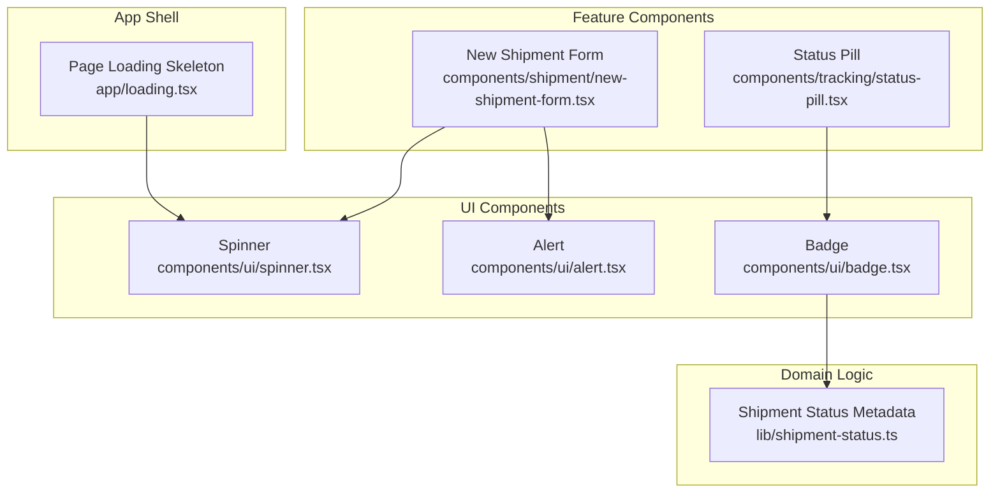
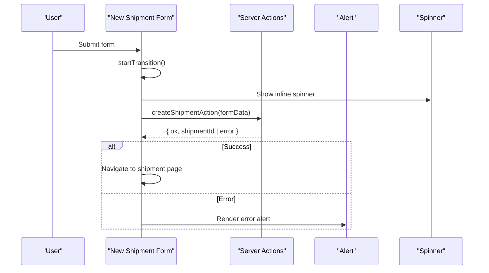
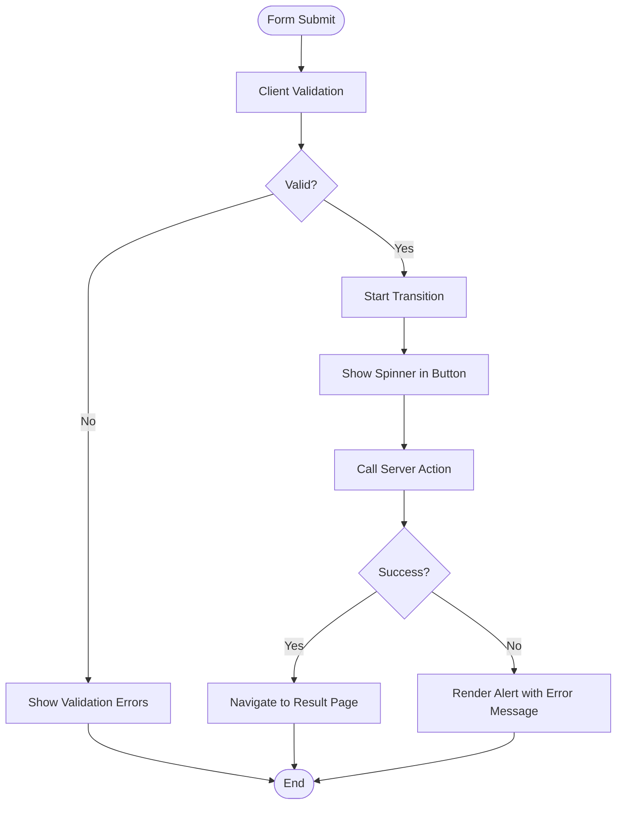
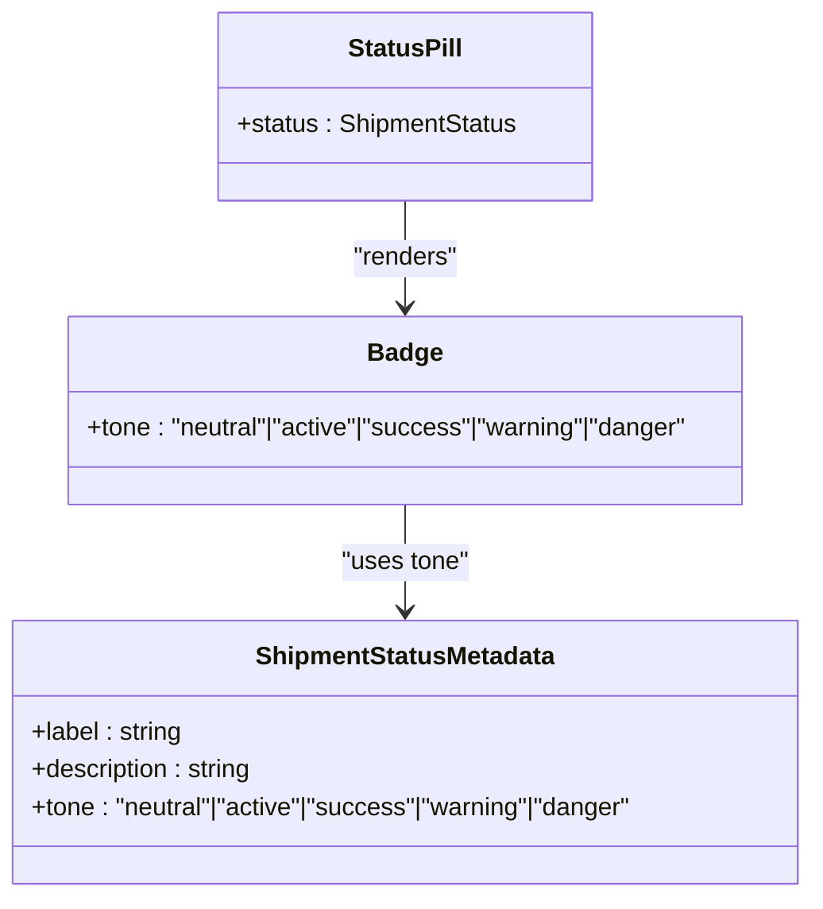
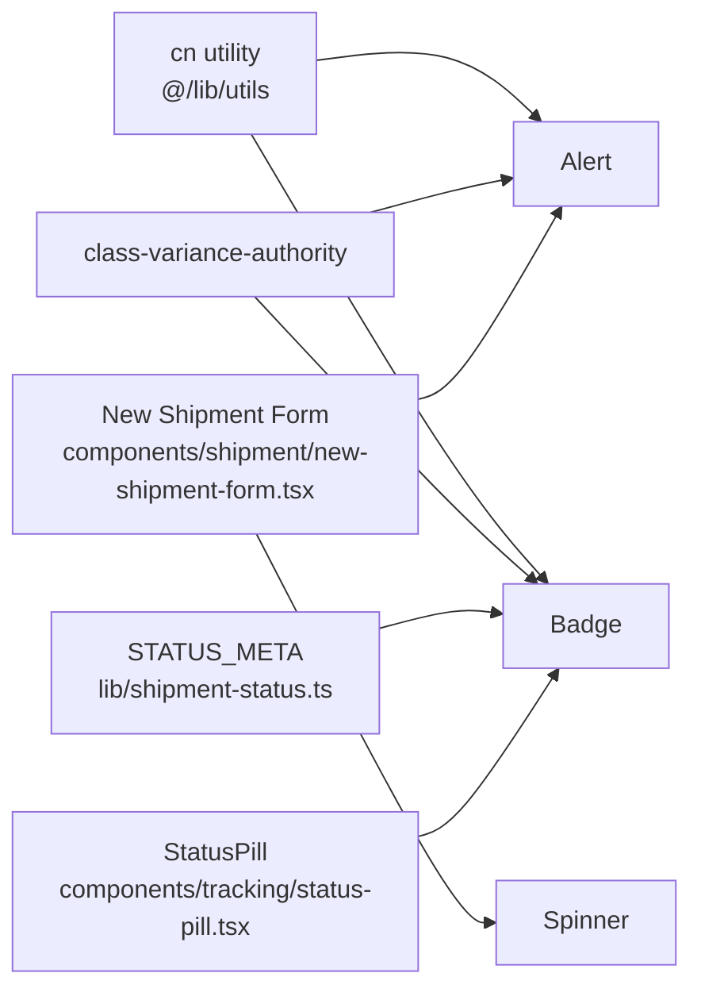

# Feedback Components

<cite>
**Referenced Files in This Document**
- [alert.tsx](file://components/ui/alert.tsx)
- [spinner.tsx](file://components/ui/spinner.tsx)
- [badge.tsx](file://components/ui/badge.tsx)
- [new-shipment-form.tsx](file://components/shipment/new-shipment-form.tsx)
- [status-pill.tsx](file://components/tracking/status-pill.tsx)
- [shipment-status.ts](file://lib/shipment-status.ts)
- [loading.tsx](file://app/loading.tsx)
</cite>

## Table of Contents
1. [Introduction](#introduction)
2. [Project Structure](#project-structure)
3. [Core Components](#core-components)
4. [Architecture Overview](#architecture-overview)
5. [Detailed Component Analysis](#detailed-component-analysis)
6. [Dependency Analysis](#dependency-analysis)
7. [Performance Considerations](#performance-considerations)
8. [Troubleshooting Guide](#troubleshooting-guide)
9. [Conclusion](#conclusion)

## Introduction
This document explains the feedback and status display components used across the application: Alert, Spinner, and Badge. These components provide consistent user feedback for errors and success states, loading indicators during asynchronous operations, and compact status labels for data displays. The guidance covers styling variants, animation patterns, accessibility considerations, integration examples in forms and data views, timing recommendations for spinners, and alert messaging patterns.

## Project Structure
The feedback components live under a shared UI layer and are consumed by feature-specific components such as forms and tracking displays.

**Diagram sources**
- [alert.tsx:1-24](file://components/ui/alert.tsx#L1-L24)
- [spinner.tsx:1-20](file://components/ui/spinner.tsx#L1-L20)
- [badge.tsx:1-28](file://components/ui/badge.tsx#L1-L28)
- [new-shipment-form.tsx:1-257](file://components/shipment/new-shipment-form.tsx#L1-L257)
- [status-pill.tsx:1-7](file://components/tracking/status-pill.tsx#L1-L7)
- [shipment-status.ts:62-76](file://lib/shipment-status.ts#L62-L76)
- [loading.tsx:1-17](file://app/loading.tsx#L1-L17)

**Section sources**
- [alert.tsx:1-24](file://components/ui/alert.tsx#L1-L24)
- [spinner.tsx:1-20](file://components/ui/spinner.tsx#L1-L20)
- [badge.tsx:1-28](file://components/ui/badge.tsx#L1-L28)
- [new-shipment-form.tsx:1-257](file://components/shipment/new-shipment-form.tsx#L1-L257)
- [status-pill.tsx:1-7](file://components/tracking/status-pill.tsx#L1-L7)
- [shipment-status.ts:62-76](file://lib/shipment-status.ts#L62-L76)
- [loading.tsx:1-17](file://app/loading.tsx#L1-L17)

## Core Components
- Alert: A container for contextual messages with semantic role and variant-based styling.
- Spinner: An animated SVG indicator for loading states.
- Badge: A compact label for status or metadata with tone-based styling.

Key characteristics:
- Variants are driven by class-variance-authority to keep styles composable and type-safe.
- Accessibility is considered through roles and attributes where appropriate.
- Components accept additional className props for customization.

**Section sources**
- [alert.tsx:5-23](file://components/ui/alert.tsx#L5-L23)
- [spinner.tsx:3-19](file://components/ui/spinner.tsx#L3-L19)
- [badge.tsx:5-27](file://components/ui/badge.tsx#L5-L27)

## Architecture Overview
Feedback components are small, focused primitives that compose into richer UIs:
- Forms use Alert to communicate validation and server errors, and Spinner to indicate pending actions.
- Data displays use Badge to show concise status information, often mapped from domain metadata.

**Diagram sources**
- [new-shipment-form.tsx:136-163](file://components/shipment/new-shipment-form.tsx#L136-L163)
- [new-shipment-form.tsx:165-187](file://components/shipment/new-shipment-form.tsx#L165-L187)
- [new-shipment-form.tsx:246-253](file://components/shipment/new-shipment-form.tsx#L246-L253)

## Detailed Component Analysis

### Alert
Purpose:
- Communicate informational, success, warning, or error messages to users.

Variants:
- info: Neutral informational message.
- success: Positive confirmation.
- warning: Cautionary or advisory message.
- error: Failure or validation error.

Accessibility:
- Uses role="alert" so assistive technologies announce it as an important message.

Styling:
- Border, background tint, and text color vary by variant using semantic tokens (e.g., success, destructive, warning).
- Base layout includes rounded corners, padding, and readable text size.

Usage patterns:
- Display transient server errors after form submissions.
- Show success confirmations after successful operations.
- Provide warnings before destructive actions or when input requires attention.

Integration example:
- In a form, render an Alert at the top when an error state is present.
- Clear the alert on new interactions to avoid stale messages.

Timing and messaging:
- Keep messages concise and actionable.
- Avoid long-lived alerts; dismiss them after navigation or user acknowledgment.

**Section sources**
- [alert.tsx:5-23](file://components/ui/alert.tsx#L5-L23)
- [new-shipment-form.tsx:165-168](file://components/shipment/new-shipment-form.tsx#L165-L168)

### Spinner
Purpose:
- Indicate that an operation is in progress.

Animation:
- Uses CSS animation to rotate continuously while visible.

Accessibility:
- Marked as aria-hidden="true" because it is decorative; meaningful context should be provided by surrounding elements (e.g., button text or screen-reader-only text).

Sizing and placement:
- Default size is small; can be scaled via className.
- Commonly placed inside buttons or alongside text to signal pending work.

Timing considerations:
- Use spinners only for short to medium operations.
- For very fast operations (<200ms), consider hiding the spinner to avoid flicker.
- Debounce repeated triggers to prevent rapid toggling.

Integration example:
- Show a spinner inside a button while a transition or async action is running.
- Disable the button during the operation to prevent duplicate requests.

**Section sources**
- [spinner.tsx:3-19](file://components/ui/spinner.tsx#L3-L19)
- [new-shipment-form.tsx:182-186](file://components/shipment/new-shipment-form.tsx#L182-L186)
- [new-shipment-form.tsx:246-253](file://components/shipment/new-shipment-form.tsx#L246-L253)

### Badge
Purpose:
- Display compact status labels or metadata tags.

Tones:
- neutral: Default or low-emphasis state.
- active: Current or progressing state.
- success: Completed or positive outcome.
- warning: Attention needed but not critical.
- danger: Critical or negative outcome.

Styling:
- Pill-shaped with border and background tint based on tone.
- Small text size suitable for dense layouts.

Data-driven usage:
- Map domain statuses to badge tones and labels.
- Keep labels concise and descriptive.

Integration example:
- Render a status pill for shipments using metadata that maps each status to a tone and label.

**Section sources**
- [badge.tsx:5-27](file://components/ui/badge.tsx#L5-L27)
- [status-pill.tsx:1-7](file://components/tracking/status-pill.tsx#L1-L7)
- [shipment-status.ts:62-76](file://lib/shipment-status.ts#L62-L76)

### Integration Patterns

#### Forms
- Error feedback: Render an Alert when server actions return an error.
- Loading feedback: Render a Spinner inside submit buttons and disable them during transitions.
- Success feedback: Optionally show a success Alert or redirect to a confirmation view.

**Diagram sources**
- [new-shipment-form.tsx:136-163](file://components/shipment/new-shipment-form.tsx#L136-L163)
- [new-shipment-form.tsx:165-187](file://components/shipment/new-shipment-form.tsx#L165-L187)
- [new-shipment-form.tsx:246-253](file://components/shipment/new-shipment-form.tsx#L246-L253)

#### Data Displays
- Status pills: Use Badge with tone derived from domain metadata to reflect current state.
- Keep labels aligned with user expectations and system semantics.

**Diagram sources**
- [status-pill.tsx:1-7](file://components/tracking/status-pill.tsx#L1-L7)
- [badge.tsx:5-27](file://components/ui/badge.tsx#L5-L27)
- [shipment-status.ts:62-76](file://lib/shipment-status.ts#L62-L76)

### Accessibility Considerations
- Alert:
  - role="alert" ensures announcements for important updates.
  - Pair with clear, concise text describing the issue or success.
- Spinner:
  - Decorative; mark as aria-hidden="true".
  - Ensure surrounding text or labels convey the meaning (e.g., “Submitting…”).
- Badge:
  - If conveying critical status, pair with accessible text or tooltip if needed.
  - Avoid relying solely on color; ensure sufficient contrast and include text.

### Timing Guidelines for Spinners
- Fast operations (<200ms): Consider no spinner to avoid visual noise.
- Medium operations (200–2000ms): Show spinner to indicate progress.
- Long operations (>2s): Consider adding a progress hint or allowing cancellation.
- Debounce repeated triggers to prevent flickering spinners.

### Alert Messaging Patterns
- Error: State what failed and how to fix it.
- Success: Confirm completion and next steps.
- Warning: Explain potential consequences and offer guidance.
- Info: Provide helpful context without implying failure.

## Dependency Analysis
The following diagram shows how feedback components depend on shared utilities and domain metadata.

**Diagram sources**
- [alert.tsx:1-24](file://components/ui/alert.tsx#L1-L24)
- [badge.tsx:1-28](file://components/ui/badge.tsx#L1-L28)
- [shipment-status.ts:62-76](file://lib/shipment-status.ts#L62-L76)
- [status-pill.tsx:1-7](file://components/tracking/status-pill.tsx#L1-L7)
- [new-shipment-form.tsx:1-257](file://components/shipment/new-shipment-form.tsx#L1-L257)
- [spinner.tsx:1-20](file://components/ui/spinner.tsx#L1-L20)

**Section sources**
- [alert.tsx:1-24](file://components/ui/alert.tsx#L1-L24)
- [badge.tsx:1-28](file://components/ui/badge.tsx#L1-L28)
- [shipment-status.ts:62-76](file://lib/shipment-status.ts#L62-L76)
- [status-pill.tsx:1-7](file://components/tracking/status-pill.tsx#L1-L7)
- [new-shipment-form.tsx:1-257](file://components/shipment/new-shipment-form.tsx#L1-L257)
- [spinner.tsx:1-20](file://components/ui/spinner.tsx#L1-L20)

## Performance Considerations
- Prefer lightweight components: Alert and Badge are simple DOM nodes with minimal overhead.
- Avoid unnecessary re-renders:
  - Only render Alert when there is a message.
  - Toggle Spinner conditionally around transitions.
- Animation performance:
  - Spinner uses CSS animations; keep instances minimal to reduce repaint cost.
- Layout stability:
  - Reserve space for spinners and alerts to avoid layout shifts.

[No sources needed since this section provides general guidance]

## Troubleshooting Guide
Common issues and resolutions:
- Alert not announced by screen readers:
  - Ensure role="alert" is present and the component is mounted when the message appears.
- Spinner not visible:
  - Verify parent containers do not hide content (e.g., overflow hidden) and that colors have sufficient contrast.
- Badge tone mismatch:
  - Confirm the tone prop matches one of the supported values and aligns with domain metadata.
- Stale error messages:
  - Reset error state on new interactions or before new requests.

**Section sources**
- [alert.tsx:21-23](file://components/ui/alert.tsx#L21-L23)
- [spinner.tsx:3-19](file://components/ui/spinner.tsx#L3-L19)
- [badge.tsx:25-27](file://components/ui/badge.tsx#L25-L27)

## Conclusion
Alert, Spinner, and Badge provide a cohesive foundation for user feedback and status communication. By combining variant-driven styling, thoughtful accessibility, and disciplined integration patterns, these components help build responsive, understandable interfaces. Use Alerts for clear messaging, Spinners judiciously for loading states, and Badges for concise status indicators tied to domain semantics.

[No sources needed since this section summarizes without analyzing specific files]